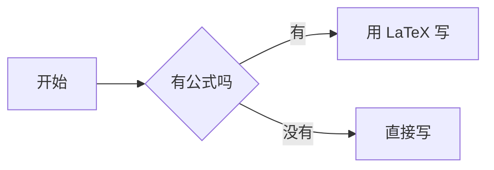

# LyZeroMoon 的技术笔记

基于 [Hexo](https://hexo.io) + [Fluid](https://github.com/fluid-dev/hexo-theme-fluid) 主题的个人博客，通过 GitHub Actions 自动部署到 GitHub Pages。

## 日常写作

新建一篇文章：

```bash
npx hexo new post "my-new-post"
```

文件会生成在 `source/_posts/` 下。**建议文件名用英文**，这样生成的 URL 更干净；中文标题写在文件的 front-matter 里即可：

```yaml
---
title: 中文标题写在这里
date: 2026-10-13 17:00:00
categories:
  - 教程
tags:
  - 标签一
  - 标签二
---
```

## 本地预览

```bash
npx hexo server
```

然后访问 http://localhost:4000 。改动会实时生效，不需要重启。

## 发布

```bash
git add .
git commit -m "post: 新增文章"
git push
```

推送后 GitHub Actions 会自动构建并发布，约 1 分钟后生效。

### 为什么不是「立刻」上线

「发布」实际上提交的是一次 Git commit，之后 GitHub 还要走完整条流水线：

| 阶段 | 大约耗时 |
| --- | --- |
| GitHub 调度运行器（排队） | 5–20 秒 |
| `npm ci` 装依赖 | 2 秒（有缓存） |
| `hexo generate` 全站重建 | 1 秒 |
| 推送到 `gh-pages` | 3 秒 |
| GitHub Pages 再发布一次 | 20–40 秒 |
| CDN 边缘节点同步 | 视地区而定 |

真正构建只占十几秒，**大头是两次排队和 Pages 自身的发布**。这是静态站点托管在 GitHub 上的固有开销，
换成别的纯静态托管（Netlify / Cloudflare Pages）机制也一样。

后台发布后状态栏会实时显示进度（构建中… 已 N 秒 → 已上线），不用对着「约 1 分钟」干等。

## 在线写作后台

浏览器打开 **https://lyzeromoon.github.io/admin/** 即可写作，不用碰命令行。

### 账号与登录

首次打开会让你初始化管理员账号：填账号名、设一个密码、粘贴一次 GitHub Token。
Token 会用密码派生的密钥（PBKDF2-SHA256 600k 迭代 + AES-256-GCM）加密后存进
`source/admin/auth.json`，**明文不会上传**。之后换设备或清了浏览器缓存，只要输密码就能登进后台，
不用再重新生成 Token。

- 初始化时会生成一张**恢复码**，务必抄下来 —— 忘记密码时这是唯一的找回方式
- 「账号设置」里可以改密码、换 Token、重新生成恢复码
- 密码忘了、恢复码也丢了，可以走「改用 Token 直接登录」的应急通道
- 注意：加密后的 auth.json 会随站点公开（仓库是公开的），所以密码要设强一点，别用常见词或生日

### 能做什么

| 功能 | 说明 |
| --- | --- |
| 文章管理 | 新建 / 编辑 / 删除，侧栏搜索，按日期倒序 |
| 笔记管理 | 顶部「笔记」标签，编辑 `source/notes/` 下的参考内容。没有日期、不进归档、排版更紧凑 |
| 链接地址 | **留空即可**，自动按标题生成；中文标题也行，想自定义再手填 |
| 发布进度 | 状态栏实时显示「构建中… 已 N 秒 → 已上线」，不用盲等那 1 分钟 |
| 分类与标签 | 点开就是全站已有值的列表（带篇数），选中即添加；直接输入可新建。分类即「专栏」，两者是同一个东西 |
| 实时预览 | 编辑器与预览双栏，可拖动分栏，也可切「仅编辑 / 仅预览」 |
| Markdown 工具栏 | 加粗、标题、代码块、引用、列表、待办、链接、表格、分隔线、数学公式、流程图 |
| 图片上传 | 直接**粘贴**或**拖入**图片，自动传到 `source/images/` 并插入 Markdown |
| 图片管理 | 顶部「图片」标签，网格预览全部图片，可搜索、复制链接、单张或批量删除，并统计占用空间 |
| 站点概览 | 顶部「概览」标签，文章数 / 总字数 / 分类 / 图片占用，专栏分布条形图与最近更新列表 |
| 关于页 | 顶部「关于页」标签，所见即所得地改 `source/about/index.md` |
| 专栏管理 | 顶部「专栏」标签，可视化编辑 `source/_data/columns.yml`（名称 / 简介 / 图标 / 颜色） |
| 资源库 | 顶部「资源」标签，像文件管理器一样建文件夹、传电子书、添加外部链接，全库搜索，一键发布 |
| front-matter 保真 | 后台只接管标题 / 日期 / 分类 / 标签，其余字段（`comment`、`permalink` 等）原样保留 |
| 草稿保护 | 编辑内容自动暂存在本地，误关页面后重开会提示恢复 |
| 深色模式 | 右上角切换，默认跟随系统 |
| 快捷键 | `Ctrl+S` 发布、`Ctrl+B` 加粗、`Ctrl+I` 斜体、`Ctrl+K` 插链接、`Esc` 关弹窗 |

后台本身是纯静态页面，发布动作直接调用 GitHub Contents API 提交 commit，触发 Actions 自动部署。

## 写数学公式

用 LaTeX 语法，`$...$` 行内、`$$...$$` 独立成块：

```markdown
质能方程 $E = mc^2$ 说的是……

$$
\frac{\partial f}{\partial x_i} = \sum_{j=1}^{n} A_{ij} v_j
$$

$$
\begin{pmatrix} a & b \\ c & d \end{pmatrix}
\begin{pmatrix} x \\ y \end{pmatrix}
=
\begin{pmatrix} ax + by \\ cx + dy \end{pmatrix}
$$
```

渲染由 KaTeX 在**构建时**完成，页面不加载额外脚本，公式随文字一起出现，也不会有渲染闪烁。
后台工具栏的 `∑+` 按钮可以直接插入公式骨架。

> Markdown 渲染器已从默认的 `marked` 换成 `markdown-it` + KaTeX 插件。
> 原因是 `marked` 会把公式里的 `\\`、`_` 当成 Markdown 语法，矩阵、多行推导这类复杂公式会被写坏。
> 换渲染器后既有文章的渲染结果完全一致（只有 `/` 是否转义成 `&#x2F;` 这种无视觉差异的区别）。

### 绝对值、范数里的竖线，直接写就行

`$|a| < 1$`、`$\sum |x[n]|^2$`、`$||x||$` 这些**照常写**，不用做任何转义，表格里也一样。

不过这里有个 Markdown 的经典坑，值得知道原因：**表格是块级语法，在行内解析之前就按 `|` 切列了**。
所以

```markdown
| 写法 | 说明 |
| --- | --- |
| 衰减 | $a^n u[n]$（$|a|<1$） |   ← |a| 的竖线把这一行切成了 5 列
```

这行会被切坏，公式也就配不成对，页面上直接露出 `$`。**跟支不支持行内公式无关** ——
同样一个 `$|a|<1$` 放在段落里一直是正常的。

`scripts/math-pipe-guard.js` 会在构建时自动把公式里的裸竖线换成 LaTeX 的 `\vert`
（视觉上是同一个符号），从根上避开这个问题。它只动 `$...$` 里的内容，
代码块、行内代码、`$$...$$` 块级公式、以及你自己写的 `\|`（双竖线 ‖）全部原样保留。

想手写也没问题，下面几种都是合法的：`$|a|$`、`$\vert a \vert$`、`$\lvert a \rvert$`。

## 写流程图

直接用 `mermaid` 代码块，**不需要**在 front-matter 里加任何字段：

````markdown

````

`scripts/auto-mermaid.js` 会在构建时扫描文章，发现有 `mermaid` 代码块才给这一页加上 mermaid.js（约 800KB），
没有图表的文章不会加载它。所以随便写，不会拖慢其他页面。

后台工具栏的流程图按钮可以直接插入骨架。

## 分类、专栏与标签

**分类和专栏是同一个东西**，不要当成两套体系。专栏页遍历的是 Hexo 的 `site.categories`，
`source/_data/columns.yml` 只是给每个分类配一句简介、一个图标和一个主题色：

- 给文章写一个从没用过的分类 → 它**自动**出现在 `/columns/` 页，用默认样式兜底
- 想让它好看一点 → 去后台「专栏」页补上简介、图标、颜色

**标签**是另一条独立的线，一篇可以有多个，用来横向串起零散的文章。

后台编辑器里这两个字段都是胶囊式选择器：

- 点输入框 → 列出全站已有的值，右边标注被用过几篇
- 直接输入新名字后回车 → 新建（绿色胶囊，提示这是个还没有文章用过的新值）
- 点胶囊上的 `×` 或按退格 → 移除
- 候选列表来自所有文章的 front-matter，是在后台自动补齐并缓存的，
  所以第一次打开可能要等一两秒，之后就是瞬时的

## 文章的链接地址

后台的「链接地址」**留空就行** —— 它会跟着标题自动生成，你不需要现编一个英文文件名。

| 标题 | 自动生成的地址 |
| --- | --- |
| `别再用 for 循环了` | `/2026/10/13/别再用-for-循环了/` |
| `Why Write A Blog` | `/2026/10/13/why-write-a-blog/` |
| `Node.js 入门：从零开始` | `/2026/10/13/nodejs-入门从零开始/` |

中文标题就用中文地址（会和站内标签页一样转成百分号编码，浏览器地址栏里正常显示中文），
比硬凑拼音或英文更可读。想换成更短的英文地址，直接在「链接地址」里手填即可 ——
一旦手填就不再跟随标题，把它清空就又恢复自动生成。

已有文章的地址是**锁定**的，改标题不会改动链接，避免旧链接失效。

## 笔记：不按时间排的内容

文章是**时间线**，笔记是**参考资料**。两边的区别：

| | 文章 `/2026/10/13/xxx/` | 笔记 `/notes/xxx/` |
| --- | --- | --- |
| 有日期 | 有 | 没有 |
| 进归档页 | 是 | 否 |
| 上一篇 / 下一篇 | 有 | 没有 |
| RSS | 收录 | 不收录 |
| 写在 | `source/_posts/` | `source/notes/` |

适合放概念定义、公式速查、方法总结这类东西 —— 它们不该按「什么时候写的」排列。

在写作后台点「笔记」标签就能写。笔记的 front-matter 会自动带上 `layout: note`
和 `permalink: /notes/标题/`，所以地址是干净的 `/notes/xxx/` 而不是 `/notes/xxx.html`。

首页 `/notes/` 是索引页，**按分类分组**自动列出所有笔记（顺序、篇数都是自动算的），
每张卡片显示标题、`description` 字段和标签。所以在后台填一下「简介」很有用。

> 注意：笔记是 Hexo 的 page，不进 `site.categories` / `site.tags`，所以不会出现在
> /categories/ 和 /tags/ 页面里 —— 因为那两页只统计文章。笔记的归类靠索引页的分组，
> 搜索也能搜到（已把搜索索引从 `post` 改成 `all`）。

## 双向链接

在任何文章或笔记里写 `[[另一篇的标题]]`，构建时会变成指向它的链接。也支持自定义显示文字：

```markdown
见 [[离散时间傅里叶变换]] 的定义。

上一篇 [[【数字信号处理DSP】（一）信号周期性判断|周期性怎么判断]] 里提过。
```

标题匹配会忽略大小写和空格，也可以用文件名（`[[DSP_ONE]]`）当别名。

**反向链接**：每个页面底部会自动列出「提到这篇的地方」，带角标区分是文章还是笔记。
不用手动维护任何索引 —— 它是从所有源文件里扫出来的。

**断链**：指向还没写的笔记时，页面上会显示成带虚线的黄色文字（鼠标悬停能看到缺的是哪篇），
同时**构建日志里会汇总成一份待办清单**：

```
↳ 有 1 条被 [[ ]] 指向、但还没写的笔记：
      · 离散时间傅里叶变换  ×1
```

也就是说：你可以先在文章里随手写下 `[[某个概念]]`，等想写了再补上那条笔记，链接会自动接上。

### 实现上的一个坑（改代码前必读）

`scripts/wiki-links.js` 分**两阶段**执行，这不是设计洁癖，是被逼的：

- Hexo 在 `before_generate` 阶段 `locals` **还没加载全** —— 实测 5 篇文章只加载了 2 篇，
  而且漏哪几篇每次还不一样。如果在这个阶段查表换链接，文章一多就会随机漏掉一部分
- 所以阶段一（`before_post_render`）只把 `[[...]]` 换成不依赖索引的占位标记，
  阶段二（`after_render:html`，此时 `locals` 实测是完整的）再解析成真实链接

另外阶段一把 `|` 提前吃掉，顺带避开了「表格把 `[[A|B]]` 里的竖线当列分隔符」的问题。
代码块与行内代码里的 `[[...]]` 一律不动 —— 注意 Hexo 的代码高亮跑在本过滤器之前，
所以代码块到这里时已经是 `<pre><code>` 了，判断逻辑两种形态都要认。

## 资源库（电子书）

`/resources/` 是一个文件管理器样式的页面，用来放电子书和资料：面包屑导航、文件夹磁贴、
网格 / 列表两种视图、按名称 / 时间 / 大小排序，搜索是**跨整个资源库**的（结果里会标出它在哪个文件夹）。

地址用 hash 表示当前目录，所以可以直接把某个文件夹的链接发出去：

```
/resources/            # 资源库根目录
/resources/#/数字信号处理      # 直接打开这个文件夹
```

### 两种条目，展示效果一样

| | 仓库内文件 | 外部链接 |
| --- | --- | --- |
| 存哪 | `source/resources/<文件夹>/` | 你自己的网盘 / 其它站点 |
| 页面上 | 点一下直接下载，PDF 还能在浏览器里看 | 新窗口打开原地址 |
| 大小上限 | 建议 25MB 以内 | 无 |
| 适合 | 小的经典教材、自己整理的讲义 | 几十上百 MB 的大部头 |

**为什么不在仓库里放所有电子书**：git 会永久保留每个历史版本，
删掉一本书仓库体积也不会变小；而且 GitHub 对单文件硬上限是 100MB。
所以后台在 25MB 处就拦下来，引导你填外部链接。真放进去了也能随时删。

### 怎么加内容

打开写作后台的「资源」标签：

- **新建文件夹** —— 支持多层（比如 `数字信号处理/习题解答`）
- **上传文件** —— 进仓库，页面上直接可下载
- **添加链接** —— 只存一条指向外部的记录
- 每条可以填标题、作者、格式、大小、简介、标签；格式和大小在上传时会自动识别

文件夹重命名会**连带改掉里面所有条目的路径**，不会出现「改名后条目消失了」。
删除文件夹时，确认框里会写清楚有几个仓库文件会被一并删除。
注意所有改动都是先在内存里，最后要点「发布资源库」才提交。

### 数据长什么样

清单是一个 JSON：`source/_data/resources.json`（Hexo 的 `_data` 内置支持 `.json`，
用 JSON 而不是 YAML 是为了让后台直接 `JSON.parse`，不必手写解析器）：

```json
{
  "version": 1,
  "folders": [
    { "path": "数字信号处理", "title": "数字信号处理", "desc": "DSP 教材与习题", "order": 1 }
  ],
  "items": [
    {
      "id": "m1x2y3",
      "title": "数字信号处理（第三版）",
      "path": "数字信号处理",
      "author": "程佩青",
      "format": "PDF",
      "size": 18432000,
      "file": "source/resources/数字信号处理/程佩青.pdf",
      "desc": "经典教材，前四章讲 z 变换与 DFT。",
      "tags": ["DSP"],
      "date": "2026-10-14"
    }
  ]
}
```

- `file` 是**仓库路径**（以 `source/` 开头），页面会自动换算成 `/resources/...` 的下载地址；
  填 `link` 则用外部链接。两个都填时优先用仓库文件。
- `folders` 里可以存在**空文件夹**（git 不跟踪空目录，所以这里用清单来记录）。
  就算某个条目的 `path` 指向了没声明的目录，页面也会自动补出那一级，不会把条目藏起来。
- 加新字段不用改代码：前台只读它认识的字段，后台保存时也只写认识的，未知字段会被丢掉。

## 评论

文章评论用 **giscus**，数据存在仓库的 GitHub Discussions 里，不需要数据库和服务器，读者用 GitHub 账号登录即可发言。

- 仓库 Discussions 已开启，分类指向 **General**
- 想只让维护者能新建讨论，可以在仓库 Settings → Discussions 里建一个 **Announcements** 类型的分类，
  再把 `_config.fluid.yml` 里 `giscus.category` / `category-id` 换成它
- 评论跟随站点深浅色自动切换主题
- 单篇文章想关评论，在 front-matter 写 `comment: false`

## 订阅与收录

- `/atom.xml` — RSS/Atom 订阅源，页面 `<head>` 里已带自动发现标签，阅读器能直接识别
- `/sitemap.xml` — 站点地图，可提交到 Google Search Console 或百度搜索资源平台加速收录
- 页脚有 RSS 入口

## 项目结构

```
├── _config.yml            # 站点主配置（标题、作者、URL、RSS、站点地图、Markdown 渲染器）
├── _config.fluid.yml      # 主题配置（导航、样式、公式、图表、评论等开关）
├── scripts/
│   ├── auto-mermaid.js    # 构建时自动检测 Mermaid 代码块并启用渲染脚本
│   ├── math-pipe-guard.js # 把公式里的裸竖线换成 \vert，避免被表格语法切断
│   └── wiki-links.js      # 双向链接 [[...]] 的解析与反向链接统计
├── source/
│   ├── _posts/            # 文章（Markdown，按时间排）
│   ├── notes/             # 笔记（Markdown，不按时间排，首页 index.md 是索引）
│   ├── resources/         # 资源库页面 + 上传进来的电子书本体
│   ├── _data/columns.yml  # 专栏页配置（后台「专栏」标签可视化编辑）
│   ├── _data/resources.json # 资源库清单（后台「资源」标签可视化编辑）
│   ├── about/             # 关于页（后台「关于页」标签可在线编辑）
│   ├── admin/             # 在线写作后台（单文件 SPA，含加密账号系统）
│   ├── css/kb.css         # 知识库样式（双向链接、笔记页、反向链接）
│   ├── css/resources.css  # 资源库样式（只由资源页引入）
│   ├── js/resources.js    # 资源库页面的交互（只由资源页引入）
│   ├── columns/           # 专栏页
│   ├── images/            # 后台插入的图片（后台「图片」标签可管理）
│   ├── categories/        # 分类页
│   └── tags/              # 标签页
├── themes/fluid/          # 主题文件（已随仓库提交）
└── .github/workflows/     # 自动部署配置
```

## 常用配置位置

| 想改什么 | 改哪里 |
| --- | --- |
| 博客名称、副标题、作者、URL | `_config.yml` |
| RSS / 站点地图 | `_config.yml` 的 `feed` / `sitemap` 段 |
| 公式与图表的渲染开关 | `_config.fluid.yml` 的 `post.math` / `post.mermaid` 段 |
| 评论（giscus）仓库与分类 | `_config.fluid.yml` 的 `giscus` 段 |
| 双向链接的标题匹配规则、反向链接文案 | `scripts/wiki-links.js` |
| 笔记页 / 反向链接的外观 | `source/css/kb.css` |
| 笔记索引页的分组与卡片 | `themes/fluid/layout/notes.ejs` |
| 资源库清单（文件夹 / 条目） | `source/_data/resources.json`，或用后台「资源」标签 |
| 资源库页面外观 | `source/css/resources.css` |
| 资源库页面交互、视图与排序 | `source/js/resources.js` |
| 资源库上传的大小上限 | `source/admin/index.html` 的 `CFG.maxResBytes`（默认 25MB） |
| 导航菜单、首页标语、社交图标 | `_config.fluid.yml` |
| 主题配色、暗色模式 | `_config.fluid.yml` 的 `color` / `dark_mode` 段 |
| 代码块样式、行号、复制按钮 | `_config.fluid.yml` 的 `code` 段 |

## 首次部署前置设置

在 GitHub 仓库的 **Settings → Pages** 中，把 **Source** 设为 `Deploy from a branch`，分支选择 **gh-pages**、目录选 **/(root)**，保存即可。

之后每次 push 到 `main` 分支，Actions 会重新构建并把结果推送到 `gh-pages` 分支。
