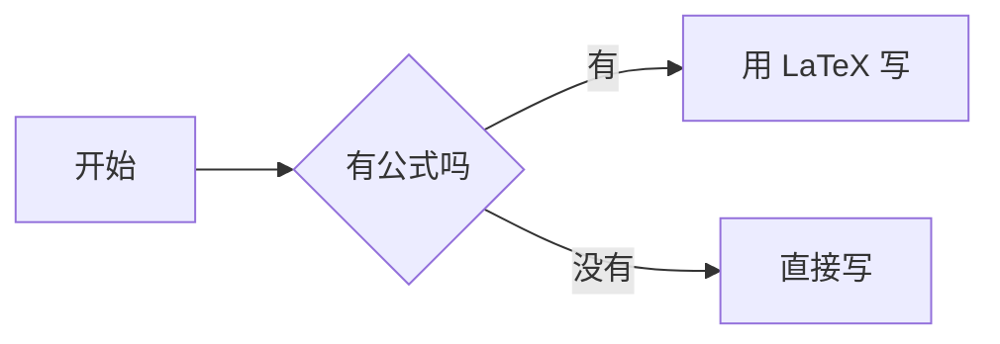

# LyZeroMoon 的技术笔记

基于 [Hexo](https://hexo.io) + [Fluid](https://github.com/fluid-dev/hexo-theme-fluid) 主题的个人博客，通过 GitHub Actions 自动部署到 GitHub Pages。

## 日常写作

新建一篇文章：

```bash
npx hexo new post "my-new-post"
```

文件会生成在 `source/_posts/` 下。**建议文件名用英文**，这样生成的 URL 更干净；中文标题写在文件的 front-matter 里即可：

```yaml
---
title: 中文标题写在这里
date: 2026-10-13 17:00:00
categories:
  - 教程
tags:
  - 标签一
  - 标签二
---
```

## 本地预览

```bash
npx hexo server
```

然后访问 http://localhost:4000 。改动会实时生效，不需要重启。

## 发布

```bash
git add .
git commit -m "post: 新增文章"
git push
```

推送后 GitHub Actions 会自动构建并发布，约 1 分钟后生效。

### 为什么不是「立刻」上线

「发布」实际上提交的是一次 Git commit，之后 GitHub 还要走完整条流水线：

| 阶段 | 大约耗时 |
| --- | --- |
| GitHub 调度运行器（排队） | 5–20 秒 |
| `npm ci` 装依赖 | 2 秒（有缓存） |
| `hexo generate` 全站重建 | 1 秒 |
| 推送到 `gh-pages` | 3 秒 |
| GitHub Pages 再发布一次 | 20–40 秒 |
| CDN 边缘节点同步 | 视地区而定 |

真正构建只占十几秒，**大头是两次排队和 Pages 自身的发布**。这是静态站点托管在 GitHub 上的固有开销，
换成别的纯静态托管（Netlify / Cloudflare Pages）机制也一样。

后台发布后状态栏会实时显示进度（构建中… 已 N 秒 → 已上线），不用对着「约 1 分钟」干等。

## 在线写作后台

浏览器打开 **https://lyzeromoon.github.io/admin/** 即可写作，不用碰命令行。

### 账号与登录

首次打开会让你初始化管理员账号：填账号名、设一个密码、粘贴一次 GitHub Token。
Token 会用密码派生的密钥（PBKDF2-SHA256 600k 迭代 + AES-256-GCM）加密后存进
`source/admin/auth.json`，**明文不会上传**。之后换设备或清了浏览器缓存，只要输密码就能登进后台，
不用再重新生成 Token。

- 初始化时会生成一张**恢复码**，务必抄下来 —— 忘记密码时这是唯一的找回方式
- 「账号设置」里可以改密码、换 Token、重新生成恢复码
- 密码忘了、恢复码也丢了，可以走「改用 Token 直接登录」的应急通道
- 注意：加密后的 auth.json 会随站点公开（仓库是公开的），所以密码要设强一点，别用常见词或生日

### 能做什么

| 功能 | 说明 |
| --- | --- |
| 文章管理 | 新建 / 编辑 / 删除，侧栏搜索，可选排序：按标题（中文一二三）/ 最新在前 / 最早在前 |
| 常用公式 | 顶部「常用公式」标签，编辑 `source/notes/` 下的参考内容。没有日期、不进归档，版式与文章一致 |
| 链接地址 | **留空即可**，自动按标题生成；中文标题也行，想自定义再手填 |
| 发布进度 | 状态栏实时显示「构建中… 已 N 秒 → 已上线」，不用盲等那 1 分钟 |
| 分类与标签 | 点开就是全站已有值的列表（带篇数），选中即添加；直接输入可新建。分类即「专栏」，两者是同一个东西 |
| 实时预览 | 编辑器与预览双栏，可拖动分栏，也可切「仅编辑 / 仅预览」。**公式在预览里就是渲染好的**（和站点最终排版一致） |
| Markdown 工具栏 | 加粗、标题、代码块、引用、列表、待办、链接、表格、分隔线、数学公式、流程图 |
| 图片上传 | 直接**粘贴**或**拖入**图片，自动传到 `source/images/` 并插入 Markdown |
| 图片管理 | 顶部「图片」标签，网格预览全部图片，可搜索、复制链接、单张或批量删除，并统计占用空间 |
| 站点概览 | 顶部「概览」标签，文章数 / 总字数 / 分类 / 图片占用，专栏分布条形图与最近更新列表 |
| 关于页 | 顶部「关于页」标签，所见即所得地改 `source/about/index.md` |
| 专栏管理 | 顶部「专栏」标签，可视化编辑 `source/_data/columns.yml`（名称 / 简介 / 图标 / 颜色） |
| 资源库 | 顶部「资源」标签，像文件管理器一样建文件夹、传电子书、添加外部链接，全库搜索，一键发布 |
| 小游戏 | 顶部「游戏」标签，开关整站小游戏、指定游戏中心的首位推荐、逐款启停 / 调序 / 改文案，一键发布 |
| front-matter 保真 | 后台只接管标题 / 日期 / 分类 / 标签，其余字段（`comment`、`permalink` 等）原样保留 |
| 草稿保护 | 编辑内容自动暂存在本地，误关页面后重开会提示恢复 |
| 深色模式 | 右上角切换，默认跟随系统 |
| 界面风格（皮肤） | 顶部「外观」标签，挑一套作默认、决定访客能否自己换。站点自带 10 套皮肤，访客用右上角的画笔按钮切换 |
| 快捷键 | `Ctrl+S` 发布、`Ctrl+B` 加粗、`Ctrl+I` 斜体、`Ctrl+K` 插链接、`Esc` 关弹窗 |

后台本身是纯静态页面，发布动作直接调用 GitHub Contents API 提交 commit，触发 Actions 自动部署。

### 侧栏列表的排序

侧栏默认按**标题**排，选择会记在本地，下次打开还是上次那个。

标题排序对中文是按拼音比的，但**中文数字会先换算成数值**再比：

```
【数字信号处理DSP】（一）…      ← 纯拼音比会把「（二）」排到「（一）」前面，
【数字信号处理DSP】（二）…         因为 二 èr 比 一 yī 靠前，正好是反的
【数字信号处理DSP】（三）…      ← 换算成 1/2/3 之后才是对的
```

「十」也会排在「九」后面（10 > 9），不是按拼音的 shí 去比。

另外两个选项是「新→旧」「旧→新」，按 front-matter 的 `date` 排，同一天再按标题。

## 写数学公式

用 LaTeX 语法，`$...$` 行内、`$$...$$` 独立成块：

```markdown
质能方程 $E = mc^2$ 说的是……

$$
\frac{\partial f}{\partial x_i} = \sum_{j=1}^{n} A_{ij} v_j
$$

$$
\begin{pmatrix} a & b \\ c & d \end{pmatrix}
\begin{pmatrix} x \\ y \end{pmatrix}
=
\begin{pmatrix} ax + by \\ cx + dy \end{pmatrix}
$$
```

渲染由 KaTeX 在**构建时**完成，页面不加载额外脚本，公式随文字一起出现，也不会有渲染闪烁。
后台工具栏的 `∑+` 按钮可以直接插入公式骨架。

> Markdown 渲染器已从默认的 `marked` 换成 `markdown-it` + KaTeX 插件。
> 原因是 `marked` 会把公式里的 `\\`、`_` 当成 Markdown 语法，矩阵、多行推导这类复杂公式会被写坏。
> 换渲染器后既有文章的渲染结果完全一致（只有 `/` 是否转义成 `&#x2F;` 这种无视觉差异的区别）。

### LaTeX 的 `\[...\]` / `\(...\)` 也认

KaTeX 的 markdown-it 插件原生只支持 `$...$` 和 `$$...$$`，但 `\[ ... \]` 和 `\( ... \)`
是 LaTeX 文档里更常见的写法，多数编辑器和 AI 输出公式时用的也是这一套。所以这两种也能直接写：

```markdown
行内写法 \(E = mc^2\) 和 $E = mc^2$ 等价。

\[
\int_{-\infty}^{\infty} e^{-x^2}\,dx = \sqrt{\pi}
\]
```

`scripts/math-delims.js` 会在构建时把它们改写成 `$...$` / `$$...$$`。

> 这一步不只是「方便」。Markdown 会先把 `\[` 当成**转义的方括号**吃掉 —— `\[` 变 `[`、`\(` 变 `(`，
> 连 `\,` 都会变成 `,`（逗号是 ASCII 标点，属于 CommonMark 的可转义字符）。
> 也就是说公式会先被拆散，之后无论怎么补都救不回来，
> 页面上只剩「`[ X(z)=\sum x[n],z^{-n} ]`」这种看不懂的东西。所以必须在解析之前改写。

### 后台的预览也是渲染好的

在线写作后台的预览用的是浏览器的 `marked`，跟站点构建期的渲染器不是同一个。
如果什么都不做，预览里就会出现「公式还是一堆美元符号加反斜杠」的情况 ——
更糟的是 `marked` 会把 `\[`、`\(`、`\,` 按 Markdown 转义规则吃掉，看起来像公式写错了。

所以后台在把正文交给 `marked` **之前**，先把公式整段抠成占位符，等 `marked` 跑完再塞回 KaTeX 的结果，
行为和站点的 `scripts/math-delims.js` 对齐。两种分隔符、代码块里的公式、表格里的竖线都按同一套规则处理，
所以**预览里公式长什么样，发出去就是什么样**。

KaTeX 从 CDN 懒加载（和站点同源的 `lib.baomitu.com`），只有正文里真的出现公式时才去拿；
万一拿不到（离线、CDN 挂了），公式会退化成带虚线的代码块，鼠标悬停能看到原因，不影响继续写。

### 绝对值、范数里的竖线，直接写就行

`$|a| < 1$`、`$\sum |x[n]|^2$`、`$||x||$` 这些**照常写**，不用做任何转义，表格里也一样。

不过这里有个 Markdown 的经典坑，值得知道原因：**表格是块级语法，在行内解析之前就按 `|` 切列了**。
所以

```markdown
| 写法 | 说明 |
| --- | --- |
| 衰减 | $a^n u[n]$（$|a|<1$） |   ← |a| 的竖线把这一行切成了 5 列
```

这行会被切坏，公式也就配不成对，页面上直接露出 `$`。**跟支不支持行内公式无关** ——
同样一个 `$|a|<1$` 放在段落里一直是正常的。

`scripts/math-pipe-guard.js` 会在构建时自动把公式里的裸竖线换成 LaTeX 的 `\vert`
（视觉上是同一个符号），从根上避开这个问题。它只动 `$...$` 里的内容，
代码块、行内代码、`$$...$$` 块级公式、以及你自己写的 `\|`（双竖线 ‖）全部原样保留。

想手写也没问题，下面几种都是合法的：`$|a|$`、`$\vert a \vert$`、`$\lvert a \rvert$`。

## 写流程图

直接用 `mermaid` 代码块，**不需要**在 front-matter 里加任何字段：

````markdown

````

`scripts/auto-mermaid.js` 会在构建时扫描文章，发现有 `mermaid` 代码块才给这一页加上 mermaid.js（约 800KB），
没有图表的文章不会加载它。所以随便写，不会拖慢其他页面。

后台工具栏的流程图按钮可以直接插入骨架。

## 分类、专栏与标签

**分类和专栏是同一个东西**，不要当成两套体系。专栏页遍历的是 Hexo 的 `site.categories`，
`source/_data/columns.yml` 只是给每个分类配一句简介、一个图标和一个主题色：

- 给文章写一个从没用过的分类 → 它**自动**出现在 `/columns/` 页，用默认样式兜底
- 想让它好看一点 → 去后台「专栏」页补上简介、图标、颜色

**标签**是另一条独立的线，一篇可以有多个，用来横向串起零散的文章。

后台编辑器里这两个字段都是胶囊式选择器：

- 点输入框 → 列出全站已有的值，右边标注被用过几篇
- 直接输入新名字后回车 → 新建（绿色胶囊，提示这是个还没有文章用过的新值）
- 点胶囊上的 `×` 或按退格 → 移除
- 候选列表来自所有文章的 front-matter，是在后台自动补齐并缓存的，
  所以第一次打开可能要等一两秒，之后就是瞬时的

## 文章的链接地址

后台的「链接地址」**留空就行** —— 它会跟着标题自动生成，你不需要现编一个英文文件名。

| 标题 | 自动生成的地址 |
| --- | --- |
| `别再用 for 循环了` | `/2026/10/13/别再用-for-循环了/` |
| `Why Write A Blog` | `/2026/10/13/why-write-a-blog/` |
| `Node.js 入门：从零开始` | `/2026/10/13/nodejs-入门从零开始/` |

中文标题就用中文地址（会和站内标签页一样转成百分号编码，浏览器地址栏里正常显示中文），
比硬凑拼音或英文更可读。想换成更短的英文地址，直接在「链接地址」里手填即可 ——
一旦手填就不再跟随标题，把它清空就又恢复自动生成。

已有文章的地址是**锁定**的，改标题不会改动链接，避免旧链接失效。

## 常用公式：不按时间排的内容

文章是**时间线**，「常用公式」是**参考资料**。两边的区别：

| | 文章 `/2026/10/13/xxx/` | 常用公式 `/notes/xxx/` |
| --- | --- | --- |
| 有日期 | 有 | 没有 |
| 进归档页 | 是 | 否 |
| 上一篇 / 下一篇 | 有 | 没有 |
| RSS | 收录 | 不收录 |
| 写在 | `source/_posts/` | `source/notes/` |

适合放公式表、性质速查、方法总结这类东西 —— 它们不该按「什么时候写的」排列。

在写作后台点「常用公式」标签就能写。它的 front-matter 会自动带上 `layout: note`
和 `permalink: /notes/标题/`，所以地址是干净的 `/notes/xxx/` 而不是 `/notes/xxx.html`。

> 版式上和文章**完全一样**（同一条栅格），这点是有意为之：`note.ejs` 自带整幅栅格
> （`container-fluid > row > col-lg-8 > #board`），所以 `layout.ejs` 里它必须和文章
> 一样走「直接输出 body」那条分支。否则会被外面再套一层 `col-12 col-md-10`，
> 正文被压成 `10/12 × 8/12` ≈ 55%，还会出现两个 `id="board"`。

索引页 `/notes/` **按分类分组**自动列出所有条目（顺序、篇数都是自动算的），
每张卡片显示标题、`description` 字段和标签。所以在后台填一下「简介」很有用。

> 注意：它是 Hexo 的 page，不进 `site.categories` / `site.tags`，所以不会出现在
> /categories/ 和 /tags/ 页面里 —— 因为那两页只统计文章。归类靠索引页的分组，
> 搜索也能搜到（已把搜索索引从 `post` 改成 `all`）。

## 双向链接

在任何文章或常用公式里写 `[[另一篇的标题]]`，构建时会变成指向它的链接。也支持自定义显示文字：

```markdown
见 [[离散时间傅里叶变换]] 的定义。

上一篇 [[【数字信号处理DSP】（一）信号周期性判断|周期性怎么判断]] 里提过。
```

标题匹配会忽略大小写和空格，也可以用文件名（`[[DSP_ONE]]`）当别名。

**反向链接**：每个页面底部会自动列出「提到这篇的地方」，带角标区分是文章还是常用公式。
不用手动维护任何索引 —— 它是从所有源文件里扫出来的。

**断链**：指向还没写的内容时，页面上会显示成带虚线的黄色文字（鼠标悬停能看到缺的是哪篇），
同时**构建日志里会汇总成一份待办清单**：

```
↳ 有 1 条被 [[ ]] 指向、但还没写的条目：
      · 离散时间傅里叶变换  ×1
```

也就是说：你可以先在文章里随手写下 `[[某个概念]]`，等想写了再补上那一页，链接会自动接上。

### 实现上的一个坑（改代码前必读）

`scripts/wiki-links.js` 分**两阶段**执行，这不是设计洁癖，是被逼的：

- Hexo 在 `before_generate` 阶段 `locals` **还没加载全** —— 实测 5 篇文章只加载了 2 篇，
  而且漏哪几篇每次还不一样。如果在这个阶段查表换链接，文章一多就会随机漏掉一部分
- 所以阶段一（`before_post_render`）只把 `[[...]]` 换成不依赖索引的占位标记，
  阶段二（`after_render:html`，此时 `locals` 实测是完整的）再解析成真实链接

另外阶段一把 `|` 提前吃掉，顺带避开了「表格把 `[[A|B]]` 里的竖线当列分隔符」的问题。
代码块与行内代码里的 `[[...]]` 一律不动 —— 注意 Hexo 的代码高亮跑在本过滤器之前，
所以代码块到这里时已经是 `<pre><code>` 了，判断逻辑两种形态都要认。

## 资源库（电子书）

`/resources/` 是一个文件管理器样式的页面，用来放电子书和资料：面包屑导航、文件夹磁贴、
网格 / 列表两种视图、按名称 / 时间 / 大小排序，搜索是**跨整个资源库**的（结果里会标出它在哪个文件夹）。

地址用 hash 表示当前目录，所以可以直接把某个文件夹的链接发出去：

```
/resources/            # 资源库根目录
/resources/#/数字信号处理      # 直接打开这个文件夹
```

### 两种条目，展示效果一样

| | 仓库内文件 | 外部链接 |
| --- | --- | --- |
| 存哪 | `source/resources/<文件夹>/` | 你自己的网盘 / 其它站点 |
| 页面上 | 点一下直接下载，PDF 还能在浏览器里看 | 新窗口打开原地址 |
| 大小上限 | **38MB**（实测） | 无 |
| 适合 | 小的经典教材、自己整理的讲义 | 几十上百 MB 的大部头 |

**为什么上限是 38MB，而不是「GitHub 的 100MB」**：这两条路的限制不是一回事。

后台是从浏览器直接调 GitHub 的 Contents API 提交的，这条路的瓶颈在 **API 网关对请求体大小的限制**，
不在仓库。2026-10-14 在本仓库实测（用临时分支，不影响 main）：

| 文件大小 | 请求体 | 结果 |
| --- | --- | --- |
| 20 / 26 / 30 / 32 / 34 / 36 / 38 MB | 27–51 MB | ✅ 201 |
| 39 MB | 52 MB | ❌ 502 Server Error |
| 40 MB 以上 | 53 MB+ | ❌ 422 `the file is too large to be processed` |

墙体在 40,000,000 字节附近。所以后台把上限设成实测通过的最大值 38MB，
超过就引导你填外部链接 —— 页面上两种条目展示效果完全一样。

如果你确实要把更大的书放进仓库，只有一条路：**在本地用 git push**（那条路的上限才是 100MB，
超 50MB 时 git 会警告但能推上去）。代价是仓库体积永久增长，而且
**git 会保留每个历史版本 —— 以后删掉这本书，仓库也不会变小**。

> 顺带排除掉了一个想法：把大文件放到 GitHub Releases 的附件里（那边单文件能到 2GB）。
> 实测 `uploads.github.com` 的响应里**没有** `Access-Control-Allow-Origin`，
> 也就是浏览器端的 CORS 不给过，纯静态后台根本调不动它，这条路堵死。

其他几个不会马上碰到、但迟早会撞上的限制（都是 GitHub 侧的）：

- 仓库建议 **< 1GB**（超过会收到 GitHub 的邮件，让你清理）
- 已发布的 Pages 站点 **≤ 1GB**
- Pages 带宽 **100GB/月**（软限制）
- 单次部署超 **10 分钟**会超时 —— 仓库越大，Actions 的 checkout + 构建越慢

### 怎么加内容

打开写作后台的「资源」标签：

- **新建文件夹** —— 支持多层（比如 `数字信号处理/习题解答`）
- **上传文件** —— 进仓库，页面上直接可下载
- **添加链接** —— 只存一条指向外部的记录
- 每条可以填标题、作者、格式、大小、简介、标签；格式和大小在上传时会自动识别

文件夹重命名会**连带改掉里面所有条目的路径**，不会出现「改名后条目消失了」。
删除文件夹时，确认框里会写清楚有几个仓库文件会被一并删除。
注意所有改动都是先在内存里，最后要点「发布资源库」才提交。

### 数据长什么样

清单是一个 JSON：`source/_data/resources.json`（Hexo 的 `_data` 内置支持 `.json`，
用 JSON 而不是 YAML 是为了让后台直接 `JSON.parse`，不必手写解析器）：

```json
{
  "version": 1,
  "folders": [
    { "path": "数字信号处理", "title": "数字信号处理", "desc": "DSP 教材与习题", "order": 1 }
  ],
  "items": [
    {
      "id": "m1x2y3",
      "title": "数字信号处理（第三版）",
      "path": "数字信号处理",
      "author": "程佩青",
      "format": "PDF",
      "size": 18432000,
      "file": "source/resources/数字信号处理/程佩青.pdf",
      "desc": "经典教材，前四章讲 z 变换与 DFT。",
      "tags": ["DSP"],
      "date": "2026-10-14"
    }
  ]
}
```

- `file` 是**仓库路径**（以 `source/` 开头），页面会自动换算成 `/resources/...` 的下载地址；
  填 `link` 则用外部链接。两个都填时优先用仓库文件。
- `folders` 里可以存在**空文件夹**（git 不跟踪空目录，所以这里用清单来记录）。
  就算某个条目的 `path` 指向了没声明的目录，页面也会自动补出那一级，不会把条目藏起来。
- 加新字段不用改代码：前台只读它认识的字段，后台保存时也只写认识的，未知字段会被丢掉。

## 小游戏

导航栏上有「小游戏」，点进去是 `/games/`：几款能**直接在页面上开一局**的经典游戏，不跳转、不注册、没有广告。

| 游戏 | 玩法 | 操作 |
| --- | --- | --- |
| 贪吃蛇 | 吃到食物变长，撞墙或咬到自己结束；每吃五个提速一档 | 方向键 / `WASD`，手机划屏幕 |
| 2048 | 滑动合并相同数字，凑出 2048；凑出来不会结束，可以继续往 4096 冲 | 方向键 / 划屏幕 |
| 俄罗斯方块 | 七种方块往下降，转好位置填满整行消除；每 10 行升一级 | 左右移动 · 上键旋转 · 下键速降 · 空格落底 |
| 打砖块 | 挡板接住小球敲掉整面砖墙，三条命，敲空就过关 | 左右键 / 在画面里拖动 · 空格发球 |
| 扫雷 | 数字表示周围有几颗雷，把安全格全翻开 | 左键翻格 · 右键或长按插旗 |

**最高分记在这台设备上**（浏览器 `localStorage`），没有账号也没有排行榜。扫雷比的是**用时**，越短越好。

### 站主怎么管

后台顶部「游戏」标签 → 改完点「发布游戏设置」，等构建走完生效。能做的：

- **总开关**：关掉之后导航栏的「小游戏」入口和 `/games/` 页面一起消失（不会留一个点进去空空如也的死链接）
- **放到首位**：卡片上带「推荐」角标，也是街机皮肤那个摇杆快捷入口直接开的那一款
- **逐款启停 / 上下调序 / 改文案**（名称、简介、操作提示、标签、卡片主色）
- **移除**：只是从这个清单里去掉，`source/js/games/<id>.js` 不会被删 —— 想加回来点「添加一款」填回同一个 id 就行

配置存在 `source/_data/games.json`，前台有两处读它：`games.ejs` 服务端渲染卡片，`head.ejs` 把清单注入 `window.LY_GAMES`。**后台是唯一写入方**，手工改文件也可以，但「游戏」页保存一次就会按自己的理解重整一遍格式。

⚠️ **`id` 不是普通文案**：它是脚本文件名（`js/games/<id>.js`），也是最高分的存储键（`ly_game_best_<id>`）。所以只允许小写字母/数字/`-`/`_`，而且出过成绩之后就不要改 —— 想换名字改「显示名称」。

### 再加一款游戏

每款游戏就是一个文件，加一款 = 写一个文件 + 在后台登记一条：

1. 在 `source/js/games/` 新建 `<id>.js`，写纯逻辑 + 调一次 `LY_GAME_KIT.register({...})`（照着 `snake.js` 抄最快）
2. 后台「游戏」→「添加一款」→ 填 `id`、名称、简介、操作提示
3. 发布。静态校验会检查「清单里的每一款都有同名脚本文件」，漏了会直接报出来

引擎（`games/kit.js`）负责所有跟玩法无关的事：机台外壳、HUD、遮罩文案、方向键面板、rAF 循环、键盘 / 滑动 / 指针输入、最高分持久化、`Esc` 关闭。游戏只要实现 `create / reset / draw / over / bestValue`（外加 `tick` 或 `step`）就行。**逻辑与渲染必须分开**，这样规则能脱离浏览器测试 —— 目前这些游戏的规则是这样测的。

### 为什么不卡

- 首页、每篇文章只多下载 `js/games-hub.js`（7KB，gzip 后 2.9KB）和一段几百字节的清单 JSON。**引擎（22KB / gzip 7.5KB）、每一款游戏、机台样式（12KB / gzip 3.8KB）都要等你真的点开某一款才下载**
- 没有游戏卡片的页面连引擎预热都不会触发（`boot()` 会先数卡片）
- 样式故意**不等它加载完**：`<link>` 一插进去就继续开机台。晚到顶多闪一下原始样子，等它万一样式请求挂住，会把「点开游戏」一起卡死
- 机台样式只由游戏中心页和「第一次开游戏」引入，不挂全站 `custom_css`

## 界面风格（皮肤）

站点自带 10 套风格，访客点右上角的**画笔按钮**就能换。选择记在浏览器本地（`localStorage`），只影响他自己。

前 6 套是「换配色 + 调排版」，后 4 套是**结构性**的 —— 不只是换颜色，窗口形状、装饰、字体体系都换了。

| 皮肤 | 风格 | 结构上做了什么 |
| --- | --- | --- |
| 经典 | Fluid 原味，零覆盖 | — |
| 墨韵 | 暖纸底、衬线字、朱砂点缀 | 细边框、3px 圆角、衬线正文 |
| 深海 | 深蓝夜色，为长时间阅读而调 | 8px 圆角、大投影 |
| 玻璃 | 毛玻璃卡片 + 渐变背景 | `backdrop-filter` 毛玻璃、18px 圆角 |
| 樱雾 | 粉紫柔和，轻盈通透 | 14px 圆角、粉调分隔线 |
| 终端 | 等宽字体与磷光绿，极客风 | 全站等宽、虚线标题、2px 直角 |
| **复古** | Windows 95 视窗 | 银灰窗口 + 双层 3D 边框、蓝渐变标题栏与关闭按钮、白色凹陷「客户区」、16px 立体滚动条、Tahoma/宋体 |
| **街机** | 霓虹机台 + CRT 扫描线 | 全屏扫描线覆盖层、四角 L 形角标、霓虹辉光标题、等宽大写标题、导航栏多一个「直接开一局」的摇杆入口 |
| **杂志** | 编辑式排版 | 衬线大字、首字下沉、悬挂引号、窄栏宽（40rem）、细线分隔的目录式列表 |
| **赛博** | 网格底纹 + 切角面板 + 霓虹辉光 | 双向网格背景、L 形角标、标题左侧霓虹条、品牌名双色偏移描边 |

**默认给谁看**由站主决定：后台顶部「外观」标签 → 选一套 → 「发布外观设置」。

- 没挑过的访客看到「默认」那一套；挑过的访客下次来还是他自己那套（面板里有「恢复默认」可以回到站点默认）
- 不想让访客换，把「允许访客自己切换风格」关掉 —— 导航栏上的画笔按钮整个消失
- 每套皮肤都能单独停用。停用只是从切换器里藏起来，配置还在，随时开回来
- 「经典」是兜底皮肤，锁着不能停用：它是唯一的零覆盖方案，别的皮肤出问题时还有退路
- 街机 / 赛博是**故意的深色皮肤**，明暗两态之间只做亮度差（街机厅和赛博朋克没有日间版）；其余皮肤都严格跟随明暗切换

### 街机皮肤多出来的那个摇杆

选到「街机」时，导航栏会多出一个**摇杆图标**（移动端在网格菜单里叫「开一局」）。它和「小游戏」板块是两回事：点它是**直接开一局**（开的是游戏中心里排第一的那款），省掉「先跳列表再点一次」。机台样式和游戏本身见下面的「小游戏」一节。

### 怎么实现的

Fluid 把配色收敛在 `main.css` 的 `:root` 上 —— 22 个 CSS 自定义属性（`--body-bg-color`、`--board-bg-color`、`--navbar-bg-color` …），所有子布局都靠 `var()` 取值。

所以**换皮肤 = 用更高的特异性重新赋值这组变量**，一个主题类都不用改。`source/css/skins.css` 里每套皮肤要写三处：

```css
:root[data-ui="ink"] { … }                                   /* 明色 */
:root[data-ui="ink"]:not([data-user-color-scheme]) { … }      /* 自动暗色 */
@media not print {
  :root[data-ui="ink"][data-user-color-scheme="dark"] { … }    /* 手动 / 系统暗色 */
}
```

漏掉后两条就会出现「切了暗色皮肤没跟上」。皮肤靠 `<html data-ui="…">` 选中，写入它的是两处：`themes/fluid/layout/_partials/head.ejs` 里的**内联脚本**（排在样式表之前，防首屏闪烁）和 `source/js/skins.js`（点击切换时）。

> 别去覆盖 `--color-mode`：主题靠它做 `prefers-color-scheme` 探测。

想加一套皮肤：复制 `skins.css` 里任意一节改配色，再到 `source/_data/ui.json` 的 `skins` 数组追加一条同名记录（后台读的就是这份清单）。

结构性皮肤允许在同一个选择器上写**多个块**（复古就把「结构色」和「主题色」拆成了两块 `:root[data-ui="retro"]`），自定义属性是按元素计算的，所以凸起/凹陷那两组组合式变量会自动跟着暗色块里覆盖的边色变。

几个踩过的点：

- 双层 3D 边框用 `inset box-shadow` 两两配对画（`#0a0a0a` 配 `#ffffff`、`#808080` 配 `#dfdfdf`），凸起和凹陷就是这两对颜色对调。同一个 `box-shadow` 里混用 `inset` 和外阴影是合法的，所以还能再叠一层投影
- 复古的窗口标题栏是 `#board::before`，文字来自 CSS 变量 `--ly-site-title` —— 站点名由 `head.ejs` 用 `JSON.stringify` 转成合法的 CSS 字符串字面量塞进去（`content` 读不到站点配置，这是绕法）
- 街机 / 赛博的四角切角**不用 `clip-path`**：`clip-path` 会把 `box-shadow` 的光晕一起裁掉。改用伪元素画 L 形角标，既不裁内容也不裁阴影
- 复古的 `#board` 必须写 `margin-top: … !important` —— 主题在窄屏给 `#board` 挂了 `margin-top: !important`，还可能在 `layout.ejs` 里内联 `style="margin-top: 0"`

### 顺带修掉的一个问题

`kb.css`（双向链接 / 常用公式页）和 `resources.css`（资源页）原本是硬编码颜色，还各写了一整套 `[data-color-scheme="dark"]` 暗色规则 —— 但主题注入的属性叫 **`data-user-color-scheme`**，那批规则**从来没生效过**（也就是说资源页在暗色下一直是亮色硬编码）。

现在这两个文件统一改走主题变量，层次色用 `color-mix()` 现算，于是暗色模式修好了、10 套皮肤也自动跟随，资源页那 55 条失效规则直接删掉。

## 评论

文章评论用 **giscus**，数据存在仓库的 GitHub Discussions 里，不需要数据库和服务器，读者用 GitHub 账号登录即可发言。

- 仓库 Discussions 已开启，分类指向 **General**
- 想只让维护者能新建讨论，可以在仓库 Settings → Discussions 里建一个 **Announcements** 类型的分类，
  再把 `_config.fluid.yml` 里 `giscus.category` / `category-id` 换成它
- 评论跟随站点深浅色自动切换主题
- 单篇文章想关评论，在 front-matter 写 `comment: false`

## 订阅与收录

- `/atom.xml` — RSS/Atom 订阅源，页面 `<head>` 里已带自动发现标签，阅读器能直接识别
- `/sitemap.xml` — 站点地图，可提交到 Google Search Console 或百度搜索资源平台加速收录
- 页脚有 RSS 入口

## 项目结构

```
├── _config.yml            # 站点主配置（标题、作者、URL、RSS、站点地图、Markdown 渲染器）
├── _config.fluid.yml      # 主题配置（导航、样式、公式、图表、评论等开关）
├── scripts/
│   ├── auto-mermaid.js    # 构建时自动检测 Mermaid 代码块并启用渲染脚本
│   ├── math-delims.js     # 把 LaTeX 的 \[...\] / \(...\) 改写成 $$...$$ / $...$（必须赶在解析前）
│   ├── math-pipe-guard.js # 把公式里的裸竖线换成 \vert，避免被表格语法切断
│   └── wiki-links.js      # 双向链接 [[...]] 的解析与反向链接统计
├── source/
│   ├── _posts/            # 文章（Markdown，按时间排）
│   ├── notes/             # 常用公式（Markdown，不按时间排，首页 index.md 是索引）
│   ├── games/             # 小游戏中心页（/games/，卡片由 games.json 服务端渲染）
│   ├── resources/         # 资源库页面 + 上传进来的电子书本体
│   ├── _data/columns.yml  # 专栏页配置（后台「专栏」标签可视化编辑）
│   ├── _data/resources.json # 资源库清单（后台「资源」标签可视化编辑）
│   ├── _data/ui.json      # 界面风格清单与默认值（后台「外观」标签可视化编辑）
│   ├── _data/games.json   # 小游戏清单（后台「游戏」标签可视化编辑）
│   ├── about/             # 关于页（后台「关于页」标签可在线编辑）
│   ├── admin/             # 在线写作后台（单文件 SPA，含加密账号系统）
│   ├── css/kb.css         # 知识库样式（双向链接、常用公式页、反向链接）
│   ├── css/resources.css  # 资源库样式（只由资源页引入）
│   ├── css/games.css      # 机台 + 游戏中心页样式（只在需要游戏的页面加载）
│   ├── css/skins.css      # 10 套界面皮肤 + 切换面板样式（全站加载）
│   ├── js/resources.js    # 资源库页面的交互（只由资源页引入）
│   ├── js/skins.js        # 右上角皮肤切换面板（全站加载）
│   ├── js/games-hub.js    # 小游戏入口：绑卡片 + 按需加载引擎/游戏/样式（全站加载，7KB）
│   ├── js/games/kit.js    # 游戏引擎：机台、循环、输入、最高分（点开游戏时才下载，22KB）
│   ├── js/games/*.js      # 五款游戏，每款一个文件、纯逻辑 + register
│   ├── columns/           # 专栏页
│   ├── images/            # 后台插入的图片（后台「图片」标签可管理）
│   ├── categories/        # 分类页
│   └── tags/              # 标签页
├── themes/fluid/          # 主题文件（已随仓库提交）
└── .github/workflows/     # 自动部署配置
```

## 常用配置位置

| 想改什么 | 改哪里 |
| --- | --- |
| 博客名称、副标题、作者、URL | `_config.yml` |
| RSS / 站点地图 | `_config.yml` 的 `feed` / `sitemap` 段 |
| 公式与图表的渲染开关 | `_config.fluid.yml` 的 `post.math` / `post.mermaid` 段 |
| 公式分隔符（`\[...\]` → `$$...$$`）的改写规则 | `scripts/math-delims.js` |
| 公式里裸竖线的处理 | `scripts/math-pipe-guard.js` |
| 评论（giscus）仓库与分类 | `_config.fluid.yml` 的 `giscus` 段 |
| 双向链接的标题匹配规则、反向链接文案 | `scripts/wiki-links.js` |
| 常用公式页 / 反向链接的外观 | `source/css/kb.css` |
| 常用公式索引页的分组与卡片 | `themes/fluid/layout/notes.ejs` |
| 资源库清单（文件夹 / 条目） | `source/_data/resources.json`，或用后台「资源」标签 |
| 资源库页面外观 | `source/css/resources.css` |
| 资源库页面交互、视图与排序 | `source/js/resources.js` |
| 资源库上传的大小上限 | `source/admin/index.html` 的 `CFG.maxResBytes`（默认 38MB，实测的浏览器直传上限） |
| 默认皮肤、访客能不能自己换 | `source/_data/ui.json`，或用后台「外观」标签 |
| 每套皮肤的具体配色与风格 | `source/css/skins.css` |
| 街机皮肤那个摇杆快捷入口 | `themes/fluid/layout/_partials/header/navigation.ejs` + `source/css/skins.css` 末尾 |
| 小游戏清单（上架 / 启停 / 顺序 / 文案） | `source/_data/games.json`，或用后台「游戏」标签 |
| 某款游戏的规则与手感 | `source/js/games/<id>.js`（纯逻辑都在文件上半部分） |
| 机台外观、HUD、方向键面板 | `source/css/games.css`（配色写死，不跟皮肤） |
| 机台的行为：循环、输入、最高分、快捷键 | `source/js/games/kit.js` |
| 游戏脚本的加载策略与缓存 | `source/js/games-hub.js` |
| 皮肤入口、首屏防闪烁脚本 | `themes/fluid/layout/_partials/head.ejs`、`.../header/navigation.ejs` |
| 导航菜单、首页标语、社交图标 | `_config.fluid.yml` |
| 主题配色、暗色模式 | `_config.fluid.yml` 的 `color` / `dark_mode` 段 |
| 代码块样式、行号、复制按钮 | `_config.fluid.yml` 的 `code` 段 |

## 首次部署前置设置

在 GitHub 仓库的 **Settings → Pages** 中，把 **Source** 设为 `Deploy from a branch`，分支选择 **gh-pages**、目录选 **/(root)**，保存即可。

之后每次 push 到 `main` 分支，Actions 会重新构建并把结果推送到 `gh-pages` 分支。
