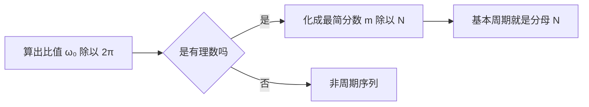

# 信号周期性判断

**标签：** #数字信号处理 #DSP #周期性 #正弦序列 #复指数序列

---

## 一、为什么"离散正弦"不一定是周期的？

连续时间的正弦信号 $\sin(\Omega t)$ 对**任意** $\Omega$ 都是周期的，周期 $T = 2\pi/\Omega$。

离散时间序列没这么幸运。序列只在整数点 $n$ 上有定义，要求

$$
x[n+N] = x[n] \quad \text{对所有整数 } n \text{ 成立}
$$

对 $x[n] = A\sin(\omega_0 n + \varphi)$ 来说，这意味着必须存在正整数 $N$ 使

$$
\omega_0 N = 2\pi m \quad (m \text{ 为整数})
$$

也就是说，**$\omega_0$ 必须是 $2\pi$ 的有理数倍**。连续域里"想多慢就多慢"的自由，在离散域被"只能用整数点"这个约束砍掉了一大半。

---

## 二、判断公式

### 1. 核心判据

$$
\frac{\omega_0}{2\pi} = \frac{m}{N} \quad (\text{最简分数}) \;\Longrightarrow\; \text{基本周期} = N
$$

其中"基本周期"是满足条件的最小正整数。

### 2. 两种等价的算法

| 做法 | 步骤 | 结果 |
|------|------|------|
| 比值法（推荐） | 算出 $\omega_0/2\pi$，化成最简分数 $m/N$ | 分母 $N$ 就是基本周期 |
| 倒数法 | 算出 $2\pi/\omega_0$，化成最简分数 $N/m$ | **分子** $N$ 才是基本周期 |

> ⚠️ 常见坑：$\omega_0/2\pi$ 为无理数时**非周期**，此时无论怎么约分都得不到整数 $N$；而 $2\pi/\omega_0$ 不是整数时，也**不能**直接四舍五入当成周期（比如 $2\pi/\omega_0 = 8/3$，基本周期是 8 而不是 3，也不是 $8/3$）。

### 3. 判断流程

---

## 三、不同类型序列的周期判断

### 1. 正弦序列 x[n] = A·sin(ω₀n + φ)

判断方法与相位 $\varphi$ 无关（$\varphi$ 只影响起始位置，不影响周期）。

**示例1**：$x[n] = \sin(\pi n/4)$

$$
\frac{\omega_0}{2\pi} = \frac{\pi/4}{2\pi} = \frac{1}{8} \; \Rightarrow \; N = 8
$$

**示例2**：$x[n] = \sin(3\pi n/4)$

$$
\frac{\omega_0}{2\pi} = \frac{3\pi/4}{2\pi} = \frac{3}{8} \; \Rightarrow \; N = 8
$$

注意这里 $2\pi/\omega_0 = 8/3$ 不是整数，但基本周期确实是 8 —— 这正是要用"比值法"的原因。

**示例3**：$x[n] = \sin(3n)$

$$
\frac{\omega_0}{2\pi} = \frac{3}{2\pi} \approx 0.477 \quad \text{（无理数）} \;\Rightarrow\; \textbf{非周期序列}
$$

### 2. 复指数序列 x[n] = e^(jω₀n)

判据与正弦序列**完全相同**：只看 $\omega_0/2\pi$ 是否为有理数。

**示例4**：$x[n] = e^{j\pi n/3}$

$$
\frac{\omega_0}{2\pi} = \frac{1}{6} \;\Rightarrow\; N = 6
$$

**示例5**：$x[n] = e^{jn}$

$$
\frac{\omega_0}{2\pi} = \frac{1}{2\pi} \quad \text{（无理数）} \;\Rightarrow\; \textbf{非周期序列}
$$

### 3. 多个正弦相加的序列

**判断方法**：

1. 分别求出每个分量的基本周期 $N_1, N_2, \dots$
2. 若**每个分量都周期**，整体周期为各周期的最小公倍数（LCM）
3. 若**有任何一个是非周期**，整体非周期

**示例6**：$x[n] = \sin(\pi n/3) + \cos(\pi n/4)$

- 第一项：$\omega_1/2\pi = 1/6 \Rightarrow N_1 = 6$
- 第二项：$\omega_2/2\pi = 1/8 \Rightarrow N_2 = 8$
- $\mathrm{LCM}(6, 8) = 24 \;\Rightarrow\; N = 24$

**示例7**：$x[n] = \sin(\pi n/3) + \sin(n)$

- 第一项：$N_1 = 6$
- 第二项：非周期
- 整体**非周期**（一个非周期分量就足以拖垮整个序列）

### 4. 实指数序列 x[n] = aⁿ

**结论**：实指数序列永远不是周期的。

- $a = 1$ 时 $x[n] \equiv 1$，任意 $N$ 都是周期（可视为周期为 1 的平凡情况）
- $a = 0$ 时序列只在 $n \geq 0$ 起点非零，同样不构成周期
- 其余情况：$\lvert a \rvert \neq 1$ 时模值单调变化，$\lvert a \rvert = 1$ 时退化为常数或 $\pm$ 交替

---

## 四、数字频率的周期性

这是离散序列独有的性质，也是后面理解频域分析的起点：

$$
e^{j(\omega_0 + 2\pi k)n} = e^{j\omega_0 n} \cdot e^{j2\pi kn} = e^{j\omega_0 n}
$$

因为 $e^{j2\pi kn} = 1$（$n$、$k$ 皆为整数）。所以

> **数字频率 $\omega_0$ 与 $\omega_0 + 2\pi k$ 描述的是同一个序列**（$k$ 为任意整数）。

随之而来的两个结论：

1. 讨论数字频率时只需限定在 $2\pi$ 的区间内，习惯取 $-\pi \lt \omega \leq \pi$ 或 $0 \leq \omega \lt 2\pi$
2. 与（[[【数字信号处理DSP】（十）模拟频率与数字频率的关系|（十）模拟频率与数字频率的关系]]）连起来看：数字频率 $\omega$ 是模拟频率对采样率归一化的结果，这个"卷起来"的周期性正来自采样

### 关于"周期"和"频率为有理数"的关系

- $\omega_0/2\pi$ 是**有理数** $\Rightarrow$ 序列周期，且数字频率落在 $2\pi$ 内的同一个值上
- $\omega_0/2\pi$ 是**无理数** $\Rightarrow$ 序列非周期

所以"序列是否周期"本质上问的是：**这个数字频率能不能写成 $2\pi$ 的有理数倍**。

---

## 五、常见考题速查

| 序列 | $\omega_0$ | $\omega_0/2\pi$ | 是否周期 | 基本周期 $N$ |
|------|-----------|-----------------|---------|-------------|
| $\sin(\pi n/2)$ | $\pi/2$ | $1/4$ | ✅ | 4 |
| $\sin(\pi n)$ | $\pi$ | $1/2$ | ✅ | 2 |
| $\sin(2\pi n/5)$ | $2\pi/5$ | $1/5$ | ✅ | 5 |
| $\sin(3\pi n/4)$ | $3\pi/4$ | $3/8$ | ✅ | 8 |
| $\sin(0.5n)$ | $0.5$ | $1/(4\pi)$ | ❌ | — |
| $\cos(2n)$ | $2$ | $1/\pi$ | ❌ | — |
| $e^{j\pi n/6}$ | $\pi/6$ | $1/12$ | ✅ | 12 |
| $e^{j2n}$ | $2$ | $1/\pi$ | ❌ | — |
| $\sin(\pi n/4) + \cos(\pi n/6)$ | — | — | ✅ | $\mathrm{LCM}(8, 12) = 24$ |

---

## 六、常见错误提醒

1. **把 $2\pi/\omega_0$ 直接当周期**：它只在"恰好是整数"时成立；一般要把 $\omega_0/2\pi$ 写成最简分数 $m/N$，**分母**才是基本周期。
2. **由"约分不干净"就判非周期**：$\sin(3\pi n/4)$ 的 $2\pi/\omega_0 = 8/3$，但它依然是周期的（$N = 8$）。
3. **相加序列里漏判某一个分量**：只要有一个分量非周期，整体就非周期，不用再算 LCM。
4. **忘了 $\omega_0$ 与 $\omega_0 + 2\pi k$ 等价**：$\sin(1.5\pi n)$ 和 $\sin(-0.5\pi n)$ 是同一个序列，判周期时可以先化简到 $(-\pi, \pi]$ 区间内再算，结论一致。
5. **把连续域的直觉搬过来**：连续正弦"任意频率都周期"，离散正弦"多数频率都不周期"，这是最容易失分的地方。

---

## 七、知识链定位

信号周期性判断（本节）

│

├── 判据：ω₀/2π 为有理数 ⇔ 周期，最简分数的分母 = 基本周期

├── 正弦 / 复指数 / 相加序列 / 实指数

└── 数字频率的周期性：ω 与 ω + 2πk 等价

│

├── 模拟频率与数字频率的关系（第十节）

├── 序列的傅里叶变换：从"周期"到"频谱"（后续章节）

└── DFT / DFS：周期序列的频域表示（后续章节）

---

## 八、总结

- **一个判据管所有**：$\omega_0/2\pi$ 是有理数则周期，无理数则非周期。
- **基本周期**：把 $\omega_0/2\pi$ 化成最简分数 $m/N$，$N$ 就是基本周期。
- **相加序列**：全周期才周期，周期取最小公倍数；有一个非周期，整体非周期。
- **实指数序列**永远不是周期的。
- 离散域独有的现象：**数字频率以 $2\pi$ 为周期**，$\omega$ 与 $\omega + 2\pi k$ 是同一个序列。

---

> **一句话总结**：正弦 / 复指数序列是否周期，只看 $\omega_0/2\pi$ 是不是有理数 —— 有理则周期（最简分数的分母就是基本周期），无理则非周期；这个"有理数门槛"正是离散时间与连续时间最大的差别之一。
