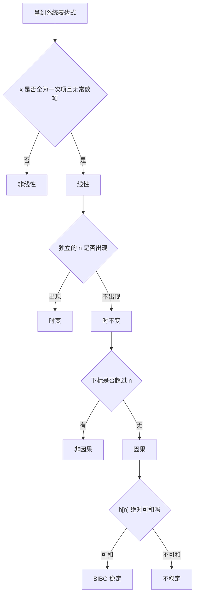

# 离散时间系统六大性质判断方法

**标签：** #数字信号处理 #DSP #线性 #时不变 #因果 #稳定 #BIBO #LSI

---

## 一、概述

对于一个离散时间系统，通常用以下六个性质来描述其特性：

1. **线性性（Linearity）**
2. **时不变性（Time-Invariance）**
3. **因果性（Causality）**
4. **稳定性（Stability）**
5. **记忆性（Memory）**
6. **可逆性（Invertibility）**

六个性质之间**互相独立**——一个系统可以线性但不因果，可以稳定但时变。做题时逐条单独判断，不要试图用一条结论推另一条。

有一个组合特别重要：**线性 + 时不变 = LSI（线性移不变）系统**。只有 LSI 系统才能用单位脉冲响应 $h[n]$ 完整描述，才有 $y[n] = x[n] * h[n]$、才有 $H(z)$ 和 $H(e^{j\omega})$。后面所有章节（[[【数字信号处理DSP】（七）卷积和|（七）卷积和]]、[[【数字信号处理DSP】（十三）Z 变换与收敛域|（十三）Z 变换与收敛域]]）都建立在它上面。

---

## 二、线性（Linearity）

### 判断公式

系统 $T$ 满足线性性，当且仅当对任意输入 $x_1[n]$、$x_2[n]$ 和任意常数 $a$、$b$，有：

$$
T\{a \cdot x_1[n] + b \cdot x_2[n]\} = a \cdot T\{x_1[n]\} + b \cdot T\{x_2[n]\}
$$

即同时满足：

- **可加性**：$T\{x_1[n] + x_2[n]\} = T\{x_1[n]\} + T\{x_2[n]\}$
- **齐次性**：$T\{a \cdot x[n]\} = a \cdot T\{x[n]\}$

### 判断步骤

1. 令 $y_1[n] = T\{x_1[n]\}$，$y_2[n] = T\{x_2[n]\}$
2. 计算 $y_3[n] = T\{a \cdot x_1[n] + b \cdot x_2[n]\}$
3. 计算 $a \cdot y_1[n] + b \cdot y_2[n]$
4. 若 $y_3[n] = a \cdot y_1[n] + b \cdot y_2[n]$ → **线性**；否则 → **非线性**

> **快速判据**：表达式里 $x$ 全部是**一次**（不能有 $x^2$、$|x|$、$\cos x$、$x\cdot y$），且**不含与 $x$ 无关的常数项**。含常数项的系统必然非线性，因为零输入时输出不为零。

### 典型例题

**例题1**：$y[n] = x[n] + 1$

**解**：

- $T\{a x_1 + b x_2\} = a x_1[n] + b x_2[n] + 1$
- $a T\{x_1\} + b T\{x_2\} = a(x_1[n]+1) + b(x_2[n]+1) = a x_1 + b x_2 + a + b$
- 两者不相等 → **非线性系统**

**例题2**：$y[n] = 2x[n] - x[n-1]$

**解**：

- $T\{a x_1 + b x_2\} = 2(a x_1 + b x_2) - (a x_1[n-1] + b x_2[n-1])$
- $= a(2x_1 - x_1[n-1]) + b(2x_2 - x_2[n-1])$
- $= a T\{x_1\} + b T\{x_2\}$
- → **线性系统**

**例题3**：$y[n] = x^2[n]$

**解**：

- $T\{a x_1 + b x_2\} = (a x_1 + b x_2)^2 = a^2 x_1^2 + 2ab x_1 x_2 + b^2 x_2^2$
- $a T\{x_1\} + b T\{x_2\} = a x_1^2 + b x_2^2$
- 两者不相等 → **非线性系统**

> 注意：例题 1 中若只看 $x[n]$ 部分像是"放大了 1 倍"，但那个 $+1$ 使系统在零输入时输出为 1，已经破坏了齐次性（$a=0$ 时不成立），所以必非线性。

---

## 三、时不变性（Time-Invariance）

### 判断公式

系统 $T$ 是时不变的，当且仅当输入延迟 $n_0$ 个样本，输出也延迟相同的 $n_0$ 个样本：

$$
T\{x[n - n_0]\} = y[n - n_0]
$$

### 判断步骤

1. 计算原输出：$y[n] = T\{x[n]\}$
2. 计算延迟输入后的输出：$y'[n] = T\{x[n - n_0]\}$
3. 计算原输出的延迟：$y[n - n_0]$
4. 若 $y'[n] = y[n - n_0]$ → **时不变**；否则 → **时变**

> **快速判据**：把表达式里所有 $n$ 看一遍——如果 $n$ 只以 $n$、$n-1$、$n+2$ 这种**整体平移**的形式出现在 $x[\cdot]$ 的下标里，就是时不变的；一旦出现**独立于 $x$ 的 $n$**（如系数 $n$、$2n$、$\cos(\pi n)$、下标 $2n$），就是时变的。

### 典型例题

**例题4**：$y[n] = x[n] - x[n-1]$

**解**：

- 输入 $x[n-n_0]$ 的输出：$x[n-n_0] - x[n-n_0-1]$
- 原输出延迟：$y[n-n_0] = x[n-n_0] - x[n-n_0-1]$
- 两者相等 → **时不变系统**

**例题5**：$y[n] = n \cdot x[n]$

**解**：

- 输入 $x[n-n_0]$ 的输出：$n \cdot x[n-n_0]$
- 原输出延迟：$y[n-n_0] = (n-n_0) \cdot x[n-n_0]$
- 两者不相等 → **时变系统**

**例题6**：$y[n] = x[n] \cdot \cos(\pi n)$

**解**：

- 输入 $x[n-n_0]$ 的输出：$x[n-n_0] \cdot \cos(\pi n)$
- 原输出延迟：$y[n-n_0] = x[n-n_0] \cdot \cos(\pi (n-n_0))$
- 由 $\cos(\pi (n-n_0)) = \cos(\pi n - \pi n_0) = (-1)^{n_0} \cos(\pi n)$
- 当 $n_0$ 为奇数时，两者相差一个负号 → **时变系统**

> 陷阱：$\cos(\pi n) = (-1)^n$ 看起来"就是一个系数"，但它是 $n$ 的函数，所以仍是时变。若改成 $y[n] = x[n] \cdot \cos(\pi n_0)$（$n_0$ 是常数），就变成时不变了——**关键看这个因子是否随 $n$ 变化**。

---

## 四、因果性（Causality）

### 判断公式

系统是因果的，当且仅当输出 $y[n]$ 只依赖于当前及过去的输入，不依赖于未来的输入。

### 判断方法

- 若系统表达式中出现 $x[n+1]$、$x[n+2]$ 等未来项 → **非因果**
- 若只含 $x[n]$、$x[n-1]$、$x[n-2]$ 等当前和过去项 → **因果**
- 若用单位脉冲响应 $h[n]$ 描述：$h[n] = 0$ 对所有 $n < 0$ → **因果**

> **下标法**：把所有 $x[\cdot]$ 的下标与 $n$ 比较。若存在下标 $> n$（如 $x[2n]$ 在 $n>0$ 时、$x[-n]$ 在 $n<0$ 时），就非因果。

### 典型例题

**例题7**：$y[n] = x[n] + x[n-1]$

**解**：只依赖当前和过去 → **因果系统**

**例题8**：$y[n] = x[n+1] + 2x[n]$

**解**：依赖未来输入 $x[n+1]$ → **非因果系统**

**例题9**：$y[n] = x[n] + 0.5x[n-2]$

**解**：只依赖当前和过去 → **因果系统**

**例题10**：$y[n] = x[-n]$

**解**：

- 当 $n \geq 0$ 时，$x[-n]$ 表示过去或当前的输入 → 没问题
- 当 $n < 0$ 时，$-n > 0$，$x[-n]$ 表示未来输入 → **非因果系统**

**例题11**：$y[n] = x[2n]$（抽取器）

**解**：

- 对于 $n = 1$，$y[1] = x[2]$，用到了 $n=1$ 时刻还未到来的 $x[2]$ → **非因果**
- 用下标法：$2n > n$ 对所有 $n > 0$ 成立 → 非因果

> 补充：抽取器在**离线处理**（先录完全部数据再算）时是可行的，所以工程上常说它"非因果但可实现"。**因果性是实时系统的要求**，离线系统不受此限。

---

## 五、稳定性（BIBO Stability）

### 判断公式

系统是稳定的，当且仅当有界输入产生有界输出（Bounded Input Bounded Output）。

### 判断方法

**方法一（冲激响应法）**：若系统由单位脉冲响应 $h[n]$ 表征，则稳定条件为：

$$
\sum_{n=-\infty}^{\infty} \lvert h[n] \rvert < \infty
$$

即 $h[n]$ 绝对可和。

**方法二（直接判断法）**：假设输入有界 $|x[n]| \leq M$，观察输出是否有界。

$$\lvert y[n] \rvert = \left\lvert \sum_k h[k]\,x[n-k] \right\rvert \leq M \sum_k \lvert h[k] \rvert$$

右端与 $n$ 无关，故只要 $\sum \lvert h[k] \rvert < \infty$，输出就有界——这正是**充分性**的来源。

### 典型例题

**例题12**：$h[n] = (0.9)^n \cdot u[n]$

**解**：

- $\sum \lvert h[n] \rvert = \sum_{n=0}^{\infty} (0.9)^n = \frac{1}{1-0.9} = 10 < \infty$
- → **稳定系统**

**例题13**：$h[n] = u[n]$

**解**：

- $\sum \lvert h[n] \rvert = \sum_{n=0}^{\infty} 1 = \infty$
- → **不稳定系统**

**例题14**：$y[n] = 2x[n]$

**解**：

- 若 $\lvert x[n] \rvert \leq M$，则 $\lvert y[n] \rvert = 2\lvert x[n] \rvert \leq 2M$
- 输出有界 → **稳定系统**

**例题15**：$y[n] = n \cdot x[n]$

**解**：

- 取有界输入 $x[n] = 1$，输出 $y[n] = n$ → 随 $n$ 增大而发散
- → **不稳定系统**

### 补充：BIBO 稳定与极点位置（与 Z 变换的接口）

对因果 LSI 系统，$h[n] = a^n u[n]$ 的稳定性由 $a$ 决定：

- $\lvert a \rvert < 1$：几何级数收敛 → **稳定**
- $\lvert a \rvert \geq 1$：级数发散 → **不稳定**（$a = -1$ 时是等幅振荡，也不稳定）

换成差分方程 $y[n] - a y[n-1] = x[n]$，这个 $a$ 就是系统函数的极点位置。于是第一次遇到结论：**因果系统稳定 ⟺ 全部极点位于单位圆内**（严格小于 1）。这个结论在 [[【数字信号处理DSP】（十三）Z 变换与收敛域|（十三）Z 变换与收敛域]] 中会从收敛域的角度重新推一遍。

> 别混淆：**BIBO 稳定**（有界输入有界输出）与**渐近稳定**（零输入时状态自行衰减到零）不是一回事。本例 $a=-1$ 时系统是**不稳定**的（等幅振荡不会衰减），但输出始终有界——所以 BIBO 稳定要求更严，必须严格衰减。

---

## 六、记忆性（Memory）

### 判断公式

系统是无记忆的，当且仅当输出 $y[n]$ 只依赖于同一时刻的输入 $x[n]$。

若输出依赖于其他时刻的输入（如 $x[n-1]$、$x[n+1]$），则系统有记忆。

### 判断方法

- 若 $y[n]$ 只与 $x[n]$ 有关 → **无记忆系统**
- 若 $y[n]$ 与 $x[n-1]$、$x[n+1]$ 等任何其他时刻有关 → **有记忆系统**

> 注意：**记忆性只看"是否跨时刻"，与非线性无关**。$y[n] = x^2[n]$ 是非线性的，但它无记忆；$y[n] = x[n]+x[n-1]$ 是线性的，但它有记忆。

### 典型例题

**例题16**：$y[n] = x^2[n]$

**解**：只依赖当前输入 → **无记忆系统**

**例题17**：$y[n] = x[n] + x[n-1]$

**解**：依赖过去输入 → **有记忆系统**

**例题18**：$y[n] = x[n] + 1$

**解**：只依赖当前输入 → **无记忆系统**

**例题19**：$y[n] = 2x[n] - 0.5x[n-2]$

**解**：依赖过去输入 → **有记忆系统**

---

## 七、可逆性（Invertibility）

### 判断公式

系统是可逆的，当且仅当存在一个逆系统 $T^{-1}$，使得原系统和逆系统级联后输出等于输入：

$$
T^{-1}\{T\{x[n]\}\} = x[n]
$$

或用冲激响应表示：存在 $h^{-1}[n]$ 使得 $h[n] * h^{-1}[n] = \delta[n]$。

### 判断方法

- 若两个不同的输入产生相同的输出 → **不可逆**（信息已被压缩丢失）
- 若能通过输出唯一地恢复出输入 → **可逆**
- 对于 LSI 系统，若能找到逆系统的冲激响应 → **可逆**

### 典型例题

**例题20**：$y[n] = x[n] - x[n-1]$（差分器）

**解**：

- 逆系统为累加器：$y'[n] = \sum_{k=-\infty}^{n} x[k]$
- 两者级联可恢复原信号（忽略常数偏移）
- → **可逆系统**（若考虑直流偏移，严格说差一个常数，工程上视为可逆）

**例题21**：$y[n] = \lvert x[n] \rvert$

**解**：

- 输入 $x_1[n] = 1$，输出 $y[n] = 1$
- 输入 $x_2[n] = -1$，输出 $y[n] = 1$
- 两个不同输入产生相同输出 → **不可逆系统**

**例题22**：$y[n] = 2x[n]$

**解**：

- 逆系统为 $y'[n] = x[n]/2$
- 可唯一恢复输入 → **可逆系统**

**例题23**：$y[n] = x^2[n]$

**解**：

- 输入 $x_1[n] = 2$，输出 $y[n] = 4$
- 输入 $x_2[n] = -2$，输出 $y[n] = 4$
- 两个不同输入产生相同输出 → **不可逆系统**

### 补充：抽取为什么不可逆

$y[n] = x[2n]$（抽取器，见例题 11）把序列压缩了一半，被丢掉的奇数点信息无法恢复 → **不可逆**。这与 $y[n] = x^2[n]$ 是同一类错误：**多对一映射必然不可逆**。判断可逆性的通用套路就是找反例——找出两个不同输入映到同一输出。

---

## 八、六性质判断流程

把上面的快速判据串起来，就是一条可以机械执行的判断路线：

左侧一列是判断顺序，右侧表格给出对照结论：

| 判断维度 | 一句话判据 |
| --- | --- |
| 线性 | $x$ 全为一次项，且无常数项 |
| 时不变 | 独立的 $n$ 不出现 |
| 因果 | 下标不超过 $n$ |
| 稳定 | $h[n]$ 绝对可和 |
| 记忆 | $y[n]$ 只与 $x[n]$ 有关 |
| 可逆 | 输入输出是一对一的 |

---

## 九、六大性质速查表

| 性质 | 判断核心 | 记忆口诀 |
|------|---------|---------|
| 线性性 | $T\{ax_1+bx_2\} = aT\{x_1\}+bT\{x_2\}$ | 加权和能拆开 |
| 时不变性 | $T\{x[n-n_0]\} = y[n-n_0]$ | 输入延迟，输出也延迟 |
| 因果性 | 输出不依赖未来输入 | 不碰未来 |
| 稳定性 | $\sum \lvert h[n] \rvert \lt \infty$ | 冲激响应绝对可和 |
| 记忆性 | 输出只依赖当前输入 | 没跨时刻 |
| 可逆性 | 不同输入→不同输出 | 一对一能还原 |

---

## 十、综合例题

**题目**：判断系统 $y[n] = x[n] + x[n-1] - 2x[n+1]$ 的六大性质。

**解答**：

1. **线性性**：
   - 表达式为输入的线性组合，无常数项
   - → **线性系统** ✅

2. **时不变性**：
   - 输入 $x[n-n_0]$ → 输出 $x[n-n_0] + x[n-n_0-1] - 2x[n-n_0+1]$
   - $y[n-n_0] = x[n-n_0] + x[n-n_0-1] - 2x[n-n_0+1]$
   - 两者相等 → **时不变系统** ✅

3. **因果性**：
   - 输出含 $x[n+1]$（未来输入）
   - → **非因果系统** ❌

4. **稳定性**：
   - $h[n] = \delta[n] + \delta[n-1] - 2\delta[n+1]$
   - $\sum \lvert h[n] \rvert = 1 + 1 + 2 = 4 \lt \infty$
   - → **稳定系统** ✅

5. **记忆性**：
   - 依赖 $x[n]$、$x[n-1]$、$x[n+1]$
   - → **有记忆系统** ✅

6. **可逆性**：
   - 这是一个线性组合 $\delta[n]+\delta[n-1]-2\delta[n+1]$，其 Z 变换是 $1+z^{-1}-2z$，在 $z$ 平面上有非零零点
   - 更直接的看法：含超前项 $x[n+1]$，离线反算时相当于解一个非因果方程，一般无法唯一确定 $x[n]$
   - → **不可逆系统** ❌

---

## 十一、常见错误提醒

1. **只验证了齐次性就下结论**：线性必须同时满足可加性与齐次性，两个都要验（尤其含常数项的系统，用 $a=0$ 一试即可露馅）。
2. **把"系数是常数"当作时不变的充分条件**：系数是常数只说明它是**移不变**的必要条件，还要确认 $n$ 没有单独出现在别处（如 $x[2n]$）。
3. **用 $y[n] = x[n-1]$ 判断因果时说"依赖过去所以非因果"**：因果**允许**依赖过去，只禁止依赖未来。依赖过去恰恰是因果的典型形态。
4. **认为不稳定就会发散到无穷**：$a=-1$ 的等幅振荡输出有界，但在 BIBO 意义下仍属**不稳定**（不满足绝对可和）。
5. **把"无记忆"和"线性"绑定**：$y[n]=x^2[n]$ 无记忆但非线性；$y[n]=x[n]-x[n-1]$ 线性但有记忆。两者互相独立。
6. **判断可逆性时只代一个输入**：可逆要求"对所有输入唯一"，证不可逆只需一对反例（如 $x$ 与 $-x$），但证可逆必须给出逆系统。
7. **忽略系统的定义域**：$y[n]=x[-n]$ 在 $n<0$ 时用到未来，说明"非因果"与信号的取值范围有关，画图或代具体值比空想更可靠。

---

## 十二、知识链定位

离散时间系统六大性质（本节）

│

├── 线性 + 时不变 = LSI → 才能用 h[n]、H(z)、H(e^{jω})

├── 因果 ⟺ h[n] 在 n < 0 处为 0

├── BIBO 稳定 ⟺ h[n] 绝对可和 ⟺ 因果时极点全在单位圆内

└── 无记忆 ⟺ 只依赖 x[n]（与线性无关）

│

├── 能量信号与功率信号：稳定性的能量视角（第三节）

├── 卷积和：LSI 系统的时域描述（第七节）

├── 离散时间系统的各种响应：零输入/零状态（第八节）

├── 时域解法：差分方程求解（第九节）

├── 奈奎斯特采样定理：连续到离散的桥梁（第十一节）

└── Z 变换与收敛域：从极点位置判定因果与稳定（第十三节）

---

## 十三、总结

判断系统六大性质的关键在于：

- **线性**：看是否满足叠加原理，且无常数项
- **时不变**：看是否有独立于输入的 $n$ 出现
- **因果**：看是否出现未来输入（下标超过 $n$）
- **稳定**：看冲激响应是否绝对可和（因果时看极点是否在单位圆内）
- **记忆**：看是否只依赖当前输入
- **可逆**：看输入输出是否一对一

> **一句话总结**：六大性质是离散时间系统的"体检表"，其中线性与时不变合起来定义了 LSI 系统——只有 LSI 系统才配拥有 $h[n]$、$H(z)$ 和 $H(e^{j\omega})$ 这三把钥匙。
