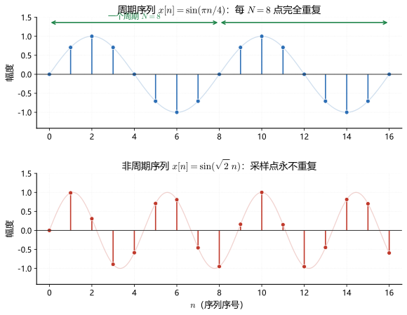
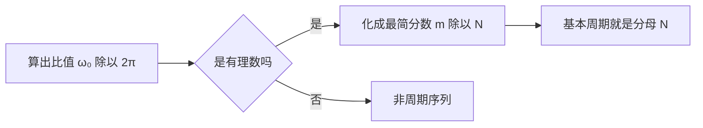
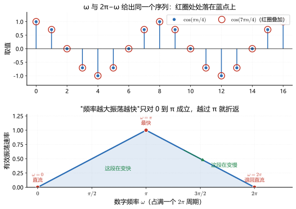

# 信号周期性判断

**标签：** #数字信号处理 #DSP #周期性 #正弦序列 #复指数序列

---

## 本篇的位置

**这一篇补的空洞。** 上一手留下的是连续时间里那条顺手的结论：$\sin(\Omega t)$ 对任意 $\Omega\ne0$ 都周期，周期 $T=2\pi/\Omega$。把 $t$ 换成 $n$、把 $\Omega$ 换成 $\omega_0$，这条结论立刻失效。序列只在整数点上有值，"相位走满 $2\pi$"这件事必须恰好在整数步上完成。这一篇要补的不是"周期怎么算"，而是为什么多出一个有理数门槛，以及这个门槛把多少频率挡在门外。

**和前后篇的接口。** 上游是连续时间信号里正弦的周期定义 $T=2\pi/\Omega$，加上"序列只认整数下标"这条基本约定。下游紧接（二）离散时间系统六大性质：那里判线性、时不变，用的全是"把 $n$ 换成 $n-n_0$"这类整数平移，前提正是这里的约定。（十四）DTFT 会把这里的 $2\pi$ 周期搬进频域，$\omega$ 与 $\omega+2\pi k$ 等价是整套频域分析的地基。

**本篇保留的简化。** 只讨论实正弦、复指数、实指数三类基本序列，且默认 $n$ 取遍全部整数。若序列只在 $n\ge0$ 有定义，那段"重复"不算定义意义上的周期，这个边界情形在第一节末的折叠里单独处理。另外全程不追问 $\omega_0$ 从哪个模拟频率采来，抽样率的问题留到（十一）。

**没出现的东西。** 抽样定理与模拟频率的换算、离散系统的六个性质、DFT 与 DFS（周期序列怎么用一个周期的 $N$ 个点描述），三样分别在（十一）（二）与后续章节。

**读完能做什么。** 给一个 $\omega_0$，当场判出周期与否并写出基本周期；给两个周期序列相加，能说出整体周期取 LCM 还是直接非周期；给一个被 $2\pi$ 折过的频率（如 $1.5\pi$），能先折回 $(-\pi,\pi]$ 再判，且知道结论不会变。

---

## 本篇要点

1. 判据只有一条：$\omega_0/(2\pi)$ 为有理数则周期，为无理数则非周期。有理的不是 $\omega_0$——例题 1 的 $\omega_0=\pi/4$ 本身无理，比值 $1/8$ 却有理。
2. 基本周期取最简分数的**分母**。$2\pi/\omega_0=8/3$ 时答案是 $8$，不是 $3$，也不是 $8/3$。
3. 叠加序列：分量全都周期才周期，整体周期取 LCM，$\mathrm{LCM}(6,8)=24$；任一分量非周期，整体立即非周期。
4. 实指数 $a^n$ 只在 $a=1$（$N=1$）与 $a=-1$（$N=2$）时周期，$\lvert a\rvert\ne1$ 一律非周期。

---

## 一、周期的门槛：有理数条件的来历

连续时间的正弦信号 $\sin(\Omega t)$ 对**任意** $\Omega \ne 0$ 都是周期的，周期 $T = 2\pi/\Omega$。

离散时间序列没这么幸运。序列只在整数点 $n$ 上有定义，要求存在**正整数** $N$ 使

$$
x[n+N] = x[n] \qquad \text{对所有整数 } n \text{ 成立}
$$

对 $x[n] = A\sin(\omega_0 n + \varphi)$ 代入：

$$
A\sin\big(\omega_0 (n+N) + \varphi\big) = A\sin(\omega_0 n + \varphi)
$$

正弦以 $2\pi$ 为周期，两式相等要求相位差是 $2\pi$ 的整数倍：

$$
\omega_0 N = 2\pi m \quad (m \text{ 为整数}) \tag{1}
$$

式 (1) 就是全部秘密所在。把它改写成比值形式：

$$
\boxed{\frac{\omega_0}{2\pi} = \frac{m}{N}}
$$

左边由信号给定，右边是**两个整数之比**。所以：

> **$\omega_0/(2\pi)$ 必须是有理数**，序列才可能周期。

为什么判据落在比值上，而不是直接看频率本身

被检的量必须无量纲。$x[n+N]=x[n]$ 代进复指数得到 $e^{j\omega_0N}=1$，它成立的条件是 $\omega_0N$ 等于 $2\pi$ 的整数倍——$2\pi$ 是唯一被允许的"圈长"。把 $\omega_0N=2\pi m$ 两边同除 $2\pi N$，就得到 $\omega_0/(2\pi)=m/N$。这一步只是把"$\omega_0$ 是 $2\pi$ 的有理数倍"换了个写法，比值背后量的是"每走满一圈需要多少个样点"。

所以被检的从来不是"$\omega_0$ 是不是整数"。例题 1 的 $\omega_0=\pi/4$ 本身是无理数，序列照样以 $8$ 为周期；反过来 $\omega_0=0.5$ 看着很规整，比值 $1/(4\pi)$ 却是无理数，序列一次都回不到原位。

连续域里"想多慢就多慢"的自由，在离散域被"只能用整数点采样"这个约束砍掉了一大半——绝大多数数字频率对应的离散正弦都**根本不周期**。

只在 n≥0 上重复，算不算周期序列

不算。定义里那句"对所有整数 $n$"不是修辞，它专门排除这一类序列。

$u[n]$ 就是现成的例子：对每个 $n\ge0$，$x[n+1]=x[n]=1$ 都成立，右半边看上去完全周期。但取 $n=-1$，$x[0]=1$ 而 $x[-1]=0$，$N=1$ 失败；换成任意 $N$，$x[N-1]=1$ 与 $x[-1]=0$ 同样不等，全部失败。判据只在半边成立，就不叫周期序列。

工程上这种"上电后才开始重复"的序列很常见，它是右单边序列的稳态段，不是周期序列。拿一段稳态数据当一个周期丢进 DFT，是近似，不是数学结论。区别在于：周期序列的 $N$ 个值决定了整条序列，单边序列的 $N$ 个值只决定了 $n\ge0$ 那一段。

---

## 二、判据与算法

> 上图：蓝色是 $\sin(\pi n/4)$ 的采样点，落在连续正弦上且**每隔 8 点完全重复**（绿色箭头标出一个周期 $N=8$）；红色是 $\sin(\sqrt{2}\,n)$ 的采样点，落在连续正弦上但**永不重复**。采样点是否重复，正是离散正弦是否周期的判据。

### 1. 核心判据

$$
\frac{\omega_0}{2\pi} = \frac{m}{N}\ (\text{最简分数，} m,N \text{ 互质}) \quad\Longrightarrow\quad \text{基本周期} = N
$$

"基本周期"指满足条件的最小**正**整数。

### 2. 两种等价的算法

| 做法 | 步骤 | 结论取自 |
|------|------|---------|
| **比值法**（推荐） | 算 $\omega_0/2\pi$，化成最简分数 $\dfrac{m}{N}$ | **分母** $N$ |
| 倒数法 | 算 $2\pi/\omega_0$，化成最简分数 $\dfrac{N}{m}$ | **分子** $N$ |

> ⚠️ **坑在这里**：$\omega_0/2\pi$ 为无理数 ⇒ 非周期（无论怎么约分都得不到整数 $N$）；而 $2\pi/\omega_0$ 不是整数时，**不能**四舍五入当周期。例如 $2\pi/\omega_0 = 8/3$，基本周期是 $8$，既不是 $3$、也不是 $8/3$。

### 3. 判断流程

### 4. 最简分数的必要性

若 $\dfrac{\omega_0}{2\pi} = \dfrac{m}{N}$ 但 $m,N$ 有公因子 $d$，则 $\dfrac{m}{N} = \dfrac{m/d}{N/d}$，真正的**最小**周期是 $N/d$ 而不是 $N$。

例如 $\dfrac{\omega_0}{2\pi} = \dfrac{6}{12}$，若不约分会答成 $N=12$；约分后 $\dfrac{1}{2}$，正确答案是 $N=2$。**先约分，再取分母**。

---

## 三、分类精讲与例题

> **统一答题格式**：先写判据 → 代入 $\omega_0$ → 约分 → 读分母 → 结论 → 检验。
> 考试时判据必须写出来，这是拿步骤分的关键。

### 1. 正弦序列 x[n] = A·sin(ω₀n + φ)

**关键结论**：判断与幅度 $A$、初相 $\varphi$ **无关**——它们只改变波形的高低和起点，不改变重复间隔。

---

**例题 1**：判断 $x[n]=\sin\left(\dfrac{\pi}{4}n\right)$ 是否为周期序列，若是求基本周期。

**解**：

（1）**写判据**：正弦序列周期的充要条件是 $\dfrac{\omega_0}{2\pi}$ 为有理数，且该比值写成最简分数 $\dfrac{m}{N}$ 时分母 $N$ 即基本周期。

（2）**代入数字角频率**：本题 $\omega_0 = \dfrac{\pi}{4}$。

（3）**计算比值并约分**：

$$
\frac{\omega_0}{2\pi} = \frac{\pi/4}{2\pi} = \frac{1}{8}
$$

$1$ 与 $8$ 已互质，是最简分数，故 $m=1,\ N=8$。

（4）**读结论**：比值为有理数，序列**周期**，基本周期 $N=8$。

**答案**：

$$
\boxed{\text{周期序列，基本周期 } N = 8}
$$

**检验**：$x[n+8]=\sin\left(\dfrac{\pi}{4}(n+8)\right)=\sin\left(\dfrac{\pi}{4}n+2\pi\right)=\sin\left(\dfrac{\pi}{4}n\right)=x[n]$ ✓

---

**例题 2**：判断 $x[n]=\sin\left(\dfrac{3\pi}{4}n\right)$ 是否为周期序列。

**解**：

（1）**写判据**：同上，看 $\dfrac{\omega_0}{2\pi}$ 是否为有理数。

（2）**代入**：$\omega_0 = \dfrac{3\pi}{4}$。

（3）**求比值**：

$$
\frac{\omega_0}{2\pi} = \frac{3\pi/4}{2\pi} = \frac{3}{8}
$$

（4）**约分**：$3$ 与 $8$ 互质，已是最简分数，$m=3,\ N=8$。

（5）**读结论**：有理数 ⇒ **周期**，基本周期 $N=8$。

**答案**：

$$
\boxed{\text{周期序列，基本周期 } N = 8}
$$

**检验**：$x[n+8]=\sin\left(\dfrac{3\pi}{4}n+\dfrac{3\pi}{4}\cdot 8\right)=\sin\left(\dfrac{3\pi}{4}n+6\pi\right)=x[n]$ ✓

**要点**：本题 $2\pi/\omega_0 = 8/3$ **不是整数**，若用倒数法容易误判成"非周期"。但比值 $\dfrac{3}{8}$ 是有理数，结论就是周期，周期是分母 $8$。**这正是必须用比值法的原因**。

---

**例题 3**：判断 $x[n]=\sin(3n)$ 是否为周期序列。

**解**：

（1）**写判据**：看 $\dfrac{\omega_0}{2\pi}$ 是否为有理数。

（2）**代入**：$\omega_0 = 3$。

（3）**求比值**：

$$
\frac{\omega_0}{2\pi} = \frac{3}{2\pi}
$$

三除以二π，凭什么一口断定它是无理数

因为 $\pi$ 无理，而有理数除以非零无理数必定无理。设 $3/(2\pi)=p/q$（$p,q$ 为整数，$q\ne0$），交叉相乘得 $3q=2\pi p$，于是 $\pi=3q/(2p)$。右端由整数构成，是有理数，与 $\pi$ 无理矛盾。所以 $3/(2\pi)$ 没有分数形式，最小周期不存在。

对照例题 2：$\dfrac{3\pi/4}{2\pi}$ 里 $\pi$ 在分子分母上约掉了，得 $3/8$。**能不能把 $\pi$ 约掉，是这一类题唯一要看的东西**。$\omega_0$ 写成 $\pi$ 的有理数倍（$\pi/4$、$3\pi/4$、$2\pi/5$）时比值必为有理数；$\omega_0$ 是纯数字（$3$、$1$、$0.5$）时，比值里必留下一个约不掉的 $\pi$。判断只需看 $\omega_0$ 是"$\pi$ 的有理倍"还是"纯数字"，不必真的把 $\pi$ 代成 $3.14159$。

（4）**判定有理/无理**：$\pi$ 是无理数，$\dfrac{3}{2\pi}$ **是无理数**（分子有理、分母无理）。

（5）**得结论**：不存在正整数 $N$ 使 $\omega_0 N = 2\pi m$，故**非周期**。

**答案**：

$$
\boxed{\text{非周期序列}}
$$

**检验（反证）**：若存在正整数 $N$ 使 $\sin\big(3(n+N)\big)=\sin(3n)$，则必有 $3N=2\pi m$（$m$ 为整数）。左端是正整数，右端含无理数 $\pi$ 且 $m\neq0$，二者不可能相等，矛盾 ✓

**要点**：能化成"整数 / ($\pi$ 的倍数)"的即为无理数，一律非周期。这类题不需要硬算小数近似。

靠看采样点"好像每 44 点重复"判周期，错在哪里

错在把"逼近"当成了"相等"。$\sin(3n)$ 的样板点确实能凑出一段很像的重复：取 $N=44$，$3\times44=132$，而 $2\pi\times21=131.947$，两者差 $0.053$ 弧度。前几十个点画在图上，肉眼分不出差别，于是有人判它周期 $44$。

把这个推理走到底：那个 $0.053$ 的差不会消失，它每一个"周期"累加一次，到第 $20$ 个重复段（$n\approx880$）已经偏了约 $1$ 弧度，波形明显错位。要继续压小误差只能换更大的 $m$——$\pi$ 的有理逼近有无穷多个，$N$ 想要多长有多长，永远停不下来。这种"越看越像、越久越不像"的形态，正是非周期的画像。

所以判周期只能靠整除关系，不能靠目测。$\sin(3n)$ 的 $3N$ 与 $2\pi m$ 之间隔着 $\pi$ 这个无理因子，任何有限精度下"看起来对上"的 $N$ 都不是解。

---

### 2. 复指数序列 x[n] = exp(jω₀n)

判据与正弦序列**完全一样**：只看 $\dfrac{\omega_0}{2\pi}$ 是否为有理数。因为欧拉公式把复指数拆成一对正弦/余弦，周期必然同步。

**例题 4**：判断 $x[n]=e^{j\frac{\pi}{3}n}$ 是否为周期序列。

**解**：

（1）**写判据**：复指数序列 $e^{j\omega_0 n}$ 周期 $\iff \dfrac{\omega_0}{2\pi}$ 为有理数。

（2）**代入**：$\omega_0 = \dfrac{\pi}{3}$。

（3）**求比值**：

$$
\frac{\omega_0}{2\pi} = \frac{\pi/3}{2\pi} = \frac{1}{6}
$$

已是最简分数，分母 $N=6$。

**答案**：

$$
\boxed{\text{周期序列，基本周期 } N = 6}
$$

**检验**：$e^{j\frac{\pi}{3}(n+6)} = e^{j\frac{\pi}{3}n}\cdot e^{j2\pi} = e^{j\frac{\pi}{3}n}$ ✓

---

**例题 5**：判断 $x[n]=e^{jn}$ 是否为周期序列。

**解**：

（1）**写判据**：同上。

（2）**代入**：$\omega_0 = 1$。

（3）**求比值**：$\dfrac{1}{2\pi}$，因 $\pi$ 无理，比值为**无理数**。

**答案**：

$$
\boxed{\text{非周期序列}}
$$

**检验（反证）**：若 $e^{jN}=1$，则 $N=2\pi m$。正整数不可能等于无理数 $\pi$ 的整数倍，故这样的 $N$ 不存在 ✓

---

### 3. 多个正弦叠加

**判据**：

1. 分别求各分量基本周期 $N_1, N_2, \dots, N_k$；
2. 若**全部**周期，整体基本周期为 $\mathrm{LCM}(N_1,\dots,N_k)$；
3. 若**任一**分量非周期，整体**非周期**（无需再算 LCM）。

---

**例题 6**：判断 $x[n]=\sin\left(\dfrac{\pi}{3}n\right)+\cos\left(\dfrac{\pi}{4}n\right)$ 的周期性。

**解**：

（1）**分解并分别判定**。

第一项 $\omega_1=\dfrac{\pi}{3}$：

$$
\frac{\omega_1}{2\pi} = \frac{1}{6} \;\Rightarrow\; N_1 = 6
$$

第二项 $\omega_2=\dfrac{\pi}{4}$：

$$
\frac{\omega_2}{2\pi} = \frac{1}{8} \;\Rightarrow\; N_2 = 8
$$

（2）**求最小公倍数**。$6 = 2\times 3$，$8 = 2^3$，故

$$
\mathrm{LCM}(6,8) = 2^3 \times 3 = 24
$$

两个周期叠加，为什么是取最小公倍数而不是相加

"公共周期"必须同时是 $N_1$ 与 $N_2$ 的整数倍。第一项要回到原相位，走的总步数得是 $6$ 的倍数；第二项得是 $8$ 的倍数。两个条件同时成立，答案就落在那组公倍数 $24,48,72,\dots$ 上，最小正的那个是 $24$。

反过来试 $6+8=14$：$14$ 不是 $6$ 的倍数，第一项在 $n=14$ 处多走了 $14\pi/3$，比整圈多出 $2\pi/3$ 的相位，没回原位。所以加和没有物理意义。

顺带说清 $6\times8=48$ 为什么也不是答案：它确实是公共周期，但不是**最小**的。$48$ 里含了两遍公因子 $2$，LCM 只取每个质因子的最高次幂，$2^3\times3=24$ 才是最少步数。

（3）**得结论**：两个分量都周期 ⇒ 整体周期，基本周期 $N=24$。

**答案**：

$$
\boxed{\text{周期序列，基本周期 } N = 24}
$$

**检验**：$N=24$ 是 $6$ 的 $4$ 倍、$8$ 的 $3$ 倍，两项同时回到原相位 ✓；且 $24$ 是满足此条件的最小正整数（任何公共周期必为 $6$ 与 $8$ 的公倍数）✓

---

**例题 7**：判断 $x[n]=\sin\left(\dfrac{\pi}{3}n\right)+\sin(n)$ 的周期性。

**解**：

（1）**分别判定**。

第一项：$\dfrac{\pi/3}{2\pi}=\dfrac{1}{6}$ 为有理数 ⇒ $N_1=6$，周期。

第二项：$\dfrac{1}{2\pi}$ 为无理数 ⇒ **非周期**。

（2）**得结论**：存在非周期分量 ⇒ 整体**非周期**。

**答案**：

$$
\boxed{\text{非周期序列}}
$$

**检验**：即使第一项每 $6$ 点回到原值，第二项 $\sin(n)$ 在 $n=N$ 处要求 $N=2\pi m$，无正整数解。**两项有一个不闭合，整体就不可能闭合** ✓

**要点**：一个非周期分量就足以拖垮整个序列，不必再算 LCM。反过来，若两个分量都周期，**必须**取最小公倍数，不能简单相加。

---

### 4. 实指数序列 a^n

这一类**不能一概而论**，需按 $\lvert a \rvert$ 分类讨论：

| 情况 | 序列形态 | 是否周期 | 说明 |
|------|---------|---------|------|
| $a = 1$ | $x[n]\equiv 1$ | **是**，$N=1$ | 常数序列，任何 $N$ 都成立，最小正周期为 $1$ |
| $a = -1$ | $x[n]=(-1)^n$ | **是**，$N=2$ | 正负交替，隔一点重复 |
| $a = 0$ | $x[n]=0\ (n\ge 0)$ | 否 | 只在 $n\ge 0$ 非零，形状不重复 |
| $0 \lt a \lt 1$ 或 $a \gt 1$ | 单调衰减 / 增长 | **否** | $\lvert a \rvert^n$ 严格单调，永不自重复 |
| $-1 \lt a \lt 0$ | 衰减振荡 | **否** | 幅度单调趋零，峰值逐次变小 |
| $a$ 为一般复数 | $a = re^{j\theta}$ | 看 $\theta/(2\pi)$ | 幅度按 $r^n$ 变化，仅 $r=1$ 且 $\theta/(2\pi)$ 有理时周期 |

> **纠正一个常见说法**：网上常说"实指数序列永远不是周期的"——**这是错的**。$a=1$ 与 $a=-1$ 都是周期的。准确表述是：**$\lvert a\rvert \ne 1$ 的实指数序列非周期**。

**例题 8**：判断 $x[n]=\left(-\dfrac{1}{2}\right)^n$ 是否为周期序列。

**解**：

（1）**看模值**：$\lvert a\rvert = \dfrac{1}{2} \ne 1$。

（2）**判单调性**：$\lvert x[n]\rvert = \left(\dfrac{1}{2}\right)^n$ 严格单调递减，任意两点模值都不相等。

（3）**得结论**：周期序列要求 $x[n+N]=x[n]$，即模值必须相等，与单调性矛盾，故**非周期**。

**答案**：

$$
\boxed{\text{非周期序列}}
$$

**检验**：看相邻两点的模值之比 $\dfrac{\lvert x[n+1]\rvert}{\lvert x[n]\rvert}=\dfrac{1}{2}\neq1$。若序列以 $N$ 为周期，则 $x[n+N]=x[n]$ 必然要求该比值在整周期后回到 $1$，矛盾 ✓

---

**例题 9**：判断 $x[n]=e^{j\frac{2\pi}{5}n}$ 的周期性，并写出一个周期的全部取值。

**解**：

（1）**写判据**：$\dfrac{\omega_0}{2\pi}$ 是否为有理数。

（2）**求比值**：

$$
\frac{\omega_0}{2\pi} = \frac{2\pi/5}{2\pi} = \frac{1}{5}
$$

最简分数，分母 $N=5$。

（3）**求一个周期的取值**（$n=0,1,2,3,4$）：

$$
1,\quad e^{j\frac{2\pi}{5}},\quad e^{j\frac{4\pi}{5}},\quad e^{j\frac{6\pi}{5}},\quad e^{j\frac{8\pi}{5}}
$$

**答案**：

$$
\boxed{\text{周期序列，基本周期 } N=5,\ \text{一周期 } 5 \text{ 点均布单位圆}}
$$

**检验**：$5$ 步走满 $2\pi$（每步 $2\pi/5$）✓；$m=1$ 与 $N=5$ 互质，保证 $5$ 个点互不重合 —— 若换成 $e^{j\frac{2\pi}{6}\cdot 2n}=e^{j\frac{2\pi}{3}n}$，$m=2,N=6$ 不互质，实际周期缩到 $3$ ✓

**要点**：$N$ 个点的复指数序列恰好绕单位圆 $m$ 圈（本题 $m=1$ 圈）。$m$ 与 $N$ 互质保证这 $N$ 个点**互不重合**。

---

## 四、数字频率的周期性（离散域独有）

### 1. 核心恒等式

对任意整数 $n$ 与整数 $k$：

$$
e^{j(\omega_0 + 2\pi k)n} = e^{j\omega_0 n} \cdot \underbrace{e^{j2\pi kn}}_{=\,1} = e^{j\omega_0 n}
$$

那个花括号底下的 1，对 k 和 n 各有什么要求

要求 $kn$ 是整数，缺一个都不行，而这两个整数前提分别来自两个不同的地方。

$e^{j2\pi kn}=1$ 本身靠的是 $\cos(2\pi kn)+j\sin(2\pi kn)=1$：整圈处余弦为 $1$、正弦为 $0$。$k=1/2$ 时 $e^{j\pi}=-1$，符号翻了过来，等价性立刻失效。所以 $k$ 只能取整数，$\omega_0+2\pi k$ 里的 $2\pi$ 是一整圈一整圈地加的。

$n$ 取整数则由序列的定义给死。同样的式子里若取 $n=1/2$、$k=1$，$kn$ 成了半整数，$e^{j2\pi kn}=e^{j\pi}=-1$，那个花括号底下的 $1$ 就没了。连续时间的 $e^{j\Omega t}$ 里 $t$ 可取任意实数，这个等式根本写不出来。**离散域"频率卷起来"这件事，$n\in\mathbb{Z}$ 与 $k\in\mathbb{Z}$ 两个前提各出一半力。**

因此：

> **数字频率 $\omega_0$ 与 $\omega_0 + 2\pi k$ 描述的是完全同一个序列**。

### 2. 两个直接推论

1. 讨论数字频率只需限定在长度为 $2\pi$ 的区间内，习惯取 $-\pi \lt \omega \leq \pi$ 或 $0 \leq \omega \lt 2\pi$。
2. 数字频率 $\omega$ 是模拟频率对采样率归一化的结果（详见 [[【数字信号处理DSP】（十）模拟频率与数字频率的关系|（十）模拟频率与数字频率的关系]]），这个"卷起来"的周期性正来自**采样**。

### 3. 一条重要直觉：ω 越大不代表振荡越快

由于上述等价性，$\omega$ 与 $2\pi - \omega$ 是同一个序列：

$$
e^{j(2\pi-\omega_0)n} = e^{-j\omega_0 n}
$$

右端是原序列的**共轭**（实部相同、虚部反号）。对实正弦而言 $\cos\big((2\pi-\omega_0)n\big) = \cos(\omega_0 n)$，两者**完全相同**。

于是：

- $\omega$ 从 $0$ 增到 $\pi$，振荡越来越快；
- $\omega$ 从 $\pi$ 增到 $2\pi$，振荡反而越来越慢，在 $2\pi$ 处退化为常数。

**$\omega = \pi$ 是离散序列能表示的"最快振荡"**（每两点翻转一次，形如 $1,-1,1,-1,\dots$）。这条直觉是后面理解"最高频率只到 $\pi$""混叠""采样定理"的地基。

> 上图：**上栏**把 $\cos(\pi n/4)$（蓝点）与 $\cos(7\pi n/4)$（红圈）画在一起，红圈处处套在蓝点上——$\omega=7\pi/4$ 与 $\omega=\pi/4$ 是同一个序列。**下栏**把 $\omega$ 从 $0$ 扫到 $2\pi$，纵轴是"有效振荡速率"：$0\to\pi$ 段越来越快，$\pi$ 处达到最快，之后**折返下降**，到 $2\pi$ 退回直流。所以"频率越大振荡越快"只在半个周期内成立。

### 4. "周期"与"频率是有理数倍"的等价

| $\omega_0/(2\pi)$ | 序列性质 | 数字频率的等价类 |
|---|---|---|
| 有理数 $m/N$ | 周期，基本周期 $N$ | 落在 $2\pi$ 区间内的某个确定值上 |
| 无理数 | 非周期 | 在 $(-\pi,\pi]$ 内稠密地"游走"，永不回到原点 |

所以"序列是否周期"本质上问的是：**这个数字频率能不能写成 $2\pi$ 的有理数倍**。

一个周期的 N 个数，凭什么能决定整条序列

因为 $x[n+N]=x[n]$ 把后面每一个位置都指回了前 $N$ 个。例题 9 的 $N=5$：$x[5]=x[0]$、$x[6]=x[1]$、$x[7]=x[2]$，再往后只是这段的复制，第 $6$ 个位置起不存在任何新信息。

"独立样本数 $=N$"这一步直接决定了频域。用 $N$ 个数就能写清的序列，不可能需要连续谱去描述，它在频域只能有 $N$ 根谱线，间隔 $2\pi/N$。DFS 的求和只在一个周期内跑、DFT 的输出恰好 $N$ 个数，根都在这里，不在变换公式的推导里。

反过来看 $\sin(3n)$：非周期，$n$ 每加一就多一个不重复的值，样本数没有上限，于是描述它只能用连续的 $\omega$（DTFT），谱线上处处有值、没有间隔。**周期的意义是"独立信息的个数有限"，周期值 $N$ 就是那个个数。**

---

## 五、常见考题速查

| 序列 | $\omega_0$ | $\omega_0/2\pi$ | 是否周期 | 基本周期 |
|------|-----------|-----------------|---------|---------|
| $\sin(\pi n/2)$ | $\pi/2$ | $1/4$ | ✅ | $4$ |
| $\sin(\pi n)$ | $\pi$ | $1/2$ | ✅ | $2$ |
| $\sin(2\pi n/5)$ | $2\pi/5$ | $1/5$ | ✅ | $5$ |
| $\sin(3\pi n/4)$ | $3\pi/4$ | $3/8$ | ✅ | $8$ |
| $\sin(6\pi n/8)$ | $3\pi/4$ | $3/8$（约分后） | ✅ | $8$ |
| $\sin(0.5n)$ | $0.5$ | $1/(4\pi)$ 无理 | ❌ | — |
| $\cos(2n)$ | $2$ | $1/\pi$ 无理 | ❌ | — |
| $e^{j\pi n/6}$ | $\pi/6$ | $1/12$ | ✅ | $12$ |
| $e^{j2n}$ | $2$ | $1/\pi$ 无理 | ❌ | — |
| $(-1)^n$ | — | — | ✅ | $2$ |
| $\sin(\pi n/4) + \cos(\pi n/6)$ | — | — | ✅ | $\mathrm{LCM}(8,12)=24$ |

---

## 六、常见错误提醒

八条里的问题都不在算，而在判：判的对象错（盯着 $\omega_0$ 而不看比值）、判的范围错（只验半边）、判的步数错（漏了约分）。表的重心因此放在判据上：每条给一句能当场自检的话，反例全部取自本篇正文。

| 错误说法 | 为什么会这么想 | 判据 | 反例 |
|---|---|---|---|
| 周期就是 $2\pi/\omega_0$ | 连续域的 $T=2\pi/\Omega$ 拿来就用 | 看这个数是不是整数，不是整数就不能当周期 | $\sin(3\pi n/4)$ 的 $2\pi/\omega_0=8/3$，真周期是 $8$，$8/3$ 与 $3$ 都不对 |
| 约分不干净就判非周期 | $8/3$ 带分数，看着不像周期 | 回看 $\omega_0/(2\pi)$ 是有理数还是无理数 | 同上，$\dfrac{3}{8}$ 有理 ⇒ 周期，$N=8$ |
| 忘记先约分 | 分母是几就填几 | 比一比分子分母还有没有公因子 | $\omega_0/2\pi=6/12$，答案是 $N=2$，不是 $12$ |
| 第一项周期就当整体周期 | 算完第一项就下了结论 | 逐个分量判，有一个无理比值就停 | $\sin(\pi n/3)+\sin(n)$：第一项 $N_1=6$，第二项 $1/(2\pi)$ 无理 ⇒ 整体非周期 |
| 两个都周期就把周期相加 | 周期像长度一样能叠加 | 看这两个数有没有公约数，取公倍数的最小值 | $N_1=6$、$N_2=8$，和是 $14$（不是 $6$ 的倍数），正确是 $24$ |
| 实指数序列一律非周期 | 指数在实轴上单调，看着不会回头 | 代 $a=1$、$a=-1$ 两个值试 | $(-1)^n$ 周期 $2$；$1^n$ 周期 $1$ |
| 频率数值不同就是不同序列 | $1.5\pi$ 与 $-0.5\pi$ 差了两个 $\pi$ | 两数相减，看是否为 $2\pi$ 的整数倍 | $\sin(1.5\pi n)$ 与 $\sin(-0.5\pi n)$ 是同一序列，周期都是 $4$ |
| 答出周期就交卷 | $N=8$ 验证通过了 | 问一句 $N$ 的因数里有没有更小的公共周期 | $\sin(3\pi n/4)$ 答 $16$ 也"对"，但基本周期是 $8$ |

---

## 七、知识链定位

信号周期性判断（本节）

│

├── 判据：ω₀/2π 为有理数 ⇔ 周期，最简分数的分母 = 基本周期

├── 分类：正弦 / 复指数 / 相加（LCM）/ 实指数（按 |a| 讨论）

└── 数字频率的周期性：ω 与 ω + 2πk 等价，最高频率在 π

│

├── 模拟频率与数字频率的关系（第十节）

├── 序列的傅里叶变换：从"周期"到"频谱"（第十四节）

└── DFT / DFS：周期序列的频域表示（后续章节）

---

## 八、总结

- **一个判据管所有**：$\omega_0/(2\pi)$ 有理则周期，无理则非周期。
- **基本周期**：把它化成最简分数 $m/N$，$N$ 就是基本周期（**先约分再取分母**）。
- **相加序列**：全周期才周期且取 LCM；有一个非周期，整体非周期。
- **实指数序列**：$\lvert a\rvert\ne 1$ 时非周期；$a=1$ 周期 $1$，$a=-1$ 周期 $2$。
- **离散域独有**：数字频率以 $2\pi$ 为周期，$\omega$ 与 $\omega+2\pi k$ 是同一序列，故 $\omega=\pi$ 是最快振荡。

---

## 九、学会的四层判据

这一篇的目标不是背下"有理则周期"，而是四件事能做到。逐层自评，卡在哪层就回哪一节：

| 层 | 能做到什么 | 卡住了回哪 |
|---|---|---|
| 1. 会算 | 给任意 $\omega_0$，算出 $\omega_0/(2\pi)$ 的最简分数并读出 $N$；给两个分量能算出 LCM | 二、1 与三、3 |
| 2. 会判 | 看到"$2\pi/\omega_0=8/3$ 所以非周期"能立刻判错，并说出真周期是 $8$ | 二、2 与三、例题 2 |
| 3. 会诊断 | 一条实测序列每 $44$ 点看着重复却判不出周期时，能分清"数值上近似重复"与"整除关系成立" | 三、例题 3 后的折叠 |
| 4. 会被追问 | 能答"为什么判比值不判频率""为什么取分母不取分子""只对 $n\ge0$ 重复为什么不算" | 本篇七处折叠 |

第 1 层是考试要求，第 2 层是选择题要求，第 3 层是调试真实数据时的要求，第 4 层是面试和答辩要求。多数人停在第 2 层——题会做，一问"为什么门槛是 $2\pi$"就回到背诵。

---

## 十、本篇自测

六道选择题，点选项立刻判对错，四个选项各有一句说明。

三道简答题（先自己写，再展开解析）

**题 7.** 判断 $x[n]=\sin\left(\dfrac{2\pi}{5}n\right)+\cos\left(\dfrac{3\pi}{10}n\right)$ 的周期性。这道题的哪一步最容易做错？

**题 8.** 判断 $x[n]=(-1)^n+\sin\left(\dfrac{\pi}{2}n\right)$ 的基本周期。

**题 9.** $\omega_0=0$（常数序列）时，判据里的比值是多少？基本周期取多少？

---

**解析 7.** 第一项 $\dfrac{2\pi/5}{2\pi}=\dfrac{1}{5}$，$N_1=5$；第二项 $\dfrac{3\pi/10}{2\pi}=\dfrac{3}{20}$，$N_2=20$。两项都周期，$N=\mathrm{LCM}(5,20)=20$。最容易错的是第二项用倒数法：$2\pi/\omega_0=20/3$ 不是整数，容易顺手判成"非周期"。比值 $\dfrac{3}{20}$ 是有理数，结论就是周期。

**解析 8.** $(-1)^n$ 的比值是 $\dfrac{1}{2}$，$N_1=2$；$\sin(\pi n/2)$ 的比值是 $\dfrac{1}{4}$，$N_2=4$。$N=\mathrm{LCM}(2,4)=4$。验证：$x[n+4]=(-1)^{n+4}+\sin\left(\dfrac{\pi}{2}n+2\pi\right)=(-1)^n+\sin\left(\dfrac{\pi}{2}n\right)=x[n]$。$4$ 是 $2$ 的倍数，取 $4$ 而不是 $2+4=6$。

**解析 9.** $\dfrac{0}{2\pi}=0=\dfrac{0}{1}$，最简分数分母为 $1$，故基本周期 $N=1$。判据没有失效：$0$ 是有理数，序列周期，只是周期退化为最短的 $1$。若按"$0/1$ 不是分数"跳过判据，就会把常数序列误判成非周期。

---

> **一句话总结**：正弦 / 复指数序列是否周期，只看 $\omega_0/(2\pi)$ 是不是有理数——有理则周期（最简分数的分母即基本周期），无理则非周期；这个"有理数门槛"正是离散时间与连续时间最大的差别之一。
