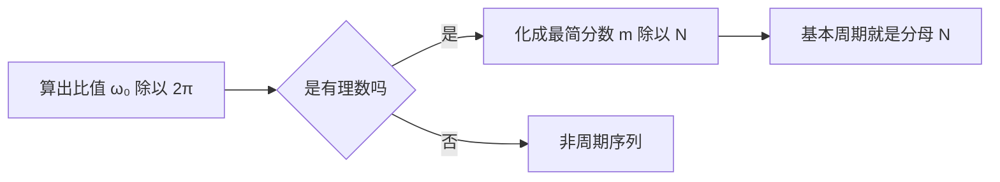

# 信号周期性判断

**标签：** #数字信号处理 #DSP #周期性 #正弦序列 #复指数序列

---

## 一、为什么"离散正弦"不一定是周期的？

连续时间的正弦信号 $\sin(\Omega t)$ 对**任意** $\Omega \ne 0$ 都是周期的，周期 $T = 2\pi/\Omega$。

离散时间序列没这么幸运。序列只在整数点 $n$ 上有定义，要求存在**正整数** $N$ 使

$$
x[n+N] = x[n] \qquad \text{对所有整数 } n \text{ 成立}
$$

对 $x[n] = A\sin(\omega_0 n + \varphi)$ 代入：

$$
A\sin\big(\omega_0 (n+N) + \varphi\big) = A\sin(\omega_0 n + \varphi)
$$

正弦以 $2\pi$ 为周期，两式相等要求相位差是 $2\pi$ 的整数倍：

$$
\omega_0 N = 2\pi m \quad (m \text{ 为整数}) \tag{1}
$$

式 (1) 就是全部秘密所在。把它改写成比值形式：

$$
\boxed{\frac{\omega_0}{2\pi} = \frac{m}{N}}
$$

左边由信号给定，右边是**两个整数之比**。所以：

> **$\omega_0/(2\pi)$ 必须是有理数**，序列才可能周期。

连续域里"想多慢就多慢"的自由，在离散域被"只能用整数点采样"这个约束砍掉了一大半——绝大多数数字频率对应的离散正弦都**根本不周期**。

---

## 二、判据与算法

> 上图：蓝色是 $\sin(\pi n/4)$ 的采样点，落在连续正弦上且**每隔 8 点完全重复**（绿色箭头标出一个周期 $N=8$）；红色是 $\sin(\sqrt{2}\,n)$ 的采样点，落在连续正弦上但**永不重复**。采样点是否重复，正是离散正弦是否周期的判据。

### 1. 核心判据

$$
\frac{\omega_0}{2\pi} = \frac{m}{N}\ (\text{最简分数，} m,N \text{ 互质}) \quad\Longrightarrow\quad \text{基本周期} = N
$$

"基本周期"指满足条件的最小**正**整数。

### 2. 两种等价的算法

| 做法 | 步骤 | 结论取自 |
|------|------|---------|
| **比值法**（推荐） | 算 $\omega_0/2\pi$，化成最简分数 $\dfrac{m}{N}$ | **分母** $N$ |
| 倒数法 | 算 $2\pi/\omega_0$，化成最简分数 $\dfrac{N}{m}$ | **分子** $N$ |

> ⚠️ **坑在这里**：$\omega_0/2\pi$ 为无理数 ⇒ 非周期（无论怎么约分都得不到整数 $N$）；而 $2\pi/\omega_0$ 不是整数时，**不能**四舍五入当周期。例如 $2\pi/\omega_0 = 8/3$，基本周期是 $8$，既不是 $3$、也不是 $8/3$。

### 3. 判断流程

### 4. 为什么"最简分数"这一步不能省

若 $\dfrac{\omega_0}{2\pi} = \dfrac{m}{N}$ 但 $m,N$ 有公因子 $d$，则 $\dfrac{m}{N} = \dfrac{m/d}{N/d}$，真正的**最小**周期是 $N/d$ 而不是 $N$。

例如 $\dfrac{\omega_0}{2\pi} = \dfrac{6}{12}$，若不约分会答成 $N=12$；约分后 $\dfrac{1}{2}$，正确答案是 $N=2$。**先约分，再取分母**。

---

## 三、分类精讲与例题

> **统一答题格式**：先写判据 → 代入 $\omega_0$ → 约分 → 读分母 → 结论 → 检验。
> 考试时判据必须写出来，这是拿步骤分的关键。

### 1. 正弦序列 $x[n] = A\sin(\omega_0 n + \varphi)$

**关键结论**：判断与幅度 $A$、初相 $\varphi$ **无关**——它们只改变波形的高低和起点，不改变重复间隔。

---

**例题 1**：判断 $x[n]=\sin\left(\dfrac{\pi}{4}n\right)$ 是否为周期序列，若是求基本周期。

**解**：

（1）**写判据**：正弦序列周期的充要条件是 $\dfrac{\omega_0}{2\pi}$ 为有理数，且该比值写成最简分数 $\dfrac{m}{N}$ 时分母 $N$ 即基本周期。

（2）**代入数字角频率**：本题 $\omega_0 = \dfrac{\pi}{4}$。

（3）**计算比值并约分**：

$$
\frac{\omega_0}{2\pi} = \frac{\pi/4}{2\pi} = \frac{1}{8}
$$

$1$ 与 $8$ 已互质，是最简分数，故 $m=1,\ N=8$。

（4）**读结论**：比值为有理数，序列**周期**，基本周期 $N=8$。

**答案**：

$$
\boxed{\text{周期序列，基本周期 } N = 8}
$$

**检验**：$x[n+8]=\sin\left(\dfrac{\pi}{4}(n+8)\right)=\sin\left(\dfrac{\pi}{4}n+2\pi\right)=\sin\left(\dfrac{\pi}{4}n\right)=x[n]$ ✓

---

**例题 2**：判断 $x[n]=\sin\left(\dfrac{3\pi}{4}n\right)$ 是否为周期序列。

**解**：

（1）**写判据**：同上，看 $\dfrac{\omega_0}{2\pi}$ 是否为有理数。

（2）**代入**：$\omega_0 = \dfrac{3\pi}{4}$。

（3）**求比值**：

$$
\frac{\omega_0}{2\pi} = \frac{3\pi/4}{2\pi} = \frac{3}{8}
$$

（4）**约分**：$3$ 与 $8$ 互质，已是最简分数，$m=3,\ N=8$。

（5）**读结论**：有理数 ⇒ **周期**，基本周期 $N=8$。

**答案**：

$$
\boxed{\text{周期序列，基本周期 } N = 8}
$$

**检验**：$x[n+8]=\sin\left(\dfrac{3\pi}{4}n+\dfrac{3\pi}{4}\cdot 8\right)=\sin\left(\dfrac{3\pi}{4}n+6\pi\right)=x[n]$ ✓

**要点**：本题 $2\pi/\omega_0 = 8/3$ **不是整数**，若用倒数法容易误判成"非周期"。但比值 $\dfrac{3}{8}$ 是有理数，结论就是周期，周期是分母 $8$。**这正是必须用比值法的原因**。

---

**例题 3**：判断 $x[n]=\sin(3n)$ 是否为周期序列。

**解**：

（1）**写判据**：看 $\dfrac{\omega_0}{2\pi}$ 是否为有理数。

（2）**代入**：$\omega_0 = 3$。

（3）**求比值**：

$$
\frac{\omega_0}{2\pi} = \frac{3}{2\pi}
$$

（4）**判定有理/无理**：$\pi$ 是无理数，$\dfrac{3}{2\pi}$ **是无理数**（分子有理、分母无理）。

（5）**得结论**：不存在正整数 $N$ 使 $\omega_0 N = 2\pi m$，故**非周期**。

**答案**：

$$
\boxed{\text{非周期序列}}
$$

**检验（反证）**：若存在正整数 $N$ 使 $\sin\big(3(n+N)\big)=\sin(3n)$，则必有 $3N=2\pi m$（$m$ 为整数）。左端是正整数，右端含无理数 $\pi$ 且 $m\neq0$，二者不可能相等，矛盾 ✓

**要点**：能化成"整数 / ($\pi$ 的倍数)"的即为无理数，一律非周期。这类题不需要硬算小数近似。

---

### 2. 复指数序列 $x[n] = e^{j\omega_0 n}$

判据与正弦序列**完全一样**：只看 $\dfrac{\omega_0}{2\pi}$ 是否为有理数。因为欧拉公式把复指数拆成一对正弦/余弦，周期必然同步。

**例题 4**：判断 $x[n]=e^{j\frac{\pi}{3}n}$ 是否为周期序列。

**解**：

（1）**写判据**：复指数序列 $e^{j\omega_0 n}$ 周期 $\iff \dfrac{\omega_0}{2\pi}$ 为有理数。

（2）**代入**：$\omega_0 = \dfrac{\pi}{3}$。

（3）**求比值**：

$$
\frac{\omega_0}{2\pi} = \frac{\pi/3}{2\pi} = \frac{1}{6}
$$

已是最简分数，分母 $N=6$。

**答案**：

$$
\boxed{\text{周期序列，基本周期 } N = 6}
$$

**检验**：$e^{j\frac{\pi}{3}(n+6)} = e^{j\frac{\pi}{3}n}\cdot e^{j2\pi} = e^{j\frac{\pi}{3}n}$ ✓

---

**例题 5**：判断 $x[n]=e^{jn}$ 是否为周期序列。

**解**：

（1）**写判据**：同上。

（2）**代入**：$\omega_0 = 1$。

（3）**求比值**：$\dfrac{1}{2\pi}$，因 $\pi$ 无理，比值为**无理数**。

**答案**：

$$
\boxed{\text{非周期序列}}
$$

**检验（反证）**：若 $e^{jN}=1$，则 $N=2\pi m$。正整数不可能等于无理数 $\pi$ 的整数倍，故这样的 $N$ 不存在 ✓

---

### 3. 多个正弦叠加

**判据**：

1. 分别求各分量基本周期 $N_1, N_2, \dots, N_k$；
2. 若**全部**周期，整体基本周期为 $\mathrm{LCM}(N_1,\dots,N_k)$；
3. 若**任一**分量非周期，整体**非周期**（无需再算 LCM）。

---

**例题 6**：判断 $x[n]=\sin\left(\dfrac{\pi}{3}n\right)+\cos\left(\dfrac{\pi}{4}n\right)$ 的周期性。

**解**：

（1）**分解并分别判定**。

第一项 $\omega_1=\dfrac{\pi}{3}$：

$$
\frac{\omega_1}{2\pi} = \frac{1}{6} \;\Rightarrow\; N_1 = 6
$$

第二项 $\omega_2=\dfrac{\pi}{4}$：

$$
\frac{\omega_2}{2\pi} = \frac{1}{8} \;\Rightarrow\; N_2 = 8
$$

（2）**求最小公倍数**。$6 = 2\times 3$，$8 = 2^3$，故

$$
\mathrm{LCM}(6,8) = 2^3 \times 3 = 24
$$

（3）**得结论**：两个分量都周期 ⇒ 整体周期，基本周期 $N=24$。

**答案**：

$$
\boxed{\text{周期序列，基本周期 } N = 24}
$$

**检验**：$N=24$ 是 $6$ 的 $4$ 倍、$8$ 的 $3$ 倍，两项同时回到原相位 ✓；且 $24$ 是满足此条件的最小正整数（任何公共周期必为 $6$ 与 $8$ 的公倍数）✓

---

**例题 7**：判断 $x[n]=\sin\left(\dfrac{\pi}{3}n\right)+\sin(n)$ 的周期性。

**解**：

（1）**分别判定**。

第一项：$\dfrac{\pi/3}{2\pi}=\dfrac{1}{6}$ 为有理数 ⇒ $N_1=6$，周期。

第二项：$\dfrac{1}{2\pi}$ 为无理数 ⇒ **非周期**。

（2）**得结论**：存在非周期分量 ⇒ 整体**非周期**。

**答案**：

$$
\boxed{\text{非周期序列}}
$$

**检验**：即使第一项每 $6$ 点回到原值，第二项 $\sin(n)$ 在 $n=N$ 处要求 $N=2\pi m$，无正整数解。**两项有一个不闭合，整体就不可能闭合** ✓

**要点**：一个非周期分量就足以拖垮整个序列，不必再算 LCM。反过来，若两个分量都周期，**必须**取最小公倍数，不能简单相加。

---

### 4. 实指数序列 $x[n] = a^n$

这一类**不能一概而论**，需按 $\lvert a \rvert$ 分类讨论：

| 情况 | 序列形态 | 是否周期 | 说明 |
|------|---------|---------|------|
| $a = 1$ | $x[n]\equiv 1$ | **是**，$N=1$ | 常数序列，任何 $N$ 都成立，最小正周期为 $1$ |
| $a = -1$ | $x[n]=(-1)^n$ | **是**，$N=2$ | 正负交替，隔一点重复 |
| $a = 0$ | $x[n]=0\ (n\ge 0)$ | 否 | 只在 $n\ge 0$ 非零，形状不重复 |
| $0 \lt a \lt 1$ 或 $a \gt 1$ | 单调衰减 / 增长 | **否** | $\lvert a \rvert^n$ 严格单调，永不自重复 |
| $-1 \lt a \lt 0$ | 衰减振荡 | **否** | 幅度单调趋零，峰值逐次变小 |
| $a$ 为一般复数 | $a = re^{j\theta}$ | 看 $\theta/(2\pi)$ | 幅度按 $r^n$ 变化，仅 $r=1$ 且 $\theta/(2\pi)$ 有理时周期 |

> **纠正一个常见说法**：网上常说"实指数序列永远不是周期的"——**这是错的**。$a=1$ 与 $a=-1$ 都是周期的。准确表述是：**$\lvert a\rvert \ne 1$ 的实指数序列非周期**。

**例题 8**：判断 $x[n]=\left(-\dfrac{1}{2}\right)^n$ 是否为周期序列。

**解**：

（1）**看模值**：$\lvert a\rvert = \dfrac{1}{2} \ne 1$。

（2）**判单调性**：$\lvert x[n]\rvert = \left(\dfrac{1}{2}\right)^n$ 严格单调递减，任意两点模值都不相等。

（3）**得结论**：周期序列要求 $x[n+N]=x[n]$，即模值必须相等，与单调性矛盾，故**非周期**。

**答案**：

$$
\boxed{\text{非周期序列}}
$$

**检验**：看相邻两点的模值之比 $\dfrac{\lvert x[n+1]\rvert}{\lvert x[n]\rvert}=\dfrac{1}{2}\neq1$。若序列以 $N$ 为周期，则 $x[n+N]=x[n]$ 必然要求该比值在整周期后回到 $1$，矛盾 ✓

---

**例题 9**：判断 $x[n]=e^{j\frac{2\pi}{5}n}$ 的周期性，并写出一个周期的全部取值。

**解**：

（1）**写判据**：$\dfrac{\omega_0}{2\pi}$ 是否为有理数。

（2）**求比值**：

$$
\frac{\omega_0}{2\pi} = \frac{2\pi/5}{2\pi} = \frac{1}{5}
$$

最简分数，分母 $N=5$。

（3）**求一个周期的取值**（$n=0,1,2,3,4$）：

$$
1,\quad e^{j\frac{2\pi}{5}},\quad e^{j\frac{4\pi}{5}},\quad e^{j\frac{6\pi}{5}},\quad e^{j\frac{8\pi}{5}}
$$

**答案**：

$$
\boxed{\text{周期序列，基本周期 } N=5,\ \text{一周期 } 5 \text{ 点均布单位圆}}
$$

**检验**：$5$ 步走满 $2\pi$（每步 $2\pi/5$）✓；$m=1$ 与 $N=5$ 互质，保证 $5$ 个点互不重合 —— 若换成 $e^{j\frac{2\pi}{6}\cdot 2n}=e^{j\frac{2\pi}{3}n}$，$m=2,N=6$ 不互质，实际周期缩到 $3$ ✓

**要点**：$N$ 个点的复指数序列恰好绕单位圆 $m$ 圈（本题 $m=1$ 圈）。$m$ 与 $N$ 互质保证这 $N$ 个点**互不重合**。

---

## 四、数字频率的周期性（离散域独有）

### 1. 核心恒等式

对任意整数 $n$ 与整数 $k$：

$$
e^{j(\omega_0 + 2\pi k)n} = e^{j\omega_0 n} \cdot \underbrace{e^{j2\pi kn}}_{=\,1} = e^{j\omega_0 n}
$$

因此：

> **数字频率 $\omega_0$ 与 $\omega_0 + 2\pi k$ 描述的是完全同一个序列**。

### 2. 两个直接推论

1. 讨论数字频率只需限定在长度为 $2\pi$ 的区间内，习惯取 $-\pi \lt \omega \leq \pi$ 或 $0 \leq \omega \lt 2\pi$。
2. 数字频率 $\omega$ 是模拟频率对采样率归一化的结果（详见 [[【数字信号处理DSP】（十）模拟频率与数字频率的关系|（十）模拟频率与数字频率的关系]]），这个"卷起来"的周期性正来自**采样**。

### 3. 一条重要直觉：$\omega$ 越大不代表振荡越快

由于上述等价性，$\omega$ 与 $2\pi - \omega$ 是同一个序列：

$$
e^{j(2\pi-\omega_0)n} = e^{-j\omega_0 n}
$$

右端是原序列的**共轭**（实部相同、虚部反号）。对实正弦而言 $\cos\big((2\pi-\omega_0)n\big) = \cos(\omega_0 n)$，两者**完全相同**。

于是：

- $\omega$ 从 $0$ 增到 $\pi$，振荡越来越快；
- $\omega$ 从 $\pi$ 增到 $2\pi$，振荡反而越来越慢，在 $2\pi$ 处退化为常数。

**$\omega = \pi$ 是离散序列能表示的"最快振荡"**（每两点翻转一次，形如 $1,-1,1,-1,\dots$）。这条直觉是后面理解"最高频率只到 $\pi$""混叠""采样定理"的地基。

> 上图：**上栏**把 $\cos(\pi n/4)$（蓝点）与 $\cos(7\pi n/4)$（红圈）画在一起，红圈处处套在蓝点上——$\omega=7\pi/4$ 与 $\omega=\pi/4$ 是同一个序列。**下栏**把 $\omega$ 从 $0$ 扫到 $2\pi$，纵轴是"有效振荡速率"：$0\to\pi$ 段越来越快，$\pi$ 处达到最快，之后**折返下降**，到 $2\pi$ 退回直流。所以"频率越大振荡越快"只在半个周期内成立。

### 4. "周期"与"频率是有理数倍"的等价

| $\omega_0/(2\pi)$ | 序列性质 | 数字频率的等价类 |
|---|---|---|
| 有理数 $m/N$ | 周期，基本周期 $N$ | 落在 $2\pi$ 区间内的某个确定值上 |
| 无理数 | 非周期 | 在 $(-\pi,\pi]$ 内稠密地"游走"，永不回到原点 |

所以"序列是否周期"本质上问的是：**这个数字频率能不能写成 $2\pi$ 的有理数倍**。

---

## 五、常见考题速查

| 序列 | $\omega_0$ | $\omega_0/2\pi$ | 是否周期 | 基本周期 |
|------|-----------|-----------------|---------|---------|
| $\sin(\pi n/2)$ | $\pi/2$ | $1/4$ | ✅ | $4$ |
| $\sin(\pi n)$ | $\pi$ | $1/2$ | ✅ | $2$ |
| $\sin(2\pi n/5)$ | $2\pi/5$ | $1/5$ | ✅ | $5$ |
| $\sin(3\pi n/4)$ | $3\pi/4$ | $3/8$ | ✅ | $8$ |
| $\sin(6\pi n/8)$ | $3\pi/4$ | $3/8$（约分后） | ✅ | $8$ |
| $\sin(0.5n)$ | $0.5$ | $1/(4\pi)$ 无理 | ❌ | — |
| $\cos(2n)$ | $2$ | $1/\pi$ 无理 | ❌ | — |
| $e^{j\pi n/6}$ | $\pi/6$ | $1/12$ | ✅ | $12$ |
| $e^{j2n}$ | $2$ | $1/\pi$ 无理 | ❌ | — |
| $(-1)^n$ | — | — | ✅ | $2$ |
| $\sin(\pi n/4) + \cos(\pi n/6)$ | — | — | ✅ | $\mathrm{LCM}(8,12)=24$ |

---

## 六、常见错误提醒

1. **把 $2\pi/\omega_0$ 直接当周期**：只有它恰好是整数时才成立。一般应把 $\omega_0/2\pi$ 化成最简分数 $m/N$，**分母**才是基本周期。
2. **由"约分不干净"就判非周期**：$\sin(3\pi n/4)$ 的 $2\pi/\omega_0 = 8/3$ 不是整数，但它周期（$N=8$）。
3. **忘记先约分**：$\omega_0/2\pi = 6/12$ 时答案是 $N=2$，不是 $12$。
4. **相加序列漏判某分量**：只要有一个分量非周期，整体非周期，不必再算 LCM。
5. **误以为"实指数序列都不周期"**：$a=1$、$a=-1$ 都是周期的。
6. **忘了 $\omega_0$ 与 $\omega_0+2\pi k$ 等价**：$\sin(1.5\pi n)$ 与 $\sin(-0.5\pi n)$ 是同一序列，判周期前可先化简到 $(-\pi,\pi]$，结论不变。
7. **把连续域直觉搬过来**：连续正弦"任意频率都周期"，离散正弦"多数频率都不周期"，这是最容易失分的地方。
8. **答周期却不给最小正周期**：题目问"周期"时若有多个周期，考试要求写出**基本（最小正）周期**。

---

## 七、知识链定位

信号周期性判断（本节）

│

├── 判据：ω₀/2π 为有理数 ⇔ 周期，最简分数的分母 = 基本周期

├── 分类：正弦 / 复指数 / 相加（LCM）/ 实指数（按 |a| 讨论）

└── 数字频率的周期性：ω 与 ω + 2πk 等价，最高频率在 π

│

├── 模拟频率与数字频率的关系（第十节）

├── 序列的傅里叶变换：从"周期"到"频谱"（第十四节）

└── DFT / DFS：周期序列的频域表示（后续章节）

---

## 八、总结

- **一个判据管所有**：$\omega_0/(2\pi)$ 有理则周期，无理则非周期。
- **基本周期**：把它化成最简分数 $m/N$，$N$ 就是基本周期（**先约分再取分母**）。
- **相加序列**：全周期才周期且取 LCM；有一个非周期，整体非周期。
- **实指数序列**：$\lvert a\rvert\ne 1$ 时非周期；$a=1$ 周期 $1$，$a=-1$ 周期 $2$。
- **离散域独有**：数字频率以 $2\pi$ 为周期，$\omega$ 与 $\omega+2\pi k$ 是同一序列，故 $\omega=\pi$ 是最快振荡。

---

> **一句话总结**：正弦 / 复指数序列是否周期，只看 $\omega_0/(2\pi)$ 是不是有理数——有理则周期（最简分数的分母即基本周期），无理则非周期；这个"有理数门槛"正是离散时间与连续时间最大的差别之一。
