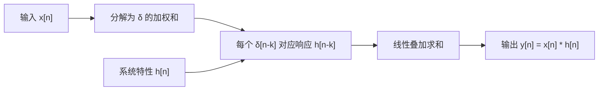
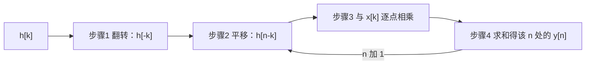

# 卷积和

**标签：** #数字信号处理 #DSP #卷积和 #LSI系统 #单位脉冲响应 #图解法

---

## 一、为什么需要卷积？

卷积是离散时间信号处理中最核心的运算之一。它的重要性体现在：

- **LSI系统的描述**：线性移不变（LSI）系统的输出等于输入与单位脉冲响应的卷积
- **信号分解**：任何离散时间信号都可以分解为单位脉冲序列的加权和，卷积正是这种分解的自然结果
- **后续基础**：卷积是理解 Z 变换、DFT、滤波器设计的前提

一句话概括它的地位：**只要系统是 LSI，输出就只能是卷积**。这是在 [[【数字信号处理DSP】（二）离散时间系统六大性质判断方法|（二）离散时间系统六大性质判断方法]] 中"线性 + 时不变"两个性质合起来推出来的必然结论。

---

## 二、卷积的定义

### 1. 卷积和公式

对于两个离散时间序列 $x[n]$ 和 $h[n]$，它们的卷积定义为：

$$
y[n] = x[n] * h[n] = \sum_{k=-\infty}^{\infty} x[k] \, h[n-k]
$$

其中：
- $n$ 为输出序列的时间索引
- $k$ 为求和哑变量
- $*$ 表示卷积运算符

### 2. 另一种等价形式

$$
y[n] = \sum_{k=-\infty}^{\infty} x[n-k] \, h[k]
$$

两种形式等价，由卷积的交换律保证。**做题时选哪个更方便就用哪个**——如果其中一个序列很长（如 $u[n]$、$a^nu[n]$），把它的下标留在 $n-k$ 位置通常更好处理。

---

## 三、卷积的物理意义

> 上图：两个宽度都是 4 的矩形序列 $x[k]$、$h[k]$（上）；翻转 $h$ 并右移到 $n=2$、紫色部分为重叠相乘项（中，重叠 3 项故 $y[2]=3$）；结果是长度 $4+4-1=7$ 的三角形 $1,2,3,4,3,2,1$（下）。**等宽矩形卷积才是纯三角，峰值为 $\min(L_x,L_h)$**；若两矩形不等宽（如 4 与 3），结果是梯形、顶部有一段平台。

### 1. LSI系统的零状态响应

对于线性移不变系统，若系统的单位脉冲响应为 $h[n]$，则输入 $x[n]$ 产生的零状态响应为：

$$
y[n] = x[n] * h[n]
$$

### 2. 信号分解角度

将输入信号 $x[n]$ 表示为加权移位单位脉冲的和：

$$
x[n] = \sum_{k=-\infty}^{\infty} x[k] \, \delta[n-k]
$$

由于系统是线性和移不变的，输出为：

$$
y[n] = \sum_{k=-\infty}^{\infty} x[k] \, h[n-k] = x[n] * h[n]
$$

这三步推理（分解 → 用脉冲响应替换 → 用线性叠加求和）就是卷积的**全部来历**，值得记住上面这个推导。它的结构可以用一张图看得很清楚：

---

## 四、图解卷积法（四步走）

计算卷积 $y[n] = x[n] * h[n]$ 的图解步骤如下：

### 步骤1：翻转（Folding）

将 $h[k]$ 关于纵轴翻转得到 $h[-k]$。

### 步骤2：平移（Shifting）

将 $h[-k]$ 向右平移 $n$ 个单位，得到 $h[n-k]$。

### 步骤3：相乘（Multiplication）

将 $x[k]$ 与 $h[n-k]$ 逐点相乘。

### 步骤4：求和（Summation）

将所有乘积相加，得到 $y[n]$ 在该 $n$ 点的值。

重复步骤2~4，遍历所有 $n$ 即可得到完整的 $y[n]$。

> 上图：$x=\{1,2,3,2,1\}$、$h=\{1,0.5,0.25\}$。**上排**把 $h$ 先翻转（灰点线是未翻转的 $h[k]$，橙虚线是翻转后的 $h[n-k]$——一个递减、一个递增，翻转关系一眼可见），再右移到当前的 $n$。**下排**是逐点乘积，柱高之和就是 $y[n]$：$y[2]=4.25$、$y[3]=4$。窗口每右移一格，橙线跟着右移一格，这就是"重复步骤 2~4"的字面意思。

> 口诀：**翻、移、乘、加**。四个字里最容易被忽略的是"移"——移的距离就是当前的输出时刻 $n$，所以每算一个 $n$ 都要重新移一次。

---

## 五、卷积的性质

### 性质1：交换律

$$
x[n] * h[n] = h[n] * x[n]
$$

### 性质2：结合律

$$
(x[n] * h_1[n]) * h_2[n] = x[n] * (h_1[n] * h_2[n])
$$

### 性质3：分配律

$$
x[n] * (h_1[n] + h_2[n]) = x[n] * h_1[n] + x[n] * h_2[n]
$$

### 性质4：与单位脉冲的卷积

$$
x[n] * \delta[n] = x[n]
$$

### 性质5：与移位单位脉冲的卷积

$$
x[n] * \delta[n - n_0] = x[n - n_0]
$$

### 性质6：与单位阶跃的卷积（累加器）

$$
x[n] * u[n] = \sum_{k=-\infty}^{n} x[k]
$$

### 性质7：时移性质（考试高频）

若 $x[n] * h[n] = y[n]$，则

$$
x[n-n_1] * h[n-n_2] = y[n-n_1-n_2]
$$

即**两个输入各自移多少，输出就移多少之和**。这条性质把"带移位的卷积"直接归约到"先算无移位的卷积，再把结果整体平移"。

> **它的用法**：遇到 $x[n-2]*h[n-1]$ 这种题，先算 $x*h$，再把结果右移 $3$，**不要重新做四步法**。

---

## 六、典型例题

> **统一答题格式**：① 判类型（有限长 → 表格/多项式法；无限长 → 定区间后解析求和）；② 定 $y$ 的非零区间；③ 逐个 $n$ 计算；④ **核长度**（$L_y=L_x+L_h-1$）。
> 「定区间 + 核长度」这两步能在动笔前就把答案框住，算错了立刻能发现。

### 例题 1：两个有限长序列的卷积（表格法）

**题目**：$x[n]=\{1,2,3\}$（$n=0,1,2$），$h[n]=\{4,5\}$（$n=0,1$），求 $y[n]=x[n]*h[n]$。

**解**：

（1）**定区间**：$x$ 在 $[0,2]$（$L_x=3$）、$h$ 在 $[0,1]$（$L_h=2$），故 $y$ 在 $[0+0,\,2+1]=[0,3]$，长度 $L_y=3+2-1=4$。

（2）**逐点求**（$y[n]=\sum_k x[k]h[n-k]$）：

| $n$ | 非零项（$m=k$ 与 $n-k$ 配对） | 计算 | $y[n]$ |
|---|---|---|---|
| $0$ | $x[0]h[0]$ | $1\times4$ | $4$ |
| $1$ | $x[0]h[1]+x[1]h[0]$ | $5+8$ | $13$ |
| $2$ | $x[1]h[1]+x[2]h[0]$ | $10+12$ | $22$ |
| $3$ | $x[2]h[1]$ | $15$ | $15$ |

（3）**写出结果**：

$$
\boxed{y[n]=\{4,\ 13,\ 22,\ 15\},\quad n=0,1,2,3}
$$

**检验**（用多项式乘法复核，这是最快的手算验证法）：

$$
(1+2z^{-1}+3z^{-2})(4+5z^{-1}) = 4+13z^{-1}+22z^{-2}+15z^{-3}
$$

系数依次为 $4,13,22,15$，与表格法一致 ✓；项数 $4$，与 $L_y=4$ 一致 ✓

---

### 例题 2：指数序列与单位阶跃的卷积

**题目**：$x[n] = a^n u[n]$（$\lvert a\rvert<1$），$h[n] = u[n]$，求 $y[n]$。

**解**：

（1）**写定义式**：

$$
y[n] = \sum_{k=-\infty}^{\infty} a^k u[k] \, u[n-k]
$$

（2）**定求和区间**：$u[k]$ 要求 $k\ge 0$，$u[n-k]$ 要求 $k\le n$，两者同时成立才非零，故

$$
y[n]=\sum_{k=0}^{n}a^k \quad(\text{仅当 } n\ge 0)
$$

（3）**分情况**：

- $n<0$：区间 $[0,n]$ 为空（下界大于上界），$y[n]=0$。
- $n\ge 0$：等比级数求和，首项 $1$、公比 $a$、共 $n+1$ 项：

$$
y[n]=\frac{1-a^{n+1}}{1-a}
$$

（4）**合并成分段/阶跃形式**：

$$
\boxed{y[n] = \frac{1-a^{n+1}}{1-a}\,u[n]}
$$

**检验**（$n=0$ 与 $n\to\infty$ 两端）：

- $y[0]=a^0=1$ ✓（$n=0$ 时只有一个重叠项）
- $n\to\infty$ 时 $y[n]\to\dfrac{1}{1-a}$，即 $x$ 全部"积分"后的稳态值 ✓

> **理解**：$x*u$ 就是"累加器"对 $x$ 的累积求和，所以输出会趋于 $\sum_{k=0}^\infty a^k=\frac{1}{1-a}$。

---

### 例题 3：矩形脉冲与自身的卷积

**题目**：$x[n]=R_N[n]=u[n]-u[n-N]$（$n=0,\dots,N-1$ 为 $1$），求 $y[n]=x[n]*x[n]$。

**解**：

（1）**定区间与长度**：$x$ 在 $[0,N-1]$，故 $y$ 在 $[0,2N-2]$，长度 $L_y=N+N-1=2N-1$。

（2）**写出求和式**（$R_N[k]R_N[n-k]$ 要求 $0\le k\le N-1$ 且 $0\le n-k\le N-1$，即 $\max(0,n-N+1)\le k\le\min(n,N-1)$）：

$$
y[n]=\sum_{k=\max(0,\,n-N+1)}^{\min(n,\,N-1)}1 \;=\; (\text{上限} - \text{下限} + 1)
$$

（3）**分三段**：

- $0\le n\le N-1$：下限 $0$、上限 $n$，故 $y[n]=n+1$（**上升段**）
- $N\le n\le 2N-2$：下限 $n-N+1$、上限 $N-1$，故 $y[n]=2N-1-n$（**下降段**）
- 其余：$y[n]=0$

$$
\boxed{y[n] =
\begin{cases}
n+1, & 0 \le n \le N-1 \\
2N-1-n, & N \le n \le 2N-2 \\
0, & \text{otherwise}
\end{cases}}
$$

（4）**取 $N=3$ 验证**：

$$
y[n]=\{1,2,3,2,1\},\quad n=0,1,2,3,4
$$

**检验**：长度 $5=2\times3-1$ ✓；峰值 $3=N$（出现在 $n=N-1=2$，正好两矩形完全重叠）✓；上升段与下降段关于 $n=N-1$ 对称 ✓

> **配图里是 $N=4$ 的情形**：$y=\{1,2,3,4,3,2,1\}$，长度 $7$。
>
> **重要提醒**：只有**等宽**矩形卷积才是纯三角。若宽度不同（如 $4$ 与 $3$），重叠项数会先升到 $\min$ 后保持几拍再降，结果是**梯形**——很多教材只画等宽情形，容易让人误以为"矩形卷积一定是三角"。

---

### 例题 4：利用卷积性质简化计算

**题目**：$x[n] = \delta[n] + 2\delta[n-1]$，$h[n] = 3\delta[n] - \delta[n-2]$，求 $y[n]=x[n]*h[n]$。

**解**：

（1）**策略**：含 $\delta$ 的序列用性质法，**不要做四步法**。

（2）**展开成四项**（分配律）：

$$
y[n] = (\delta[n]+2\delta[n-1])*(3\delta[n]-\delta[n-2])
$$

$$
=3\underbrace{\delta[n]*\delta[n]}_{=\delta[n]}-\underbrace{\delta[n]*\delta[n-2]}_{=\delta[n-2]}+6\underbrace{\delta[n-1]*\delta[n]}_{=\delta[n-1]}-2\underbrace{\delta[n-1]*\delta[n-2]}_{=\delta[n-3]}
$$

（3）**合并同类项**（$\delta[n-1]$ 有两项：$6\delta[n-1]$）：

$$
\boxed{y[n] = 3\delta[n] + 6\delta[n-1] - \delta[n-2] - 2\delta[n-3]}
$$

**检验**：也可以把它写成系数序列 $\{3,6,-1,-2\}$，长度 $4=2+2-1$ ✓；与多项式乘法 $(1+2z^{-1})(3-z^{-2})=3+6z^{-1}-z^{-2}-2z^{-3}$ 一致 ✓

---

### 例题 5：两个指数序列的卷积（$a\neq b$）

**题目**：$x[n]=a^nu[n]$，$h[n]=b^nu[n]$，$a\neq b$，$a,b\neq 0$。求 $y[n]$。

**解**：

（1）**写定义式并定区间**（同例题 2，$0\le k\le n$）：

$$
y[n]=\sum_{k=0}^{n}a^k b^{\,n-k}\quad(n\ge0)
$$

（2）**提公因子构造等比**：提出 $b^n$，公比为 $a/b$：

$$
y[n]=b^n\sum_{k=0}^{n}\left(\frac{a}{b}\right)^{k}=b^n\cdot\frac{1-(a/b)^{n+1}}{1-a/b}
$$

（3）**化简**（分子分母同乘 $b$）：

$$
b^n\cdot\frac{1-(a/b)^{n+1}}{1-a/b}
= b^n\cdot\frac{b^{\,n+1}-a^{\,n+1}}{b^{\,n}\cdot(b-a)}\cdot\frac{1}{1}
=\frac{b^{\,n+1}-a^{\,n+1}}{b-a}
$$

$$
\boxed{y[n]=\frac{a^{\,n+1}-b^{\,n+1}}{a-b}\,u[n]}
$$

**检验**（三种办法互相印证）：

1. **$n=0$**：$y[0]=\dfrac{a-b}{a-b}=1=x[0]h[0]$ ✓
2. **取 $b\to a$ 的极限**（洛必达，把 $b$ 视作变量）：$\dfrac{a^{n+1}-b^{n+1}}{a-b}\to(n+1)a^{n}$，正是例题 2 中"两个相同指数"的结果 ✓
3. **$a=1,b=a$ 特例**：取 $a=1$，$y[n]=\dfrac{1-b^{n+1}}{1-b}$，与例题 2（把 $a$ 换成 $b$）完全一致 ✓

> **这是最典型的"必考型"卷积**：只要看到两个指数序列相乘求和，答案一定是 $\dfrac{a^{n+1}-b^{n+1}}{a-b}$ 的形式。**记结论省时间，但推导要会写**（考卷上不推导会被扣步骤分）。

---

### 例题 6：带负下标的卷积（区间规则实战）

**题目**：$x[n]=\{2,1\}$ 非零于 $n=-1,0$（即 $x[n]=2\delta[n+1]+\delta[n]$），$h[n]=\{1,3\}$ 非零于 $n=0,1$。求 $y[n]$。

**解**：

（1）**定区间与长度**：$x$ 在 $[-1,0]$、$h$ 在 $[0,1]$，故

$$
y \text{ 的区间} = [-1+0,\ 0+1] = [-1,1],\qquad L_y = 2+2-1 = 3
$$

（2）**逐点算**（$y[n]=\sum_k x[k]h[n-k]$，$x$ 非零仅 $k=-1,0$）：

| $n$ | 非零配对 | 计算 | $y[n]$ |
|---|---|---|---|
| $-1$ | $k=-1,\ n-k=0$ | $x[-1]h[0]=2\times1$ | $2$ |
| $0$ | $k=-1,\ n-k=1$；$k=0,\ n-k=0$ | $2\times3+1\times1$ | $7$ |
| $1$ | $k=0,\ n-k=1$ | $x[0]h[1]=1\times3$ | $3$ |

（3）**写出结果**：

$$
\boxed{y[n]=\{2,\ 7,\ 3\},\quad n=-1,0,1}
$$

**检验**：结果为 $3$ 点，与 $L_y=3$ 一致 ✓；首发点 $y[-1]=x[-1]h[0]=2$ ✓；末点 $y[1]=x[0]h[1]=3$ ✓

（4）**用性质法复核**（更快）：

$$
y=2\delta[n+1]*(\delta[n]+3\delta[n-1])+(\delta[n])*(\delta[n]+3\delta[n-1])
$$

$$
=2\delta[n+1]+6\delta[n]+\delta[n]+3\delta[n-1]=2\delta[n+1]+7\delta[n]+3\delta[n-1]
$$

系数序列 $\{2,7,3\}$，与表格法一致 ✓

> **性质 7 的用法**：若把 $h[n]$ 换成 $h[n-5]$（右移 $5$），则 $y$ 整体右移 $5$，区间变为 $[4,6]$，数值仍为 $\{2,7,3\}$。**先算无移位版本再平移**，这是省时关键。

---

## 七、卷积结果的长度与有效区间

这是手工计算最容易出错的地方，单独拎出来说清楚。

### 1. 长度规则

设 $x[n]$ 非零长度为 $L_x$、$h[n]$ 非零长度为 $L_h$，则 $y[n] = x[n]*h[n]$ 的非零长度为

$$
L_y = L_x + L_h - 1
$$

**直觉**：最前面的非零点只能靠"两者的第一个非零点"对齐产生，最后面的非零点只能靠"两者的最后一个非零点"对齐产生，中间的每个输出点至少有一种配对方式。

### 2. 有效区间

若 $x[n]$ 的非零区间为 $[N_1, N_2]$、$h[n]$ 的非零区间为 $[M_1, M_2]$，则 $y[n]$ 的非零区间为

$$
[N_1 + M_1, \quad N_2 + M_2]
$$

**这个区间就是"起始下标相加、结束下标相加"**，不用记公式也能推。用它可以直接给例题 1 的结果定界：$x$ 在 $[0,2]$、$h$ 在 $[0,1]$，则 $y$ 在 $[0, 3]$，共 4 点——与表格算出的 $\{4,13,22,15\}$ 一致。

### 3. 卷积 vs 相关（易混点）

| | 是否翻转 | 表达式 | 结果长度 |
| --- | --- | --- | --- |
| 卷积 | 翻转 | $\sum_k x[k]h[n-k]$ | $L_x + L_h - 1$ |
| 相关 | 不翻转 | $\sum_k x[k]y[k-n]$ | 同左（也是 $L_x + L_y - 1$） |

一句话区分：**卷积要"翻"，相关不要"翻"**（详见 [[【数字信号处理DSP】（四）自相关函数与互相关函数|（四）自相关函数与互相关函数]]）。自相关可以看成"序列与自己的卷积"，所以长度正好是 $2L-1$。

---

## 八、卷积的计算方法总结

| 方法 | 适用场景 | 特点 |
|------|---------|------|
| 图解翻转法 | 教学理解、短序列 | 直观，但手工计算慢 |
| 表格法 | 有限长序列 | 系统化，不易出错 |
| 多项式乘法 | 有限长序列 | **最快**，一次乘法出全部系数 |
| 解析法 | 无限长序列（指数、阶跃） | 需要求和公式 |
| 性质法 | 含 $\delta$ 的序列 | 最快，利用卷积性质 |
| FFT法 | 长序列、工程实现 | 计算效率高（$O(N\log N)$） |

### 用 FFT 算卷积：为什么必须补零

频域相乘对应**循环**卷积，不是线性卷积：

$$
\text{IDFT}\big\{X[k]H[k]\big\} = \text{循环卷积}
$$

要让两者相等，必须把两个序列都补零到长度 $N\ge L_x+L_h-1$ 再做 $N$ 点 FFT。**不补零会出现"尾部绕回头部"的混叠**——本应出现在末尾的项跑到开头，结果全错。

> **工程惯例**：实做时取 $N=2^{\lceil\log_2(L_x+L_h-1)\rceil}$，即不小于 $L_x+L_h-1$ 的最小 2 的幂，这样 FFT 最快。

---

## 九、卷积的工程应用

| 领域 | 应用 |
|------|------|
| 数字滤波 | FIR滤波器输出 = 输入与滤波器系数的卷积 |
| 图像处理 | 二维卷积用于模糊、边缘检测 |
| 通信系统 | 匹配滤波器 = 接收信号与发送波形的卷积 |
| 音频处理 | 混响效果 = 干信号与房间冲激响应的卷积 |
| 地震勘探 | 地震记录 = 震源子波与地层反射系数的卷积 |

---

## 十、常见错误提醒

1. **求和区间搞错**：一定要正确确定 $x[k]$ 和 $h[n-k]$ 的非零区间。**先写出"下界 ≤ k ≤ 上界"，再判断这个区间是否为空**（上界小于下界即为空，$y[n]=0$）。
2. **忘记边界**：有限长卷积的结果长度 = $L_x + L_h - 1$，且区间 = 两区间首尾分别相加。算完先核这两个数。
3. **混淆卷积与相关**：卷积需要翻转，相关不需要翻转。
4. **符号混淆**：$x[n]*h[n]$ 中的 $*$ 是卷积运算符，不是乘法。
5. **以为矩形卷积一定是三角形**：只有**等宽**矩形才是纯三角；不等宽时是梯形（有平台段）。
6. **$a^n u[n]*b^n u[n]$ 直接用几何级数**：公比是 $a/b$ 而不是 $a$，容易漏掉外层的 $b^n$。结果一定要是 $\dfrac{a^{n+1}-b^{n+1}}{a-b}$ 这种**对称形式**。
7. **带移位的卷积重做四步法**：应先用性质 7（$x[n-n_1]*h[n-n_2]=y[n-n_1-n_2]$），只算一次无移位卷积。
8. **用 FFT 算卷积不补零**：得到的是循环卷积，尾部绕回头部。必须补零到 $\ge L_x+L_h-1$。

---

## 十一、知识链定位

卷积和（本节）

│

├── 定义：y[n] = Σ x[k] h[n-k]（翻转、平移、相乘、求和）

├── 来历：LSI 系统对单位脉冲分解的线性叠加

├── 性质：交换律 / 结合律 / 分配律 / 与 δ 卷积 / 时移

├── 长度与区间：Ly = Lx + Lh - 1，区间首尾分别相加

└── 两大手算捷径：多项式乘法、性质法

│

├── 离散时间系统六大性质：卷积的前提是 LSI（第二节）

├── 自相关与互相关：不翻转的"卷积"（第四节）

├── 离散时间系统的各种响应：零状态响应即卷积（第八节）

├── 时域解法：差分方程与卷积两条路（第九节）

├── Z 变换与收敛域：卷积 → 乘法（第十三节）

└── 系统函数 H(z)：H(z) = Y(z)/X(z) 就是卷积定理的产物（后续章节）

---

## 十二、快速记忆

| 要点 | 内容 |
|------|------|
| 定义 | $y[n] = \sum_k x[k] h[n-k]$ |
| 四步法 | 翻转 → 平移 → 相乘 → 求和 |
| 交换律 | $x*h = h*x$ |
| 与 $\delta$ | $x*\delta = x$，$x*\delta[n-n_0]=x[n-n_0]$ |
| 时移 | $x[n-n_1]*h[n-n_2]=y[n-n_1-n_2]$ |
| 长度规则 | $L_y = L_x + L_h - 1$ |
| 区间规则 | $[N_1+M_1,\ N_2+M_2]$ |
| 指数型结论 | $a^nu[n]*b^nu[n]=\dfrac{a^{n+1}-b^{n+1}}{a-b}u[n]$ |
| LSI系统 | 输出 = 输入 * 冲激响应 |

---

> **一句话总结**：卷积是LSI系统分析的灵魂运算，它将输入信号、系统特性（冲激响应）和输出紧密联系在一起，是后续所有频域分析的基础。
