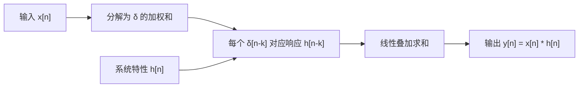
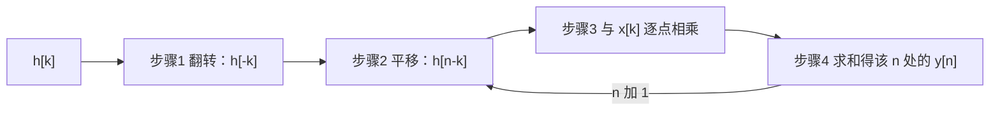

# 卷积和

**标签：** #数字信号处理 #DSP #卷积和 #LSI系统 #单位脉冲响应 #图解法

---

## 一、为什么需要卷积？

卷积是离散时间信号处理中最核心的运算之一。它的重要性体现在：

- **LSI系统的描述**：线性移不变（LSI）系统的输出等于输入与单位脉冲响应的卷积
- **信号分解**：任何离散时间信号都可以分解为单位脉冲序列的加权和，卷积正是这种分解的自然结果
- **后续基础**：卷积是理解 Z 变换、DFT、滤波器设计的前提

一句话概括它的地位：**只要系统是 LSI，输出就只能是卷积**。这是在 [[【数字信号处理DSP】（二）离散时间系统六大性质判断方法|（二）离散时间系统六大性质判断方法]] 中"线性 + 时不变"两个性质合起来推出来的必然结论。

---

## 二、卷积的定义

### 1. 卷积和公式

对于两个离散时间序列 $x[n]$ 和 $h[n]$，它们的卷积定义为：

$$
y[n] = x[n] * h[n] = \sum_{k=-\infty}^{\infty} x[k] \, h[n-k]
$$

其中：
- $n$ 为输出序列的时间索引
- $k$ 为求和哑变量
- $*$ 表示卷积运算符

### 2. 另一种等价形式

$$
y[n] = \sum_{k=-\infty}^{\infty} x[n-k] \, h[k]
$$

两种形式等价，由卷积的交换律保证。

---

## 三、卷积的物理意义

> 上图：两个长度 3 的矩形序列卷积，得到长度 5 的三角序列 $1,2,3,2,1$。卷积结果长度 = 两序列长度之和减 1。

### 1. LSI系统的零状态响应

对于线性移不变系统，若系统的单位脉冲响应为 $h[n]$，则输入 $x[n]$ 产生的零状态响应为：

$$
y[n] = x[n] * h[n]
$$

### 2. 信号分解角度

将输入信号 $x[n]$ 表示为加权移位单位脉冲的和：

$$
x[n] = \sum_{k=-\infty}^{\infty} x[k] \, \delta[n-k]
$$

由于系统是线性和移不变的，输出为：

$$
y[n] = \sum_{k=-\infty}^{\infty} x[k] \, h[n-k] = x[n] * h[n]
$$

这三步推理（分解 → 用脉冲响应替换 → 用线性叠加求和）就是卷积的**全部来历**，值得记住上面这个推导。它的结构可以用一张图看得很清楚：

---

## 四、图解卷积法（四步走）

计算卷积 $y[n] = x[n] * h[n]$ 的图解步骤如下：

### 步骤1：翻转（Folding）

将 $h[k]$ 关于纵轴翻转得到 $h[-k]$。

### 步骤2：平移（Shifting）

将 $h[-k]$ 向右平移 $n$ 个单位，得到 $h[n-k]$。

### 步骤3：相乘（Multiplication）

将 $x[k]$ 与 $h[n-k]$ 逐点相乘。

### 步骤4：求和（Summation）

将所有乘积相加，得到 $y[n]$ 在该 $n$ 点的值。

重复步骤2~4，遍历所有 $n$ 即可得到完整的 $y[n]$。

> 口诀：**翻、移、乘、加**。四个字里最容易被忽略的是"移"——移的距离就是当前的输出时刻 $n$，所以每算一个 $n$ 都要重新移一次。

---

## 五、卷积的性质

### 性质1：交换律

$$
x[n] * h[n] = h[n] * x[n]
$$

### 性质2：结合律

$$
(x[n] * h_1[n]) * h_2[n] = x[n] * (h_1[n] * h_2[n])
$$

### 性质3：分配律

$$
x[n] * (h_1[n] + h_2[n]) = x[n] * h_1[n] + x[n] * h_2[n]
$$

### 性质4：与单位脉冲的卷积

$$
x[n] * \delta[n] = x[n]
$$

### 性质5：与移位单位脉冲的卷积

$$
x[n] * \delta[n - n_0] = x[n - n_0]
$$

### 性质6：与单位阶跃的卷积（累加器）

$$
x[n] * u[n] = \sum_{k=-\infty}^{n} x[k]
$$

---

## 六、典型例题

### 例题1：两个有限长序列的卷积

已知：
$$
x[n] = \{1, 2, 3\}, \quad n=0,1,2
$$
$$
h[n] = \{4, 5\}, \quad n=0,1
$$

求 $y[n] = x[n] * h[n]$

**解**：

列出表格法（或图解）：

| n | 计算过程 | y[n] |
|---|---------|------|
| 0 | $1\times4 = 4$ | 4 |
| 1 | $1\times5 + 2\times4 = 5+8=13$ | 13 |
| 2 | $2\times5 + 3\times4 = 10+12=22$ | 22 |
| 3 | $3\times5 = 15$ | 15 |

所以：
$$
y[n] = \{4, 13, 22, 15\}, \quad n=0,1,2,3
$$

---

### 例题2：指数序列与单位阶跃的卷积

$x[n] = a^n u[n]$，$|a|<1$，$h[n] = u[n]$

求 $y[n] = x[n] * u[n]$

**解**：

$$
y[n] = \sum_{k=-\infty}^{\infty} a^k u[k] \, u[n-k]
$$

由于 $u[k]$ 使 $k \geq 0$，$u[n-k]$ 使 $k \leq n$，所以：

当 $n < 0$ 时，无重叠区间，$y[n]=0$；
当 $n \geq 0$ 时：

$$
y[n] = \sum_{k=0}^{n} a^k = \frac{1-a^{n+1}}{1-a}
$$

因此：
$$
y[n] = \frac{1-a^{n+1}}{1-a} u[n]
$$

---

### 例题3：矩形脉冲与自身的卷积

$x[n] = R_N[n]$（矩形序列，从 $0$ 到 $N-1$ 为1）

求 $y[n] = x[n] * x[n]$

**解**：

这是一个三角形序列：

$$
y[n] = 
\begin{cases}
n+1, & 0 \leq n \leq N-1 \\
2N-1-n, & N \leq n \leq 2N-2 \\
0, & \text{otherwise}
\end{cases}
$$

例如 $N=3$ 时：
$$
y[n] = \{1, 2, 3, 2, 1\}, \quad n=0,1,2,3,4
$$

---

### 例题4：利用卷积性质简化计算

已知 $x[n] = \delta[n] + 2\delta[n-1]$，$h[n] = 3\delta[n] - \delta[n-2]$

求 $y[n] = x[n] * h[n]$

**解**：

利用分配律和 $\delta$ 的卷积性质：

$$
\begin{aligned}
y[n] &= (\delta[n] + 2\delta[n-1]) * (3\delta[n] - \delta[n-2]) \\
&= 3\delta[n]*\delta[n] - \delta[n]*\delta[n-2] + 6\delta[n-1]*\delta[n] - 2\delta[n-1]*\delta[n-2] \\
&= 3\delta[n] - \delta[n-2] + 6\delta[n-1] - 2\delta[n-3]
\end{aligned}
$$

所以：
$$
y[n] = 3\delta[n] + 6\delta[n-1] - \delta[n-2] - 2\delta[n-3]
$$

---

## 七、卷积结果的长度与有效区间

这是手工计算最容易出错的地方，单独拎出来说清楚。

### 1. 长度规则

设 $x[n]$ 非零长度为 $L_x$、$h[n]$ 非零长度为 $L_h$，则 $y[n] = x[n]*h[n]$ 的非零长度为

$$
L_y = L_x + L_h - 1
$$

**直觉**：最前面的非零点只能靠"两者的第一个非零点"对齐产生，最后面的非零点只能靠"两者的最后一个非零点"对齐产生，中间的每个输出点至少有一种配对方式。

### 2. 有效区间

若 $x[n]$ 的非零区间为 $[N_1, N_2]$、$h[n]$ 的非零区间为 $[M_1, M_2]$，则 $y[n]$ 的非零区间为

$$
[N_1 + M_1, \quad N_2 + M_2]
$$

**这个区间就是"起始下标相加、结束下标相加"**，不用记公式也能推。用它可以直接给例题 1 的结果定界：$x$ 在 $[0,2]$、$h$ 在 $[0,1]$，则 $y$ 在 $[0, 3]$，共 4 点——与表格算出的 $\{4,13,22,15\}$ 一致。

### 3. 卷积 vs 相关（易混点）

| | 是否翻转 | 表达式 | 结果长度 |
| --- | --- | --- | --- |
| 卷积 | 翻转 | $\sum_k x[k]h[n-k]$ | $L_x + L_h - 1$ |
| 相关 | 不翻转 | $\sum_k x[k]y[k-n]$ | 同左（也是 $L_x + L_y - 1$） |

一句话区分：**卷积要"翻"，相关不要"翻"**（详见 [[【数字信号处理DSP】（四）自相关函数与互相关函数|（四）自相关函数与互相关函数]]）。自相关可以看成"序列与自己的卷积"，所以长度正好是 $2L-1$。

---

## 八、卷积的计算方法总结

| 方法 | 适用场景 | 特点 |
|------|---------|------|
| 图解翻转法 | 教学理解、短序列 | 直观，但手工计算慢 |
| 表格法 | 有限长序列 | 系统化，不易出错 |
| 解析法 | 无限长序列（指数、阶跃） | 需要求和公式 |
| 性质法 | 含 $\delta$ 的序列 | 最快，利用卷积性质 |
| FFT法 | 长序列、工程实现 | 计算效率高（$O(N\log N)$） |

---

## 九、卷积的工程应用

| 领域 | 应用 |
|------|------|
| 数字滤波 | FIR滤波器输出 = 输入与滤波器系数的卷积 |
| 图像处理 | 二维卷积用于模糊、边缘检测 |
| 通信系统 | 匹配滤波器 = 接收信号与发送波形的卷积 |
| 音频处理 | 混响效果 = 干信号与房间冲激响应的卷积 |
| 地震勘探 | 地震记录 = 震源子波与地层反射系数的卷积 |

---

## 十、常见错误提醒

1. **求和区间搞错**：一定要正确确定 $x[k]$ 和 $h[n-k]$ 的非零区间
2. **忘记边界**：有限长卷积的结果长度 = $L_x + L_h - 1$
3. **混淆卷积与相关**：卷积需要翻转，相关不需要翻转
4. **符号混淆**：$x[n]*h[n]$ 中的 $*$ 是卷积运算符，不是乘法

---

## 十一、知识链定位

卷积和（本节）

│

├── 定义：y[n] = Σ x[k] h[n-k]（翻转、平移、相乘、求和）

├── 来历：LSI 系统对单位脉冲分解的线性叠加

├── 性质：交换律 / 结合律 / 分配律 / 与 δ 卷积

└── 长度与区间：Ly = Lx + Lh - 1

│

├── 离散时间系统六大性质：卷积的前提是 LSI（第二节）

├── 自相关与互相关：不翻转的"卷积"（第四节）

├── 离散时间系统的各种响应：零状态响应即卷积（第八节）

├── 时域解法：差分方程与卷积两条路（第九节）

├── Z 变换与收敛域：卷积 → 乘法（第十三节）

└── 系统函数 H(z)：H(z) = Y(z)/X(z) 就是卷积定理的产物（后续章节）

---

## 十二、快速记忆

| 要点 | 内容 |
|------|------|
| 定义 | $y[n] = \sum_k x[k] h[n-k]$ |
| 四步法 | 翻转 → 平移 → 相乘 → 求和 |
| 交换律 | $x*h = h*x$ |
| 与 $\delta$ | $x*\delta = x$ |
| 长度规则 | $L_y = L_x + L_h - 1$ |
| LSI系统 | 输出 = 输入 * 冲激响应 |

---

> **一句话总结**：卷积是LSI系统分析的灵魂运算，它将输入信号、系统特性（冲激响应）和输出紧密联系在一起，是后续所有频域分析的基础。