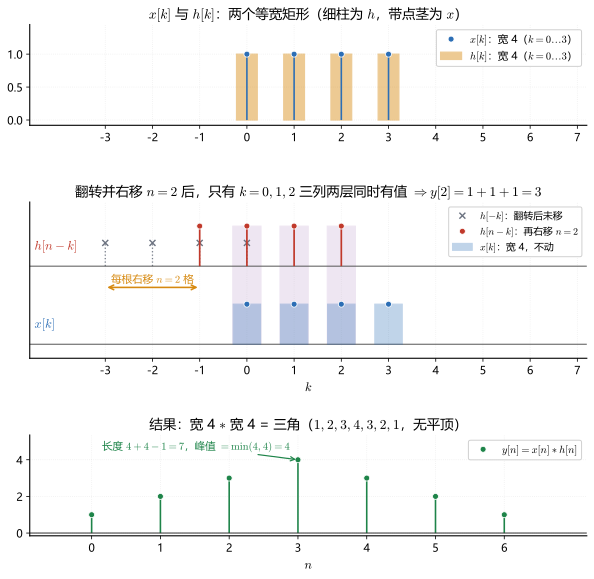
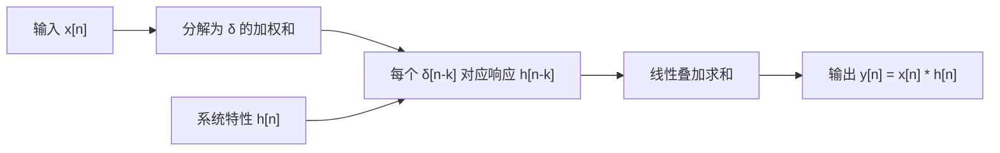
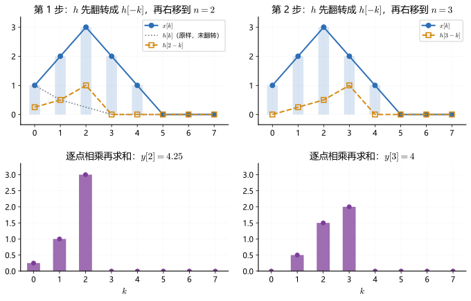
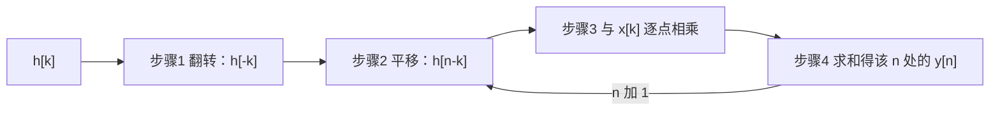

# 卷积和

**标签：** #数字信号处理 #DSP #卷积和 #LSI系统 #单位脉冲响应 #图解法

---

## 本篇的位置

**这一篇补的空洞。**（二）判出了"这个系统是 LSI"，但只说了它的输出由输入唯一决定，没给算法；（八）把 $y_{zs}=x*h$ 当成已知结论直接往下用。中间这一环一直是空的：为什么 LSI 的输出只能是卷积、具体怎么算、结果有多长、区间从哪到哪。卷积不是谁定义出来的运算，是"线性"加"时不变"两条性质合起来逼出的唯一形式。

**和前后篇的接口。** 上游是两个东西：（二）的线性与时不变，以及 $\delta[n]$ 的筛选性——$x[n]=\sum_k x[k]\delta[n-k]$ 这一步只用到筛选性。下游分三支：（八）的零状态响应直接写成 $y_{zs}=x*h$；（九）时域解法里"零状态"那条路就是卷积；（十三）Z 变换把它变成乘法，$Y(z)=X(z)H(z)$。

**本篇保留的简化。** 全篇只讨论 LSI 系统、实序列、因果或双边都行但必须有限起点。长度公式 $L_y=L_x+L_h-1$ 要求两个序列各自从某个有限下标开始（$x$ 从 $N_1$、$h$ 从 $M_1$），无限长序列只能谈区间、不能谈长度。复序列要把翻转改成共轭翻转，这里不出现。

**没出现的东西。** 卷积定理的证明、循环卷积与线性卷积的完整对应、二维卷积，三样都不在这里。前两样归（十三），二维卷积属图像处理，本专栏不展开。

**读完能做什么。** 拿到两个有限长序列，不用动笔就能报出结果长度和区间，再用多项式乘法一次出全部系数；遇到含 $\delta$ 或带移位的题，两分钟内用性质法出答案，而不是重做四步；用 FFT 实现时能说出补零的最小长度，以及补不够时哪个点会串到哪个点。

---

## 本篇要点

1. 三步推导里，"$x[k]$ 能提到求和号外"靠线性，"$\delta[n-k]$ 变 $\delta$ 响应"靠时不变。缺任一条，输出就不是卷积。
2. 结果长度 $L_x+L_h-1$、区间 $[N_1+M_1,\,N_2+M_2]$，两个数都能在动笔前算出来，算完先核这两个数。
3. 有限长序列手算，多项式乘法最快：$\{1,2,3\}*\{4,5\}=\{4,13,22,15\}$ 与 $(1+2z^{-1}+3z^{-2})(4+5z^{-1})$ 的系数逐个相同。
4. 指数型结论 $a^nu[n]*b^nu[n]=\dfrac{a^{n+1}-b^{n+1}}{a-b}u[n]$，公比取 $a/b$，外层的 $b^n$ 不能丢，答案必须对 $a,b$ 对称。

---

## 一、动机：LSI 系统为何只能输出卷积

卷积是离散时间信号处理中最核心的运算之一。它的重要性体现在：

- **LSI系统的描述**：线性移不变（LSI）系统的输出等于输入与单位脉冲响应的卷积
- **信号分解**：任何离散时间信号都可以分解为单位脉冲序列的加权和，卷积正是这种分解的自然结果
- **后续基础**：卷积是理解 Z 变换、DFT、滤波器设计的前提

一句话概括它的地位：**只要系统是 LSI，输出就只能是卷积**。这是在 [[【数字信号处理DSP】（二）离散时间系统六大性质判断方法|（二）离散时间系统六大性质判断方法]] 中"线性 + 时不变"两个性质合起来推出来的必然结论。

---

## 二、卷积的定义

### 1. 卷积和公式

对于两个离散时间序列 $x[n]$ 和 $h[n]$，它们的卷积定义为：

$$
y[n] = x[n] * h[n] = \sum_{k=-\infty}^{\infty} x[k] \, h[n-k]
$$

其中：
- $n$ 为输出序列的时间索引
- $k$ 为求和哑变量
- $*$ 表示卷积运算符

### 2. 另一种等价形式

$$
y[n] = \sum_{k=-\infty}^{\infty} x[n-k] \, h[k]
$$

两种形式等价，由卷积的交换律保证。**做题时选哪个更方便就用哪个**——如果其中一个序列很长（如 $u[n]$、$a^nu[n]$），把它的下标留在 $n-k$ 位置通常更好处理。

---

## 三、卷积的物理意义

> 上图三层对照。**上**：$x[k]$ 与 $h[k]$ 都是宽 4 的矩形，都占 $k=0,1,2,3$。**中**：$h$ 先翻成 $h[-k]$（灰叉，占 $k=-3\ldots0$——正好是上图中 $h$ 关于 $0$ 的镜像），再右移 $n=2$ 得 $h[n-k]$（红点，占 $k=-1\ldots2$），橙色双箭头标的就是这 2 格。两层**同时有值**的只有 $k=0,1,2$ 三列（紫色竖条），每列乘积都是 $1\times1=1$，所以 $y[2]=1+1+1=3$。**下**：对每个 $n$ 重做一遍，得到长度 $4+4-1=7$ 的三角形 $1,2,3,4,3,2,1$。
>
> **等宽矩形卷积才是纯三角，峰值为 $\min(L_x,L_h)=4$**；若两矩形不等宽（如 4 与 3），结果是梯形、顶部有一段平台。
>
> 一点提醒：两列都是常数 $1$，**翻转前后形状完全一样**，所以"翻转"这一步在这张图里看不出来，只能靠灰叉与上图 $h$ 的镜像关系去认。下一张图用的 $h=\{1,\,0.5,\,0.25\}$ 不对称，翻转才一眼可见。

### 1. LSI系统的零状态响应

对于线性移不变系统，若系统的单位脉冲响应为 $h[n]$，则输入 $x[n]$ 产生的零状态响应为：

$$
y[n] = x[n] * h[n]
$$

### 2. 信号分解角度

将输入信号 $x[n]$ 表示为加权移位单位脉冲的和：

$$
x[n] = \sum_{k=-\infty}^{\infty} x[k] \, \delta[n-k]
$$

由于系统是线性和移不变的，输出为：

$$
y[n] = \sum_{k=-\infty}^{\infty} x[k] \, h[n-k] = x[n] * h[n]
$$

求和号里的 x[k] 凭什么能被当成系数提到外面

因为线性的定义就是"加权和的响应，等于响应的加权和"。分解式里每个 $x[k]$ 是一个数（权重），$\delta[n-k]$ 是一个序列：输入写成 $\sum_k x[k]\cdot\left(\delta[n-k]\right)$，是若干个"数乘序列"再相加，线性允许把这两步翻个个儿——先各自过系统，再加权求和。

这一步只能逐个送：第 $k$ 个输入是 $\delta[n-k]$，它的响应记作 $h_k[n]$。**时不变性**规定 $h_k[n]=h[n-k]$，形状不动、位置跟着输入走。两条性质合起来，$\sum_k x[k]h_k[n]$ 才写成 $\sum_k x[k]h[n-k]$。

只有线性、没有时不变，$h_k[n]$ 就随 $k$ 变，求和号外找不到一个共同的 $h$ 去配 $x[k]$，结果只能停在 $\sum_k x[k]h_k[n]$。这个式子在数学上没问题，但它不是卷积，也不能用一个 $h[n]$ 描述整个系统。

这三步推理（分解 → 用脉冲响应替换 → 用线性叠加求和）就是卷积的**全部来历**，值得记住上面这个推导。它的结构可以用一张图看得很清楚：

线性但不移不变的系统，输出还能写成卷积吗

不能，而且失败的位置很具体：在"$\delta[n-k]$ 的响应 $h_k[n]$ 与 $k$ 无关"这一句上。

举一个只保留线性的例子。系统对 $\delta[n-k]$ 的响应定义为 $(k+1)h[n-k]$，$h$ 是某个固定的窄脉冲。这个系统是线性的：输入的每个分量各自被放大后叠加。但它时变——同一个 $\delta$ 在不同时刻送进去，放大倍数不同。

输入 $x[n]=\delta[n]+\delta[n-1]$ 时，实际输出是 $h[n]+2h[n-1]$。若按卷积算，$x*h=h[n]+h[n-1]$，第二项差一倍。差额就是那个随 $k$ 变化的因子 $k+1$，它卡在求和号里面提不出来。

这条也解释了（二）为什么把"移不变"单独列一条性质：没有它，冲激响应不足以描述系统，得为每个时刻各准备一个 $h_k$，工程上无法测量也无法存储。

---

## 四、图解卷积法（四步走）

计算卷积 $y[n] = x[n] * h[n]$ 的图解步骤如下：

### 步骤1：翻转（Folding）

将 $h[k]$ 关于纵轴翻转得到 $h[-k]$。

### 步骤2：平移（Shifting）

将 $h[-k]$ 向右平移 $n$ 个单位，得到 $h[n-k]$。

### 步骤3：相乘（Multiplication）

将 $x[k]$ 与 $h[n-k]$ 逐点相乘。

### 步骤4：求和（Summation）

将所有乘积相加，得到 $y[n]$ 在该 $n$ 点的值。

重复步骤2~4，遍历所有 $n$ 即可得到完整的 $y[n]$。

> 上图：$x=\{1,2,3,2,1\}$、$h=\{1,0.5,0.25\}$。**上排**把 $h$ 先翻转（灰点线是未翻转的 $h[k]$，橙虚线是翻转后的 $h[n-k]$——一个递减、一个递增，翻转关系一眼可见），再右移到当前的 $n$。**下排**是逐点乘积，柱高之和就是 $y[n]$：$y[2]=4.25$、$y[3]=4$。窗口每右移一格，橙线跟着右移一格，这就是"重复步骤 2~4"的字面意思。

> 口诀：**翻、移、乘、加**。四个字里最容易被忽略的是"移"——移的距离就是当前的输出时刻 $n$，所以每算一个 $n$ 都要重新移一次。

---

## 五、卷积的性质

### 性质1：交换律

$$
x[n] * h[n] = h[n] * x[n]
$$

### 性质2：结合律

$$
(x[n] * h_1[n]) * h_2[n] = x[n] * (h_1[n] * h_2[n])
$$

### 性质3：分配律

$$
x[n] * (h_1[n] + h_2[n]) = x[n] * h_1[n] + x[n] * h_2[n]
$$

### 性质4：与单位脉冲的卷积

$$
x[n] * \delta[n] = x[n]
$$

### 性质5：与移位单位脉冲的卷积

$$
x[n] * \delta[n - n_0] = x[n - n_0]
$$

### 性质6：与单位阶跃的卷积（累加器）

$$
x[n] * u[n] = \sum_{k=-\infty}^{n} x[k]
$$

### 性质7：时移性质（考试高频）

若 $x[n] * h[n] = y[n]$，则

$$
x[n-n_1] * h[n-n_2] = y[n-n_1-n_2]
$$

即**两个输入各自移多少，输出就移多少之和**。这条性质把"带移位的卷积"直接归约到"先算无移位的卷积，再把结果整体平移"。

两个移位量为什么要相加，而不是取其中较大的那个

因为两个序列各改一次"起点"，而卷积的首点由两个起点相加决定。$x[n-n_1]$ 的原点是 $n_1$，$h[n-n_2]$ 的原点是 $n_2$，配出来最小的下标就是 $n_1+n_2$；其余各点的相对位置没变，整段形状原样搬到新起点上，于是刚好是 $y[n-n_1-n_2]$。

用例题 6 的数试：$y=\{2,7,3\}$ 占 $n=-1,0,1$。把 $h$ 换成 $h[n-5]$，就是 $n_2=5$，结果整体右移 $5$，占 $[4,6]$，值仍是 $\{2,7,3\}$。若再把 $x$ 换成 $x[n-2]$，合计右移 $7$，占 $[6,8]$。

取较大值的做法会怎样：$x[n-2]*h[n-1]$ 若答成"右移 2"，区间会落在原来加 2 的位置，比正确结果偏左一格，长度倒是对的——所以只看长度查不出这个错。

> **它的用法**：遇到 $x[n-2]*h[n-1]$ 这种题，先算 $x*h$，再把结果右移 $3$，**不要重新做四步法**。

---

## 六、典型例题

> **统一答题格式**：① 判类型（有限长 → 表格/多项式法；无限长 → 定区间后解析求和）；② 定 $y$ 的非零区间；③ 逐个 $n$ 计算；④ **核长度**（$L_y=L_x+L_h-1$）。
> 「定区间 + 核长度」这两步能在动笔前就把答案框住，算错了立刻能发现。

### 例题 1：两个有限长序列的卷积（表格法）

**题目**：$x[n]=\{1,2,3\}$（$n=0,1,2$），$h[n]=\{4,5\}$（$n=0,1$），求 $y[n]=x[n]*h[n]$。

**解**：

（1）**定区间**：$x$ 在 $[0,2]$（$L_x=3$）、$h$ 在 $[0,1]$（$L_h=2$），故 $y$ 在 $[0+0,\,2+1]=[0,3]$，长度 $L_y=3+2-1=4$。

（2）**逐点求**（$y[n]=\sum_k x[k]h[n-k]$）：

| $n$ | 非零项（$m=k$ 与 $n-k$ 配对） | 计算 | $y[n]$ |
|---|---|---|---|
| $0$ | $x[0]h[0]$ | $1\times4$ | $4$ |
| $1$ | $x[0]h[1]+x[1]h[0]$ | $5+8$ | $13$ |
| $2$ | $x[1]h[1]+x[2]h[0]$ | $10+12$ | $22$ |
| $3$ | $x[2]h[1]$ | $15$ | $15$ |

（3）**写出结果**：

$$
\boxed{y[n]=\{4,\ 13,\ 22,\ 15\},\quad n=0,1,2,3}
$$

**检验**（用多项式乘法复核，这是最快的手算验证法）：

$$
(1+2z^{-1}+3z^{-2})(4+5z^{-1}) = 4+13z^{-1}+22z^{-2}+15z^{-3}
$$

系数依次为 $4,13,22,15$，与表格法一致 ✓；项数 $4$，与 $L_y=4$ 一致 ✓

---

### 例题 2：指数序列与单位阶跃的卷积

**题目**：$x[n] = a^n u[n]$（$\lvert a\rvert<1$），$h[n] = u[n]$，求 $y[n]$。

**解**：

（1）**写定义式**：

$$
y[n] = \sum_{k=-\infty}^{\infty} a^k u[k] \, u[n-k]
$$

（2）**定求和区间**：$u[k]$ 要求 $k\ge 0$，$u[n-k]$ 要求 $k\le n$，两者同时成立才非零，故

$$
y[n]=\sum_{k=0}^{n}a^k \quad(\text{仅当 } n\ge 0)
$$

（3）**分情况**：

- $n<0$：区间 $[0,n]$ 为空（下界大于上界），$y[n]=0$。
- $n\ge 0$：等比级数求和，首项 $1$、公比 $a$、共 $n+1$ 项：

$$
y[n]=\frac{1-a^{n+1}}{1-a}
$$

（4）**合并成分段/阶跃形式**：

$$
\boxed{y[n] = \frac{1-a^{n+1}}{1-a}\,u[n]}
$$

**检验**（$n=0$ 与 $n\to\infty$ 两端）：

- $y[0]=a^0=1$ ✓（$n=0$ 时只有一个重叠项）
- $n\to\infty$ 时 $y[n]\to\dfrac{1}{1-a}$，即 $x$ 全部"积分"后的稳态值 ✓

> **理解**：$x*u$ 就是"累加器"对 $x$ 的累积求和，所以输出会趋于 $\sum_{k=0}^\infty a^k=\frac{1}{1-a}$。

---

### 例题 3：矩形脉冲与自身的卷积

**题目**：$x[n]=R_N[n]=u[n]-u[n-N]$（$n=0,\dots,N-1$ 为 $1$），求 $y[n]=x[n]*x[n]$。

**解**：

（1）**定区间与长度**：$x$ 在 $[0,N-1]$，故 $y$ 在 $[0,2N-2]$，长度 $L_y=N+N-1=2N-1$。

（2）**写出求和式**（$R_N[k]R_N[n-k]$ 要求 $0\le k\le N-1$ 且 $0\le n-k\le N-1$，即 $\max(0,n-N+1)\le k\le\min(n,N-1)$）：

$$
y[n]=\sum_{k=\max(0,\,n-N+1)}^{\min(n,\,N-1)}1 \;=\; (\text{上限} - \text{下限} + 1)
$$

上限减下限之后为什么还得加一

因为 $\sum_{k=a}^{b}$ 是闭区间求和，展开是 $b-a+1$ 项：$k=a,a+1,\dots,b$。被求和的量恒为 $1$，求和结果就等于项数，项数比"跨度"多一。

$N=3$ 时看得最清楚：$\max(0,\,n-2)$ 到 $\min(n,\,2)$。$n=2$ 处下限 $0$、上限 $2$，$k$ 取 $0,1,2$ 三个值，$y[2]=3$，正是峰值 $N$。漏掉这个 $+1$，峰值会算成 $2$，首点会从 $1$ 变成 $0$——两端各错一格，比只错一个数更容易发现。

另一处容易漏的是 `otherwise` 那一段。它管的不是"顺手补个零"，而是 $n<0$ 与 $n>2N-2$ 两块都不属于前两段的区间；不写这一段，下限会大于上限，求和式本身就没有定义。

（3）**分三段**：

- $0\le n\le N-1$：下限 $0$、上限 $n$，故 $y[n]=n+1$（**上升段**）
- $N\le n\le 2N-2$：下限 $n-N+1$、上限 $N-1$，故 $y[n]=2N-1-n$（**下降段**）
- 其余：$y[n]=0$

$$
\boxed{y[n] =
\begin{cases}
n+1, & 0 \le n \le N-1 \\
2N-1-n, & N \le n \le 2N-2 \\
0, & \text{otherwise}
\end{cases}}
$$

（4）**取 $N=3$ 验证**：

$$
y[n]=\{1,2,3,2,1\},\quad n=0,1,2,3,4
$$

**检验**：长度 $5=2\times3-1$ ✓；峰值 $3=N$（出现在 $n=N-1=2$，正好两矩形完全重叠）✓；上升段与下降段关于 $n=N-1$ 对称 ✓

> **配图里是 $N=4$ 的情形**：$y=\{1,2,3,4,3,2,1\}$，长度 $7$。
>
> **重要提醒**：只有**等宽**矩形卷积才是纯三角。若宽度不同（如 $4$ 与 $3$），重叠项数会先升到 $\min$ 后保持几拍再降，结果是**梯形**——很多教材只画等宽情形，容易让人误以为"矩形卷积一定是三角"。

---

### 例题 4：利用卷积性质简化计算

**题目**：$x[n] = \delta[n] + 2\delta[n-1]$，$h[n] = 3\delta[n] - \delta[n-2]$，求 $y[n]=x[n]*h[n]$。

**解**：

（1）**策略**：含 $\delta$ 的序列用性质法，**不要做四步法**。

（2）**展开成四项**（分配律）：

$$
y[n] = (\delta[n]+2\delta[n-1])*(3\delta[n]-\delta[n-2])
$$

$$
=3\underbrace{\delta[n]*\delta[n]}_{=\delta[n]}-\underbrace{\delta[n]*\delta[n-2]}_{=\delta[n-2]}+6\underbrace{\delta[n-1]*\delta[n]}_{=\delta[n-1]}-2\underbrace{\delta[n-1]*\delta[n-2]}_{=\delta[n-3]}
$$

（3）**合并同类项**（$\delta[n-1]$ 有两项：$6\delta[n-1]$）：

$$
\boxed{y[n] = 3\delta[n] + 6\delta[n-1] - \delta[n-2] - 2\delta[n-3]}
$$

**检验**：也可以把它写成系数序列 $\{3,6,-1,-2\}$，长度 $4=2+2-1$ ✓；与多项式乘法 $(1+2z^{-1})(3-z^{-2})=3+6z^{-1}-z^{-2}-2z^{-3}$ 一致 ✓

---

### 例题 5：两个指数序列的卷积（a ≠ b）

**题目**：$x[n]=a^nu[n]$，$h[n]=b^nu[n]$，$a\neq b$，$a,b\neq 0$。求 $y[n]$。

**解**：

（1）**写定义式并定区间**（同例题 2，$0\le k\le n$）：

$$
y[n]=\sum_{k=0}^{n}a^k b^{\,n-k}\quad(n\ge0)
$$

（2）**提公因子构造等比**：提出 $b^n$，公比为 $a/b$：

$$
y[n]=b^n\sum_{k=0}^{n}\left(\frac{a}{b}\right)^{k}=b^n\cdot\frac{1-(a/b)^{n+1}}{1-a/b}
$$

（3）**化简**（分子分母同乘 $b$）：

$$
b^n\cdot\frac{1-(a/b)^{n+1}}{1-a/b}
= b^n\cdot\frac{b^{\,n+1}-a^{\,n+1}}{b^{\,n}\cdot(b-a)}\cdot\frac{1}{1}
=\frac{b^{\,n+1}-a^{\,n+1}}{b-a}
$$

分母里那个 b 的 n 次方是从哪一步冒出来的

来自把 $1-\left(\frac{a}{b}\right)^{n+1}$ 通分：它等于 $\frac{b^{n+1}-a^{n+1}}{b^{n+1}}$，分子分母都带了 $b$ 的幂。所以整式是 $b^n\cdot\frac{b^{n+1}-a^{n+1}}{b^{n+1}}\cdot\frac{1}{1-a/b}$，外层的 $b^n$ 与分母的 $b^{n+1}$ 只约掉 $n$ 次，还剩一个 $b$ 在分母。

第二个 $b$ 来自 $1-\frac{a}{b}=\frac{b-a}{b}$。它乘进分母后，跟刚才剩下的那个 $b$ 正好抵消，分母才干净地剩 $b-a$。

少约一次会得到 $\frac{b^{n}-a^{n+1}}{b-a}$ 这种只对一半对称的形式。自查靠对称性：把 $a$、$b$ 互换，$\frac{a^{n+1}-b^{n+1}}{a-b}$ 的值不变（分子分母同时变号），任何化简结果都必须满足这条。

$$
\boxed{y[n]=\frac{a^{\,n+1}-b^{\,n+1}}{a-b}\,u[n]}
$$

**检验**（三种办法互相印证）：

1. **$n=0$**：$y[0]=\dfrac{a-b}{a-b}=1=x[0]h[0]$ ✓
2. **取 $b\to a$ 的极限**（洛必达，把 $b$ 视作变量）：$\dfrac{a^{n+1}-b^{n+1}}{a-b}\to(n+1)a^{n}$，正是例题 2 中"两个相同指数"的结果 ✓
3. **$a=1,b=a$ 特例**：取 $a=1$，$y[n]=\dfrac{1-b^{n+1}}{1-b}$，与例题 2（把 $a$ 换成 $b$）完全一致 ✓

> **这是最典型的"必考型"卷积**：只要看到两个指数序列相乘求和，答案一定是 $\dfrac{a^{n+1}-b^{n+1}}{a-b}$ 的形式。**记结论省时间，但推导要会写**（考卷上不推导会被扣步骤分）。

---

### 例题 6：带负下标的卷积（区间规则实战）

**题目**：$x[n]=\{2,1\}$ 非零于 $n=-1,0$（即 $x[n]=2\delta[n+1]+\delta[n]$），$h[n]=\{1,3\}$ 非零于 $n=0,1$。求 $y[n]$。

**解**：

（1）**定区间与长度**：$x$ 在 $[-1,0]$、$h$ 在 $[0,1]$，故

$$
y \text{ 的区间} = [-1+0,\ 0+1] = [-1,1],\qquad L_y = 2+2-1 = 3
$$

（2）**逐点算**（$y[n]=\sum_k x[k]h[n-k]$，$x$ 非零仅 $k=-1,0$）：

| $n$ | 非零配对 | 计算 | $y[n]$ |
|---|---|---|---|
| $-1$ | $k=-1,\ n-k=0$ | $x[-1]h[0]=2\times1$ | $2$ |
| $0$ | $k=-1,\ n-k=1$；$k=0,\ n-k=0$ | $2\times3+1\times1$ | $7$ |
| $1$ | $k=0,\ n-k=1$ | $x[0]h[1]=1\times3$ | $3$ |

（3）**写出结果**：

$$
\boxed{y[n]=\{2,\ 7,\ 3\},\quad n=-1,0,1}
$$

**检验**：结果为 $3$ 点，与 $L_y=3$ 一致 ✓；首发点 $y[-1]=x[-1]h[0]=2$ ✓；末点 $y[1]=x[0]h[1]=3$ ✓

（4）**用性质法复核**（更快）：

$$
y=2\delta[n+1]*(\delta[n]+3\delta[n-1])+(\delta[n])*(\delta[n]+3\delta[n-1])
$$

$$
=2\delta[n+1]+6\delta[n]+\delta[n]+3\delta[n-1]=2\delta[n+1]+7\delta[n]+3\delta[n-1]
$$

系数序列 $\{2,7,3\}$，与表格法一致 ✓

> **性质 7 的用法**：若把 $h[n]$ 换成 $h[n-5]$（右移 $5$），则 $y$ 整体右移 $5$，区间变为 $[4,6]$，数值仍为 $\{2,7,3\}$。**先算无移位版本再平移**，这是省时关键。

---

## 七、卷积结果的长度与有效区间

这是手工计算最容易出错的地方，单独拎出来说清楚。

### 1. 长度规则

设 $x[n]$ 非零长度为 $L_x$、$h[n]$ 非零长度为 $L_h$，则 $y[n] = x[n]*h[n]$ 的非零长度为

$$
L_y = L_x + L_h - 1
$$

**直觉**：最前面的非零点只能靠"两者的第一个非零点"对齐产生，最后面的非零点只能靠"两者的最后一个非零点"对齐产生，中间的每个输出点至少有一种配对方式。

为什么是加完再减一，不是直接相加

因为减掉的是"被两个序列各算了一次的那个点"。长度公式更严格地由区间推出来：$y$ 占 $[N_1+M_1,\,N_2+M_2]$，点数等于末减首加一，代入得 $(N_2+M_2)-(N_1+M_1)+1=(N_2-N_1+1)+(M_2-M_1+1)-1$，后两项正是 $L_x$ 与 $L_h$。

换句话说，$L_x+L_h$ 数的是"两个序列的点数之和"，而首点 $y[N_1+M_1]$ 是把 $x$ 的首点与 $h$ 的首点对在同一个下标上，那个位置只该算一次。

若按 $L_x+L_h$ 写：例题 1 会得 $5$，可 $x$ 最长 $3$ 点、$h$ 最长 $2$ 点，乘开后最高次只到 $z^{-3}$，第 $5$ 个系数恒为零。多写一个零进答案，长度这一栏自查反而"通过"了。

### 2. 有效区间

若 $x[n]$ 的非零区间为 $[N_1, N_2]$、$h[n]$ 的非零区间为 $[M_1, M_2]$，则 $y[n]$ 的非零区间为

$$
[N_1 + M_1, \quad N_2 + M_2]
$$

**这个区间就是"起始下标相加、结束下标相加"**，不用记公式也能推。用它可以直接给例题 1 的结果定界：$x$ 在 $[0,2]$、$h$ 在 $[0,1]$，则 $y$ 在 $[0, 3]$，共 4 点——与表格算出的 $\{4,13,22,15\}$ 一致。

### 3. 卷积 vs 相关（易混点）

| | 是否翻转 | 表达式 | 结果长度 |
| --- | --- | --- | --- |
| 卷积 | 翻转 | $\sum_k x[k]h[n-k]$ | $L_x + L_h - 1$ |
| 相关 | 不翻转 | $\sum_k x[k]y[k-n]$ | 同左（也是 $L_x + L_y - 1$） |

一句话区分：**卷积要"翻"，相关不要"翻"**（详见 [[【数字信号处理DSP】（四）自相关函数与互相关函数|（四）自相关函数与互相关函数]]）。自相关可以看成"序列与自己的卷积"，所以长度正好是 $2L-1$。

长度和区间都对，是不是就说明算对了

不是。长度只排除了一种错——把点数和写错，它对中间任何一个数的错误都无感。$x$、$h$ 各 $4$ 点，结果必然是 $7$ 点，任何 $7$ 个数的答案都能通过这一关。

能真正卡住错的是另外三条，成本都不高：

**看两端。** 首点 $y[N_1+M_1]=x[N_1]h[M_1]$，末点 $y[N_2+M_2]=x[N_2]h[M_2]$，各只有一项，心算即得。例题 6 的首点 $2\times1=2$、末点 $1\times3=3$，两步就框住了 $\{2,\square,3\}$。

**看总和。** $\sum_n y[n]=\left(\sum_n x[n]\right)\left(\sum_n h[n]\right)$，因为求和可以拆成两层。例题 6 两边都是 $3\times4=12$，例题 1 两边都是 $6\times9=54$。这条对"中间某点算错、其他都对"特别灵——错了总和必然不符。

**看对称性。** 等宽矩形自卷积必关于峰对称，指数型结论必须对 $a,b$ 对称。形状上的对称一破，说明某处的配对漏了或重了。

---

## 八、卷积的计算方法总结

| 方法 | 适用场景 | 特点 |
|------|---------|------|
| 图解翻转法 | 教学理解、短序列 | 直观，但手工计算慢 |
| 表格法 | 有限长序列 | 系统化，不易出错 |
| 多项式乘法 | 有限长序列 | **最快**，一次乘法出全部系数 |
| 解析法 | 无限长序列（指数、阶跃） | 需要求和公式 |
| 性质法 | 含 $\delta$ 的序列 | 最快，利用卷积性质 |
| FFT法 | 长序列、工程实现 | 计算效率高（$O(N\log N)$） |

多项式乘法凭什么能当卷积用

因为 $z^{-1}$ 只是个占位符，它的指数记录"延迟了几拍"，而指数的运算法则是相加。

把 $\{1,2,3\}$ 写成 $1+2z^{-1}+3z^{-2}$，把 $\{4,5\}$ 写成 $4+5z^{-1}$。乘开时每一对项贡献 $x[k]z^{-k}\cdot h[m]z^{-m}=x[k]h[m]z^{-(k+m)}$，指数相加恰好等于下标相加——正是 $y[n]=\sum_k x[k]h[n-k]$ 里 $n=k+m$ 的配对规则。"合并同类项"那一步，就是 $\sum_k$ 这个求和本身。

于是每个系数原样就是 $y[n]$，一次乘法出全部答案。长度公式也跟着变清楚：两个次数为 $L_x-1$、$L_h-1$ 的多项式相乘，积的次数是 $(L_x-1)+(L_h-1)$，项数就是 $L_x+L_h-1$。

（十三）会把这件事写成正式的卷积定理：$z$ 取 $e^{j\omega}$ 是 DTFT，留作 $z$ 就是 Z 变换，两边都满足"时域卷积 = 频域相乘"。这里只用它的算术外壳，不碰收敛域。

### FFT 算卷积的补零长度

频域相乘对应**循环**卷积，不是线性卷积：

$$
\text{IDFT}\big\{X[k]H[k]\big\} = \text{循环卷积}
$$

要让两者相等，必须把两个序列都补零到长度 $N\ge L_x+L_h-1$ 再做 $N$ 点 FFT。**不补零会出现"尾部绕回头部"的混叠**——本应出现在末尾的项跑到开头，结果全错。

> **工程惯例**：实做时取 $N=2^{\lceil\log_2(L_x+L_h-1)\rceil}$，即不小于 $L_x+L_h-1$ 的最小 2 的幂，这样 FFT 最快。

---

## 九、卷积的工程应用

| 领域 | 应用 |
|------|------|
| 数字滤波 | FIR滤波器输出 = 输入与滤波器系数的卷积 |
| 图像处理 | 二维卷积用于模糊、边缘检测 |
| 通信系统 | 匹配滤波器 = 接收信号与发送波形的卷积 |
| 音频处理 | 混响效果 = 干信号与房间冲激响应的卷积 |
| 地震勘探 | 地震记录 = 震源子波与地层反射系数的卷积 |

---

## 十、常见错误与判据

八条里有五条不是算错，而是框架没先搭好：区间没定、长度没核、配对方式没想清。所以这张表的重心放在判据上，每条给一句当场能做的检查，反例全部取本篇的式子。

| 错误说法 | 为什么会这么想 | 判据 | 反例 |
|---|---|---|---|
| 求和区间凭感觉定 | 区间"看起来"就在 $0$ 到 $n$ | 先把"下界 ≤ k ≤ 上界"写出来，再看上下界会不会倒挂 | 例题 2 若把上限写成 $\infty$，$y[n]$ 变成常数 $\frac{1}{1-a}$，与 $y[0]=1$ 冲突 |
| 结果长度是 $L_x+L_h$ | 两段长度相加，听起来就该是总长 | 数多项式相乘后的最高次 | 例题 1 会多出一个恒为零的点，得到 $5$ 点；而 $z^{-3}$ 已是最末项 |
| 卷积要翻，相关也要翻 | 两个求和式长得几乎一样 | 看被乘的两个下标之和是不是恒等于 $n$ | $\sum_k x[k]h[n-k]$ 下标和恒为 $n$；$\sum_k x[k]y[k-n]$ 下标差恒为 $n$ |
| $*$ 就是普通乘法 | 写法都带星号，序列都写成大括号 | 数结果的点数，乘法不会变长 | $\{1,2,3\}*\{4,5\}$ 若当乘法只剩 $2$ 点，正确是 $4$ 点 |
| 矩形卷积必定是三角 | 教材配图都画等宽矩形 | 先问一句"两个矩形等宽吗" | 宽 $4$ 与宽 $3$ 卷积得梯形，平台值 $3$ 连续出现两次 |
| 指数卷积直接套等比公式 | 形式眼熟，公比顺手写成 $a$ | 答案对 $a$、$b$ 是否对称 | 例题 5 取 $a=1,b=2,n=1$：漏掉外层 $b^n$ 得 $1.5$，正确是 $3$ |
| 带移位就重做四步法 | 怕出错，干脆从头算一遍 | 移位量只改下标、不改数值 | 例题 6 把 $h$ 换成 $h[n-5]$，值仍是 $\{2,7,3\}$，只有区间变成 $[4,6]$ |
| FFT 不补零也是线性卷积 | 频域相乘本来就对应卷积 | $N$ 是否 $\ge L_x+L_h-1$ | 两个 $3$ 点序列若取 $N=4$，$y[4]$ 绕回 $y[0]$，首点变成 $1+1=2$ |

---

## 十一、知识链定位

卷积和（本节）

│

├── 定义：y[n] = Σ x[k] h[n-k]（翻转、平移、相乘、求和）

├── 来历：LSI 系统对单位脉冲分解的线性叠加

├── 性质：交换律 / 结合律 / 分配律 / 与 δ 卷积 / 时移

├── 长度与区间：Ly = Lx + Lh - 1，区间首尾分别相加

└── 两大手算捷径：多项式乘法、性质法

│

├── 离散时间系统六大性质：卷积的前提是 LSI（第二节）

├── 自相关与互相关：不翻转的"卷积"（第四节）

├── 离散时间系统的各种响应：零状态响应即卷积（第八节）

├── 时域解法：差分方程与卷积两条路（第九节）

├── Z 变换与收敛域：卷积 → 乘法（第十三节）

└── 系统函数 H(z)：H(z) = Y(z)/X(z) 就是卷积定理的产物（后续章节）

---

## 十二、速查表

| 要点 | 内容 |
|------|------|
| 定义 | $y[n] = \sum_k x[k] h[n-k]$ |
| 四步法 | 翻转 → 平移 → 相乘 → 求和 |
| 交换律 | $x*h = h*x$ |
| 与 $\delta$ | $x*\delta = x$，$x*\delta[n-n_0]=x[n-n_0]$ |
| 时移 | $x[n-n_1]*h[n-n_2]=y[n-n_1-n_2]$ |
| 长度规则 | $L_y = L_x + L_h - 1$ |
| 区间规则 | $[N_1+M_1,\ N_2+M_2]$ |
| 指数型结论 | $a^nu[n]*b^nu[n]=\dfrac{a^{n+1}-b^{n+1}}{a-b}u[n]$ |
| LSI系统 | 输出 = 输入 * 冲激响应 |

---

## 十三、学会的四层判据

这一篇的目标不是背下四步法，而是四件事能做到。逐层自评，卡在哪层就回哪一节：

| 层 | 能做到什么 | 卡住了回哪 |
|---|---|---|
| 1. 会算 | 给两个有限长序列，动笔前报出长度与区间，再用多项式乘法一次出全部系数，并用总和校验 | 六、例题 1；七、长度与区间 |
| 2. 会判 | 看到"矩形卷积一定是三角""长度就是两段相加"，能立刻判错并举出本篇的反例 | 十、常见错误与判据 |
| 3. 会诊断 | 长度对而数值错，能用两端点、总和、对称性三条把错误定位到具体某一段 | 七、末尾的折叠 |
| 4. 会被追问 | 能答"为什么 LSI 只能用卷积""时不变缺了会怎样""多项式乘法为何等价"，而不是只会背翻移乘加 | 三、推导与两处折叠 |

第 1 层是考试要求，第 2 层是选择题要求，第 3 层是调试真实代码时的要求，第 4 层是面试和答辩要求。

---

## 十四、本篇自测

八道选择题，点选项立刻判对错，四个选项各有一句说明。

三道简答题（先自己写，再展开解析）

**题 9.** 某系统对 $\delta[n-k]$ 的响应是 $(k+1)h[n-k]$。它是线性的吗？能用卷积描述吗？说出卡住的那个条件。

**题 10.** 两个序列分别非零于 $n\in[-2,1]$ 与 $n\in[0,3]$。不计算，说出结果的长度、区间、首点与末点。

**题 11.** 例题 3 中两个矩形都宽 $N$，峰值 $N$ 出现在 $n=N-1$。若把两个矩形改成宽 $4$ 与宽 $3$，峰值是多少、出现在哪几个 $n$、结果叫什么形状？

---

**解析 9.** 线性成立，卷积不成立。线性的判据是"输入的加权和进去，输出的加权和出来"，$(k+1)$ 这个因子只跟输入送进来的时刻有关，与叠加无关，所以齐次性与可加性都满足。卷积要求的额外一条是 $h_k[n]$ 与 $k$ 无关，这里 $h_k[n]=(k+1)h[n-k]$ 明显随 $k$ 变，求和号里提不出公共的 $h$。输入 $\delta[n]+\delta[n-1]$ 时实际输出 $h[n]+2h[n-1]$，卷积给的是 $h[n]+h[n-1]$，第二项差一倍。

**解析 10.** 长度 $L_x=4$、$L_h=4$，故 $L_y=4+4-1=7$；区间 $[-2+0,\,1+3]=[-2,4]$，正好 7 个点。首点 $y[-2]=x[-2]h[0]$，末点 $y[4]=x[1]h[3]$，各只有一项，可以先把这两格填上再算中间。若长度按 $L_x+L_h$ 算会得 $8$，与区间长度 $7$ 自相矛盾，这就是两道检查互为印证的地方。

**解析 11.** 峰值是 $\min(4,3)=3$，出现在 $n=2$ 与 $n=3$ 两处，形状是梯形。重叠项数依次为 $1,2,3,3,2,1$：$n=0,1$ 逐格上升，$n=2,3$ 都取 $3$（平台段），$n=4,5$ 逐格下降，长度 $4+3-1=6$。平台段的存在正是"不等宽"的标志——等宽时两矩形只在一个错位处完全重合，峰值只取一次。

---

> **一句话总结**：卷积是LSI系统分析的灵魂运算，它将输入信号、系统特性（冲激响应）和输出紧密联系在一起，是后续所有频域分析的基础。
