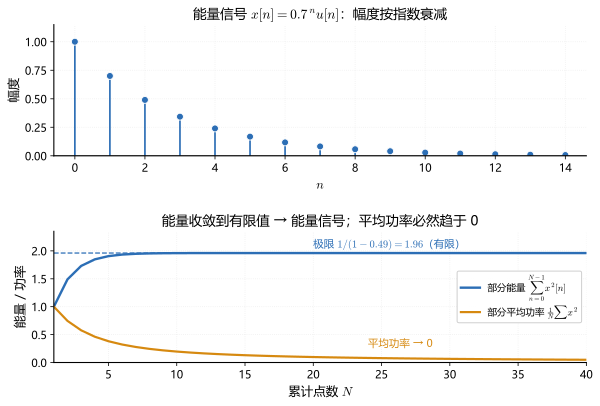
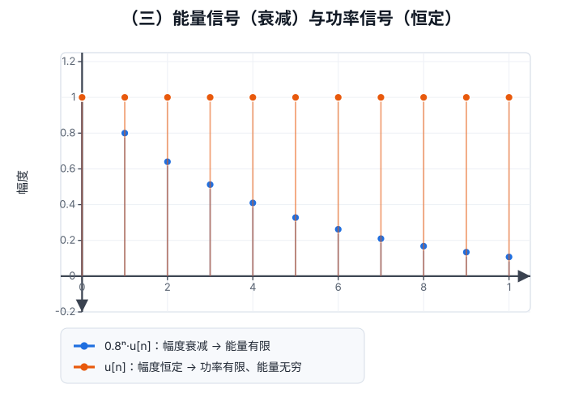
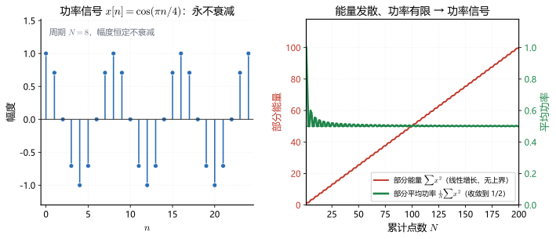

# 能量信号和功率信号

**标签：** #数字信号处理 #DSP #能量信号 #功率信号 #平均功率

---

## 本篇的位置

**这一篇补的空洞。** （二）判的是系统，用的是 $\sum\lvert h[n]\rvert<\infty$。那个判据只回答"和收不收敛"，没回答"收敛到什么程度"。同一个求和，平方之后收敛，信号才有资格做傅里叶变换；平方之后发散，就只能退到功率去描述。少了这一步刻度，（五）（六）里"能量谱密度""功率谱密度"两个名字是空的，同一个信号凭什么配两套谱也说不清。

**和前后篇的接口。** 上游是（一）的周期性判据和（二）的稳定性判据：周期性告诉你会遇到周期序列，稳定性告诉你 $\sum\lvert h\rvert$ 有界。下游是（四）自相关——那里"要不要除以 $2N+1$"直接对应这一篇的能量与平均功率两种归一化；再往后是（五）功率谱密度与（六）维纳-辛钦，$r_{xx}[0]$ 是能量还是功率，由这一篇的分类决定。

**本篇保留的简化。** 全部结论建立在"求和与极限都存在"这个前提上，并且默认序列是确定性的。功率用的是对称窗口 $[-N,N]$ 上的长平均，这个极限对一般序列未必存在（见第四节之后的折叠）。随机信号要先取期望再取时间平均，那一步需要各态历经假设，本篇没有展开。

**没出现的东西。** 连续时间的能量与功率（积分形式）、功率谱的具体估计算法（周期图、相关法）、帕塞瓦尔定理的证明。三样分别留在（五）（六）（十四）。

**读完能做什么。** 给一条序列，能按"先能量、后功率"的顺序在两步内定类，并说清第二步为什么通常可以省；看到 $r_{xx}[0]$、$\sum\lvert h[n]\rvert$、$\sum\lvert x[n]\rvert^2$ 这类式子，能立刻分辨它问的是能量、功率还是稳定性；拿到一段实测数据，能判断该去做能量谱还是功率谱。

---

## 本篇要点

1. 三类互斥，但"既非能量也非功率"不止"两端都无限"一种：$\frac{1}{\sqrt{n+1}}u[n]$ 的 $E=\infty$ 而 $P=0$，同样归进这一类。
2. "能量有限 ⇒ $P=0$" 靠的是 $P\le E/(2N+1)$，与信号形状无关，只看分母是否随 $N$ 增长。
3. 周期序列的功率等于一个周期内的均方值；振幅 $A$ 的正弦序列一律是 $A^2/2$，与频率高低无关。
4. 平方可和与绝对可和是单向的，绝对可和 ⇒ 平方可和，反例是 $\frac1n u[n-1]$。判系统稳定用的是后者，不是前者。

---

## 一、分类的动机：先定类，再选工具

同一套"频谱"工具不能通用于所有信号，根源在于**能量是否有限**：

- **能量信号**：能量有限、平均功率为零 → 可做傅里叶变换（DTFT）
- **功率信号**：能量无限、功率有限 → 只能用功率谱密度描述
- **既非能量也非功率**：两者都无限 → 无实际分析意义（如 $x[n]=n$）

所以这个分类的现实意义是：**它决定你手上这个信号能用哪套工具**。一个衰减脉冲可以谈频谱；一个永不停歇的周期信号或白噪声，能量无限，只能退一步谈功率分布。

---

## 二、基本定义

### 1. 能量

$$
E = \sum_{n=-\infty}^{\infty}\big\lvert x[n]\big\rvert^{2}
$$

### 2. 平均功率

$$
P = \lim_{N\to\infty}\frac{1}{2N+1}\sum_{n=-N}^{N}\big\lvert x[n]\big\rvert^{2}
$$

功率的分母为什么是 2N+1 而不是 N

窗口取的是 $[-N,N]$，从 $-N$ 数到 $N$ 一共 $2N+1$ 个样点。分母必须等于分子实际加了多少项，否则算出来的不是平均值。

对称是要紧的。窗口中心固定在 $n=0$，极限才与"从哪一段开始截"无关。若把窗口改成同样长度的 $[0,2N]$，对 $u[n]$ 会得到 $\lim (2N+1)/(2N+1)=1$，而不是 $1/2$：负半轴那 $N+1$ 个零点被窗口丢在外面，分母却仍按全长算。$u[n]$ "一半样点为 1"这个事实，只在对称窗口下体现得出来。

所以这条式子的两个细节都不能动：对称区间保证了取值不偏，$2N+1$ 保证了归一化正确。

### 3. 两者的关系：能量有限蕴含功率为零

若 $E<\infty$，则对任意 $N$：

$$
0 \le \frac{1}{2N+1}\sum_{n=-N}^{N}\big\lvert x[n]\big\rvert^{2} \le \frac{E}{2N+1}
$$

令 $N\to\infty$，右端趋于 $0$，故 $P=0$。

> 这个不等式同时说明了一件事：**能量信号不可能是功率信号**，两者互斥。所以判定的顺序必然是"先能量、后功率"（下面第四节的步骤正是这么来的）。

> 上图：**上栏**是 $x[n]=0.7^{\,n}u[n]$ 本身，幅度按指数衰减；**下栏**是它的部分能量 $\sum_{n=0}^{N-1}x^2[n]$（蓝，**收敛**到 $1/(1-0.49)=1.96$）与部分平均功率 $\frac{1}{N}\sum x^2[n]$（橙，一路压向 $0$）。这就是上面那个不等式 $P\le E/(2N+1)$ 的图形版：**能量一旦收敛，平均必然被分母拖到零。**

### 4. 物理直觉

| 量 | 类比 | 含义 |
|---|---|---|
| $E$ | 总耗电度数 | 整段时间内累积的总量 |
| $P$ | 平均功率（瓦） | 单位时间的平均消耗 |

一个只亮一秒的灯泡：总耗电有限（能量信号），长期平均功率为零。一个持续亮着的灯：总耗电无限（能量信号不成立），但平均功率有限（功率信号）。

---

## 三、分类标准

> **左图**：蓝色茎为 $0.75^n u[n]$（逐点衰减），橙色茎为 $u[n]$（恒为 1）——衰减序列的面积（能量）有限，恒定序列的面积无限。
> **右图**：累积能量 $E_N$ 随 $N$ 的变化。蓝色曲线**收敛**到 $\frac{1}{1-a^2}=2.29$，说明 $0.75^n u[n]$ 是能量信号；橙色直线随 $N$ 匀速增长（$E_N=N+1$），说明 $u[n]$ 能量无穷——只能谈功率。

> 上图：**左栏** $x[n]=\cos(\pi n/4)$ 永不衰减，周期 $N=8$；**右栏**是它的两个统计量——部分能量（红，左轴）随 $N$ **线性增长、没有上界**，部分平均功率（绿，右轴）却**收敛到 $1/2$**。能量无穷而功率有限，正是功率信号的定义。

| 信号类型 | 能量 $E$ | 平均功率 $P$ | 典型例子 |
|---|---|---|---|
| **能量信号** | $0<E<\infty$ | $P=0$ | 有限长序列、$\lvert a\rvert<1$ 的衰减指数序列 |
| **功率信号** | $E=\infty$ | $0<P<\infty$ | 周期序列、$u[n]$、常数序列 |
| **非能量非功率** | $E=\infty$ | $P=\infty$ | $x[n]=n$、$x[n]=2^nu[n]$ |

---

## 四、判断流程

1. 算能量 $E=\sum_{n=-\infty}^{\infty}\lvert x[n]\rvert^2$
2. $E$ 为**有限正数** → **能量信号**，结束（不必再算 $P$）
3. $E=\infty$ → 算平均功率 $P$
4. $P$ 为**有限正数** → **功率信号**
5. $P=\infty$ → **既非能量也非功率信号**

> **注意两点**：$E=0$ 对应全零序列（没有讨论价值）；"有限"必须排除"无穷大"，有些序列 $E$ 和 $P$ 都是无穷（如 $2^n$）。

能量无穷、功率却为零的序列存在吗

存在。取 $x[n]=\dfrac{1}{\sqrt{n+1}}\,u[n]$。

能量是 $\sum_{n=0}^{\infty}\frac{1}{n+1}$，调和级数，发散。功率端，部分和约等于 $\ln(N+1)$，除以窗口长度后 $\dfrac{\ln(N+1)}{2N+1}\to0$。

于是 $E=\infty$、$P=0$。按定义它落进"既非能量也非功率"，可它的功率既不为无穷也不是正数，与 $2^nu[n]$ 那种两端一起炸的情形完全不是一回事。

这条序列说明三类划分只回答"哪个量有限"，不回答"有限到什么程度"。真正决定能不能做 DTFT 的是 $E$；决定能不能谈功率谱的是 $0<P<\infty$。这条序列两头都落空，那才是"无分析价值"的实际含义。顺带一提，它与补充 2 里的 $\frac1n u[n-1]$ 只差半个指数：分母上多一个根号，能量就从有限翻成无限。

### 补充 1：周期信号的功率只算一个周期

设 $x[n]$ 是周期为 $N$ 的周期序列。把求和窗口 $[-M,M]$ 按完整周期分组，每个完整周期内的平方和都是同一个值 $S=\sum_{n=0}^{N-1}\lvert x[n]\rvert^2$：

$$
\sum_{n=-M}^{M}\big\lvert x[n]\big\rvert^{2} = \frac{2M+1}{N}S + O(N)
$$

（$O(N)$ 来自窗口两端不满一个周期的余数，最多 $2N$ 项，是有界的。）于是

$$
P=\lim_{M\to\infty}\frac{1}{2M+1}\sum_{n=-M}^{M}\lvert x[n]\rvert^{2}
=\frac{S}{N}=\frac{1}{N}\sum_{n=0}^{N-1}\big\lvert x[n]\big\rvert^{2}
$$

余数项最多 2N 个，为什么不会把极限带偏

写成 $\frac{2M+1}{N}S+O(N)$，其中第二项来自窗口两端不满一个周期的残段，绝对值不超过 $2N\cdot\max\lvert x[n]\rvert^2$。关键在 $N$ 是周期长度、固定不动，趋于无穷的只有 $M$。

除以 $2M+1$ 后，第一项给出 $S/N$，第二项是"常数除以 $2M+1$"，趋于 $0$。残段只影响有限项的精度，不影响极限值。

若把 $O(N)$ 误读成随 $M$ 一起增长的量，就会得出"功率依赖起点"的结论。实际换任何一个起点，残段只是另一个有界常数，摊薄之后同样归零。

**结论**：周期序列的平均功率等于**一个周期内的均方值**，与起点无关。

### 补充 2：能量有限（平方可和）≠ 绝对可和

判"能量信号"用 $\sum\lvert x[n]\rvert^2<\infty$，叫**平方可和**；判系统 BIBO 稳定用 $\sum\lvert h[n]\rvert<\infty$，叫**绝对可和**（见 [[【数字信号处理DSP】（二）离散时间系统六大性质判断方法|（二）离散时间系统六大性质]]）。两者的关系是单向的：

$$
\text{绝对可和} \;\Longrightarrow\; \text{平方可和}
$$

这一条单向蕴含，中间那一步是什么

把求和按 $\lvert x[n]\rvert\le1$ 与 $\lvert x[n]\rvert>1$ 分成两段。

第一段里 $\lvert x[n]\rvert^2\le\lvert x[n]\rvert$，逐项放大后求和不超过 $\sum\lvert x[n]\rvert$，有限。

第二段单独处理：绝对可和蕴含 $x[n]\to0$，所以 $\lvert x[n]\rvert>1$ 的样点只能有有限个，否则求和里会有无穷多个大于 $1$ 的项。有限个点的平方和仍是有限数。

两段相加得 $\sum\lvert x[n]\rvert^2<\infty$。论证里只用到"通项最终小于 1"，没有别的条件，所以对任何绝对可和序列都成立。反方向不成立的原因也在这里：介于 $0$ 与 $1$ 之间时平方更小，收敛变容易，原本发散的和可能被平方救回来，$\frac1n$ 就是被救回来的那一类。

反过来**不成立**。反例：$x[n]=\dfrac{1}{n}u[n-1]$，能量

$$
E=\sum_{n=1}^{\infty}\frac{1}{n^{2}}=\frac{\pi^{2}}{6}<\infty
$$

但绝对值之和 $\sum_{n=1}^{\infty}\dfrac{1}{n}$ 是调和级数，**发散**，故它不绝对可和。

> **三套判据不要混用**：能量（平方可和）、功率（均方极限）、稳定性（绝对可和）。一个序列完全可以"是能量信号但对应的系统不稳定"。

---

## 五、典型例题

> **统一答题格式**：写出定义式 → 代入 → 算极限 → 分类结论 → 必要时检验。
> 只要 $E$ 有限就立刻停手，**不必再求 $P$**（这是最常见的丢分/浪费时间点）。

### 例题 1：有限长序列

**题目**：$x[n]=\{1,-2,3\}$（仅在 $n=0,1,2$ 处非零），判断其类型。

**解**：

（1）**写定义式**：能量 $E=\sum_{n=-\infty}^{\infty}\lvert x[n]\rvert^2$（有限长序列只有 3 项）。

（2）**代入求能量**：

$$
E=1^{2}+(-2)^{2}+3^{2}=1+4+9=14
$$

$14$ 是有限正数。

（3）**判定**：$E<\infty$，按第四节步骤 2 直接结束。

**答案**：

$$
\boxed{E=14,\ P=0,\ \text{能量信号}}
$$

**检验**：由第二节 3 的不等式，$P\le \dfrac{14}{2N+1}\to 0$，与"$P=0$"一致 ✓

---

### 例题 2：单位阶跃序列

**题目**：$x[n]=u[n]$，判断其类型。

**解**：

（1）**先算能量**：

$$
E=\sum_{n=0}^{\infty}1^{2}=\infty
$$

能量无穷，转求功率。

（2）**写功率定义式**：

$$
P=\lim_{N\to\infty}\frac{1}{2N+1}\sum_{n=-N}^{N}\big\lvert u[n]\big\rvert^{2}
$$

（3）**确定求和范围**：$n<0$ 时 $u[n]=0$，故只剩 $n=0,1,\dots,N$ 共 $N+1$ 项，每项为 $1$：

$$
P=\lim_{N\to\infty}\frac{N+1}{2N+1}
$$

（4）**求极限**（同除 $N$）：

$$
P=\lim_{N\to\infty}\frac{1+1/N}{2+1/N}=\frac{1}{2}
$$

**答案**：

$$
\boxed{E=\infty,\ P=1/2,\ \text{功率信号}}
$$

**检验**：$u[n]$ 在一半的时间里取 $1$、一半取 $0$，均方值为 $1/2$，符合直觉 ✓

---

### 例题 3：正弦周期序列

**题目**：$x[n]=\sin\left(\dfrac{\pi}{4}n\right)$，判断其类型并求平均功率。

**解**：

（1）**判断是否能量信号**：序列为周期序列（基本周期 $N=8$，见 [[【数字信号处理DSP】（一）信号周期性判断|（一）信号周期性判断]]），在无穷多点上取非零值且幅度不衰减，故

$$
E=\sum_{n=-\infty}^{\infty}\sin^{2}\!\left(\frac{\pi n}{4}\right)=\infty
$$

（2）**用周期公式求功率**（补充 1）：只在一个周期 $n=0,\dots,7$ 内求均方值：

$$
P=\frac{1}{8}\sum_{n=0}^{7}\sin^{2}\!\left(\frac{\pi n}{4}\right)
$$

（3）**逐点列表**：

| $n$ | $0$ | $1$ | $2$ | $3$ | $4$ | $5$ | $6$ | $7$ |
|---|---|---|---|---|---|---|---|---|
| $\sin(\pi n/4)$ | $0$ | $\frac{\sqrt2}{2}$ | $1$ | $\frac{\sqrt2}{2}$ | $0$ | $-\frac{\sqrt2}{2}$ | $-1$ | $-\frac{\sqrt2}{2}$ |
| 平方 | $0$ | $\frac12$ | $1$ | $\frac12$ | $0$ | $\frac12$ | $1$ | $\frac12$ |

（4）**求和**：

$$
\sum_{n=0}^{7}\sin^{2}\!\left(\frac{\pi n}{4}\right)=0+\frac12+1+\frac12+0+\frac12+1+\frac12=4
$$

（5）**除以周期长度**：

$$
P=\frac{4}{8}=\frac{1}{2}
$$

**答案**：

$$
\boxed{P=1/2,\ \text{功率信号}}
$$

**检验**：一般结论是"振幅 $A$ 的正弦序列平均功率为 $A^2/2$"，本题 $A=1$，应得 $1/2$ ✓

**推论**（以后反复用）：

| 信号 | 平均功率 |
|---|---|
| $A\sin(\omega_0 n+\varphi)$ 或 $A\cos(\omega_0 n+\varphi)$ | $\dfrac{A^{2}}{2}$ |
| $e^{j\omega_0 n}$ | $1$（因 $\lvert e^{j\omega_0 n}\rvert\equiv 1$） |
| $A e^{j\omega_0 n}$ | $A^{2}$ |

---

### 例题 4：衰减指数序列

**题目**：$x[n]=(0.5)^n u[n]$，判断其类型。

**解**：

（1）**写能量定义式**（$n<0$ 时为零）：

$$
E=\sum_{n=0}^{\infty}\big\lvert (0.5)^n\big\rvert^{2}=\sum_{n=0}^{\infty}(0.25)^n
$$

（2）**等比级数求和**（公比 $q=0.25$，$\lvert q\rvert<1$）：

$$
E=\frac{1}{1-0.25}=\frac{4}{3}
$$

（3）**判定**：$E$ 有限 ⇒ 能量信号，结束。

**答案**：

$$
\boxed{E=4/3,\ P=0,\ \text{能量信号}}
$$

**检验**：公比 $1/4\lt1$ 保证级数收敛，故 $E$ 有限；再由上面的不等式 $P\le E/(2N+1)\to0$，功率必为零，两端自洽 ✓

**一般结论**：$x[n]=a^{n}u[n]$ 的能量为

$$
E=\sum_{n=0}^{\infty}\big\lvert a\big\rvert^{2n}=\frac{1}{1-\lvert a\rvert^{2}}\quad(\lvert a\rvert<1)
$$

等比级数的公比为什么是 a 的平方

能量定义里是模平方，$\big\lvert a^{n}\big\rvert^{2}=\lvert a\rvert^{2n}$，所以公比是 $\lvert a\rvert^{2}$，不是 $a$。收敛条件也随之变成 $\lvert a\rvert^{2}<1$，与 $\lvert a\rvert<1$ 等价，只需要一条。

把公比误写成 $a$ 的后果可以算出来：$a=0.5$ 时 $1/(1-0.5)=2$，而正确答案是 $1/(1-0.25)=4/3$。更麻烦的是 $a$ 取负值——$a=-0.5$ 时 $1/(1-a)=2/3$，看上去还算合理，可真实能量仍是 $4/3$，因为平方把符号抹掉了。级数求和在 $a<0$ 时给出的是另一个量。

---

### 例题 5：常数序列

**题目**：$x[n]=3$（对所有整数 $n$），判断其类型。

**解**：

（1）**算能量**：

$$
E=\sum_{n=-\infty}^{\infty}3^{2}=\infty
$$

（2）**写功率定义式并代入**（求和区间共 $2N+1$ 项，每项都是 $9$）：

$$
P=\lim_{N\to\infty}\frac{1}{2N+1}\sum_{n=-N}^{N}9=\lim_{N\to\infty}\frac{9(2N+1)}{2N+1}=9
$$

（3）**判定**：$P$ 有限正数 ⇒ 功率信号。

**答案**：

$$
\boxed{E=\infty,\ P=9,\ \text{功率信号}}
$$

**检验**：常数序列是周期为 $1$ 的周期序列，用周期公式 $P=\frac{1}{1}\cdot 3^2=9$，一致 ✓

---

### 例题 6：增长指数序列

**题目**：$x[n]=2^{n}u[n]$，判断其类型。

**解**：

（1）**算能量**：

$$
E=\sum_{n=0}^{\infty}4^{n}=\infty
$$

（2）**算功率**（等比求和 $\sum_{n=0}^{N}4^{n}=\dfrac{4^{N+1}-1}{3}$）：

$$
P=\lim_{N\to\infty}\frac{1}{2N+1}\cdot\frac{4^{N+1}-1}{3}
$$

（3）**判断极限**：分子是**指数增长**，分母是线性增长，故

$$
P=\infty
$$

分子指数、分母线性，凭什么断定它发散

比的是两条增长曲线的阶。$4^{N}$ 每加一步乘 $4$，分母 $2N+1$ 每步只加 $2$，比值单调上升且无上界：对任何 $M$，总能找到 $N$ 使比值超过 $M$。

不能因为"分子有闭式"就以为它算完了。$\sum_{n=0}^{N}4^{n}=\frac{4^{N+1}-1}{3}$ 确实是一个有限和的准确值，但它随 $N$ 指数增长。闭式表达与有界是两件事。

反过来，若把 $P=\infty$ 当成"公式太复杂、算不出来"，就会跳过"既非能量也非功率"这一类，转去找一个并不存在的有限值。判定这一类只需要看增长阶，不需要精确值。

**答案**：

$$
\boxed{\text{既非能量信号，也非功率信号}}
$$

**检验**：能量端 $\sum 4^{n}=\infty$，功率端分子指数增长、分母线性增长故 $P\to\infty$。**两端都发散**才落进"既非"这一类；只要有一端有限，就必属前两类之一 ✓

**要点**：$\lvert a\rvert>1$ 的 $a^nu[n]$ 一定落进这一类。增长率太快，连"平均"都压不住。

---

### 例题 7：双边衰减序列（都有值）

**题目**：$x[n]=\left(\dfrac{1}{2}\right)^{\lvert n\rvert}$（对所有整数 $n$），判断其类型。

**解**：

（1）**分析结构**：这是**双边**序列，$n\to\pm\infty$ 两侧都衰减，需要把求和拆成两半。

（2）**写能量并拆分**：

$$
E=\sum_{n=-\infty}^{\infty}\left(\frac12\right)^{2\lvert n\rvert}
=\underbrace{\sum_{n=0}^{\infty}\left(\frac14\right)^{n}}_{n\ge 0}
+\underbrace{\sum_{n=-\infty}^{-1}\left(\frac14\right)^{-n}}_{n<0}
$$

（3）**分别求和**：第一项 $=\dfrac{1}{1-1/4}=\dfrac{4}{3}$。第二项令 $m=-n$，化为 $\sum_{m=1}^{\infty}\left(\dfrac14\right)^{m}=\dfrac{1/4}{1-1/4}=\dfrac{1}{3}$。

（4）**相加**：

$$
E=\frac{4}{3}+\frac{1}{3}=\frac{5}{3}
$$

**答案**：

$$
\boxed{E=5/3,\ \text{能量信号}}
$$

**检验**：把 $n=0$ 单列，两侧对称各贡献 $\frac{1}{3}$：$E=1+2\times\frac{1}{3}=\frac{5}{3}$ ✓ —— $n=0$ 只算一次，这正是拆分求和最容易重复计数的地方

**要点**：双边序列必须**两侧分别求和**，只算一侧是常见错误（$n=0$ 点不能重复计）。

---

## 六、常见信号分类速查表

| 信号 | 能量 | 平均功率 | 分类 |
|---|---|---|---|
| $\delta[n]$ | $1$ | $0$ | 能量信号 |
| 矩形序列 $R_N[n]$（长 $N$，幅度 1） | $N$ | $0$ | 能量信号 |
| $u[n]$ | $\infty$ | $1/2$ | 功率信号 |
| 常数 $c$ | $\infty$ | $c^{2}$ | 功率信号 |
| $a^{n}u[n]$，$\lvert a\rvert<1$ | $\dfrac{1}{1-\lvert a\rvert^{2}}$ | $0$ | 能量信号 |
| $a^{n}u[n]$，$\lvert a\rvert>1$ | $\infty$ | $\infty$ | 非能量非功率 |
| $\sin(\omega_0 n)$ / $\cos(\omega_0 n)$ | $\infty$ | $1/2$ | 功率信号 |
| $A\sin(\omega_0 n)$ | $\infty$ | $A^{2}/2$ | 功率信号 |
| $e^{j\omega_0 n}$ | $\infty$ | $1$ | 功率信号 |
| 有限长序列（各点有限） | 有限 | $0$ | 能量信号 |
| $n\cdot u[n]$ | $\infty$ | $\infty$ | 非能量非功率 |

周期不是功率有限的必要条件

速查表容易读成"周期 ⇒ 功率信号"，像是因果链。反例：$x[n]=\sin(0.1n)$。$0.1/(2\pi)$ 是无理数，这条序列根本不周期（判据见（一）），可它的平均功率仍然是 $1/2$。

算法和例题 3 一样。积化和差给出 $\frac12-\frac12\cos(0.2n)$，第二项以 $0.2$ rad/样点振荡，长平均趋于 $0$，只剩 $1/2$。整个推导一次都没用到周期性。

真正让功率有限的是"幅度有界、均方不随时间发散"。周期只是保证均方不发散的一种最省事的结构，不是唯一的结构。所以定类的顺序不能颠倒：先算 $E$、再算 $P$，靠"看起来像周期"去猜，遇到 $\sin(0.1n)$ 就猜错了。

---

## 七、快速记忆口诀

> **有限长、衰减快 → 能量信号**
> **周期长、一直晃 → 功率信号**
> **增长快、不停涨 → 啥也不是别多想**

---

## 八、与后续内容的联系

- **能量信号**：可直接做 DTFT，频谱收敛（见 [[【数字信号处理DSP】（十四）离散时间傅里叶变换（DTFT）|（十四）DTFT]]）；其谱密度 $\lvert X(e^{j\omega})\rvert^{2}$ 叫**能量谱密度**，守恒律是**帕塞瓦尔定理**（见 [[【数字信号处理DSP】（五）能量谱密度与功率谱密度|（五）能量谱密度与功率谱密度]] 与 [[【数字信号处理DSP】（六）维纳-辛钦定理与帕塞瓦尔定理|（六）维纳-辛钦定理与帕塞瓦尔定理]]）
- **功率信号**：常规 DTFT 不收敛，需用**功率谱密度**（见 [[【数字信号处理DSP】（五）能量谱密度与功率谱密度|（五）能量谱密度与功率谱密度]]）
- **周期信号**：功率信号的特例，可用傅里叶级数（DFS）展开

功率信号为什么不能直接做 DTFT，非得先截断

DTFT 的求和是 $\sum_{n=-\infty}^{\infty}x[n]e^{-j\omega n}$。对 $x[n]=\cos(\omega_0 n)$，通项模恒为 $1$，不趋于零，级数在通常意义下处处发散，写出来没有意义。

工程上的做法是先截断：$x_N[n]=x[n]\cdot\mathbf{1}_{\lvert n\rvert\le N}$，有限长、绝对可和，DTFT 存在。再让 $N\to\infty$，看 $\frac{1}{2N+1}\lvert X_N(e^{j\omega})\rvert^2$ 收敛到什么。这个极限就是功率谱密度，它在 $\pm\omega_0$ 处是冲激，不是普通函数。所以（六）里"自相关的傅里叶变换"对功率信号指的是平均相关的变换，谱里允许出现 $\delta$。

能量信号不需要这一步，但要注意分寸：$E<\infty$ 并不保证绝对可和（补充 2 的 $\frac1n u[n-1]$ 就是如此），此时 DTFT 在均方意义下存在，逐点级数不绝对收敛。两套谱的分界线，根子还是这一篇那个 $E$ 有限与否。

---

## 九、常见错误

八条里没有一条是"算错"，全是顺序、归一化和取值范围三件事上的偏差。表里的反例都用本篇的例题数，可以当场回代。

| 错误说法 | 为什么会这么想 | 判据 | 反例 |
|---|---|---|---|
| 能量和功率混着算 | 两个量都写成一个求和，看着像一回事 | 看 $E$ 是否有限，有限就停手 | 例题 1 的 $E=14$ 已经有限，再算 $P$ 只能得 $0$ |
| 功率就是平方和 | 把"平均"读成了"总量" | 检查式子里有没有 $1/(2N+1)$ | $u[n]$ 漏掉归一化因子得 $N+1\to\infty$，正确值 $1/2$ |
| 归一化因子写成 $1/N$ | "长度是 $N$"听起来没错 | 数一数窗口 $[-N,N]$ 有几个点 | $u[n]$ 用 $1/N$ 得 $1$，用 $1/(2N+1)$ 才是 $1/2$ |
| 周期序列的功率随起点变 | 以为 $\frac1N\sum_{n=k}^{k+N-1}$ 换个 $k$ 就变 | 换一个起点重算一个完整周期，看是否相同 | $\cos(\pi n/4)$ 从 $n=0$ 或 $n=3$ 起算，平方和都是 $4$ |
| 能量有限就是系统稳定 | 两个判据都写成一个求和 | 看指数是 $1$ 还是 $2$ | $x[n]=\frac1n u[n-1]$ 的 $E=\pi^2/6$ 有限，$\sum\frac1n$ 却发散 |
| 有限长序列一定能量有限 | 长度有限，总和看着就该有限 | 逐点查有没有取到 $\infty$ | 序列 $\{1,\infty,3\}$ 的 $E=\infty$，不属于能量信号 |
| 双边序列只算一侧 | 看到指数里的 $\lvert n\rvert$ 就往正方向加 | 把 $n=0$ 单列，看两侧是否各算了一次 | $\left(\frac12\right)^{\lvert n\rvert}$ 只算一侧得 $\frac43$，正确是 $\frac53$ |
| 复信号直接用 $x^2[n]$ | 实信号的 $\sum x^2$ 顺手照抄 | 看有没有先取模再平方 | $e^{j\omega_0 n}$ 写成 $x^2$ 得 $e^{j2\omega_0 n}$，不是实数；正确 $P=1$ |

---

## 十、知识链定位

能量信号与功率信号（本节）

│

├── 定义：E = Σ|x[n]|²，P = lim Σ|x[n]|² /(2N+1)

├── 三类：能量信号 / 功率信号 / 既非能量也非功率

├── 关系：E 有限 ⇒ P = 0（互斥）

└── 平方可和 ≠ 绝对可和

│

├── 序列的周期性判断（第一节）：周期 → 功率信号

├── 系统的 BIBO 稳定性：用绝对可和判断（第二节）

├── 功率谱密度：功率信号的频域分析工具（第五节）

└── 离散时间傅里叶变换：能量信号的频域工具（第十四节）

---

## 十一、总结：两条判据与三类归属

- **判据只有两条**：先看 $E=\sum\lvert x[n]\rvert^{2}$，有限则能量信号（$P=0$）；无限再看 $P$，有限则功率信号；两者都无限则不讨论。
- **典型归属**：有限长、衰减指数（$\lvert a\rvert<1$）→ 能量信号；周期、阶跃、常数 → 功率信号；增长指数 → 既非能量也非功率。
- **周期序列的平均功率只算一个周期**：$P=\frac{1}{N}\sum_{n=0}^{N-1}\lvert x[n]\rvert^{2}$。
- **正弦/余弦 $A$ 幅度 → $P=A^{2}/2$；复指数 → $P=1$**。
- **能量有限（平方可和）不等于绝对可和**，后者才是稳定性的判据。
- 分类的意义在于选工具：能量信号谈频谱，功率信号谈功率谱。

---

## 十二、学会的四层判据

这一篇的目标不是背三类定义，而是四件事能做到。逐层自评，卡在哪层回哪一节：

| 层 | 能做到什么 | 卡住了回哪 |
|---|---|---|
| 1. 会算 | 给一条序列算出 $E$，$E$ 有限就判能量信号并说明为什么不必再算 $P$；$E$ 无限才继续算 $P$ | 五、例题 1–7 |
| 2. 会判 | 看到"衰减到零就是能量信号""周期就是功率信号"能立刻判错，并给出 $\frac{1}{\sqrt{n+1}}u[n]$、$\sin(0.1n)$ 两个反例 | 四、判断流程与六、速查表之后的两处折叠 |
| 3. 会诊断 | 拿到一段实测数据算出 $E$ 发散，能说出该走功率谱而不是能量谱，以及为什么不能直接对原序列做 DTFT | 八、与后续内容的联系 |
| 4. 会被追问 | 能答"分母为什么是 $2N+1$""为什么绝对可和强于平方可和"，而不是只会背三类名字 | 三处 eq-note 折叠 |

第 1 层是考试要求，第 2 层是选择题要求，第 3 层是工程要求，第 4 层是面试和答辩要求。多数人停在第 1 层，因为"先算 E 再算 P"这个流程本身太好用，一旦被问"如果 E 无限而 P 也是零呢"，流程就接不上了。

---

## 十三、本篇自测

六道选择题，点选项立刻判对错，四个选项各有一句说明。

三道简答题（先自己写，再展开解析）

**题 7.** 判断 $x[n]=\left(\frac13\right)^{\lvert n\rvert}$ 的类型，给出 $E$ 的数值。

**题 8.** 有人说"$E=\infty$ 就说明它有功率成分"。这条推理错在哪？举一条能让它失效的序列。

**题 9.** 一段 30 秒的环境噪声录音，要分析它的频率分布。该用能量谱密度还是功率谱密度？为什么不能直接对整段序列做 DTFT？

---

**解析 7.** 能量信号，$E=\frac54$。分开算：$n=0$ 一项为 $1$；$n\ge1$ 与 $n\le-1$ 两侧对称，公比都是 $\left(\frac19\right)$，各贡献 $\frac{1/9}{1-1/9}=\frac18$。合计 $1+2\times\frac18=\frac54$。注意底数是 $\left(\frac13\right)^{2}=\frac19$，不是 $\frac13$。

**解析 8.** 错在把"能量无限"当成了"功率非零"。功率是能量的长平均，分母 $2N+1$ 会随 $N$ 增长，只要分子增长得比分母慢，平均就压向零。反例 $x[n]=\frac{1}{\sqrt{n+1}}u[n]$：$E$ 是调和级数发散，而部分和只按 $\ln N$ 增长，$P=0$。它属于"既非能量也非功率"。

**解析 9.** 用功率谱密度。噪声在整段录音里持续存在，$E$ 必然发散；但它的均方不随时间发散，$P$ 有限，所以是功率信号。直接对整段序列做 DTFT 没有意义——要么按无限长序列看，级数处处发散；要么按有限长看，得到的谱随窗长剧烈变化，每次重算都不一样。正确做法是先截断成若干段、每段算周期图再平均，或先算平均相关再做变换。

---

> **一句话总结**：能量信号"活一会儿就没了"，功率信号"永远在但强度有限"——用 $E$ 有限还是 $P$ 有限来区分；同时记住"能量有限"和"绝对可和"是两回事，前者宽松、后者才是稳定性的判据。
