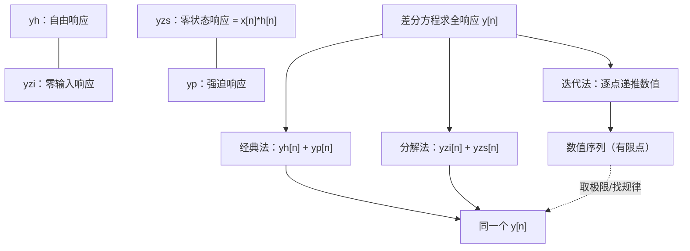
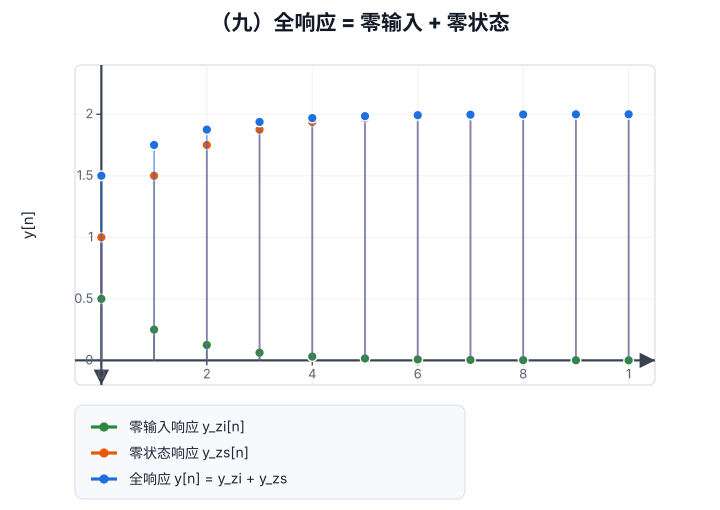

# 离散时间系统的时域解法

**标签：** #数字信号处理 #DSP #差分方程 #齐次解 #特解 #零输入响应 #零状态响应 #迭代法

---

## 本篇的位置

**这一篇补的空洞。**（八）把五个响应概念分清了类，但每个量具体怎么算只给了名字和一句"由初值定"；（七）给出了零状态那条路，可题目给的通常是 $y[-1]$、$y[-2]$，而方程要的是 $y[0]$、$y[1]$。这一篇补的就是这中间的一步：差分方程摆在那里，怎么把 $y[n]$ 真正算出来，以及三条路为什么必然给出同一个答案。

**和前后篇的接口。** 上游两处：（七）的卷积，它提供零状态响应；$\delta[n]$ 只在 $n=0$ 非零这一点，它决定 $h[n]$ 的初值怎么定。下游是（十三）Z 变换——那时差分方程变成代数方程，特征根变成极点，齐次解的形状由极点位置一眼看出。本篇用"实根单调、复根振荡、模长管衰减"来说的事，（十三）会换个坐标系重说一遍。

**本篇保留的简化。** 只讨论线性常系数差分方程，$a_k$ 与 $n$ 无关，且 $a_0=1$ 已归一化。系数一旦随 $n$ 变，$\lambda^n$ 代进去就约不掉，特征方程这一步直接失效。另外全部闭式解只在 $n\ge0$ 成立，$n<0$ 时输出为零要靠乘 $u[n]$ 补上，因果性也含在这条里。

**没出现的东西。** Z 变换解法、状态空间与矩阵递推、频率响应 $H(e^{j\omega})$ 的稳态算法，三样都不在这里。第一样在（十三），第二样本专栏不展开，第三样要等（十）（十一）讲完频率才说得清。

**读完能做什么。** 拿到方程与 $y[-1],y[-2]$，先看特征根有没有 $1$，再决定特解要不要升幂；用递推把负下标换成 $y[0],y[1]$，两步内完成；闭式解出来后用 $n=0,1,2$ 三点回代，判断它是真解还是漏了项。

---

## 本篇要点

1. 阶数、特征根个数、待定系数个数、所需初始条件个数四者相等。二阶系统只给 $y[-1]$ 一个条件时，解无法定死。
2. 特解不能与齐次解同形，同形就乘 $n$：例题 3 设 $y_p=P$ 得 $0=1$，改设 $Pn$ 得 $y_p=-n$。
3. 迭代法的第一用途不是求通项，而是换初值——把题目给的 $y[-1],y[-2]$ 递推成 $y[0],y[1]$。
4. 复根用两个参数分工：$r$ 管衰减、$\omega$ 管振荡快慢。例题 5 的 $r=1/\sqrt2$、$\omega=\pi/4$ 给出周期 $8$、包络按 $(\sqrt2)^{-n}$ 收缩的振荡。

---

## 一、三条求解路线的分工

离散时间系统通常用线性常系数差分方程描述：

$$
\sum_{k=0}^{N} a_k \, y[n-k] = \sum_{r=0}^{M} b_r \, x[n-r]
$$

其中 $a_0 = 1$（归一化），$N$ 为系统阶数。

时域解法就是直接求解差分方程，得到输出序列 $y[n]$。主要有三种方法：

- **经典法**：齐次解 + 特解
- **零输入/零状态分解法**
- **迭代法**（递推法）

三种方法算出的**全响应是同一个**，只是观察角度不同：

**两个分法的区别**：

- **齐次解/特解** 是按**数学形式**分：齐次解满足方程的"左边为 0"，特解负责"凑出输入"。
- **零输入/零状态** 是按**物理来源**分：一个来自初始储能，一个来自外部输入。

两种分法的四个分量之间有交叉关系，对照表见 [[【数字信号处理DSP】（八）离散时间系统的各种响应概念详解|（八）离散时间系统的各种响应概念详解]]。

---

## 二、经典法（齐次解 + 特解）

### 1. 齐次解（自由响应）

令输入 $x[n] = 0$，求解齐次方程：

$$
\sum_{k=0}^{N} a_k \, y_h[n-k] = 0
$$

设 $y_h[n] = \lambda^n$，代入得特征方程：

$$
\sum_{k=0}^{N} a_k \, \lambda^{-k} = 0 \quad \Rightarrow \quad \lambda^N + a_1 \lambda^{N-1} + \cdots + a_N = 0
$$

> **注意特征方程的写法**：把 $y[n-k]$ 换成 $\lambda^{n-k}$，约掉 $\lambda^{n-N}$ 后得到的是**多项式**。一阶系统 $\lambda-a=0$，二阶系统 $\lambda^2+a_1\lambda+a_2=0$——**幂次与阶数一致，符号与差分方程里 $a_k$ 的符号一致**（$+a_2$ 而不是 $-a_2$）。

- **单根** $\lambda_i$：对应项 $C_i \lambda_i^n$
- **重根**（$r$ 重根 $\lambda_0$）：对应项 $(C_0 + C_1 n + \cdots + C_{r-1} n^{r-1}) \lambda_0^n$

约掉的为什么是 λ 的 n 减 N 次方

因为代入 $\lambda^n$ 之后，每一项都是 $\lambda^{n-k}$，而 $k$ 从 $0$ 取到 $N$，次数最低的那一项是 $\lambda^{n-N}$。把它提出来：$\sum_k a_k\lambda^{n-k}=\lambda^{n-N}\sum_k a_k\lambda^{N-k}$，剩下的括号里才是 $\lambda$ 的多项式。

$\lambda=0$ 不是特征根（否则常数项 $a_N$ 为零，方程降阶），所以 $\lambda^{n-N}\ne0$，两边可以约掉。约完以后次数从 $n-k$ 变成 $N-k$，最高次正好是 $N$——"幂次与阶数一致"是从这里出来的，不是另一条要背的规则。

不约会怎样：留着 $\lambda^{n-N}$ 的方程随 $n$ 变，每取一个 $n$ 就得到一根不同的根，齐次解根本不成形。必须约到与 $n$ 无关，才能解出一组固定的 $\lambda_i$。

### 2. 特解（强迫响应）

根据输入 $x[n]$ 的形式设定特解形式：

| 输入 $x[n]$ | 特解形式 |
|--------------|---------|
| 常数 $A$ | $P$（常数） |
| $A \alpha^n$（$\alpha$ 不是特征根） | $P \alpha^n$ |
| $A \alpha^n$（$\alpha$ 是 $r$ 重特征根） | $P n^r \alpha^n$ |
| $A \cos(\omega_0 n)$ 或 $A \sin(\omega_0 n)$ | $P \cos(\omega_0 n) + Q \sin(\omega_0 n)$ |
| $A n^k$ | $P_0 + P_1 n + \cdots + P_k n^k$ |

将特解代入原差分方程，比较系数求出待定常数。

> **最常见的坑**：输入是常数而 $\lambda=1$ 是特征根时，设 $y_p=P$ 会得到 $0=A$ 的矛盾式。此时必须升一次幂，改设 $y_p=Pn$（若 $\lambda=1$ 是二重根则设 $Pn^2$）。同理，输入 $\alpha^n$ 而 $\alpha$ 恰是特征根时，要设 $Pn\alpha^n$。
>
> **判别口诀**：**特解形式不能与齐次解的"形状"重复**，重复就乘 $n$。

### 3. 全解

$$
y[n] = y_h[n] + y_p[n]
$$

利用初始条件（或边界条件）确定齐次解中的待定系数 $C_i$。

> 上图：以某个一阶系统为例，绿色虚线是**齐次解** $y_h[n]=0.6^n$（指数衰减的暂态），橙色虚线是**特解** $y_p[n]=1.5$（长期保留的稳态），蓝色实线是两者之和即**全解**。绿色阴影就是两者之间的差，随 $n$ 增大而消失——这就是"过渡过程"。

系数随 n 变的方程，特征根这套还算得下去吗

算不下去，断在"代入 $\lambda^n$ 再约掉"这一步。

看 $y[n]-n\,y[n-1]=x[n]$。照例代 $y_h[n]=\lambda^n$，得 $\lambda^n-n\lambda^{n-1}=0$，两边除 $\lambda^{n-1}$ 得 $\lambda-n=0$，即 $\lambda=n$。根随 $n$ 走，不再是固定的数，所以"齐次解是若干 $\lambda_i^n$ 的线性组合"这句话没有意义——每一项的底数都不同。

实际情况是这类方程的解长得完全不像指数：$y[n]=n!$ 满足齐次方程（$n!-n\cdot(n-1)!=0$），阶乘型增长，跟 $\lambda^n$ 是两个物种。

所以"特征根决定一切"这句话有前提：系数与 $n$ 无关。这也是为什么（十三）用 Z 变换时，第一件事是确认系统是线性常系数——否则连 $H(z)$ 都写不出来。工程上遇到时变系数的滤波器（自适应滤波），走的是另一套方法。

---

## 三、零输入响应与零状态响应

将全响应分解为两部分：

$$
y[n] = y_{zi}[n] + y_{zs}[n]
$$

### 1. 零输入响应（ZIR）

系统无外部输入（$x[n]=0$），仅由初始储能引起的响应。

- 求解方法与齐次解相同
- 初始条件由系统在 $n<0$ 时的状态决定（如 $y[-1], y[-2], \dots$）

### 2. 零状态响应（ZSR）

系统初始状态为零（松弛状态），仅由输入 $x[n]$ 引起的响应。

- 计算方法：卷积和 $y_{zs}[n] = x[n] * h[n]$
- 或采用经典法，令齐次解中的系数由零初始条件确定

### 3. 全响应 = 零输入 + 零状态

$$
y[n] = y_{zi}[n] + x[n] * h[n]
$$

> 这两个分量在时间上的形态差异（一个衰减、一个上升）可以看 [[【数字信号处理DSP】（八）离散时间系统的各种响应概念详解|（八）离散时间系统的各种响应概念详解]] 里的对比图。

---

## 四、迭代法（递推法）

将差分方程改写为递推形式：

$$
y[n] = -\sum_{k=1}^{N} a_k \, y[n-k] + \sum_{r=0}^{M} b_r \, x[n-r]
$$

从 $n=0$ 开始，依次利用已知的初始条件和输入计算后续输出值。

凭什么能把 y[n] 单独解到等号左边

靠 $a_0=1$ 这个归一化。原式里 $y[n]$ 的系数是 $a_0$，移项后要除以它才能得到递推式；$a_0=1$ 时这一步是恒等变换，写出来的 $y[n]$ 直接等于右边那串已知量。

这条不是形式上的讲究。若 $a_0\ne1$，例如 $2y[n]-y[n-1]=x[n]$，递推式变成 $y[n]=\frac{1}{2}\left(y[n-1]+x[n]\right)$，每步多一次除法；更麻烦的是 $a_0=0$ 的情形，方程里根本没有 $y[n]$，最小的输出下标是 $y[n-1]$，递推方向和起点全变了——那已经是另一类方程，不是"阶数"能描述的。

另外 $b_0$ 项之所以能留在 $r=0$ 的位置，也是同一个原因：$x[n]$ 与 $y[n]$ 同刻，不需要提前知道未来的输入。若某个 $b_r$ 配的是 $x[n+1]$，递推就要用到还没来的输入，因果性破了，实时实现也做不了。

**优点**：简单直观，适合计算机实现
**缺点**：只能得到数值解，难以得到闭式表达式

> **迭代法最大的用途不是"求答案"，而是"求初值"**：经典法/分解法需要 $y[0],y[1]$ 这类非负下标的初值，而题目通常给的是 $y[-1],y[-2]$。**用递推把负下标换成非负下标**，是每道题都躲不开的一步。

---

## 五、单位脉冲响应的两种求法

单位脉冲响应 $h[n]$ 是系统在零状态下对 $\delta[n]$ 的响应。

### 方法一：迭代法

令 $x[n] = \delta[n]$，初始条件为零，递推计算 $h[n]$。前几点用手推，再用经典法找通项。

### 方法二：经典法

1. 求齐次解（形式与零输入相同）
2. 利用 $\delta[n]$ 仅在 $n=0$ 处非零的特点，确定初始条件
3. 对于 $n \geq 0$，$h[n]$ 满足齐次方程（因为 $n>0$ 时 $\delta[n]=0$）

**常用结论**：
- 一阶系统：$y[n] - a y[n-1] = b x[n]$ ⇒ $h[n] = b a^n u[n]$
- 二阶系统：$y[n] - a_1 y[n-1] - a_2 y[n-2] = b_0 x[n]$ ⇒ $h[n]$ 形式取决于特征根
- **重根情形**（$\lambda_0$ 为二重根）：$h[n]=(C_0+C_1 n)\lambda_0^n u[n]$

> **为什么重根会多出一个 $n$ 倍因子**：两个相同的极点"撞"在一起，微分/差分意义下产生了一个 $n$ 的线性增长项。这是 s 域中二重极点对应 $te^{-at}$ 的离散版本。

h[n] 到手了，是不是任何输入都能靠卷积算出输出

只对零状态成立，一有初始储能就少一块。

拿例题 1 试：$y[n]-0.5y[n-1]=x[n]$，$x[n]=u[n]$，$y[-1]=1$。它的 $h[n]=(0.5)^nu[n]$。直接算 $y=h*x=\sum_{k=0}^{n}(0.5)^{n-k}$，得 $2\left[1-(0.5)^{n+1}\right]$，与例题 2 里的 $y_{zs}$ 一字不差。

但正确答案是 $2-(0.5)^{n+1}$。两者在 $n=0$ 处差得很明显：卷积给 $1$，正确是 $1.5$，缺的 $0.5$ 正是零输入响应 $y_{zi}[0]=(0.5)^{1}$。

差一个常系数所以看起来"差不多"，这正是它危险的地方——曲线整体下移，形状却仍然对，画图不容易发现，只有回代 $y[0]$ 才露馅。补的办法是把 $y_{zi}$ 单独加上去，也就是例题 2 的做法。

---

## 六、典型例题

> **统一答题格式**：
> 1. **写特征方程、求特征根**（决定齐次解形式）；
> 2. **按输入形式设特解**（注意是否与齐次解重形，重形则乘 $n$）；
> 3. **用递推把 $y[-1],y[-2]$ 换成 $y[0],y[1]$**（这一步不能跳）；
> 4. **代初值定系数**；
> 5. **写出闭式解并在末尾乘 $u[n]$**；
> 6. **代回原方程或再递推一个点检验**。

### 例题 1：一阶差分方程（经典法）

**题目**：$y[n] - 0.5 y[n-1] = x[n]$，$x[n] = u[n]$，初始条件 $y[-1] = 1$。求全响应 $y[n]$。

**解**：

（1）**特征方程与齐次解**：

$$
\lambda - 0.5 = 0 \;\Rightarrow\; \lambda = 0.5,\qquad y_h[n] = C(0.5)^n
$$

（2）**设特解**：$n\ge0$ 时 $x[n]=1$（常数），且 $\lambda=0.5\neq1$，故设 $y_p[n]=P$：

$$
P - 0.5P = 1 \;\Rightarrow\; 0.5P=1 \;\Rightarrow\; P=2
$$

（3）**写全解**：

$$
y[n] = C(0.5)^n + 2,\qquad n\ge 0
$$

（4）**求 $y[0]$**（用方程在 $n=0$ 处，把 $-1$ 的初值转成 $0$ 的初值）：

$$
y[0] - 0.5y[-1] = x[0]=1 \;\Rightarrow\; y[0] - 0.5 = 1 \;\Rightarrow\; y[0]=1.5
$$

（5）**定系数**：令 $n=0$ 代入全解 $1.5 = C + 2$，得 $C=-0.5$。

$$
\boxed{y[n] = \left[2 - 0.5(0.5)^{n}\right]u[n] = \left[2-(0.5)^{n+1}\right]u[n]}
$$

初值给的是 y[-1]，定系数却要代 n=0，为什么

因为全解 $y[n]=C(0.5)^n+2$ 只在 $n\ge0$ 成立。那个 $+2$ 是假设输入恒为 $1$ 解出来的特解，而 $n<0$ 时 $x[n]=0$，特解根本不存在——式子在那一段没有定义，代进去算出的数不属于这个解。

$n=0$ 是"全解定义域的第一个点"，所以第（4）步先用方程把 $y[-1]$ 换成 $y[0]$，再拿 $y[0]$ 定 $C$。这个顺序不能颠倒：先换，后代。

本例题里若强行代 $n=-1$，恰好也得到 $C=-0.5$，因为 $2-(0.5)^{0}=1$ 正好等于 $y[-1]$。这只是数字凑巧，换一道题就不成立。判断依据应当是"定义域允许代哪一点"，而不是"代出来对不对"。

**检验**：

- $n=0$：$2-0.5=1.5$，与第（4）步的 $y[0]$ 一致 ✓
- $n=1$：$y[1]=2-0.25=1.75$；由方程 $y[1]=1+0.5\times1.5=1.75$ ✓
- $n\to\infty$：$y\to2$，稳态值与特解 $P=2$ 一致 ✓

---

### 例题 2：零输入 + 零状态分解（同一道题，另一种算法）

**题目**：系统与输入、初值同例题 1，改用零输入/零状态分解求 $y[n]$。

**解**：

（1）**零输入响应**（令 $x[n]=0$）：

$$
y_{zi}[n]=C(0.5)^n,\qquad y_{zi}[-1]=C(0.5)^{-1}=2C=1 \;\Rightarrow\; C=0.5
$$

$$
y_{zi}[n] = 0.5(0.5)^n=(0.5)^{n+1},\quad n\ge0
$$

（2）**单位脉冲响应**（零状态、输入 $\delta[n]$，由例题 1 的结论 $b=1,a=0.5$）：

$$
h[n]=(0.5)^nu[n]
$$

（3）**零状态响应**（卷积）：

$$
y_{zs}[n]=u[n]*(0.5)^nu[n]=\sum_{k=0}^{n}(0.5)^k
=\frac{1-(0.5)^{n+1}}{1-0.5}=2\left[1-(0.5)^{n+1}\right],\quad n\ge0
$$

（4）**相加**：

$$
y[n]=(0.5)^{n+1}+2-2(0.5)^{n+1}=2-(0.5)^{n+1}
$$

$$
\boxed{y[n]=\left[2-(0.5)^{n+1}\right]u[n]}
$$

**检验**：与例题 1 的答案逐项相同 ✓ —— 这正是"两种分法给出同一个全响应"的实证。

> **两条路怎么选**：题目给了 $x[n]$ 和 $y[-1]$、问全响应 → 两种都行，**经典法更快**；题目明确要求"分别求零输入与零状态" → 只能走分解法。**但分解法里的 $y_{zs}$ 要先有 $h[n]$**，若 $h[n]$ 不好求（高阶系统），分解法反而更慢。

---

### 例题 3：二阶系统（特解需升幂）

**题目**：$y[n] - 3y[n-1] + 2y[n-2] = x[n]$，$x[n] = u[n]$，$y[-1]=1$、$y[-2]=0$。求全响应。

**解**：

（1）**特征方程**：

$$
\lambda^2-3\lambda+2=0 \;\Rightarrow\; (\lambda-1)(\lambda-2)=0 \;\Rightarrow\; \lambda_1=1,\ \lambda_2=2
$$

（2）**设特解——这里要小心**：输入为常数 $1$，而 $\lambda_1=1$ 恰好是**特征根**，若设 $y_p=P$ 会得到

$$
P-3P+2P=1 \;\Rightarrow\; 0=1 \quad\text{（矛盾）}
$$

故升一次幂，改设 $y_p[n]=Pn$：

$$
Pn-3P(n-1)+2P(n-2)=1
\;\Rightarrow\; (P-3P+2P)n+(3P-4P)=1
\;\Rightarrow\; -P=1
$$

$$
y_p[n]=-n
$$

（3）**全解**：

$$
y[n]=C_1+C_2\,2^n-n,\qquad n\ge0
$$

（4）**递推求初值**：

$$
y[0]=x[0]+3y[-1]-2y[-2]=1+3-0=4
$$

$$
y[1]=x[1]+3y[0]-2y[-1]=1+12-2=11
$$

递推式里那两项的符号为什么反了一次

因为移项。原方程 $y[n]-3y[n-1]+2y[n-2]=x[n]$ 里，两个旧输出都在左边且带符号；解出 $y[n]$ 时它们搬到右边，符号整体翻转，$+3y[n-1]$ 和 $-2y[n-2]$ 就是这么来的。

照抄符号会怎样：$y[0]=x[0]+3y[-1]+2y[-2]=1+3+0=4$，与正确值碰巧相同（因为 $y[-2]=0$）；到 $y[1]$ 就露馅——错式给 $1+3\times4+2\times1=15$，正确是 $11$。所以只验一个点不够，$y[-2]=0$ 这种"零正好吃掉错误"的情形很常见。

一条稳妥的做法：递推式写完后，随手取一个 $n$ 把式子代回原方程，看两边是否相等。这步只花几秒，能挡住绝大多数符号错。

（5）**代初值定系数**：

- $n=0$：$C_1+C_2=4$
- $n=1$：$C_1+2C_2-1=11\Rightarrow C_1+2C_2=12$

解得 $C_2=8$、$C_1=-4$。

$$
\boxed{y[n]=\left[8\cdot2^{n}-n-4\right]u[n]}
$$

**检验**：

- $y[0]=8-0-4=4$ ✓
- $y[1]=16-1-4=11$ ✓
- $y[2]$：公式给 $32-2-4=26$；方程给 $1+3\times11-2\times4=26$ ✓

> **这题的两个"陷阱"**：
> ① **特解升幂**——$\lambda=1$ 与常数输入"同形"，必须乘 $n$；漏了这一步会直接算出 $0=1$。
> ② **系统不稳定**——$\lambda_2=2>1$，输出含 $8\cdot2^n$ 发散项。数学上答案没错，但如果题目问"稳态响应"，答案就是**不存在**（无稳态）。

---

### 例题 4：迭代法

**题目**：$y[n] - 0.5 y[n-1] = x[n]$，$x[n] = \delta[n] + \delta[n-1]$，$y[-1]=0$。用迭代法求 $y[0]\sim y[3]$，并写出闭式解。

**解**：

（1）**改写成递推式**：

$$
y[n]=0.5\,y[n-1]+x[n]
$$

（2）**逐点递推**：

| $n$ | $0.5y[n-1]$ | $x[n]$ | $y[n]$ |
|---|---|---|---|
| $0$ | $0.5\times0=0$ | $1$ | $1$ |
| $1$ | $0.5\times1=0.5$ | $1$ | $1.5$ |
| $2$ | $0.5\times1.5=0.75$ | $0$ | $0.75$ |
| $3$ | $0.5\times0.75=0.375$ | $0$ | $0.375$ |

（3）**写出前几点并找规律**：

$$
\boxed{y[n]=\{1,\ 1.5,\ 0.75,\ 0.375,\ \dots\},\quad y[n]=1.5(0.5)^{n-1}\ (n\ge1)}
$$

**检验**（把通项代回递推式）：

$$
0.5y[n-1]+x[n]=0.5\cdot1.5(0.5)^{n-2}+0=1.5(0.5)^{n-1}=y[n]\ (n\ge2)\ \checkmark
$$

且 $n=1$：$0.5\times1+1=1.5$ ✓

> **注意**：$y[1]=1.5$ 之后才进入纯齐次（$x=0$）的等比衰减，所以**通项从 $n=1$ 起**成立，不能用它算 $y[0]$。这类"分段通项"在迭代法题目里很常见。

---

### 例题 5：特征根为共轭复根（振荡解）

**题目**：$y[n] - y[n-1] + 0.5 y[n-2] = x[n]$，$x[n] = u[n]$，$y[-1]=0$、$y[-2]=0$。求全响应。

**解**：

（1）**特征根**：

$$
\lambda^2-\lambda+0.5=0 \;\Rightarrow\; \lambda=\frac{1\pm\sqrt{1-2}}{2}=0.5\pm j0.5
$$

（2）**化成极坐标**（$r$ 管衰减、$\omega$ 管振荡频率）：

$$
r=\sqrt{0.5^2+0.5^2}=\frac{1}{\sqrt2},\qquad \omega=\arctan\frac{0.5}{0.5}=\frac{\pi}{4}
$$

（3）**齐次解取实值形式**（复根成对，取实组合）：

$$
y_h[n]=r^n\left(A\cos\frac{\pi n}{4}+B\sin\frac{\pi n}{4}\right)
$$

复根为什么要改写成模长乘三角函数的实值形式

因为实系数方程的根必成共轭对，两个复指数项合起来就是一个实数。设两根为 $r e^{\pm j\omega}$，对应项 $C_1\left(re^{j\omega}\right)^n+C_2\left(re^{-j\omega}\right)^n$；实系数方程要求 $C_2=C_1^{*}$，于是这一对的和等于 $2\operatorname{Re}\left(C_1r^ne^{j\omega n}\right)$，也就是 $r^n\left(A\cos\omega n+B\sin\omega n\right)$，其中 $A$、$B$ 是实数。

换成实数形式不只是为了好看。若保留 $C_1$、$C_2$，它们是复数，等于把一个实方程拆成两个实未知数再加一个虚部为零的约束，代初值时容易漏掉那个约束。改成 $A\cos+B\sin$ 之后，两个待定常数正好对应二阶系统的两个独立初值条件，一对一。

用例题 5 验：$\omega=\pi/4$，$\cos$ 与 $\sin$ 每 $8$ 个样本重复一次，所以振荡周期是 $8$ 而不是别处；$A=-1$、$B=1$ 合成振幅 $\sqrt2$、初相 $-\pi/4$，与第（7）步一致。

（4）**特解**：输入常数且 $\lambda\neq1$，设 $y_p=P$：

$$
P-P+0.5P=1 \;\Rightarrow\; P=2
$$

（5）**递推求初值**（零状态，$y[-1]=y[-2]=0$）：

$$
y[0]=x[0]+y[-1]-0.5y[-2]=1
$$

$$
y[1]=x[1]+y[0]-0.5y[-1]=1+1-0=2
$$

（6）**定系数**（全解 $y[n]=r^n(A\cos\frac{\pi n}{4}+B\sin\frac{\pi n}{4})+2$）：

- $n=0$：$A+2=1\Rightarrow A=-1$
- $n=1$：$\frac{1}{\sqrt2}\left(-1\cdot\frac{\sqrt2}{2}+B\cdot\frac{\sqrt2}{2}\right)+2=2\Rightarrow \frac{B-1}{2}=0\Rightarrow B=1$

（7）**合并成一个正弦**（$-1$、$1$ 的合成振幅 $\sqrt2$、初相 $-\frac{\pi}{4}$）：

$$
\boxed{y[n]=2+\sqrt{2}\left(\frac{1}{\sqrt2}\right)^{n}\sin\!\left(\frac{\pi n}{4}-\frac{\pi}{4}\right),\quad n\ge0}
$$

**检验**：

- $y[0]=2+\sqrt2\cdot1\cdot\sin(-\frac{\pi}{4})=2+\sqrt2\cdot(-\frac{\sqrt2}{2})=2-1=1$ ✓
- $y[2]=2+\sqrt2\cdot\frac12\cdot\sin\frac{\pi}{4}=2+0.5=2.5$；方程给 $y[2]=1+y[1]-0.5y[0]=1+2-0.5=2.5$ ✓

→ 输出是**振幅按 $r^n$ 衰减的振荡**，最终稳定到 $2$。$r=\frac{1}{\sqrt2}<1$ 说明系统稳定。

---

### 例题 6：重根情形下的单位脉冲响应

**题目**：$y[n]-y[n-1]+0.25y[n-2]=x[n]$，求单位脉冲响应 $h[n]$。

**解**：

（1）**特征方程**：

$$
\lambda^2-\lambda+0.25=0 \;\Rightarrow\; \left(\lambda-0.5\right)^2=0
$$

$\lambda_0=0.5$ 是**二重根**，故

$$
h[n]=(C_0+C_1 n)(0.5)^n,\qquad n\ge0
$$

（2）**递推求前两点**（零状态，$x[n]=\delta[n]$）：

- $n=0$：$h[0]-h[-1]+0.25h[-2]=\delta[0]=1 \Rightarrow h[0]=1$
- $n=1$：$h[1]-h[0]+0.25h[-1]=\delta[1]=0 \Rightarrow h[1]=h[0]=1$

（3）**定系数**：

- $n=0$：$C_0=1$
- $n=1$：$(C_0+C_1)(0.5)=1 \Rightarrow 1+C_1=2 \Rightarrow C_1=1$

$$
\boxed{h[n]=(1+n)\left(\tfrac{1}{2}\right)^{n}u[n]}
$$

**检验**：

- $h[2]$：公式给 $3\times0.25=0.75$；方程给 $h[2]=h[1]-0.25h[0]=1-0.25=0.75$ ✓
- $n\to\infty$：$(1+n)(0.5)^n\to0$，冲击响应衰减，系统稳定 ✓（二重根模长 $0.5<1$）

> **重根的判别价值**：若误按"两个不同的 $0.5$ 根"设 $h[n]=C_1(0.5)^n+C_2(0.5)^n$，形式上会退化成**只有一个待定系数**，两个初值条件必然无法同时满足——这是发现自己"漏了重根"的信号。

### 补充：特征根三种情形对照

| 特征根 | 齐次解形式 | 响应形态 |
| --- | --- | --- |
| 实单根 $\lambda_i$ | $\sum_i C_i \lambda_i^n$ | 单调衰减或增长 |
| 重根 $\lambda_0$（$r$ 重） | $(C_0 + C_1 n + \cdots + C_{r-1}n^{r-1})\lambda_0^n$ | 先增后减的"先鼓包"形态 |
| 共轭复根 $r e^{\pm j\omega}$ | $r^n(A\cos\omega n + B\sin\omega n)$ | **振荡**，包络 $r^n$ |

**两个参数各管一件事**：

- **模长 $r$ 决定"振不振得下去"**：$r \lt 1$ 衰减、$r = 1$ 等幅、$r \gt 1$ 发散；
- **辐角 $\omega$ 决定"振多快"**：$\omega$ 越大，每样本的相位变化越大，振荡越剧烈。

这个结论换个说法就是 Z 域中的**极点位置决定系统行为**——极点模长在单位圆内即稳定，见 [[【数字信号处理DSP】（十三）Z 变换与收敛域|（十三）Z 变换与收敛域]]。

特征根和系统函数的极点为什么是同一批数

因为它们由同一个多项式定义，只是一个在时域写、一个在 z 域写。

对 $y[n]-a_1y[n-1]-a_2y[n-2]=b_0x[n]$，设零状态后两边取 Z 变换，利用时移性质得 $Y(z)\left(1-a_1z^{-1}-a_2z^{-2}\right)=b_0X(z)$，于是 $H(z)=\dfrac{b_0}{1-a_1z^{-1}-a_2z^{-2}}=\dfrac{b_0z^2}{z^2-a_1z-a_2}$。

分母通分后的 $z^2-a_1z-a_2$，与第二节的特征方程 $\lambda^2-a_1\lambda-a_2=0$ 逐项相同。特征根就是极点的位置，$r<1$ 即极点在单位圆内。

这条对应也解释了时域里那个说法的边界：$r=1$ 时极点落在单位圆上，齐次解等幅不衰减，系统临界稳定；$r>1$ 时极点出圆，齐次解发散。三种情形在时域叫"衰减、等幅、发散"，在 z 域叫"圆内、圆上、圆外"，说的是同一件事。

---

## 七、三种方法的对比

| 方法 | 优点 | 缺点 | 适用场景 |
|------|------|------|---------|
| 经典法 | 得到闭式表达式 | 需确定初始条件，高阶计算繁琐 | 低阶系统、理论分析 |
| 零输入/零状态分解 | 物理概念清晰，便于理解系统行为 | 需分别计算两部分 | 系统分析、教学 |
| 迭代法 | 简单直接，适合编程 | 只能得到数值解，无法看出规律 | 计算机仿真、实时计算 |

---

## 八、常见错误与判据

八条里前四条都绕着一个环节：题目给的是负下标，方程要的是非负下标，中间"递推换初值"这一步一旦跳过，后面全跟着错。表里的判据都写成当场能做的动作。

| 错误说法 | 为什么会这么想 | 判据 | 反例 |
|---|---|---|---|
| 特解与齐次解重形也不必升幂 | 常数输入的"自然"特解就是常数 | 把 $y_p$ 代进方程，看左边是否变成 $0=\text{常数}$ | 例题 3 设 $y_p=P$ 得 $P-3P+2P=1$，即 $0=1$；改设 $Pn$ 得 $y_p=-n$ |
| 直接把 $y[-1],y[-2]$ 代进全解 | 题目给的就是这两个数，看着就该用 | 全解的定义域从 $n=0$ 起，代之前先递推出 $y[0],y[1]$ | 例题 3 全解含 $-n$ 项，代 $n=-1$ 得 $+1$，与 $x[-1]=0$ 矛盾 |
| 零状态响应带着非零初值算 | 手上有 $y[-1]=1$，顺手就代 | 零状态要求所有 $y[-k]=0$，代之前先清零 | 例题 2 的 $y_{zs}=2\left[1-(0.5)^{n+1}\right]$，多带一项就变成全响应 |
| 卷积和能用于有初值的题 | 卷积和是求输出的通用公式 | 看初值是否全为零 | 例题 1 直接卷积得 $y[0]=1$，正确是 $1.5$，差的是 $y_{zi}[0]$ |
| 重根漏掉 $n$ 倍因子 | $(\lambda-0.5)^2=0$ 看着就像两个相同的单根 | 数一数待定系数个数与条件个数是否相等 | 例题 6 若设 $C_1(0.5)^n+C_2(0.5)^n$，系数退化成一个，$h[0]=1$ 与 $h[1]=1$ 无法同时满足 |
| 特征方程符号凭印象写 | 直觉上"减号"该配负根 | 系数照抄差分方程，再核幂次是否为 $N$ | $y[n]-3y[n-1]+2y[n-2]$ 对应 $\lambda^2-3\lambda+2$；写成 $+3\lambda$ 得根 $-1,-2$，全错 |
| 闭式解不乘 $u[n]$ | 解出来的是 $n\ge0$ 的式子，看着已经完整 | 代一个负下标，看结果是否为零 | 例题 1 不乘 $u[n]$ 时 $y[-3]=2-0.5^{-2}=-2$，与因果系统的 $0$ 矛盾 |
| 算出发散解就以为算错 | 教材例题的答案都收敛 | 先算特征根模长，再确认题目问的是不是"稳态" | 例题 3 的 $\lambda_2=2>1$，$8\cdot2^n$ 确实发散；若问稳态响应，答案是不存在 |

---

## 九、知识链定位

时域解法（本章）

│

├── 经典法（齐次解 + 特解）→ 闭式解

├── 零输入 / 零状态分解 → 物理意义清晰

├── 迭代法（递推）→ 数值解 + 求初值

└── 单位脉冲响应 h[n] 的求法（含重根情形）

│

├── 离散时间系统六大性质：稳定性与因果性（第二节）

├── 自相关与互相关：相关运算的时域视角（第四节）

├── 卷积和：零状态响应的另一条路（第七节）

├── 离散时间系统的各种响应：四分量交叉关系（第八节）

├── 模拟频率与数字频率：响应的频率含义（第十节）

├── 奈奎斯特采样定理：连续到离散（第十一节）

└── Z 变换与收敛域：把差分方程变成代数方程（第十三节）

---

## 十、方法选择对照

| 需求 | 推荐方法 |
| --- | --- |
| 要闭式表达式、低阶系统 | 经典法（齐次解 + 特解） |
| 要看清"哪部分来自初始状态、哪部分来自输入" | 零输入 / 零状态分解 |
| 要算若干点的数值、要编程实现 | 迭代法 |
| 要求单位脉冲响应 $h[n]$ | 迭代法（前几点）+ 经典法（通项） |
| 求零状态响应 | 卷积和 $y_{zs}[n] = x[n]*h[n]$ |

三条贯穿本章的主线：

1. **特征根决定一切**：实根单调、重根鼓包、复根振荡，模长管衰减、辐角管频率；
2. **初始条件决定待定系数**：$y[-1], y[-2]$ 必须先用方程递推到 $y[0], y[1]$ 才能代入齐次解；
3. **全响应只有一个**：三种方法算出的是同一个 $y[n]$，分法不同只是观察角度不同。

---

## 十一、学会的四层判据

这一篇的目标不是背下三种方法的流程，而是四件事能做到。逐层自评，卡在哪层就回哪一节：

| 层 | 能做到什么 | 卡住了回哪 |
|---|---|---|
| 1. 会算 | 给方程、输入、$y[-1],y[-2]$，先判特解要不要升幂，再递推换初值，最后写出带 $u[n]$ 的闭式解 | 六、例题 1 与例题 3 |
| 2. 会判 | 看到"二阶只需一个初值""发散就是算错"，能立刻判错并举出本篇的反例 | 八、常见错误与判据 |
| 3. 会诊断 | 答案某点对不上，能用 $n=0,1,2$ 三点回代和特征根模长分清是算错、还是系统本来就不稳定 | 六、各例题的检验段 |
| 4. 会被追问 | 能答"为什么约掉 $\lambda^{n-N}$""复根为什么要写成三角函数""特征根为什么就是极点"，而不是只会套表 | 二、四、六里的折叠 |

第 1 层是考试要求，第 2 层是选择题要求，第 3 层是调试真实代码时的要求，第 4 层是面试和答辩要求。

---

## 十二、本篇自测

八道选择题，点选项立刻判对错，四个选项各有一句说明。

三道简答题（先自己写，再展开解析）

**题 9.** 例题 3 里若仍设 $y_p=P$，问题会在哪一步暴露？写出那一步的式子，并说明为什么升一次幂就够、不需要升两次。

**题 10.** 例题 1 的系统与初值（$y[-1]=1$）。若把输入由 $u[n]$ 换成 $2u[n]$，哪些量变、哪些量不变？写出新的全响应。

**题 11.** 例题 4 的通项 $1.5(0.5)^{n-1}$ 为什么只对 $n\ge1$ 成立？用它算 $y[0]$ 会得到什么？

---

**解析 9.** 暴露在"待定常数解不出来"那一步：$P-3P+2P=1$ 化简为 $0=1$，$P$ 被整块消掉。原因是 $\lambda=1$ 是特征方程的**单根**，而常数特解 $P$ 与齐次解里的 $C_1\cdot1^n$ 同形，被差分算子零化。升一次幂后 $y_p=Pn$，代入得 $(P-3P+2P)n+(3P-4P)=1$，一次项照样消掉，但常数项留下 $-P=1$，于是 $P=-1$。不需要升两次，因为 $1$ 只是单根：若是二重根，$Pn$ 也会被零化，那才要设 $Pn^2$。

**解析 10.** 零输入响应不变：$y_{zi}=(0.5)^{n+1}$ 只由初值 $y[-1]=1$ 决定，与输入幅度无关。零状态响应与特解翻倍：$y_{zs}$ 从 $2\left[1-(0.5)^{n+1}\right]$ 变成 $4\left[1-(0.5)^{n+1}\right]$，特解 $P$ 从 $2$ 变成 $4$。全响应 $=(0.5)^{n+1}+4\left[1-(0.5)^{n+1}\right]=4-3(0.5)^{n+1}$。回代 $n=0$：$4-1.5=2.5$，方程给 $x[0]+0.5y[-1]=2+0.5=2.5$ ✓。

**解析 11.** 因为 $n=0$ 那一拍输入的仍是 $\delta[0]$，输出由输入直接给出，还没进入"纯齐次衰减"的阶段；从 $n=1$ 起 $x[n]=0$，输出才严格按 $0.5$ 的等比衰减。代 $n=0$ 进通项得 $1.5\times(0.5)^{-1}=3$，与实际 $y[0]=1$ 差 3 倍。这类题的正确写法是分段：$y[0]=1$，$y[n]=1.5(0.5)^{n-1}$（$n\ge1$）。

---

> **一句话总结**：时域解法是离散时间系统分析的基石——经典法给出闭式解，分解法给出物理图像，迭代法给出数值结果；而特征根的位置早已把"响应会长什么样"写在答案里了。
