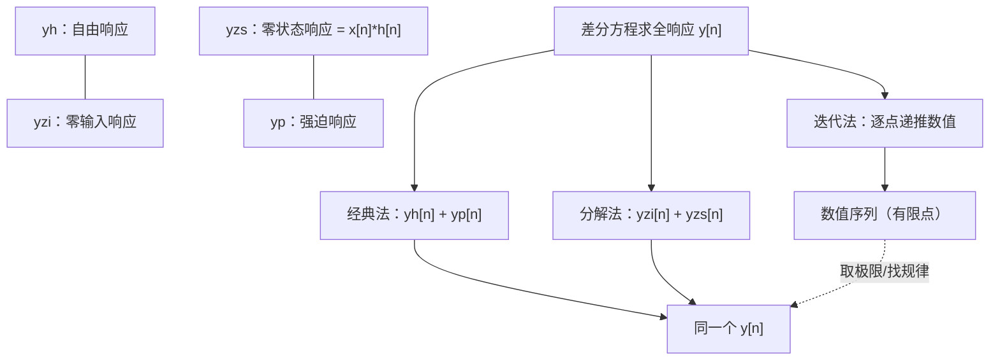

# 离散时间系统的时域解法

**标签：** #数字信号处理 #DSP #差分方程 #齐次解 #特解 #零输入响应 #零状态响应 #迭代法

---

## 一、概述

离散时间系统通常用线性常系数差分方程描述：

$$
\sum_{k=0}^{N} a_k \, y[n-k] = \sum_{r=0}^{M} b_r \, x[n-r]
$$

其中 $a_0 = 1$（归一化），$N$ 为系统阶数。

时域解法就是直接求解差分方程，得到输出序列 $y[n]$。主要有三种方法：

- **经典法**：齐次解 + 特解
- **零输入/零状态分解法**
- **迭代法**（递推法）

三种方法算出的**全响应是同一个**，只是观察角度不同：

**两个分法的区别**（这是本章最容易绕晕的点，一句话记住）：

- **齐次解/特解** 是按**数学形式**分：齐次解满足方程的"左边为 0"，特解负责"凑出输入"。
- **零输入/零状态** 是按**物理来源**分：一个来自初始储能，一个来自外部输入。

两种分法的四个分量之间有交叉关系，对照表见 [[【数字信号处理DSP】（八）离散时间系统的各种响应概念详解|（八）离散时间系统的各种响应概念详解]]。

---

## 二、经典法（齐次解 + 特解）

### 1. 齐次解（自由响应）

令输入 $x[n] = 0$，求解齐次方程：

$$
\sum_{k=0}^{N} a_k \, y_h[n-k] = 0
$$

设 $y_h[n] = \lambda^n$，代入得特征方程：

$$
\sum_{k=0}^{N} a_k \, \lambda^{-k} = 0 \quad \Rightarrow \quad \lambda^N + a_1 \lambda^{N-1} + \cdots + a_N = 0
$$

> **注意特征方程的写法**：把 $y[n-k]$ 换成 $\lambda^{n-k}$，约掉 $\lambda^{n-N}$ 后得到的是**多项式**。一阶系统 $\lambda-a=0$，二阶系统 $\lambda^2+a_1\lambda+a_2=0$——**幂次与阶数一致，符号与差分方程里 $a_k$ 的符号一致**（$+a_2$ 而不是 $-a_2$）。

- **单根** $\lambda_i$：对应项 $C_i \lambda_i^n$
- **重根**（$r$ 重根 $\lambda_0$）：对应项 $(C_0 + C_1 n + \cdots + C_{r-1} n^{r-1}) \lambda_0^n$

### 2. 特解（强迫响应）

根据输入 $x[n]$ 的形式设定特解形式：

| 输入 $x[n]$ | 特解形式 |
|--------------|---------|
| 常数 $A$ | $P$（常数） |
| $A \alpha^n$（$\alpha$ 不是特征根） | $P \alpha^n$ |
| $A \alpha^n$（$\alpha$ 是 $r$ 重特征根） | $P n^r \alpha^n$ |
| $A \cos(\omega_0 n)$ 或 $A \sin(\omega_0 n)$ | $P \cos(\omega_0 n) + Q \sin(\omega_0 n)$ |
| $A n^k$ | $P_0 + P_1 n + \cdots + P_k n^k$ |

将特解代入原差分方程，比较系数求出待定常数。

> **最常见的坑**：输入是常数而 $\lambda=1$ 是特征根时，设 $y_p=P$ 会得到 $0=A$ 的矛盾式。此时必须升一次幂，改设 $y_p=Pn$（若 $\lambda=1$ 是二重根则设 $Pn^2$）。同理，输入 $\alpha^n$ 而 $\alpha$ 恰是特征根时，要设 $Pn\alpha^n$。
>
> **判别口诀**：**特解形式不能与齐次解的"形状"重复**，重复就乘 $n$。

### 3. 全解

$$
y[n] = y_h[n] + y_p[n]
$$

利用初始条件（或边界条件）确定齐次解中的待定系数 $C_i$。

> 上图：以某个一阶系统为例，绿色虚线是**齐次解** $y_h[n]=0.6^n$（指数衰减的暂态），橙色虚线是**特解** $y_p[n]=1.5$（长期保留的稳态），蓝色实线是两者之和即**全解**。绿色阴影就是两者之间的差，随 $n$ 增大而消失——这就是"过渡过程"。

---

## 三、零输入响应与零状态响应

将全响应分解为两部分：

$$
y[n] = y_{zi}[n] + y_{zs}[n]
$$

### 1. 零输入响应（ZIR）

系统无外部输入（$x[n]=0$），仅由初始储能引起的响应。

- 求解方法与齐次解相同
- 初始条件由系统在 $n<0$ 时的状态决定（如 $y[-1], y[-2], \dots$）

### 2. 零状态响应（ZSR）

系统初始状态为零（松弛状态），仅由输入 $x[n]$ 引起的响应。

- 计算方法：卷积和 $y_{zs}[n] = x[n] * h[n]$
- 或采用经典法，令齐次解中的系数由零初始条件确定

### 3. 全响应 = 零输入 + 零状态

$$
y[n] = y_{zi}[n] + x[n] * h[n]
$$

> 这两个分量在时间上的形态差异（一个衰减、一个上升）可以看 [[【数字信号处理DSP】（八）离散时间系统的各种响应概念详解|（八）离散时间系统的各种响应概念详解]] 里的对比图。

---

## 四、迭代法（递推法）

将差分方程改写为递推形式：

$$
y[n] = -\sum_{k=1}^{N} a_k \, y[n-k] + \sum_{r=0}^{M} b_r \, x[n-r]
$$

从 $n=0$ 开始，依次利用已知的初始条件和输入计算后续输出值。

**优点**：简单直观，适合计算机实现
**缺点**：只能得到数值解，难以得到闭式表达式

> **迭代法最大的用途不是"求答案"，而是"求初值"**：经典法/分解法需要 $y[0],y[1]$ 这类非负下标的初值，而题目通常给的是 $y[-1],y[-2]$。**用递推把负下标换成非负下标**，是每道题都躲不开的一步。

---

## 五、由差分方程求单位脉冲响应 $h[n]$

单位脉冲响应 $h[n]$ 是系统在零状态下对 $\delta[n]$ 的响应。

### 方法一：迭代法

令 $x[n] = \delta[n]$，初始条件为零，递推计算 $h[n]$。前几点用手推，再用经典法找通项。

### 方法二：经典法

1. 求齐次解（形式与零输入相同）
2. 利用 $\delta[n]$ 仅在 $n=0$ 处非零的特点，确定初始条件
3. 对于 $n \geq 0$，$h[n]$ 满足齐次方程（因为 $n>0$ 时 $\delta[n]=0$）

**常用结论**：
- 一阶系统：$y[n] - a y[n-1] = b x[n]$ ⇒ $h[n] = b a^n u[n]$
- 二阶系统：$y[n] - a_1 y[n-1] - a_2 y[n-2] = b_0 x[n]$ ⇒ $h[n]$ 形式取决于特征根
- **重根情形**（$\lambda_0$ 为二重根）：$h[n]=(C_0+C_1 n)\lambda_0^n u[n]$

> **为什么重根会多出一个 $n$ 倍因子**：两个相同的极点"撞"在一起，微分/差分意义下产生了一个 $n$ 的线性增长项。这是 s 域中二重极点对应 $te^{-at}$ 的离散版本。

---

## 六、典型例题

> **统一答题格式**：
> 1. **写特征方程、求特征根**（决定齐次解形式）；
> 2. **按输入形式设特解**（注意是否与齐次解重形，重形则乘 $n$）；
> 3. **用递推把 $y[-1],y[-2]$ 换成 $y[0],y[1]$**（这一步不能跳）；
> 4. **代初值定系数**；
> 5. **写出闭式解并在末尾乘 $u[n]$**；
> 6. **代回原方程或再递推一个点检验**。

### 例题 1：一阶差分方程（经典法）

**题目**：$y[n] - 0.5 y[n-1] = x[n]$，$x[n] = u[n]$，初始条件 $y[-1] = 1$。求全响应 $y[n]$。

**解**：

（1）**特征方程与齐次解**：

$$
\lambda - 0.5 = 0 \;\Rightarrow\; \lambda = 0.5,\qquad y_h[n] = C(0.5)^n
$$

（2）**设特解**：$n\ge0$ 时 $x[n]=1$（常数），且 $\lambda=0.5\neq1$，故设 $y_p[n]=P$：

$$
P - 0.5P = 1 \;\Rightarrow\; 0.5P=1 \;\Rightarrow\; P=2
$$

（3）**写全解**：

$$
y[n] = C(0.5)^n + 2,\qquad n\ge 0
$$

（4）**求 $y[0]$**（用方程在 $n=0$ 处，把 $-1$ 的初值转成 $0$ 的初值）：

$$
y[0] - 0.5y[-1] = x[0]=1 \;\Rightarrow\; y[0] - 0.5 = 1 \;\Rightarrow\; y[0]=1.5
$$

（5）**定系数**：令 $n=0$ 代入全解 $1.5 = C + 2$，得 $C=-0.5$。

$$
\boxed{y[n] = \left[2 - 0.5(0.5)^{n}\right]u[n] = \left[2-(0.5)^{n+1}\right]u[n]}
$$

**检验**：

- $n=0$：$2-0.5=1.5$，与第（4）步的 $y[0]$ 一致 ✓
- $n=1$：$y[1]=2-0.25=1.75$；由方程 $y[1]=1+0.5\times1.5=1.75$ ✓
- $n\to\infty$：$y\to2$，稳态值与特解 $P=2$ 一致 ✓

---

### 例题 2：零输入 + 零状态分解（同一道题，另一种算法）

**题目**：系统与输入、初值同例题 1，改用零输入/零状态分解求 $y[n]$。

**解**：

（1）**零输入响应**（令 $x[n]=0$）：

$$
y_{zi}[n]=C(0.5)^n,\qquad y_{zi}[-1]=C(0.5)^{-1}=2C=1 \;\Rightarrow\; C=0.5
$$

$$
y_{zi}[n] = 0.5(0.5)^n=(0.5)^{n+1},\quad n\ge0
$$

（2）**单位脉冲响应**（零状态、输入 $\delta[n]$，由例题 1 的结论 $b=1,a=0.5$）：

$$
h[n]=(0.5)^nu[n]
$$

（3）**零状态响应**（卷积）：

$$
y_{zs}[n]=u[n]*(0.5)^nu[n]=\sum_{k=0}^{n}(0.5)^k
=\frac{1-(0.5)^{n+1}}{1-0.5}=2\left[1-(0.5)^{n+1}\right],\quad n\ge0
$$

（4）**相加**：

$$
y[n]=(0.5)^{n+1}+2-2(0.5)^{n+1}=2-(0.5)^{n+1}
$$

$$
\boxed{y[n]=\left[2-(0.5)^{n+1}\right]u[n]}
$$

**检验**：与例题 1 的答案逐项相同 ✓ —— 这正是"两种分法给出同一个全响应"的实证。

> **两条路怎么选**：题目给了 $x[n]$ 和 $y[-1]$、问全响应 → 两种都行，**经典法更快**；题目明确要求"分别求零输入与零状态" → 只能走分解法。**但分解法里的 $y_{zs}$ 要先有 $h[n]$**，若 $h[n]$ 不好求（高阶系统），分解法反而更慢。

---

### 例题 3：二阶系统（特解需升幂）

**题目**：$y[n] - 3y[n-1] + 2y[n-2] = x[n]$，$x[n] = u[n]$，$y[-1]=1$、$y[-2]=0$。求全响应。

**解**：

（1）**特征方程**：

$$
\lambda^2-3\lambda+2=0 \;\Rightarrow\; (\lambda-1)(\lambda-2)=0 \;\Rightarrow\; \lambda_1=1,\ \lambda_2=2
$$

（2）**设特解——这里要小心**：输入为常数 $1$，而 $\lambda_1=1$ 恰好是**特征根**，若设 $y_p=P$ 会得到

$$
P-3P+2P=1 \;\Rightarrow\; 0=1 \quad\text{（矛盾）}
$$

故升一次幂，改设 $y_p[n]=Pn$：

$$
Pn-3P(n-1)+2P(n-2)=1
\;\Rightarrow\; (P-3P+2P)n+(3P-4P)=1
\;\Rightarrow\; -P=1
$$

$$
y_p[n]=-n
$$

（3）**全解**：

$$
y[n]=C_1+C_2\,2^n-n,\qquad n\ge0
$$

（4）**递推求初值**：

$$
y[0]=x[0]+3y[-1]-2y[-2]=1+3-0=4
$$

$$
y[1]=x[1]+3y[0]-2y[-1]=1+12-2=11
$$

（5）**代初值定系数**：

- $n=0$：$C_1+C_2=4$
- $n=1$：$C_1+2C_2-1=11\Rightarrow C_1+2C_2=12$

解得 $C_2=8$、$C_1=-4$。

$$
\boxed{y[n]=\left[8\cdot2^{n}-n-4\right]u[n]}
$$

**检验**：

- $y[0]=8-0-4=4$ ✓
- $y[1]=16-1-4=11$ ✓
- $y[2]$：公式给 $32-2-4=26$；方程给 $1+3\times11-2\times4=26$ ✓

> **这题的两个"陷阱"**：
> ① **特解升幂**——$\lambda=1$ 与常数输入"同形"，必须乘 $n$；漏了这一步会直接算出 $0=1$。
> ② **系统不稳定**——$\lambda_2=2>1$，输出含 $8\cdot2^n$ 发散项。数学上答案没错，但如果题目问"稳态响应"，答案就是**不存在**（无稳态）。

---

### 例题 4：迭代法

**题目**：$y[n] - 0.5 y[n-1] = x[n]$，$x[n] = \delta[n] + \delta[n-1]$，$y[-1]=0$。用迭代法求 $y[0]\sim y[3]$，并写出闭式解。

**解**：

（1）**改写成递推式**：

$$
y[n]=0.5\,y[n-1]+x[n]
$$

（2）**逐点递推**：

| $n$ | $0.5y[n-1]$ | $x[n]$ | $y[n]$ |
|---|---|---|---|
| $0$ | $0.5\times0=0$ | $1$ | $1$ |
| $1$ | $0.5\times1=0.5$ | $1$ | $1.5$ |
| $2$ | $0.5\times1.5=0.75$ | $0$ | $0.75$ |
| $3$ | $0.5\times0.75=0.375$ | $0$ | $0.375$ |

（3）**写出前几点并找规律**：

$$
\boxed{y[n]=\{1,\ 1.5,\ 0.75,\ 0.375,\ \dots\},\quad y[n]=1.5(0.5)^{n-1}\ (n\ge1)}
$$

**检验**（把通项代回递推式）：

$$
0.5y[n-1]+x[n]=0.5\cdot1.5(0.5)^{n-2}+0=1.5(0.5)^{n-1}=y[n]\ (n\ge2)\ \checkmark
$$

且 $n=1$：$0.5\times1+1=1.5$ ✓

> **注意**：$y[1]=1.5$ 之后才进入纯齐次（$x=0$）的等比衰减，所以**通项从 $n=1$ 起**成立，不能用它算 $y[0]$。这类"分段通项"在迭代法题目里很常见。

---

### 例题 5：特征根为共轭复根（振荡解）

**题目**：$y[n] - y[n-1] + 0.5 y[n-2] = x[n]$，$x[n] = u[n]$，$y[-1]=0$、$y[-2]=0$。求全响应。

**解**：

（1）**特征根**：

$$
\lambda^2-\lambda+0.5=0 \;\Rightarrow\; \lambda=\frac{1\pm\sqrt{1-2}}{2}=0.5\pm j0.5
$$

（2）**化成极坐标**（$r$ 管衰减、$\omega$ 管振荡频率）：

$$
r=\sqrt{0.5^2+0.5^2}=\frac{1}{\sqrt2},\qquad \omega=\arctan\frac{0.5}{0.5}=\frac{\pi}{4}
$$

（3）**齐次解取实值形式**（复根成对，取实组合）：

$$
y_h[n]=r^n\left(A\cos\frac{\pi n}{4}+B\sin\frac{\pi n}{4}\right)
$$

（4）**特解**：输入常数且 $\lambda\neq1$，设 $y_p=P$：

$$
P-P+0.5P=1 \;\Rightarrow\; P=2
$$

（5）**递推求初值**（零状态，$y[-1]=y[-2]=0$）：

$$
y[0]=x[0]+y[-1]-0.5y[-2]=1
$$

$$
y[1]=x[1]+y[0]-0.5y[-1]=1+1-0=2
$$

（6）**定系数**（全解 $y[n]=r^n(A\cos\frac{\pi n}{4}+B\sin\frac{\pi n}{4})+2$）：

- $n=0$：$A+2=1\Rightarrow A=-1$
- $n=1$：$\frac{1}{\sqrt2}\left(-1\cdot\frac{\sqrt2}{2}+B\cdot\frac{\sqrt2}{2}\right)+2=2\Rightarrow \frac{B-1}{2}=0\Rightarrow B=1$

（7）**合并成一个正弦**（$-1$、$1$ 的合成振幅 $\sqrt2$、初相 $-\frac{\pi}{4}$）：

$$
\boxed{y[n]=2+\sqrt{2}\left(\frac{1}{\sqrt2}\right)^{n}\sin\!\left(\frac{\pi n}{4}-\frac{\pi}{4}\right),\quad n\ge0}
$$

**检验**：

- $y[0]=2+\sqrt2\cdot1\cdot\sin(-\frac{\pi}{4})=2+\sqrt2\cdot(-\frac{\sqrt2}{2})=2-1=1$ ✓
- $y[2]=2+\sqrt2\cdot\frac12\cdot\sin\frac{\pi}{4}=2+0.5=2.5$；方程给 $y[2]=1+y[1]-0.5y[0]=1+2-0.5=2.5$ ✓

→ 输出是**振幅按 $r^n$ 衰减的振荡**，最终稳定到 $2$。$r=\frac{1}{\sqrt2}<1$ 说明系统稳定。

---

### 例题 6：重根情形（求 $h[n]$）

**题目**：$y[n]-y[n-1]+0.25y[n-2]=x[n]$，求单位脉冲响应 $h[n]$。

**解**：

（1）**特征方程**：

$$
\lambda^2-\lambda+0.25=0 \;\Rightarrow\; \left(\lambda-0.5\right)^2=0
$$

$\lambda_0=0.5$ 是**二重根**，故

$$
h[n]=(C_0+C_1 n)(0.5)^n,\qquad n\ge0
$$

（2）**递推求前两点**（零状态，$x[n]=\delta[n]$）：

- $n=0$：$h[0]-h[-1]+0.25h[-2]=\delta[0]=1 \Rightarrow h[0]=1$
- $n=1$：$h[1]-h[0]+0.25h[-1]=\delta[1]=0 \Rightarrow h[1]=h[0]=1$

（3）**定系数**：

- $n=0$：$C_0=1$
- $n=1$：$(C_0+C_1)(0.5)=1 \Rightarrow 1+C_1=2 \Rightarrow C_1=1$

$$
\boxed{h[n]=(1+n)\left(\tfrac{1}{2}\right)^{n}u[n]}
$$

**检验**：

- $h[2]$：公式给 $3\times0.25=0.75$；方程给 $h[2]=h[1]-0.25h[0]=1-0.25=0.75$ ✓
- $n\to\infty$：$(1+n)(0.5)^n\to0$，冲击响应衰减，系统稳定 ✓（二重根模长 $0.5<1$）

> **重根的判别价值**：若误按"两个不同的 $0.5$ 根"设 $h[n]=C_1(0.5)^n+C_2(0.5)^n$，形式上会退化成**只有一个待定系数**，两个初值条件必然无法同时满足——这是发现自己"漏了重根"的信号。

### 补充：特征根三种情形对照

| 特征根 | 齐次解形式 | 响应形态 |
| --- | --- | --- |
| 实单根 $\lambda_i$ | $\sum_i C_i \lambda_i^n$ | 单调衰减或增长 |
| 重根 $\lambda_0$（$r$ 重） | $(C_0 + C_1 n + \cdots + C_{r-1}n^{r-1})\lambda_0^n$ | 先增后减的"先鼓包"形态 |
| 共轭复根 $r e^{\pm j\omega}$ | $r^n(A\cos\omega n + B\sin\omega n)$ | **振荡**，包络 $r^n$ |

**两个参数各管一件事**：

- **模长 $r$ 决定"振不振得下去"**：$r \lt 1$ 衰减、$r = 1$ 等幅、$r \gt 1$ 发散；
- **辐角 $\omega$ 决定"振多快"**：$\omega$ 越大，每样本的相位变化越大，振荡越剧烈。

这个结论换个说法就是 Z 域中的**极点位置决定系统行为**——极点模长在单位圆内即稳定，见 [[【数字信号处理DSP】（十三）Z 变换与收敛域|（十三）Z 变换与收敛域]]。

---

## 七、三种方法的对比

| 方法 | 优点 | 缺点 | 适用场景 |
|------|------|------|---------|
| 经典法 | 得到闭式表达式 | 需确定初始条件，高阶计算繁琐 | 低阶系统、理论分析 |
| 零输入/零状态分解 | 物理概念清晰，便于理解系统行为 | 需分别计算两部分 | 系统分析、教学 |
| 迭代法 | 简单直接，适合编程 | 只能得到数值解，无法看出规律 | 计算机仿真、实时计算 |

---

## 八、常见错误提醒

1. **特解形式选择错误**：当输入与齐次解形式相同时，需乘以 $n$（或 $n^r$）。典型症状是代入后得到 $0=\text{常数}$ 的矛盾式。
2. **初始条件使用不当**：经典法需要的是 $n=0,1,\dots,N-1$ 的初值，而题目给的是 $n=-1,-2,\dots$，**必须先用方程递推转换**。直接用负下标代入会定错系数。
3. **零状态响应忽略了系统初始松弛**：零状态必须假设所有初始条件为零。
4. **卷积和与差分方程混淆**：卷积和只适用于零状态响应，不能直接用于非零初始条件。
5. **漏掉重根**：特征方程出现 $(\lambda-\lambda_0)^2$ 时必须设 $(C_0+C_1n)\lambda_0^n$。漏掉的话方程个数与待定系数个数对不上。
6. **特征方程符号写反**：$y[n]-3y[n-1]+2y[n-2]$ 对应 $\lambda^2-3\lambda+2=0$，**系数符号照抄**，不要自己改成 $+3\lambda$。
7. **闭式解漏写 $u[n]$**：解出的是 $n\ge0$ 的表达式，$n<0$ 时输出为 $0$（因果系统），必须乘 $u[n]$ 才完整。
8. **算出发散解就以为算错了**：若特征根模长大于 $1$，输出确实发散（系统不稳定），这不是计算错误。但若题目问"稳态响应"，答案是**不存在**。

---

## 九、知识链定位

时域解法（本章）

│

├── 经典法（齐次解 + 特解）→ 闭式解

├── 零输入 / 零状态分解 → 物理意义清晰

├── 迭代法（递推）→ 数值解 + 求初值

└── 单位脉冲响应 h[n] 的求法（含重根情形）

│

├── 离散时间系统六大性质：稳定性与因果性（第二节）

├── 自相关与互相关：相关运算的时域视角（第四节）

├── 卷积和：零状态响应的另一条路（第七节）

├── 离散时间系统的各种响应：四分量交叉关系（第八节）

├── 模拟频率与数字频率：响应的频率含义（第十节）

├── 奈奎斯特采样定理：连续到离散（第十一节）

└── Z 变换与收敛域：把差分方程变成代数方程（第十三节）

---

## 十、总结

| 需求 | 推荐方法 |
| --- | --- |
| 要闭式表达式、低阶系统 | 经典法（齐次解 + 特解） |
| 要看清"哪部分来自初始状态、哪部分来自输入" | 零输入 / 零状态分解 |
| 要算若干点的数值、要编程实现 | 迭代法 |
| 要求单位脉冲响应 $h[n]$ | 迭代法（前几点）+ 经典法（通项） |
| 求零状态响应 | 卷积和 $y_{zs}[n] = x[n]*h[n]$ |

三条贯穿本章的主线：

1. **特征根决定一切**：实根单调、重根鼓包、复根振荡，模长管衰减、辐角管频率；
2. **初始条件决定待定系数**：$y[-1], y[-2]$ 必须先用方程递推到 $y[0], y[1]$ 才能代入齐次解；
3. **全响应只有一个**：三种方法算出的是同一个 $y[n]$，分法不同只是观察角度不同。

> **一句话总结**：时域解法是离散时间系统分析的基石——经典法给出闭式解，分解法给出物理图像，迭代法给出数值结果；而特征根的位置早已把"响应会长什么样"写在答案里了。
