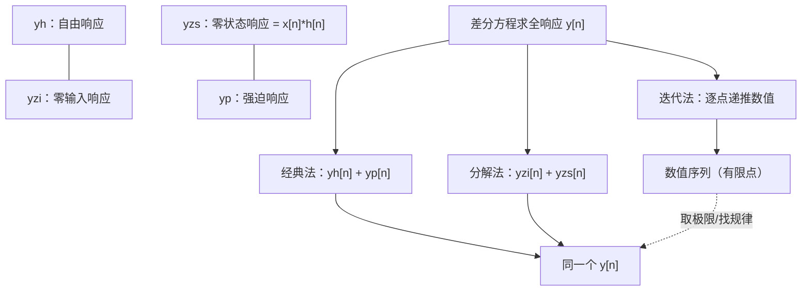

# 离散时间系统的时域解法

**标签：** #数字信号处理 #DSP #差分方程 #齐次解 #特解 #零输入响应 #零状态响应 #迭代法

---

## 一、概述

离散时间系统通常用线性常系数差分方程描述：

$$
\sum_{k=0}^{N} a_k \, y[n-k] = \sum_{r=0}^{M} b_r \, x[n-r]
$$

其中 $a_0 = 1$（归一化），$N$ 为系统阶数。

时域解法就是直接求解差分方程，得到输出序列 $y[n]$。主要有三种方法：

- **经典法**：齐次解 + 特解
- **零输入/零状态分解法**
- **迭代法**（递推法）

三种方法算出的**全响应是同一个**，只是观察角度不同：

**两个分法的区别**（这是本章最容易绕晕的点，一句话记住）：

- **齐次解/特解** 是按**数学形式**分：齐次解满足方程的"左边为 0"，特解负责"凑出输入"。
- **零输入/零状态** 是按**物理来源**分：一个来自初始储能，一个来自外部输入。

两种分法的四个分量之间有交叉关系，对照表见 [[【数字信号处理DSP】（八）离散时间系统的各种响应概念详解|（八）离散时间系统的各种响应概念详解]]。

---

## 二、经典法（齐次解 + 特解）

### 1. 齐次解（自由响应）

令输入 $x[n] = 0$，求解齐次方程：

$$
\sum_{k=0}^{N} a_k \, y_h[n-k] = 0
$$

设 $y_h[n] = \lambda^n$，代入得特征方程：

$$
\sum_{k=0}^{N} a_k \, \lambda^{-k} = 0 \quad \Rightarrow \quad \lambda^N + a_1 \lambda^{N-1} + \cdots + a_N = 0
$$

- **单根** $\lambda_i$：对应项 $C_i \lambda_i^n$
- **重根**（$r$ 重根 $\lambda_0$）：对应项 $(C_0 + C_1 n + \cdots + C_{r-1} n^{r-1}) \lambda_0^n$

### 2. 特解（强迫响应）

根据输入 $x[n]$ 的形式设定特解形式：

| 输入 $x[n]$ | 特解形式 |
|--------------|---------|
| 常数 $A$ | $P$（常数） |
| $A \alpha^n$（$\alpha$ 不是特征根） | $P \alpha^n$ |
| $A \alpha^n$（$\alpha$ 是 $r$ 重特征根） | $P n^r \alpha^n$ |
| $A \cos(\omega_0 n)$ 或 $A \sin(\omega_0 n)$ | $P \cos(\omega_0 n) + Q \sin(\omega_0 n)$ |
| $A n^k$ | $P_0 + P_1 n + \cdots + P_k n^k$ |

将特解代入原差分方程，比较系数求出待定常数。

### 3. 全解

$$
y[n] = y_h[n] + y_p[n]
$$

利用初始条件（或边界条件）确定齐次解中的待定系数 $C_i$。

---

## 三、零输入响应与零状态响应

将全响应分解为两部分：

$$
y[n] = y_{zi}[n] + y_{zs}[n]
$$

### 1. 零输入响应（ZIR）

系统无外部输入（$x[n]=0$），仅由初始储能引起的响应。

- 求解方法与齐次解相同
- 初始条件由系统在 $n<0$ 时的状态决定（如 $y[-1], y[-2], \dots$）

### 2. 零状态响应（ZSR）

系统初始状态为零（松弛状态），仅由输入 $x[n]$ 引起的响应。

- 计算方法：卷积和 $y_{zs}[n] = x[n] * h[n]$
- 或采用经典法，令齐次解中的系数由零初始条件确定

### 3. 全响应 = 零输入 + 零状态

$$
y[n] = y_{zi}[n] + x[n] * h[n]
$$

---

## 四、迭代法（递推法）

将差分方程改写为递推形式：

$$
y[n] = -\sum_{k=1}^{N} a_k \, y[n-k] + \sum_{r=0}^{M} b_r \, x[n-r]
$$

从 $n=0$ 开始，依次利用已知的初始条件和输入计算后续输出值。

**优点**：简单直观，适合计算机实现  
**缺点**：只能得到数值解，难以得到闭式表达式

---

## 五、由差分方程求单位脉冲响应 $h[n]$

单位脉冲响应 $h[n]$ 是系统在零状态下对 $\delta[n]$ 的响应。

### 方法一：迭代法

令 $x[n] = \delta[n]$，初始条件为零，递推计算 $h[n]$。

### 方法二：经典法

1. 求齐次解（形式与零输入相同）
2. 利用 $\delta[n]$ 仅在 $n=0$ 处非零的特点，确定初始条件
3. 对于 $n \geq 0$，$h[n]$ 满足齐次方程（因为 $n>0$ 时 $\delta[n]=0$）

**常用结论**：
- 一阶系统：$y[n] - a y[n-1] = b x[n]$  ⇒  $h[n] = b a^n u[n]$
- 二阶系统：$y[n] - a_1 y[n-1] - a_2 y[n-2] = b_0 x[n]$  ⇒  $h[n]$ 形式取决于特征根

---

## 六、典型例题

### 例题1：一阶差分方程（经典法）

已知：$y[n] - 0.5 y[n-1] = x[n]$，$x[n] = u[n]$，初始条件 $y[-1] = 1$

求全响应 $y[n]$。

**解**：

**步骤1：齐次解**

特征方程：$\lambda - 0.5 = 0$ ⇒ $\lambda = 0.5$

$$
y_h[n] = C (0.5)^n
$$

**步骤2：特解**

输入 $u[n]$ 在 $n \geq 0$ 时为常数 1，设特解 $y_p[n] = P$（常数）

代入方程：$P - 0.5P = 1$ ⇒ $0.5P = 1$ ⇒ $P = 2$

所以 $y_p[n] = 2$（$n \geq 0$）

**步骤3：全解**

$$
y[n] = C (0.5)^n + 2, \quad n \geq 0
$$

利用初始条件 $y[-1] = 1$，注意方程对 $n=0$ 成立：

$$
y[0] - 0.5 y[-1] = x[0] = 1 \quad \Rightarrow \quad y[0] - 0.5 \times 1 = 1 \quad \Rightarrow \quad y[0] = 1.5
$$

代入全解：$n=0$ 时 $1.5 = C + 2$ ⇒ $C = -0.5$

所以：

$$
y[n] = [-0.5 (0.5)^n + 2] \, u[n]
$$

---

### 例题2：零输入 + 零状态分解

系统：$y[n] - 0.5 y[n-1] = x[n]$，$x[n] = u[n]$，$y[-1] = 1$

**零输入响应**：

齐次解形式 $y_{zi}[n] = C (0.5)^n$，由初始条件 $y[-1]=1$ 得：

$y_{zi}[-1] = C (0.5)^{-1} = 2C = 1$ ⇒ $C = 0.5$

所以 $y_{zi}[n] = 0.5 (0.5)^n = (0.5)^{n+1}$，$n \geq -1$（实际上 $n \geq 0$ 时也成立）

**零状态响应**：

先求单位脉冲响应：$h[n] = (0.5)^n u[n]$（由迭代法或经典法可得）

$$
y_{zs}[n] = u[n] * (0.5)^n u[n] = \sum_{k=0}^{n} (0.5)^k = \frac{1-(0.5)^{n+1}}{1-0.5} = 2[1-(0.5)^{n+1}] u[n]
$$

**全响应**：

$$
y[n] = y_{zi}[n] + y_{zs}[n] = (0.5)^{n+1} + 2 - 2(0.5)^{n+1} = 2 - (0.5)^{n+1} = [-0.5(0.5)^n + 2] u[n]
$$

与例题1结果一致。

---

### 例题3：二阶系统

系统：$y[n] - 3y[n-1] + 2y[n-2] = x[n]$，$x[n] = u[n]$，初始条件 $y[-1]=1$，$y[-2]=0$

求全响应。

**解**：

特征方程：$\lambda^2 - 3\lambda + 2 = 0$ ⇒ $(\lambda-1)(\lambda-2)=0$ ⇒ $\lambda_1=1$，$\lambda_2=2$

齐次解：$y_h[n] = C_1 (1)^n + C_2 (2)^n = C_1 + C_2 2^n$

特解：输入为常数，设 $y_p[n] = P$

代入：$P - 3P + 2P = 1$ ⇒ $0 = 1$，矛盾！

说明特解形式应设为 $P n$（因为 $\lambda=1$ 是特征根，且为单根）

设 $y_p[n] = P n$，代入：

$$
P n - 3P (n-1) + 2P (n-2) = 1
$$

化简：$P n - 3P n + 3P + 2P n - 4P = 1$ ⇒ $(P - 3P + 2P)n + (3P - 4P) = -P = 1$ ⇒ $P = -1$

所以 $y_p[n] = -n$

全解：$y[n] = C_1 + C_2 2^n - n$，$n \geq 0$

利用初始条件求 $C_1, C_2$：

由差分方程递推 $y[0]$：
$$
y[0] - 3y[-1] + 2y[-2] = x[0] = 1 \quad \Rightarrow \quad y[0] - 3\times1 + 2\times0 = 1 \quad \Rightarrow \quad y[0] = 4
$$

再求 $y[1]$：
$$
y[1] - 3y[0] + 2y[-1] = x[1] = 1 \quad \Rightarrow \quad y[1] - 12 + 2 = 1 \quad \Rightarrow \quad y[1] = 11
$$

代入全解：
- $n=0$：$C_1 + C_2 = 4$
- $n=1$：$C_1 + 2C_2 - 1 = 11$ ⇒ $C_1 + 2C_2 = 12$

解得：$C_2 = 8$，$C_1 = -4$

所以：
$$
y[n] = [-4 + 8\cdot 2^n - n] \, u[n] = [8\cdot 2^n - n - 4] \, u[n]
$$

---

### 例题4：迭代法

系统：$y[n] - 0.5 y[n-1] = x[n]$，$x[n] = \delta[n] + \delta[n-1]$，初始条件 $y[-1]=0$

用迭代法求 $y[n]$（$n=0,1,2,3$）

**解**：

递推式：$y[n] = 0.5 y[n-1] + x[n]$

- $n=0$：$y[0] = 0.5 y[-1] + x[0] = 0 + 1 = 1$
- $n=1$：$y[1] = 0.5 y[0] + x[1] = 0.5\times1 + 1 = 1.5$
- $n=2$：$y[2] = 0.5 y[1] + x[2] = 0.5\times1.5 + 0 = 0.75$
- $n=3$：$y[3] = 0.5 y[2] + x[3] = 0.5\times0.75 + 0 = 0.375$

所以：
$$
y[n] = \{1, 1.5, 0.75, 0.375, \dots\}
$$

---

### 例题5：特征根为共轭复根（振荡解）

系统：$y[n] - y[n-1] + 0.5 y[n-2] = x[n]$，$x[n] = u[n]$，初始条件 $y[-1]=0$、$y[-2]=0$

求全响应。

**解**：

**步骤1：特征根**

$$
\lambda^2 - \lambda + 0.5 = 0 \quad \Rightarrow \quad \lambda = \frac{1 \pm \sqrt{1-2}}{2} = 0.5 \pm j0.5
$$

写成极坐标形式：

$$
\lambda = r e^{\pm j\omega}, \quad r = \sqrt{0.5^2 + 0.5^2} = \frac{1}{\sqrt{2}} \approx 0.707, \quad \omega = \arctan 1 = \frac{\pi}{4}
$$

**步骤2：齐次解**

复根成对出现时，取实值形式：

$$
y_h[n] = r^n \left( A \cos(\omega n) + B \sin(\omega n) \right)
$$

**步骤3：特解**

输入为常数，设 $y_p[n] = P$，代入：$P - P + 0.5P = 1 \Rightarrow P = 2$。

**步骤4：由零初始条件确定 $A$、$B$**

先递推求出 $y[0]$、$y[1]$：

- $y[0] - y[-1] + 0.5y[-2] = x[0] = 1 \Rightarrow y[0] = 1$
- $y[1] - y[0] + 0.5y[-1] = x[1] = 1 \Rightarrow y[1] = 2$

代入全解 $y[n] = r^n(A\cos\frac{\pi n}{4} + B\sin\frac{\pi n}{4}) + 2$：

- $n=0$：$A + 2 = 1 \Rightarrow A = -1$
- $n=1$：$\frac{1}{\sqrt{2}}\left(-1\cdot\frac{\sqrt{2}}{2} + B\cdot\frac{\sqrt{2}}{2}\right) + 2 = 2 \Rightarrow B = 1$

于是

$$
y[n] = 2 + \sqrt{2}\left(\frac{1}{\sqrt{2}}\right)^{n} \sin\!\left(\frac{\pi n}{4} - \frac{\pi}{4}\right), \quad n \geq 0
$$

**验算**：$y[2] = 2 + \sqrt{2}\cdot\frac{1}{2}\cdot\sin\frac{\pi}{4} = 2.5$，与递推 $y[2] = y[1] - 0.5y[0] + 1 = 2.5$ 一致。

→ 输出是**振幅按 $r^n$ 指数衰减的振荡**，最终稳定到 $2$。$r \lt 1$ 说明系统稳定。

### 补充：特征根三种情形对照

| 特征根 | 齐次解形式 | 响应形态 |
| --- | --- | --- |
| 实单根 $\lambda_i$ | $\sum_i C_i \lambda_i^n$ | 单调衰减或增长 |
| 重根 $\lambda_0$（$r$ 重） | $(C_0 + C_1 n + \cdots + C_{r-1}n^{r-1})\lambda_0^n$ | 先增后减的"先鼓包"形态 |
| 共轭复根 $r e^{\pm j\omega}$ | $r^n(A\cos\omega n + B\sin\omega n)$ | **振荡**，包络 $r^n$ |

**两个参数各管一件事**：

- **模长 $r$ 决定"振不振得下去"**：$r \lt 1$ 衰减、$r = 1$ 等幅、$r \gt 1$ 发散；
- **辐角 $\omega$ 决定"振多快"**：$\omega$ 越大，每样本的相位变化越大，振荡越剧烈。

这个结论换个说法就是 Z 域中的**极点位置决定系统行为**——极点模长在单位圆内即稳定，见 [[【数字信号处理DSP】（十三）Z 变换与收敛域|（十三）Z 变换与收敛域]]。

---

## 七、三种方法的对比

| 方法 | 优点 | 缺点 | 适用场景 |
|------|------|------|---------|
| 经典法 | 得到闭式表达式 | 需确定初始条件，高阶计算繁琐 | 低阶系统、理论分析 |
| 零输入/零状态分解 | 物理概念清晰，便于理解系统行为 | 需分别计算两部分 | 系统分析、教学 |
| 迭代法 | 简单直接，适合编程 | 只能得到数值解，无法看出规律 | 计算机仿真、实时计算 |

---

## 八、常见错误提醒

1. **特解形式选择错误**：当输入与齐次解形式相同时，需乘以 $n$（或 $n^r$）
2. **初始条件使用不当**：经典法需要的是 $n=0,1,\dots,N-1$ 的初始值，而不是 $n=-1,-2,\dots$ 的初始条件，需通过递推转换
3. **零状态响应忽略了系统初始松弛**：零状态必须假设所有初始条件为零
4. **卷积和与差分方程混淆**：卷积和只适用于零状态响应，不能直接用于非零初始条件

---

## 九、知识链定位

时域解法（本章）

│

├── 经典法（齐次解 + 特解）→ 闭式解

├── 零输入 / 零状态分解 → 物理意义清晰

├── 迭代法（递推）→ 数值解

└── 单位脉冲响应 h[n] 的求法

│

├── 离散时间系统六大性质：稳定性与因果性（第二节）

├── 自相关与互相关：相关运算的时域视角（第四节）

├── 卷积和：零状态响应的另一条路（第七节）

├── 离散时间系统的各种响应：四分量交叉关系（第八节）

├── 模拟频率与数字频率：响应的频率含义（第十节）

├── 奈奎斯特采样定理：连续到离散（第十一节）

└── Z 变换与收敛域：把差分方程变成代数方程（第十三节）

---

## 十、总结

| 需求 | 推荐方法 |
| --- | --- |
| 要闭式表达式、低阶系统 | 经典法（齐次解 + 特解） |
| 要看清"哪部分来自初始状态、哪部分来自输入" | 零输入 / 零状态分解 |
| 要算若干点的数值、要编程实现 | 迭代法 |
| 要求单位脉冲响应 $h[n]$ | 迭代法（前几点）+ 经典法（通项） |
| 求零状态响应 | 卷积和 $y_{zs}[n] = x[n]*h[n]$ |

三条贯穿本章的主线：

1. **特征根决定一切**：实根单调、重根鼓包、复根振荡，模长管衰减、辐角管频率；
2. **初始条件决定待定系数**：$y[-1], y[-2]$ 必须先用方程递推到 $y[0], y[1]$ 才能代入齐次解；
3. **全响应只有一个**：三种方法算出的是同一个 $y[n]$，分法不同只是观察角度不同。

> **一句话总结**：时域解法是离散时间系统分析的基石——经典法给出闭式解，分解法给出物理图像，迭代法给出数值结果；而特征根的位置早已把"响应会长什么样"写在答案里了。