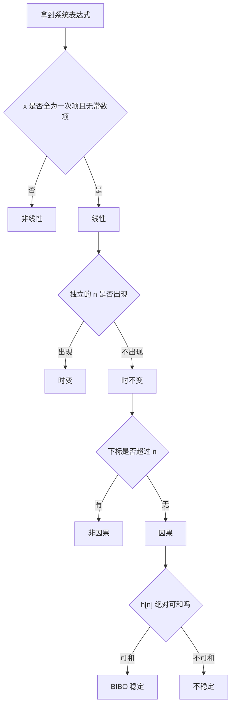

# 离散时间系统六大性质判断方法

**标签：** #数字信号处理 #DSP #线性 #时不变 #因果 #稳定 #BIBO #LSI

---

## 一、概述

一个离散时间系统 $y[n]=T\{x[n]\}$，用六个性质刻画：

1. **线性性**（Linearity）
2. **时不变性**（Time-Invariance）
3. **因果性**（Causality）
4. **稳定性**（Stability，BIBO）
5. **记忆性**（Memory）
6. **可逆性**（Invertibility）

六个性质**互相独立**：一个系统可以线性但不因果，可以稳定但时变。做题时逐条单独判断，**不要试图用一条结论推另一条**。

其中有一对组合格外重要：

$$
\text{线性} + \text{时不变} \;=\; \text{LSI（线性移不变）系统}
$$

只有 LSI 系统才能用单位脉冲响应 $h[n]$ 完整描述，才有 $y[n]=x[n]*h[n]$、才有 $H(z)$ 与 $H(e^{j\omega})$。后面几乎所有章节（[[【数字信号处理DSP】（七）卷积和|（七）卷积和]]、[[【数字信号处理DSP】（十三）Z 变换与收敛域|（十三）Z 变换与收敛域]]）都建立在它上面。

### 答题的三个层次（考试要求）

| 层次 | 要求 | 分值倾向 |
|------|------|---------|
| **写判据** | 明确写出所用定义式 | 必给分点 |
| **代式子验证** | 把 $x_1,x_2$ 或 $x[n-n_0]$ 代进去算出两边 | 主要得分 |
| **下结论 + 反例** | 判定为"否"时给出一个具体反例 | 常见扣分点 |

> 本文每类性质先给**判据**，再给**答题模板**，最后用例题演示。判断题用三步式（判据 → 代入 → 结论），需要算的地方才展开完整步骤。

---

## 二、线性（Linearity）

### 1. 判据

系统 $T$ 线性，当且仅当对任意输入 $x_1[n],x_2[n]$ 与任意常数 $a,b$：

$$
T\{a x_1[n] + b x_2[n]\} = a\,T\{x_1[n]\} + b\,T\{x_2[n]\}
$$

它等价于同时满足：

- **可加性**：$T\{x_1[n]+x_2[n]\}=T\{x_1[n]\}+T\{x_2[n]\}$
- **齐次性**：$T\{a x[n]\}=a\,T\{x[n]\}$

> 上图：**左栏**两个输入 $x_1=\delta[n-2]$、$x_2=0.55^{\,n}u[n]$ 按 $1.5$ 与 $-1$ 加权叠加成新输入；**右栏**让"先叠加再进系统"（蓝圆点）与"先进系统再叠加"（红空心方块）两条路各走一遍，结果处处重合。**重合 ⇒ 线性；某点不重合，那个差值就是非线性的证据。**

### 2. 快速判据（先看后算，省时间）

| 表达式里出现 | 判定 |
|---|---|
| $x$ 全为**一次**，且**无**独立常数项 | 线性 |
| $x^2$、$\lvert x\rvert$、$\cos x$、$x_1\cdot x_2$、$x[n]\cdot x[n-1]$ | 非线性 |
| 与输入无关的常数项（如 $+1$、$+c$） | 非线性（零输入输出不为零） |

### 3. 答题模板

> **解**：
> （1）设 $x_1[n]\to y_1[n]$，$x_2[n]\to y_2[n]$，取任意常数 $a,b$；
> （2）计算 $T\{a x_1+b x_2\}=\cdots$；
> （3）计算 $a y_1[n]+b y_2[n]=\cdots$；
> （4）比较两者：相等 ⇒ 线性；不等 ⇒ 非线性。
> **答案**：线性 / 非线性。

---

**例题 1**：判断 $y[n]=x[n]+1$ 是否为线性系统。

**解**：

（1）**写判据**：线性要求 $T\{ax_1+bx_2\}=aT\{x_1\}+bT\{x_2\}$。

（2）**算左边**（把输入 $ax_1+bx_2$ 送进系统）：

$$
T\{ax_1+bx_2\} = ax_1[n]+bx_2[n]+1
$$

（3）**算右边**（分别作用后加权）：

$$
a\,T\{x_1\} + b\,T\{x_2\} = a\big(x_1[n]+1\big)+b\big(x_2[n]+1\big) = ax_1[n]+bx_2[n]+a+b
$$

（4）**比较**：左边比右边少了 $a+b$，两者不相等。

**答案**：

$$
\boxed{\text{非线性系统}}
$$

**检验**（更快的办法——查零输入）：取 $x[n]\equiv 0$，得 $y[n]\equiv 1 \ne 0$。线性系统零输入必须零输出，故必非线性 ✓

---

**例题 2**：判断 $y[n]=2x[n]-x[n-1]$ 是否为线性系统。

**解**：

（1）**写判据**：同上。

（2）**算左边**：

$$
T\{ax_1+bx_2\} = 2\big(ax_1[n]+bx_2[n]\big) - \big(ax_1[n-1]+bx_2[n-1]\big)
$$

（3）**算右边**：

$$
aT\{x_1\}+bT\{x_2\} = a\big(2x_1[n]-x_1[n-1]\big)+b\big(2x_2[n]-x_2[n-1]\big)
$$

（4）**比较**：把 (3) 展开即与 (2) 完全相同（$a,b$ 分别乘以同一括号）。

**答案**：

$$
\boxed{\text{线性系统}}
$$

**检验**：取 $x[n]=\delta[n]$，得 $y[n]=2\delta[n]-\delta[n-1]$；把输入放大 $2$ 倍，输出恰为 $2y[n]$，齐次性成立 ✓

**要点**：$x[n]$ 与 $x[n-1]$ 都是**一次项**，系数 $2$、$-1$ 是常数，故线性。**有记忆不影响线性**。

---

**例题 3**：判断 $y[n]=x^2[n]$ 是否为线性系统。

**解**：

（1）**算左边**：

$$
T\{ax_1+bx_2\} = \big(ax_1[n]+bx_2[n]\big)^2 = a^2x_1^2[n]+2ab\,x_1[n]x_2[n]+b^2x_2^2[n]
$$

（2）**算右边**：

$$
aT\{x_1\}+bT\{x_2\} = ax_1^2[n]+bx_2^2[n]
$$

（3）**比较**：左边多了交叉项 $2ab\,x_1x_2$，且系数是 $a^2,b^2$ 而非 $a,b$，两式不等。

**答案**：

$$
\boxed{\text{非线性系统}}
$$

**检验（反例）**：取 $x[n]=\delta[n]$ 时 $y=\delta[n]$；取 $x[n]=2\delta[n]$ 时 $y=4\delta[n]\neq2\delta[n]$ —— 一个反例就推翻线性 ✓

---

## 三、时不变性（Time-Invariance）

> 上图：把输入整体右移 $2$ 个采样点（橙色方点），经同一系统后，输出也恰好右移 $2$ 个采样点（橙色方点），形状完全不变——这就是**时不变性**。

### 1. 判据

$$
T\{x[n-n_0]\} = y[n-n_0] \qquad \text{对任意 } n_0
$$

即：**先移位再进系统** 与 **先进系统再移位**，结果必须相同。

> 上图：**上栏**是时不变系统 $y[n]=0.5\big(x[n]+x[n-1]\big)$，输入右移 $3$ 点后，输出也整体右移 $3$ 点，橙圈完全套住紫点；**下栏**是 $y[n]=n\,x[n]$，两条路的结果错开，而且错位随 $n$ 越来越大——这就是时变。**判据：两圈能否严丝合缝地套住。**

### 2. 答题模板

> （1）写出原输出 $y[n]=T\{x[n]\}$；
> （2）令输入为 $x[n-n_0]$，求 $T\{x[n-n_0]\}$；
> （3）把 (1) 的结果整体延迟 $n_0$，得 $y[n-n_0]$；
> （4）比较 (2)(3)：恒等 ⇒ 时不变；存在某个 $n_0$ 不等 ⇒ 时变。

### 3. 快速判据

看 $n$ 出现的位置：

| 情形 | 判定 |
|---|---|
| $n$ 只出现在 $x[\cdot]$ 的下标里，且形如 $n$、$n-1$、$n+2$（整体平移） | 时不变 |
| 出现**独立于 $x$ 的 $n$**：系数 $n$、下标 $2n$、因子 $\cos(\pi n)$ | **时变** |

---

**例题 4**：判断 $y[n]=x[n]-x[n-1]$ 是否为时不变系统。

**解**：

（1）**原输出**：$y[n]=x[n]-x[n-1]$。

（2）**输入延迟后的输出**：把 $x[n]$ 换成 $x[n-n_0]$：

$$
T\{x[n-n_0]\} = x[n-n_0]-x[n-n_0-1]
$$

（3）**原输出延迟**：把 $y[n]$ 中的 $n$ 换成 $n-n_0$：

$$
y[n-n_0] = x[n-n_0]-x[n-n_0-1]
$$

（4）**比较**：两式完全相同，对任意 $n_0$ 成立。

**答案**：

$$
\boxed{\text{时不变系统}}
$$

**检验**：把输入右移 $3$ 点，输出为 $x[n-3]-x[n-4]$，正是原输出整体右移 $3$ 点 ✓

---

**例题 5**：判断 $y[n]=n\,x[n]$ 是否为时不变系统。

**解**：

（1）**原输出**：$y[n]=n\,x[n]$。

（2）**输入延迟后的输出**：

$$
T\{x[n-n_0]\} = n\,x[n-n_0]
$$

（3）**原输出延迟**：

$$
y[n-n_0] = (n-n_0)\,x[n-n_0]
$$

（4）**比较**：两者相差系数上的 $(n-n_0)$ 与 $n$，当 $n_0\ne 0$ 时不相等。

**答案**：

$$
\boxed{\text{时变系统}}
$$

**检验（反例）**：取 $x[n]=\delta[n]$，则 $T\{x\}=n\delta[n]=0$（只有 $n=0$ 项，值为 $0$）；而 $T\{x[n-1]\}=n\delta[n-1]=\delta[n-1]\neq0$，两圈错开 ✓

---

**例题 6**：判断 $y[n]=x[n]\cos(\pi n)$ 是否为时不变系统。

**解**：

（1）**原输出**：$y[n]=x[n]\cos(\pi n)$。

（2）**输入延迟后的输出**：

$$
T\{x[n-n_0]\} = x[n-n_0]\cos(\pi n)
$$

（3）**原输出延迟**：

$$
y[n-n_0] = x[n-n_0]\cos\big(\pi(n-n_0)\big)
$$

（4）**化简并比较**。用 $\cos(\pi n)=(-1)^n$：

$$
\cos\big(\pi(n-n_0)\big) = (-1)^{n-n_0} = (-1)^{n_0}(-1)^n = (-1)^{n_0}\cos(\pi n)
$$

故 $y[n-n_0]=(-1)^{n_0}\,x[n-n_0]\cos(\pi n)$。

（5）**判定**：当 $n_0$ 为偶数时两者相等，当 $n_0$ 为**奇数**时相差一个负号。时不变性要求**对任意 $n_0$** 都相等，故不成立。

**答案**：

$$
\boxed{\text{时变系统}}
$$

**检验（反例）**：化简得 $y[n]=(-1)^{n}x[n]$。取 $x=\delta[n]$ 得 $y=\delta[n]$；取 $x=\delta[n-1]$ 得 $y=-\delta[n-1]$，而时不变应给 $+\delta[n-1]$，差一个负号 ✓

> **陷阱**：$\cos(\pi n)=(-1)^n$ 看着"像个常数系数"，但它随 $n$ 变化，所以是时变的。若改成 $y[n]=x[n]\cos(\pi n_0)$（$n_0$ 固定），则是时不变的——**关键看这个因子是否随 $n$ 变**。

---

## 四、因果性（Causality）

### 1. 判据

输出 $y[n]$ 只依赖**当前与过去**的输入（$x[n],x[n-1],x[n-2],\dots$），不依赖未来 $x[n+1],x[n+2],\dots$。

用冲激响应表述，LSI 系统因果的充要条件是：

$$
h[n] = 0 \quad \text{对所有 } n<0
$$

> 上图：**左栏**因果系统 $y[n]=0.5y[n-1]+x[n]$，输入 $u[n]$ 在 $n\lt0$ 为 $0$，输出在 $n\lt0$ 也严格为 $0$；**右栏**非因果系统 $y[n]=x[n+1]$，$n=-1$ 处输出已经是 $1$，而输入此刻还没来——**输出比输入早一步**，这就是"用到未来"。

### 2. 答题模板

> （1）列出输出表达式中所有 $x[\cdot]$ 的下标；
> （2）逐个与 $n$ 比较：若存在下标 $>n$（对**某个** $n$ 成立）⇒ 非因果；
> （3）若所有下标都 $\le n$ ⇒ 因果。

### 3. 常见下标模式的判断

| 表达式 | 是否因果 | 原因 |
|---|---|---|
| $x[n]$、$x[n-1]$、$x[n-2]$ | 因果 | 下标 $\le n$ |
| $x[n+1]$、$x[n+2]$ | 非因果 | 用未来输入 |
| $x[-n]$ | **非因果** | $n<0$ 时 $-n>n$ |
| $x[2n]$ | **非因果** | $n>0$ 时 $2n>n$ |
| $x[n/2]$ | 非因果 | 需要内插未来点 |

---

**例题 7**：判断 $y[n]=x[n]+x[n-1]$ 是否为因果系统。

**解**：

（1）**列下标**：$x[n]$、$x[n-1]$。

（2）**与 $n$ 比较**：$n\le n$ ✓，$n-1<n$ ✓，均不超过 $n$。

**答案**：

$$
\boxed{\text{因果系统}}
$$

**检验**：$y[n]$ 只用到 $x[n]$ 与 $x[n-1]$，没有任何"未来"下标 ✓

**要点**：因果**允许**依赖过去，只禁止依赖未来。依赖过去恰恰是因果系统的典型形态。

---

**例题 8**：判断 $y[n]=x[n+1]+2x[n]$ 是否为因果系统。

**解**：

（1）**列下标**：$x[n+1]$、$x[n]$。

（2）**比较**：下标 $n+1>n$，需要用到还没到来的输入。

**答案**：

$$
\boxed{\text{非因果系统}}
$$

**检验**：$n=0$ 时 $y[0]=x[1]+2x[0]$，用到 $x[1]$（未来）✓

---

**例题 9**：判断 $y[n]=x[-n]$ 是否为因果系统。

**解**：

（1）**列下标**：$x[-n]$。

（2）**分区间比较**：

- 当 $n\ge 0$ 时，$-n\le 0\le n$，属于过去 ✓
- 当 $n<0$ 时，令 $n=-2$，则 $-n=2>-2=n$，用到了未来 ✗

（3）**判定**：只要存在某个 $n$ 用到未来即非因果。

**答案**：

$$
\boxed{\text{非因果系统}}
$$

**检验**：$n=-2$ 时 $y[-2]=x[2]$，输出在 $n=-2$ 就依赖 $n=2$ 的输入 ✓

---

**例题 10**：判断 $y[n]=x[2n]$（抽取器）是否为因果系统。

**解**：

（1）**列下标**：$x[2n]$。

（2）**比较**：$2n-n=n$，故当 $n>0$ 时 $2n>n$。例如 $n=1$ 时 $y[1]=x[2]$，用到下一时刻的输入。

**答案**：

$$
\boxed{\text{非因果系统}}
$$

**检验**：$n=1$ 时 $y[1]=x[2]$，用到未来输入 ✓。注意 $n=-1$ 时用的是 $x[-2]$（过去），但只要**存在一个** $n$ 用到未来，整个系统就非因果

> **工程注记**：抽取器在**离线处理**（先把整段数据录完再算）时完全可行，所以常说它"非因果但可实现"。**因果性是实时系统的要求**，离线系统不受此限。这一点也解释了为什么抽取**不可逆**——见第七节。

---

## 五、稳定性（BIBO Stability）

### 1. 判据

对任意有界输入（存在 $M$ 使 $\lvert x[n]\rvert\le M$），输出也有界，则系统 BIBO 稳定。

**LSI 系统的充要条件**：冲激响应绝对可和

$$
\sum_{n=-\infty}^{\infty}\big\lvert h[n]\big\rvert < \infty
$$

> 上图：**左栏**极点在单位圆内（$0.55$），输入有界时输出始终压在输入上界之下；**右栏**极点 $1.3\gt1$，纵轴换成对数后输出仍指数上升，冲出输入上界好几个数量级——有界输入换来无界输出，这就是不稳定。判据 $\sum\lvert h[n]\rvert\lt\infty$ 与"极点在单位圆内"是同一件事的两种说法。

### 2. 为什么是充要条件

**充分性**（有界输入 ⇒ 有界输出）：

$$
\big\lvert y[n]\big\rvert=\Big\lvert \sum_k h[k]\,x[n-k]\Big\rvert \le \sum_k \lvert h[k]\rvert\,\big\lvert x[n-k]\big\rvert \le M\sum_k\lvert h[k]\rvert
$$

右端与 $n$ 无关，只要 $\sum\lvert h[k]\rvert<\infty$ 就有界。

**必要性**（不稳定 ⇒ 存在有界输入使输出无界）：取

$$
x[n] = \operatorname{sgn}\big(h[-n]\big)
$$

则 $\lvert x[n]\rvert\le 1$ 有界，而 $y[0]=\sum_k h[k]x[-k]=\sum_k\lvert h[k]\rvert=\infty$。反证完毕。

### 3. 两类题型的答题模板

**题型 A：给 $h[n]$ 判稳定**

> （1）写出 $\sum_n \lvert h[n]\rvert$；
> （2）用等比级数求和（或比较判别法）算该级数；
> （3）有限 ⇒ 稳定；发散 ⇒ 不稳定。

**题型 B：给输入输出关系判稳定**

> （1）判断是否 LSI；若否，直接取有界输入构造无界输出；
> （2）取 $x[n]\le M$，估 $y[n]$ 的上界是否与 $n$ 无关。

---

**例题 11**：判断 $h[n]=(0.9)^n u[n]$ 的系统是否稳定。

**解**：

（1）**写判据**：LSI 系统 BIBO 稳定 $\iff \sum_n\lvert h[n]\rvert<\infty$。

（2）**代入求和**（$n<0$ 时 $h[n]=0$，故只从 $0$ 加到 $\infty$）：

$$
\sum_{n=-\infty}^{\infty}\big\lvert h[n]\big\rvert = \sum_{n=0}^{\infty}(0.9)^n
$$

（3）**等比级数求和**（公比 $q=0.9$，$\lvert q\rvert<1$ 收敛）：

$$
\sum_{n=0}^{\infty}(0.9)^n = \frac{1}{1-0.9}=10<\infty
$$

**答案**：

$$
\boxed{\text{系统 BIBO 稳定}}
$$

**检验**：$\lvert h[n]\rvert$ 以 $0.9^n$ 衰减，尾部求和有限，符合"衰减足够快 ⇒ 稳定"的直觉 ✓

---

**例题 12**：判断 $h[n]=u[n]$ 的系统是否稳定。

**解**：

（1）**代入求和**：

$$
\sum_{n=-\infty}^{\infty}\lvert u[n]\rvert = \sum_{n=0}^{\infty}1 = \infty
$$

（2）**发散**，故不绝对可和。

**答案**：

$$
\boxed{\text{不稳定}}
$$

**检验**：$\sum_{n=0}^{\infty}\lvert h[n]\rvert=\sum 1=\infty$，不满足稳定充要条件；等价地，极点 $z=1$ 落在单位圆上而非圆内 ✓

**验证不稳定确实存在有界输入导致无界输出**：取 $x[n]=u[n]$（有界，$\lvert x\rvert\le 1$），则

$$
y[n]=u[n]*u[n]=(n+1)u[n]
$$

随 $n$ 线性增长，无界 ✓

---

**例题 13**：判断 $y[n]=2x[n]$ 是否为稳定系统。

**解**：

（1）**该系统的冲激响应**：$h[n]=2\delta[n]$，故

$$
\sum_n\lvert h[n]\rvert = 2<\infty
$$

（2）据此判定稳定。

**答案**：

$$
\boxed{\text{稳定}}
$$

**检验**：若 $\lvert x[n]\rvert\le M$，则 $\lvert y[n]\rvert\le2M$，有界输入必得带界输出；且 $h[n]=2\delta[n]$，$\sum\lvert h\rvert=2\lt\infty$ ✓

**另证（直接法）**：若 $\lvert x[n]\rvert\le M$，则 $\lvert y[n]\rvert=2\lvert x[n]\rvert\le 2M$，与 $n$ 无关 ✓

---

**例题 14**：判断 $y[n]=n\,x[n]$ 是否为稳定系统。

**解**：

（1）**写判据**：需对**任意**有界输入，输出都有界。

（2）**构造反例**：取有界输入 $x[n]=1$（$\lvert x\rvert\le 1$），则

$$
y[n]=n
$$

（3）**判定**：$y[n]\to\infty$，无界。

**答案**：

$$
\boxed{\text{不稳定}}
$$

**检验（反例）**：取有界输入 $x[n]\equiv1$，输出 $y[n]=n\to\infty$，无界 ✓

> **方法要点**：证稳定要用上界估计（对所有输入成立），证不稳定只需**一个**反例。

### 4. 补充：BIBO 稳定与极点位置

对因果 LSI 系统，$h[n]=a^n u[n]$ 的稳定性由 $\lvert a\rvert$ 决定：$\lvert a\rvert<1$ 时几何级数收敛（稳定）；$\lvert a\rvert\ge 1$ 时发散（不稳定）。

把 $h[n]=a^nu[n]$ 写成系统函数：$H(z)=\dfrac{1}{1-az^{-1}}$，极点就在 $z=a$。于是得到 LS 链上的第一个结论：

$$
\text{因果系统 BIBO 稳定} \iff \text{全部极点位于单位圆内（}\lvert p_i\rvert<1\text{）}
$$

这个结论在 [[【数字信号处理DSP】（十三）Z 变换与收敛域|（十三）Z 变换与收敛域]] 里会从收敛域的角度重推一遍（稳定 ⟺ ROC 含单位圆）。

> **别混两个概念**：$a=-1$ 时 $h[n]=(-1)^nu[n]$，输出始终有界（不是无穷大），但 $\sum\lvert h[n]\rvert=\infty$，所以 BIBO **不稳定**。BIBO 稳定要求"绝对可和"，比"不爆炸"更严。

---

## 六、记忆性（Memory）

### 1. 判据

无记忆系统：$y[n]$ **只**依赖同一时刻的 $x[n]$。

只要依赖任何其他时刻（$x[n-1]$、$x[n+1]$、$x[-n]$），就是有记忆。

### 2. 快速判断

| 表达式 | 记忆性 |
|---|---|
| $y[n]=x[n]$、$y[n]=2x[n]$、$y[n]=x^2[n]$、$y[n]=x[n]+1$ | **无记忆** |
| $y[n]=x[n]-x[n-1]$、$y[n]=x[n]+x[n+1]$、$y[n]=x[-n]$ | **有记忆** |
| 差分方程含 $y[n-1]$、$y[n-2]$（递归型） | **有记忆**（输出历史也算状态） |

> **关键**：记忆性只看"是否跨时刻"，**与线性、线性无关**。$y[n]=x^2[n]$ 非线性但无记忆；$y[n]=x[n]-x[n-1]$ 线性但有记忆。

---

**例题 15**：判断 $y[n]=x^2[n]$ 的记忆性。

**解**：

（1）**看依赖的输入时刻**：只出现 $x[n]$。

（2）**判定**：输出只由当前输入决定。

**答案**：

$$
\boxed{\text{无记忆}}
$$

**检验**：右端只出现 $x[n]$ 本身，不含任何延迟项 ✓

---

**例题 16**：判断 $y[n]=2x[n]-0.5x[n-2]$ 的记忆性。

**解**：

（1）**看依赖的输入时刻**：$x[n]$ 与 $x[n-2]$。

（2）**判定**：用到 2 步之前的输入，跨时刻。

**答案**：

$$
\boxed{\text{有记忆}}
$$

**检验**：右端出现 $x[n-2]$，输出依赖 $2$ 步之前的输入 ✓

---

**例题 17**：判断差分方程 $y[n]-0.5y[n-1]=x[n]$ 所描述系统的记忆性。

**解**：

（1）**看依赖量**：输出的当前值与**过去的输出** $y[n-1]$ 有关。

（2）**判定**：输出历史就是系统的"记忆状态"，需要保存才能递推。

**答案**：

$$
\boxed{\text{有记忆}}
$$

**检验**：展开递推 $y[n]=0.5y[n-1]+x[n]=0.25y[n-2]+\cdots$，输出依赖全部过去的输出 ✓

**要点**：递归型（含 $y[n-k]$）系统必然有记忆——它必须记住过去的输出才能算下一个。

---

## 七、可逆性（Invertibility）

### 1. 判据

存在系统 $T^{-1}$ 使级联后还原输入：

$$
T^{-1}\big\{T\{x[n]\}\big\} = x[n]
$$

对 LSI 系统等价于存在 $h^{-1}[n]$ 使

$$
h[n]*h^{-1}[n]=\delta[n]
$$

### 2. 答题模板

> **证不可逆**（只需反例）：找两个不同输入 $x_1\ne x_2$，使 $T\{x_1\}=T\{x_2\}$。
> **证可逆**（必须构造）：写出逆系统的表达式或 $h^{-1}[n]$，并验证级联为 $\delta[n]$。

> 上图：$x[n]=\{1,2,3,2,1,0,\dots\}$ 过一个一阶差分器，变成 $\{1,1,1,-1,-1,\dots\}$——**形状全变了**；再过一个累加器，红圈处处套回原来的蓝点，原序列被完整还原。这就是"可逆"：**存在一个系统能把输出还原成输入**，这里的逆系统就是累加器。反过来，$y[n]=\lvert x[n]\rvert$ 就没有这样的系统——正负号被抹掉，永远找不回来。

### 3. 快速判据

| 特征 | 判定 |
|---|---|
| 映射多对一（$x^2$、$\lvert x\rvert$、抽取、限幅） | 不可逆 |
| 多对一以外的**单射**映射（$y=2x$、$y=x[n-1]$） | 可逆 |
| LSI 系统的 $H(z)$ 有零点 | 不可逆（逆系统出现极点） |

---

**例题 18**：判断 $y[n]=x[n]-x[n-1]$（一阶差分器）是否可逆。

**解**：

（1）**找逆运算**：差分对应累加。设逆系统为

$$
x[n] = \sum_{k=-\infty}^{n} y[k]
$$

（2）**验证级联**：把 $y[k]=x[k]-x[k-1]$ 代入，

$$
\sum_{k=-\infty}^{n}\big(x[k]-x[k-1]\big)=x[n]-x[-\infty]=x[n]\quad(\text{设 }x[-\infty]=0)
$$

（3）**判定**：在零初值条件下能完全还原。

**答案**：

$$
\boxed{\text{可逆，逆系统为累加器}}
$$

**检验**：把逆系统代回，$\sum_{k=-\infty}^{n}\big(x[k]-x[k-1]\big)=x[n]$（望远镜求和），复合得恒等 ✓

**注意**：若信号含有未知直流分量，累加会带来一个不可确定的常数偏移。严格说差分器**丢掉了直流量**，在"允许相差常数"的意义下可逆。考试中若无特殊说明，按"可逆"作答并注明这一点。

---

**例题 19**：判断 $y[n]=\lvert x[n]\rvert$ 是否可逆。

**解**：

（1）**构造反例**：取

$$
x_1[n]=1,\qquad x_2[n]=-1
$$

（2）**算输出**：

$$
T\{x_1\}=1,\qquad T\{x_2\}=\lvert -1\rvert=1
$$

（3）**判定**：$x_1\ne x_2$ 但输出相同，多对一，无法由输出唯一确定输入。

**答案**：

$$
\boxed{\text{不可逆}}
$$

**检验（反例）**：$x[n]=1$ 与 $x[n]=-1$ 给出同一个输出 $y[n]=1$，无法由输出区分输入 ✓

---

**例题 20**：判断 $y[n]=2x[n]$ 是否可逆。

**解**：

（1）**构造逆系统**：

$$
T^{-1}\{y[n]\} = \frac{1}{2}y[n]
$$

（2）**验证**：

$$
T^{-1}\{T\{x[n]\}\}=\frac{1}{2}\cdot 2x[n]=x[n]
$$

**答案**：

$$
\boxed{\text{可逆，逆系统为 } y[n]=\tfrac{1}{2}x[n]}
$$

**检验**：$\frac{1}{2}\cdot2x[n]=x[n]$，复合为恒等 ✓

---

**例题 21**：判断 $y[n]=x[2n]$（抽取器）是否可逆。

**解**：

（1）**构造反例**：令

$$
x_1[n]=0\ \text{（全零）},\qquad x_2[n]=\begin{cases}1, & n\ \text{为奇数}\\ 0, & n\ \text{为偶数}\end{cases}
$$

（2）**算输出**：$y_1[n]=x_1[2n]=0$；$y_2[n]=x_2[2n]=0$（$2n$ 恒为偶数，取到的全是 $0$）。

（3）**判定**：两个不同输入给出同一个（全零）输出，奇数点信息被永久丢弃。

**答案**：

$$
\boxed{\text{不可逆}}
$$

**检验（反例）**：$x_1=\{0,1,0,0,\dots\}$（只在 $n=1$ 非零）与全零序列，输出都是全零 —— 奇数下标的样本被永久丢弃 ✓

> **统一视角**：$\lvert\cdot\rvert$、$x^2$、抽取都是**多对一映射**，所以不可逆。判断可逆性的通用套路就是找反例——找出两个不同输入映到同一输出。

---

## 八、六性质判断流程

把各性质的快速判据串起来，是一条可以机械执行的路线：

> 上图只串了四个性质（因为这四个能用表达式直接判）。**记忆性**与**可逆性**单独看：前者看是否跨时刻，后者看是否多对一。

| 判断维度 | 一句话判据 | 判定为"否"时的取证方式 |
|---|---|---|
| 线性 | $x$ 全为一次项，且无常数项 | 给 $ax_1+bx_2$ 与 $aT\{x_1\}+bT\{x_2\}$ 两式 |
| 时不变 | 独立的 $n$ 不出现 | 给一个具体的 $n_0$ 使两式不等 |
| 因果 | 下标不超过 $n$ | 指出某个 $n$ 用到未来下标 |
| 稳定 | $h[n]$ 绝对可和 | 构造一个有界输入使输出无界 |
| 记忆 | $y[n]$ 只与 $x[n]$ 有关 | 指出表达式中其他时刻的下标 |
| 可逆 | 输入输出一对一 | 给出一对不同的 $x_1,x_2$ 映到同一输出 |

---

## 九、综合例题（考试标准写法）

**题目**：判断系统 $y[n]=x[n]+x[n-1]-2x[n+1]$ 的六大性质。

**解**：

**（1）线性性**

判据：$T\{ax_1+bx_2\}=aT\{x_1\}+bT\{x_2\}$。

$$
T\{ax_1+bx_2\}=ax_1[n]+bx_2[n]+ax_1[n-1]+bx_2[n-1]-2ax_1[n+1]-2bx_2[n+1]
$$

$$
aT\{x_1\}+bT\{x_2\}=a\big(x_1[n]+x_1[n-1]-2x_1[n+1]\big)+b\big(x_2[n]+x_2[n-1]-2x_2[n+1]\big)
$$

两式展开完全相同 ⇒ **线性**。

**（2）时不变性**

$$
T\{x[n-n_0]\}=x[n-n_0]+x[n-n_0-1]-2x[n-n_0+1]
$$

$$
y[n-n_0]=x[n-n_0]+x[n-n_0-1]-2x[n-n_0+1]
$$

两式相同 ⇒ **时不变**。

**（3）因果性**

输出含 $x[n+1]$，下标 $n+1>n$ ⇒ **非因果**。

**（4）稳定性**

先求冲激响应（令 $x[n]=\delta[n]$）：

$$
h[n]=\delta[n]+\delta[n-1]-2\delta[n+1]
$$

$$
\sum_n\big\lvert h[n]\big\rvert = 1+1+2=4<\infty
$$

有限 ⇒ **BIBO 稳定**。

**（5）记忆性**

输出依赖 $x[n]$、$x[n-1]$、$x[n+1]$ 三个时刻 ⇒ **有记忆**。

**（6）可逆性**

$$
H(z)=1+z^{-1}-2z=\frac{-2z^2+z+1}{z}
$$

零点由 $-2z^2+z+1=0$ 解得 $z=1$ 与 $z=-\dfrac{1}{2}$。$H(z)$ 存在零点 ⇒ 逆系统 $1/H(z)$ 在这些位置有极点 ⇒ 逆系统不能与 $H(z)$ 在同一 ROC 内稳定存在 ⇒ **不可逆**。

**答案**：

$$
\boxed{\text{线性、时不变、非因果、稳定、有记忆、不可逆}}
$$

**检验**：线性 + 时不变 ⇒ 是 LSI 系统，故可用 $h[n]$ 与 $H(z)$ 描述 ✓；$h[n]$ 含 $n=-1$ 项（$\delta[n+1]$）即"$n<0$ 处非零"，与"非因果"一致 ✓；$\sum\lvert h\rvert$ 有限，与"稳定"一致 ✓

---

## 十、常见错误提醒

1. **只验证齐次性就下结论**：线性必须同时满足可加性与齐次性。含常数项的系统用 $a=0$ 一试即露馅。
2. **把"系数是常数"当成时不变的充分条件**：还要确认 $n$ 没有单独出现（如 $x[2n]$、$\cos(\pi n)$）。
3. **判因果时说"依赖过去所以非因果"**：因果**允许**依赖过去，只禁止未来。
4. **认为不稳定就会发散到无穷**：$a=-1$ 等幅振荡输出有界，但 BIBO 意义下仍不稳定。
5. **把"无记忆"和"线性"绑定**：$y[n]=x^2[n]$ 无记忆但非线性；$y[n]=x[n]-x[n-1]$ 线性但有记忆。
6. **判可逆时只代一个输入**：证不可逆只需一对反例，但证可逆**必须**给出逆系统并验证级联。
7. **忽略定义域**：$y[n]=x[-n]$ 在 $n<0$ 时用到未来——判断时画图或代具体值比空想可靠。
8. **不稳定只信"看起来会爆炸"**：必须回到 $\sum\lvert h[n]\rvert$ 的定义式算，不能凭波形直觉。

---

## 十一、知识链定位

离散时间系统六大性质（本节）

│

├── 线性 + 时不变 = LSI → 才能用 h[n]、H(z)、H(e^{jω})

├── 因果 ⟺ h[n] 在 n < 0 处为 0

├── BIBO 稳定 ⟺ h[n] 绝对可和 ⟺ 因果时极点全在单位圆内

└── 无记忆 ⟺ 只依赖 x[n]（与线性无关）

│

├── 能量信号与功率信号：稳定性的能量视角（第三节）

├── 卷积和：LSI 系统的时域描述（第七节）

├── 离散时间系统的各种响应：零输入/零状态（第八节）

├── 时域解法：差分方程求解（第九节）

├── 奈奎斯特采样定理：连续到离散的桥梁（第十一节）

└── Z 变换与收敛域：从极点位置判定因果与稳定（第十三节）

---

## 十二、总结

| 性质 | 判据 | 一句话记忆 |
|------|------|-----------|
| 线性 | $T\{ax_1+bx_2\}=aT\{x_1\}+bT\{x_2\}$ | 加权和能拆开，且无常数项 |
| 时不变 | $T\{x[n-n_0]\}=y[n-n_0]$ | 输入延迟，输出同样延迟 |
| 因果 | 不依赖未来输入 | 下标不超过 $n$ |
| 稳定 | $\sum\lvert h[n]\rvert<\infty$ | 冲激响应绝对可和 |
| 记忆 | 只依赖 $x[n]$ | 不跨时刻 |
| 可逆 | 输入输出一对一 | 多对一即不可逆 |

> **一句话总结**：六大性质是离散时间系统的"体检表"，其中线性与时不变合起来定义了 LSI 系统——只有 LSI 系统才配拥有 $h[n]$、$H(z)$ 和 $H(e^{j\omega})$ 这三把钥匙。
