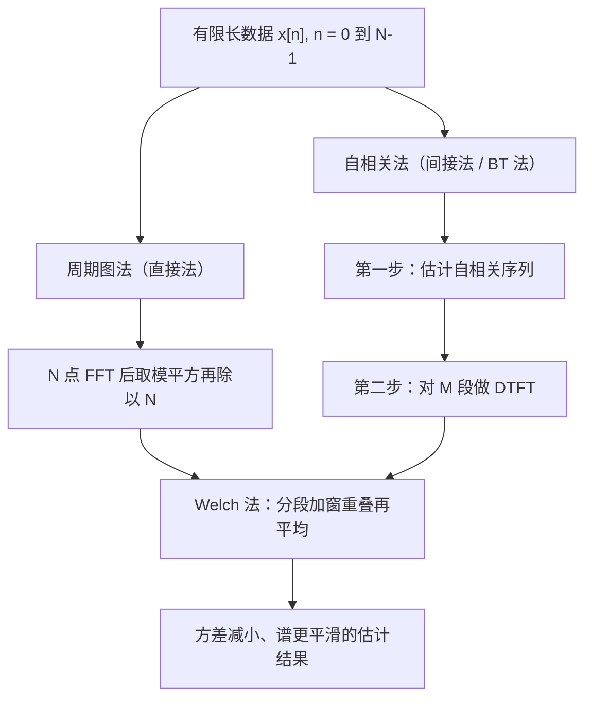

# 功率谱密度

**标签：** #数字信号处理 #DSP #功率谱密度 #PSD #谱估计 #周期图 #Welch

---

## 一、为什么需要功率谱密度？

在前面的学习中我们知道：

- **能量信号**：用傅里叶变换分析频谱（幅度谱、相位谱）
- **功率信号**：傅里叶变换不收敛，无法直接分析频谱

那么，如何描述功率信号的频率特性？

**功率谱密度（PSD）** 就是答案——它描述的是**信号功率在频率上的分布**。

> **与下一章的衔接**：[[【数字信号处理DSP】（六）维纳-辛钦定理（Wiener-Khinchin Theorem）|（六）维纳-辛钦定理]] 讲的是"为什么 PSD 等于自相关的傅里叶变换"（**定理与推导**）；本章讲"PSD 是什么、有哪些性质、工程上怎么算出来"（**定义与实现**）。两章配合看效果最好。

---

## 二、功率谱密度的定义

### 1. 基于维纳-辛钦定理的定义

对于宽平稳随机序列 $x[n]$，其功率谱密度定义为自相关函数的傅里叶变换：

$$
P_{xx}(e^{j\omega}) = \sum_{m=-\infty}^{\infty} r_{xx}[m] e^{-j\omega m}
$$

逆变换：

$$
r_{xx}[m] = \frac{1}{2\pi} \int_{-\pi}^{\pi} P_{xx}(e^{j\omega}) e^{j\omega m} d\omega
$$

### 2. 基于截断信号的定义（等效定义）

将无限长信号截断为长度为 $N$ 的有限段 $x_N[n]$，取其傅里叶变换 $X_N(e^{j\omega})$，则功率谱密度为：

$$
P_{xx}(e^{j\omega}) = \lim_{N \to \infty} \frac{1}{N} E\left[ \lvert X_N(e^{j\omega}) \rvert^2 \right]
$$

两种定义等价，前者理论性强（**间接法**的出发点），后者更贴近实际计算（**直接法**的出发点）。注意 $\frac{1}{N}$ 与取期望 $E[\cdot]$ 二者缺一不可——少了期望，得到的是无论怎么加长数据都不收敛的"周期图"。

---

## 三、功率谱密度的物理意义

> 上图：灰虚线是白噪声（$P(\omega)=\sigma^2$，各频率等能量）；蓝线是一阶 AR 过程的谱 $P(\omega)=\sigma_w^2/\lvert 1-ae^{-j\omega}\rvert^2$（$a=0.8$），能量集中在 $\omega=0$ 附近。两者对比说明：**谱形状就是"功率随频率怎么分配"的画像**。

### 1. 功率的频域分布

$$
\text{信号在 } [\omega, \omega+d\omega] \text{ 内的功率} = \frac{1}{2\pi} P_{xx}(e^{j\omega}) d\omega
$$

### 2. 总平均功率

信号的总平均功率等于功率谱密度曲线下的面积：

$$
P = r_{xx}[0] = \frac{1}{2\pi} \int_{-\pi}^{\pi} P_{xx}(e^{j\omega}) d\omega
$$

### 3. 直观理解

| PSD 形状 | 物理含义 |
|----------|---------|
| 平坦（常数） | 功率在所有频率均匀分布 → 白噪声 |
| 集中在低频 | 信号变化缓慢 → 低通特性 |
| 集中在高频 | 信号剧烈变化 → 高通特性 |
| 出现尖峰 | 含有周期成分 → 正弦信号 |
| 出现谷（陷波） | 该频率被系统抑制 → 存在零点 |

### 4. 双边谱与单边谱

上面的定义在 $\omega \in [-\pi, \pi]$ 上给出**双边谱**。实信号的谱是偶函数（性质 3），负频率部分与正频率部分完全重复，所以工程上常只画 $\omega \in [0, \pi]$，称为**单边谱**：

$$
P_{\text{单边}}(\omega) = 2 P_{xx}(e^{j\omega}), \quad 0 \leq \omega \leq \pi
$$

**乘 2 是为了保住总功率**——把负半轴的能量折到正半轴上来。查资料时务必先确认对方用的是单边还是双边，否则功率会差 2 倍（这在实际测试报告中是常见争议来源）。

---

## 四、功率谱密度的性质

### 性质1：非负性

$$
P_{xx}(e^{j\omega}) \geq 0, \quad \forall \omega
$$

功率谱密度始终为非负实数。

### 性质2：周期性

$$
P_{xx}(e^{j(\omega + 2\pi)}) = P_{xx}(e^{j\omega})
$$

周期为 $2\pi$，这是离散时间信号的固有特性。

### 性质3：对称性（实信号）

对于实信号：

$$
P_{xx}(e^{j\omega}) = P_{xx}(e^{-j\omega})
$$

即功率谱密度是偶函数，只需分析 $[0, \pi]$ 区间。

### 性质4：与幅频特性的关系

若信号通过一个线性时不变系统 $H(e^{j\omega})$，则输出功率谱为：

$$
P_{yy}(e^{j\omega}) = \lvert H(e^{j\omega}) \rvert^2 P_{xx}(e^{j\omega})
$$

**只有幅频特性参与，相位被"平方"掉了**。所以滤波器设计中对噪声的抑制能力，完全由 $\lvert H \rvert$ 的阻带衰减决定。

### 性质5：功率守恒

$$
\frac{1}{2\pi} \int_{-\pi}^{\pi} P_{xx}(e^{j\omega}) d\omega = r_{xx}[0] = E\left[\lvert x[n] \rvert^2\right]
$$

> **性质 1～5 的一个用途**：算出 PSD 后，用它做三项自查——① 非负？② 偶对称？③ 积分回原值？三关都过，结果基本就错不了。

---

## 五、典型例题

> **统一答题格式**：写定义式 → 代入自相关（或系统函数）→ 化成可辨认的形式 → 结论 → **用 $\frac{1}{2\pi}\int P\,d\omega = r_{xx}[0]$ 检验**。
> PSD 题的答案一定要能"积分回去"，这是最可靠的验算手段。

### 例题 1：白噪声的 PSD

**题目**：$w[n]$ 为零均值白噪声，方差 $\sigma^2$。求 $P_{ww}(e^{j\omega})$ 与总平均功率。

**解**：

（1）**写自相关**：由 [[【数字信号处理DSP】（四）自相关函数与互相关函数|（四）自相关函数与互相关函数]] 例题 4，$r_{ww}[m]=\sigma^2\delta[m]$。

（2）**代定义式**：

$$
P_{ww}(e^{j\omega}) = \sum_{m=-\infty}^{\infty} \sigma^2 \delta[m] e^{-j\omega m}
$$

（3）**定非零项**：$\delta[m]$ 只在 $m=0$ 为 $1$，$e^{-j\omega\cdot 0}=1$：

$$
\boxed{P_{ww}(e^{j\omega}) = \sigma^2 \quad (\text{与 } \omega \text{ 无关})}
$$

（4）**总平均功率**：

$$
P = \frac{1}{2\pi}\int_{-\pi}^{\pi}\sigma^2 d\omega = \sigma^2
$$

**检验**：$r_{ww}[0]=\sigma^2$，与积分结果一致 ✓；非负 ✓；偶对称 ✓

→ 白噪声的 PSD 为常数，所有频率上功率均匀分布。"白"指的就是这个"全频带平坦"。

---

### 例题 2：正弦信号的 PSD（冲激强度怎么来的）

**题目**：$x[n] = A\sin(\omega_0 n+\phi)$，$0<\omega_0<\pi$。求 $P_{xx}(e^{j\omega})$。

**解**：

（1）**先写自相关**（前面例 3 已得，注意与相位 $\phi$ 无关）：

$$
r_{xx}[m] = \frac{A^2}{2}\cos(\omega_0 m)
$$

（2）**把余弦写成指数**（欧拉公式）：

$$
r_{xx}[m] = \frac{A^2}{4}\left(e^{j\omega_0 m} + e^{-j\omega_0 m}\right)
$$

（3）**逐项代定义式**。利用冲激的频域表示（在 $-\pi<\omega\le\pi$ 内成立）：

$$
\sum_{m=-\infty}^{\infty} e^{\pm j\omega_0 m} e^{-j\omega m} = 2\pi\,\delta(\omega \mp \omega_0)
$$

于是

$$
P_{xx}(e^{j\omega}) = \frac{A^2}{4}\Big[2\pi\delta(\omega-\omega_0) + 2\pi\delta(\omega+\omega_0)\Big]
$$

$$
\boxed{P_{xx}(e^{j\omega}) = \frac{\pi A^2}{2}\Big[\delta(\omega-\omega_0) + \delta(\omega+\omega_0)\Big], \quad -\pi \lt \omega \leq \pi}
$$

（4）**积分验证**：

$$
\frac{1}{2\pi}\int_{-\pi}^{\pi}P_{xx}\,d\omega = \frac{1}{2\pi}\left(\frac{\pi A^2}{2}+\frac{\pi A^2}{2}\right) = \frac{A^2}{2}
$$

**检验**：$r_{xx}[0]=\frac{A^2}{2}$，与 $\sin$ 的平均功率一致 ✓（见 [[【数字信号处理DSP】（三）能量信号和功率信号|（三）能量信号和功率信号]]）

> **为什么冲激前面有个 $\pi$**：离散时间傅里叶变换（DTFT）的频域冲激约定是 $\sum_m e^{j\omega_0m}\leftrightarrow 2\pi\delta(\omega-\omega_0)$，这里的 $2\pi$ 来自反变换里的 $\frac{1}{2\pi}$。丢掉它会让功率差 $2\pi$ 倍——这是本题最容易错的地方。完整推导见 [[【数字信号处理DSP】（六）维纳-辛钦定理（Wiener-Khinchin Theorem）|（六）维纳-辛钦定理]] 例题 3。

→ 正弦信号的功率集中在 $\pm\omega_0$ 两个频率点上，**这是"离散谱线"的数学表现**，也是频谱仪上看到的"针状峰"。

---

### 例题 3：一阶 AR 过程的 PSD

**题目**：$x[n] = a\,x[n-1] + w[n]$，$\lvert a\rvert<1$，$w[n]$ 为方差 $\sigma_w^2$ 的白噪声。求 $P_{xx}(e^{j\omega})$ 与总功率。

**解**：

（1）**写出系统函数**（把差分方程看成"白噪声通过 $H$"）：

$$
H(z) = \frac{1}{1-az^{-1}}
$$

（2）**套性质 4**（$P_{yy}=\lvert H\rvert^2P_{xx}$，输入是白噪声，谱为 $\sigma_w^2$）：

$$
P_{xx}(e^{j\omega}) = \lvert H(e^{j\omega}) \rvert^2 \sigma_w^2 = \frac{\sigma_w^2}{\big\lvert 1-ae^{-j\omega}\big\rvert^2}
$$

（3）**展开分母**（$\lvert 1-ae^{-j\omega}\rvert^2 = (1-ae^{-j\omega})(1-ae^{j\omega}) = 1-2a\cos\omega+a^2$）：

$$
\boxed{P_{xx}(e^{j\omega}) = \frac{\sigma_w^2}{1-2a\cos\omega+a^2}}
$$

（4）**总功率**：由 AR(1) 的方差公式 $r_{xx}[0]=\dfrac{\sigma_w^2}{1-a^2}$。

**检验**（用 $\omega=0$ 与 $\omega=\pi$ 两个端点验证）：

| $\omega$ | $P_{xx}$ | 说明 |
|---|---|---|
| $0$ | $\dfrac{\sigma_w^2}{(1-a)^2}$ | $a>0$ 时最大 |
| $\pi$ | $\dfrac{\sigma_w^2}{(1+a)^2}$ | $a>0$ 时最小 |

$a=0.8$、$\sigma_w^2=0.36$ 时：$P(0)=0.36/0.04=9$、$P(\pi)=0.36/3.24=0.111$，相差 81 倍，确实是强低通——与配图的形状一致 ✓

→ 当 $a>0$ 时谱集中在低频（低通），$a<0$ 时集中在高频（高通），$\lvert a\rvert$ 越接近 $1$ 谱峰越尖。

> **这里的"分母 = 系统函数模的平方"不是巧合**。**AR 过程的谱 = 白噪声谱 × 系统幅频特性的平方**，这是随机信号建模中最常用的推理方式，比先求自相关再变换快得多。

---

### 例题 4：白噪声通过理想低通

**题目**：$w[n]$（PSD $=\sigma^2$）通过理想低通

$$
H(e^{j\omega}) =
\begin{cases}
1, & \lvert \omega \rvert \lt \omega_c \\
0, & \omega_c \lt \lvert \omega \rvert \leq \pi
\end{cases}
$$

求输出 PSD 与输出平均功率。

**解**：

（1）**套性质 4**，注意 $\lvert H\rvert^2=\lvert H\rvert$（因为取值只有 $0$ 和 $1$）：

$$
P_{yy}(e^{j\omega}) = \lvert H(e^{j\omega}) \rvert^2 \cdot \sigma^2 =
\begin{cases}
\sigma^2, & \lvert \omega \rvert \lt \omega_c \\
0, & \omega_c \lt \lvert \omega \rvert \leq \pi
\end{cases}
$$

（2）**求功率**（在 $-[\omega_c,\omega_c]$ 上积分，宽度 $2\omega_c$）：

$$
P_y = \frac{1}{2\pi} \int_{-\omega_c}^{\omega_c} \sigma^2 d\omega = \frac{\sigma^2 \omega_c}{\pi}
$$

$$
\boxed{P_y = \frac{\sigma^2 \omega_c}{\pi}}
$$

**检验**：$\omega_c=\pi$（全通）时 $P_y=\sigma^2$，与原白噪声功率一致 ✓；$\omega_c\to 0$ 时 $P_y\to 0$，符合"没有频率成分就没有功率" ✓

**用带宽理解**：白噪声的功率均匀分布在宽度 $2\pi$ 上，理想低通只保留宽度 $2\omega_c$ 的一段，于是输出功率 = 总功率 × 带宽占比 $\frac{2\omega_c}{2\pi}=\frac{\omega_c}{\pi}$。**噪声功率与带宽成正比**，这是所有降噪系统都要"限制带宽"的原因。

---

### 例题 5：周期图法手算

**题目**：$x[n]=\{1,\,1,\,-1,\,-1\}$（$n=0,1,2,3$，$N=4$）。用周期图 $\hat P(\omega)=\frac1N\lvert X(e^{j\omega})\rvert^2$ 求 $\omega=0,\ \frac{\pi}{2},\ \pi$ 三处的值，并指出谱峰位置。

**解**：

（1）**写周期图定义式**：

$$
\hat P(\omega) = \frac{1}{N}\left\lvert\sum_{n=0}^{N-1}x[n]e^{-j\omega n}\right\rvert^2,\quad N=4
$$

（2）**逐点算 $\omega=0$**：$e^{-j0\cdot n}=1$，

$$
X(0) = 1+1-1-1 = 0 \;\Longrightarrow\; \hat P(0)=0
$$

（3）**算 $\omega=\frac{\pi}{2}$**：$e^{-j\frac{\pi}{2}n}$ 依次为 $1,\,-j,\,-1,\,j$，

$$
X\!\left(\tfrac{\pi}{2}\right) = 1\cdot1 + 1\cdot(-j) + (-1)(-1) + (-1)(j) = 2-2j
$$

$$
\lvert X \rvert^2 = 2^2+(-2)^2 = 8 \;\Longrightarrow\; \hat P\!\left(\tfrac{\pi}{2}\right) = \frac{8}{4} = 2
$$

（4）**算 $\omega=\pi$**：$e^{-j\pi n}=(-1)^n$ 依次为 $1,-1,1,-1$，

$$
X(\pi) = 1 - 1 - 1 + 1 = 0 \;\Longrightarrow\; \hat P(\pi)=0
$$

（5）**汇总**：

$$
\boxed{\hat P(0)=0,\quad \hat P\!\left(\tfrac{\pi}{2}\right)=2,\quad \hat P(\pi)=0}
$$

**检验**（回到时域核对序列成分）：

$$
x[n] = \cos\!\left(\tfrac{\pi}{2}n\right)+\sin\!\left(\tfrac{\pi}{2}n\right) = \sqrt2\cos\!\left(\tfrac{\pi}{2}n-\tfrac{\pi}{4}\right)
$$

即 $x[n]$ 是**纯 $\omega=\pi/2$ 的单频信号**，没有直流（$\omega=0$）也没有 $\omega=\pi$ 成分，所以谱峰落在 $\pi/2$、两端为零，完全吻合 ✓

> **顺手学一件事**：$\hat P(\pi/2)=2$，而该信号的平均功率是 $\frac14(1+1+1+1)=1$。数值对不上是因为 $N=4$ 的点数太少，谱泄漏严重（能量散到相邻频率去了）。**这正是周期图"分辨率差、有偏"的具体体现**。

---

### 例题 6：Welch 法的分辨率–方差权衡

**题目**：$f_s=8000\text{ Hz}$，数据长 $N=8192$ 点。方案 A：整段做一次周期图；方案 B：分 $K=16$ 段、50% 重叠加窗后平均。分别求两者的频率分辨率与方差量级。

**解**：

（1）**频率分辨率的公式**：$\Delta f = \dfrac{f_s}{L}$，$L$ 为参与一次 FFT 的数据段长度。

（2）**方案 A**：$L_A=N=8192$，

$$
\Delta f_A = \frac{8000}{8192} \approx 0.98\text{ Hz}
$$

（3）**方案 B**：50% 重叠时总长与段数的关系为 $N = L\left(1+\frac{K-1}{2}\right)=\dfrac{L(K+1)}{2}$，反解

$$
L_B = \frac{2N}{K+1} = \frac{2\times 8192}{17} \approx 964 \;\Longrightarrow\; \Delta f_B = \frac{8000}{964} \approx 8.3\text{ Hz}
$$

（4）**方差**：周期图方差与 $P^2$ 同阶、且**与 $N$ 无关**；平均 $K$ 段后方差降到约 $\dfrac{1}{K}$。

$$
\text{方案 B：方差} \approx \frac{1}{16}\text{（方案 A 的）},\qquad \text{标准差} \approx \frac14
$$

（5）**结论**：

$$
\boxed{\text{方案 A：分辨率 } 0.98\text{ Hz，曲线毛糙；方案 B：分辨率 } 8.3\text{ Hz，曲线平滑约 4 倍}}
$$

**检验**：段长从 $8192$ 缩到 $964$，约为原来的 $\frac{1}{8.5}$，故分辨率变差约 $8.5$ 倍（$0.98\times8.5\approx8.3$）✓；段数 $16$，方差降 $16$ 倍、标准差降 $4$ 倍 ✓ 两个数字自洽。

> **这就是谱估计的核心矛盾**：平滑度与分辨率不可兼得。工程上先问"我要看清间隔多近的两根谱线"，据此定段长 $L$；剩下的数据全部用来分段平均以压方差。

---

## 六、PSD vs 频谱 vs 能量谱密度

| 对比项 | 频谱 | 能量谱密度 | 功率谱密度 |
|--------|------|-----------|-----------|
| 适用信号 | 能量信号 | 能量信号 | 功率信号 |
| 定义 | $X(e^{j\omega})$ | $\lvert X(e^{j\omega}) \rvert^2$ | $P_{xx}(e^{j\omega})$ |
| 物理含义 | 幅度和相位 | 能量分布 | 功率分布 |
| 是否保留相位 | 是 | 否 | 否 |
| 是否非负 | 否（可为复/负） | 是 | 是 |
| 周期信号 | 不收敛 | 不收敛 | 可用（含冲激） |
| 单位量纲 | 幅度 | 能量/rad | 功率/rad |

---

## 七、功率谱密度的估计方法（实际应用）

在实际工程中，我们无法获得无限长信号，需要通过有限长数据估计PSD。三类经典方法的关系如下：

### 1. 周期图法（直接法）

$$
\hat{P}_{xx}(e^{j\omega}) = \frac{1}{N} \left\lvert \sum_{n=0}^{N-1} x[n] e^{-j\omega n} \right\rvert^2
$$

优点：计算简单（FFT实现）
缺点：估计方差大，不平滑（**加长数据方差不降**，这是周期图的著名缺陷）

### 2. 自相关法（间接法，BT法）

1. 先估计自相关函数 $\hat{r}_{xx}[m]$
2. 再做傅里叶变换得到PSD

$$
\hat{P}_{xx}(e^{j\omega}) = \sum_{m=-M}^{M} \hat{r}_{xx}[m] e^{-j\omega m}
$$

优点：比周期图法平滑
缺点：分辨率降低（截断到 $\pm M$ 相当于加窗，$M$ 越小越平滑但峰越胖）

### 3. Welch法（改进周期图法）

- 将数据分段，每段加窗（常用汉宁窗）
- 允许段间重叠（典型 50%）
- 对各段周期图取平均

**这是最常用的现代PSD估计方法**。原理很直白：周期图方差大是因为"只测了一次"，把数据切成 $K$ 段得到 $K$ 个独立估计再平均，方差就降到约 $1/K$；代价是每段变短、频率分辨率下降。**平滑度与分辨率之间的权衡，是谱估计永恒的主题。**

### 4. 三者的定量对照

设总数据长 $N$、采样率 $f_s$、分段数 $K$、段长 $L$：

| 方法 | 参与变换的长度 | 频率分辨率 | 估计方差 |
|---|---|---|---|
| 周期图 | $N$ | $f_s/N$（最好） | 大，且**不随 $N$ 减小** |
| BT 法 | $2M+1$ | 约 $f_s/(2M+1)$ | 较小，随 $M$ 减小而降 |
| Welch | $L\approx 2N/(K+1)$ | $f_s/L$（变差） | 约 $1/K$（可控制） |

> **一句话记法**：**分辨率看段长，平滑度看段数。**

---

## 八、应用场景

| 领域 | 应用 |
|------|------|
| 通信 | 分析信道噪声特性、设计调制方案 |
| 语音处理 | 分析语音频谱特征、端点检测 |
| 机械故障诊断 | 检测旋转机械的异常频率成分（轴承故障特征频率） |
| 生物医学 | EEG/ECG信号频域分析（脑电节律、心率变异性） |
| 地震勘探 | 分析地下介质的频率响应 |
| 雷达/声呐 | 目标检测、多普勒频移分析 |
| 音频工程 | 噪声本底测量、扬声器频响测试 |

---

## 九、常见错误提醒

1. **忘记 $\frac{1}{N}$ 或忘记取期望**：少了这两样得到的只是周期图，不是 PSD 的一致估计。
2. **双边谱与单边谱混用**：单边谱 = 双边谱 × 2（$\omega \gt 0$ 部分）。看图时先确认纵轴定义，否则功率差 2 倍。
3. **把 PSD 当作"某个频率上的功率"**：PSD 是**密度**，单位是功率/rad。某频率上的功率只有在它是离散谱线（冲激）时才有确定值，连续谱上只能谈"某带宽内的功率"。
4. **正弦谱的冲激丢了 $2\pi$**：$\sum_m e^{j\omega_0m}\leftrightarrow 2\pi\delta(\omega-\omega_0)$，这个 $2\pi$ 漏掉后功率就差 $2\pi$ 倍。算完务必积分回验。
5. **以为数据越长谱越平滑**：周期图的方差与数据长度无关，加长数据只是让谱线更密（分辨率更高），**不会让曲线变平滑**；要平滑必须做平均。
6. **算 PSD 前不去均值**：直流分量会在 $\omega = 0$ 处顶出一个巨大尖峰，把真正的低频谱结构全压扁。**先减均值是最省事的一步**。
7. **加窗后忘记补偿能量**：加窗会降低总功率（汉宁窗约损失一半），需要按窗函数的能量归一化因子补偿，否则幅值读数偏低。
8. **用 $\lvert X \rvert^2$ 分析功率信号**：能量信号才有 $\lvert X \rvert^2$；对周期信号、白噪声直接套用会发散。
9. **把 AR 谱当成"真谱"**：模型谱是拟合出来的，阶数选错会造出虚假峰或抹掉真实峰。
10. **只看分辨率不看方差**：分辨率高但曲线抖动剧烈的谱，肉眼"看到"的峰可能全是噪声涨落。**判断真实峰要看它是否在多段平均后依然存在**。

---

## 十、知识链定位

功率谱密度（本节）

│

├── 两种定义：自相关的 DTFT / 截断谱的极限平均

├── 性质：非负、周期 2π、实信号偶对称、总功率守恒

└── 三条性质链：Pyy = |H|²·Pxx（滤波）、∫Pxx = 功率（能量守恒）

│

├── 能量信号与功率信号：谱的适用对象（第三节）

├── 自相关函数：PSD 的时域来源（第四节）

├── 维纳-辛钦定理：PSD 的定义依据与推导（第六节）

├── 卷积和：系统对随机信号的作用（第七节）

├── 模拟频率与数字频率：谱轴换算（第十节）

└── 系统函数 H(z)：由 H 直接写出输出谱（后续章节）

---

## 十一、快速记忆

| 要点 | 内容 |
|------|------|
| 定义 | 自相关的傅里叶变换 |
| 物理意义 | 功率在频率上的分布（密度） |
| 非负性 | $P_{xx}(e^{j\omega}) \geq 0$ |
| 周期性 | 周期 $2\pi$ |
| 对称性 | 实信号为偶函数 |
| 总功率 | $\frac{1}{2\pi} \int P_{xx} d\omega = r_{xx}[0]$ |
| 通过系统 | $P_{yy} = \lvert H(e^{j\omega}) \rvert^2 P_{xx}$ |
| 白噪声 | $P_{xx} = \sigma^2$（常数） |
| 正弦信号 | 在 $\pm\omega_0$ 处出现强度 $\pi A^2/2$ 的冲激 |
| 估计方法 | 周期图 → BT 法 → Welch 法（越来越平滑） |
| 权衡口诀 | 分辨率看段长，平滑度看段数 |

> **一句话总结**：功率谱密度是功率信号在频域的"身份证"，它告诉我们信号功率在不同频率上是如何分配的——它是随机信号分析和滤波系统设计的核心工具，而它的估计永远在"平滑度"与"分辨率"之间做取舍。
