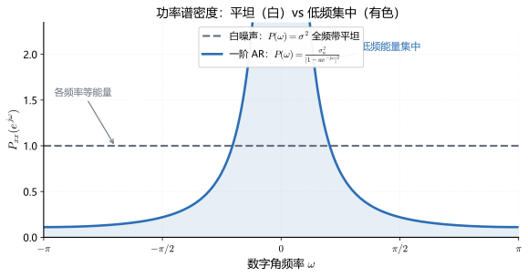
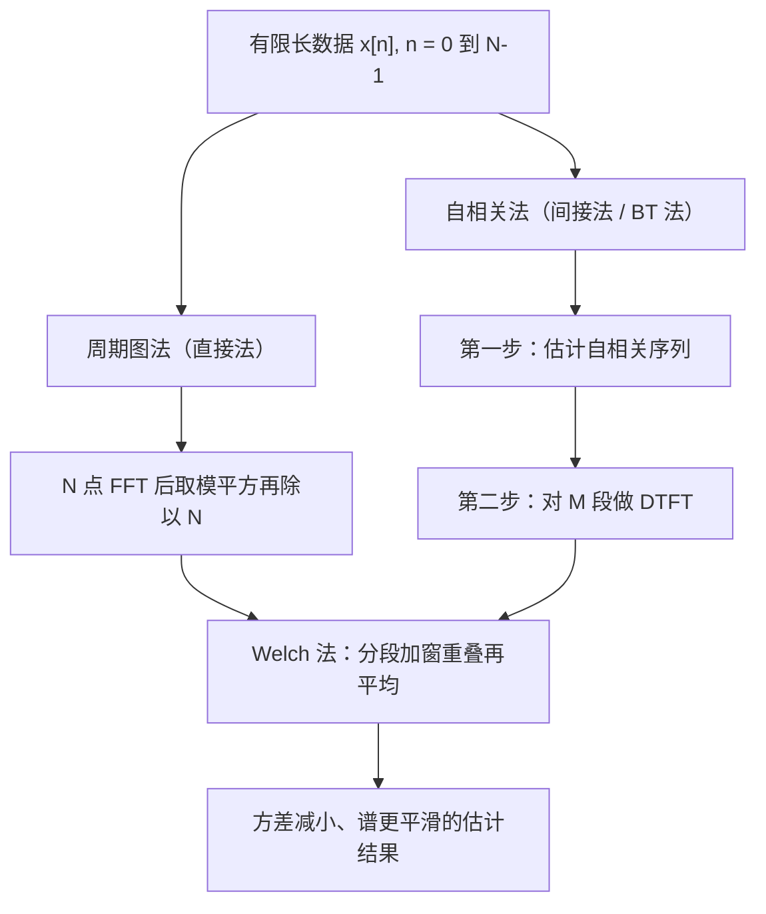

# 能量谱密度与功率谱密度

**标签：** #数字信号处理 #DSP #功率谱密度 #能量谱密度 #PSD #谱估计 #周期图 #Welch

---

## 本篇的位置

**这一篇补的空洞。** （三）把信号分成能量与功率两类之后就停了，只留下一句"功率信号的傅里叶变换不收敛"。（四）算出自相关，也只把它当"信号与自身的相似度"用。两件事分开看都不解决"功率信号怎么看频率"这个问题：分类说这条路走不通，自相关说有另一个时域量可算，缺的是把两者接起来的那个对象。这一篇补的就是它——能量信号用 $\xi(\omega)=\lvert X(e^{j\omega})\rvert^{2}$，功率信号用 $P_{xx}=\sum_m r_{xx}[m]e^{-j\omega m}$。

**和前后篇的接口。** 上游是（四）的自相关 $r_{xx}[m]$ 与（三）的能量/功率判据，本篇的定义全部建立在"先判类别、再选自相关"这两步上。下游是（六）维纳-辛钦定理，它回答"为什么 $P_{xx}$ 恰好是 $r_{xx}$ 的 DTFT"，本篇只把这个等式当定义用、不证；（七）卷积和给出 $P_{yy}=\lvert H\rvert^{2}P_{xx}$ 的时域来源。

**本篇保留的简化。** 全程假设宽平稳（均值常数、自相关只与延迟有关）、二阶矩有限、系统线性时不变。第一条破了，$r_{xx}[m]$ 这个单变量函数根本不存在，谱无从定义；第二条破了（比如某些 $1/f$ 型噪声的低频段），积分发散，谱要在更弱的条件下重写。文中"偶对称""非负"这些结论都挂在这两条上。

**没出现的东西。** 定理的证明（在（六）第三节）、谱估计的置信区间与模型定阶（AR/MA/ARMA 那套，属于随机信号处理）、多通道与阵列的互谱矩阵。前两个各有专章，第三个本篇只在正文里带一句互谱的名字，完整形式在（六）性质 6。

**读完能做什么。** 给一段数据先判它是能量信号还是功率信号，再决定用 $\xi$ 还是 $P_{xx}$；算完一张谱用"非负、偶对称、积分回 $r_{xx}[0]$"三条当场自检；拿到一段实测谱能区分"分辨率不够"和"方差太大"这两种不同的毛病。

---

## 本篇要点

1. 两张谱的差别只在分母：$\xi$ 是能量/rad，$P_{xx}$ 是功率/rad。量纲不同，数值不能直接比。
2. 谱里出现冲激，说明这是功率信号；连续、可积、不含冲激的谱只可能来自能量信号。
3. 周期图 $\hat P=\frac{1}{N}\lvert X_N\rvert^{2}$ 只做幅度标定，把能量摊成功率，**不减小涨落**。要平滑必须多段平均。
4. Welch 的账很清楚：分辨率由段长 $L$ 定（$f_s/L$），方差由段数 $K$ 定（约 $1/K$），两者不可兼得。

---

## 一、问题的来源：功率信号没有频谱

在前面的学习中我们知道：

- **能量信号**：用傅里叶变换分析频谱（幅度谱、相位谱）；它也有谱密度——**能量谱密度** $\xi(\omega)=\lvert X(e^{j\omega})\rvert^{2}$，见第六节
- **功率信号**：傅里叶变换不收敛，无法直接分析频谱

那么，如何描述功率信号的频率特性？

**功率谱密度（PSD）** 就是答案——它描述的是**信号功率在频率上的分布**。

> **本章其实讲两张谱**。能量信号的谱密度叫**能量谱密度** $\xi(\omega)=\lvert X(e^{j\omega})\rvert^{2}$，它不需要极限、不需要期望，一次 FFT 就能算准——放在第六节完整展开。两件事合在一章，是因为它们是**同一个对象在两类信号上的两种形态**：谱密度是"密度"，差别只在分母是能量还是功率。
>
> **与下一章的衔接**：[[【数字信号处理DSP】（六）维纳-辛钦定理与帕塞瓦尔定理|（六）维纳-辛钦定理与帕塞瓦尔定理]] 讲"为什么 $P_{xx}$ 等于自相关的傅里叶变换"（**定理与推导**），以及能量版的守恒律**帕塞瓦尔定理**；本章讲"两张谱各是什么、有哪些性质、工程上怎么算出来"（**定义与实现**）。两章配合看效果最好。

---

## 二、功率谱密度的定义

### 1. 基于维纳-辛钦定理的定义

对于宽平稳随机序列 $x[n]$，其功率谱密度定义为自相关函数的傅里叶变换：

$$
P_{xx}(e^{j\omega}) = \sum_{m=-\infty}^{\infty} r_{xx}[m] e^{-j\omega m}
$$

逆变换：

$$
r_{xx}[m] = \frac{1}{2\pi} \int_{-\pi}^{\pi} P_{xx}(e^{j\omega}) e^{j\omega m} d\omega
$$

### 2. 基于截断信号的定义（等效定义）

将无限长信号截断为长度为 $N$ 的有限段 $x_N[n]$，取其傅里叶变换 $X_N(e^{j\omega})$，则功率谱密度为：

$$
P_{xx}(e^{j\omega}) = \lim_{N \to \infty} \frac{1}{N} E\left[ \lvert X_N(e^{j\omega}) \rvert^2 \right]
$$

两种定义等价，前者理论性强（**间接法**的出发点），后者更贴近实际计算（**直接法**的出发点）。注意 $\frac{1}{N}$ 与取期望 $E[\cdot]$ 二者缺一不可——少了期望，得到的是无论怎么加长数据都不收敛的"周期图"。

两种定义凭什么等价，差的只是一个极限吗

把直接法的 $\frac1N E\lvert X_N\rvert^{2}$ 展开，会看到它并不是"另一种定义"，而是同一串自相关加了权：

$$
\frac{1}{N}E\Big\lvert\sum_{n=0}^{N-1}x[n]e^{-j\omega n}\Big\rvert^{2}
=\sum_{m=-(N-1)}^{N-1}\Big(1-\frac{\lvert m\rvert}{N}\Big)\hat r_{xx}[m]\,e^{-j\omega m}
$$

右边那个 $(1-\lvert m\rvert/N)$ 是**三角窗**，来历很实在：延迟取 $m$ 时，$N$ 个采样点里只有 $N-\lvert m\rvert$ 对能真正错开 $m$ 格，其余位置没有数据可比。所以两种定义等价，靠的是 $N\to\infty$ 时三角窗逐点趋于 $1$。

这条式子顺带解释了 BT 法为什么要单独截断到 $\pm M$：截断等于把三角窗换成矩形窗。窗一换，谱形就变，这就是第七节表里"BT 法分辨率降低"的根源。

**不这样会怎样**：若在有限 $N$ 下就把三角窗当作 $1$，等于假设 $\lvert m\rvert\ge N$ 的延迟也估得出来。那些延迟上一对重叠采样都没有，估出来的只能是 $0$，结果是一串"先被低估、再被强行补齐"的自相关，谱的形状跟着失真。

---

## 三、功率谱密度的物理意义

> 上图：灰虚线是白噪声（$P(\omega)=\sigma^2$，各频率等能量）；蓝线是一阶 AR 过程的谱 $P(\omega)=\sigma_w^2/\lvert 1-ae^{-j\omega}\rvert^2$（$a=0.8$），能量集中在 $\omega=0$ 附近。两者对比说明：**谱形状就是"功率随频率怎么分配"的画像**。

### 1. 功率的频域分布

$$
\text{信号在 } [\omega, \omega+d\omega] \text{ 内的功率} = \frac{1}{2\pi} P_{xx}(e^{j\omega}) d\omega
$$

### 2. 总平均功率

信号的总平均功率等于功率谱密度曲线下的面积：

$$
P = r_{xx}[0] = \frac{1}{2\pi} \int_{-\pi}^{\pi} P_{xx}(e^{j\omega}) d\omega
$$

密度乘上频率间隔以后，为什么还要再除一个 2π

因为 $P_{xx}$ 是对**弧度**定义的密度：$[-\pi,\pi]$ 这整圈被当成 $2\pi$ 个单位，一小段 $d\omega$ 里的功率就是 $\frac{1}{2\pi}P_{xx}\,d\omega$。不除 $2\pi$ 的话，整圈积出来是 $2\pi r_{xx}[0]$，比真实功率大 $2\pi$ 倍，后面所有守恒式都对不上。

真正把这件事说透的是换轴。令 $\omega=2\pi f/f_s$，则 $d\omega=\dfrac{2\pi}{f_s}df$，代进守恒式：

$$
r_{xx}[0]=\frac{1}{2\pi}\int_{-\pi}^{\pi}P_{xx}\,d\omega
=\frac{1}{f_s}\int_{-f_s/2}^{f_s/2}P_{xx}\!\left(\frac{2\pi f}{f_s}\right)df
$$

那个 $2\pi$ **恰好被换轴时的 $d\omega$ 抵消干净**，只剩 $1/f_s$。所以"每 Hz 的功率谱"是 $P_{xx}/f_s$，不是 $P_{xx}/(2\pi)$。

**不这样会怎样**：把课本的弧度制读数直接当 Hz 轴读数上报，噪声本底会差 $f_s$ 倍。$f_s=48$ kHz 时差 4.8 万倍，量级完全不可用，而且这个错在报告里看起来只是"本底偏高"。

### 3. 直观理解

| PSD 形状 | 物理含义 |
|----------|---------|
| 平坦（常数） | 功率在所有频率均匀分布 → 白噪声 |
| 集中在低频 | 信号变化缓慢 → 低通特性 |
| 集中在高频 | 信号剧烈变化 → 高通特性 |
| 出现尖峰 | 含有周期成分 → 正弦信号 |
| 出现谷（陷波） | 该频率被系统抑制 → 存在零点 |

### 4. 双边谱与单边谱

上面的定义在 $\omega \in [-\pi, \pi]$ 上给出**双边谱**。实信号的谱是偶函数（性质 3），负频率部分与正频率部分完全重复，所以工程上常只画 $\omega \in [0, \pi]$，称为**单边谱**：

$$
P_{\text{单边}}(\omega) = 2 P_{xx}(e^{j\omega}), \quad 0 \leq \omega \leq \pi
$$

**乘 2 是为了保住总功率**——把负半轴的能量折到正半轴上来。查资料时务必先确认对方用的是单边还是双边，否则功率会差 2 倍（这在实际测试报告中是常见争议来源）。

偶对称这条性质，换成复信号还成立吗

要分两种情形，答案不一样，这正是它容易错的地方。

**统计平均之后成立。** 宽平稳复序列满足 $r_{xx}[-m]=r_{xx}^{*}[m]$，代进定义：

$$
P_{xx}(e^{-j\omega})=\sum_m r_{xx}[m]e^{j\omega m}
\overset{m\to-m}{=}\sum_m r_{xx}[-m]e^{-j\omega m}
=\sum_m r_{xx}^{*}[m]e^{-j\omega m}=P_{xx}^{*}(e^{j\omega})
$$

而共轭偶序列的 DTFT 必为实数，所以 $P_{xx}(-\omega)=P_{xx}(\omega)$ 照样成立。复信号并不能逃掉偶对称。

**单次实现不成立。** 取 $x[n]=e^{j\omega_0 n}$，它的周期图在 $\omega=+\omega_0$ 有一个峰，在 $-\omega_0$ 几乎为零。复指数只朝一个方向转，负频率那侧什么都没有——这就是"复信号没有负频率成分"的具体含义，也是单边谱只对实信号定义的原因。

**判据**：看这张谱是"算出来的"还是"平均出来的"。一次 FFT 得到的周期图，复信号一定不对称；多段平均、且信号确实宽平稳，才会对称回来。

---

## 四、功率谱密度的性质

### 性质1：非负性

$$
P_{xx}(e^{j\omega}) \geq 0, \quad \forall \omega
$$

功率谱密度始终为非负实数。

### 性质2：周期性

$$
P_{xx}(e^{j(\omega + 2\pi)}) = P_{xx}(e^{j\omega})
$$

周期为 $2\pi$，这是离散时间信号的固有特性。

### 性质3：对称性（实信号）

对于实信号：

$$
P_{xx}(e^{j\omega}) = P_{xx}(e^{-j\omega})
$$

即功率谱密度是偶函数，只需分析 $[0, \pi]$ 区间。

### 性质4：与幅频特性的关系

若信号通过一个线性时不变系统 $H(e^{j\omega})$，则输出功率谱为：

$$
P_{yy}(e^{j\omega}) = \lvert H(e^{j\omega}) \rvert^2 P_{xx}(e^{j\omega})
$$

**只有幅频特性参与，相位被"平方"掉了**。所以滤波器设计中对噪声的抑制能力，完全由 $\lvert H \rvert$ 的阻带衰减决定。

乘的是幅度的平方，那相位项究竟去哪了

$Y(e^{j\omega})=H(e^{j\omega})X(e^{j\omega})$ 是逐点的复数乘法，输入每个频点的相位都被 $H$ 的相位**加上**去了，一点没丢。做模平方时

$$
\lvert Y\rvert^{2}=\lvert H\rvert^{2}\lvert X\rvert^{2}=HH^{*}XX^{*}
$$

$H$ 与 $H^{*}$ 相遇，相位自动对消。所以"功率谱过系统"这条性质里相位必然缺席，不是被谁丢掉的，是**平方运算本身不保留它**。

代价要看清：**全通滤波器 $\lvert H\rvert\equiv1$ 完全不改变功率谱**，却能把波形改得面目全非（把脉冲展成振铃）。想用谱比对两个系统"像不像"，全通差异根本查不出来。

**不这样会怎样**：若以为 $P_{yy}=\lvert H\rvert^{2}P_{xx}$ 里隐含了相频信息，就会试着从输出谱反推 $H$ 的相位——推不出来。要相位必须用互谱 $P_{yx}=H P_{xx}$（形式见（六）性质 6）。

### 性质5：功率守恒

$$
\frac{1}{2\pi} \int_{-\pi}^{\pi} P_{xx}(e^{j\omega}) d\omega = r_{xx}[0] = E\left[\lvert x[n] \rvert^2\right]
$$

> **性质 1～5 的一个用途**：算出 PSD 后，用它做三项自查——① 非负？② 偶对称？③ 积分回原值？三关都过，结果基本就错不了。

---

## 五、典型例题

> **统一答题格式**：写定义式 → 代入自相关（或系统函数）→ 化成可辨认的形式 → 结论 → **用 $\frac{1}{2\pi}\int P\,d\omega = r_{xx}[0]$ 检验**。
> PSD 题的答案一定要能"积分回去"，这是最可靠的验算手段。

### 例题 1：白噪声的 PSD

**题目**：$w[n]$ 为零均值白噪声，方差 $\sigma^2$。求 $P_{ww}(e^{j\omega})$ 与总平均功率。

**解**：

（1）**写自相关**：由 [[【数字信号处理DSP】（四）自相关函数与互相关函数|（四）自相关函数与互相关函数]] 例题 4，$r_{ww}[m]=\sigma^2\delta[m]$。

（2）**代定义式**：

$$
P_{ww}(e^{j\omega}) = \sum_{m=-\infty}^{\infty} \sigma^2 \delta[m] e^{-j\omega m}
$$

（3）**定非零项**：$\delta[m]$ 只在 $m=0$ 为 $1$，$e^{-j\omega\cdot 0}=1$：

$$
\boxed{P_{ww}(e^{j\omega}) = \sigma^2 \quad (\text{与 } \omega \text{ 无关})}
$$

（4）**总平均功率**：

$$
P = \frac{1}{2\pi}\int_{-\pi}^{\pi}\sigma^2 d\omega = \sigma^2
$$

**检验**：$r_{ww}[0]=\sigma^2$，与积分结果一致 ✓；非负 ✓；偶对称 ✓

→ 白噪声的 PSD 为常数，所有频率上功率均匀分布。"白"指的就是这个"全频带平坦"。

---

### 例题 2：正弦信号的 PSD（冲激强度怎么来的）

**题目**：$x[n] = A\sin(\omega_0 n+\phi)$，$0<\omega_0<\pi$。求 $P_{xx}(e^{j\omega})$。

**解**：

（1）**先写自相关**（前面例 3 已得，注意与相位 $\phi$ 无关）：

$$
r_{xx}[m] = \frac{A^2}{2}\cos(\omega_0 m)
$$

（2）**把余弦写成指数**（欧拉公式）：

$$
r_{xx}[m] = \frac{A^2}{4}\left(e^{j\omega_0 m} + e^{-j\omega_0 m}\right)
$$

（3）**逐项代定义式**。每一项都是"纯复指数对 $m$ 求和"，它在基本区间 $-\pi\lt\omega\le\pi$ 内等于一根冲激（**这一步为什么成立，见本节下方「例题 2 的补遗」**）：

$$
\sum_{m=-\infty}^{\infty} e^{\pm j\omega_0 m} e^{-j\omega m} = 2\pi\,\delta(\omega \mp \omega_0)
$$

于是

$$
P_{xx}(e^{j\omega}) = \frac{A^2}{4}\Big[2\pi\delta(\omega-\omega_0) + 2\pi\delta(\omega+\omega_0)\Big]
$$

$$
\boxed{P_{xx}(e^{j\omega}) = \frac{\pi A^2}{2}\Big[\delta(\omega-\omega_0) + \delta(\omega+\omega_0)\Big], \quad -\pi \lt \omega \leq \pi}
$$

（4）**积分验证**：

$$
\frac{1}{2\pi}\int_{-\pi}^{\pi}P_{xx}\,d\omega = \frac{1}{2\pi}\left(\frac{\pi A^2}{2}+\frac{\pi A^2}{2}\right) = \frac{A^2}{2}
$$

**检验**：$r_{xx}[0]=\frac{A^2}{2}$，与 $\sin$ 的平均功率一致 ✓（见 [[【数字信号处理DSP】（三）能量信号和功率信号|（三）能量信号和功率信号]]）

→ 正弦信号的功率集中在 $\pm\omega_0$ 两个频率点上，**这是"离散谱线"的数学表现**，也是频谱仪上看到的"针状峰"。

---

### 例题 2 的补遗：发散的求和与冲激的对应

上面第（3）步是直接引用结论的——用的就是那个"纯复指数对 $m$ 求和"的变换对

$$
\sum_{m=-\infty}^{\infty} e^{-j\theta m} \;\longleftrightarrow\; ??
$$

这里把它拆开：**一个通项不趋于 0、明显发散的和，凭什么等于冲激？** 换个说法——这就是"常数序列 $1$ 的 DTFT 是冲激串"那句话的具体含义，只是平时被一句话带过了。

#### 问题 1：发散求和的确切含义

$\lvert e^{-j\theta m}\rvert = 1$，通项不趋于 0，所以 $\sum_{m=-\infty}^{\infty} e^{-j\theta m}$ 在普通意义下**确实发散**。但它有广义函数（分布）意义下的确定值——这和无衰减正弦本身"能量无限、功率有限"是同一件事。

最直观的做法是**先算有限和再取极限**。令

$$
S_M(\theta) = \sum_{m=-M}^{M} e^{-j\theta m}
$$

先看它对 $\theta$ 在 $(-\pi,\pi]$ 上的积分。$m = 0$ 项贡献 $2\pi$；$m \ne 0$ 时

$$
\int_{-\pi}^{\pi} e^{-j\theta m}\, d\theta
= \frac{e^{-j\pi m} - e^{j\pi m}}{-jm}
= \frac{(-1)^m - (-1)^m}{-jm}
= 0
$$

分子上两个 $(-1)^m$ 直接相消。所以**不管 $M$ 取多大**

$$
\int_{-\pi}^{\pi} S_M(\theta)\, d\theta = 2\pi, \qquad \forall M
$$

另一方面，$S_M$ 有闭式——Dirichlet 核：

$$
S_M(\theta) = \frac{\sin\big[(2M+1)\theta/2\big]}{\sin(\theta/2)}
$$

它在 $\theta = 0$ 处高 $2M+1$，主瓣宽度约 $\dfrac{4\pi}{2M+1}$。于是 $M \to \infty$ 时：**峰越来越高、越来越窄，而围出的面积恒为 $2\pi$**。这正是冲激的定义性特征（支撑收缩到一点、面积为常数），所以

$$
\sum_{m=-\infty}^{\infty} e^{-j\theta m} = 2\pi\,\delta(\theta)
$$

> **记住"面积等于 $2\pi$"比记住"等于 $\delta$"更有用**——本题所有系数错误，本质上都是把这块面积算错了。

#### 问题 2：系数 2π 的确定方式

不用背约定，**反变换自洽就能定出来**。假设只知道它是 $C\delta(\theta)$，把它当频谱做逆变换，应该还原出"全 1 序列"（即每一项都是 1）：

$$
\frac{1}{2\pi}\int_{-\pi}^{\pi} C\,\delta(\theta)\, e^{j\theta n}\, d\theta = \frac{C}{2\pi}
\;\overset{\text{应等于}}{=}\; 1
\quad\Longrightarrow\quad C = 2\pi
$$

所以 $2\pi$ **不是人为约定，而是被逆变换里的 $\dfrac{1}{2\pi}$ 逼出来的**：正变换这里放 $2\pi$，逆变换那边才除得掉。丢掉它，功率就差 $2\pi$ 倍。

#### 问题 3：冲激串与单根冲激的取舍

关键在于 $m$ 是**整数**。把 $\theta$ 换成 $\theta + 2\pi$：

$$
e^{-j(\theta+2\pi)m} = e^{-j\theta m}\cdot \underbrace{e^{-j2\pi m}}_{=\,1} = e^{-j\theta m}
$$

即 $e^{-j\theta m}$ 关于 $\theta$ 以 $2\pi$ 为周期。一个 $2\pi$ 周期的谱不可能只有一根冲激，所以完整形式是**冲激串**（间距 $2\pi$）：

$$
\sum_{m=-\infty}^{\infty} e^{-j\theta m} = 2\pi \sum_{k=-\infty}^{\infty} \delta(\theta - 2\pi k)
$$

**谐波的整数性导致频谱的 $2\pi$ 周期性**——这就是 DTFT 以 $2\pi$ 为周期的根源（见 [[【数字信号处理DSP】（十四）离散时间傅里叶变换（DTFT）|（十四）DTFT]]）。

而 PSD 只在基本区间 $-\pi\lt\omega\le\pi$ 上书写（第二节已约定），所以**每串只保留落在区间内的那一根**：

| 求和式 | 令 $\theta$ 为 | 冲激位于 $\omega=$ | 落在 $(-\pi,\pi]$ 内的是 |
|---|---|---|---|
| $\sum_m e^{-j(\omega-\omega_0)m}$ | $\omega-\omega_0$ | $\omega_0 + 2\pi k$ | $k=0$：$\omega=\omega_0$ ✓（因 $0\lt\omega_0\lt\pi$）；$k=\pm1$ 的副本在 $\omega_0\pm2\pi$ 处，出界 |
| $\sum_m e^{-j(\omega+\omega_0)m}$ | $\omega+\omega_0$ | $-\omega_0 + 2\pi k$ | $k=0$：$\omega=-\omega_0$ ✓（因 $-\pi\lt-\omega_0\lt0$）；其余副本出界 |

于是得到题目里那两行：

$$
\sum_{m=-\infty}^{\infty} e^{-j(\omega-\omega_0)m} = 2\pi\,\delta(\omega-\omega_0),
\qquad \omega_0 \in (0,\pi)
$$

$$
\sum_{m=-\infty}^{\infty} e^{-j(\omega+\omega_0)m} = 2\pi\,\delta(\omega+\omega_0),
\qquad -\omega_0 \in (-\pi,0)
$$

> **"限制到一个周期"这一步不能省**。若把冲激串原样抄下去，会得到无限多根谱线，积分出来的功率是无穷大——而正弦的功率明明是有限的 $A^2/2$。这一步正是离散谱与连续谱的分水岭。

> **边界情形**：若 $\omega_0 = \pi$，两根冲激分别落在 $\omega=\pi$ 与 $\omega=-\pi$，而区间是 $-\pi\lt\omega\le\pi$，二者其实是**同一个点**，必须合并成一根（强度翻倍，位置写 $\omega=\pi$）。所以上面的式子都要求 $0\lt\omega_0\lt\pi$ 的开区间。

#### 问题 4：符号的对应规则

把这类式子统一写成**括号里相减**的形式，就不用记符号：

$$
\sum_{m} e^{\pm j\omega_0 m} e^{-j\omega m}
= \sum_{m} e^{-j(\omega \mp \omega_0)m}
\;\longrightarrow\;
2\pi\,\delta(\omega \mp \omega_0)
$$

**判据只有一句：冲激落在"让括号内为零"的那个 $\omega$ 上。**

- 取上面符号（$e^{+j\omega_0 m}$）：括号是 $\omega - \omega_0$，为零给出 $\omega = +\omega_0$
- 取下面符号（$e^{-j\omega_0 m}$）：括号是 $\omega + \omega_0$，为零给出 $\omega = -\omega_0$

所以 $\pm$ 在上、$\mp$ 在下，规律是**同号相消**：时域指数里 $\omega_0$ 的符号，与频域冲激位置的符号相反。

#### 回到本题

$$
r_{xx}[m] = \frac{A^2}{4}\left(e^{j\omega_0 m} + e^{-j\omega_0 m}\right)
\;\Longrightarrow\;
P_{xx} = \frac{A^2}{4}\cdot 2\pi\Big[\delta(\omega-\omega_0) + \delta(\omega+\omega_0)\Big]
= \frac{\pi A^2}{2}\Big[\delta(\omega-\omega_0)+\delta(\omega+\omega_0)\Big]
$$

**一根冲激的"高度"是 $\dfrac{\pi A^2}{2}$，而"面积"（乘 $\dfrac{1}{2\pi}$ 后才等于功率）是 $\dfrac{A^2}{4}$**，两根加起来正好 $A^2/2 = r_{xx}[0]$。这就是为什么功率谱的纵轴读数叫"密度"——**看的是面积，不是高度**。

---

### 例题 3：一阶 AR 过程的 PSD

**题目**：$x[n] = a\,x[n-1] + w[n]$，$\lvert a\rvert<1$，$w[n]$ 为方差 $\sigma_w^2$ 的白噪声。求 $P_{xx}(e^{j\omega})$ 与总功率。

**解**：

（1）**写出系统函数**（把差分方程看成"白噪声通过 $H$"）：

$$
H(z) = \frac{1}{1-az^{-1}}
$$

（2）**套性质 4**（$P_{yy}=\lvert H\rvert^2P_{xx}$，输入是白噪声，谱为 $\sigma_w^2$）：

$$
P_{xx}(e^{j\omega}) = \lvert H(e^{j\omega}) \rvert^2 \sigma_w^2 = \frac{\sigma_w^2}{\big\lvert 1-ae^{-j\omega}\big\rvert^2}
$$

（3）**展开分母**（$\lvert 1-ae^{-j\omega}\rvert^2 = (1-ae^{-j\omega})(1-ae^{j\omega}) = 1-2a\cos\omega+a^2$）：

$$
\boxed{P_{xx}(e^{j\omega}) = \frac{\sigma_w^2}{1-2a\cos\omega+a^2}}
$$

（4）**总功率**：由 AR(1) 的方差公式 $r_{xx}[0]=\dfrac{\sigma_w^2}{1-a^2}$。

**检验**（用 $\omega=0$ 与 $\omega=\pi$ 两个端点验证）：

| $\omega$ | $P_{xx}$ | 说明 |
|---|---|---|
| $0$ | $\dfrac{\sigma_w^2}{(1-a)^2}$ | $a>0$ 时最大 |
| $\pi$ | $\dfrac{\sigma_w^2}{(1+a)^2}$ | $a>0$ 时最小 |

$a=0.8$、$\sigma_w^2=0.36$ 时：$P(0)=0.36/0.04=9$、$P(\pi)=0.36/3.24=0.111$，相差 81 倍，确实是强低通——与配图的形状一致 ✓

→ 当 $a>0$ 时谱集中在低频（低通），$a<0$ 时集中在高频（高通），$\lvert a\rvert$ 越接近 $1$ 谱峰越尖。

> **这里的"分母 = 系统函数模的平方"不是巧合**。**AR 过程的谱 = 白噪声谱 × 系统幅频特性的平方**，这是随机信号建模中最常用的推理方式，比先求自相关再变换快得多。

---

### 例题 4：白噪声通过理想低通

**题目**：$w[n]$（PSD $=\sigma^2$）通过理想低通

$$
H(e^{j\omega}) =
\begin{cases}
1, & \lvert \omega \rvert \lt \omega_c \\
0, & \omega_c \lt \lvert \omega \rvert \leq \pi
\end{cases}
$$

求输出 PSD 与输出平均功率。

**解**：

（1）**套性质 4**，注意 $\lvert H\rvert^2=\lvert H\rvert$（因为取值只有 $0$ 和 $1$）：

$$
P_{yy}(e^{j\omega}) = \lvert H(e^{j\omega}) \rvert^2 \cdot \sigma^2 =
\begin{cases}
\sigma^2, & \lvert \omega \rvert \lt \omega_c \\
0, & \omega_c \lt \lvert \omega \rvert \leq \pi
\end{cases}
$$

（2）**求功率**（在 $-[\omega_c,\omega_c]$ 上积分，宽度 $2\omega_c$）：

$$
P_y = \frac{1}{2\pi} \int_{-\omega_c}^{\omega_c} \sigma^2 d\omega = \frac{\sigma^2 \omega_c}{\pi}
$$

$$
\boxed{P_y = \frac{\sigma^2 \omega_c}{\pi}}
$$

**检验**：$\omega_c=\pi$（全通）时 $P_y=\sigma^2$，与原白噪声功率一致 ✓；$\omega_c\to 0$ 时 $P_y\to 0$，符合"没有频率成分就没有功率" ✓

**用带宽理解**：白噪声的功率均匀分布在宽度 $2\pi$ 上，理想低通只保留宽度 $2\omega_c$ 的一段，于是输出功率 = 总功率 × 带宽占比 $\frac{2\omega_c}{2\pi}=\frac{\omega_c}{\pi}$。**噪声功率与带宽成正比**，这是所有降噪系统都要"限制带宽"的原因。

---

### 例题 5：周期图法手算

**题目**：$x[n]=\{1,\,1,\,-1,\,-1\}$（$n=0,1,2,3$，$N=4$）。用周期图 $\hat P(\omega)=\frac1N\lvert X(e^{j\omega})\rvert^2$ 求 $\omega=0,\ \frac{\pi}{2},\ \pi$ 三处的值，并指出谱峰位置。

**解**：

（1）**写周期图定义式**：

$$
\hat P(\omega) = \frac{1}{N}\left\lvert\sum_{n=0}^{N-1}x[n]e^{-j\omega n}\right\rvert^2,\quad N=4
$$

（2）**逐点算 $\omega=0$**：$e^{-j0\cdot n}=1$，

$$
X(0) = 1+1-1-1 = 0 \;\Longrightarrow\; \hat P(0)=0
$$

（3）**算 $\omega=\frac{\pi}{2}$**：$e^{-j\frac{\pi}{2}n}$ 依次为 $1,\,-j,\,-1,\,j$，

$$
X\!\left(\tfrac{\pi}{2}\right) = 1\cdot1 + 1\cdot(-j) + (-1)(-1) + (-1)(j) = 2-2j
$$

$$
\lvert X \rvert^2 = 2^2+(-2)^2 = 8 \;\Longrightarrow\; \hat P\!\left(\tfrac{\pi}{2}\right) = \frac{8}{4} = 2
$$

（4）**算 $\omega=\pi$**：$e^{-j\pi n}=(-1)^n$ 依次为 $1,-1,1,-1$，

$$
X(\pi) = 1 - 1 - 1 + 1 = 0 \;\Longrightarrow\; \hat P(\pi)=0
$$

（5）**汇总**：

$$
\boxed{\hat P(0)=0,\quad \hat P\!\left(\tfrac{\pi}{2}\right)=2,\quad \hat P(\pi)=0}
$$

**检验**（回到时域核对序列成分）：

$$
x[n] = \cos\!\left(\tfrac{\pi}{2}n\right)+\sin\!\left(\tfrac{\pi}{2}n\right) = \sqrt2\cos\!\left(\tfrac{\pi}{2}n-\tfrac{\pi}{4}\right)
$$

即 $x[n]$ 是**纯 $\omega=\pi/2$ 的单频信号**，没有直流（$\omega=0$）也没有 $\omega=\pi$ 成分，所以谱峰落在 $\pi/2$、两端为零，完全吻合 ✓

> **顺手学一件事**：$\hat P(\pi/2)=2$，而该信号的平均功率是 $\frac14(1+1+1+1)=1$。数值对不上是因为 $N=4$ 的点数太少，谱泄漏严重（能量散到相邻频率去了）。**这正是周期图"分辨率差、有偏"的具体体现**。

---

### 例题 6：Welch 法的分辨率–方差权衡

**题目**：$f_s=8000\text{ Hz}$，数据长 $N=8192$ 点。方案 A：整段做一次周期图；方案 B：分 $K=16$ 段、50% 重叠加窗后平均。分别求两者的频率分辨率与方差量级。

**解**：

（1）**频率分辨率的公式**：$\Delta f = \dfrac{f_s}{L}$，$L$ 为参与一次 FFT 的数据段长度。

（2）**方案 A**：$L_A=N=8192$，

$$
\Delta f_A = \frac{8000}{8192} \approx 0.98\text{ Hz}
$$

（3）**方案 B**：50% 重叠时总长与段数的关系为 $N = L\left(1+\frac{K-1}{2}\right)=\dfrac{L(K+1)}{2}$，反解

$$
L_B = \frac{2N}{K+1} = \frac{2\times 8192}{17} \approx 964 \;\Longrightarrow\; \Delta f_B = \frac{8000}{964} \approx 8.3\text{ Hz}
$$

50% 重叠时，段长为什么是 2N 除以 K 加 1

把"覆盖了多少数据"数清楚就行。每段长 $L$，相邻段起点错开 $L/2$，这正是 50% 重叠的定义；$K$ 段的首尾跨度是

$$
L+\underbrace{\frac{L}{2}+\frac{L}{2}+\cdots}_{K-1\ \text{个}\;L/2}=\frac{L(K+1)}{2}=N
$$

反解就得到 $L=2N/(K+1)$。本题 $K=16$、$N=8192$，故 $L=16384/17\approx964$。

**换成不重叠**：$L=N/K=512$，分辨率还要再差近一倍。这是重叠的实际好处——同样的段数，段长几乎翻倍。

**代价在哪**：重叠让相邻段共享一半数据，各段周期图不再独立，而"方差降到 $1/K$"恰恰以独立性为前提。工程上 50% 重叠是"多花一半计算量换回分辨率"的折中，不是免费的。

（4）**方差**：周期图方差与 $P^2$ 同阶、且**与 $N$ 无关**；平均 $K$ 段后方差降到约 $\dfrac{1}{K}$。

$$
\text{方案 B：方差} \approx \frac{1}{16}\text{（方案 A 的）},\qquad \text{标准差} \approx \frac14
$$

（5）**结论**：

$$
\boxed{\text{方案 A：分辨率 } 0.98\text{ Hz，曲线毛糙；方案 B：分辨率 } 8.3\text{ Hz，曲线平滑约 4 倍}}
$$

**检验**：段长从 $8192$ 缩到 $964$，约为原来的 $\frac{1}{8.5}$，故分辨率变差约 $8.5$ 倍（$0.98\times8.5\approx8.3$）✓；段数 $16$，方差降 $16$ 倍、标准差降 $4$ 倍 ✓ 两个数字自洽。

> **这就是谱估计的核心矛盾**：平滑度与分辨率不可兼得。工程上先问"我要看清间隔多近的两根谱线"，据此定段长 $L$；剩下的数据全部用来分段平均以压方差。

---

## 六、谱密度总览：能量谱、功率谱与频谱

### 1. 三张谱的分工

| 对比项 | 频谱 $X(e^{j\omega})$ | 能量谱密度 $\xi(\omega)$ | 功率谱密度 $P_{xx}(e^{j\omega})$ |
|---|---|---|---|
| 适用信号 | 能量信号 | 能量信号 | 功率信号 |
| 定义 | $X(e^{j\omega})$ | $\lvert X(e^{j\omega})\rvert^{2}$ | $\sum_m r_{xx}[m]e^{-j\omega m}$ |
| 物理含义 | 幅度和相位 | 能量分布 | 功率分布 |
| 是否保留相位 | 是 | 否 | 否 |
| 是否非负 | 否（可为复/负） | 是 | 是 |
| 周期信号 | 不收敛 | 不收敛 | 可用（含冲激） |
| 单位量纲 | 幅度 | 能量/rad | 功率/rad |
| 守恒律 | — | **帕塞瓦尔** | **维纳-辛钦** |
| 单次观测可否估计 | 可以 | 可以（一次 FFT） | 不可以（需多段平均） |

三列读下来的结论：**频谱是"带相位的幅度账"，两张谱密度是"不带相位的能量账"**，后两者的差别只在分母是能量还是功率。

### 2. 能量谱密度的定义

**连续时间**（$x(t)$ 能量有限、满足狄利克雷条件）：

$$
X(j\Omega)=\int_{-\infty}^{\infty}x(t)e^{-j\Omega t}\,dt,
\qquad
\xi(\Omega)=\lvert X(j\Omega)\rvert^{2}
$$

$$
E=\int_{-\infty}^{\infty}\lvert x(t)\rvert^{2}dt=\frac{1}{2\pi}\int_{-\infty}^{\infty}\xi(\Omega)\,d\Omega
$$

**离散时间**（积分区间只有一个 $2\pi$，因为 $\xi$ 以 $2\pi$ 为周期）：

$$
\xi(\omega)=\lvert X(e^{j\omega})\rvert^{2},
\qquad
E=\sum_{n=-\infty}^{\infty}\lvert x[n]\rvert^{2}=\frac{1}{2\pi}\int_{-\pi}^{\pi}\xi(\omega)\,d\omega
$$

$\xi$ 是**密度**：单个频点上的能量为零，只有一段频带内的能量才有意义；它的量纲是"能量 / rad"，与 $P_{xx}$ 的"功率 / rad"只差一个时间归一。

上面那两条把 $E$ 写成 $\xi$ 积分的式子，就是**帕塞瓦尔定理**。本文只把它当性质用，定理的陈述、三步证明和四种形态放在 [[【数字信号处理DSP】（六）维纳-辛钦定理与帕塞瓦尔定理|（六）维纳-辛钦定理与帕塞瓦尔定理]] 第五节——因为它和维纳-辛钦是同一件事在两类信号上的两个版本。

### 3. 取模平方的理由：正交性

因为能量对幅度是二次的：幅度变 $k$ 倍，能量变 $k^{2}$ 倍。更关键的是**没有交叉项**——把信号拆成正交基上的分量，

$$
x=\sum_k c_k\varphi_k\ \Longrightarrow\ \lVert x\rVert^{2}=\sum_k\lvert c_k\rvert^{2}\lVert\varphi_k\rVert^{2}
$$

这一步之所以成立、而不是多出一堆 $\langle\varphi_k,\varphi_l\rangle$ 的交叉项，靠的是不同频率彼此正交（详细证明见 [[【数字信号处理DSP】（十五）正弦信号的正交性|（十五）正弦信号的正交性]]）。**所以"能量谱 = 幅度谱的平方"不是量纲上的凑数，而是正交性的直接后果**：基若不正交，能量就没法逐频点分摊，"谱密度"这个概念本身也就不成立。

交叉项为什么一个都不剩，剩一点会怎样

展开是 $\lVert x\rVert^{2}=\sum_k\sum_l c_kc_l^{*}\langle\varphi_k,\varphi_l\rangle$，只有当 $\langle\varphi_k,\varphi_l\rangle=0$（$k\ne l$）时才能塌成 $\sum_k\lvert c_k\rvert^{2}\lVert\varphi_k\rVert^{2}$。正弦基这个内积为零的条件很具体：被积函数必须在积分区间上转完整数个周期，也就是频率差 $(k-l)$ 乘以区间长度是 $2\pi$ 的整数倍。

**区间不是整周期，正交性立刻破掉。** 取一段只有四分之一周期的 $[0,\pi/2]$，$\int_0^{\pi/2}\cos\omega\cos2\omega\,d\omega=1/3\ne0$，能量里就多出一块"交叉项"，逐频点分摊的说法直接失效。

这就是**谱泄漏**的代数解释：把有限长数据当作整周期信号处理，等于强行用了不该用的正交性。加窗是在边界处把跳变抹软，让这个错误小一点，并没有把它消掉。

顺带得到一个硬结论：$\xi$ 只保留每个频率上的**强度**，把相位抹掉了。所以

$$
\text{实信号}\ x[n]\ \text{与}\ x[-n]\ \text{的能量谱完全相同}
$$

时移、反褶、共轭、任意全通相移都不改变 $\xi$。**能量谱能回答"能量分布在哪"，永远回答不了"长什么样"。**

### 4. 能量谱密度的性质

与本文第四节功率谱的五条性质逐条对应：

| 性质 | 能量谱密度 $\xi(\omega)$ | 对应 $P_{xx}$ 的性质 |
|---|---|---|
| 实、非负 | $\xi=X X^{*}=\lvert X\rvert^{2}\ge 0$ | 性质 1 |
| 偶对称（实信号） | $\xi(-\omega)=\xi(\omega)$ | 性质 3 |
| 周期 $2\pi$ | $\xi(\omega+2\pi)=\xi(\omega)$ | 性质 2 |
| 能量守恒 | $E=\frac{1}{2\pi}\int_{-\pi}^{\pi}\xi\,d\omega$ | 性质 5（功率守恒） |
| 过线性系统 | $\xi_y=\lvert H(e^{j\omega})\rvert^{2}\xi_x$ | 性质 4 |

**单边谱**：实信号的 $\xi$ 是偶函数，把负半轴折过来，

$$
E=\frac{1}{2\pi}\int_{-\pi}^{\pi}\xi\,d\omega=\frac{1}{\pi}\int_{0}^{\pi}\xi\,d\omega
$$

系数是 $\frac{1}{\pi}$，**不是** $\frac{1}{2\pi}$——这一步的因子 2 最常被漏掉。

### 5. 能量谱密度与自相关：同一个公式，两种含义

能量信号的自相关 $r_{xx}[m]=\sum_n x[n]x^{*}[n-m]$ 绝对可和，所以它的 DTFT 一定存在且连续：

$$
\mathcal{F}\big\{r_{xx}[m]\big\}=\lvert X(e^{j\omega})\rvert^{2}=\xi(\omega)
$$

这看起来和本章第二节的 $P_{xx}=\sum_m r_{xx}[m]e^{-j\omega m}$ 一模一样，**区别全在 $r_{xx}$ 的定义**：

| | 能量信号 | 功率信号 |
|---|---|---|
| $r_{xx}[m]$ 的定义 | 直接求和 | 求和取平均再取极限 |
| $r_{xx}[0]$ 的物理量 | **能量 $E$** | **平均功率 $P$** |
| 谱里能否有冲激 | **不能**（$\xi$ 必连续） | 能（周期成分必有） |

能量信号的自相关为什么不必取平均就能直接变换

因为 $r_{xx}$ 本身就被 $r_{xx}[0]$ 卡住了：Cauchy–Schwarz 给出

$$
\lvert r_{xx}[m]\rvert=\Big\lvert\sum_n x[n]x^{*}[n-m]\Big\rvert
\le\lVert x\rVert\cdot\lVert x\rVert=r_{xx}[0]=E
$$

对**每个** $m$ 都成立。所以它不光绝对可和，还是一致有界的，DTFT 作为函数处处收敛，一个极限也不需要。

功率信号正相反：周期序列的 $r_{xx}[m]$ 是周期函数，永不衰减，$\sum_m\lvert r_{xx}[m]\rvert$ 直接发散。这时"逐点收敛"要换成"广义函数意义下收敛"，谱里必然长出冲激。

**这条界顺手成了自检工具**：任何算出来的自相关，只要某个 $m\ne0$ 处的值超过 $m=0$ 处，不用验算就能判错。

由此得到一条实用判据：**谱里出现冲激，说明那是功率信号**；反过来说，一个连续、可积、不含冲激的谱密度，只可能来自能量信号。

### 6. 例题：矩形脉冲的能量谱与帕塞瓦尔

**题**：$x[n]=1$（$0\le n\le 3$），其余为 $0$。求能量 $E$ 与能量谱密度 $\xi(\omega)$，并用图形核对帕塞瓦尔。

**（1）判据**：4 点有限长，$\sum\lvert x\rvert^{2}=4<\infty$ ⇒ 能量信号，可以用 $\xi$。

**（2）时域能量**

$$
E=\sum_{n=0}^{3}1^{2}=4
$$

**（3）求谱**（离散等比求和，$N=4$）

$$
X(e^{j\omega})=\sum_{n=0}^{3}e^{-j\omega n}=e^{-j\frac{3\omega}{2}}\cdot\frac{\sin(2\omega)}{\sin(\omega/2)}
$$

那个正弦因子和前面的相位指数分别从哪来

都是同一个等比求和公式拆出来的。$\sum_{n=0}^{N-1}q^{n}=\dfrac{1-q^{N}}{1-q}$，取 $q=e^{-j\omega}$：

$$
X=\frac{1-e^{-jN\omega}}{1-e^{-j\omega}}
=\underbrace{e^{-j(N-1)\omega/2}}_{\text{相位}}\cdot
\underbrace{\frac{\sin(N\omega/2)}{\sin(\omega/2)}}_{\text{幅度}}
$$

做法是分子分母各提半个相角：$1-e^{-jN\omega}=e^{-jN\omega/2}\cdot 2j\sin(N\omega/2)$，分母同理，两个 $j$ 相消。本题 $N=4$，于是 $(N-1)/2=3/2$、$N/2=2$，正好是 $e^{-j3\omega/2}$ 和 $\sin 2\omega$。

**不这样会怎样**：把 $\sin(N\omega/2)$ 记成 $\sin(N\omega)$，在 $\omega=\pi/4$ 处得 $0$（因 $\sin\pi=0$），而正确值是 $\big(\sin\frac{\pi}{2}/\sin\frac{\pi}{8}\big)^{2}\approx6.83$，整个主瓣形状全错。凡是 $N$ 点矩形窗的谱，分子里都是 $N\omega/2$。

**（4）取模平方，相位项消失**

$$
\xi(\omega)=\left(\frac{\sin 2\omega}{\sin(\omega/2)}\right)^{2}
$$

相位因子 $e^{-j3\omega/2}$ 模为 1，平方后不见了——这正是"能量谱不含相位"的具体体现。

**（5）结论**

$$
\boxed{\ E=4,\qquad \xi(\omega)=\left(\frac{\sin 2\omega}{\sin(\omega/2)}\right)^{2},\qquad
\frac{1}{2\pi}\int_{-\pi}^{\pi}\xi\,d\omega=4\ }
$$

**（6）检验（用图形核）**：$\xi$ 的零点在 $2\omega=\pm\pi,\pm2\pi$，即 $\omega=\pm\frac{\pi}{2},\pm\pi$，所以主瓣是 $[-\frac{\pi}{2},\frac{\pi}{2}]$、宽 $\pi$；峰值在 $\omega=0$，极限值 $4^{2}=16=N^{2}$。把主瓣近似成底 $\pi$、高 $16$ 的三角形：

$$
\frac{1}{2\pi}\cdot\underbrace{\frac12\cdot\pi\cdot 16}_{\text{主瓣面积}}=\frac{1}{2\pi}\cdot 8\pi=4=E\ \checkmark
$$

这个"近似"给出了**精确值**：主瓣面积确实是 $8\pi$，旁瓣正负相消、净贡献为零。顺带纠正一个容易记反的印象——**旁瓣并不额外贡献能量，只是把主瓣的面积在频轴上重新分配**。

### 7. 两张谱的分界

- **能量谱**回答："这一下有多少能量、分布在哪。"——一次观测就算得准。
- **功率谱**回答："长期平均下来，每单位时间有多少能量、分布在哪。"——必须靠统计平均才稳。

而两者的桥，就是第（五）节那句"除以 $N$"：实际采到的 $N$ 点数据一定是能量信号，它的 $\xi_N=\lvert X_N\rvert^{2}$ 一定算得出来，**除以 $N$ 换成"每点功率"，就是周期图**：

$$
\hat P_{xx}(\omega)=\frac{1}{N}\lvert X_N(e^{j\omega})\rvert^{2}
$$

这也解释了本文第二节那句话——"少了期望得到周期图"：$\xi_N/N$ 只是**幅度标定**把能量摊成功率，它并不减小涨落；要压方差必须多段平均（Welch，见第八节）。**归一化管尺度，平均管方差，两件事不能互相替代。**

---

## 七、估计方法：周期图、BT 法与 Welch

在实际工程中，我们无法获得无限长信号，需要通过有限长数据估计PSD。三类经典方法的关系如下：

### 1. 周期图法（直接法）

$$
\hat{P}_{xx}(e^{j\omega}) = \frac{1}{N} \left\lvert \sum_{n=0}^{N-1} x[n] e^{-j\omega n} \right\rvert^2
$$

优点：计算简单（FFT实现）
缺点：估计方差大，不平滑（**加长数据方差不降**，这是周期图的著名缺陷）

加窗之后读数为什么偏低，偏低多少

窗把数据两端压到零，功率当然跟着少。要补的量是窗的**能量归一化因子** $\frac{1}{N}\sum_n w^{2}[n]$，读数除以它才对。

汉宁窗 $w[n]=0.5-0.5\cos(2\pi n/N)$ 的代数是干净的：

$$
\frac{1}{N}\sum_{n=0}^{N-1}w^{2}[n]=\frac{3}{8}
$$

所以功率读数偏低 $8/3\approx2.67$ 倍。换成 dB 是 $10\log_{10}(8/3)\approx4.3$ dB；幅度读数偏低 $\sqrt{8/3}\approx1.63$ 倍，按 $20\log_{10}$ 算**同样是 4.3 dB**——两个 dB 数的定义差一个 2 倍，正好抵消，别以为幅度和功率差一倍。

**换来的是什么**：旁瓣从矩形窗的 $-13$ dB 降到 $-31$ dB，泄漏弱了近 18 dB；代价是主瓣宽了一倍（$8\pi/N$ 对 $4\pi/N$），分辨率下降。Welch 默认用汉宁窗，是拿"分辨率减半"换"泄漏降 18 dB"——分段平均已经牺牲过分辨率了，这时泄漏更碍事。

**不补偿会怎样**：同一个正弦分别用矩形窗和汉宁窗测，峰值读数差 4.3 dB，会被误读成"信号变弱了"或"两个通道增益不一致"。

### 2. 自相关法（间接法，BT法）

1. 先估计自相关函数 $\hat{r}_{xx}[m]$
2. 再做傅里叶变换得到PSD

$$
\hat{P}_{xx}(e^{j\omega}) = \sum_{m=-M}^{M} \hat{r}_{xx}[m] e^{-j\omega m}
$$

优点：比周期图法平滑
缺点：分辨率降低（截断到 $\pm M$ 相当于加窗，$M$ 越小越平滑但峰越胖）

### 3. Welch法（改进周期图法）

- 将数据分段，每段加窗（常用汉宁窗）
- 允许段间重叠（典型 50%）
- 对各段周期图取平均

**这是最常用的现代PSD估计方法**。原理很直白：周期图方差大是因为"只测了一次"，把数据切成 $K$ 段得到 $K$ 个独立估计再平均，方差就降到约 $1/K$；代价是每段变短、频率分辨率下降。**平滑度与分辨率之间的权衡，是谱估计永恒的主题。**

数据加长一倍，谱为什么不会更平滑

把错误推理走到底就能看清。若真像想象的那样"方差正比于 $1/N$"，那么 $N\to\infty$ 时方差趋于零，谱曲线该收敛到一条光滑曲线。实测不是这样：采一小时的噪声和采一秒的噪声，谱上的毛刺程度差不多。

真实关系是 $\mathrm{Var}[\hat P]\approx P^{2}$，**与 $N$ 无关**。加长数据只做了一件事——把频率栅格从 $2\pi/N$ 变密，峰变细、细节变多，而每个频点上的相对误差仍是 100% 量级。这类估计有个专门的名字：**不一致估计**，无偏，但不收敛。

**所以判"平不平滑"要看段数 $K$，不是看 $N$**。方差约正比于 $1/K$，$K$ 才是那个该加的变量。例题 6 里方案 A 的 $N=8192$ 是方案 B 段长的 8.5 倍，谱却更毛糙，原因就在这里。

**顺带一个后果**：没有"数据存久一点再算"这种省事的办法。要平滑只能牺牲分辨率去换段数，就是本节第 4 小节那张表里的权衡。

### 4. 三者的定量对照

设总数据长 $N$、采样率 $f_s$、分段数 $K$、段长 $L$：

| 方法 | 参与变换的长度 | 频率分辨率 | 估计方差 |
|---|---|---|---|
| 周期图 | $N$ | $f_s/N$（最好） | 大，且**不随 $N$ 减小** |
| BT 法 | $2M+1$ | 约 $f_s/(2M+1)$ | 较小，随 $M$ 减小而降 |
| Welch | $L\approx 2N/(K+1)$ | $f_s/L$（变差） | 约 $1/K$（可控制） |

> **一句话记法**：**分辨率看段长，平滑度看段数。**

---

## 八、应用场景

| 领域 | 应用 |
|------|------|
| 通信 | 分析信道噪声特性、设计调制方案 |
| 语音处理 | 分析语音频谱特征、端点检测 |
| 机械故障诊断 | 检测旋转机械的异常频率成分（轴承故障特征频率） |
| 生物医学 | EEG/ECG信号频域分析（脑电节律、心率变异性） |
| 地震勘探 | 分析地下介质的频率响应 |
| 雷达/声呐 | 目标检测、多普勒频移分析 |
| 音频工程 | 噪声本底测量、扬声器频响测试 |

---

## 九、常见错误

十四条并成十条。多数不是算错，而是"把密度当功率""把估计当真实"这两类概念错位，所以第三列一律给一个能当场做的动作，第四列全部用本文的数字。

| 错误说法 | 为什么会这么想 | 判据 | 反例 |
|---|---|---|---|
| 少了 $\frac1N$ 或少了期望，也算 PSD | 两个因子看着都像"归一化的修饰"，去掉只差个常数 | 看它随 $N$ 增大收不收敛：不收敛的一律叫周期图 | 例题 5 里 $\lvert X(\pi/2)\rvert^{2}=8$，除 $N=4$ 才是 $\hat P=2$；漏了 $\frac1N$ 就报成 8 |
| 单边谱与双边谱混着比 | 两条曲线形状一样，只是高度不同，容易当成画法差异 | 看 $\omega\gt0$ 那半是不是 2 倍，再回验总功率 | 例题 1 白噪声 $\sigma^2$：双边读数 $\sigma^2$、单边读数 $2\sigma^2$，混用功率差 2 倍 |
| 把 PSD 读成"某频率上的功率" | 横轴是频率，纵轴自然当成该频率的功率 | 问一句"这个数是高度还是面积" | 例题 2 的冲激高度 $\frac{\pi A^2}{2}$，单点功率其实是 0，整段积分才等于 $\frac{A^2}{2}$ |
| 正弦谱的冲激漏 $2\pi$，或把整串冲激抄下来 | 变换表写着 $2\pi\delta$，抄时容易只抄 $\delta$；抄全了又忘了截取 | 积分回 $r_{xx}[0]$，对不上就是这里错 | 漏 $2\pi$：$\frac{A^2}{2}$ 变成 $\frac{A^2}{4\pi}$；抄全冲激串：功率积成 $\infty$ |
| 以为数据越长谱越平滑 | 分辨率确实随 $N$ 变好，把两件事混成一件 | 看方差有没有跟着 $N$ 降，周期图不降 | 例题 6 方案 A 的 $N=8192$，谱比段长 964 的方案 B 更毛糙 |
| 算 PSD 前不减均值 | 均值看着只抬高了一条水平线，觉得无关大局 | 看 $\omega=0$ 有没有孤立尖峰，去均值后消不消失 | 均值 $\bar x$ 使 $r_{xx}[m]$ 带常数项 $\bar x^{2}$，谱在原点多出 $2\pi\bar x^{2}\delta(\omega)$ |
| 加窗后不补偿能量 | 窗只是"两端变软"，看不出幅度变化 | 比同一正弦在两种窗下的峰值读数 | 汉宁窗 $\frac1N\sum w^{2}=\frac38$，不补偿读数偏低 4.3 dB（幅度与功率是同一个 dB 数） |
| 拿 $\lvert X\rvert^{2}$ 直接分析功率信号 | 形式与能量谱一模一样，看不出适用边界 | 看 $\sum_n\lvert x[n]\rvert^{2}$ 收不收敛 | 白噪声的 $\lvert X_N\rvert^{2}$ 随 $N$ 线性增长，必须除 $N$ 才稳定 |
| 把估出来的谱形当成真实谱形 | 曲线画出来了，就默认它反映信号本身 | 换段长、换段数、换窗各测一次，峰还在不在 | 段长取到 964 点时 $\Delta f=8.3$ Hz，间隔小于它的两根谱线会并成一根 |
| 能量谱写成 $\lvert X\rvert$ 而不是 $\lvert X\rvert^{2}$ | 幅度谱常用 $\lvert X\rvert$，顺手就少一个平方 | 先过量纲：能量对幅度是二次的 | 例题 5 的 $\lvert X(\pi/2)\rvert=2.83$、$\lvert X\rvert^{2}=8$，用前者能量对不上 4 |

---

## 十、知识链定位

能量谱密度与功率谱密度（本节）

│

├── 两张谱的分工：频谱（带相位）/ 能量谱（能量/rad）/ 功率谱（功率/rad）

├── 能量谱密度：$\xi=\lvert X(e^{j\omega})\rvert^{2}$，一次 FFT 可算，必连续无冲激

├── 为什么是平方：正交 ⇒ 无交叉项 ⇒ 能量可逐频点分摊

├── 功率谱：两种定义（自相关的 DTFT / 截断谱的极限平均）

├── 共同性质：实非负、周期 2π、实信号偶对称、守恒（帕塞瓦尔 / 维纳-辛钦）

├── 三条性质链：Pyy = |H|²·Pxx 与 ξy = |H|²·ξx（滤波）

├── 两者的桥：周期图 $\hat P_{xx}=\frac1N\lvert X_N\rvert^{2}$

└── 工程估计：周期图 → BT 法 → Welch 法

│

├── 能量信号与功率信号：先分类再选工具（第三节）

├── 自相关函数：两张谱共同的时域来源（第四节）

├── 维纳-辛钦定理与帕塞瓦尔定理：守恒律与推导在下一章（第六节）

├── 正弦信号的正交性：帕塞瓦尔证明的工具（第十五节）

├── 卷积和：系统对随机信号的作用（第七节）

├── 模拟频率与数字频率：谱轴换算（第十节）

└── 系统函数 H(z)：由 H 直接写出输出谱（后续章节）

---

## 十一、快速记忆

| 要点 | 内容 |
|------|------|
| 定义 | 自相关的傅里叶变换 |
| 能量谱密度 | $\xi(\omega)=\lvert X(e^{j\omega})\rvert^{2}$（能量/rad） |
| 能量守恒 | $E=\frac{1}{2\pi}\int\xi\,d\omega=\frac{1}{\pi}\int_0^{\pi}\xi\,d\omega$（实信号） |
| 物理意义 | 功率在频率上的分布（密度） |
| 非负性 | $P_{xx}(e^{j\omega}) \geq 0$ |
| 周期性 | 周期 $2\pi$ |
| 对称性 | 实信号为偶函数 |
| 总功率 | $\frac{1}{2\pi} \int P_{xx} d\omega = r_{xx}[0]$ |
| 通过系统 | $P_{yy} = \lvert H(e^{j\omega}) \rvert^2 P_{xx}$ |
| 白噪声 | $P_{xx} = \sigma^2$（常数） |
| 正弦信号 | 在 $\pm\omega_0$ 处出现强度 $\pi A^2/2$ 的冲激 |
| 估计方法 | 周期图 → BT 法 → Welch 法（越来越平滑） |
| 权衡口诀 | 分辨率看段长，平滑度看段数 |

---

## 十二、学会的四层判据

四层里前两层是考试要求，第三层是工程要求，第四层是面试和答辩要求。逐层自评，卡在哪层就回哪一节：

| 层 | 能做到什么 | 卡住了回哪 |
|---|---|---|
| 1. 会算 | 给 $r_{xx}[m]$ 或给系统函数，算出 $P_{xx}$ 并用 $\frac{1}{2\pi}\int P\,d\omega=r_{xx}[0]$ 对上 | 五、例题 1～4 |
| 2. 会判 | 看到"谱里这条是冲激，所以它还是能量信号"，能立刻判错，并说出判据是 $r_{xx}[0]$ 有没有界 | 六、5 两张谱的判据表 |
| 3. 会诊断 | 实测谱毛糙时，能分清是分辨率不够（段太短）还是方差太大（段太少），并各自给一个改法 | 七、4 定量对照表 |
| 4. 会被追问 | 能答"为什么密度要除 $2\pi$""为什么加长数据不降方差"，而不是只会套公式 | 十处折叠与三、2 |

**大多数人停在第 2 层**：会套定义式算出曲线，但一问"这个峰是真的还是噪声"就答不上来。

---

## 十三、本篇自测

十道选择题，点选项立刻判对错，四个选项各有一句说明。

三道简答题（先自己写，再展开解析）

**题 11.** 正弦信号的功率谱是两根冲激，而不是两个有限高的峰。用"密度"这个词解释这个差别，并说明为什么单点功率是 0。

**题 12.** 一段 8192 点的数据，整段做周期图算出的谱毛刺很重。有人说"再采 4 倍数据就平滑了"。这个办法有效吗，为什么？

**题 13.** 谱上 $\omega=0.4$ 处有一个明显高出邻域的峰。给出三条互不依赖的检查，用来判断它是真实周期成分还是估计涨落。

---

**解析 11.** 功率谱是密度，纵轴读数是"每弧度多少功率"，不是"该频率有多少功率"。连续谱上取一个点，宽度为 0，功率自然是 0，只有乘上 $d\omega$ 再除 $2\pi$ 才有意义。正弦的功率全部集中在两个点上，任何宽度的邻域里都装着同样的功率，密度在这种极限下只能写成冲激——强度用积分来读，$\frac{\pi A^2}{2}$ 除 $2\pi$ 才是 $\frac{A^2}{2}$。

**解析 12.** 没有效。周期图的方差与 $N$ 无关，加长数据只把频率栅格变密（$2\pi/N$ 变小、细节变多），每个频点上的相对误差仍是 100% 量级，曲线照样毛糙。要平滑必须增加独立平均的段数 $K$，方差约降 $1/K$，代价是段长变短、分辨率下降。例题 6 里 $N=8192$ 的方案 A 比段长 964 的方案 B 更毛糙，就是这个道理。

**解析 13.** ① 加长数据重算，峰位不动、宽度变窄 → 不是泄漏边带；② 增大分段数 $K$ 重算，峰仍在 → 不是涨落；③ 换窗（矩形换汉宁）重算，峰位不动 → 不是窗的旁瓣。三条都过，才敢说是周期成分。只做一次 FFT 就指认峰，是把估计当真实，本文第九节第 9 条。

---

> **一句话总结**：谱密度是信号在频域的"分账表"——能量信号记总账（能量谱，一次观测即准），功率信号记平均账（功率谱，必须统计平均才稳），两者的估计永远在"平滑度"与"分辨率"之间做取舍。
