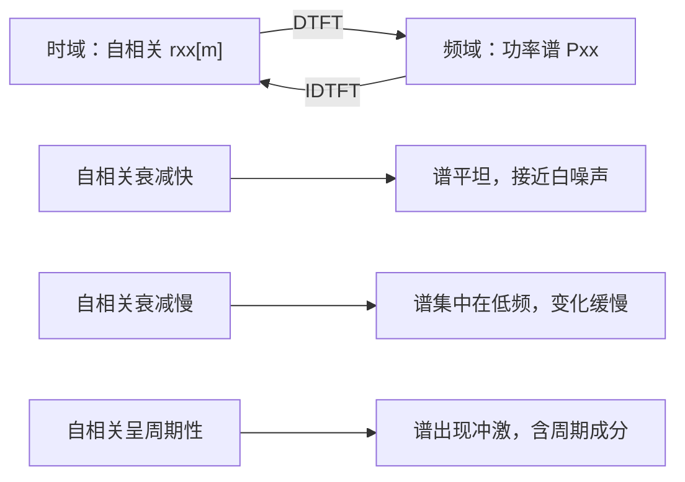

# 维纳-辛钦定理（Wiener-Khinchin Theorem）

**标签：** #数字信号处理 #DSP #维纳辛钦 #功率谱密度 #自相关 #随机信号

---

## 一、为什么需要维纳-辛钦定理？

在之前的文章中我们学过：

- **能量信号**：可以做傅里叶变换（DTFT）分析频谱
- **功率信号**（周期序列、阶跃、白噪声）：能量无限，傅里叶变换不收敛

那么，功率信号的频率特性该如何分析？

答案是：不看频谱，看**功率谱密度（PSD）**。
而维纳-辛钦定理告诉我们：

> **功率谱密度 = 自相关函数的傅里叶变换**

这条定理的价值在于：**它把"求频谱"这件做不到的事，转化成了"求自相关"这件做得到的事**。自相关是一个时域的平均量，只要数据够长就能估计出来，不需要信号绝对可和。

更完整的背景见 [[【数字信号处理DSP】（四）自相关函数与互相关函数|（四）自相关函数与互相关函数]]；定理的工程用法与估计方法见 [[【数字信号处理DSP】（六）功率谱密度|（六）功率谱密度]]。

---

## 二、定理内容

### 1. 连续时间形式

设 $x(t)$ 是宽平稳随机过程，自相关函数为 $R_x(\tau)$，则功率谱密度为：

$$
S_x(f) = \int_{-\infty}^{\infty} R_x(\tau) e^{-j2\pi f \tau} d\tau
$$

逆变换：

$$
R_x(\tau) = \int_{-\infty}^{\infty} S_x(f) e^{j2\pi f \tau} df
$$

### 2. 离散时间形式（DSP 重点）

设 $x[n]$ 是宽平稳离散随机序列，自相关函数为 $r_{xx}[m]$，则功率谱密度为：

$$
P_{xx}(e^{j\omega}) = \sum_{m=-\infty}^{\infty} r_{xx}[m] e^{-j\omega m}
$$

逆变换（IDTFT）：

$$
r_{xx}[m] = \frac{1}{2\pi} \int_{-\pi}^{\pi} P_{xx}(e^{j\omega}) e^{j\omega m} d\omega
$$

### 3. 用角频率 $\Omega$ 表示（另一种常见形式）

$$
S_{xx}(e^{j\Omega}) = \sum_{m=-\infty}^{\infty} r_{xx}[m] e^{-j\Omega m}
$$

$$
r_{xx}[m] = \frac{1}{2\pi} \int_{-\pi}^{\pi} S_{xx}(e^{j\Omega}) e^{j\Omega m} d\Omega
$$

两种形式等价，$\omega$ 和 $\Omega$ 都表示数字角频率（见 [[【数字信号处理DSP】（十）模拟频率与数字频率的关系|（十）模拟频率与数字频率的关系]]）。

---

## 三、定理为什么成立（推导思路）

不用背，两行就能想通。先从**能量信号**下手。

若 $x[n]$ 能量有限，定义自相关 $r_{xx}[m] = \sum_n x[n]x^*[n-m]$，直接对它做 DTFT：

$$
\sum_m r_{xx}[m] e^{-j\omega m}
= \sum_m \sum_n x[n] x^*[n-m] e^{-j\omega m}
\overset{k=n-m}{=} \sum_n x[n] e^{-j\omega n} \sum_k x^*[k] e^{j\omega k}
$$

第二个因子是 $X^*(e^{j\omega})$（因为 $x^*[k] e^{j\omega k} = \left(x[k]e^{-j\omega k}\right)^*$），于是

$$
\boxed{\ \mathcal{F}\{r_{xx}[m]\} = X(e^{j\omega}) \, X^*(e^{j\omega}) = \lvert X(e^{j\omega}) \rvert^2\ }
$$

**能量信号的自相关谱恰好是能量谱密度**——这就是维纳-辛钦定理的"能量版"，也叫自相关定理。

对**功率信号**，能量无限，$\lvert X \rvert^2$ 发散，于是改用**平均**：把信号截断成长度 $N$ 的一段，对其自相关除以 $N$，再令 $N \to \infty$。取极限后得到的就是功率谱密度。所以：

| 信号类型 | 自相关的 DTFT | 名称 |
| --- | --- | --- |
| 能量信号 | $\lvert X(e^{j\omega}) \rvert^2$ | 能量谱密度 |
| 功率信号 | $\lim\limits_{N\to\infty}\frac{1}{N}\lvert X_N(e^{j\omega}) \rvert^2$ | 功率谱密度 |

**同一把尺子，只差一个归一化。**

---

## 四、定理的物理意义

| 时域 | 频域 | 含义 |
|------|------|------|
| $r_{xx}[0]$ | $\frac{1}{2\pi}\int_{-\pi}^{\pi} P_{xx}(e^{j\omega}) d\omega$ | 信号的平均功率 |
| $r_{xx}[m]$ 衰减快 | $P_{xx}(e^{j\omega})$ 平坦 | 信号接近白噪声 |
| $r_{xx}[m]$ 衰减慢 | $P_{xx}(e^{j\omega})$ 集中在低频 | 信号变化缓慢 |
| $r_{xx}[m]$ 呈周期性 | $P_{xx}(e^{j\omega})$ 出现冲激 | 信号含有周期成分 |

这张表体现了傅里叶变换的**对偶性**：时域越"集中/尖锐"，频域越"分散/平坦"；时域越"缓慢/持续"，频域越"集中"。

---

## 五、重要性质

### 性质1：功率谱密度是实的、非负的

$$
P_{xx}(e^{j\omega}) \geq 0, \quad \forall \omega
$$

推导：$P_{xx}$ 是**共轭偶对称**序列 $r_{xx}[-m] = r_{xx}^*[m]$ 的 DTFT，实部是偶函数、虚部是奇函数；再结合能量/功率的归一化定义，虚部与负值都被排除，最终只剩非负实数。**"非负"是功率谱区别于一般频谱的关键特征**——它的物理含义是"功率密度"，而功率不可能为负。

### 性质2：功率谱密度是周期的

$$
P_{xx}(e^{j(\omega + 2\pi)}) = P_{xx}(e^{j\omega})
$$

周期为 $2\pi$，这是离散时间信号的固有特性。工程上只需要看 $\omega \in [-\pi, \pi]$（或 $[0, 2\pi]$）这一段。

### 性质3：总平均功率

信号的平均功率等于功率谱密度在一个周期内的积分平均值：

$$
P = r_{xx}[0] = \frac{1}{2\pi} \int_{-\pi}^{\pi} P_{xx}(e^{j\omega}) d\omega
$$

这是**时域求平均功率**与**频域求面积**的等价表述，也是"功率守恒"的具体形式。

### 性质4：对称性

对于实信号：

$$
P_{xx}(e^{j\omega}) = P_{xx}(e^{-j\omega})
$$

即功率谱密度是偶函数，只需要分析 $[0, \pi]$ 区间。

### 性质5：线性系统输出功率谱

若宽平稳信号通过线性时不变系统 $H(e^{j\omega})$，则输出功率谱为：

$$
P_{yy}(e^{j\omega}) = \lvert H(e^{j\omega}) \rvert^2 \, P_{xx}(e^{j\omega})
$$

**这里只出现幅频特性，不出现相位**——因为功率谱本身不含相位信息。工程上做滤波器对噪声的抑制能力分析，全部依赖这个公式。

---

## 六、典型例题

### 例题1：白噪声的功率谱

白噪声的自相关函数：$r_{xx}[m] = \sigma^2 \delta[m]$

**解**：

$$
P_{xx}(e^{j\omega}) = \sum_{m=-\infty}^{\infty} \sigma^2 \delta[m] e^{-j\omega m} = \sigma^2
$$

→ 白噪声的功率谱是常数，在所有频率上功率均匀分布。**时域是冲激、频域是常数**，正是上一节对偶性的最典型例子。

### 例题2：一阶AR过程的功率谱

自相关函数：$r_{xx}[m] = \sigma^2 a^{\lvert m \rvert}$，$\lvert a \rvert \lt 1$

**解**：

$$
P_{xx}(e^{j\omega}) = \sum_{m=-\infty}^{\infty} \sigma^2 a^{\lvert m \rvert} e^{-j\omega m}
$$

把求和拆成正负两半（利用 $a^{\lvert m \rvert}$ 的偶对称性）：

$$
= \sigma^2 \left( \sum_{m=0}^{\infty} a^m e^{-j\omega m} + \sum_{m=1}^{\infty} a^m e^{j\omega m} \right)
= \sigma^2 \left( \frac{1}{1 - ae^{-j\omega}} + \frac{ae^{j\omega}}{1 - ae^{j\omega}} \right)
$$

通分整理后：

$$
P_{xx}(e^{j\omega}) = \frac{\sigma^2 (1 - a^2)}{1 - 2a\cos\omega + a^2}
$$

→ 当 $a \gt 0$ 时，分母在 $\omega = 0$ 处最小，功率集中在低频；当 $a \lt 0$ 时，分母在 $\omega = \pi$ 处最小，功率集中在高频。**参数 $a$ 的符号决定"低通还是高通"**，这正是 AR 模型用于谱估计的直觉来源。

### 例题3：正弦信号的功率谱

$x[n] = A\sin(\omega_0 n + \phi)$

自相关函数：$r_{xx}[m] = \frac{A^2}{2} \cos(\omega_0 m)$

**解**：先把余弦展开成两个复指数：

$$
r_{xx}[m] = \frac{A^2}{4}\left( e^{j\omega_0 m} + e^{-j\omega_0 m} \right)
$$

再对每一项做 DTFT。关键是这一个变换对（周期为 $2\pi$ 的冲激串）：

$$
\sum_{m=-\infty}^{\infty} e^{j\omega_0 m} e^{-j\omega m} = 2\pi \sum_{k=-\infty}^{\infty} \delta(\omega - \omega_0 - 2\pi k)
$$

代入 $[-\pi, \pi]$ 区间只留下一个冲激：

$$
P_{xx}(e^{j\omega}) = \frac{\pi A^2}{2} \left[ \delta(\omega - \omega_0) + \delta(\omega + \omega_0) \right], \quad -\pi \lt \omega \leq \pi
$$

→ 正弦信号的功率谱是在 $\pm\omega_0$ 处的两条冲激，冲激强度为 $\pi A^2 / 2$。

**两个要点**：

1. **强度验证**：把 $\omega_0$ 与 $-\omega_0$ 两个冲激都算进积分，$\frac{1}{2\pi}\cdot 2\cdot\frac{\pi A^2}{2} = \frac{A^2}{2}$，正好等于正弦信号的平均功率 $A^2/2$；
2. **相位消失**：结果与初相 $\phi$ 无关，印证了"功率谱不含相位信息"。

### 例题4：周期信号的功率谱

$x[n]$ 是周期为 $N$ 的周期信号

**解**：

- 自相关函数也是周期为 $N$ 的周期函数
- 功率谱密度是离散的冲激序列，冲激出现在 $\omega_k = 2\pi k / N$ 处
- 每个冲激的强度等于对应频率分量的功率

对任意周期信号写成傅里叶级数 $x[n] = \sum_k c_k e^{j2\pi kn/N}$，则

$$
P_{xx}(e^{j\omega}) = 2\pi \sum_k \lvert c_k \rvert^2 \, \delta\!\left(\omega - \frac{2\pi k}{N}\right)
$$

即**第 $k$ 次谐波的功率就是 $\lvert c_k \rvert^2$**，$N$ 条谱线把总功率分完。这就是用 FFT 做谱分析时"谱线高度代表该频率分量功率"的依据。

---

## 七、维纳-辛钦定理的使用条件

| 条件 | 说明 |
|------|------|
| 宽平稳 | 均值为常数，自相关函数只与延迟 $m$ 有关、与时间起点无关 |
| 二阶矩有限 | $r_{xx}[0] = E[\lvert x[n] \rvert^2] \lt \infty$，即平均功率有限 |
| 自相关绝对可和 | $\sum_m \lvert r_{xx}[m] \rvert \lt \infty$ 时，$P_{xx}(e^{j\omega})$ 是**连续的普通函数** |

> **条件 3 不满足时定理仍然成立，只是结果含冲激**。周期分量的自相关不衰减，求和发散，此时要用**广义傅里叶变换**（允许 $\delta$ 函数出现在谱里），这正是例题 3、4 处理的情形。
>
> 所以准确的表述是：**维纳-辛钦定理对宽平稳、有限平均功率的信号普遍成立；自相关绝对可和只是"谱不含冲激"的充分条件，不是定理成立的必要条件。**

---

## 八、维纳-辛钦定理的应用

1. **功率谱估计**：通过估计自相关函数，再求傅里叶变换得到功率谱（间接法/BT 法）
2. **信号检测**：在噪声中检测周期信号（功率谱中出现尖峰）
3. **系统分析**：输入输出功率谱关系 $P_{yy} = \lvert H \rvert^2 P_{xx}$，用于滤波器噪声抑制分析
4. **系统辨识**：白噪声激励下，输入输出互相关正比于冲激响应
5. **随机信号处理**：分析噪声特性、设计最优滤波器（维纳滤波器的出发点就是这条定理）

---

## 九、常见错误提醒

1. **把功率谱当频谱用**：频谱 $X(e^{j\omega})$ 保留幅度和相位、可以有负值；功率谱 $P_{xx}$ 只有幅度信息、恒非负。二者不可互换。
2. **忘记除以 $2\pi$**：「积分求总功率」时，$P = r_{xx}[0] = \frac{1}{2\pi}\int P_{xx} d\omega$，这个 $\frac{1}{2\pi}$ 常被漏掉，结果会差 $2\pi$ 倍。
3. **对周期信号用"自相关绝对可和"的条件**：周期信号的自相关是周期的，绝对可和条件不满足，但定理依然成立（谱中含冲激），不要因此认为"定理不适用"。
4. **混淆能量谱与功率谱**：能量信号用 $\lvert X \rvert^2$；功率信号用 $P_{xx}$。量纲不同（一个是能量/rad，一个是功率/rad）。
5. **忽略去均值**：含直流分量的信号，自相关里含常数项 $\bar{x}^2$，会在 $\omega = 0$ 处产生虚假冲激。
6. **正弦信号的冲激强度写成 $A^2/2$**：谱里每个冲激的强度是 $\pi A^2/2$，不是 $A^2/2$；$A^2/2$ 是**积分后的功率**。差一个 $\pi$ 与一个 $2\pi$ 归一化。
7. **以为 PSD 一定连续**：只有自相关绝对可和时才是连续函数；含周期分量时必定出现冲激。

---

## 十、知识链定位

维纳-辛钦定理（本节）

│

├── 定理：Pxx(e^jω) = DTFT{rxx[m]}

├── 推导：能量信号 rxx 的 DTFT = |X(e^jω)|²（自相关定理）

├── 延拓：功率信号取截断平均的极限

└── 适用：宽平稳 + 有限平均功率（含冲激也能用）

│

├── 能量信号与功率信号：先分类才能选工具（第三节）

├── 自相关函数：定理的输入（第四节）

├── 功率谱密度：定理的工程落地与估计（第六节）

├── 模拟频率与数字频率：ω 与 f 的换算（第十节）

└── Z 变换与收敛域：把 DTFT 推广到复频域（第十三节）

---

## 十一、快速记忆

| 要点 | 内容 |
|------|------|
| 核心思想 | 自相关的傅里叶变换 = 功率谱密度 |
| 正变换 | $P_{xx}(e^{j\omega}) = \sum_m r_{xx}[m] e^{-j\omega m}$ |
| 逆变换 | $r_{xx}[m] = \frac{1}{2\pi} \int_{-\pi}^{\pi} P_{xx}(e^{j\omega}) e^{j\omega m} d\omega$ |
| 零点关系 | $r_{xx}[0] =$ 平均功率 $= \frac{1}{2\pi}\int P_{xx} d\omega$ |
| 能量版对照 | 能量信号：$\mathcal{F}\{r_{xx}\} = \lvert X(e^{j\omega}) \rvert^2$ |
| 适用对象 | 宽平稳随机过程 / 功率信号 |
| 白噪声特例 | $P_{xx} = \sigma^2$（常数） |
| 正弦特例 | 在 $\pm\omega_0$ 处两条冲激，强度 $\pi A^2/2$ |

> **一句话总结**：维纳-辛钦定理把"功率信号的频谱分析"从不可能变成了可能——只要算出自相关再做 DTFT，就得到了功率谱密度；它是自相关（第四节）与功率谱（第六节）之间的那座桥。
