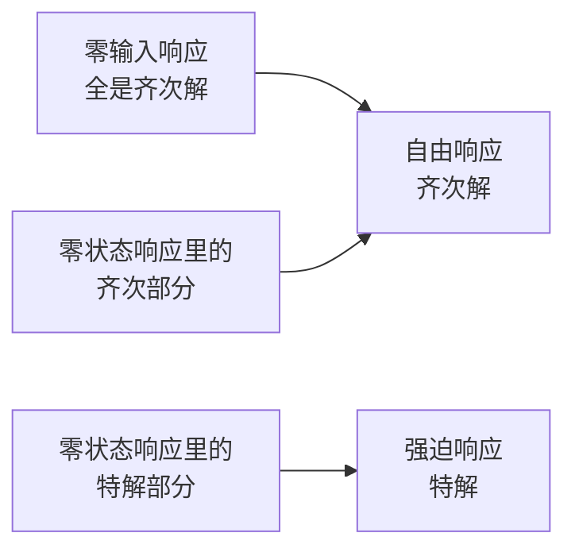

# 离散时间系统的各种响应概念详解

**标签：** #数字信号处理 #DSP #系统响应 #零输入响应 #零状态响应 #自由响应 #强迫响应

---

## 一、为什么要区分不同的响应？

系统的输出不仅取决于输入信号，还取决于系统内部的初始状态（如寄存器初值、电容初始电压等）。为了清楚分析输出的来源，我们将全响应分解为不同的分量，每个分量有明确的物理意义和数学形式。

---

## 二、五大核心响应概念

先用一张表把五个概念对齐，再看后面的详细说明：

| 概念 | 符号 | 数学成分 | 由谁决定 |
|------|------|---------|---------|
| 零输入响应 | \(y_{zi}[n]\) | 齐次解 | 初始条件 |
| 零状态响应 | \(y_{zs}[n]\) | 齐次解 + 特解 | 输入信号 |
| 自由响应 | \(y_h[n]\) | 齐次解（全部） | 系统特性 + 初始条件 + 输入 |
| 强迫响应 | \(y_p[n]\) | 特解 | 输入的形式 |
| 全响应 | \(y[n]\) | 以上两组之和 | — |

> 关键在最后一行：**这两种分解是同一件事的两种说法**，不是四种独立的东西。下面逐个展开。

### 1. 零输入响应（Zero-Input Response, ZIR）

**定义**：系统在没有外部输入（\(x[n]=0\)）时，仅由初始状态产生的输出。

**符号**：\(y_{zi}[n]\)

**数学形式**：齐次解，系数完全由初始条件决定。

**物理意义**：系统的“记忆”——过去输入留下的痕迹。

---

### 2. 零状态响应（Zero-State Response, ZSR）

**定义**：系统初始状态为零时，仅由输入信号产生的输出。

**符号**：\(y_{zs}[n]\)

**数学形式**：齐次解 + 特解。其中齐次部分的系数由输入确定（前提是初始状态为零），特解形式与输入有关。

**物理意义**：系统对输入的“直接反应”。

**计算方法**：卷积和 \(y_{zs}[n] = x[n] * h[n]\)，或令初始条件为零后用经典法求解。

---

### 3. 自由响应（Natural Response）

**定义**：系统差分方程的齐次解，反映系统自身的固有特性。

**符号**：\(y_h[n]\)

**数学形式**：由特征根决定的指数/振荡形式的组合，系数由初始条件和输入共同决定。

**物理意义**：系统“天生”的响应模式，在稳定系统中通常随时间衰减（瞬态）。

---

### 4. 强迫响应（Forced Response）

**定义**：系统差分方程的特解，由输入信号的形式强制产生。

**符号**：\(y_p[n]\)

**数学形式**：与输入形式相同或类似（如输入为常数则特解为常数，输入为正弦则特解为同频正弦）。

**物理意义**：系统被输入“牵着走”的那部分响应，通常构成稳态部分。

---

### 5. 全响应（Total Response）

**定义**：系统实际的总输出。

**符号**：\(y[n]\)

$$
y[n] = y_{zi}[n] + y_{zs}[n] = y_h[n] + y_p[n]
$$

---

## 三、两对分解方式的对应关系

系统分析中有两种常见的分解视角，它们不是独立的四种响应，而是从不同角度对全响应的划分。

### 视角一：按原因分解（工程常用）

$$
y[n] = \underbrace{y_{zi}[n]}_{\text{零输入响应}} + \underbrace{y_{zs}[n]}_{\text{零状态响应}}
$$

- **零输入响应**：由初始条件引起，只含齐次解。
- **零状态响应**：由输入引起，含齐次解和特解。

### 视角二：按数学形式分解（经典法）

$$
y[n] = \underbrace{y_h[n]}_{\text{自由响应}} + \underbrace{y_p[n]}_{\text{强迫响应}}
$$

- **自由响应**：齐次解，形式由系统特征根决定。
- **强迫响应**：特解，形式由输入决定。

### 两对之间的交叉关系

两种视角不是简单并列，而是**交叉**的：零输入响应整个属于自由响应，而零状态响应被"劈"成两半。

**关键结论**：
- **自由响应 = 零输入响应 + 零状态响应中的齐次解部分**
- **强迫响应 = 零状态响应中的特解部分**
- 因此：零输入响应**只有**自由响应成分；零状态响应**同时含有**两种成分；强迫响应**只来自**零状态响应。

> 换个角度记：**"零输入 / 零状态"是按"谁引起的"分，"自由 / 强迫"是按"长什么样子"分。** 前者对应物理原因，后者对应数学形式。

---

## 四、举例验证

系统：\(y[n] - 0.5y[n-1] = x[n]\)，\(x[n]=u[n]\)，初始条件 \(y[-1]=1\)（完整求解过程见[[【数字信号处理DSP】（九）离散时间系统的时域解法|（九）离散时间系统的时域解法]]）

| 分量 | 表达式 | 所属类别 |
|------|--------|---------|
| 全响应 | \(y[n] = 2 - (0.5)^{n+1}\) | — |
| 零输入响应 | \(y_{zi}[n] = (0.5)^{n+1}\) | 自由响应 |
| 零状态响应 | \(y_{zs}[n] = 2 - 2(0.5)^{n+1}\) | 含自由响应部分 \(-2(0.5)^{n+1}\) 和强迫响应部分 \(2\) |
| 自由响应 | \(y_h[n] = -0.5(0.5)^n\) | 等于 \(y_{zi} +\) 零状态中的齐次部分 |
| 强迫响应 | \(y_p[n] = 2\) | 等于零状态中的特解部分 |

---

## 五、补充：瞬态响应与稳态响应

这两个概念是从时间持久性角度划分的，与上述分类正交。

| 名称 | 含义 | 通常来源 |
|------|------|---------|
| 瞬态响应 | 随时间增长而衰减消失的部分 | 稳定系统的自由响应（齐次解） |
| 稳态响应 | 持续存在的部分 | 强迫响应（特解）或非衰减的自由响应 |

**注意**：零输入响应在稳定系统中是瞬态的，但在不稳定系统中可能不衰减；零状态响应中既有瞬态（齐次部分）也有稳态（特解部分）。

---

## 六、常见错误提醒

1. **把四种响应当成四种独立的东西**：全响应既等于"零输入 + 零状态"，也等于"自由 + 强迫"，两组分解只是视角不同。
2. **认为"零状态响应 = 强迫响应"**：这是最常错的一条。零状态响应里**也含齐次解**（由输入激励出来的那部分），只有特解才等于强迫响应。
3. **认为"零输入响应 = 自由响应"**：零输入响应只是自由响应的**一部分**（它是纯自由响应，但自由响应还包含零状态里的齐次部分）。
4. **求零输入响应时带入了输入**：零输入响应必须令 \(x[n]=0\)，只用初始条件解齐次方程。
5. **求零状态响应时用了非零初始条件**：零状态要求初始状态全为零，两套分解不能用同一组初始条件混着算。
6. **把瞬态 / 稳态与自由 / 强迫直接划等号**：稳态通常来自强迫响应，但系统不稳定时自由响应也不衰减，那时它也是稳态的一部分。

---

## 七、知识链定位

各种响应概念（本节）

│

├── 五种响应：零输入 / 零状态 / 自由 / 强迫 / 全响应

├── 两对分解的交叉关系

└── 瞬态响应与稳态响应（时间维度，与上述分类正交）

│

├── 时域解法：经典法、零输入 / 零状态分解、迭代法（第九节）

├── 系统稳定性：决定自由响应是否随时间衰减（第二节）

└── 频率响应：稳态响应的频域描述（后续章节）

---

## 八、总结对照表

| 响应名称 | 英文 | 数学成分 | 由谁决定 | 与初始条件关系 | 与输入关系 |
|---------|------|---------|---------|--------------|-----------|
| 零输入响应 | ZIR | 齐次解 | 初始条件 | 直接相关 | 无关 |
| 零状态响应 | ZSR | 齐次解+特解 | 输入信号 | 无关 | 直接相关 |
| 自由响应 | Natural | 齐次解（全部） | 系统特性+初始条件+输入 | 部分相关 | 部分相关 |
| 强迫响应 | Forced | 特解 | 输入形式 | 无关 | 直接相关 |
| 瞬态响应 | Transient | 衰减部分 | 系统稳定性 | 可能相关 | 可能相关 |
| 稳态响应 | Steady-state | 持续部分 | 输入+系统 | 可能相关 | 相关 |

---

> **一句话总结**：零输入响应是系统的“记忆”（纯自由响应），零状态响应是系统的“反应”（含部分自由响应和全部强迫响应）；自由响应是系统的“本性”，强迫响应是输入“强加”的形态。