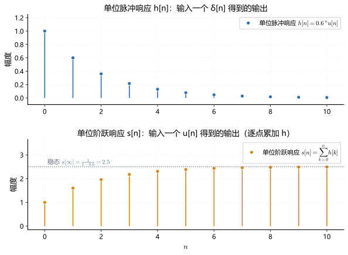
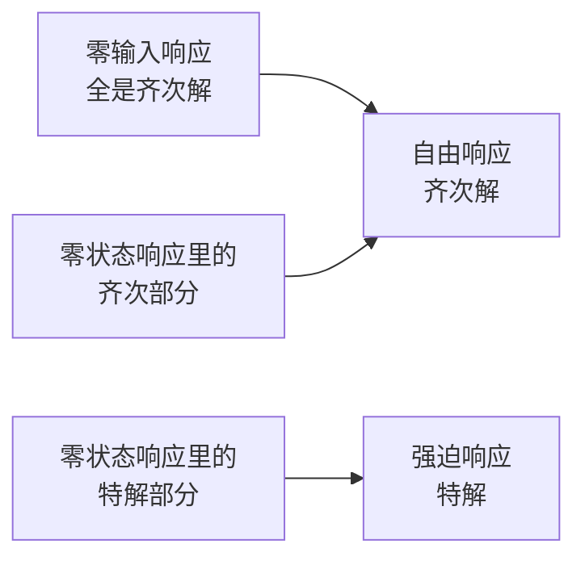
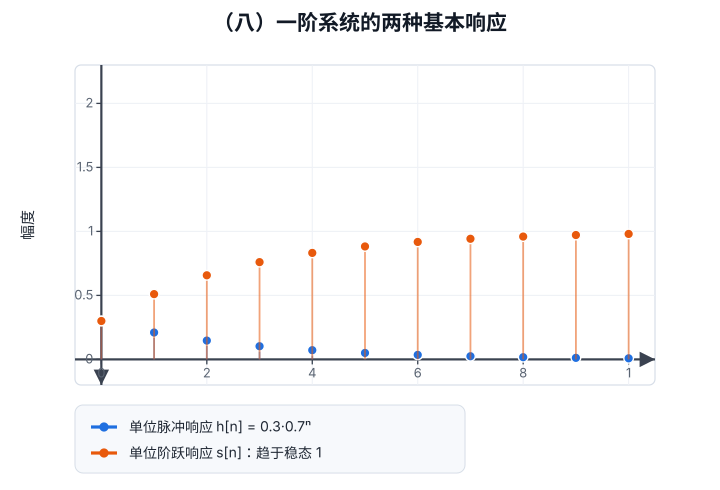
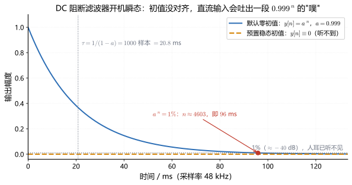

# 离散时间系统的各种响应概念详解

**标签：** #数字信号处理 #DSP #系统响应 #零输入响应 #零状态响应 #自由响应 #强迫响应

---

## 本篇的位置

**这一篇补的空洞。** 前七篇讲的是"信号长什么样"和"两个信号怎么叠成第三个"。到系统这一侧，手上只有一个 $h[n]$，可考试能对着它问出五个名字，工程上对应五张不同的"身份证"。五个名字不拆开，"这个输出是哪来的"就答不清；更实际的后果是，分不清两半，就会拿调系数的办法去修一个其实只是初值没设对的问题。

**和前后篇的接口。** 上游是（七）卷积和——$y_{zs}=x*h$ 就是这一篇的零状态响应。下游是（九）时域解法：经典法、迭代法、零输入/零状态分解，全是在这五个量上做运算。再往后，（十三）Z 变换把"瞬态/稳态"换成极点位置来说，（十四）DTFT 把它换成频率响应，指的仍是这一篇的同一批对象。

**本篇保留的简化。** 只讨论线性时不变系统、单输入单输出、实系数。非线性系统做不了这种分解——叠加原理不成立，两半加起来不等于整体。这条限制不写出来，后面所有"分解"都站不住。

**没出现的东西。** 状态空间（用矩阵统一描述初值）、零极点图（判断稳定性比算 $a^n$ 快）、正弦输入的稳态响应（属于频率响应），三样都在后面几篇。

**读完能做什么。** 拿到一道题能立刻判断它问的是哪个量，而不是五个都算一遍；五个量算完能用两条等式自验；看到一个工程现象（开机"噗"声、混响、阶跃测试、上电漂移），能指出它属于哪一半。

---

## 本篇要点

1. 五个名字分成两对：按"谁引起的"分零输入/零状态，按"长什么样子"分自由/强迫。两对是交叉的，不是并列的四种。
2. 零状态响应里含齐次解。这是全篇最反直觉的一点，也是"零状态 ≠ 强迫"的根源。
3. $h[n]$ 与 $s[n]$ 互为累加与差分，是工程上测系统的两个主接口。
4. 只有"系统稳定"且"输入持续"时，自由响应才等于瞬态、强迫响应才等于稳态。缺任一条，这个对应就断。

---

## 一、分解的动机：输出从哪来

系统的输出不仅取决于输入信号，还取决于系统内部的初始状态（如寄存器初值、电容初始电压等）。为了清楚分析输出的来源，我们将全响应分解为不同的分量，每个分量有明确的物理意义和数学形式。

---

## 二、五大核心响应概念

> 上图：同一个一阶系统 $h[n]=0.6^nu[n]$（上），它的单位阶跃响应是**逐点累加**：$s[n]=\sum_{k=0}^{n}h[k]$（下）。因为 $u[n]=\sum_k\delta[n-k]$，所以阶跃响应就是脉冲响应的"累积求和"，并最终趋于稳态值 $\frac{1}{1-0.6}=2.5$。

先用一张表把五个概念对齐，再看后面的详细说明：

| 概念 | 符号 | 数学成分 | 由谁决定 |
|------|------|---------|---------|
| 零输入响应 | $y_{zi}[n]$ | 齐次解 | 初始条件 |
| 零状态响应 | $y_{zs}[n]$ | 齐次解 + 特解 | 输入信号 |
| 自由响应 | $y_h[n]$ | 齐次解（全部） | 系统特性 + 初始条件 + 输入 |
| 强迫响应 | $y_p[n]$ | 特解 | 输入的形式 |
| 全响应 | $y[n]$ | 以上两组之和 | — |

> 关键在最后一行：**这两种分解是同一件事的两种说法**，不是四种独立的东西。下面逐个展开。

### 1. 零输入响应（Zero-Input Response, ZIR）

**定义**：系统在没有外部输入（$x[n]=0$）时，仅由初始状态产生的输出。

**符号**：$y_{zi}[n]$

**数学形式**：齐次解，系数完全由初始条件决定。

**物理意义**：系统的"记忆"——过去输入留下的痕迹。

---

### 2. 零状态响应（Zero-State Response, ZSR）

**定义**：系统初始状态为零时，仅由输入信号产生的输出。

**符号**：$y_{zs}[n]$

**数学形式**：齐次解 + 特解。其中齐次部分的系数由输入确定（前提是初始状态为零），特解形式与输入有关。

**物理意义**：系统对输入的"直接反应"。

**计算方法**：卷积和 $y_{zs}[n] = x[n] * h[n]$，或令初始条件为零后用经典法求解。

> **为什么零状态响应里会有齐次解？** 这是本章最反直觉的一点，值得单独讲清。
>
> 齐次解的形式由系统特征根决定，只要方程是齐次的，它就会出现。零状态响应满足的是**非齐次**方程（右边有 $x[n]$），它的通解 = 齐次解 + 特解，所以必然带一个齐次项。
>
> **物理上**：输入在 $n=0$ 时刻"突然"加进来，相当于给系统一个冲击，把系统自身的固有振荡"激"起来了。这个振荡按特征根衰减，但它确实存在——它就是零状态响应里的齐次部分。
>
> **注意**：这一部分的系数由"输入"决定（因为初始状态为零，没有别的来源）；而零输入响应的齐次系数由"初始条件"决定。**两者形式相同、来源不同**，这正是容易混淆的根源。

---

### 3. 自由响应（Natural Response）

**定义**：系统差分方程的齐次解，反映系统自身的固有特性。

**符号**：$y_h[n]$

**数学形式**：由特征根决定的指数/振荡形式的组合，系数由初始条件和输入共同决定。

**物理意义**：系统"天生"的响应模式，在稳定系统中通常随时间衰减（瞬态）。

---

### 4. 强迫响应（Forced Response）

**定义**：系统差分方程的特解，由输入信号的形式强制产生。

**符号**：$y_p[n]$

**数学形式**：与输入形式相同或类似（如输入为常数则特解为常数，输入为正弦则特解为同频正弦）。

**物理意义**：系统被输入"牵着走"的那部分响应，通常构成稳态部分。

---

### 5. 全响应（Total Response）

**定义**：系统实际的总输出。

**符号**：$y[n]$

$$
y[n] = y_{zi}[n] + y_{zs}[n] = y_h[n] + y_p[n]
$$

---

## 三、两对分解方式的对应关系

系统分析中有两种常见的分解视角，它们不是独立的四种响应，而是从不同角度对全响应的划分。

### 视角一：按原因分解（工程常用）

$$
y[n] = \underbrace{y_{zi}[n]}_{\text{零输入响应}} + \underbrace{y_{zs}[n]}_{\text{零状态响应}}
$$

- **零输入响应**：由初始条件引起，只含齐次解。
- **零状态响应**：由输入引起，含齐次解和特解。

### 视角二：按数学形式分解（经典法）

$$
y[n] = \underbrace{y_h[n]}_{\text{自由响应}} + \underbrace{y_p[n]}_{\text{强迫响应}}
$$

- **自由响应**：齐次解，形式由系统特征根决定。
- **强迫响应**：特解，形式由输入决定。

### 两对之间的交叉关系

两种视角不是简单并列，而是**交叉**的：零输入响应整个属于自由响应，而零状态响应被"劈"成两半。

**关键结论**：
- **自由响应 = 零输入响应 + 零状态响应中的齐次解部分**
- **强迫响应 = 零状态响应中的特解部分**
- 因此：零输入响应**只有**自由响应成分；零状态响应**同时含有**两种成分；强迫响应**只来自**零状态响应。

> 换个角度记：**"零输入 / 零状态"是按"谁引起的"分，"自由 / 强迫"是按"长什么样子"分。** 前者对应物理原因，后者对应数学形式。

既然都是齐次解，为什么不能把零状态里那一半挪进零输入

因为分类的那把尺子是"**谁引起的**"，不是"**长什么样子**"。

零输入响应的定义里有一个硬条件：$x[n]\equiv0$。它回答的是"把输入彻底拿掉，光靠初值，系统会怎么走"。而零状态响应里的齐次部分，恰恰是**有输入**才被激出来的——输入在 $n=0$ 突然加上，相当于踢了系统一脚，把它的固有振荡踢了出来。把输入撤掉，这一项就消失。

两者的系数来源也不同：零输入响应的系数由初值定，零状态响应里齐次项的系数由输入定。形式一样，来源不同，所以不能合并。

**怎么验**：把输入置零，若某一项消失，它属于零状态；若原样保留，它属于零输入。用例题 1 试：$y_{zi}=(0.5)^{n+1}$ 在 $x\equiv0$ 时不变；$y_{zs}=2-2(0.5)^{n+1}$ 里，$2$ 和 $-2(0.5)^{n+1}$ 都会随输入一起消失。

> 上图（同一系统 $y[n]-0.5y[n-1]=x[n]$、$x[n]=u[n]$、$y[-1]=1$）：绿方块是**零输入响应**（只有初始状态，从 $0.5$ 起衰减），橙三角是**零状态响应**（只有输入，从 $0$ 起上升），蓝线是两者之和即**全响应**。两者都趋于 $2$，但**零输入那半在衰减、零状态那半在上升**——这就是"同一件事的两种说法"在时间上的直观差异。

---

## 四、h[n] 与 s[n]：两个"标准输入"对应的输出

工程上最常用的两个"标准输入"是单位脉冲 $\delta[n]$ 和单位阶跃 $u[n]$，它们对应的输出分别是**单位脉冲响应** $h[n]$ 与**单位阶跃响应** $s[n]$。

### 1. 两者的关系（必背）

因为 $u[n]=\sum_{k=-\infty}^{n}\delta[n-k]$，由 LSI 的线性叠加：

$$
\boxed{s[n]=\sum_{k=-\infty}^{n}h[k]=h[n]*u[n]}
$$

求和上限为什么是 n 而不是无穷大

因为输入 $u[n]$ 自己就只到 $n$ 为止：$u[n]=\sum_{k=-\infty}^{n}\delta[n-k]$。到时刻 $n$ 为止，系统一共只收到过 $n+1$ 个冲激（$k=-\infty$ 到 $n$），后面的还没发生。

每个 $\delta[n-k]$ 经系统后变成 $h[n-k]$，线性叠加起来就是这些冲激的响应之和，上限自然跟输入一样停在 $n$。

写成 $\sum_{k=-\infty}^{\infty}$ 等于假设系统已经把无穷长的阶跃全吃完了——那是 $n\to\infty$ 的极限 $s[\infty]$，不是 $s[n]$。这两个的差别，正是"瞬态还没走完"和"已经到稳态"的差别。

反过来（差分）：

$$
\boxed{h[n]=s[n]-s[n-1]}
$$

> **这两个式子为什么好用**：只要知道 $h$ 或 $s$ 之一，另一个立刻就出来。
> **注意 $n=0$ 的处理**：$s[n]-s[n-1]$ 在 $n=0$ 处用到 $s[-1]=0$（系统在输入加进来之前没有输出），所以 $h[0]=s[0]$。

### 2. h[n] 与 s[n] 与其它响应的关系

| 已知 | 求 | 方法 |
|---|---|---|
| $h[n]$ | 零状态响应 | $y_{zs}=x*h$ |
| $h[n]$ | $s[n]$ | 累加（$s=h*u$） |
| $s[n]$ | $h[n]$ | 差分（$h[n]=s[n]-s[n-1]$） |
| $s[n]$ | $h[n]$ 再求任意输入响应 | 先差分再卷积 |

---

## 五、补充：瞬态响应与稳态响应

这两个概念是从时间持久性角度划分的，与上述分类正交。

| 名称 | 含义 | 通常来源 |
|------|------|---------|
| 瞬态响应 | 随时间增长而衰减消失的部分 | 稳定系统的自由响应（齐次解） |
| 稳态响应 | 持续存在的部分 | 强迫响应（特解）或非衰减的自由响应 |

**注意**：零输入响应在稳定系统中是瞬态的，但在不稳定系统中可能不衰减；零状态响应中既有瞬态（齐次部分）也有稳态（特解部分）。

> **稳定系统 + 持续输入时的完整对应**：
>
> $$
> y[n]=\underbrace{y_h[n]}_{\text{瞬态，衰减到 }0}+\underbrace{y_p[n]}_{\text{稳态，长期保留}}
> $$
>
> 这是考试里最常用的一句话结论。**前提是"系统稳定"且"输入持续存在"**，两者缺一，这个对应就不成立（不稳定系统自由响应不衰减；输入撤掉后稳态也消失）。

---

## 六、工程语境：五个概念的实际名称

前五节把五个量拆干净了，但考试之外它们各有一张"身份证"。这一节给四个能对上号的场景，每个只用前面已经讲过的一句话。

### 1. 拆开的价值：一半能改，一半改不了

$y[n]=y_{zi}[n]+y_{zs}[n]$ 的工程价值就在这个加法号上：

| 分量 | 由谁决定 | 工程师能不能动 |
|---|---|---|
| $y_{zs}$ | $h[n]$（系统结构、系数） | **能**——设计滤波器就是设计它 |
| $y_{zi}$ | 初值（电容电压、寄存器内容、历史输入） | 通常**不能改历史**，只能**预置** |

所以出问题时先问一句：**换输入、换系数都没用，只跟"上次剩下的东西"有关，还是输入一变它就跟着变？** 前者是 $y_{zi}$，后者是 $y_{zs}$。分不清这两半，就会拿调系数的办法去修一个其实是"初值没设对"的问题——下面第一个案例就是这个错误。

### 2. 案例一：音频开机的"噗"声——`zi` 就是把零输入响应预置掉

一阶 DC 阻断（直流隔离）滤波器，音频里几乎每条链路的开头都有它：

$$
y[n]=x[n]-x[n-1]+a\,y[n-1],\qquad a=0.999,\quad f_s=48\ \text{kHz}
$$

输入是一段带直流偏置的静音（$x[n]=1$，比如麦克风偏置电压）。按"默认零初值"取 $x[-1]=0$、$y[-1]=0$，逐点算：

$$
y[0]=1-0+a\cdot 0=1,\quad y[1]=1-1+a\cdot 1=a,\quad y[2]=a^2,\ \dots
$$

用归纳法一验就得到结论：

$$
\boxed{\,y[n]=a^{\,n},\quad n\ge 0\,}
$$

只改了一个初值，为什么整条曲线都变了

递推式 $y[n]=x[n]-x[n-1]+a\,y[n-1]$ 里，每个 $y[n]$ 都要用到上一步的 $y[n-1]$。初值定在哪里，整条轨迹就从哪里开始走，后面每一步只是把前面乘一次 $a$、加一个常数。

零初值时链条从 $y[-1]=0$ 起：$y[0]=1-0+a\cdot0=1$，于是 $y[1]=a$、$y[2]=a^2$……

预置后 $x[-1]$ 改成 $1$：$y[0]=1-1+a\cdot0=0$，从 $0$ 开始乘 $a$ 还是 $0$，整条恒为零。

两式的系数、输入、结构完全相同，差别只在链条的起点。**一阶系统只有一个自由度，起点定死、轨迹就定死**——这也是为什么"初始化"在工程上是个正经步骤，不是可选项。

这串衰减**跟"高通"这件事毫无关系**——它是一只纯的零输入响应：初值（$x[-1]=0$）与实际稳态（$x[-1]$ 应该等于 $1$）不一致，滤波器就在开头"纠正"这个不一致。

> 上图：$a=0.999$、48 kHz，直流输入下的输出。蓝线是默认零初值，输出从满幅 1 开始按 $0.999^{\,n}$ 衰减，时间常数 $\tau=\frac{1}{1-a}=1000$ 个样本 $=20.8$ ms，落到 1%（约 $-40$ dB，人耳基本听不见）要 $4.6\tau\approx96$ ms。橙线是预置了稳态初值的结果，恒为 0——**同一个滤波器，同一个输入，只改了初值**。

**怎么改**：让状态从稳态出发。直流输入时稳态输出是 $0$，而内部要存的 $x[-1]$ 应当等于 $x[0]=1$。取 $x[-1]=1,\ y[-1]=0$：

$$
y[0]=1-1+a\cdot 0=0,\qquad y[n]\equiv 0
$$

一个样本都不抖。工程上这就是 `scipy.signal.lfilter_zi` / `sosfilt_zi` 干的事：**先算稳态，再把状态预置成稳态值**，而不是一律清零。这就是为什么"初始化"在音频处理里是一个正经的工程步骤，不是可选项。

> 播放时你听到的是 $y=y_{zi}+y_{zs}$：$y_{zs}$ 是音乐本身，$y_{zi}$ 就是那声"噗"。

### 3. 案例二：房间混响——敲一下录下来的那串回声

$y[n]=x[n]*h[n]$ 是纯零状态响应。这个 $h[n]$ 在声学里有正式名字：**房间脉冲响应（RIR, Room Impulse Response）**。理想做法是往房间里放一个 $\delta[n]$，实际做不到（需要无穷大瞬时功率），于是用气球、发令枪，或者一段**扫频正弦**（sine sweep）再反卷积把 $h[n]$ 还原出来。

拿到 $h[n]$ 之后，任何声音 $x$ 进这个房间的效果都能直接算：$y=x*h$。这就是卷积混响的工作原理，跟"滤波器"用的是同一条公式，区别只在于**这个 $h$ 是从真实房间测出来的，不是设计出来的**。

数字很硬：48 kHz、混响时间 $\text{RT}_{60}=0.6$ s 的厅堂，$h[n]$ 长约 $0.6\times48000\approx 28800$ 个抽头。直接卷积每个输出样本要 28800 次乘加，等效每秒 $48000\times28800\approx1.4\times10^{9}$ 次运算——实时跑不动。所以工程上改成分块 FFT（overlap-add），把卷积搬到频域做，运算量降到 $10^{7}$ 量级（千万次/秒），这是"卷积定理"最值钱的一次应用。

### 4. 案例三：阶跃响应测系统——终值就是直流增益

给系统一个阶跃（温控箱设定从 20 ℃ 跳到 30 ℃），录下 $s[n]$，一条曲线上能同时读出四件事：

| 从曲线上读 | 对应的量 | 本节哪个概念 |
|---|---|---|
| 终值 | $s[\infty]=\sum_{k}h[k]=H(e^{j0})$，即**直流增益** | 稳态响应 |
| 上升到 63% 的时间 | 时间常数 $\tau$ | 瞬态响应 |
| 超调量与振荡次数 | 极点位置（阻尼） | 瞬态响应 |
| 进入 ±2% 不再出来的时刻 | 调节时间 | 瞬态 → 稳态的分界 |

如果终值不是设定的 30 ℃ 而是 27.6 ℃，那就是 $s[\infty]=0.76$，即**稳态误差 24%**——这个数在 $s[n]$ 上是直接看出来的，在 $h[n]$ 上要累加全部项才能看出来。

终值为什么恰好等于直流增益：0.76 是怎么算出来的

先纠一个容易算错的地方：阶跃的**幅度是 $30-20=10$**，不是 $30$。$s[\infty]$ 是"输出变化量 ÷ 输入变化量"，所以要从 20 ℃ 起算：

$$
s[\infty]=\frac{27.6-20}{30-20}=\frac{7.6}{10}=0.76
$$

若直接拿 $27.6/30=0.92$ 去算，错在把绝对温度当成了变化量。温度、电压这类带偏置的量，一律先减基准。

再说为什么它等于直流增益。由第四节，$s[\infty]=\sum_{k}h[k]$（稳定系统的级数收敛，所以这个和存在）。而频率响应的定义是 $H(e^{j\omega})=\sum_{k}h[k]e^{-j\omega k}$。代入 $\omega=0$，$e^{0}=1$，右边只剩 $\sum_{k}h[k]$。

两边相等，所以 $s[\infty]=H(e^{j0})$ 是恒等式，不是近似。工程上的用法很直接：**做一次阶跃测试，读终值，就等于把 $H(1)$ 量出来了**，不需要扫频。

反向也成立：$h[n]=s[n]-s[n-1]$（且 $s[-1]=0$），所以**只测阶跃响应就能反推 $h[n]$**。这就是工程上偏爱阶跃测试的原因：脉冲测试要求近似 $\delta$、瞬时功率极大，阶跃测试只要把开关一合。你在实验室看到的"扫频测频响""阶跃测时域指标"，本质都在恢复这同一个 $h$。

### 5. 案例四：电容放电与传感器漂移——纯零输入响应的样子

RC 电路断开电源后 $u(t)=U_0e^{-t/RC}$。以间隔 $T$ 采样离散化，令 $a=e^{-T/RC}$，就有

$$
u[n]=U_0\,a^{\,n}
$$

$RC=1$ s、$T=1$ ms 时 $a=e^{-0.001}\approx0.999$——**跟案例一那个 $a$ 是同一个数**。这不是巧合：一阶系统的时间常数、$a^n$ 的衰减率、滤波器的 $\tau$，三者是同一个东西的三种写法。

这一类现象的共同点：**输入已经断了（$x[n]=0$），输出还在走**。工程上对应的都是熟面孔：

- 断电重启后执行器停在哪不知道（编码器读数就是"初值"）；
- 传感器刚上电读数在漂，几十秒后才稳（热惯性 = 一阶系统）；
- 电池拔掉后温控读数仍偏高（余温）。

它们都不是"输入引起的"，所以只能靠 $y_{zi}$ 描述，也只能靠"等它稳定"或"上电先读一次基准"来消除。

### 6. 一张对照表

| 概念 | 工程里的名字 | 典型场景 | 你能直接观测到什么 |
|---|---|---|---|
| $y_{zi}$ | 初值响应 / 起始瞬态 | 滤波器开机"噗"声、上电漂移 | 输入为 0 时仍在变化的输出 |
| $y_{zs}$ | 卷积响应 | 混响、均衡、信道、滤波 | 换输入就变，且符合 $x*h$ |
| $h[n]$ | 脉冲响应 / 房间脉冲响应 RIR | 房间、音箱、无线信道 | 敲一下、录下来的那串衰减 |
| $s[n]$ | 阶跃响应 | 温控、电机、电源环路 | 一条"爬升—振荡—稳定"的曲线 |
| 瞬态 / 稳态 | 建立时间 / 稳态误差 | 所有闭环系统 | 曲线的前段 / 后段 |

> **三条要点**：
> 1. 出问题先分一半——跟初值有关，还是跟输入有关；改错一半就是白忙。
> 2. 工程上测 $h$ 难、测 $s$ 容易，两者可互推（$h[n]=s[n]-s[n-1]$，$s[n]=\sum h[k]$）。
> 3. $a^{\,n}$ 到处出现——电容放电、滤波器开机、传感器预热，都是同一个数学，认出它就省一半功夫。

---

## 七、典型例题

> **答题格式**：
> - **计算题**：写方程 → 分别令 $x=0$ / 初始状态为零 → 解出两部分 → 相加 → 拆出齐次/特解 → **两两核对**（$y_{zi}+y_{zs}=y_h+y_p=y$）。
> - **判断题**：写判据（定义是什么）→ 代入检查（找反例或验证）→ 下结论。**判"错"必须给反例**。

### 例题 1：完整分解一道题（把五个量全算出来）

**题目**：系统 $y[n]-0.5\,y[n-1]=x[n]$，输入 $x[n]=u[n]$，初始条件 $y[-1]=1$。求零输入响应、零状态响应、全响应、自由响应、强迫响应，并核对两组分解。

**解**：

（1）**求零输入响应**（令 $x[n]=0$，方程变齐次）：

$$
y_{zi}[n]-0.5\,y_{zi}[n-1]=0 \;\Longrightarrow\; y_{zi}[n]=C\,(0.5)^{n}
$$

为什么齐次解一定长成指数形式

齐次方程只说了一件事：$y[n]$ 与 $y[n-1]$ 之间差一个固定的比例。指数形状 $C\lambda^{n}$ 天生满足这一点——相邻两项的比值 $\lambda$，与 $n$ 无关。

把 $C\lambda^{n}$ 代回方程，$C$ 被约掉，剩下 $\lambda-0.5=0$，解得 $\lambda=0.5$。这个 $\lambda$ 就是特征根。所以 $0.5^{n}$ 不是猜出来的形状，是**唯一**能同时满足"比例固定"和"比例等于 0.5"的形状（差一个常数倍）。

另一条路是逐点推：$y[0]=0.5\,y[-1]$，$y[1]=0.5\,y[0]=0.5^{2}y[-1]$…… 每一步乘一个 0.5，到第 $n$ 步就是 $y[-1]\cdot 0.5^{\,n+1}$。两条路结果相同，只是 $C$ 的表达式不同。

由 $y_{zi}[-1]=y[-1]=1$ 定系数：

$$
C\,(0.5)^{-1}=1 \;\Longrightarrow\; C=0.5
$$

$$
y_{zi}[n] = 0.5\cdot(0.5)^{n} = (0.5)^{n+1},\quad n\ge 0
$$

（2）**求零状态响应**（令初始状态为零，用卷积）：

系统的单位脉冲响应 $h[n]=(0.5)^nu[n]$（可由方程直接递推），故

$$
y_{zs}[n]=u[n]*(0.5)^nu[n]=\sum_{k=0}^{n}(0.5)^{k}=\frac{1-(0.5)^{n+1}}{1-0.5}=2-2(0.5)^{n+1}
$$

求和到 n 为什么是 n+1 项，前后两个 2 又是哪来的

$k$ 从 $0$ 取到 $n$，项数是 $n-0+1=n+1$，不是 $n$ 项。这一步最常错，错了系数就差一个 $0.5$。

等比求和公式是 $\sum_{k=0}^{n}q^{k}=\dfrac{1-q^{n+1}}{1-q}$。代入 $q=0.5$，分母 $1-0.5=0.5$，除以 $0.5$ 等于乘 $2$，于是整个分式变成 $2\left[1-(0.5)^{n+1}\right]=2-2(0.5)^{n+1}$。

两个 $2$ 是同一个 $2$：一个来自除以 $0.5$，一个来自乘开括号时的 $2\times1$。看着像两个来源，其实只有一次除法。

验一下 $n=0$：和式只有 $(0.5)^0=1$ 一项，闭式给 $2-2(0.5)=1$，对上了。**每次写完等比求和，代 $n=0$ 检查一遍**，项数错没错立刻现形。

（3）**全响应**（两部分相加）：

$$
y[n]=y_{zi}[n]+y_{zs}[n]=(0.5)^{n+1}+2-2(0.5)^{n+1}=2-(0.5)^{n+1}
$$

（4）**按形式拆出自由 / 强迫**：把 $y[n]$ 整理成"$A(0.5)^n$ + 常数"：

$$
y[n]=2-0.5\cdot(0.5)^{n}
$$

为什么自由响应的系数是 −0.5，而不是上一行那个 1

$2-(0.5)^{n+1}$ 和 $2-0.5\cdot(0.5)^{n}$ 是同一个数，差别只在于把 $(0.5)^{n+1}$ 拆成了 $0.5\cdot(0.5)^{n}$。

拆的理由是定义：自由响应要求齐次项写成 $A\lambda^{n}$ 的标准形，**$A$ 必须与 $n$ 无关**。所以要把 $n$ 全部收进 $\lambda^{n}$，剩下的常数才是系数。$(0.5)^{n+1}=0.5\cdot(0.5)^{n}$，于是 $A=-0.5$。

不拆会怎样：直接读 $(0.5)^{n+1}$ 的"系数 1"，得出 $y_h=(0.5)^{n+1}$。那是**零输入响应**，不是自由响应。这两个量只差一个系数 $0.5$，例题 4 的说法 3 考的就是这一处。

故

$$
y_h[n]=-0.5\,(0.5)^{n},\qquad y_p[n]=2
$$

（5）**汇总**：

$$
\boxed{
\begin{aligned}
&y_{zi}[n]=(0.5)^{n+1}, && y_{zs}[n]=2-2(0.5)^{n+1}\\
&y[n]=2-(0.5)^{n+1}, && y_h[n]=-0.5(0.5)^{n},\quad y_p[n]=2
\end{aligned}}
$$

（6）**三重核对**：

| 核对项 | 计算 | 结果 |
|---|---|---|
| $y_{zi}+y_{zs}=y$ | $(0.5)^{n+1}+2-2(0.5)^{n+1}$ | $2-(0.5)^{n+1}$ ✓ |
| $y_h+y_p=y$ | $-0.5(0.5)^{n}+2$ | $2-(0.5)^{n+1}$ ✓ |
| $y_{zi}+$ 零状态齐次部分 $=y_h$ | $(0.5)^{n+1}-2(0.5)^{n+1}=-1\cdot(0.5)^{n+1}$ | $-0.5(0.5)^{n}$ ✓ |

**数值检验**（用递推独立验证 $y[0],y[1]$）：

$y[0]=x[0]+0.5y[-1]=1+0.5=1.5$，公式给 $2-0.5=1.5$ ✓
$y[1]=x[1]+0.5y[0]=1+0.75=1.75$，公式给 $2-0.25=1.75$ ✓

> **这道题的价值在于第（6）步**：五个量算完不算完，**必须用两条等式串起来核对**。考卷上写这三行核对，等于给自己上保险。

---

### 例题 2：阶跃响应与脉冲响应互推

**题目**：某 LSI 系统的单位阶跃响应为 $s[n]=\left[2-2(0.5)^{n+1}\right]u[n]$。求 $h[n]$，并求输入 $x[n]=\delta[n]-\delta[n-1]$ 时的输出。

**解**：

（1）**写关系式**（由第四节）：

$$
h[n]=s[n]-s[n-1]
$$

（2）**逐项相减**（$n\ge1$ 时两项的 $u$ 都取 $1$）：

$$
s[n]-s[n-1]=\left[2-2(0.5)^{n+1}\right]-\left[2-2(0.5)^{n}\right]
=-2(0.5)^{n+1}+2(0.5)^{n}
$$

提出 $2(0.5)^n$：

$$
=2(0.5)^{n}\left(1-0.5\right)=(0.5)^{n}
$$

（3）**补上 $n=0$ 的边界**：$h[0]=s[0]=2-2(0.5)=1=(0.5)^0$，与上式在 $n=0$ 处一致，故

$$
\boxed{h[n]=(0.5)^{n}u[n]}
$$

（4）**求新输入下的输出**（用线性 + 时移）：

$$
y[n]=\delta[n]*h[n]-\delta[n-1]*h[n]=h[n]-h[n-1]
$$

$$
\boxed{y[n]=(0.5)^{n}u[n]-(0.5)^{n-1}u[n-1]}
$$

**检验**：

- $y[0]=h[0]-h[-1]=1-0=1$ ✓
- $y[1]=0.5-1=-0.5$ ✓（差分型输入把阶跃变成"先正后负"的脉冲对）
- 若把 $n\ge1$ 的 $y$ 合并：$(0.5)^n-(0.5)^{n-1}=(0.5)^{n-1}(0.5-1)=-(0.5)^{n}$，即 $y=\{1,-0.5,-0.25,-0.125,\dots\}$，能量有限、符号交替 ✓

---

### 例题 3：二阶系统的零输入响应

**题目**：系统 $y[n]-1.5\,y[n-1]+0.5\,y[n-2]=x[n]$，初始条件 $y[-1]=1$、$y[-2]=0$，$x[n]=0$。求 $y_{zi}[n]$。

**解**：

（1）**写特征方程**（令 $y=\lambda^n$ 代入齐次方程）：

$$
\lambda^{2}-1.5\lambda+0.5=0 \;\Longrightarrow\; (\lambda-1)(\lambda-0.5)=0
$$

特征根 $\lambda_1=1$、$\lambda_2=0.5$，**互异**，故

$$
y_{zi}[n]=A\cdot1^{n}+B\cdot(0.5)^{n}=A+B(0.5)^{n}
$$

为什么两个根就要两个待定系数，也要两个初始条件

二阶方程含 $y[n]$、$y[n-1]$、$y[n-2]$ 三项，等于把"相邻三点的关系"绑死。要让解唯一，需要两个独立信息，所以 $A$、$B$ 两个系数就得配两个初始条件（这里是 $y[-1]$ 和 $y[-2]$）。给一个条件只能定出一个比例，解不唯一。

同理，一阶方程一个根、一个系数、一个初始条件；三阶要三个。**阶数 = 特征根个数 = 待定系数个数 = 需要的初始条件个数**，这四个数必须相等，缺一个方程就解不出来。

两个根**相等**时，$A\lambda^n+B\lambda^n$ 会合并成一个常数，两个系数退化成一个，凑不出两个自由度。这时第二个解要乘 $n$，形如 $(A+Bn)\lambda^{n}$。（九）的例题 6 就是重根情形。

（2）**代入两个初始条件**（注意 $n$ 可取负值）：

- $n=-1$：$A+B(0.5)^{-1}=A+2B=1$
- $n=-2$：$A+B(0.5)^{-2}=A+4B=0$

（3）**解方程组**：两式相减得 $2B=-1$，即 $B=-0.5$；回代得 $A=2$。

$$
\boxed{y_{zi}[n]=2-0.5(0.5)^{n}=2-(0.5)^{n+1},\quad n\ge 0}
$$

（4）**检验**（代回原方程核对 $n=0,1$）：

- $n=0$：$y[0]-1.5y[-1]+0.5y[-2]=(2-0.5)-1.5(1)+0=0$ ✓
- $n=1$：$y[1]-1.5y[0]+0.5y[-1]=(2-0.25)-1.5(1.5)+0.5=1.75-2.25+0.5=0$ ✓

> **为什么必须用 $n=-1,-2$ 而不是 $n=0,1$**：初始条件给的是"输入加入之前"的状态，它对应的时间点是 $-1,-2$。若误用 $n=0,1$ 代系数，得到的是**另一个问题**的答案（相当于已知 $y[0],y[1]$ 的零输入响应），数值完全不同。**这是本节最容易踩的坑。**

真拿 n=0、1 代进去，会得到什么（错误答案长什么样）

按错误做法，令 $A+B=1$、$A+0.5B=0$，解得 $A=-1$、$B=2$，即

$$
y_{\text{错}}[n]=-1+2(0.5)^{n}
$$

代 $n=0$ 得 $1$，代 $n=1$ 得 $0$——它**完全满足**用来定系数的那两个条件，所以自查时看不出问题。代数全对，错的是"拿哪两个点当条件"。

代回原题给的条件 $n=-1$：$y_{\text{错}}[-1]=-1+2(0.5)^{-1}=3$，而题目要求 $y[-1]=1$。立刻露馅。

正确解 $y[n]=2-(0.5)^{n+1}$ 在 $n=0$ 处给 $1.5$，错误解给 $1$。两条曲线都满足同一个齐次方程，只在初值上分家。

回代时只看一个地方：题目原文给的那个下标，不是你自己选的下标。

---

### 例题 4：判断题（四步判据 + 反例）

**题目**：判断下列说法是否正确，说明理由。

1. 零状态响应就是强迫响应。
2. 零输入响应是自由响应的一部分。
3. 自由响应只由初始条件决定。
4. 稳定系统在持续输入下，瞬态响应就是自由响应、稳态响应就是强迫响应。

**解**：

（1）**说法 1 —— 错**。

**判据**：零状态响应的通解 = 齐次解 + 特解；强迫响应只等于特解。

**反例**（用例题 1 的结果）：$y_{zs}[n]=2-2(0.5)^{n+1}$，其中 $2$ 是特解，而 $-2(0.5)^{n+1}$ 是齐次解。所以零状态响应**含齐次成分**，不能等同于强迫响应。

（2）**说法 2 —— 对**。

**判据**：自由响应定义为"全部齐次解"，而零输入响应在 $x[n]=0$ 时只能是齐次解（无输入就没有特解）。所以零输入响应必然落在自由响应之中。

**验证**：例题 1 中 $y_{zi}=(0.5)^{n+1}$，而 $-0.5(0.5)^n$ 才是全部齐次解；$(0.5)^{n+1}=0.5\cdot(0.5)^n$ 确实是其中一部分（系数的一部分）✓

（3）**说法 3 —— 错**。

**判据**：自由响应 = 零输入响应 + 零状态响应中的齐次部分，后者的系数由**输入**决定。

**反例**：同一系统 $y[n]-0.5y[n-1]=x[n]$：

- 若 $y[-1]=1$、$x=u[n]$：自由响应 $=-0.5(0.5)^n$
- 若 $y[-1]=0$、$x=u[n]$：零输入为零，自由响应只剩零状态部分 $=-2(0.5)^{n+1}$

两种情形下自由响应不同，且都受输入影响，所以"只由初始条件决定"不成立。

（4）**说法 4 —— 对（但前提必须写上）**。

**判据**：稳定系统特征根的模全小于 $1$，故齐次解（=自由响应）必衰减到 $0$，是瞬态；特解由输入形式决定、持续存在，是稳态。

**验证**：例题 1 中 $y_h=-0.5(0.5)^n\to0$（瞬态），$y_p=2$（稳态）✓；两者之和 $=y[n]$ ✓

> **答题要点**：判"对"要把**前提条件**讲出来（"稳定"和"持续输入"缺一不可）。只说"对"不解释，等于没答。

---

## 八、常见错误提醒

十条里有八条不是"算错"，而是"分错"。所以这张表的重心放在**判据**上：每条给一句能当场自检的话，和一个用例题 1 就能验证的反例。

| 错误说法 | 为什么会这么想 | 判据 | 反例（例题 1 的数） |
|---|---|---|---|
| 四种响应是四种独立的东西 | 名字有四个，自然以为有四个量 | 数一数独立等式：只有 $y_{zi}+y_{zs}=y$ 和 $y_h+y_p=y$ 两条 | 五个量全部由同一条差分方程算出，只有两组分解 |
| 零状态响应 = 强迫响应 | "零状态"听起来就是"只由输入决定"，而强迫也是输入定的 | 看零状态响应里有没有 $\lambda^{n}$ 项 | $y_{zs}=2-2(0.5)^{n+1}$，后一项是齐次解，强迫响应只有常数 $2$ |
| 零输入响应 = 自由响应 | 两者都只含齐次解 | 比系数：$y_{zi}$ 的系数由初值定，$y_h$ 的系数还含输入的贡献 | $y_{zi}=(0.5)^{n+1}$，$y_h=-0.5(0.5)^{n}$，差一个 $-1$ 倍 |
| 求零输入响应时带着输入 | 习惯性把 $x[n]$ 留在方程右边 | 写方程前先划掉输入项，确认是齐次的 | 若不划，解出来的是全响应 $2-(0.5)^{n+1}$，不是 $y_{zi}$ |
| 求零状态响应时用了非零初值 | 手上有 $y[-1]=1$，就顺手代进去 | 零状态要求所有初值为零，代之前先清零 | 代 $y[-1]=1$ 解出的是全响应，$y_{zs}$ 应为 $2-2(0.5)^{n+1}$ |
| 代初始条件时用 $n=0,1$ | 条件写着 $y[-1]$，但下意识从 $0$ 开始代 | 回代题目原文给的那个下标 | 用 $n=0,1$ 得 $y=-1+2(0.5)^{n}$，代 $n=-1$ 得 $3\ne1$ |
| 瞬态/稳态 = 自由/强迫 | 稳定系统里两者确实重合 | 加两个前提：系统稳定 + 输入持续 | 不稳定系统自由响应不衰减，也属于稳态 |
| $h$ 与 $s$ 互推漏掉 $n=0$ | $s[n]-s[n-1]$ 看起来从 $n=1$ 才开始 | $h[0]=s[0]-s[-1]=s[0]$，因为 $s[-1]=0$ | $s[0]=1$，漏掉就少一项，$h$ 整条少 $1$ |

---

## 九、知识链定位

各种响应概念（本节）

│

├── 五种响应：零输入 / 零状态 / 自由 / 强迫 / 全响应

├── 两对分解的交叉关系（零状态里含齐次部分）

├── 标准输入响应：h[n] 与 s[n]，s 是 h 的累加、h 是 s 的差分

├── 瞬态响应与稳态响应（时间维度，与上述分类正交）

├── 工程对应：zi 初值 / 房间脉冲响应 RIR / 阶跃测试 / 上电漂移

│

├── 时域解法：经典法、零输入 / 零状态分解、迭代法（第九节）

├── 卷积和：零状态响应 = x 与 h 的卷积（第七节）

├── 系统稳定性：决定自由响应是否随时间衰减（第二节）

└── 频率响应：稳态响应的频域描述（后续章节）

---

## 十、总结对照表

| 响应名称 | 英文 | 数学成分 | 由谁决定 | 与初始条件关系 | 与输入关系 |
|---------|------|---------|---------|--------------|-----------|
| 零输入响应 | ZIR | 齐次解 | 初始条件 | 直接相关 | 无关 |
| 零状态响应 | ZSR | 齐次解+特解 | 输入信号 | 无关 | 直接相关 |
| 自由响应 | Natural | 齐次解（全部） | 系统特性+初始条件+输入 | 部分相关 | 部分相关 |
| 强迫响应 | Forced | 特解 | 输入形式 | 无关 | 直接相关 |
| 瞬态响应 | Transient | 衰减部分 | 系统稳定性 | 可能相关 | 可能相关 |
| 稳态响应 | Steady-state | 持续部分 | 输入+系统 | 可能相关 | 相关 |

---

## 十一、学会的四层判据

这一篇的目标不是"记住五个定义"，而是四件事能做到。逐层自评，卡在哪层就回哪一节：

| 层 | 能做到什么 | 卡住了回哪 |
|---|---|---|
| 1. 会算 | 给方程、输入、初值，五个量全算出来，并用 $y_{zi}+y_{zs}=y$、$y_h+y_p=y$ 核对上 | 七、例题 1 |
| 2. 会判 | 看到"零状态响应就是强迫响应"，能立刻判错，并指出 $y_{zs}$ 里哪一项是齐次解 | 三、交叉关系 |
| 3. 会诊断 | 看到一条实测曲线（开机噗声、上电漂移），能指出是哪一半造成的，以及调系数有没有用 | 六、四个案例 |
| 4. 会被追问 | 能答"为什么零状态里有齐次解""为什么必须代负下标"，而不是只会背结论 | 三处折叠 |

第 1 层是考试要求，第 2 层是选择题要求，第 3 层是工程要求，第 4 层是面试和答辩要求。**大多数人停在第 2 层**——会做题，但一问"为什么"就回到背诵。

---

## 十二、本篇自测

八道选择题，点选项立刻判对错，四个选项各有一句说明。

三道简答题（先自己写，再展开解析）

**题 9.** 用一句话说清"零输入响应"与"自由响应"的关系，并举出一个"属于自由响应、但不属于零输入响应"的成分。

**题 10.** 系统 $y[n]-0.5y[n-1]=x[n]$，初值 $y[-1]=0$，输入 $x[n]=u[n]$。它的自由响应为零吗？为什么？

**题 11.** 某音频滤波器每次上电都有约 80 ms 的"噗"声，换输入信号、改截止频率都不消失。判断它属于哪一半响应，并给出两种消除办法。

---

**解析 9.** 零输入响应是自由响应的一部分，不是全部。反例：例题 1 里零状态响应中的 $-2(0.5)^{n+1}$ —— 它由输入激励出来，属于自由响应（齐次解），但不属于零输入响应（那时输入为零）。

**解析 10.** 不为零。初值为零只保证 $y_{zi}=0$，但零状态响应 $y_{zs}=2-2(0.5)^{n+1}$ 里含齐次项 $-2(0.5)^{n+1}$，它同样属于自由响应。所以自由响应 $=-2(0.5)^{n+1}\ne0$。**"初值为零"和"没有自由响应"是两件事**，这是第 2 层判据的标准考法。

**解析 11.** 属于零输入响应（纯 $y_{zi}$）。判据：与输入无关、只与"上次剩下的状态"有关，换输入改系数都不影响。两种办法：① 预置稳态初值（`lfilter_zi` / `sosfilt_zi`），让状态从上电前就该有的值出发；② 上电后先静音一小段（等 $a^n$ 衰减到听不见，例中约 96 ms），再放行音频。

---

> **一句话总结**：零输入响应是系统的"记忆"（纯自由响应），零状态响应是系统的"反应"（含部分自由响应和全部强迫响应）；自由响应是系统的"本性"，强迫响应是输入"强加"的形态。
