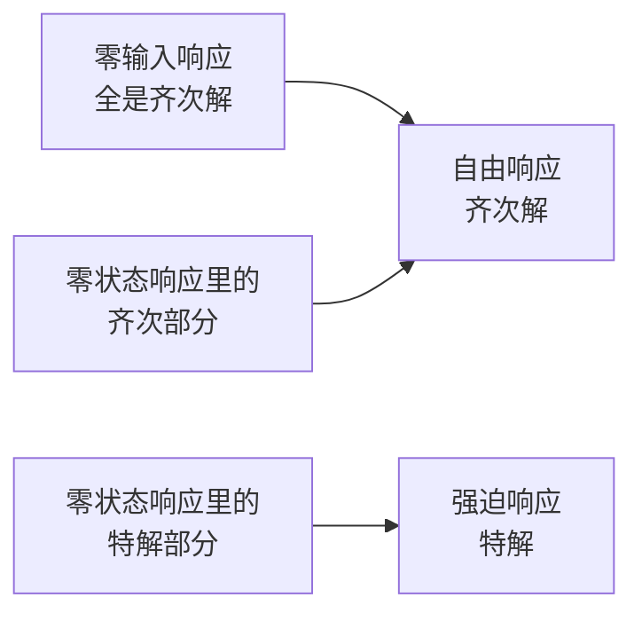

# 离散时间系统的各种响应概念详解

**标签：** #数字信号处理 #DSP #系统响应 #零输入响应 #零状态响应 #自由响应 #强迫响应

---

## 一、为什么要区分不同的响应？

系统的输出不仅取决于输入信号，还取决于系统内部的初始状态（如寄存器初值、电容初始电压等）。为了清楚分析输出的来源，我们将全响应分解为不同的分量，每个分量有明确的物理意义和数学形式。

---

## 二、五大核心响应概念

> 上图：同一个一阶系统 $h[n]=0.6^nu[n]$（上），它的单位阶跃响应是**逐点累加**：$s[n]=\sum_{k=0}^{n}h[k]$（下）。因为 $u[n]=\sum_k\delta[n-k]$，所以阶跃响应就是脉冲响应的"累积求和"，并最终趋于稳态值 $\frac{1}{1-0.6}=2.5$。

先用一张表把五个概念对齐，再看后面的详细说明：

| 概念 | 符号 | 数学成分 | 由谁决定 |
|------|------|---------|---------|
| 零输入响应 | \(y_{zi}[n]\) | 齐次解 | 初始条件 |
| 零状态响应 | \(y_{zs}[n]\) | 齐次解 + 特解 | 输入信号 |
| 自由响应 | \(y_h[n]\) | 齐次解（全部） | 系统特性 + 初始条件 + 输入 |
| 强迫响应 | \(y_p[n]\) | 特解 | 输入的形式 |
| 全响应 | \(y[n]\) | 以上两组之和 | — |

> 关键在最后一行：**这两种分解是同一件事的两种说法**，不是四种独立的东西。下面逐个展开。

### 1. 零输入响应（Zero-Input Response, ZIR）

**定义**：系统在没有外部输入（\(x[n]=0\)）时，仅由初始状态产生的输出。

**符号**：\(y_{zi}[n]\)

**数学形式**：齐次解，系数完全由初始条件决定。

**物理意义**：系统的"记忆"——过去输入留下的痕迹。

---

### 2. 零状态响应（Zero-State Response, ZSR）

**定义**：系统初始状态为零时，仅由输入信号产生的输出。

**符号**：\(y_{zs}[n]\)

**数学形式**：齐次解 + 特解。其中齐次部分的系数由输入确定（前提是初始状态为零），特解形式与输入有关。

**物理意义**：系统对输入的"直接反应"。

**计算方法**：卷积和 \(y_{zs}[n] = x[n] * h[n]\)，或令初始条件为零后用经典法求解。

> **为什么零状态响应里会有齐次解？** 这是本章最反直觉的一点，值得单独讲清。
>
> 齐次解的形式由系统特征根决定，只要方程是齐次的，它就会出现。零状态响应满足的是**非齐次**方程（右边有 $x[n]$），它的通解 = 齐次解 + 特解，所以必然带一个齐次项。
>
> **物理上**：输入在 $n=0$ 时刻"突然"加进来，相当于给系统一个冲击，把系统自身的固有振荡"激"起来了。这个振荡按特征根衰减，但它确实存在——它就是零状态响应里的齐次部分。
>
> **注意**：这一部分的系数由"输入"决定（因为初始状态为零，没有别的来源）；而零输入响应的齐次系数由"初始条件"决定。**两者形式相同、来源不同**，这正是容易混淆的根源。

---

### 3. 自由响应（Natural Response）

**定义**：系统差分方程的齐次解，反映系统自身的固有特性。

**符号**：\(y_h[n]\)

**数学形式**：由特征根决定的指数/振荡形式的组合，系数由初始条件和输入共同决定。

**物理意义**：系统"天生"的响应模式，在稳定系统中通常随时间衰减（瞬态）。

---

### 4. 强迫响应（Forced Response）

**定义**：系统差分方程的特解，由输入信号的形式强制产生。

**符号**：\(y_p[n]\)

**数学形式**：与输入形式相同或类似（如输入为常数则特解为常数，输入为正弦则特解为同频正弦）。

**物理意义**：系统被输入"牵着走"的那部分响应，通常构成稳态部分。

---

### 5. 全响应（Total Response）

**定义**：系统实际的总输出。

**符号**：\(y[n]\)

$$
y[n] = y_{zi}[n] + y_{zs}[n] = y_h[n] + y_p[n]
$$

---

## 三、两对分解方式的对应关系

系统分析中有两种常见的分解视角，它们不是独立的四种响应，而是从不同角度对全响应的划分。

### 视角一：按原因分解（工程常用）

$$
y[n] = \underbrace{y_{zi}[n]}_{\text{零输入响应}} + \underbrace{y_{zs}[n]}_{\text{零状态响应}}
$$

- **零输入响应**：由初始条件引起，只含齐次解。
- **零状态响应**：由输入引起，含齐次解和特解。

### 视角二：按数学形式分解（经典法）

$$
y[n] = \underbrace{y_h[n]}_{\text{自由响应}} + \underbrace{y_p[n]}_{\text{强迫响应}}
$$

- **自由响应**：齐次解，形式由系统特征根决定。
- **强迫响应**：特解，形式由输入决定。

### 两对之间的交叉关系

两种视角不是简单并列，而是**交叉**的：零输入响应整个属于自由响应，而零状态响应被"劈"成两半。

**关键结论**：
- **自由响应 = 零输入响应 + 零状态响应中的齐次解部分**
- **强迫响应 = 零状态响应中的特解部分**
- 因此：零输入响应**只有**自由响应成分；零状态响应**同时含有**两种成分；强迫响应**只来自**零状态响应。

> 换个角度记：**"零输入 / 零状态"是按"谁引起的"分，"自由 / 强迫"是按"长什么样子"分。** 前者对应物理原因，后者对应数学形式。

> 上图（同一系统 $y[n]-0.5y[n-1]=x[n]$、$x[n]=u[n]$、$y[-1]=1$）：绿方块是**零输入响应**（只有初始状态，从 $0.5$ 起衰减），橙三角是**零状态响应**（只有输入，从 $0$ 起上升），蓝线是两者之和即**全响应**。两者都趋于 $2$，但**零输入那半在衰减、零状态那半在上升**——这就是"同一件事的两种说法"在时间上的直观差异。

---

## 四、h[n] 与 s[n]：两个"标准输入"对应的输出

工程上最常用的两个"标准输入"是单位脉冲 $\delta[n]$ 和单位阶跃 $u[n]$，它们对应的输出分别是**单位脉冲响应** $h[n]$ 与**单位阶跃响应** $s[n]$。

### 1. 两者的关系（必背）

因为 $u[n]=\sum_{k=-\infty}^{n}\delta[n-k]$，由 LSI 的线性叠加：

$$
\boxed{s[n]=\sum_{k=-\infty}^{n}h[k]=h[n]*u[n]}
$$

反过来（差分）：

$$
\boxed{h[n]=s[n]-s[n-1]}
$$

> **这两个式子为什么好用**：只要知道 $h$ 或 $s$ 之一，另一个立刻就出来。
> **注意 $n=0$ 的处理**：$s[n]-s[n-1]$ 在 $n=0$ 处用到 $s[-1]=0$（系统在输入加进来之前没有输出），所以 $h[0]=s[0]$。

### 2. h[n] 与 s[n] 与其它响应的关系

| 已知 | 求 | 方法 |
|---|---|---|
| $h[n]$ | 零状态响应 | $y_{zs}=x*h$ |
| $h[n]$ | $s[n]$ | 累加（$s=h*u$） |
| $s[n]$ | $h[n]$ | 差分（$h[n]=s[n]-s[n-1]$） |
| $s[n]$ | $h[n]$ 再求任意输入响应 | 先差分再卷积 |

---

## 五、补充：瞬态响应与稳态响应

这两个概念是从时间持久性角度划分的，与上述分类正交。

| 名称 | 含义 | 通常来源 |
|------|------|---------|
| 瞬态响应 | 随时间增长而衰减消失的部分 | 稳定系统的自由响应（齐次解） |
| 稳态响应 | 持续存在的部分 | 强迫响应（特解）或非衰减的自由响应 |

**注意**：零输入响应在稳定系统中是瞬态的，但在不稳定系统中可能不衰减；零状态响应中既有瞬态（齐次部分）也有稳态（特解部分）。

> **稳定系统 + 持续输入时的完整对应**：
>
> $$
> y[n]=\underbrace{y_h[n]}_{\text{瞬态，衰减到 }0}+\underbrace{y_p[n]}_{\text{稳态，长期保留}}
> $$
>
> 这是考试里最常用的一句话结论。**前提是"系统稳定"且"输入持续存在"**，两者缺一，这个对应就不成立（不稳定系统自由响应不衰减；输入撤掉后稳态也消失）。

---

## 六、这些概念在工程里分别叫什么

前五节把五个量拆干净了，但考试之外它们各有一张"身份证"。这一节给四个能对上号的场景，每个只用前面已经讲过的一句话。

### 1. 拆开的价值：一半能改，一半改不了

$y[n]=y_{zi}[n]+y_{zs}[n]$ 的工程价值就在这个加法号上：

| 分量 | 由谁决定 | 工程师能不能动 |
|---|---|---|
| $y_{zs}$ | $h[n]$（系统结构、系数） | **能**——设计滤波器就是设计它 |
| $y_{zi}$ | 初值（电容电压、寄存器内容、历史输入） | 通常**不能改历史**，只能**预置** |

所以出问题时先问一句：**换输入、换系数都没用，只跟"上次剩下的东西"有关，还是输入一变它就跟着变？** 前者是 $y_{zi}$，后者是 $y_{zs}$。分不清这两半，就会拿调系数的办法去修一个其实是"初值没设对"的问题——下面第一个案例就是这个错误。

### 2. 案例一：音频开机的"噗"声——`zi` 就是把零输入响应预置掉

一阶 DC 阻断（直流隔离）滤波器，音频里几乎每条链路的开头都有它：

$$
y[n]=x[n]-x[n-1]+a\,y[n-1],\qquad a=0.999,\quad f_s=48\ \text{kHz}
$$

输入是一段带直流偏置的静音（$x[n]=1$，比如麦克风偏置电压）。按"默认零初值"取 $x[-1]=0$、$y[-1]=0$，逐点算：

$$
y[0]=1-0+a\cdot 0=1,\quad y[1]=1-1+a\cdot 1=a,\quad y[2]=a^2,\ \dots
$$

用归纳法一验就得到结论：

$$
\boxed{\,y[n]=a^{\,n},\quad n\ge 0\,}
$$

这串衰减**跟"高通"这件事毫无关系**——它是一只纯的零输入响应：初值（$x[-1]=0$）与实际稳态（$x[-1]$ 应该等于 $1$）不一致，滤波器就在开头"纠正"这个不一致。

> 上图：$a=0.999$、48 kHz，直流输入下的输出。蓝线是默认零初值，输出从满幅 1 开始按 $0.999^{\,n}$ 衰减，时间常数 $\tau=\frac{1}{1-a}=1000$ 个样本 $=20.8$ ms，落到 1%（约 $-40$ dB，人耳基本听不见）要 $4.6\tau\approx96$ ms。橙线是预置了稳态初值的结果，恒为 0——**同一个滤波器，同一个输入，只改了初值**。

**怎么改**：让状态从稳态出发。直流输入时稳态输出是 $0$，而内部要存的 $x[-1]$ 应当等于 $x[0]=1$。取 $x[-1]=1,\ y[-1]=0$：

$$
y[0]=1-1+a\cdot 0=0,\qquad y[n]\equiv 0
$$

一个样本都不抖。工程上这就是 `scipy.signal.lfilter_zi` / `sosfilt_zi` 干的事：**先算稳态，再把状态预置成稳态值**，而不是一律清零。这就是为什么"初始化"在音频处理里是一个正经的工程步骤，不是可选项。

> 播放时你听到的是 $y=y_{zi}+y_{zs}$：$y_{zs}$ 是音乐本身，$y_{zi}$ 就是那声"噗"。

### 3. 案例二：房间混响——敲一下录下来的那串回声

$y[n]=x[n]*h[n]$ 是纯零状态响应。这个 $h[n]$ 在声学里有正式名字：**房间脉冲响应（RIR, Room Impulse Response）**。理想做法是往房间里放一个 $\delta[n]$，实际做不到（需要无穷大瞬时功率），于是用气球、发令枪，或者一段**扫频正弦**（sine sweep）再反卷积把 $h[n]$ 还原出来。

拿到 $h[n]$ 之后，任何声音 $x$ 进这个房间的效果都能直接算：$y=x*h$。这就是卷积混响的工作原理，跟"滤波器"用的是同一条公式，区别只在于**这个 $h$ 是从真实房间测出来的，不是设计出来的**。

数字很硬：48 kHz、混响时间 $\text{RT}_{60}=0.6$ s 的厅堂，$h[n]$ 长约 $0.6\times48000\approx 28800$ 个抽头。直接卷积每个输出样本要 28800 次乘加，等效每秒 $48000\times28800\approx1.4\times10^{9}$ 次运算——实时跑不动。所以工程上改成分块 FFT（overlap-add），把卷积搬到频域做，运算量降到 $10^{7}$ 量级（千万次/秒），这是"卷积定理"最值钱的一次应用。

### 4. 案例三：阶跃响应测系统——终值就是直流增益

给系统一个阶跃（温控箱设定从 20 ℃ 跳到 30 ℃），录下 $s[n]$，一条曲线上能同时读出四件事：

| 从曲线上读 | 对应的量 | 本节哪个概念 |
|---|---|---|
| 终值 | $s[\infty]=\sum_{k}h[k]=H(e^{j0})$，即**直流增益** | 稳态响应 |
| 上升到 63% 的时间 | 时间常数 $\tau$ | 瞬态响应 |
| 超调量与振荡次数 | 极点位置（阻尼） | 瞬态响应 |
| 进入 ±2% 不再出来的时刻 | 调节时间 | 瞬态 → 稳态的分界 |

如果终值不是设定的 30 ℃ 而是 27.6 ℃，那就是 $s[\infty]=0.8$，即**稳态误差 20%**——这个数在 $s[n]$ 上是直接看出来的，在 $h[n]$ 上要累加全部项才能看出来。

反向也成立：$h[n]=s[n]-s[n-1]$（且 $s[-1]=0$），所以**只测阶跃响应就能反推 $h[n]$**。这就是工程上偏爱阶跃测试的原因：脉冲测试要求近似 $\delta$、瞬时功率极大，阶跃测试只要把开关一合。你在实验室看到的"扫频测频响""阶跃测时域指标"，本质都在恢复这同一个 $h$。

### 5. 案例四：电容放电与传感器漂移——纯零输入响应的样子

RC 电路断开电源后 $u(t)=U_0e^{-t/RC}$。以间隔 $T$ 采样离散化，令 $a=e^{-T/RC}$，就有

$$
u[n]=U_0\,a^{\,n}
$$

$RC=1$ s、$T=1$ ms 时 $a=e^{-0.001}\approx0.999$——**跟案例一那个 $a$ 是同一个数**。这不是巧合：一阶系统的时间常数、$a^n$ 的衰减率、滤波器的 $\tau$，三者是同一个东西的三种写法。

这一类现象的共同点：**输入已经断了（$x[n]=0$），输出还在走**。工程上对应的都是熟面孔：

- 断电重启后执行器停在哪不知道（编码器读数就是"初值"）；
- 传感器刚上电读数在漂，几十秒后才稳（热惯性 = 一阶系统）；
- 电池拔掉后温控读数仍偏高（余温）。

它们都不是"输入引起的"，所以只能靠 $y_{zi}$ 描述，也只能靠"等它稳定"或"上电先读一次基准"来消除。

### 6. 一张对照表

| 概念 | 工程里的名字 | 典型场景 | 你能直接观测到什么 |
|---|---|---|---|
| $y_{zi}$ | 初值响应 / 起始瞬态 | 滤波器开机"噗"声、上电漂移 | 输入为 0 时仍在变化的输出 |
| $y_{zs}$ | 卷积响应 | 混响、均衡、信道、滤波 | 换输入就变，且符合 $x*h$ |
| $h[n]$ | 脉冲响应 / 房间脉冲响应 RIR | 房间、音箱、无线信道 | 敲一下、录下来的那串衰减 |
| $s[n]$ | 阶跃响应 | 温控、电机、电源环路 | 一条"爬升—振荡—稳定"的曲线 |
| 瞬态 / 稳态 | 建立时间 / 稳态误差 | 所有闭环系统 | 曲线的前段 / 后段 |

> **三条要点**：
> 1. 出问题先分一半——跟初值有关，还是跟输入有关；改错一半就是白忙。
> 2. 工程上测 $h$ 难、测 $s$ 容易，两者可互推（$h[n]=s[n]-s[n-1]$，$s[n]=\sum h[k]$）。
> 3. $a^{\,n}$ 到处出现——电容放电、滤波器开机、传感器预热，都是同一个数学，认出它就省一半功夫。

---

## 七、典型例题

> **答题格式**：
> - **计算题**：写方程 → 分别令 $x=0$ / 初始状态为零 → 解出两部分 → 相加 → 拆出齐次/特解 → **两两核对**（$y_{zi}+y_{zs}=y_h+y_p=y$）。
> - **判断题**：写判据（定义是什么）→ 代入检查（找反例或验证）→ 下结论。**判"错"必须给反例**。

### 例题 1：完整分解一道题（把五个量全算出来）

**题目**：系统 $y[n]-0.5\,y[n-1]=x[n]$，输入 $x[n]=u[n]$，初始条件 $y[-1]=1$。求零输入响应、零状态响应、全响应、自由响应、强迫响应，并核对两组分解。

**解**：

（1）**求零输入响应**（令 $x[n]=0$，方程变齐次）：

$$
y_{zi}[n]-0.5\,y_{zi}[n-1]=0 \;\Longrightarrow\; y_{zi}[n]=C\,(0.5)^{n}
$$

由 $y_{zi}[-1]=y[-1]=1$ 定系数：

$$
C\,(0.5)^{-1}=1 \;\Longrightarrow\; C=0.5
$$

$$
y_{zi}[n] = 0.5\cdot(0.5)^{n} = (0.5)^{n+1},\quad n\ge 0
$$

（2）**求零状态响应**（令初始状态为零，用卷积）：

系统的单位脉冲响应 $h[n]=(0.5)^nu[n]$（可由方程直接递推），故

$$
y_{zs}[n]=u[n]*(0.5)^nu[n]=\sum_{k=0}^{n}(0.5)^{k}=\frac{1-(0.5)^{n+1}}{1-0.5}=2-2(0.5)^{n+1}
$$

（3）**全响应**（两部分相加）：

$$
y[n]=y_{zi}[n]+y_{zs}[n]=(0.5)^{n+1}+2-2(0.5)^{n+1}=2-(0.5)^{n+1}
$$

（4）**按形式拆出自由 / 强迫**：把 $y[n]$ 整理成"$A(0.5)^n$ + 常数"：

$$
y[n]=2-0.5\cdot(0.5)^{n}
$$

故

$$
y_h[n]=-0.5\,(0.5)^{n},\qquad y_p[n]=2
$$

（5）**汇总**：

$$
\boxed{
\begin{aligned}
&y_{zi}[n]=(0.5)^{n+1}, && y_{zs}[n]=2-2(0.5)^{n+1}\\
&y[n]=2-(0.5)^{n+1}, && y_h[n]=-0.5(0.5)^{n},\quad y_p[n]=2
\end{aligned}}
$$

（6）**三重核对**：

| 核对项 | 计算 | 结果 |
|---|---|---|
| $y_{zi}+y_{zs}=y$ | $(0.5)^{n+1}+2-2(0.5)^{n+1}$ | $2-(0.5)^{n+1}$ ✓ |
| $y_h+y_p=y$ | $-0.5(0.5)^{n}+2$ | $2-(0.5)^{n+1}$ ✓ |
| $y_{zi}+$ 零状态齐次部分 $=y_h$ | $(0.5)^{n+1}-2(0.5)^{n+1}=-1\cdot(0.5)^{n+1}$ | $-0.5(0.5)^{n}$ ✓ |

**数值检验**（用递推独立验证 $y[0],y[1]$）：

$y[0]=x[0]+0.5y[-1]=1+0.5=1.5$，公式给 $2-0.5=1.5$ ✓
$y[1]=x[1]+0.5y[0]=1+0.75=1.75$，公式给 $2-0.25=1.75$ ✓

> **这道题的价值在于第（6）步**：五个量算完不算完，**必须用两条等式串起来核对**。考卷上写这三行核对，等于给自己上保险。

---

### 例题 2：阶跃响应与脉冲响应互推

**题目**：某 LSI 系统的单位阶跃响应为 $s[n]=\left[2-2(0.5)^{n+1}\right]u[n]$。求 $h[n]$，并求输入 $x[n]=\delta[n]-\delta[n-1]$ 时的输出。

**解**：

（1）**写关系式**（由第四节）：

$$
h[n]=s[n]-s[n-1]
$$

（2）**逐项相减**（$n\ge1$ 时两项的 $u$ 都取 $1$）：

$$
s[n]-s[n-1]=\left[2-2(0.5)^{n+1}\right]-\left[2-2(0.5)^{n}\right]
=-2(0.5)^{n+1}+2(0.5)^{n}
$$

提出 $2(0.5)^n$：

$$
=2(0.5)^{n}\left(1-0.5\right)=(0.5)^{n}
$$

（3）**补上 $n=0$ 的边界**：$h[0]=s[0]=2-2(0.5)=1=(0.5)^0$，与上式在 $n=0$ 处一致，故

$$
\boxed{h[n]=(0.5)^{n}u[n]}
$$

（4）**求新输入下的输出**（用线性 + 时移）：

$$
y[n]=\delta[n]*h[n]-\delta[n-1]*h[n]=h[n]-h[n-1]
$$

$$
\boxed{y[n]=(0.5)^{n}u[n]-(0.5)^{n-1}u[n-1]}
$$

**检验**：

- $y[0]=h[0]-h[-1]=1-0=1$ ✓
- $y[1]=0.5-1=-0.5$ ✓（差分型输入把阶跃变成"先正后负"的脉冲对）
- 若把 $n\ge1$ 的 $y$ 合并：$(0.5)^n-(0.5)^{n-1}=(0.5)^{n-1}(0.5-1)=-(0.5)^{n}$，即 $y=\{1,-0.5,-0.25,-0.125,\dots\}$，能量有限、符号交替 ✓

---

### 例题 3：二阶系统的零输入响应

**题目**：系统 $y[n]-1.5\,y[n-1]+0.5\,y[n-2]=x[n]$，初始条件 $y[-1]=1$、$y[-2]=0$，$x[n]=0$。求 $y_{zi}[n]$。

**解**：

（1）**写特征方程**（令 $y=\lambda^n$ 代入齐次方程）：

$$
\lambda^{2}-1.5\lambda+0.5=0 \;\Longrightarrow\; (\lambda-1)(\lambda-0.5)=0
$$

特征根 $\lambda_1=1$、$\lambda_2=0.5$，**互异**，故

$$
y_{zi}[n]=A\cdot1^{n}+B\cdot(0.5)^{n}=A+B(0.5)^{n}
$$

（2）**代入两个初始条件**（注意 $n$ 可取负值）：

- $n=-1$：$A+B(0.5)^{-1}=A+2B=1$
- $n=-2$：$A+B(0.5)^{-2}=A+4B=0$

（3）**解方程组**：两式相减得 $2B=-1$，即 $B=-0.5$；回代得 $A=2$。

$$
\boxed{y_{zi}[n]=2-0.5(0.5)^{n}=2-(0.5)^{n+1},\quad n\ge 0}
$$

（4）**检验**（代回原方程核对 $n=0,1$）：

- $n=0$：$y[0]-1.5y[-1]+0.5y[-2]=(2-0.5)-1.5(1)+0=0$ ✓
- $n=1$：$y[1]-1.5y[0]+0.5y[-1]=(2-0.25)-1.5(1.5)+0.5=1.75-2.25+0.5=0$ ✓

> **为什么必须用 $n=-1,-2$ 而不是 $n=0,1$**：初始条件给的是"输入加入之前"的状态，它对应的时间点是 $-1,-2$。若误用 $n=0,1$ 代系数，得到的是**另一个问题**的答案（相当于已知 $y[0],y[1]$ 的零输入响应），数值完全不同。**这是本节最容易踩的坑。**

---

### 例题 4：判断题（四步判据 + 反例）

**题目**：判断下列说法是否正确，说明理由。

1. 零状态响应就是强迫响应。
2. 零输入响应是自由响应的一部分。
3. 自由响应只由初始条件决定。
4. 稳定系统在持续输入下，瞬态响应就是自由响应、稳态响应就是强迫响应。

**解**：

（1）**说法 1 —— 错**。

**判据**：零状态响应的通解 = 齐次解 + 特解；强迫响应只等于特解。

**反例**（用例题 1 的结果）：$y_{zs}[n]=2-2(0.5)^{n+1}$，其中 $2$ 是特解，而 $-2(0.5)^{n+1}$ 是齐次解。所以零状态响应**含齐次成分**，不能等同于强迫响应。

（2）**说法 2 —— 对**。

**判据**：自由响应定义为"全部齐次解"，而零输入响应在 $x[n]=0$ 时只能是齐次解（无输入就没有特解）。所以零输入响应必然落在自由响应之中。

**验证**：例题 1 中 $y_{zi}=(0.5)^{n+1}$，而 $-0.5(0.5)^n$ 才是全部齐次解；$(0.5)^{n+1}=0.5\cdot(0.5)^n$ 确实是其中一部分（系数的一部分）✓

（3）**说法 3 —— 错**。

**判据**：自由响应 = 零输入响应 + 零状态响应中的齐次部分，后者的系数由**输入**决定。

**反例**：同一系统 $y[n]-0.5y[n-1]=x[n]$：

- 若 $y[-1]=1$、$x=u[n]$：自由响应 $=-0.5(0.5)^n$
- 若 $y[-1]=0$、$x=u[n]$：零输入为零，自由响应只剩零状态部分 $=-2(0.5)^{n+1}$

两种情形下自由响应不同，且都受输入影响，所以"只由初始条件决定"不成立。

（4）**说法 4 —— 对（但前提必须写上）**。

**判据**：稳定系统特征根的模全小于 $1$，故齐次解（=自由响应）必衰减到 $0$，是瞬态；特解由输入形式决定、持续存在，是稳态。

**验证**：例题 1 中 $y_h=-0.5(0.5)^n\to0$（瞬态），$y_p=2$（稳态）✓；两者之和 $=y[n]$ ✓

> **答题要点**：判"对"要把**前提条件**讲出来（"稳定"和"持续输入"缺一不可）。只说"对"不解释，等于没答。

---

## 八、常见错误提醒

1. **把四种响应当成四种独立的东西**：全响应既等于"零输入 + 零状态"，也等于"自由 + 强迫"，两组分解只是视角不同。
2. **认为"零状态响应 = 强迫响应"**：这是最常错的一条。零状态响应里**也含齐次解**（由输入激励出来的那部分），只有特解才等于强迫响应。
3. **认为"零输入响应 = 自由响应"**：零输入响应只是自由响应的**一部分**（它是纯自由响应，但自由响应还包含零状态里的齐次部分）。
4. **求零输入响应时带入了输入**：零输入响应必须令 \(x[n]=0\)，只用初始条件解齐次方程。
5. **求零状态响应时用了非零初始条件**：零状态要求初始状态全为零，两套分解不能用同一组初始条件混着算。
6. **代初始条件时用了 $n=0,1$**：初始条件给的是 $n=-1,-2,\dots$（输入加入之前），必须用**负下标**代入定系数。
7. **把瞬态 / 稳态与自由 / 强迫直接划等号**：稳态通常来自强迫响应，但系统不稳定时自由响应也不衰减，那时它也是稳态的一部分。
8. **$h$ 与 $s$ 互推时漏掉 $n=0$**：$h[0]=s[0]$（因为 $s[-1]=0$），不能机械套 $s[n]-s[n-1]$ 而不处理边界。

---

## 九、知识链定位

各种响应概念（本节）

│

├── 五种响应：零输入 / 零状态 / 自由 / 强迫 / 全响应

├── 两对分解的交叉关系（零状态里含齐次部分）

├── 标准输入响应：h[n] 与 s[n]，s 是 h 的累加、h 是 s 的差分

├── 瞬态响应与稳态响应（时间维度，与上述分类正交）

├── 工程对应：zi 初值 / 房间脉冲响应 RIR / 阶跃测试 / 上电漂移

│

├── 时域解法：经典法、零输入 / 零状态分解、迭代法（第九节）

├── 卷积和：零状态响应 = x 与 h 的卷积（第七节）

├── 系统稳定性：决定自由响应是否随时间衰减（第二节）

└── 频率响应：稳态响应的频域描述（后续章节）

---

## 十、总结对照表

| 响应名称 | 英文 | 数学成分 | 由谁决定 | 与初始条件关系 | 与输入关系 |
|---------|------|---------|---------|--------------|-----------|
| 零输入响应 | ZIR | 齐次解 | 初始条件 | 直接相关 | 无关 |
| 零状态响应 | ZSR | 齐次解+特解 | 输入信号 | 无关 | 直接相关 |
| 自由响应 | Natural | 齐次解（全部） | 系统特性+初始条件+输入 | 部分相关 | 部分相关 |
| 强迫响应 | Forced | 特解 | 输入形式 | 无关 | 直接相关 |
| 瞬态响应 | Transient | 衰减部分 | 系统稳定性 | 可能相关 | 可能相关 |
| 稳态响应 | Steady-state | 持续部分 | 输入+系统 | 可能相关 | 相关 |

---

> **一句话总结**：零输入响应是系统的"记忆"（纯自由响应），零状态响应是系统的"反应"（含部分自由响应和全部强迫响应）；自由响应是系统的"本性"，强迫响应是输入"强加"的形态。
