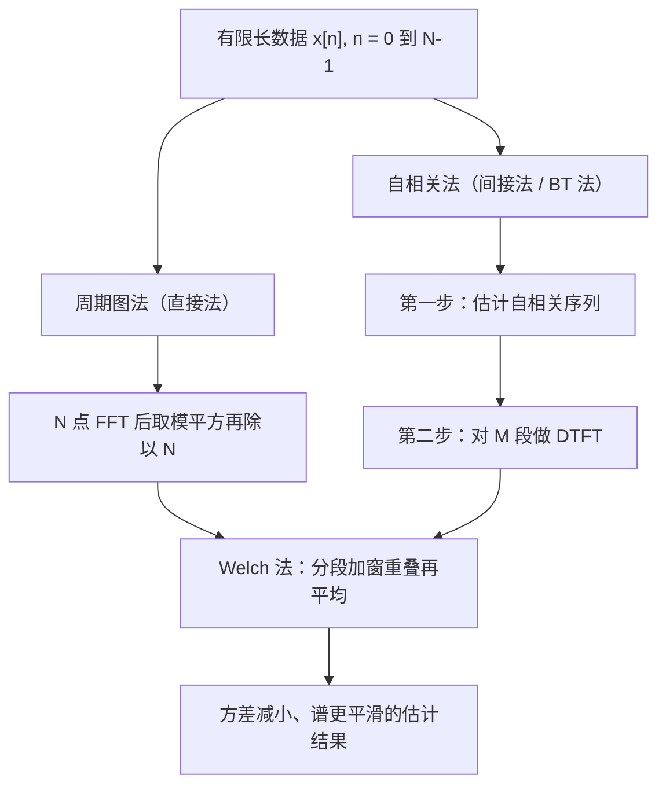

# 功率谱密度

**标签：** #数字信号处理 #DSP #功率谱密度 #PSD #谱估计 #周期图 #Welch

---

## 一、为什么需要功率谱密度？

在前面的学习中我们知道：

- **能量信号**：用傅里叶变换分析频谱（幅度谱、相位谱）
- **功率信号**：傅里叶变换不收敛，无法直接分析频谱

那么，如何描述功率信号的频率特性？

**功率谱密度（PSD）** 就是答案——它描述的是**信号功率在频率上的分布**。

> **与上一节的衔接**：[[【数字信号处理DSP】（五）维纳-辛钦定理（Wiener-Khinchin Theorem）|（五）维纳-辛钦定理]] 讲的是"为什么 PSD 等于自相关的傅里叶变换"（**定理与推导**）；本节讲"PSD 是什么、有哪些性质、工程上怎么算出来"（**定义与实现**）。两节配合看效果最好。

---

## 二、功率谱密度的定义

### 1. 基于维纳-辛钦定理的定义

对于宽平稳随机序列 $x[n]$，其功率谱密度定义为自相关函数的傅里叶变换：

$$
P_{xx}(e^{j\omega}) = \sum_{m=-\infty}^{\infty} r_{xx}[m] e^{-j\omega m}
$$

逆变换：

$$
r_{xx}[m] = \frac{1}{2\pi} \int_{-\pi}^{\pi} P_{xx}(e^{j\omega}) e^{j\omega m} d\omega
$$

### 2. 基于截断信号的定义（等效定义）

将无限长信号截断为长度为 $N$ 的有限段 $x_N[n]$，取其傅里叶变换 $X_N(e^{j\omega})$，则功率谱密度为：

$$
P_{xx}(e^{j\omega}) = \lim_{N \to \infty} \frac{1}{N} E\left[ \lvert X_N(e^{j\omega}) \rvert^2 \right]
$$

两种定义等价，前者理论性强（**间接法**的出发点），后者更贴近实际计算（**直接法**的出发点）。注意 $\frac{1}{N}$ 与取期望 $E[\cdot]$ 二者缺一不可——少了期望，得到的是无论怎么加长数据都不收敛的"周期图"。

---

## 三、功率谱密度的物理意义

> 上图：灰线是白噪声（功率谱平坦，各频率能量相同）；蓝线是一阶系统的功率谱，能量集中在低频（低通特性）。功率谱描述的是“功率随频率怎么分布”。

### 1. 功率的频域分布

$$
\text{信号在 } [\omega, \omega+d\omega] \text{ 内的功率} = \frac{1}{2\pi} P_{xx}(e^{j\omega}) d\omega
$$

### 2. 总平均功率

信号的总平均功率等于功率谱密度曲线下的面积：

$$
P = r_{xx}[0] = \frac{1}{2\pi} \int_{-\pi}^{\pi} P_{xx}(e^{j\omega}) d\omega
$$

### 3. 直观理解

| PSD 形状 | 物理含义 |
|----------|---------|
| 平坦（常数） | 功率在所有频率均匀分布 → 白噪声 |
| 集中在低频 | 信号变化缓慢 → 低通特性 |
| 集中在高频 | 信号剧烈变化 → 高通特性 |
| 出现尖峰 | 含有周期成分 → 正弦信号 |
| 出现谷（陷波） | 该频率被系统抑制 → 存在零点 |

### 4. 双边谱与单边谱

上面的定义在 $\omega \in [-\pi, \pi]$ 上给出**双边谱**。实信号的谱是偶函数（性质 3），负频率部分与正频率部分完全重复，所以工程上常只画 $\omega \in [0, \pi]$，称为**单边谱**：

$$
P_{\text{单边}}(\omega) = 2 P_{xx}(e^{j\omega}), \quad 0 \leq \omega \leq \pi
$$

**乘 2 是为了保住总功率**——把负半轴的能量折到正半轴上来。查资料时务必先确认对方用的是单边还是双边，否则功率会差 2 倍（这在实际测试报告中是常见争议来源）。

---

## 四、功率谱密度的性质

### 性质1：非负性

$$
P_{xx}(e^{j\omega}) \geq 0, \quad \forall \omega
$$

功率谱密度始终为非负实数。

### 性质2：周期性

$$
P_{xx}(e^{j(\omega + 2\pi)}) = P_{xx}(e^{j\omega})
$$

周期为 $2\pi$，这是离散时间信号的固有特性。

### 性质3：对称性（实信号）

对于实信号：

$$
P_{xx}(e^{j\omega}) = P_{xx}(e^{-j\omega})
$$

即功率谱密度是偶函数，只需分析 $[0, \pi]$ 区间。

### 性质4：与幅频特性的关系

若信号通过一个线性时不变系统 $H(e^{j\omega})$，则输出功率谱为：

$$
P_{yy}(e^{j\omega}) = \lvert H(e^{j\omega}) \rvert^2 P_{xx}(e^{j\omega})
$$

**只有幅频特性参与，相位被"平方"掉了**。所以滤波器设计中对噪声的抑制能力，完全由 $\lvert H \rvert$ 的阻带衰减决定。

### 性质5：功率守恒

$$
\frac{1}{2\pi} \int_{-\pi}^{\pi} P_{xx}(e^{j\omega}) d\omega = r_{xx}[0] = E\left[\lvert x[n] \rvert^2\right]
$$

---

## 五、典型例题

### 例题1：白噪声的PSD

白噪声 $w[n]$，均值为零，方差 $\sigma^2$

自相关：$r_{ww}[m] = \sigma^2 \delta[m]$

**解**：

$$
P_{ww}(e^{j\omega}) = \sum_{m=-\infty}^{\infty} \sigma^2 \delta[m] e^{-j\omega m} = \sigma^2
$$

→ 白噪声的PSD为常数 $\sigma^2$，在所有频率上功率均匀分布。

### 例题2：正弦信号的PSD

$x[n] = A \sin(\omega_0 n + \phi)$

自相关：$r_{xx}[m] = \frac{A^2}{2} \cos(\omega_0 m)$

**解**：

$$
P_{xx}(e^{j\omega}) = \frac{\pi A^2}{2} \left[\delta(\omega - \omega_0) + \delta(\omega + \omega_0)\right], \quad -\pi \lt \omega \leq \pi
$$

→ 正弦信号的功率集中在 $\pm\omega_0$ 两个频率点上。

> 冲激强度 $\pi A^2/2$ 的来历见 [[【数字信号处理DSP】（五）维纳-辛钦定理（Wiener-Khinchin Theorem）|（五）维纳-辛钦定理]] 例题 3。要验证它，积分回去看是否得到 $A^2/2$ 即可。

### 例题3：一阶AR过程的PSD

$x[n] = a x[n-1] + w[n]$，$\lvert a \rvert \lt 1$，$w[n]$ 为方差 $\sigma_w^2$ 的白噪声

自相关：$r_{xx}[m] = \frac{\sigma_w^2}{1-a^2} a^{\lvert m \rvert}$

**解**：

$$
P_{xx}(e^{j\omega}) = \frac{\sigma_w^2}{\lvert 1 - a e^{-j\omega} \rvert^2} = \frac{\sigma_w^2}{1 - 2a\cos\omega + a^2}
$$

→ 当 $a \gt 0$ 时，PSD集中在低频；$a \lt 0$ 时，PSD集中在高频。

> **这里的"分母 = 系统函数模的平方"不是巧合**。把差分方程写成 $H(z) = \frac{1}{1-az^{-1}}$，白噪声通过这个系统后输出就是 $x[n]$，于是直接套性质 4：
> $$P_{xx} = \lvert H(e^{j\omega}) \rvert^2 \sigma_w^2 = \frac{\sigma_w^2}{\lvert 1 - ae^{-j\omega} \rvert^2}$$
> **AR 过程的谱 = 白噪声谱 × 系统幅频特性的平方**，这是随机信号建模中最常用的推理方式。

### 例题4：通过系统后的PSD

白噪声 $w[n]$（PSD = $\sigma^2$）通过一个理想低通滤波器 $H(e^{j\omega})$：

$$
H(e^{j\omega}) =
\begin{cases}
1, & \lvert \omega \rvert \lt \omega_c \\
0, & \omega_c \lt \lvert \omega \rvert \leq \pi
\end{cases}
$$

**解**：

$$
P_{yy}(e^{j\omega}) = \lvert H(e^{j\omega}) \rvert^2 \cdot \sigma^2 =
\begin{cases}
\sigma^2, & \lvert \omega \rvert \lt \omega_c \\
0, & \omega_c \lt \lvert \omega \rvert \leq \pi
\end{cases}
$$

输出平均功率：

$$
P_y = \frac{1}{2\pi} \int_{-\omega_c}^{\omega_c} \sigma^2 d\omega = \frac{\sigma^2 \omega_c}{\pi}
$$

**用带宽理解**：白噪声的功率均匀分布在宽度 $2\pi$ 上，理想低通只保留宽度 $2\omega_c$ 的一段，于是输出功率 = 总功率 $\sigma^2$ × 带宽占比 $\frac{2\omega_c}{2\pi} = \frac{\omega_c}{\pi}$。**噪声功率与带宽成正比**，这是所有降噪系统都要"限制带宽"的原因。

---

## 六、PSD vs 频谱 vs 能量谱密度

| 对比项 | 频谱 | 能量谱密度 | 功率谱密度 |
|--------|------|-----------|-----------|
| 适用信号 | 能量信号 | 能量信号 | 功率信号 |
| 定义 | $X(e^{j\omega})$ | $\lvert X(e^{j\omega}) \rvert^2$ | $P_{xx}(e^{j\omega})$ |
| 物理含义 | 幅度和相位 | 能量分布 | 功率分布 |
| 是否保留相位 | 是 | 否 | 否 |
| 是否非负 | 否（可为复/负） | 是 | 是 |
| 周期信号 | 不收敛 | 不收敛 | 可用（含冲激） |
| 单位量纲 | 幅度 | 能量/rad | 功率/rad |

---

## 七、功率谱密度的估计方法（实际应用）

在实际工程中，我们无法获得无限长信号，需要通过有限长数据估计PSD。三类经典方法的关系如下：

### 1. 周期图法（直接法）

$$
\hat{P}_{xx}(e^{j\omega}) = \frac{1}{N} \left\lvert \sum_{n=0}^{N-1} x[n] e^{-j\omega n} \right\rvert^2
$$

优点：计算简单（FFT实现）
缺点：估计方差大，不平滑（**加长数据方差不降**，这是周期图的著名缺陷）

### 2. 自相关法（间接法，BT法）

1. 先估计自相关函数 $\hat{r}_{xx}[m]$
2. 再做傅里叶变换得到PSD

$$
\hat{P}_{xx}(e^{j\omega}) = \sum_{m=-M}^{M} \hat{r}_{xx}[m] e^{-j\omega m}
$$

优点：比周期图法平滑
缺点：分辨率降低（截断到 $\pm M$ 相当于加窗，$M$ 越小越平滑但峰越胖）

### 3. Welch法（改进周期图法）

- 将数据分段，每段加窗（常用汉宁窗）
- 允许段间重叠（典型 50%）
- 对各段周期图取平均

**这是最常用的现代PSD估计方法**。原理很直白：周期图方差大是因为"只测了一次"，把数据切成 $K$ 段得到 $K$ 个独立估计再平均，方差就降到约 $1/K$；代价是每段变短、频率分辨率下降。**平滑度与分辨率之间的权衡，是谱估计永恒的主题。**

---

## 八、应用场景

| 领域 | 应用 |
|------|------|
| 通信 | 分析信道噪声特性、设计调制方案 |
| 语音处理 | 分析语音频谱特征、端点检测 |
| 机械故障诊断 | 检测旋转机械的异常频率成分（轴承故障特征频率） |
| 生物医学 | EEG/ECG信号频域分析（脑电节律、心率变异性） |
| 地震勘探 | 分析地下介质的频率响应 |
| 雷达/声呐 | 目标检测、多普勒频移分析 |
| 音频工程 | 噪声本底测量、扬声器频响测试 |

---

## 九、常见错误提醒

1. **忘记 $\frac{1}{N}$ 或忘记取期望**：少了这两样得到的只是周期图，不是 PSD 的一致估计。
2. **双边谱与单边谱混用**：单边谱 = 双边谱 × 2（$\omega \gt 0$ 部分）。看图时先确认纵轴定义，否则功率差 2 倍。
3. **把 PSD 当作"某个频率上的功率"**：PSD 是**密度**，单位是功率/rad。某频率上的功率只有在它是离散谱线（冲激）时才有确定值，连续谱上只能谈"某带宽内的功率"。
4. **以为数据越长谱越平滑**：周期图的方差与数据长度无关，加长数据只是让谱线更密（分辨率更高），**不会让曲线变平滑**；要平滑必须做平均。
5. **算 PSD 前不去均值**：直流分量会在 $\omega = 0$ 处顶出一个巨大尖峰，把真正的低频谱结构全压扁。**先减均值是最省事的一步**。
6. **加窗后忘记补偿能量**：加窗会降低总功率（汉宁窗约损失一半），需要按窗函数的能量归一化因子补偿，否则幅值读数偏低。
7. **用 $\lvert X \rvert^2$ 分析功率信号**：能量信号才有 $\lvert X \rvert^2$；对周期信号、白噪声直接套用会发散。
8. **把 AR 谱当成"真谱"**：模型谱是拟合出来的，阶数选错会造出虚假峰或抹掉真实峰。

---

## 十、知识链定位

功率谱密度（本节）

│

├── 两种定义：自相关的 DTFT / 截断谱的极限平均

├── 性质：非负、周期 2π、实信号偶对称、总功率守恒

└── 三条性质链：Pyy = |H|²·Pxx（滤波）、∫Pxx = 功率（能量守恒）

│

├── 能量信号与功率信号：谱的适用对象（第三节）

├── 自相关函数：PSD 的时域来源（第四节）

├── 维纳-辛钦定理：PSD 的定义依据与推导（第五节）

├── 卷积和：系统对随机信号的作用（第七节）

├── 模拟频率与数字频率：谱轴换算（第十节）

└── 系统函数 H(z)：由 H 直接写出输出谱（后续章节）

---

## 十一、快速记忆

| 要点 | 内容 |
|------|------|
| 定义 | 自相关的傅里叶变换 |
| 物理意义 | 功率在频率上的分布（密度） |
| 非负性 | $P_{xx}(e^{j\omega}) \geq 0$ |
| 周期性 | 周期 $2\pi$ |
| 对称性 | 实信号为偶函数 |
| 总功率 | $\frac{1}{2\pi} \int P_{xx} d\omega = r_{xx}[0]$ |
| 通过系统 | $P_{yy} = \lvert H(e^{j\omega}) \rvert^2 P_{xx}$ |
| 白噪声 | $P_{xx} = \sigma^2$（常数） |
| 正弦信号 | 在 $\pm\omega_0$ 处出现冲激 |
| 估计方法 | 周期图 → BT 法 → Welch 法（越来越平滑） |

> **一句话总结**：功率谱密度是功率信号在频域的"身份证"，它告诉我们信号功率在不同频率上是如何分配的——它是随机信号分析和滤波系统设计的核心工具，而它的估计永远在"平滑度"与"分辨率"之间做取舍。
