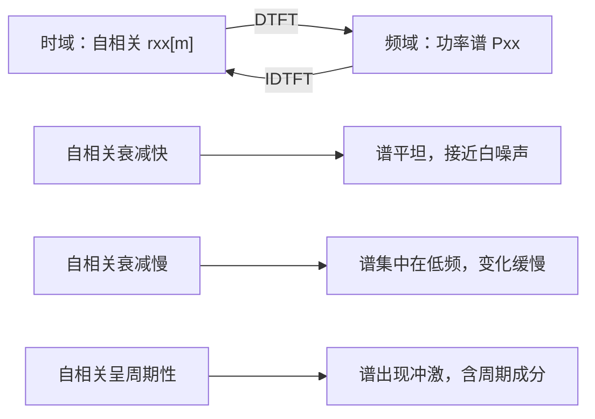

# 维纳-辛钦定理（Wiener-Khinchin Theorem）

**标签：** #数字信号处理 #DSP #维纳辛钦 #功率谱密度 #自相关 #随机信号

---

## 一、为什么需要维纳-辛钦定理？

在之前的文章中我们学过：

- **能量信号**：可以做傅里叶变换（DTFT）分析频谱
- **功率信号**（周期序列、阶跃、白噪声）：能量无限，傅里叶变换不收敛

那么，功率信号的频率特性该如何分析？

答案是：不看频谱，看**功率谱密度（PSD）**。
而维纳-辛钦定理告诉我们：

> **功率谱密度 = 自相关函数的傅里叶变换**

这条定理的价值在于：**它把"求频谱"这件做不到的事，转化成了"求自相关"这件做得到的事**。自相关是一个时域的平均量，只要数据够长就能估计出来，不需要信号绝对可和。

更完整的背景见 [[【数字信号处理DSP】（四）自相关函数与互相关函数|（四）自相关函数与互相关函数]]；PSD 的定义、性质与工程估计方法见 [[【数字信号处理DSP】（五）功率谱密度|（五）功率谱密度]]。

---

## 二、定理内容

> 上图：上为某实序列的自相关 $r_{xx}[m]$（偶对称、$m=0$ 处最大 $=4.25$）；下为对它做 DTFT 得到的功率谱 $P_{xx}(e^{j\omega})$（偶函数、低频集中）。红虚线标出 $r_{xx}[0]$——**谱曲线在 $[-\pi,\pi]$ 上的平均值恰好等于它**，这就是"总功率守恒"的几何含义。

### 1. 连续时间形式

设 $x(t)$ 是宽平稳随机过程，自相关函数为 $R_x(\tau)$，则功率谱密度为：

$$
S_x(f) = \int_{-\infty}^{\infty} R_x(\tau) e^{-j2\pi f \tau} d\tau
$$

逆变换：

$$
R_x(\tau) = \int_{-\infty}^{\infty} S_x(f) e^{j2\pi f \tau} df
$$

### 2. 离散时间形式（DSP 重点）

设 $x[n]$ 是宽平稳离散随机序列，自相关函数为 $r_{xx}[m]$，则功率谱密度为：

$$
P_{xx}(e^{j\omega}) = \sum_{m=-\infty}^{\infty} r_{xx}[m] e^{-j\omega m}
$$

逆变换（IDTFT）：

$$
r_{xx}[m] = \frac{1}{2\pi} \int_{-\pi}^{\pi} P_{xx}(e^{j\omega}) e^{j\omega m} d\omega
$$

### 3. 用角频率 $\Omega$ 表示（另一种常见形式）

$$
S_{xx}(e^{j\Omega}) = \sum_{m=-\infty}^{\infty} r_{xx}[m] e^{-j\Omega m}
$$

$$
r_{xx}[m] = \frac{1}{2\pi} \int_{-\pi}^{\pi} S_{xx}(e^{j\Omega}) e^{j\Omega m} d\Omega
$$

两种形式等价，$\omega$ 和 $\Omega$ 都表示数字角频率（见 [[【数字信号处理DSP】（十）模拟频率与数字频率的关系|（十）模拟频率与数字频率的关系]]）。

---

## 三、定理为什么成立（推导思路）

不用背，两行就能想通。先从**能量信号**下手。

若 $x[n]$ 能量有限，定义自相关 $r_{xx}[m] = \sum_n x[n]x^*[n-m]$，直接对它做 DTFT：

$$
\sum_m r_{xx}[m] e^{-j\omega m}
= \sum_m \sum_n x[n] x^*[n-m] e^{-j\omega m}
\overset{k=n-m}{=} \sum_n x[n] e^{-j\omega n} \sum_k x^*[k] e^{j\omega k}
$$

第二个因子是 $X^*(e^{j\omega})$（因为 $x^*[k] e^{j\omega k} = \left(x[k]e^{-j\omega k}\right)^*$），于是

$$
\boxed{\ \mathcal{F}\{r_{xx}[m]\} = X(e^{j\omega}) \, X^*(e^{j\omega}) = \lvert X(e^{j\omega}) \rvert^2\ }
$$

**能量信号的自相关谱恰好是能量谱密度**——这就是维纳-辛钦定理的"能量版"，也叫自相关定理。

对**功率信号**，能量无限，$\lvert X \rvert^2$ 发散，于是改用**平均**：把信号截断成长度 $N$ 的一段，对其自相关除以 $N$，再令 $N \to \infty$。取极限后得到的就是功率谱密度。所以：

| 信号类型 | 自相关的 DTFT | 名称 |
| --- | --- | --- |
| 能量信号 | $\lvert X(e^{j\omega}) \rvert^2$ | 能量谱密度 |
| 功率信号 | $\lim\limits_{N\to\infty}\frac{1}{N}\lvert X_N(e^{j\omega}) \rvert^2$ | 功率谱密度 |

**同一把尺子，只差一个归一化。**

---

## 四、定理的物理意义

| 时域 | 频域 | 含义 |
|------|------|------|
| $r_{xx}[0]$ | $\frac{1}{2\pi}\int_{-\pi}^{\pi} P_{xx}(e^{j\omega}) d\omega$ | 信号的平均功率 |
| $r_{xx}[m]$ 衰减快 | $P_{xx}(e^{j\omega})$ 平坦 | 信号接近白噪声 |
| $r_{xx}[m]$ 衰减慢 | $P_{xx}(e^{j\omega})$ 集中在低频 | 信号变化缓慢 |
| $r_{xx}[m]$ 呈周期性 | $P_{xx}(e^{j\omega})$ 出现冲激 | 信号含有周期成分 |

这张表体现了傅里叶变换的**对偶性**：时域越"集中/尖锐"，频域越"分散/平坦"；时域越"缓慢/持续"，频域越"集中"。

---

## 五、重要性质

### 性质1：功率谱密度是实的、非负的

$$
P_{xx}(e^{j\omega}) \geq 0, \quad \forall \omega
$$

推导：$P_{xx}$ 是**共轭偶对称**序列 $r_{xx}[-m] = r_{xx}^*[m]$ 的 DTFT，实部是偶函数、虚部是奇函数；再结合能量/功率的归一化定义，虚部与负值都被排除，最终只剩非负实数。**"非负"是功率谱区别于一般频谱的关键特征**——它的物理含义是"功率密度"，而功率不可能为负。

### 性质2：功率谱密度是周期的

$$
P_{xx}(e^{j(\omega + 2\pi)}) = P_{xx}(e^{j\omega})
$$

周期为 $2\pi$，这是离散时间信号的固有特性。工程上只需要看 $\omega \in [-\pi, \pi]$（或 $[0, 2\pi]$）这一段。

### 性质3：总平均功率

信号的平均功率等于功率谱密度在一个周期内的积分平均值：

$$
P = r_{xx}[0] = \frac{1}{2\pi} \int_{-\pi}^{\pi} P_{xx}(e^{j\omega}) d\omega
$$

这是**时域求平均功率**与**频域求面积**的等价表述，也是"功率守恒"的具体形式。

### 性质4：对称性

对于实信号：

$$
P_{xx}(e^{j\omega}) = P_{xx}(e^{-j\omega})
$$

即功率谱密度是偶函数，只需要分析 $[0, \pi]$ 区间。

### 性质5：线性系统输出功率谱

若宽平稳信号通过线性时不变系统 $H(e^{j\omega})$，则输出功率谱为：

$$
P_{yy}(e^{j\omega}) = \lvert H(e^{j\omega}) \rvert^2 \, P_{xx}(e^{j\omega})
$$

**这里只出现幅频特性，不出现相位**——因为功率谱本身不含相位信息。工程上做滤波器对噪声的抑制能力分析，全部依赖这个公式。

### 性质6：互功率谱（定理的"双通道"版本）

定理不只对自相关成立。对两个联合平稳序列，**互相关函数的 DTFT 就是互功率谱**：

$$
P_{xy}(e^{j\omega}) = \sum_{m=-\infty}^{\infty} r_{xy}[m] e^{-j\omega m}
$$

它建立了输入输出的频域关系：

$$
P_{yx}(e^{j\omega}) = H(e^{j\omega})\,P_{xx}(e^{j\omega})
$$

> **性质 5 与性质 6 的关系**：性质 6 是"更根本"的那条，性质 5 由它推出——
> $P_{yy} = H\cdot P_{yx} = H\cdot H^*\cdot P_{xx} = \lvert H\rvert^2 P_{xx}$。
>
> **差别在于相位**：$P_{yy}$ 丢了相位，$P_{yx}$ 保留了 $H$ 的相位。所以想辨识系统的**相位**（或全零点结构），必须用互功率谱，光看输出自谱是不够的。

---

## 六、典型例题

> **统一答题格式**：写自相关 → 代 DTFT 定义式 → 拆成可求和的几何级数 / 认出冲激对 → 化简 → **用 $\frac{1}{2\pi}\int P\,d\omega=r_{xx}[0]$ 检验**。
> 「积分回原值」这一步几乎是所有 PSD 题的通用验算手段，务必写。

### 例题 1：白噪声的功率谱

**题目**：$r_{xx}[m] = \sigma^2\delta[m]$，求 $P_{xx}(e^{j\omega})$。

**解**：

（1）**代定义式**：

$$
P_{xx}(e^{j\omega}) = \sum_{m=-\infty}^{\infty} \sigma^2 \delta[m]\, e^{-j\omega m}
$$

（2）**定非零项**：$\delta[m]$ 只在 $m=0$ 为 $1$，且 $e^{-j\omega\cdot 0}=1$：

$$
\boxed{P_{xx}(e^{j\omega}) = \sigma^2 \quad(\text{与 } \omega \text{ 无关})}
$$

**检验**：$\frac{1}{2\pi}\int_{-\pi}^{\pi}\sigma^2d\omega=\sigma^2=r_{xx}[0]$ ✓；非负 ✓；偶对称 ✓

→ **时域是冲激、频域是常数**，正是第四节对偶性的最典型例子。

---

### 例题 2：一阶 AR 过程（$a^{\lvert m\rvert}$ 型自相关）

**题目**：$r_{xx}[m] = \sigma^2 a^{\lvert m\rvert}$，$\lvert a\rvert<1$。求 $P_{xx}(e^{j\omega})$。

**解**：

（1）**代定义式并利用偶对称**（$a^{\lvert m\rvert}$ 是偶函数，把 $m=0$ 与 $m\ge1$ 分开）：

$$
P_{xx}(e^{j\omega}) = \sigma^2\left(\sum_{m=0}^{\infty}a^m e^{-j\omega m} + \sum_{m=1}^{\infty}a^m e^{j\omega m}\right)
$$

（2）**两个几何级数**（公比分别为 $ae^{-j\omega}$、$ae^{j\omega}$，因 $\lvert a\rvert<1$ 均收敛）：

$$
\sum_{m=0}^{\infty}\left(ae^{-j\omega}\right)^m = \frac{1}{1-ae^{-j\omega}},\qquad
\sum_{m=1}^{\infty}\left(ae^{j\omega}\right)^m = \frac{ae^{j\omega}}{1-ae^{j\omega}}
$$

（3）**通分**（公共分母 $(1-ae^{-j\omega})(1-ae^{j\omega})=1-2a\cos\omega+a^2$）：

$$
P_{xx}(e^{j\omega}) = \sigma^2\cdot\frac{(1-ae^{j\omega})+ae^{j\omega}(1-ae^{-j\omega})}{1-2a\cos\omega+a^2}
= \sigma^2\cdot\frac{1-a^2}{1-2a\cos\omega+a^2}
$$

$$
\boxed{P_{xx}(e^{j\omega}) = \frac{\sigma^2(1-a^2)}{1-2a\cos\omega+a^2}}
$$

（4）**积分验证**（用标准积分 $\frac{1}{2\pi}\int_{-\pi}^{\pi}\frac{d\omega}{1-2a\cos\omega+a^2}=\frac{1}{1-a^2}$）：

$$
\frac{1}{2\pi}\int_{-\pi}^{\pi}P_{xx}\,d\omega = \sigma^2(1-a^2)\cdot\frac{1}{1-a^2} = \sigma^2 = r_{xx}[0]\ \checkmark
$$

**检验**：$a=0$ 时 $P_{xx}=\sigma^2$（退化为白噪声）✓；$a\to1$ 时分母在 $\omega=0$ 趋于 $0$、谱峰越来越尖 ✓

> **⚠️ 符号陷阱（本题最易错的地方）**：这里的 $\sigma^2$ 是**序列 $x$ 的方差**，也就是 $r_{xx}[0]$。若你的题目给的是**驱动白噪声**的方差 $\sigma_w^2$，则 $r_{xx}[0]=\dfrac{\sigma_w^2}{1-a^2}$，于是
>
> $$
> P_{xx}(e^{j\omega}) = \frac{\sigma_w^2}{1-2a\cos\omega+a^2}
> $$
>
> 两式只差分子里的 $(1-a^2)$。**看到 AR 谱先确认"σ² 是谁的"，否则整题功率差 $1/(1-a^2)$ 倍。**

→ 当 $a>0$ 时，分母在 $\omega = 0$ 处最小，功率集中在低频；当 $a<0$ 时，分母在 $\omega = \pi$ 处最小，功率集中在高频。**参数 $a$ 的符号决定"低通还是高通"**。

---

### 例题 3：正弦信号的功率谱（冲激强度 $\pi A^2/2$ 的来历）

**题目**：$x[n] = A\sin(\omega_0 n + \phi)$，$0<\omega_0<\pi$。已知 $r_{xx}[m]=\frac{A^2}{2}\cos(\omega_0 m)$，求 $P_{xx}(e^{j\omega})$。

**解**：

（1）**把余弦写成复指数**：

$$
r_{xx}[m] = \frac{A^2}{4}\left( e^{j\omega_0 m} + e^{-j\omega_0 m} \right)
$$

（2）**关键变换对**（周期为 $2\pi$ 的冲激串）：

$$
\sum_{m=-\infty}^{\infty} e^{j\omega_0 m} e^{-j\omega m} = 2\pi \sum_{k=-\infty}^{\infty} \delta(\omega - \omega_0 - 2\pi k)
$$

（3）**限制到一个周期**：在 $-\pi\lt\omega\le\pi$ 内，$e^{j\omega_0m}$ 的冲激串只留下 $k=0$ 一项（$\omega_0\in(0,\pi)$）；同理 $e^{-j\omega_0m}$ 只留下 $\omega=-\omega_0$。

$$
P_{xx}(e^{j\omega}) = \frac{A^2}{4}\Big[2\pi\delta(\omega-\omega_0)+2\pi\delta(\omega+\omega_0)\Big]
$$

$$
\boxed{P_{xx}(e^{j\omega}) = \frac{\pi A^2}{2}\Big[\delta(\omega-\omega_0)+\delta(\omega+\omega_0)\Big],\quad -\pi\lt\omega\le\pi}
$$

（4）**强度验证**（两条冲激都算进积分）：

$$
\frac{1}{2\pi}\left(\frac{\pi A^2}{2}+\frac{\pi A^2}{2}\right) = \frac{A^2}{2} = r_{xx}[0]\ \checkmark
$$

**检验**：$A^2/2$ 正是 $\sin$ 的平均功率（见 [[【数字信号处理DSP】（三）能量信号和功率信号|（三）能量信号和功率信号]]）✓；结果与初相 $\phi$ 无关，印证"功率谱不含相位信息" ✓

**两个必须记住的要点**：

1. **每个冲激的强度是 $\pi A^2/2$，不是 $A^2/2$**。$A^2/2$ 是**积分后的功率**，两者差一个 $2\pi$ 归一化。
2. **那个 $2\pi$ 来自反变换里的 $\frac{1}{2\pi}$**。丢掉它功率就差 $2\pi$ 倍。

---

### 例题 4：周期信号的功率谱

**题目**：$x[n]$ 是周期为 $N$ 的周期序列，傅里叶级数 $x[n]=\sum_k c_k e^{j2\pi kn/N}$。求 $P_{xx}(e^{j\omega})$。

**解**：

（1）**自相关的性质**：周期序列的自相关也是同周期 $N$ 的周期序列（见（四）性质 3），可用平均相关求其一个周期的值。

（2）**把自相关写成级数**：周期序列的 DTFT 必为冲激串，冲激位置只能在 $\omega_k=\frac{2\pi k}{N}$（$k=0,1,\dots,N-1$）。

（3）**定强度**：每个冲激的强度由该谐波的功率决定。由傅里叶级数的功率关系（帕塞瓦尔），第 $k$ 次谐波的平均功率是 $\lvert c_k\rvert^2$，于是

$$
\boxed{P_{xx}(e^{j\omega}) = 2\pi\sum_{k}\lvert c_k \rvert^2\,\delta\!\left(\omega-\frac{2\pi k}{N}\right)}
$$

（4）**守恒验证**：

$$
\frac{1}{2\pi}\int_{-\pi}^{\pi}P_{xx}\,d\omega = \sum_k \lvert c_k \rvert^2 = \frac{1}{N}\sum_{n=0}^{N-1}\lvert x[n]\rvert^2 = r_{xx}[0]\ \checkmark
$$

**检验**：代入例题 3 的结果反查——正弦只有一个非零谐波，$c_{\pm1}$ 给出 $\lvert c\rvert^2=A^2/4$，两条合计 $A^2/2$ ✓ 与例题 3 的积分结果完全一致。

→ **第 $k$ 次谐波的功率就是 $\lvert c_k \rvert^2$**，$N$ 条谱线把总功率分完。这就是用 FFT 做谱分析时"谱线高度代表该频率分量功率"的依据。

---

### 例题 5：手算一道完整流程（$0.5^{\lvert m\rvert}$）

**题目**：已知 $r_{xx}[m]=0.5^{\lvert m\rvert}$，求 $P_{xx}(e^{j\omega})$，并求 $\omega=0$ 与 $\omega=\pi$ 处的值。

**解**：

（1）**认出这是例题 2 的形式**（$\sigma^2=1$、$a=0.5$），直接套公式：

$$
P_{xx}(e^{j\omega}) = \frac{1\cdot(1-0.5^2)}{1-2(0.5)\cos\omega+0.5^2} = \frac{0.75}{1.25-\cos\omega}
$$

$$
\boxed{P_{xx}(e^{j\omega}) = \frac{0.75}{1.25-\cos\omega}}
$$

（2）**算两个端点**：

| $\omega$ | $\cos\omega$ | $P_{xx}$ |
|---|---|---|
| $0$ | $1$ | $\dfrac{0.75}{0.25}=3$ |
| $\pm\pi$ | $-1$ | $\dfrac{0.75}{2.25}=\dfrac{1}{3}$ |

（3）**积分验证**（标准积分 $\frac{1}{2\pi}\int_{-\pi}^{\pi}\frac{d\omega}{b-\cos\omega}=\frac{1}{\sqrt{b^2-1}}$，$b=1.25$）：

$$
\frac{1}{2\pi}\int_{-\pi}^{\pi}\frac{0.75}{1.25-\cos\omega}d\omega
= 0.75\cdot\frac{1}{\sqrt{1.25^2-1}} = 0.75\cdot\frac{1}{0.75} = 1 = r_{xx}[0]\ \checkmark
$$

**检验**：谱值全部为正（$0.75/(1.25-\cos\omega)$ 分母在 $[0.25,2.25]$ 恒正）✓ 满足非负性；$\omega=0$ 处比 $\omega=\pi$ 处大 $9$ 倍，确实是低频集中 ✓

→ 这道题的两个数（$3$ 与 $1/3$）值得记住：**$a=0.5$ 的 AR(1) 谱在直流处的密度是 Nyquist 处的 9 倍**，是个很好的"低通有多强"的直觉标尺。

---

### 例题 6：系统辨识（白噪声激励 → 直接读出冲激响应）

**题目**：$x[n]$ 为零均值白噪声，方差 $\sigma_x^2$；$y[n]$ 是 $x[n]$ 通过 LSI 系统 $h[n]$ 的输出。证明 $\mathbb{E}[y[n]x[n-m]]=\sigma_x^2 h[m]$，并给出用互谱求 $H(e^{j\omega})$ 的方法。

**解**：

（1）**写出输出**（卷积和）：

$$
y[n] = \sum_{k}h[k]\,x[n-k]
$$

（2）**代互相关定义**（按（四）的顺序约定，$y$ 在前）：

$$
r_{yx}[m] = \mathbb{E}\big[y[n]x[n-m]\big] = \sum_k h[k]\,\mathbb{E}\big[x[n-k]x[n-m]\big]
$$

（3）**用白噪声性质收掉期望**：$\mathbb{E}[x[n-k]x[n-m]]=\sigma_x^2\delta[k-m]$，求和只剩 $k=m$：

$$
\boxed{r_{yx}[m] = \sigma_x^2\, h[m] \quad\Longrightarrow\quad h[m] = \frac{r_{yx}[m]}{\sigma_x^2}}
$$

（4）**转到频域**：两边做 DTFT，用性质 6：

$$
P_{yx}(e^{j\omega}) = \sigma_x^2 H(e^{j\omega})
\quad\Longrightarrow\quad
\boxed{H(e^{j\omega}) = \frac{P_{yx}(e^{j\omega})}{\sigma_x^2}}
$$

**检验**（取最简系统）：$h[n]=\delta[n]$（直通），则 $y=x$，$r_{yx}[m]=\sigma_x^2\delta[m]$，代入公式得 $h[m]=\delta[m]$ ✓

> **顺序不能反**：若写成 $r_{xy}[m]$，按（四）的定义得到的是 $\sigma_x^2h[-m]$，读出的是**时间反转的**冲激响应。这类"顺序反了就能量守恒但相位全错"的坑，在系统辨识里非常常见。
>
> **工程意义**：这就是**白噪声是"最好的测试信号"**的原因——它和系统的每个延迟都只"对一下就过"，互相关直接给出冲激响应，无需解卷积。房间声学测量、扬声器测量都用这个原理。

---

## 七、维纳-辛钦定理的使用条件

| 条件 | 说明 |
|------|------|
| 宽平稳 | 均值为常数，自相关函数只与延迟 $m$ 有关、与时间起点无关 |
| 二阶矩有限 | $r_{xx}[0] = E[\lvert x[n] \rvert^2] \lt \infty$，即平均功率有限 |
| 自相关绝对可和 | $\sum_m \lvert r_{xx}[m] \rvert \lt \infty$ 时，$P_{xx}(e^{j\omega})$ 是**连续的普通函数** |

> **条件 3 不满足时定理仍然成立，只是结果含冲激**。周期分量的自相关不衰减，求和发散，此时要用**广义傅里叶变换**（允许 $\delta$ 函数出现在谱里），这正是例题 3、4 处理的情形。
>
> 所以准确的表述是：**维纳-辛钦定理对宽平稳、有限平均功率的信号普遍成立；自相关绝对可和只是"谱不含冲激"的充分条件，不是定理成立的必要条件。**

---

## 八、维纳-辛钦定理的应用

1. **功率谱估计**：通过估计自相关函数，再求傅里叶变换得到功率谱（间接法/BT 法）
2. **信号检测**：在噪声中检测周期信号（功率谱中出现尖峰）
3. **系统分析**：输入输出功率谱关系 $P_{yy} = \lvert H \rvert^2 P_{xx}$，用于滤波器噪声抑制分析
4. **系统辨识**：白噪声激励下，输入输出互相关正比于冲激响应（例题 6）
5. **随机信号处理**：分析噪声特性、设计最优滤波器（维纳滤波器的出发点就是这条定理）

---

## 九、常见错误提醒

1. **把功率谱当频谱用**：频谱 $X(e^{j\omega})$ 保留幅度和相位、可以有负值；功率谱 $P_{xx}$ 只有幅度信息、恒非负。二者不可互换。
2. **忘记除以 $2\pi$**：「积分求总功率」时，$P = r_{xx}[0] = \frac{1}{2\pi}\int P_{xx} d\omega$，这个 $\frac{1}{2\pi}$ 常被漏掉，结果会差 $2\pi$ 倍。
3. **正弦冲激强度写错**：每个冲激的强度是 $\pi A^2/2$，不是 $A^2/2$。$A^2/2$ 是**积分后的功率**。
4. **AR 谱里 $\sigma^2$ 是谁的没搞清**：$\sigma^2$ 若是 $x$ 的方差，分子带 $(1-a^2)$；若是驱动白噪声方差 $\sigma_w^2$，分子不带。差 $1/(1-a^2)$ 倍。
5. **对周期信号用"自相关绝对可和"的条件**：周期信号的自相关是周期的，绝对可和条件不满足，但定理依然成立（谱中含冲激），不要因此认为"定理不适用"。
6. **混淆能量谱与功率谱**：能量信号用 $\lvert X \rvert^2$；功率信号用 $P_{xx}$。量纲不同（一个是能量/rad，一个是功率/rad）。
7. **忽略去均值**：含直流分量的信号，自相关里含常数项 $\bar{x}^2$，会在 $\omega = 0$ 处产生虚假冲激。
8. **以为 PSD 一定连续**：只有自相关绝对可和时才是连续函数；含周期分量时必定出现冲激。
9. **系统辨识里互相关顺序反了**：$r_{yx}$ 给出 $h[m]$，$r_{xy}$ 给出 $h[-m]$。顺序一错，幅频对但相位全错。
10. **以为互谱没用**：输出自谱 $P_{yy}$ 丢了相位，只有互谱 $P_{yx}$ 保留 $H$ 的相位。辨识相位必须用互谱。

---

## 十、知识链定位

维纳-辛钦定理（本节）

│

├── 定理：Pxx(e^jω) = DTFT{rxx[m]}

├── 推导：能量信号 rxx 的 DTFT = |X(e^jω)|²（自相关定理）

├── 延拓：功率信号取截断平均的极限

├── 互谱版：Pyx = H · Pxx（保留相位）

└── 适用：宽平稳 + 有限平均功率（含冲激也能用）

│

├── 能量信号与功率信号：先分类才能选工具（第三节）

├── 自相关函数：定理的输入（第四节）

├── 功率谱密度：定理的工程落地与估计（第五节）

├── 模拟频率与数字频率：ω 与 f 的换算（第十节）

└── Z 变换与收敛域：把 DTFT 推广到复频域（第十三节）

---

## 十一、快速记忆

| 要点 | 内容 |
|------|------|
| 核心思想 | 自相关的傅里叶变换 = 功率谱密度 |
| 正变换 | $P_{xx}(e^{j\omega}) = \sum_m r_{xx}[m] e^{-j\omega m}$ |
| 逆变换 | $r_{xx}[m] = \frac{1}{2\pi} \int_{-\pi}^{\pi} P_{xx}(e^{j\omega}) e^{j\omega m} d\omega$ |
| 零点关系 | $r_{xx}[0] =$ 平均功率 $= \frac{1}{2\pi}\int P_{xx} d\omega$ |
| 能量版对照 | 能量信号：$\mathcal{F}\{r_{xx}\} = \lvert X(e^{j\omega}) \rvert^2$ |
| 互谱版 | $P_{yx} = H\,P_{xx}$（保留相位） |
| 适用对象 | 宽平稳随机过程 / 功率信号 |
| 白噪声特例 | $P_{xx} = \sigma^2$（常数） |
| 正弦特例 | 在 $\pm\omega_0$ 处两条冲激，强度 $\pi A^2/2$ |
| 通用验算法 | 积分回 $r_{xx}[0]$ |

> **一句话总结**：维纳-辛钦定理把"功率信号的频谱分析"从不可能变成了可能——只要算出自相关再做 DTFT，就得到了功率谱密度；它是自相关（第四节）与功率谱（第五节）之间的那座桥。
