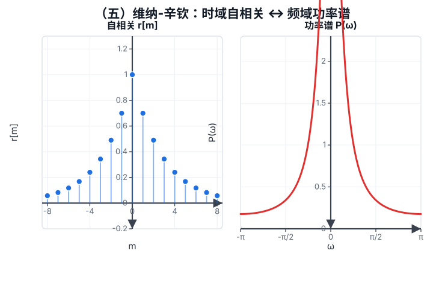
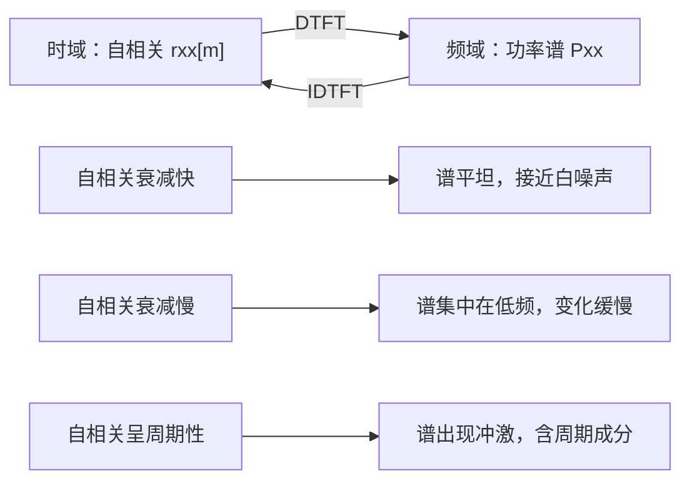

# 维纳-辛钦定理与帕塞瓦尔定理

**标签：** #数字信号处理 #DSP #维纳辛钦 #帕塞瓦尔定理 #功率谱密度 #能量谱密度 #自相关 #随机信号

---

## 本篇的位置

**这一篇补的空洞。** （五）把 $P_{xx}=\sum_m r_{xx}[m]e^{-j\omega m}$ 当定义写下去了，没回答"凭什么"。这不是形式上的追问：如果这个等式不成立，整条"先估自相关、再做变换"的工程路线（BT 法、Welch 的自相关变体、白噪声激励下的系统辨识）就全部失去依据。（四）留下的洞则是自相关只被当相似度用，从未被赋予频域含义。这一篇把两者焊在一起，顺手补上守恒律的另一半。

**和前后篇的接口。** 上游是（四）的自相关定义与（五）的两张谱定义，第二节只是把（五）第二节重述一遍再加证明。下游是（七）卷积和——$P_{yy}=\lvert H\rvert^{2}P_{xx}$ 要靠 $r_{yy}=r_{hh}*r_{xx}$ 推出来，那一步的合法性全在定理里；（十四）DTFT 的周期性与共轭对称，也在这里第一次露面。

**本篇保留的简化。** 定理成立只需要两条：宽平稳、平均功率有限（第八节）。文中推导额外用了实系数与二阶矩存在；"自相关绝对可和"只是谱不含冲激的充分条件，不是定理成立的必要条件。这条最容易读错，第八节专门澄清一次。

**没出现的东西。** 谱估计的具体算法（周期图、Welch 都在（五）第七节）、谱的置信区间、非平稳信号的时频分析。前两个属于估计问题，第三个要等短时傅里叶变换，本篇只用"有限段内可近似平稳"一句话带过。

**读完能做什么。** 给定 $r_{xx}[m]$ 能写出 $P_{xx}$ 并用积分回 $r_{xx}[0]$ 验算；能一句话说清帕塞瓦尔为什么只是维纳-辛钦取 $m=0$；能判断"周期信号不满足绝对可和所以定理不适用"这类说法错在哪。

---

## 本篇要点

1. 推导只有一步换元：把 $\sum_m\sum_n x[n]x^{*}[n-m]e^{-j\omega m}$ 里的 $m$ 换成 $n-k$，两个求和就解耦成 $X\cdot X^{*}$。
2. 帕塞瓦尔不是另一条定理，是维纳-辛钦取 $m=0$。那一步 $e^{j\omega\cdot0}=1$，整条谱只剩面积。
3. 四种形态的分母跟着基的模长平方走：连续 $2\pi$、离散 $2\pi$、DFT $N$、傅里叶级数 $1$。
4. 自相关绝对可和只保证谱连续。周期分量的自相关不衰减，谱照样存在，只是变成冲激串。

---

## 一、定理要解决的问题：功率信号没有频谱

在之前的文章中我们学过：

- **能量信号**：可以做傅里叶变换（DTFT）分析频谱
- **功率信号**（周期序列、阶跃、白噪声）：能量无限，傅里叶变换不收敛

那么，功率信号的频率特性该如何分析？

答案是：不看频谱，看**功率谱密度（PSD）**。
而维纳-辛钦定理告诉我们：

> **功率谱密度 = 自相关函数的傅里叶变换**

这条定理的价值在于：**它把"求频谱"这件做不到的事，转化成了"求自相关"这件做得到的事**。自相关是一个时域的平均量，只要数据够长就能估计出来，不需要信号绝对可和。

更完整的背景见 [[【数字信号处理DSP】（四）自相关函数与互相关函数|（四）自相关函数与互相关函数]]；能量谱、功率谱的定义、性质与工程估计方法见 [[【数字信号处理DSP】（五）能量谱密度与功率谱密度|（五）能量谱密度与功率谱密度]]。

本章还补上守恒律的另一半：**帕塞瓦尔定理**（第五节）。它和维纳-辛钦其实是同一件事的两个粒度——维纳-辛钦说"谱密度 = 自相关的 DTFT"（整条曲线对整条曲线），令 $m=0$ 就退化成"时域总和 = 频域积分"，那正是帕塞瓦尔。**一个讲整条曲线上每一点，一个只讲 $m=0$ 那一点。**

---

## 二、定理内容

> 上图：上为某实序列的自相关 $r_{xx}[m]$（偶对称、$m=0$ 处最大 $=4.25$）；下为对它做 DTFT 得到的功率谱 $P_{xx}(e^{j\omega})$（偶函数、低频集中）。红虚线标出 $r_{xx}[0]$——**谱曲线在 $[-\pi,\pi]$ 上的平均值恰好等于它**，这就是"总功率守恒"的几何含义。

点开看：这张图的三层信息怎么读

**① 上图是自相关 $r_{xx}[m]$，不是原信号**

横轴是延迟 $m$，绿杆表示"信号与自身延迟 $m$ 个采样后的相似度"。$m=0$ 是自己跟自己比，值最大，$r_{xx}[0]=4.25$。

从上图**左右对着看**，会发现两边完全镜像：$m=+1$ 和 $m=-1$ 的杆一样高（都是 $3.40$），$m=+2$ 和 $m=-2$ 也一样（都是 $1.90$），一直到 $\pm5$ 都是 $0$。

这不是巧合。算 $r[m]$ 是"原信号和**右移** $m$ 格的自己相乘再求和"，算 $r[-m]$ 是"和**左移** $m$ 格的自己相乘再求和"——两次参与相乘的，都是同一对采样点，乘积自然完全相同。所以任何实信号的自相关都满足

$$
r_{xx}[-m]=r_{xx}[m]
$$

数学上这叫**偶函数**，也就是图形关于纵轴 $m=0$ 左右对称——上图标题里那个"偶函数"就是这个意思。

**先分清三根横轴**，这是这张图最容易绕晕的地方：

- 原信号 $x[n]$：横轴是**采样序号** $n=0,1,\dots,5$（共 6 个点）——**这张图没有画它**，它只出现在（四）那张图的左栏里；
- 自相关 $r_{xx}[m]$：横轴是**延迟** $m=-5,\dots,0,\dots,5$（共 11 个点）——上图就是它；
- 功率谱 $P_{xx}(e^{j\omega})$：横轴是**数字频率** $\omega$，从 $-\pi$ 到 $\pi$——下图就是它。

所以上图的横轴**不是** $0\sim5$，是 $-5\sim+5$，零点在正中间（峰的位置）。

**11 根杆是这么来的**：自相关是两个序列逐点相乘再滑动累加。原信号长度 $L=6$，它和自身相对滑动时，能重叠的位置一共 $L+L-1=11$ 个（不错开、错开 1 格、……最多错开 5 格，左右各数一遍），所以支撑恰好 11 个点；到了 $m=\pm5$ 只剩一个采样点重叠，值必然为 $0$。

**这叫"没有更多采样可以重叠了"，不叫"衰减到零"。** 真正的衰减是 $a^{\lvert m\rvert}$ 那种无限延伸、越来越小的形态（见第五节例题 2），它的宽度由相关时间决定；而这里 11 点的宽度完全由序列长度决定，$L$ 一变它就跟着变。要判断"宽不宽"，得跟白噪声比——白噪声的 $r$ 只在 $m=0$ 有非零值（有效宽度 1 点），这里半宽 $L-1=5$ 点，差了约一个量级。

**② 下图是它的 DTFT，即功率谱**

蓝线是 $P_{xx}(e^{j\omega})=\sum_{m} r_{xx}[m]e^{-j\omega m}$：钟形、峰在 $\omega=0$、两端 $\pm\pi$ 压到近零（本例 $P(0)=16.8$、$P(\pm\pi)=0.09$）。因为 $r$ 是实偶序列，$P$ 也必然是实偶函数，且由 $P=\lvert X\rvert^{2}$ 恒非负。

形状的对应关系是**反比**：时域 $r$ 的有效宽度 $\leftrightarrow$ 频域 $P$ 的有效带宽。$r$ 的有效宽度是白噪声的 5 倍，谱的带宽就相应窄一个量级——这就是"时域胖、频域低"。

**③ 红虚线是同一个量的两个身份**

红线高度 $=r_{xx}[0]=4.25$，同时又是 $P_{xx}$ 在 $[-\pi,\pi]$ 上的**平均高度**（曲线下面积除以 $2\pi$）。逆 DTFT 取 $m=0$ 就得到它：

$$
r_{xx}[0]=\frac{1}{2\pi}\int_{-\pi}^{\pi}P_{xx}(e^{j\omega})\,d\omega
$$

左边是时域算出的平均功率，右边是频域算出的平均功率，**两条路必须等**——这就是帕塞瓦尔定理，也正是维纳-辛钦在 $m=0$ 处的特例（见第五节）。

**④ 白噪声为什么是反例**

如果 $r$ 只在 $m=0$ 有一个非零值（"瘦"），它的 DTFT 就是常数，谱是一条水平线，各频率等功率——这就是白噪声。反过来，$r$ 越宽，谱越窄。

这里有个限定：上述说法是**期望意义**。单次用有限数据估出来的白噪声 $r[m\neq0]$ 不会精确为 $0$，谱也不会完全平，这点见（五）里的周期图方差。

**一句话**：$r$ 宽（时域变化慢）$\xrightarrow{\ \text{DTFT}\ }$ $P$ 窄（低频主导），两者是同一份信息的两种排布。

### 1. 连续时间形式

设 $x(t)$ 是宽平稳随机过程，自相关函数为 $R_x(\tau)$，则功率谱密度为：

$$
S_x(f) = \int_{-\infty}^{\infty} R_x(\tau) e^{-j2\pi f \tau} d\tau
$$

逆变换：

$$
R_x(\tau) = \int_{-\infty}^{\infty} S_x(f) e^{j2\pi f \tau} df
$$

### 2. 离散时间形式（DSP 重点）

设 $x[n]$ 是宽平稳离散随机序列，自相关函数为 $r_{xx}[m]$，则功率谱密度为：

$$
P_{xx}(e^{j\omega}) = \sum_{m=-\infty}^{\infty} r_{xx}[m] e^{-j\omega m}
$$

逆变换（IDTFT）：

$$
r_{xx}[m] = \frac{1}{2\pi} \int_{-\pi}^{\pi} P_{xx}(e^{j\omega}) e^{j\omega m} d\omega
$$

### 3. 角频率 Ω 的等价写法

$$
S_{xx}(e^{j\Omega}) = \sum_{m=-\infty}^{\infty} r_{xx}[m] e^{-j\Omega m}
$$

$$
r_{xx}[m] = \frac{1}{2\pi} \int_{-\pi}^{\pi} S_{xx}(e^{j\Omega}) e^{j\Omega m} d\Omega
$$

两种形式等价，$\omega$ 和 $\Omega$ 都表示数字角频率（见 [[【数字信号处理DSP】（十）模拟频率与数字频率的关系|（十）模拟频率与数字频率的关系]]）。

---

## 三、成立的理由：一步换元与一次归一

不用背，两行就能想通。先从**能量信号**下手。

若 $x[n]$ 能量有限，定义自相关 $r_{xx}[m] = \sum_n x[n]x^*[n-m]$，直接对它做 DTFT：

$$
\sum_m r_{xx}[m] e^{-j\omega m}
= \sum_m \sum_n x[n] x^*[n-m] e^{-j\omega m}
\overset{k=n-m}{=} \sum_n x[n] e^{-j\omega n} \sum_k x^*[k] e^{j\omega k}
$$

第二个因子是 $X^*(e^{j\omega})$（因为 $x^*[k] e^{j\omega k} = \left(x[k]e^{-j\omega k}\right)^*$），于是

$$
\boxed{\ \mathcal{F}\{r_{xx}[m]\} = X(e^{j\omega}) \, X^*(e^{j\omega}) = \lvert X(e^{j\omega}) \rvert^2\ }
$$

**能量信号的自相关谱恰好是能量谱密度**——这就是维纳-辛钦定理的"能量版"，也叫自相关定理。

换元那一步凭什么把二重和拆成两个求和相乘

因为换元之后，两个求和里的指标彻底分开了。原式里 $m$ 同时出现在 $e^{-j\omega m}$ 和 $x^{*}[n-m]$ 两处，看着像缠在一起；令 $k=n-m$（也就是 $m=n-k$），指数变成

$$
e^{-j\omega(n-k)}=e^{-j\omega n}\cdot e^{j\omega k}
$$

$n$ 只留在前一个因子里，$k$ 只在后一个里，二重和就散成 $(\sum_n\cdots)(\sum_k\cdots)$。这是整个推导唯一用到技巧的地方，剩下都是认符号。

**不这样会怎样**：不换元而直接对 $m$ 求和，会误以为结果是 $\big(\sum_n x[n]\big)\big(\sum_n x^{*}[n]\big)$——两个和共用同一个指标，那等于把 $r_{xx}$ 当成了 $\lvert\sum x\rvert^{2}$，只在 $x$ 为常数时才碰巧对。

**还有一个容易漏的共轭**：$\sum_k x^{*}[k]e^{j\omega k}$ 是 $X^{*}(e^{j\omega})$ 而不是 $X(e^{j\omega})$。漏掉共轭在实信号上看不出差别（那时 $\lvert X\rvert^{2}=X^{2}$），换成复信号立刻露馅：得到的是 $X^{2}$ 这个复数，非负性当场失效。

对**功率信号**，能量无限，$\lvert X \rvert^2$ 发散，于是改用**平均**：把信号截断成长度 $N$ 的一段，对其自相关除以 $N$，再令 $N \to \infty$。取极限后得到的就是功率谱密度。所以：

| 信号类型 | 自相关的 DTFT | 名称 |
| --- | --- | --- |
| 能量信号 | $\lvert X(e^{j\omega}) \rvert^2$ | 能量谱密度 |
| 功率信号 | $\lim\limits_{N\to\infty}\frac{1}{N}\lvert X_N(e^{j\omega}) \rvert^2$ | 功率谱密度 |

**同一把尺子，只差一个归一化。**

那个 1/N 该放在自相关里，还是放在谱里

两种写法等价，因为 DTFT 是线性的。把平均做到自相关上：

$$
\mathcal{F}\left\{\frac{1}{N}\sum_n x_N[n]x_N^{*}[n-m]\right\}
=\frac{1}{N}\mathcal{F}\big\{r_{N}[m]\big\}
=\frac{1}{N}\big\lvert X_N(e^{j\omega})\big\rvert^{2}
$$

常数 $\frac1N$ 无论先进变换还是后进变换，出来的都是同一张谱。

**能自由挪动，但不能两边都放**。两边都除 $N$，报出的功率就小 $N$ 倍；一次都不除，量纲还停在"能量"，数值大 $N$ 倍。

**一个当场判据**：最后报出的数量纲必须是"功率/rad"。若积分回 $r_{xx}[0]$ 得到的值恰好是手算 $E[\lvert x[n]\rvert^{2}]$ 的 $N$ 倍，归一化就是漏在这一步。

---

## 四、定理的物理意义

| 时域 | 频域 | 含义 |
|------|------|------|
| $r_{xx}[0]$ | $\frac{1}{2\pi}\int_{-\pi}^{\pi} P_{xx}(e^{j\omega}) d\omega$ | 信号的平均功率 |
| $r_{xx}[m]$ 衰减快 | $P_{xx}(e^{j\omega})$ 平坦 | 信号接近白噪声 |
| $r_{xx}[m]$ 衰减慢 | $P_{xx}(e^{j\omega})$ 集中在低频 | 信号变化缓慢 |
| $r_{xx}[m]$ 呈周期性 | $P_{xx}(e^{j\omega})$ 出现冲激 | 信号含有周期成分 |

这张表体现了傅里叶变换的**对偶性**：时域越"集中/尖锐"，频域越"分散/平坦"；时域越"缓慢/持续"，频域越"集中"。

为什么自相关在零点最大，功率谱却没有上界

两条结论看着打架，其实一条说时域、一条说频域，各自都成立。

时域那条来自 Cauchy–Schwarz：

$$
\lvert r_{xx}[m]\rvert=\big\lvert E[x[n]x^{*}[n-m]]\big\rvert
\le\sqrt{E\lvert x[n]\rvert^{2}\cdot E\lvert x[n-m]\rvert^{2}}=r_{xx}[0]
$$

等号只在 $x[n]$ 与 $x[n-m]$ 线性相关时取到。纯正弦正好落在等号上，$r_{xx}[m]$ 永不衰减，这就是它谱里出现冲激的时域原因。

频域没有任何上界。例题 2 的 $P_{xx}=\dfrac{\sigma^{2}(1-a^{2})}{1-2a\cos\omega+a^{2}}$，$a\to1$ 时分母在 $\omega=0$ 趋零，$P(0)\to\infty$，而 $r_{xx}[0]=\sigma^{2}$ 始终有限。

**两者唯一的联系是积分**：$\frac{1}{2\pi}\int P\,d\omega=r_{xx}[0]$。面积固定，峰可以任意高，也可以任意平——白噪声就是把同样一块面积摊平到整个 $[-\pi,\pi]$。

**所以"谱峰高就是功率大"是错的**。例题 5 里 $P(0)=3$、$P(\pm\pi)=1/3$，相差 9 倍，而总功率只有 $1$。判功率看面积，不看峰值。

---

## 五、帕塞瓦尔定理：守恒律的另一半

第四节表格第一行写的是 $r_{xx}[0]=\frac{1}{2\pi}\int_{-\pi}^{\pi}P_{xx}\,d\omega$。**这条式子本身就是帕塞瓦尔定理**——它只是被当成"性质"一句话带过了。它值得单独一节，因为：

- 定理的证明里没有任何技巧，只有**正交性 + 交换次序**，看懂了就知道为什么频谱分解"不丢能量"；
- 它对**能量信号**同样成立，而那一半的谱密度是 $\lvert X\rvert^{2}$（不是 $P_{xx}$），（五）第六节只把它当性质用；
- 它和维纳-辛钦的关系可以一句话说清：**帕塞瓦尔就是维纳-辛钦在 $m=0$ 处的取值**（见本节第 3 小节）。

### 1. 定理陈述

**离散形式**（最常用）：

$$
\boxed{\ \sum_{n=-\infty}^{\infty}\lvert x[n]\rvert^{2}=\frac{1}{2\pi}\int_{-\pi}^{\pi}\lvert X(e^{j\omega})\rvert^{2}\,d\omega\ }
$$

**连续形式**同理：

$$
\int_{-\infty}^{\infty}\lvert x(t)\rvert^{2}dt=\frac{1}{2\pi}\int_{-\infty}^{\infty}\lvert X(j\Omega)\rvert^{2}\,d\Omega
$$

它说的是一件很朴素的事：**能量在时域算、在频域算，结果一样**。所以它也常被叫做"能量守恒定理"。

**功率信号版本**（本节第四节那条，也是性质 3）：

$$
P=r_{xx}[0]=\frac{1}{2\pi}\int_{-\pi}^{\pi}P_{xx}(e^{j\omega})\,d\omega
$$

### 2. 三步证明（离散）

**（1）把 $\lvert X\rvert^{2}$ 展开成二重和**

$$
\frac{1}{2\pi}\int_{-\pi}^{\pi}\lvert X(e^{j\omega})\rvert^{2}d\omega
=\frac{1}{2\pi}\int_{-\pi}^{\pi}\Big(\sum_m x[m]e^{-j\omega m}\Big)\Big(\sum_n x^{*}[n]e^{j\omega n}\Big)d\omega
$$

**（2）交换求和与积分**

$$
=\sum_m\sum_n x[m]x^{*}[n]\cdot\underbrace{\frac{1}{2\pi}\int_{-\pi}^{\pi}e^{-j\omega(m-n)}d\omega}_{=\,\delta[m-n]}
$$

内层那个积分就是"不同频率彼此正交"：$m=n$ 时被积函数恒为 1，积分得 $2\pi$，除以 $2\pi$ 为 1；$m\neq n$ 时一个整周期内正负相消，为 0。

那个积分等于 δ[m−n]，靠的到底是哪一条前提

靠的是 $m-n$ **必须是整数**。整数意味着 $e^{-j\omega(m-n)}$ 在 $[-\pi,\pi]$ 上正好转过 $\lvert m-n\rvert$ 个完整周期，正负面积精确抵消；$m=n$ 时被积函数恒等于 1，剩下 $2\pi/2\pi=1$。两条合起来就是 $\delta[m-n]$。

**前提一破，结论就变**。若频率差不是整数（比如做 DFT 时取了补零后的非整数频点，或者窗把周期切断），$\int e^{-j\omega\nu}d\omega=\dfrac{2\sin(\pi\nu)}{\nu}\ne0$，交叉项留下来，能量就不等于各分量平方和。

**所以"正交"不是一个笼统的好听词，它有可检验的形式**：内积为零。凡是内积算出来不为零的场合，帕塞瓦尔这种"逐项相加"的写法都得改。谱泄漏就是这条前提被破坏后的直接后果（在（五）第六节用具体数字算过一次）。

**（3）只剩对角项**

$$
=\sum_{n}x[n]x^{*}[n]=\sum_{n}\lvert x[n]\rvert^{2}\qquad\blacksquare
$$

**整个证明没有技巧，只有两步：展开、交换。** 定理的实质就是正交性——$\delta[m-n]$ 是"不同频率不打架"的解析形式。几何上它就是**勾股定理**：信号在正交基上分解，总长度的平方等于各分量长度的平方和，没有交叉项。（正交性的完整论述见 [[【数字信号处理DSP】（十五）正弦信号的正交性|（十五）正弦信号的正交性]]。）

### 3. 它和维纳-辛钦是什么关系

把本章第二节的逆变换拿出来，令 $m=0$：

$$
r_{xx}[m]=\frac{1}{2\pi}\int_{-\pi}^{\pi}P_{xx}(e^{j\omega})e^{j\omega m}d\omega
\quad\xrightarrow{\ m=0\ } \quad
r_{xx}[0]=\frac{1}{2\pi}\int_{-\pi}^{\pi}P_{xx}\,d\omega=P
$$

令 m 等于 0 这一步，丢掉的到底是什么

丢掉的是 $e^{j\omega m}$ 这个相位因子。$m=0$ 时它恒等于 1，积分里只剩下谱本身，于是整条曲线被"压"成一个数——曲线下面积。

这一压就把两条曲线的逐点对应关系扔了。**两条完全不同的谱可以有相同的 $r_{xx}[0]$**：白噪声的平坦谱 $P\equiv\sigma^{2}$ 和 $a\to1$ 时集中在原点的尖峰谱，只要面积都是 $\sigma^{2}$，帕塞瓦尔都对得上，但形状天差地别。

**所以它只能验算，不能求谱**。算完一条 $P_{xx}$ 积分回 $r_{xx}[0]$，对上只说明"总额没算错"，不说明形状对。形状对不对要靠 $\omega=0$ 与 $\omega=\pi$ 这两个端点的值、以及非负、偶对称另外三条去查。

**反过来也有用处**：正因为只保留一个数，它对中间步骤的算术错误极其敏感。例题 3 里漏掉 $2\pi$ 或漏掉一根冲激，积分立刻差 2 倍或差一半，一眼就能看出。

对能量信号走同一条路，把 $P_{xx}$ 换成 $\lvert X\rvert^{2}$、把 $r_{xx}[0]$ 换成 $E$：

$$
\mathcal{F}\{r_{xx}[m]\}=\lvert X(e^{j\omega})\rvert^{2}
\quad\xrightarrow{\ m=0\ } \quad
\sum_n\lvert x[n]\rvert^{2}=\frac{1}{2\pi}\int_{-\pi}^{\pi}\lvert X\rvert^{2}d\omega
$$

所以：

| | 维纳-辛钦 | 帕塞瓦尔 |
|---|---|---|
| 讲什么 | 整条 $r_{xx}[m]$ ↔ 整条谱密度 | 只讲 $m=0$ 那一点 |
| 时域一侧 | $r_{xx}[m]$ | $r_{xx}[0]=E$ 或 $P$ |
| 频域一侧 | $P_{xx}(e^{j\omega})$ | $\frac{1}{2\pi}\int P_{xx}\,d\omega$ |
| 关系 | — | **是维纳-辛钦在 $m=0$ 处取值的特例** |

**"定理"和"它的一个特例"为什么都值得单独记名字**：因为用法完全不同。维纳-辛钦用来**求谱**（整条曲线），帕塞瓦尔用来**验算**——算完谱之后积分回去看是否等于 $E$ 或 $P$。本章例题的统一检验步骤"积分回 $r_{xx}[0]$"，用的就是帕塞瓦尔。

### 4. 四种形态：分母跟着基的模长平方走

同一条定理在不同信号类型下写法不同，差别只在归一化因子：

| 信号类型 | 形式 | 分母 | 守恒量 |
|---|---|---|---|
| 能量信号（连续） | $\int\lvert x\rvert^{2}dt=\frac{1}{2\pi}\int\lvert X(j\Omega)\rvert^{2}d\Omega$ | $2\pi$ | 能量 |
| 能量信号（离散） | $\sum_n\lvert x[n]\rvert^{2}=\frac{1}{2\pi}\int_{-\pi}^{\pi}\xi\,d\omega$ | $2\pi$ | 能量 |
| 有限长序列（DFT） | $\sum_{n=0}^{N-1}\lvert x[n]\rvert^{2}=\frac{1}{N}\sum_{k=0}^{N-1}\lvert X[k]\rvert^{2}$ | $N$ | 能量 |
| 周期信号（FS） | $P=\sum_{k}\lvert c_k\rvert^{2}$ | $1$（已归一化） | 平均功率 |

**分母永远等于基的模长平方**：连续用积分、基的模长平方是 $2\pi$；离散用和、基的模长平方是 $N$。这一条记牢，四种形式不会混。

周期那一行可以用本章例题 3 验：$A\cos\omega_0 n$ 的谱是 $\pm\omega_0$ 处两条冲激、强度各 $\frac{\pi A^{2}}{2}$，于是

$$
\frac{1}{2\pi}\Big(2\cdot\frac{\pi A^{2}}{2}\Big)=\frac{A^{2}}{2}=P\ \checkmark
$$

**这说明例题 3 里那个"冲激强度 $\pi A^{2}/2$"的设定，本质就是帕塞瓦尔在周期信号上的兑现**——不是随手凑的归一化。

### 5. 例题：用帕塞瓦尔算能量

**题（1）**：$h[n]=\delta[n]-a\delta[n-1]$（$0 \lt a \lt 1$），求能量 $E$。

**（1）判据**：只有两个非零点，$\sum\lvert h\rvert^{2}=1+a^{2}<\infty$ ⇒ 能量信号。

**（2）求谱**

$$
H(e^{j\omega})=1-ae^{-j\omega},
\qquad
\lvert H\rvert^{2}=1-2a\cos\omega+a^{2}
$$

**（3）积分回能量**（帕塞瓦尔）

$$
E=\frac{1}{2\pi}\int_{-\pi}^{\pi}\big(1-2a\cos\omega+a^{2}\big)d\omega
=1+a^{2}-\frac{2a}{2\pi}\underbrace{\int_{-\pi}^{\pi}\cos\omega\,d\omega}_{=\,0}
=1+a^{2}
$$

哪些项积完就没了，判据是什么

判据只有一条：**被积函数在积分区间上转完整数个周期**。区间是 $[-\pi,\pi]$，长度 $2\pi$，所以 $\cos(k\omega)$、$\sin(k\omega)$ 只要 $k$ 是正整数就整周期，积分必为零；$k=0$ 的常数项积出 $2\pi$，除以 $2\pi$ 剩 $1$。

这条判据的边界要摸清：它说的是 $k$ **整数**。取 $\cos(\omega/2)$ 这种半整数频率，在 $[-\pi,\pi]$ 上只转了半个周期，$\int_{-\pi}^{\pi}\cos\frac{\omega}{2}d\omega=4\ne0$，项就留下了。换句话说，正交性是"整数倍频率"给的，不是"是三角函数"给的。

**用起来的样子**：展开 $\lvert H\rvert^{2}$ 后逐项看幂次——常数项留下、一次谐波抹掉、二次以上若出现也一并抹掉。本题只有三项，一眼就到底。

**不这样会怎样**：把 $\cos\omega$ 那一项也硬算进去，会得到一个含 $\sin\pi$ 的式子，值仍是 0，但要绕一大圈；更常见的是反过来——看到 $\cos$ 就当它为零，遇到 $\cos(\omega/2)$ 这种就错了。

**（4）结论**

$$
\boxed{\ E=1+a^{2}\ }
$$

**（5）检验**：时域直接加也对：$1^{2}+a^{2}=1+a^{2}$。**这道题的价值在于看清"哪些项整周期积分为零"**——$\cos\omega$ 一积就没，剩下的才是能量；这也是帕塞瓦尔最省力的用法。再验两点：$a=0$ 时 $h=\delta[n]$、$E=1$、谱恒为 1（白谱）；$a=1$ 时 $H(e^{j0})=0$，直流被挡住，谱在 $\omega=0$ 处触零——与"差分器是高通"一致。

**题（2）**：$x[n]=1$（$0\le n\le3$），用图形核对帕塞瓦尔。

**（1）时域**：$E=4$。

**（2）谱**：$X=e^{-j3\omega/2}\frac{\sin 2\omega}{\sin(\omega/2)}$，故 $\xi=\big(\frac{\sin 2\omega}{\sin(\omega/2)}\big)^{2}$。

**（3）图形核算**：零点在 $\omega=\pm\frac{\pi}{2},\pm\pi$，主瓣宽 $\pi$、峰值 $16=N^{2}$，按三角形粗估

$$
\frac{1}{2\pi}\cdot\frac12\cdot\pi\cdot 16=\frac{8\pi}{2\pi}=4=E\ \checkmark
$$

**（4）结论**

$$
\boxed{\ \frac{1}{2\pi}\int_{-\pi}^{\pi}\left(\frac{\sin 2\omega}{\sin(\omega/2)}\right)^{2}d\omega=4\ }
$$

**（5）检验**：主瓣面积确实是 $8\pi$，旁瓣正负相消、净贡献为零——所以这个"近似"给出的是精确值。（这道题的完整推导在 [[【数字信号处理DSP】（五）能量谱密度与功率谱密度|（五）能量谱密度与功率谱密度]] 第六节例题。）

### 6. 那个 2π 的来历：弧度制的记账费

频域一侧除以 $2\pi$，唯一原因是 $\omega$ 用弧度而不是赫兹。若改用 $f=\omega/(2\pi)$，式子变成

$$
\sum_n\lvert x[n]\rvert^{2}=\int_{-1/2}^{1/2}\lvert X(f)\rvert^{2}df
$$

系数干净得没有痕迹。**所以漏掉 $\frac{1}{2\pi}$ 不是"忘了个常数"，而是把弧度当成了赫兹。**

---

## 六、重要性质

### 性质1：功率谱密度是实的、非负的

$$
P_{xx}(e^{j\omega}) \geq 0, \quad \forall \omega
$$

推导：$P_{xx}$ 是**共轭偶对称**序列 $r_{xx}[-m] = r_{xx}^*[m]$ 的 DTFT，实部是偶函数、虚部是奇函数；再结合能量/功率的归一化定义，虚部与负值都被排除，最终只剩非负实数。**"非负"是功率谱区别于一般频谱的关键特征**——它的物理含义是"功率密度"，而功率不可能为负。

对称性只保证它是实数，"非负"又是从哪来的

这里有个常被跳过的分界：**共轭偶对称只能推出"实"，推不出"非负"**。

共轭偶使虚部成奇函数，而奇函数在对称区间上积分为零，所以 $\operatorname{Im}P_{xx}\equiv0$。到这一步只是实函数，完全可以取负值——频谱 $X(e^{j\omega})$ 就是实函数且可负。

非负来自另一个来源：$P_{xx}$ 是**平方的期望**（或它的极限）。对每个 $\omega$，$\lvert X_N(e^{j\omega})\rvert^{2}\ge0$ 逐点成立；取期望、取极限都是保号的运算，负数出不来。所以严格讲，"非负"是定义给的性质，不是对称性推出来的。

**分辨这两条很实际**：若某段代码算出的"功率谱"在低频出现负值，问题不是对称性被破坏，而是平方那一步丢了——常见于对 $\lvert X\rvert$ 做了某种平滑后再相减（Welch 的段间平均不会出负，但"去本底""谱减"这类操作会）。

### 性质2：功率谱密度是周期的

$$
P_{xx}(e^{j(\omega + 2\pi)}) = P_{xx}(e^{j\omega})
$$

周期为 $2\pi$，这是离散时间信号的固有特性。工程上只需要看 $\omega \in [-\pi, \pi]$（或 $[0, 2\pi]$）这一段。

### 性质3：总平均功率

信号的平均功率等于功率谱密度在一个周期内的积分平均值：

$$
P = r_{xx}[0] = \frac{1}{2\pi} \int_{-\pi}^{\pi} P_{xx}(e^{j\omega}) d\omega
$$

这是**时域求平均功率**与**频域求面积**的等价表述，也是"功率守恒"的具体形式。

### 性质4：对称性

对于实信号：

$$
P_{xx}(e^{j\omega}) = P_{xx}(e^{-j\omega})
$$

即功率谱密度是偶函数，只需要分析 $[0, \pi]$ 区间。

### 性质5：线性系统输出功率谱

若宽平稳信号通过线性时不变系统 $H(e^{j\omega})$，则输出功率谱为：

$$
P_{yy}(e^{j\omega}) = \lvert H(e^{j\omega}) \rvert^2 \, P_{xx}(e^{j\omega})
$$

**这里只出现幅频特性，不出现相位**——因为功率谱本身不含相位信息。工程上做滤波器对噪声的抑制能力分析，全部依赖这个公式。

### 性质6：互功率谱（定理的"双通道"版本）

定理不只对自相关成立。对两个联合平稳序列，**互相关函数的 DTFT 就是互功率谱**：

$$
P_{xy}(e^{j\omega}) = \sum_{m=-\infty}^{\infty} r_{xy}[m] e^{-j\omega m}
$$

它建立了输入输出的频域关系：

$$
P_{yx}(e^{j\omega}) = H(e^{j\omega})\,P_{xx}(e^{j\omega})
$$

> **性质 5 与性质 6 的关系**：性质 6 是"更根本"的那条，性质 5 由它推出——
> $P_{yy} = H\cdot P_{yx} = H\cdot H^*\cdot P_{xx} = \lvert H\rvert^2 P_{xx}$。
>
> **差别在于相位**：$P_{yy}$ 丢了相位，$P_{yx}$ 保留了 $H$ 的相位。所以想辨识系统的**相位**（或全零点结构），必须用互功率谱，光看输出自谱是不够的。

为什么辨识相位非用互谱不可，自谱差在哪

自谱是 $P_{yy}=HH^{*}P_{xx}$，两个 $H$ 一正一共轭，相位在这一步对消干净；互谱是 $P_{yx}=H P_{xx}$，只有一个 $H$，相位原样留着。从自谱能反推的只有 $\lvert H\rvert$，从互谱才能反推整个 $H(e^{j\omega})$。

落到时域就是 $h[m]$ 与 $\lvert h[m]\rvert$ 的差别。**全通部分（纯相位）在自谱里完全不可见**——把 $h$ 过一个全通滤波器，自谱一个数都不变。

而互谱的相位对不对，取决于互相关的顺序。按（四）的定义 $r_{yx}[m]=E[y[n]x[n-m]]$，白噪声激励下给出 $\sigma_x^{2}h[m]$；写成 $r_{xy}$ 得到 $\sigma_x^{2}h[-m]$，它的谱是 $H^{*}$，相位整体反号。幅频一模一样，相位全反，这种错在自谱上查不出来。

**顺带解释了一件工程上的事**：因果性只能靠相位判。$h[-m]$ 是非因果的（未来输入影响现在输出），但它和 $h[m]$ 的幅频完全相同——只看幅度，二者的区别被抹得一干二净。

---

## 七、典型例题

> **统一答题格式**：写自相关 → 代 DTFT 定义式 → 拆成可求和的几何级数 / 认出冲激对 → 化简 → **用 $\frac{1}{2\pi}\int P\,d\omega=r_{xx}[0]$ 检验**。
> 「积分回原值」这一步几乎是所有 PSD 题的通用验算手段，务必写。

### 例题 1：白噪声的功率谱

**题目**：$r_{xx}[m] = \sigma^2\delta[m]$，求 $P_{xx}(e^{j\omega})$。

**解**：

（1）**代定义式**：

$$
P_{xx}(e^{j\omega}) = \sum_{m=-\infty}^{\infty} \sigma^2 \delta[m]\, e^{-j\omega m}
$$

（2）**定非零项**：$\delta[m]$ 只在 $m=0$ 为 $1$，且 $e^{-j\omega\cdot 0}=1$：

$$
\boxed{P_{xx}(e^{j\omega}) = \sigma^2 \quad(\text{与 } \omega \text{ 无关})}
$$

**检验**：$\frac{1}{2\pi}\int_{-\pi}^{\pi}\sigma^2d\omega=\sigma^2=r_{xx}[0]$ ✓；非负 ✓；偶对称 ✓

→ **时域是冲激、频域是常数**，正是第四节对偶性的最典型例子。

---

### 例题 2：一阶 AR 过程（指数型自相关）

**题目**：$r_{xx}[m] = \sigma^2 a^{\lvert m\rvert}$，$\lvert a\rvert<1$。求 $P_{xx}(e^{j\omega})$。

**解**：

（1）**代定义式并利用偶对称**（$a^{\lvert m\rvert}$ 是偶函数，把 $m=0$ 与 $m\ge1$ 分开）：

$$
P_{xx}(e^{j\omega}) = \sigma^2\left(\sum_{m=0}^{\infty}a^m e^{-j\omega m} + \sum_{m=1}^{\infty}a^m e^{j\omega m}\right)
$$

（2）**两个几何级数**（公比分别为 $ae^{-j\omega}$、$ae^{j\omega}$，因 $\lvert a\rvert<1$ 均收敛）：

$$
\sum_{m=0}^{\infty}\left(ae^{-j\omega}\right)^m = \frac{1}{1-ae^{-j\omega}},\qquad
\sum_{m=1}^{\infty}\left(ae^{j\omega}\right)^m = \frac{ae^{j\omega}}{1-ae^{j\omega}}
$$

第二个级数的分子为什么多一个 ae 的 jω 次方

因为它的下标从 $1$ 开始，不是从 $0$。等比求和的首项必须提出来：

$$
\sum_{m=1}^{\infty}q^{m}=q\sum_{m=0}^{\infty}q^{m}=\frac{q}{1-q},\qquad q=ae^{j\omega}
$$

第一个级数的下标是 $0$，首项为 $1$，所以分子就是 $1$。两个级数只差这一个因子，来源全在"下标起点"上。

**下标为什么不一致**：$a^{\lvert m\rvert}$ 是偶函数，$m=0$ 那一项只能算一次。把它归给正延迟方向（$m\ge0$），负延迟方向就从 $m=1$ 起——写成两个都从 $0$ 起，$m=0$ 就被加了两遍，结果是 $2\sigma^{2}$ 而不是 $\sigma^{2}$。

**漏掉 $ae^{j\omega}$ 会怎样**：分子变成 $(1-ae^{j\omega})+(1-ae^{-j\omega})=2-a(e^{j\omega}+e^{-j\omega})=2-2a\cos\omega$，通分后得到 $\dfrac{2-2a\cos\omega}{1-2a\cos\omega+a^{2}}$，代 $\omega=0$ 得 $\dfrac{2(1-a)}{(1-a)^{2}}=\dfrac{2}{1-a}$，而正确答案是 $\dfrac{\sigma^{2}(1+a)}{1-a}$——积分回 $r_{xx}[0]$ 这一步立刻对不上。

（3）**通分**（公共分母 $(1-ae^{-j\omega})(1-ae^{j\omega})=1-2a\cos\omega+a^2$）：

$$
P_{xx}(e^{j\omega}) = \sigma^2\cdot\frac{(1-ae^{j\omega})+ae^{j\omega}(1-ae^{-j\omega})}{1-2a\cos\omega+a^2}
= \sigma^2\cdot\frac{1-a^2}{1-2a\cos\omega+a^2}
$$

$$
\boxed{P_{xx}(e^{j\omega}) = \frac{\sigma^2(1-a^2)}{1-2a\cos\omega+a^2}}
$$

（4）**积分验证**（用标准积分 $\frac{1}{2\pi}\int_{-\pi}^{\pi}\frac{d\omega}{1-2a\cos\omega+a^2}=\frac{1}{1-a^2}$）：

$$
\frac{1}{2\pi}\int_{-\pi}^{\pi}P_{xx}\,d\omega = \sigma^2(1-a^2)\cdot\frac{1}{1-a^2} = \sigma^2 = r_{xx}[0]\ \checkmark
$$

**检验**：$a=0$ 时 $P_{xx}=\sigma^2$（退化为白噪声）✓；$a\to1$ 时分母在 $\omega=0$ 趋于 $0$、谱峰越来越尖 ✓

> **⚠️ 符号陷阱（本题最易错的地方）**：这里的 $\sigma^2$ 是**序列 $x$ 的方差**，也就是 $r_{xx}[0]$。若你的题目给的是**驱动白噪声**的方差 $\sigma_w^2$，则 $r_{xx}[0]=\dfrac{\sigma_w^2}{1-a^2}$，于是
>
> $$
> P_{xx}(e^{j\omega}) = \frac{\sigma_w^2}{1-2a\cos\omega+a^2}
> $$
>
> 两式只差分子里的 $(1-a^2)$。**看到 AR 谱先确认"σ² 是谁的"，否则整题功率差 $1/(1-a^2)$ 倍。**

→ 当 $a>0$ 时，分母在 $\omega = 0$ 处最小，功率集中在低频；当 $a<0$ 时，分母在 $\omega = \pi$ 处最小，功率集中在高频。**参数 $a$ 的符号决定"低通还是高通"**。

---

### 例题 3：正弦信号的功率谱（冲激强度 πA²/2 的来历）

**题目**：$x[n] = A\sin(\omega_0 n + \phi)$，$0<\omega_0<\pi$。已知 $r_{xx}[m]=\frac{A^2}{2}\cos(\omega_0 m)$，求 $P_{xx}(e^{j\omega})$。

**解**：

（1）**把余弦写成复指数**：

$$
r_{xx}[m] = \frac{A^2}{4}\left( e^{j\omega_0 m} + e^{-j\omega_0 m} \right)
$$

（2）**关键变换对**（周期为 $2\pi$ 的冲激串）：

$$
\sum_{m=-\infty}^{\infty} e^{j\omega_0 m} e^{-j\omega m} = 2\pi \sum_{k=-\infty}^{\infty} \delta(\omega - \omega_0 - 2\pi k)
$$

（3）**限制到一个周期**：在 $-\pi\lt\omega\le\pi$ 内，$e^{j\omega_0m}$ 的冲激串只留下 $k=0$ 一项（$\omega_0\in(0,\pi)$）；同理 $e^{-j\omega_0m}$ 只留下 $\omega=-\omega_0$。

$$
P_{xx}(e^{j\omega}) = \frac{A^2}{4}\Big[2\pi\delta(\omega-\omega_0)+2\pi\delta(\omega+\omega_0)\Big]
$$

$$
\boxed{P_{xx}(e^{j\omega}) = \frac{\pi A^2}{2}\Big[\delta(\omega-\omega_0)+\delta(\omega+\omega_0)\Big],\quad -\pi\lt\omega\le\pi}
$$

（4）**强度验证**（两条冲激都算进积分）：

$$
\frac{1}{2\pi}\left(\frac{\pi A^2}{2}+\frac{\pi A^2}{2}\right) = \frac{A^2}{2} = r_{xx}[0]\ \checkmark
$$

**检验**：$A^2/2$ 正是 $\sin$ 的平均功率（见 [[【数字信号处理DSP】（三）能量信号和功率信号|（三）能量信号和功率信号]]）✓；结果与初相 $\phi$ 无关，印证"功率谱不含相位信息" ✓

**两个必须记住的要点**：

1. **每个冲激的强度是 $\pi A^2/2$，不是 $A^2/2$**。$A^2/2$ 是**积分后的功率**，两者差一个 $2\pi$ 归一化。
2. **那个 $2\pi$ 来自反变换里的 $\frac{1}{2\pi}$**。丢掉它功率就差 $2\pi$ 倍。

> **冲激串凭什么成立**：三个常被跳过的环节——发散的和对什么还有值、系数 $2\pi$ 怎么定出来、周期冲激串为何只剩一根——在 [[【数字信号处理DSP】（五）能量谱密度与功率谱密度|（五）能量谱密度与功率谱密度]] 的「例题 2 的补遗」里逐步推导（用 Dirichlet 核 + 反变换自洽，不需要广义函数预备知识），本章不再重复。

---

### 例题 4：周期信号的功率谱

**题目**：$x[n]$ 是周期为 $N$ 的周期序列，傅里叶级数 $x[n]=\sum_k c_k e^{j2\pi kn/N}$。求 $P_{xx}(e^{j\omega})$。

**解**：

（1）**自相关的性质**：周期序列的自相关也是同周期 $N$ 的周期序列（见（四）性质 3），可用平均相关求其一个周期的值。

（2）**把自相关写成级数**：周期序列的 DTFT 必为冲激串，冲激位置只能在 $\omega_k=\frac{2\pi k}{N}$（$k=0,1,\dots,N-1$）。

（3）**定强度**：每个冲激的强度由该谐波的功率决定。由傅里叶级数的功率关系（帕塞瓦尔），第 $k$ 次谐波的平均功率是 $\lvert c_k\rvert^2$，于是

$$
\boxed{P_{xx}(e^{j\omega}) = 2\pi\sum_{k}\lvert c_k \rvert^2\,\delta\!\left(\omega-\frac{2\pi k}{N}\right)}
$$

（4）**守恒验证**：

$$
\frac{1}{2\pi}\int_{-\pi}^{\pi}P_{xx}\,d\omega = \sum_k \lvert c_k \rvert^2 = \frac{1}{N}\sum_{n=0}^{N-1}\lvert x[n]\rvert^2 = r_{xx}[0]\ \checkmark
$$

**检验**：代入例题 3 的结果反查——正弦只有一个非零谐波，$c_{\pm1}$ 给出 $\lvert c\rvert^2=A^2/4$，两条合计 $A^2/2$ ✓ 与例题 3 的积分结果完全一致。

→ **第 $k$ 次谐波的功率就是 $\lvert c_k \rvert^2$**，$N$ 条谱线把总功率分完。这就是用 FFT 做谱分析时"谱线高度代表该频率分量功率"的依据。

---

### 例题 5：自相关为 0.5 的 |m| 次幂时的完整手算

**题目**：已知 $r_{xx}[m]=0.5^{\lvert m\rvert}$，求 $P_{xx}(e^{j\omega})$，并求 $\omega=0$ 与 $\omega=\pi$ 处的值。

**解**：

（1）**认出这是例题 2 的形式**（$\sigma^2=1$、$a=0.5$），直接套公式：

$$
P_{xx}(e^{j\omega}) = \frac{1\cdot(1-0.5^2)}{1-2(0.5)\cos\omega+0.5^2} = \frac{0.75}{1.25-\cos\omega}
$$

$$
\boxed{P_{xx}(e^{j\omega}) = \frac{0.75}{1.25-\cos\omega}}
$$

（2）**算两个端点**：

| $\omega$ | $\cos\omega$ | $P_{xx}$ |
|---|---|---|
| $0$ | $1$ | $\dfrac{0.75}{0.25}=3$ |
| $\pm\pi$ | $-1$ | $\dfrac{0.75}{2.25}=\dfrac{1}{3}$ |

（3）**积分验证**（标准积分 $\frac{1}{2\pi}\int_{-\pi}^{\pi}\frac{d\omega}{b-\cos\omega}=\frac{1}{\sqrt{b^2-1}}$，$b=1.25$）：

$$
\frac{1}{2\pi}\int_{-\pi}^{\pi}\frac{0.75}{1.25-\cos\omega}d\omega
= 0.75\cdot\frac{1}{\sqrt{1.25^2-1}} = 0.75\cdot\frac{1}{0.75} = 1 = r_{xx}[0]\ \checkmark
$$

**检验**：谱值全部为正（$0.75/(1.25-\cos\omega)$ 分母在 $[0.25,2.25]$ 恒正）✓ 满足非负性；$\omega=0$ 处比 $\omega=\pi$ 处大 $9$ 倍，确实是低频集中 ✓

→ 这道题的两个数（$3$ 与 $1/3$）值得记住：**$a=0.5$ 的 AR(1) 谱在直流处的密度是 Nyquist 处的 9 倍**，是个很好的"低通有多强"的直觉标尺。

---

### 例题 6：系统辨识（白噪声激励 → 直接读出冲激响应）

**题目**：$x[n]$ 为零均值白噪声，方差 $\sigma_x^2$；$y[n]$ 是 $x[n]$ 通过 LSI 系统 $h[n]$ 的输出。证明 $\mathbb{E}[y[n]x[n-m]]=\sigma_x^2 h[m]$，并给出用互谱求 $H(e^{j\omega})$ 的方法。

**解**：

（1）**写出输出**（卷积和）：

$$
y[n] = \sum_{k}h[k]\,x[n-k]
$$

（2）**代互相关定义**（按（四）的顺序约定，$y$ 在前）：

$$
r_{yx}[m] = \mathbb{E}\big[y[n]x[n-m]\big] = \sum_k h[k]\,\mathbb{E}\big[x[n-k]x[n-m]\big]
$$

（3）**用白噪声性质收掉期望**：$\mathbb{E}[x[n-k]x[n-m]]=\sigma_x^2\delta[k-m]$，求和只剩 $k=m$：

$$
\boxed{r_{yx}[m] = \sigma_x^2\, h[m] \quad\Longrightarrow\quad h[m] = \frac{r_{yx}[m]}{\sigma_x^2}}
$$

（4）**转到频域**：两边做 DTFT，用性质 6：

$$
P_{yx}(e^{j\omega}) = \sigma_x^2 H(e^{j\omega})
\quad\Longrightarrow\quad
\boxed{H(e^{j\omega}) = \frac{P_{yx}(e^{j\omega})}{\sigma_x^2}}
$$

**检验**（取最简系统）：$h[n]=\delta[n]$（直通），则 $y=x$，$r_{yx}[m]=\sigma_x^2\delta[m]$，代入公式得 $h[m]=\delta[m]$ ✓

> **顺序不能反**：若写成 $r_{xy}[m]$，按（四）的定义得到的是 $\sigma_x^2h[-m]$，读出的是**时间反转的**冲激响应。这类"顺序反了就能量守恒但相位全错"的坑，在系统辨识里非常常见。
>
> **工程意义**：这就是**白噪声被当成"最好的测试信号"的原因**——它和系统的每个延迟都只"对一下就过"，互相关直接给出冲激响应，无需解卷积。房间声学测量、扬声器测量都用这个原理。

---

## 八、维纳-辛钦定理的使用条件

| 条件 | 说明 |
|------|------|
| 宽平稳 | 均值为常数，自相关函数只与延迟 $m$ 有关、与时间起点无关 |
| 二阶矩有限 | $r_{xx}[0] = E[\lvert x[n] \rvert^2] \lt \infty$，即平均功率有限 |
| 自相关绝对可和 | $\sum_m \lvert r_{xx}[m] \rvert \lt \infty$ 时，$P_{xx}(e^{j\omega})$ 是**连续的普通函数** |

> **条件 3 不满足时定理仍然成立，只是结果含冲激**。周期分量的自相关不衰减，求和发散，此时要用**广义傅里叶变换**（允许 $\delta$ 函数出现在谱里），这正是例题 3、4 处理的情形。
>
> 所以准确的表述是：**维纳-辛钦定理对宽平稳、有限平均功率的信号普遍成立；自相关绝对可和只是"谱不含冲激"的充分条件，不是定理成立的必要条件。**

---

## 九、维纳-辛钦定理的应用

1. **功率谱估计**：通过估计自相关函数，再求傅里叶变换得到功率谱（间接法/BT 法）
2. **信号检测**：在噪声中检测周期信号（功率谱中出现尖峰）
3. **系统分析**：输入输出功率谱关系 $P_{yy} = \lvert H \rvert^2 P_{xx}$，用于滤波器噪声抑制分析
4. **系统辨识**：白噪声激励下，输入输出互相关正比于冲激响应（例题 6）
5. **随机信号处理**：分析噪声特性、设计最优滤波器（维纳滤波器的出发点就是这条定理）

---

## 十、常见错误

十三条并成十条。前四条的毛病在"系数和归属记混"，后六条在"把充分条件写成必要条件、把验算工具当成结论"。第三列给判据，第四列全部用本文的式子。

| 错误说法 | 为什么会这么想 | 判据 | 反例 |
|---|---|---|---|
| 功率谱可以直接当频谱用 | 两条曲线画在同一根频率轴上，形状又常常一致 | 看有没有相位、能不能取负值 | 例题 3 的谱全为正，初相 $\phi$ 一点看不出来；$X(e^{j\omega})$ 里 $\phi$ 清清楚楚 |
| 守恒式的系数随便写 | 只记得"有个 $2\pi$"或"有个 $N$"，记不住放哪 | 先数基的模长平方：连续/离散 $2\pi$、DFT $N$ | $x=\{1,1,1,1\}$ 的 $N=4$ 点 DFT：$\sum\lvert X[k]\rvert^{2}=16$，除 $N$ 得 $4$，除 $2\pi$ 得 $2.55$ |
| 正弦的冲激强度写成 $A^{2}/2$ | $A^{2}/2$ 是背得最熟的那个数 | 问它是"高度"还是"积分后的面积" | 例题 3 的高度是 $\frac{\pi A^{2}}{2}$，除 $2\pi$ 才是 $\frac{A^{2}}{2}$ |
| AR 谱里的 $\sigma^{2}$ 是谁的方差没搞清 | 两个式子长得几乎一样，只有分子差一项 | 看分子有没有 $(1-a^{2})$ | 例题 2 用 $x$ 的方差，分子带 $(1-a^{2})$；用 $\sigma_w^{2}$ 则不带，差 $1/(1-a^{2})$ 倍 |
| 认为"绝对可和"是定理的必要条件 | 第八节条件表第三行就写着它 | 问一句：不满足时谱还在不在 | 周期序列的 $r_{xx}$ 不衰减，例题 4 的谱照样是冲激串，只是不连续 |
| 把能量谱与功率谱混用 | 名字都叫"谱密度"，形式也像 | 看 $r_{xx}[0]$ 是能量还是平均功率 | $h[n]=\delta[n]-a\delta[n-1]$ 的 $E=1+a^{2}$；白噪声的 $P=\sigma^{2}$ |
| 算之前不去均值 | 均值看着只抬高一条水平线 | 看 $\omega=0$ 有没有孤立尖峰，去均值后消不消失 | 均值 $\bar x$ 使 $r_{xx}$ 带常数项 $\bar x^{2}$，谱在原点多出 $2\pi\bar x^{2}\delta(\omega)$ |
| 互相关顺序写反 | $r_{yx}$ 与 $r_{xy}$ 只差下标顺序，看起来对称 | 代最简系统 $h=\delta[n]$，看读出 $\delta[m]$ 还是 $\delta[-m]$ | 例题 6 顺序反了得到 $h[-m]$，幅频相同、相位全反 |
| 以为帕塞瓦尔只管能量信号 | 教材里它总和"能量"两个字一起出现 | 看守恒量是 $E$ 还是 $P$ | 功率版 $P=r_{xx}[0]=\frac{1}{2\pi}\int P_{xx}\,d\omega$；例题 4 用它验 $\sum_k\lvert c_k\rvert^{2}$ |
| 把帕塞瓦尔当"能量分布" | 名字里有"能量"，容易读成逐频点分摊 | 问它能不能给出某频段的占比 | 平坦谱 $\sigma^{2}$ 与 $a\to1$ 的 AR 尖峰谱可以有相同的 $r_{xx}[0]$，分布却是两回事 |

---

## 十一、知识链定位

维纳-辛钦定理与帕塞瓦尔定理（本节）

│

├── 定理：Pxx(e^jω) = DTFT{rxx[m]}

├── 推导：能量信号 rxx 的 DTFT = |X(e^jω)|²（自相关定理）

├── 延拓：功率信号取截断平均的极限

├── 互谱版：Pyx = H · Pxx（保留相位）

├── 帕塞瓦尔：Σ|x|² = (1/2π)∫|X|²dω，即维纳-辛钦在 m = 0 处的取值

├── 四种形态：连续 2π / 离散 2π / DFT N / 傅里叶级数 1（分母 = 基的模长平方）

└── 适用：宽平稳 + 有限平均功率（含冲激也能用）

│

├── 能量信号与功率信号：先分类才能选工具（第三节）

├── 自相关函数：定理的输入（第四节）

├── 能量谱密度与功率谱密度：两张谱的定义、性质与估计（第五节）

├── 正弦信号的正交性：帕塞瓦尔证明的唯一工具（第十五节）

├── 模拟频率与数字频率：ω 与 f 的换算（第十节）

└── Z 变换与收敛域：把 DTFT 推广到复频域（第十二节）

---

## 十二、快速记忆

| 要点 | 内容 |
|------|------|
| 核心思想 | 自相关的傅里叶变换 = 功率谱密度 |
| 正变换 | $P_{xx}(e^{j\omega}) = \sum_m r_{xx}[m] e^{-j\omega m}$ |
| 逆变换 | $r_{xx}[m] = \frac{1}{2\pi} \int_{-\pi}^{\pi} P_{xx}(e^{j\omega}) e^{j\omega m} d\omega$ |
| 零点关系 | $r_{xx}[0] =$ 平均功率 $= \frac{1}{2\pi}\int P_{xx} d\omega$ |
| 帕塞瓦尔 | $\sum_n\lvert x[n]\rvert^{2}=\frac{1}{2\pi}\int\lvert X(e^{j\omega})\rvert^{2}d\omega$（即上式在 $m=0$ 的特例） |
| 四种分母 | 连续 $2\pi$、离散 $2\pi$、DFT $N$、傅里叶级数 $1$ |
| 能量版对照 | 能量信号：$\mathcal{F}\{r_{xx}\} = \lvert X(e^{j\omega}) \rvert^2$ |
| 互谱版 | $P_{yx} = H\,P_{xx}$（保留相位） |
| 适用对象 | 宽平稳随机过程 / 功率信号 |
| 白噪声特例 | $P_{xx} = \sigma^2$（常数） |
| 正弦特例 | 在 $\pm\omega_0$ 处两条冲激，强度 $\pi A^2/2$ |
| 通用验算法 | 积分回 $r_{xx}[0]$ |

---

## 十三、学会的四层判据

前两层是考试要求，第三层是工程要求，第四层是面试和答辩要求。逐层自评，卡在哪层回哪一节：

| 层 | 能做到什么 | 卡住了回哪 |
|---|---|---|
| 1. 会算 | 给 $r_{xx}[m]$ 写出 $P_{xx}$，并积分回 $r_{xx}[0]$ 验算；四种形态的系数不写错 | 七、例题 1～5 |
| 2. 会判 | 看到"周期信号不满足绝对可和，所以定理不适用"能判错，并指出谱里是冲激串 | 八、使用条件 |
| 3. 会诊断 | 实测谱与模型不符时，能分清是 $\sigma^{2}$ 归属错、互谱顺序错，还是信号本来含冲激 | 七、例题 2 与例题 6 |
| 4. 会被追问 | 能答"帕塞瓦尔为什么只是取 $m=0$""那个 $2\pi$ 从哪来"，而不是背结论 | 十处折叠与五、2 |

**大多数人停在第 2 层**：会代公式算出曲线，也记得要除 $2\pi$，但一问"为什么是 $m=0$"就回到背诵。

---

## 十四、本篇自测

十道选择题，点选项立刻判对错，四个选项各有一句说明。

三道简答题（先自己写，再展开解析）

**题 11.** 用一句话说清帕塞瓦尔与维纳-辛钦的关系，并指出"令 $m=0$"这一步丢掉了什么信息。

**题 12.** 有人拿周期序列做例子，论证"维纳-辛钦定理不适用"。错在哪？正确的说法应该怎么说？

**题 13.** 白噪声激励下 $r_{yx}[m]=\sigma_x^{2}h[m]$。如果实验里把两路信号的接线接反了，读出的冲激响应会变成什么？能不能从输出自谱发现这个错？

---

**解析 11.** 帕塞瓦尔是维纳-辛钦在 $m=0$ 处取值的特例：逆变换里 $e^{j\omega m}$ 在 $m=0$ 时恒为 1，整条谱密度被压成一个积分，于是"曲线对曲线"退化成"时域总和 = 频域面积"。丢掉的是逐点对应——两条形状完全不同的谱可以有相同的 $r_{xx}[0]$，所以帕塞瓦尔只能验算总额，看不出分布。

**解析 12.** 错在把充分条件当成了必要条件。绝对可和只保证 $P_{xx}$ 是连续函数；周期序列的自相关不衰减，求和发散，但谱以广义函数意义存在，就是例题 4 那个冲激串。正确说法：定理对宽平稳、平均功率有限的信号普遍成立；绝对可和的作用是"谱里没有冲激"，它是一条更强的附加条件。

**解析 13.** 接反了相当于算 $r_{xy}[m]$，得到 $\sigma_x^{2}h[-m]$——时间反转的冲激响应（例题 6 那条注意）。输出自谱 $P_{yy}=\lvert H\rvert^{2}P_{xx}$ 完全看不出这个错：$h[-m]$ 与 $h[m]$ 的幅频一模一样，差的全在相位上。要发现它必须看互谱的相位，或者检查因果性——非因果的 $h[-m]$ 在 $m<0$ 就有非零值，这一点时域上骗不了人。

---

> **一句话总结**：维纳-辛钦定理把"功率信号的频谱分析"从不可能变成了可能——只要算出自相关再做 DTFT，就得到了功率谱密度；它在 $m=0$ 处的取值就是帕塞瓦尔（时域总能量/总功率 = 频域积分），而整个证明的支点只是"不同频率彼此正交"。**一个定理管整条谱，一个定理管总额，两者是同一条正交性推导的两个粒度。**
