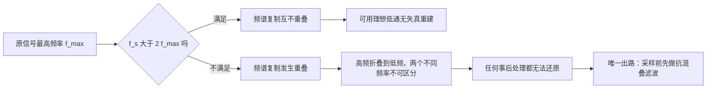

# 采样定理（Nyquist）

**标签：** #数字信号处理 #DSP #采样定理 #Nyquist #混叠

---

## 一、问题的提出

现实世界中的信号大多是连续的模拟信号（如声音、温度、电压），而数字信号处理系统只能处理离散的数字序列。将连续信号转换为离散信号的过程称为**采样**。采样定理回答了这样一个问题：**以多快的速度采样，才能从采样后的离散信号中无失真地恢复出原始连续信号？**

---

## 二、采样过程的数学描述

### 1. 理想采样

设连续信号 \(x_c(t)\)，以周期 \(T_s\) 进行理想冲激采样：

$$
x_s(t) = x_c(t) \cdot \sum_{n=-\infty}^{\infty} \delta(t - nT_s) = \sum_{n=-\infty}^{\infty} x_c(nT_s) \, \delta(t - nT_s)
$$

其中 \(f_s = 1/T_s\) 为采样频率。

### 2. 频域表示

根据傅里叶变换的性质，时域相乘对应频域卷积：

$$
X_s(j\Omega) = \frac{1}{T_s} \sum_{k=-\infty}^{\infty} X_c\bigl(j(\Omega - k\Omega_s)\bigr)
$$

其中 \(\Omega_s = 2\pi f_s = 2\pi/T_s\) 为采样角频率。

这意味着采样后信号的频谱是原始信号频谱以 \(\Omega_s\) 为周期的周期延拓，幅度乘以 \(1/T_s\)。

> **那两个因子别记错**：延拓的周期是 $\Omega_s=2\pi f_s$（不是 $f_s$），幅度因子是 $\frac{1}{T_s}=f_s$。**采样越密（$T_s$ 越小），每份副本越高**——这看着反直觉，但总能量是守恒的（副本越多、每份越高，积分后回到原值）。

---

## 三、采样定理（Nyquist-Shannon采样定理）

### 定理陈述

如果一个连续时间信号 \(x_c(t)\) 是**带限**的，即其最高频率分量为 \(\Omega_{\max}\)（或 \(f_{\max}\)），那么当采样频率满足：

$$
f_s \gt 2 f_{\max} \quad \text{或} \quad \Omega_s \gt 2\Omega_{\max}
$$

时，可以从采样后的离散序列 \(x[n] = x_c(nT_s)\) 中**无失真地恢复**出原始连续信号 \(x_c(t)\)。

### 关键术语

- **奈奎斯特频率**（Nyquist frequency）：\(f_N = f_s/2\)，即采样频率的一半。
- **奈奎斯特率**（Nyquist rate）：\(2f_{\max}\)，即无失真恢复所需的最低采样频率。
- **带限信号**：信号的频谱只在有限频率范围内非零，即 \(\lvert f \rvert \lt f_{\max}\) 时 \(X_c(f) \neq 0\)，其余为零。

> **"严格大于"不是笔误**：$f_s=2f_{\max}$ 属于临界情形，**不能保证恢复**（见例题 4 的反例）。工程上必须留余量，取 $f_s>2f_{\max}$。

---

## 四、混叠（Aliasing）

> 上图（按频率轴 $\omega$ 画，一个周期宽 $2\pi$，对应模拟域宽度 $f_s$）：**上栏**满足 $\omega_{\max}<\pi$（即 $f_s>2f_{\max}$），基带谱与两侧副本之间留有**空隙**（绿色标注），理想低通能原样取出基带；**下栏**违反条件，副本与基带重叠，**红色区域就是混叠**——高频折叠成了低频，任何处理都无法分离。

### 1. 什么是混叠

当采样频率不满足采样定理（\(f_s \leq 2f_{\max}\)）时，频谱的周期延拓会发生重叠，导致高频分量折叠到低频区域，这种现象称为**混叠**。

混叠一旦发生，就无法从采样数据中恢复原始信号，因为不同的连续信号可能产生相同的采样序列。

### 2. 混叠的数学表现

假设原始信号包含频率 \(f_1\) 和 \(f_2 = f_s - f_1\)，采样后这两个频率无法区分，表现为同一数字频率。

例如：\(f_s = 1000\) Hz，原始信号中有 700 Hz 和 300 Hz 两个分量。采样后，700 Hz 的分量会混叠到 300 Hz 的位置（因为 \(f_s - 700 = 300\)）。

**更一般的公式**（比"$f_s-f_1$"更通用）：表观频率

$$
f_a = \bigl\lvert f - k f_s\bigr\rvert \quad\text{取落在 } [0,\,f_s/2] \text{ 的那个}
$$

> 详细的"取余 + 镜像"算法见 [[【数字信号处理DSP】（十）模拟频率与数字频率的关系|（十）模拟频率与数字频率的关系]] 第六节。

### 3. 混叠的听觉/视觉例子

- **音频**：车轮旋转的频闪效应（车轮看起来倒转）
- **图像**：摩尔纹（细密条纹图案采样不足）
- **音乐**：低于奈奎斯特频率的高频乐器声变成低频噪声

---

## 五、抗混叠滤波器

在实际系统中，为了避免混叠，通常在采样前加入一个**低通滤波器**（称为抗混叠滤波器），滤除高于 \(f_s/2\) 的频率分量。

### 抗混叠滤波器的要求

- 通带：允许保留 \(0 \sim f_{\max}\) 的信号（其中 \(f_{\max} \leq f_s/2\)）
- 阻带：抑制 \(f \geq f_s/2\) 的所有频率
- 过渡带尽可能陡峭（实际滤波器无法做到理想截止）

> **顺序不能颠倒**：混叠是"信息已丢失"，不是"噪声叠加"。一旦采样完成，任何数字滤波都救不回来——因为被折叠的高频分量与真实低频分量**已经叠加成同一个数字频率**，无法区分。所以抗混叠滤波器必须放在**采样之前**、在模拟域里做。

完整的信号链是这样的：

注意链路里有**两次离散化**：**采样**把时间离散化，**量化**把幅度离散化。采样定理只管前者；后者带来量化噪声（信噪比约 $6.02b + 1.76$ dB，$b$ 为位数），是另一条独立的问题线。

---

## 六、信号重建

### 1. 理想重建（内插公式）

如果采样满足奈奎斯特定理，原始信号可以通过理想低通滤波器从采样序列中恢复：

$$
x_c(t) = \sum_{n=-\infty}^{\infty} x[n] \, \text{sinc}\!\left(\frac{t - nT_s}{T_s}\right)
$$

其中 \(\text{sinc}(x) = \frac{\sin(\pi x)}{\pi x}\)。

**这个公式的含义**：每个采样点贡献一个 $\text{sinc}$ 波形（在本点取 $1$、在其它采样点取 $0$），所有 $\text{sinc}$ 叠加后**恰好穿过全部采样点，且两点之间平滑过渡**。这就是"理想低通滤波器"在时域的样子——它的冲激响应正是 $\text{sinc}$。

### 2. 实际重建

实际中常用零阶保持器（ZOH）或一阶保持器，配合平滑滤波器近似恢复。

> **为什么不能"直接连线"**：零阶保持输出的是阶梯波，它的频谱除了基带还有大量高频镜像（$f_s$ 附近），会带来刺耳的高频"毛刺"。所以 ZOH 之后必须再串一个**平滑低通**（重建滤波器）。

---

## 七、典型例题

> **统一答题格式**：① 从 $\Omega$ 除以 $2\pi$（或直接读）**提取 $f$**；② 取最大者 $f_{\max}$；③ 与 $f_s/2$ 比较（**不是**与 $f_s$ 比较）；④ 判"是否混叠 / 求最小 $f_s$"；⑤ 若求数字频率用 $\omega=2\pi f/f_s$；⑥ **回代验证** $\omega<\pi$。
> 单位陷阱：题目给的多是**角频率 $\Omega$**，第一步一定要除 $2\pi$。

### 例题 1：判断是否满足采样定理

**题目**：\(x(t) = \cos(400\pi t) + \sin(600\pi t)\)，\(f_s = 800\text{ Hz}\)，是否会产生混叠？

**解**：

（1）**从角频率提取模拟频率**（除以 $2\pi$）：

$$
\Omega_1=400\pi\Rightarrow f_1=200\text{ Hz};\qquad
\Omega_2=600\pi\Rightarrow f_2=300\text{ Hz}
$$

（2）**取最高频率**（各分量都要满足，所以看最大者）：

$$
f_{\max}=\max(200,300)=300\text{ Hz}
$$

（3）**与奈奎斯特频率比较**：$f_s/2=400\text{ Hz}$，而 $f_{\max}=300<400$。

（4）**结论**：

$$
\boxed{f_s=800>2f_{\max}=600\text{ Hz}\ \Longrightarrow\ \text{不混叠，可无失真重建}}
$$

（5）**顺便给出数字频率**（便于核对）：

$$
\omega_1=\frac{2\pi\cdot200}{800}=0.5\pi,\qquad \omega_2=\frac{2\pi\cdot300}{800}=0.75\pi
$$

**检验**：两个 $\omega$ 都严格小于 $\pi$ ✓ 与"不混叠"结论一致。

---

### 例题 2：混叠频率计算

**题目**：\(x(t) = \cos(900\pi t)\)，\(f_s = 500\text{ Hz}\)。求采样后的数字频率与混叠后的表观模拟频率。

**解**：

（1）**提取频率**：

$$
f=\frac{900\pi}{2\pi}=450\text{ Hz}
$$

（2）**判断**：$f_s/2=250\text{ Hz}$，而 $450>250$，**发生混叠**。

（3）**用"取余 + 镜像"求表观频率**：

$$
450 \bmod 500 = 450,\quad 450>250 \;\Rightarrow\; f_a = 500-450 = 50\text{ Hz}
$$

（4）**换算数字频率**：

$$
\omega=\frac{2\pi f_a}{f_s}=\frac{2\pi\times50}{500}=0.2\pi
$$

$$
\boxed{f_a=50\text{ Hz},\qquad \omega=0.2\pi}
$$

（5）**直接验证**（最硬的证明）：

$$
\cos\!\left(2\pi\cdot450\cdot\frac{n}{500}\right)=\cos(1.8\pi n)
=\cos(1.8\pi n-2\pi n)=\cos(-0.2\pi n)=\cos(0.2\pi n)\ \checkmark
$$

而 $\cos(0.2\pi n)$ 正是 $50\text{ Hz}$、$500\text{ Hz}$ 采样的结果 ✓

> **$k=2$ 不用试**：$|450-1000|=550>250$，取余后再镜像会回到 $50$，结果唯一。**混叠后的表观频率必然唯一**，因为折返是"多对一"的映射。

---

### 例题 3：求最小采样频率

**题目**：$x(t) = 3\cos(100\pi t) + 2\cos(500\pi t)$。求不产生混叠所需的最低采样频率；若 $f_s = 1000\text{ Hz}$，两个分量的数字角频率分别是多少？

**解**：

（1）**提取频率**：

$$
f_1=\frac{100\pi}{2\pi}=50\text{ Hz},\qquad f_2=\frac{500\pi}{2\pi}=250\text{ Hz}
$$

（2）**求奈奎斯特率**：

$$
f_{\max}=250\text{ Hz}\;\Rightarrow\; f_s^{\min}=2f_{\max}=500\text{ Hz}
$$

（3）**算数字频率**（$f_s=1000\text{ Hz}$）：

$$
\omega_1=\frac{2\pi\times50}{1000}=0.1\pi,\qquad
\omega_2=\frac{2\pi\times250}{1000}=0.5\pi
$$

$$
\boxed{f_s^{\min}=500\text{ Hz};\qquad \omega_1=0.1\pi,\ \ \omega_2=0.5\pi}
$$

（4）**检验**：两个 $\omega$ 都在 $(0,\pi]$ 内 ✓；$f_s=1000>2\times250=500$ ✓ 满足定理。

> **常见错法**：把 $500\pi$ 直接当成 $f_{\max}=500\text{ Hz}$，得出 $f_s^{\min}=1000\text{ Hz}$。**$\Omega$ 是角频率，必须先除以 $2\pi$ 化成 Hz**。这一类单位混淆是采样定理题目最常见的失分点。
>
> **更隐蔽的错法**：只拿最大的那个分量算，忘了检查——其实只要最大的分量满足，小的自然满足（因为 $f_{\max}$ 是上限）。**用最大者是对的，但要说清理由**。

---

### 例题 4：临界采样为什么不行

**题目**：信号 $x(t)=\cos(1000\pi t)$，取 $f_s=1000\text{ Hz}$（恰好 $f_s=2f_{\max}$）。问能否无失真恢复？再考虑 $x(t)=\sin(1000\pi t)$ 同样采样。

**解**：

（1）**第一个信号**：$f=500\text{ Hz}$，$f_s/2=500\text{ Hz}$，处于**临界**。采样：

$$
x[n]=\cos\!\left(\frac{1000\pi n}{1000}\right)=\cos(\pi n)=(-1)^n
$$

得到 $1,-1,1,-1,\dots$——**只剩"幅度包络"的极端情形，相位信息完全丢失**（任何初相 $0$ 的 $500\text{ Hz}$ 余弦都给这个序列）。

（2）**第二个信号**：$\sin(1000\pi t)$ 采样：

$$
x[n]=\sin(\pi n)=0\quad(\forall n)
$$

**采样结果全是零！** 信号完全"消失"了。

（3）**结论**：同一采样率下，$\cos$ 与 $\sin$ 这两个"相同频率、不同相位"的信号给出了**不同但都无法正确重建**的序列，说明临界采样不可靠。

$$
\boxed{f_s=2f_{\max}\ \text{时不能保证无失真恢复，必须严格 } f_s>2f_{\max}}
$$

**检验**：把 $\cos$ 的采样值 $(-1)^n$ 用 sinc 内插"重建"，得到的确实是 $\cos(1000\pi t)$；但 $\sin$ 的采样值全零，重建得到的是**零信号**——显然错了。**同一个采样序列对应无穷多个可能的原信号**，这就是临界采样的问题所在。

> **工程含义**：这就是为什么实际 ADC 的采样率总要留余量（CD 用 $44.1\text{ kHz}$ 而不是 $40\text{ kHz}$），也是为什么"刚好两倍"在工程上被视为**不安全**。

---

### 例题 5：采样后频谱的幅度

**题目**：带限信号 $x_c(t)$ 的频谱峰值 $X_c(j\Omega)$ 在某频率处等于 $1$，用 $f_s=2\text{ kHz}$ 采样。求采样后频谱各副本的峰值，并说明为什么"变高了"。

**解**：

（1）**套用第二节的公式**（每份副本乘 $1/T_s$）：

$$
X_s(j\Omega)=\frac{1}{T_s}\sum_k X_c\bigl(j(\Omega-k\Omega_s)\bigr)
$$

（2）**算 $1/T_s$**：

$$
\frac{1}{T_s}=f_s=2000
$$

（3）**结论**：

$$
\boxed{\text{采样后每份副本峰值}=1\times2000=2000}
$$

（4）**为什么"变高"了**：理想采样是把连续信号乘上一串**冲激**，冲激的面积被定义为 $1$ 而不是"高度 $1$ 持续 $T_s$"。相当于把能量压缩到零宽的瞬间，所以在频域表现为整体放大 $f_s$ 倍。

**检验**（能量守恒的粗略核对）：采样后每份副本高 $2000$、但只在 $[0,\Omega_s/2]$ 等有限频带上非零，副本数量是原来的 $f_s$ 倍——"高度 ×$f_s$、数量 ×$f_s$"要配合 $2\pi$ 归一化才守恒，单看高度会误以为能量凭空增大。

> **做题技巧**：题目若只问"频谱形状是否重叠"，幅度因子 $1/T_s$ 可以完全忽略（它是常数，不影响重叠判断）。**只有题目明确问"幅度变为多少"时才需要乘**。

---

### 例题 6：带通采样（合法地欠采样）

**题目**：某射频信号的频带为 $f_L=100\text{ MHz}$ 到 $f_H=110\text{ MHz}$。若沿用低通采样定理需 $f_s>220\text{ MHz}$。能否用更低的采样率？求一个可用的 $f_s$ 并验证。

**解**：

（1）**带通采样的条件**（$k$ 为正整数）：

$$
\frac{2f_H}{k}\le f_s\le\frac{2f_L}{k-1},\qquad
k\le\left\lfloor\frac{f_H}{f_H-f_L}\right\rfloor
$$

（2）**定 $k$ 的上界**：带宽 $f_H-f_L=10\text{ MHz}$，

$$
k_{\max}=\left\lfloor\frac{110}{10}\right\rfloor=11
$$

（3）**试几个 $k$**：

| $k$ | 允许的 $f_s$ 区间（MHz） |
|---|---|
| $1$ | $220\le f_s$（就是低通情形） |
| $2$ | $110\le f_s\le 200$ |
| $3$ | $73.3\le f_s\le 100$ |
| $4$ | $55\le f_s\le 66.7$ |

（4）**取 $k=4$、$f_s=60\text{ MHz}$**，验证折返：

$$
100 \bmod 60=40>30=f_s/2 \Rightarrow 60-40=20\text{ MHz}
$$

$$
110 \bmod 60=50>30 \Rightarrow 60-50=10\text{ MHz}
$$

频带 $[100,110]$ 映射为 $[10,20]\text{ MHz}$，落在 $[0,30]$ 内且**自身不重叠**（宽度 $10<30$）。

$$
\boxed{f_s=60\text{ MHz} \text{ 可用（}k=4\text{），频带折返到 } [10,20]\text{ MHz}}
$$

**检验**：折返后的频带宽度仍为 $10\text{ MHz}$（无压缩）✓，且完全落在 $[0,f_s/2]$ 内 ✓ —— 这就是"欠采样但不混叠"。

> **注意**：带通采样会让频谱**发生反转**（$100\to20$、$110\to10$，高低颠倒）。工程上要在数字域再翻一次，或者靠正交解调的 $I/Q$ 两路区分。这是软件无线电（SDR）用几十 MHz 采样处理 GHz 射频的原理。

---

## 八、采样定理的工程要点

| 项目 | 说明 |
|------|------|
| 理论要求 | \(f_s > 2f_{\max}\)（严格大于） |
| 实际常用 | \(f_s = (2.5 \sim 10) f_{\max}\)，留有余量 |
| CD音频标准 | \(f_s = 44.1\) kHz（人耳上限20 kHz，留保护带） |
| 语音通信 | \(f_s = 8\) kHz（语音带宽约3.4 kHz） |
| 抗混叠滤波器 | 必须在采样前使用，不可事后补救 |
| 带通信号 | 可用带通采样，$f_s$ 只需大于 $2\times$带宽 |

---

## 九、常见误解澄清

1. **"只要 \(f_s > 2f_{\max}\) 就能完美重建"**：理论上正确，但实际中需要理想低通滤波器（不可实现），因此只能近似重建。
2. **"采样频率越高越好"**：过高会增加数据量和处理成本，应权衡选择。
3. **"带通信号也需要 \(f_s > 2f_{\max}\)"**：对于带通信号，可以使用带通采样（欠采样）技术，以低于 \(2f_{\max}\) 的采样率采样，前提是频谱不发生混叠。典型条件是
   $$
   \frac{2f_H}{k} \leq f_s \leq \frac{2f_L}{k-1}, \quad k = 1, 2, \dots, \left\lfloor \frac{f_H}{f_H - f_L} \right\rfloor
   $$
   其中 \(f_L\)、\(f_H\) 为带通信号的上下截止频率。软件无线电里用几十 MHz 采样率处理 GHz 级射频信号，靠的就是这条。
4. **"数字频率与模拟频率无关"**：实际上通过采样频率紧密关联，见 [[【数字信号处理DSP】（十）模拟频率与数字频率的关系|（十）模拟频率与数字频率的关系]]。
5. **"采样定理也管量化"**：不管。采样定理只保证**时间离散**后频谱不重叠；**幅度离散**（量化）带来的量化噪声是独立的问题，需要增加位数或抖动（dither）来解决。
6. **"欠采样一定出错"**：只有当信号含超过 \(f_s/2\) 的频率分量且未加抗混叠滤波时才是错的。带通采样（误解 3）是合法的欠采样。
7. **"重建就是简单连线"**：直接连采样点得到的是零阶保持的阶梯波，含有大量高频谐波，必须再经过平滑低通滤波器。
8. **"奈奎斯特频率和奈奎斯特率是一回事"**：**频率**指 \(f_s/2\)（采样频率的一半），**率**指 \(2f_{\max}\)（信号所需的最低采样频率）。两者数值通常不同，考试中常被混用。
9. **"$f_s=2f_{\max}$ 也行"**：不行，临界情形下相位信息可能完全丢失（例题 4 的 $\sin$ 采样全零）。定理要求**严格大于**。

---

## 十、知识链定位

奈奎斯特采样定理（本节）

│

├── 采样模型：x_s(t) = Σ x_c(nTs) δ(t - nTs)

├── 频域：频谱以 Ωs 为周期延拓，幅度乘 1/Ts = fs

├── 定理：fs > 2 f_max ⟺ 延拓不重叠 ⟺ 可无失真重建

├── 混叠：延拓重叠 → 高频折叠 → 不可逆（只能采样前抗混叠）

└── 重建：理想低通 = sinc 内插；实际用 ZOH + 平滑滤波

│

├── 离散时间系统六大性质：采样前后系统性质（第二节）

├── 能量信号与功率信号：采样序列的能量/功率（第三节）

├── 模拟频率与数字频率：ω = 2πf/fs 的换算（第十节）

├── Z 变换与收敛域：离散序列的复频域工具（第十三节）

└── 数字滤波器设计：指标换算与抗混叠滤波器（后续章节）

---

## 十一、总结

- 采样定理是模拟信号数字化的理论基础。
- 核心条件：\(f_s > 2f_{\max}\)（**严格**大于，临界不行）。
- 违反条件会导致混叠，无法恢复原始信号；抗混叠滤波必须放在采样**之前**。
- 采样后频谱 = 原谱以 $f_s$ 为周期的延拓，每份幅度乘 $f_s$。
- 采样后的数字频率与模拟频率通过 \(f_s\) 建立联系。
- 采样（时间离散）与量化（幅度离散）是两个独立的问题。
- 带通信号可以合法"欠采样"，条件是折返后频带不重叠。

> **一句话总结**：采样定理告诉我们，要以超过信号最高频率两倍的速率采样，才能从离散样本中完美还原连续世界的声音——这是数字时代一切音频、视频、通信技术的起点。
