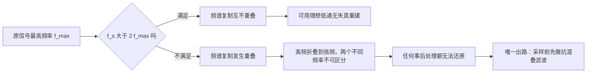

# 采样定理（Nyquist）

**标签：** #数字信号处理 #DSP #采样定理 #Nyquist #混叠

---

## 一、问题的提出

现实世界中的信号大多是连续的模拟信号（如声音、温度、电压），而数字信号处理系统只能处理离散的数字序列。将连续信号转换为离散信号的过程称为**采样**。采样定理回答了这样一个问题：**以多快的速度采样，才能从采样后的离散信号中无失真地恢复出原始连续信号？**

---

## 二、采样过程的数学描述

### 1. 理想采样

设连续信号 \(x_c(t)\)，以周期 \(T_s\) 进行理想冲激采样：

$$
x_s(t) = x_c(t) \cdot \sum_{n=-\infty}^{\infty} \delta(t - nT_s) = \sum_{n=-\infty}^{\infty} x_c(nT_s) \, \delta(t - nT_s)
$$

其中 \(f_s = 1/T_s\) 为采样频率。

### 2. 频域表示

根据傅里叶变换的性质，时域相乘对应频域卷积：

$$
X_s(j\Omega) = \frac{1}{T_s} \sum_{k=-\infty}^{\infty} X_c\bigl(j(\Omega - k\Omega_s)\bigr)
$$

其中 \(\Omega_s = 2\pi f_s = 2\pi/T_s\) 为采样角频率。

这意味着采样后信号的频谱是原始信号频谱以 \(\Omega_s\) 为周期的周期延拓，幅度乘以 \(1/T_s\)。

---

## 三、采样定理（Nyquist-Shannon采样定理）

### 定理陈述

如果一个连续时间信号 \(x_c(t)\) 是**带限**的，即其最高频率分量为 \(\Omega_{\max}\)（或 \(f_{\max}\)），那么当采样频率满足：

$$
f_s \gt 2 f_{\max} \quad \text{或} \quad \Omega_s \gt 2\Omega_{\max}
$$

时，可以从采样后的离散序列 \(x[n] = x_c(nT_s)\) 中**无失真地恢复**出原始连续信号 \(x_c(t)\)。

### 关键术语

- **奈奎斯特频率**（Nyquist frequency）：\(f_N = f_s/2\)，即采样频率的一半。
- **奈奎斯特率**（Nyquist rate）：\(2f_{\max}\)，即无失真恢复所需的最低采样频率。
- **带限信号**：信号的频谱只在有限频率范围内非零，即 \(|f| \lt f_{\max}\) 时 \(X_c(f) \neq 0\)，其余为零。

---

## 四、混叠（Aliasing）

> 上图：左图为 $f_s>2f_{\max}$ 时，基带频谱的周期延拓互不重叠，可无失真恢复；右图为 $f_s<2f_{\max}$ 时各副本重叠（红），高频被折回低频 → **混叠**。

### 1. 什么是混叠

当采样频率不满足采样定理（\(f_s \leq 2f_{\max}\)）时，频谱的周期延拓会发生重叠，导致高频分量折叠到低频区域，这种现象称为**混叠**。

混叠一旦发生，就无法从采样数据中恢复原始信号，因为不同的连续信号可能产生相同的采样序列。

### 2. 混叠的数学表现

假设原始信号包含频率 \(f_1\) 和 \(f_2 = f_s - f_1\)，采样后这两个频率无法区分，表现为同一数字频率。

例如：\(f_s = 1000\) Hz，原始信号中有 700 Hz 和 300 Hz 两个分量。采样后，700 Hz 的分量会混叠到 300 Hz 的位置（因为 \(f_s - 700 = 300\)）。

### 3. 混叠的听觉/视觉例子

- **音频**：车轮旋转的频闪效应（车轮看起来倒转）
- **图像**：摩尔纹（细密条纹图案采样不足）
- **音乐**：低于奈奎斯特频率的高频乐器声变成低频噪声

---

## 五、抗混叠滤波器

在实际系统中，为了避免混叠，通常在采样前加入一个**低通滤波器**（称为抗混叠滤波器），滤除高于 \(f_s/2\) 的频率分量。

### 抗混叠滤波器的要求

- 通带：允许保留 \(0 \sim f_{\max}\) 的信号（其中 \(f_{\max} \leq f_s/2\)）
- 阻带：抑制 \(f \geq f_s/2\) 的所有频率
- 过渡带尽可能陡峭（实际滤波器无法做到理想截止）

> **顺序不能颠倒**：混叠是"信息已丢失"，不是"噪声叠加"。一旦采样完成，任何数字滤波都救不回来——因为被折叠的高频分量与真实低频分量**已经叠加成同一个数字频率**，无法区分。所以抗混叠滤波器必须放在**采样之前**、在模拟域里做。

完整的信号链是这样的：

注意链路里有**两次离散化**：**采样**把时间离散化，**量化**把幅度离散化。采样定理只管前者；后者带来量化噪声（信噪比约 $6.02b + 1.76$ dB，$b$ 为位数），是另一条独立的问题线。

---

## 六、信号重建

### 1. 理想重建（内插公式）

如果采样满足奈奎斯特定理，原始信号可以通过理想低通滤波器从采样序列中恢复：

$$
x_c(t) = \sum_{n=-\infty}^{\infty} x[n] \, \text{sinc}\!\left(\frac{t - nT_s}{T_s}\right)
$$

其中 \(\text{sinc}(x) = \frac{\sin(\pi x)}{\pi x}\)。

### 2. 实际重建

实际中常用零阶保持器（ZOH）或一阶保持器，配合平滑滤波器近似恢复。

---

## 七、典型例题

### 例题1：判断是否满足采样定理

信号 \(x(t) = \cos(400\pi t) + \sin(600\pi t)\)，采样频率 \(f_s = 800\) Hz，是否会产生混叠？

**解**：

信号的两个频率分量：\(f_1 = 200\) Hz（\(\Omega=400\pi\)），\(f_2 = 300\) Hz（\(\Omega=600\pi\)）

最高频率 \(f_{\max} = 300\) Hz

奈奎斯特率：\(2f_{\max} = 600\) Hz

采样频率 \(f_s = 800\) Hz > 600 Hz，满足采样定理，不会混叠。

### 例题2：混叠频率计算

信号 \(x(t) = \cos(900\pi t)\)，采样频率 \(f_s = 500\) Hz，求采样后信号的数字频率以及混叠后的模拟频率（如果存在）。

**解**：

信号频率 \(f = 450\) Hz（\(\Omega=900\pi\)）

奈奎斯特率：\(2 \times 450 = 900\) Hz > \(f_s=500\) Hz，不满足采样定理，发生混叠。

混叠后的模拟频率：\(f_{\text{alias}} = |f - k f_s|\)，取最小的正值。

\(k=1\)：\(|450 - 500| = 50\) Hz

\(k=2\)：\(|450 - 1000| = 550\) Hz（大于 \(f_s/2=250\) Hz，不考虑）

所以混叠后的模拟频率为 50 Hz，对应的数字角频率：

$$
\omega = 2\pi \times \frac{50}{500} = 0.2\pi \text{ rad}
$$

采样后的序列与 50 Hz 信号采样结果完全相同。

### 例题3：求最小采样频率

信号 \(x(t) = 3\cos(100\pi t) + 2\cos(500\pi t)\)，求不产生混叠所需的最低采样频率；若采样频率取 \(f_s = 1000\) Hz，数字角频率分别是多少？

**解**：

**第一步**：从角频率提取模拟频率

\[
\Omega_1 = 100\pi \ \Rightarrow\ f_1 = \frac{\Omega_1}{2\pi} = 50 \text{ Hz}, \qquad
\Omega_2 = 500\pi \ \Rightarrow\ f_2 = 250 \text{ Hz}
\]

**第二步**：取最高频率求奈奎斯特率

\[
f_{\max} = 250 \text{ Hz} \quad \Rightarrow \quad f_s^{\min} = 2f_{\max} = 500 \text{ Hz}
\]

**第三步**：换算数字角频率（用 \(\omega = 2\pi f / f_s = \Omega T_s\)）

\[
\omega_1 = 2\pi \times \frac{50}{1000} = 0.1\pi \ \text{rad}, \qquad
\omega_2 = 2\pi \times \frac{250}{1000} = 0.5\pi \ \text{rad}
\]

两个数字频率都落在 \((0, \pi]\) 内，说明 \(f_s = 1000\) Hz 满足采样定理，没有折叠。

> **常见错法**：把 \(500\pi\) 直接当成 \(f_{\max} = 500\) Hz，得出 \(f_s^{\min} = 1000\) Hz。**$\Omega$ 是角频率，必须先除以 $2\pi$ 化成 Hz**。这一类单位混淆是采样定理题目最常见的失分点。

---

## 八、采样定理的工程要点

| 项目 | 说明 |
|------|------|
| 理论要求 | \(f_s > 2f_{\max}\)（严格大于） |
| 实际常用 | \(f_s = (2.5 \sim 10) f_{\max}\)，留有余量 |
| CD音频标准 | \(f_s = 44.1\) kHz（人耳上限20 kHz，留保护带） |
| 语音通信 | \(f_s = 8\) kHz（语音带宽约3.4 kHz） |
| 抗混叠滤波器 | 必须在采样前使用，不可事后补救 |

---

## 九、常见误解澄清

1. **“只要 \(f_s > 2f_{\max}\) 就能完美重建”**：理论上正确，但实际中需要理想低通滤波器（不可实现），因此只能近似重建。
2. **“采样频率越高越好”**：过高会增加数据量和处理成本，应权衡选择。
3. **“带通信号也需要 \(f_s > 2f_{\max}\)”**：对于带通信号，可以使用带通采样（欠采样）技术，以低于 \(2f_{\max}\) 的采样率采样，前提是频谱不发生混叠。典型条件是
   \[
   \frac{2f_H}{k} \leq f_s \leq \frac{2f_L}{k-1}, \quad k = 1, 2, \dots, \left\lfloor \frac{f_H}{f_H - f_L} \right\rfloor
   \]
   其中 \(f_L\)、\(f_H\) 为带通信号的上下截止频率。软件无线电里用几十 MHz 采样率处理 GHz 级射频信号，靠的就是这条。
4. **“数字频率与模拟频率无关”**：实际上通过采样频率紧密关联，见 [[【数字信号处理DSP】（十）模拟频率与数字频率的关系|（十）模拟频率与数字频率的关系]]。
5. **“采样定理也管量化”**：不管。采样定理只保证**时间离散**后频谱不重叠；**幅度离散**（量化）带来的量化噪声是独立的问题，需要增加位数或抖动（dither）来解决。
6. **“欠采样一定出错”**：只有当信号含超过 \(f_s/2\) 的频率分量且未加抗混叠滤波时才是错的。带通采样（误解 3）是合法的欠采样。
7. **“重建就是简单连线”**：直接连采样点得到的是零阶保持的阶梯波，含有大量高频谐波，必须再经过平滑低通滤波器。
8. **“奈奎斯特频率和奈奎斯特率是一回事”**：**频率**指 \(f_s/2\)（采样频率的一半），**率**指 \(2f_{\max}\)（信号所需的最低采样频率）。两者数值通常不同，考试中常被混用。

---

## 十、知识链定位

奈奎斯特采样定理（本节）

│

├── 采样模型：x_s(t) = Σ x_c(nTs) δ(t - nTs)

├── 频域：频谱以 Ωs 为周期延拓，幅度乘 1/Ts

├── 定理：fs > 2 f_max ⟺ 延拓不重叠 ⟺ 可无失真重建

└── 混叠：延拓重叠 → 高频折叠 → 不可逆

│

├── 离散时间系统六大性质：采样前后系统性质（第二节）

├── 能量信号与功率信号：采样序列的能量/功率（第三节）

├── 模拟频率与数字频率：ω = 2πf/fs 的换算（第十节）

├── Z 变换与收敛域：离散序列的复频域工具（第十三节）

└── 数字滤波器设计：指标换算与抗混叠滤波器（后续章节）

---

## 十一、总结

- 采样定理是模拟信号数字化的理论基础。
- 核心条件：\(f_s > 2f_{\max}\)。
- 违反条件会导致混叠，无法恢复原始信号。
- 工程实践中需配合抗混叠滤波器使用，且必须放在采样**之前**。
- 采样后的数字频率与模拟频率通过 \(f_s\) 建立联系。
- 采样（时间离散）与量化（幅度离散）是两个独立的问题。

> **一句话总结**：采样定理告诉我们，要以超过信号最高频率两倍的速率采样，才能从离散样本中完美还原连续世界的声音——这是数字时代一切音频、视频、通信技术的起点。