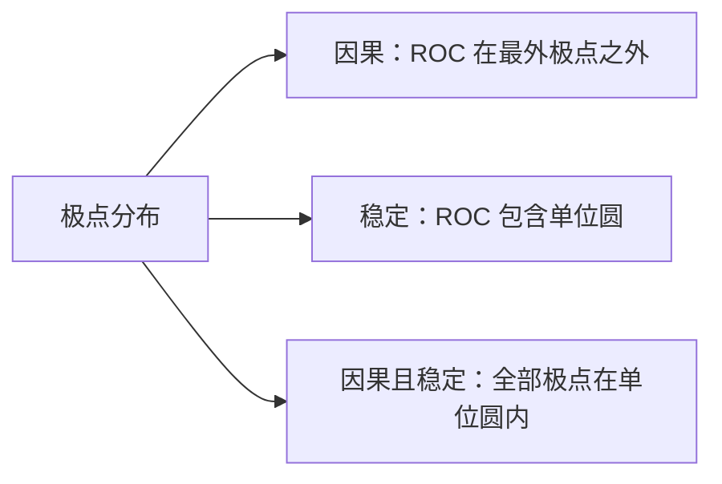
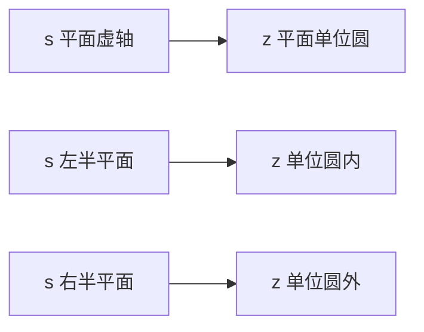

# Z 变换与收敛域

**标签：** #数字信号处理 #DSP #Z变换 #收敛域 #ROC #逆Z变换

---

## 一、为什么需要 Z 变换？

离散时间系统分析有三个层次：时域靠**卷积和**（[[【数字信号处理DSP】（七）卷积和|（七）卷积和]]）、频域靠**序列的傅里叶变换（DTFT）**（[[【数字信号处理DSP】（十四）离散时间傅里叶变换（DTFT）|（十四）DTFT]]）、复频域靠 **Z 变换**。

DTFT 有一个硬伤：它要求序列**绝对可和**，否则级数不收敛。而现实中一大堆有用的序列都不满足，例如

- \(u[n]\)：\(\sum \lvert u[n] \rvert\) 发散
- \(a^n u[n]\)（\(a \gt 1\)）：指数增长，更不可能收敛
- 反因果序列 \(a^n u[-n-1]\)

解决办法很朴素：**给序列乘一个指数衰减因子 \(r^{-n}\)（\(r \gt 0\)），把它「压」到可和，再做傅里叶变换。**

$$
X(re^{j\omega}) = \sum_{n=-\infty}^{\infty} \bigl(x[n]\,r^{-n}\bigr) e^{-j\omega n} = \sum_{n=-\infty}^{\infty} x[n]\,(re^{j\omega})^{-n}
$$

把复变量 \(re^{j\omega}\) 记作 \(z\)，右边那个式子就是 **Z 变换**。

> **Z 变换 = 先对序列做指数加权，再做傅里叶变换；它能处理的序列范围比 DTFT 大得多。**

两者的关系一句话说清：**DTFT 就是 Z 变换在单位圆上的取值**（\(r = 1\)，即 \(z = e^{j\omega}\)）。所以 Z 变换是把 DTFT「解放」到整个复平面上的推广，而不是另起炉灶的新东西。

---

## 二、定义

### 1. 双边 Z 变换

$$
X(z) = \sum_{n=-\infty}^{\infty} x[n]\,z^{-n}
$$

其中 \(z\) 为复变量。使这个级数收敛的 \(z\) 的集合，称为**收敛域（Region of Convergence，ROC）**。

### 2. 单边 Z 变换

$$
X(z) = \sum_{n=0}^{\infty} x[n]\,z^{-n}
$$

只对 \(n \geq 0\) 求和，适合处理因果序列，以及**带初始条件的差分方程**（[[【数字信号处理DSP】（九）离散时间系统的时域解法|（九）时域解法]]里的零输入响应就靠它）。若序列本身因果，单边与双边完全一致。

差别要记牢：单边 Z 变换**丢掉了 \(n \lt 0\) 的信息**，所以它对同一个 \(X(z)\) 只能对应一个因果序列，不需要 ROC 来区分。代价是：用它算出的结果是「含初始条件的全响应」，而不是零状态响应。

### 3. 收敛条件

级数在 \(z\) 处收敛，指的是**绝对可和**：

$$
\sum_{n=-\infty}^{\infty} \lvert x[n] \rvert \, \lvert z \rvert^{-n} \lt \infty
$$

注意式子里只出现 \(\lvert z \rvert\)，**与辐角 \(\omega\) 无关** —— 这一个事实直接决定了 ROC 一定是以原点为中心的圆环。

### 4. 记号约定

$$
x[n] \;\longleftrightarrow\; X(z)
$$

---

## 三、收敛域（ROC）

> 上图：复平面上的极零点分布。红色 × 是极点 \(z=0.8\)（在单位圆内），蓝色 ○ 是零点 \(z=-1.5\)，绿色一对是共轭零点。橙色填充区就是 ROC：**以最外极点 \(0.8\) 为内边界、向外无限延伸的圆外区域**。它既在最外极点之外（⇒ 因果），又包含单位圆（⇒ 稳定）。

### 1. ROC 的三条基本性质

1. **ROC 是圆环**：\(R_{x-} \lt \lvert z \rvert \lt R_{x+}\)，可能退化成「圆外」（\(R_{x+}=\infty\)）或「圆内」（\(R_{x-}=0\)）
2. **ROC 内一定不含极点** —— 极点处分母为零，级数必然发散
3. **ROC 边界一定是圆** —— 因为它只由 \(\lvert z \rvert\) 决定，与角度无关

由第 2 条还能推出一条极常用的结论：**有理 \(X(z)\) 的 ROC 边界必然穿过极点**。所以拿到 \(X(z)\) 先求极点，极点把半径轴切成若干段，ROC 只能是其中某几段的并（实际是其中一段），再靠「因果/反因果/双边」三个条件来选定。

### 2. 四类序列与 ROC 的对应

> 上图：有限长（几乎全平面，去掉 \(0\) 与 \(\infty\)）、因果（最外极点外）、反因果（最内极点内）、双边（两极点之间的圆环）。四张图放在一起看，ROC 的形状规律一眼就清楚。

| 序列类型 | 时域范围 | ROC |
|----------|----------|-----|
| 有限长 | 只在 \(n_1 \leq n \leq n_2\) 非零 | 整个 z 平面；有正序号项则不含 \(0\)，有负序号项则不含 \(\infty\) |
| 右边（因果） | \(n \geq 0\) | \(\lvert z \rvert \gt R_{x-}\)，含 \(\infty\) |
| 右边（一般） | \(n \geq n_1\) 且 \(n_1 \lt 0\) | \(\lvert z \rvert \gt R_{x-}\)，不含 \(\infty\) |
| 左边 | \(n \leq n_2\) | \(\lvert z \rvert \lt R_{x+}\)；\(n_2 \gt 0\) 时不含 \(0\) |
| 双边 | \(-\infty \lt n \lt \infty\) | 圆环 \(R_{x-} \lt \lvert z \rvert \lt R_{x+}\)，无公共部分则 Z 变换不存在 |

记忆方法：**看「哪一头」延伸到无穷**。序列往 \(n \to +\infty\) 延伸，需要 \(z\) 足够大才能压住 \(z^{-n}\)；往 \(n \to -\infty\) 延伸，需要 \(z\) 足够小。

### 3. X(z) 与 ROC 必须一起写

同一个表达式，配不同的 ROC 就是**完全不同的两个序列**。这是本章最容易丢分的地方：

$$
X(z) = \frac{1}{1-az^{-1}}, \quad \lvert z \rvert \gt \lvert a \rvert
\qquad \Longleftrightarrow \qquad
x[n] = a^n u[n]
$$

$$
X(z) = \frac{1}{1-az^{-1}}, \quad \lvert z \rvert \lt \lvert a \rvert
\qquad \Longleftrightarrow \qquad
x[n] = -a^n u[-n-1]
$$

所以「求 \(X(z)\)」这道题，**不写 ROC 等于没答完**。

### 4. ROC、因果性与稳定性

对 LTI 系统，判据可以全部翻译成 ROC 的语言：

- **因果** \(\Longleftrightarrow\) ROC 取**最外极点之外**（延伸到 \(\infty\)）
- **稳定**（BIBO）\(\Longleftrightarrow\) ROC **包含单位圆**
- **因果且稳定** \(\Longleftrightarrow\) 全部极点在单位圆内，且 ROC 取 \(\lvert z \rvert \gt R_{x-}\)

这三条把时域判据（[[【数字信号处理DSP】（二）离散时间系统六大性质判断方法|（二）六大性质]]里的因果性、稳定性）换成了「看图说话」：把极点画在 z 平面上，ROC 怎么画、含不含单位圆，因果与稳定就都出来了。

---

## 四、常用变换对

完整表格见 [[Z 变换表与性质]]。下面这几对是必须背到条件反射的：

| 序列 \(x[n]\) | \(X(z)\) | ROC |
|-------------|--------|-----|
| \(\delta[n]\) | \(1\) | 整个 z 平面 |
| \(\delta[n-k]\)（\(k\gt0\)） | \(z^{-k}\) | \(\lvert z \rvert \gt 0\) |
| \(u[n]\) | \(\dfrac{1}{1-z^{-1}}\) | \(\lvert z \rvert \gt 1\) |
| \(a^n u[n]\) | \(\dfrac{1}{1-az^{-1}}\) | \(\lvert z \rvert \gt \lvert a \rvert\) |
| \(-a^n u[-n-1]\) | \(\dfrac{1}{1-az^{-1}}\) | \(\lvert z \rvert \lt \lvert a \rvert\) |
| \(n a^n u[n]\) | \(\dfrac{az^{-1}}{(1-az^{-1})^2}\) | \(\lvert z \rvert \gt \lvert a \rvert\) |
| \((n+1)a^n u[n]\) | \(\dfrac{1}{(1-az^{-1})^2}\) | \(\lvert z \rvert \gt \lvert a \rvert\) |
| \(\cos(\omega_0 n)u[n]\) | \(\dfrac{1-z^{-1}\cos\omega_0}{1-2z^{-1}\cos\omega_0+z^{-2}}\) | \(\lvert z \rvert \gt 1\) |
| \(\sin(\omega_0 n)u[n]\) | \(\dfrac{z^{-1}\sin\omega_0}{1-2z^{-1}\cos\omega_0+z^{-2}}\) | \(\lvert z \rvert \gt 1\) |

**三个记忆要点**：

1. \(u[n]\) 只是 \(a=1\) 的特例，所以 \(u[n]\) 与 \(a^nu[n]\) 的形状完全一样，只是把 \(a\) 换成 1。
2. \(a^nu[n]\) 与 \(-a^nu[-n-1]\) **表达式相同、ROC 不同**，正好是上一节那个「必须写 ROC」的例子 —— 这不是巧合，而是 Z 变换的固有性质。
3. **二阶那一对（cos/sin）的分母完全一样**，因为它们的极点都是 \(z = e^{\pm j\omega_0}\)；\(\omega_0 = 0\) 时 cos 那一行退化成 \(u[n]\) 的形式，可以用来自检。

推导 \(a^n u[n]\) 的过程就是等比级数求和：

$$
X(z) = \sum_{n=0}^{\infty} a^n z^{-n} = \sum_{n=0}^{\infty} (az^{-1})^n = \frac{1}{1-az^{-1}}, \qquad \lvert az^{-1} \rvert \lt 1 \;\Rightarrow\; \lvert z \rvert \gt \lvert a \rvert
$$

---

## 五、常用性质

完整列表（12 条）见 [[Z 变换表与性质]]，这里只讲**最常用的几条**，以及它们各自「为什么有用」。

| 性质 | 表达式 | ROC |
|------|--------|-----|
| 线性 | \(ax[n]+by[n] \leftrightarrow aX(z)+bY(z)\) | 含 \(R_x \cap R_y\) |
| 时移 | \(x[n-k] \leftrightarrow z^{-k}X(z)\) | 与原 ROC 相同（可能增删 \(0\) 或 \(\infty\)） |
| z 域尺度 | \(a^n x[n] \leftrightarrow X(z/a)\) | \(\lvert a \rvert R_x\) |
| 时间翻转 | \(x[-n] \leftrightarrow X(1/z)\) | \(1/R_{x+} \lt \lvert z \rvert \lt 1/R_{x-}\) |
| 时域卷积 | \(x[n]*y[n] \leftrightarrow X(z)Y(z)\) | 含 \(R_x \cap R_y\) |
| z 域微分 | \(n x[n] \leftrightarrow -z\dfrac{dX(z)}{dz}\) | 与原 ROC 相同 |
| 累加 | \(\sum_{k=-\infty}^{n} x[k] \leftrightarrow \dfrac{1}{1-z^{-1}}X(z)\) | 含 \(R_x \cap \{\lvert z \rvert \gt 1\}\) |

其中 **时移** 和 **时域卷积** 是整章的核心：前者把差分方程降级成代数方程（见第七节），后者让「卷积」变成「乘法」，于是才有了系统函数 \(H(z)\) 这个概念。

两条最常用的「附加定理」：

$$
\text{初值定理：}\; x[0] = \lim_{z\to\infty} X(z) \qquad (\text{要求 } x[n] \text{ 因果})
$$

$$
\text{终值定理：}\; \lim_{n\to\infty} x[n] = \lim_{z\to 1}\,(1-z^{-1})X(z)
\qquad (\text{要求 } (1-z^{-1})X(z) \text{ 的极点全在单位圆内})
$$

初值定理就是「检验」时常用的 \(h[0]=\lim_{z\to\infty}H(z)\)；终值定理用来直接读稳态值，不用逆变换。

**单边 Z 变换的时移要注意**：左移（超前）时会多出初始条件项

$$
x[n+k] \;\longleftrightarrow\; z^{k}\Bigl[X(z) - \sum_{m=0}^{k-1} x[m]z^{-m}\Bigr]
$$

右移（延迟）则干净得多：\(x[n-k] \leftrightarrow z^{-k}X(z)\)，这也是为什么差分方程里的延迟项处理起来毫无负担。注意：**这条「干净」的右移公式只对双边 Z 变换成立**；单边时右移也要补 \(x[-1], x[-2],\dots\)，这正是第八节解差分方程的关键。

---

## 六、逆 Z 变换

前面都是「序列 → \(X(z)\)」，工程上更常遇到的是反方向：拿到 \(H(z)\) 要还原 \(h[n]\)（[[【数字信号处理DSP】（十二）系统互联|（十二）系统互联]]里的每个例题都要用到）。

### 1. 三种方法的分工

| 方法 | 适用场合 | 特点 |
|------|---------|------|
| **部分分式展开法** | \(X(z)\) 是有理真分式 | **最常用**，配 ROC 逐项查表 |
| 幂级数法（长除法） | 需要前几个样本值，或非有理式 | 只给数值序列，拿不到闭式解 |
| 留数法 | 理论推导、围线积分 | 通用但计算量大 |

**部分分式的标准套路**（一律按 \(z^{-1}\) 展开，不要按 \(z\) 展开）：

1. 若分子阶次不低于分母，先做长除分出多项式部分（对应 \(\delta[n]\) 及其移位）；
2. 分母因式分解，写成 \(\dfrac{A_1}{1-p_1z^{-1}} + \dfrac{A_2}{1-p_2z^{-1}} + \cdots\)；
3. 系数用**留数法（遮盖法）**：\(A_i = \left.(1-p_iz^{-1})X(z)\right|_{z^{-1}=1/p_i}\)；
4. 每一项按 ROC 查表：ROC 在极点**外**用 \(p^n u[n]\)，在极点**内**用 \(-p^nu[-n-1]\)。

这一步最容易错的地方是第 4 步：**同一个分式，ROC 不同，逆变换差一个符号加一个翻转**。

### 2. 例题：单极点部分分式

**例 1（逆变换）** \(X(z) = \dfrac{1}{(1-0.5z^{-1})(1-0.8z^{-1})}\)，ROC 为 \(\lvert z \rvert \gt 0.8\)，求 \(x[n]\)。

**解**：

（1）**判类型**：真分式（分子为常数 1），极点 \(p_1 = 0.5\)、\(p_2 = 0.8\)，无需长除。

（2）设部分分式

$$
X(z) = \frac{A}{1-0.5z^{-1}} + \frac{B}{1-0.8z^{-1}}
$$

（3）遮盖法求系数：令 \(z^{-1} = 1/0.5 = 2\)（即遮住 \(1-0.5z^{-1}\)）

$$
A = \left.\frac{1}{1-0.8z^{-1}}\right|_{z^{-1}=2} = \frac{1}{1-1.6} = -\frac{5}{3}
$$

令 \(z^{-1} = 1/0.8 = 1.25\)：

$$
B = \left.\frac{1}{1-0.5z^{-1}}\right|_{z^{-1}=1.25} = \frac{1}{1-0.625} = \frac{8}{3}
$$

（4）ROC 是 \(\lvert z \rvert \gt 0.8\)，两个极点都在边界**内侧**，所以两项都是因果型，查表 \(a^nu[n] \leftrightarrow \dfrac{1}{1-az^{-1}}\)：

$$
\boxed{\;x[n] = \left[-\frac{5}{3}(0.5)^n + \frac{8}{3}(0.8)^n\right] u[n]\;}
$$

（5）**检验**：

$$
x[0] = -\frac53 + \frac83 = 1 = \lim_{z\to\infty}X(z) \;\checkmark
$$

$$
\sum_{n\ge0} x[n] = -\frac53\cdot\frac{1}{1-0.5} + \frac83\cdot\frac{1}{1-0.8} = -\frac{10}{3} + \frac{40}{3} = 10,
\qquad X(1) = \frac{1}{0.5\times0.2} = 10 \;\checkmark
$$

两条检验都过。顺便注意 \(A+B=1\) 恒成立（令 \(z^{-1}\to 0\) 两边取极限即可），可以当下笔后的快速自检。

（6）**若 ROC 换成 \(0.5 \lt \lvert z \rvert \lt 0.8\)**：此时 \(p=0.8\) 在 ROC 之外侧、\(p=0.5\) 在内侧，于是

$$
x[n] = -\frac{5}{3}(0.5)^n u[n] \;-\; \frac{8}{3}(0.8)^n u[-n-1]
$$

前半因果、后半反因果 —— **同一串系数，只换 ROC 就换了半个序列**。这个对比请务必亲手写一遍。

### 3. 重极点与假分式

**重极点**时部分分式要多一项 \(\dfrac{C}{(1-pz^{-1})^2}\)，逆变换得到 \((n+1)p^n u[n]\) 这种带 \(n\) 因子的项：

$$
\frac{1}{(1-az^{-1})^2} \;\longleftrightarrow\; (n+1)a^n u[n]
$$

**假分式**（分子阶次 ≥ 分母）必须先长除。例如

$$
X(z) = \frac{1+0.5z^{-1}}{1-0.5z^{-1}}
$$

长除得商 \(-1\)、余 \(2\)：

$$
X(z) = -1 + \frac{2}{1-0.5z^{-1}}
\;\Longrightarrow\;
x[n] = -\delta[n] + 2(0.5)^n u[n]
$$

检验：\(x[0] = -1 + 2 = 1 = \lim_{z\to\infty}X(z)\) ✓。若不做长除直接套部分分式，会漏掉 \(-\delta[n]\) 这一项。

### 4. 幂级数法（长除法）

对因果序列，把 \(X(z)\) 按 \(z^{-1}\) 的升幂长除，商的多项式系数就是 \(x[0], x[1], x[2], \dots\)：

$$
\frac{1}{1-0.5z^{-1}} = 1 + 0.5z^{-1} + 0.25z^{-2} + \cdots
$$

读出来就是 \(x[0]=1,\,x[1]=0.5,\,x[2]=0.25\)。**反因果序列要按 \(z\) 的升幂除**（等价于向左展开），得到的是 \(x[-1], x[-2], \dots\)。

长除法的价值在于：任何 \(X(z)\)（哪怕分母是高阶多项式、因式分解不出来）都能用，代价是只能给数值、给不出闭式。

### 5. 留数法（了解即可）

$$
x[n] = \frac{1}{2\pi j}\oint_C X(z)z^{n-1}\,dz = \sum_{\text{围线内极点}} \operatorname{Res}\bigl[X(z)z^{n-1}\bigr]
$$

围线 \(C\) 取在 ROC 内、逆时针。极点都简单时，\(\operatorname{Res}\) 就是一阶极点的留数公式，本质上和遮盖法是同一件事，只是换了语言。考试中除非题目要求，直接用部分分式更快。

---

## 七、由差分方程直接求 H(z)

把 [[【数字信号处理DSP】（九）离散时间系统的时域解法|（九）时域解法]]里的差分方程

$$
\sum_{k=0}^{N} a_k \, y[n-k] = \sum_{r=0}^{M} b_r \, x[n-r]
$$

逐项做 Z 变换（每项用一次时移性质）：

得到

$$
Y(z)\sum_{k=0}^{N} a_k z^{-k} = X(z)\sum_{r=0}^{M} b_r z^{-r}
\;\Longrightarrow\;
H(z) = \frac{Y(z)}{X(z)} = \frac{\sum\limits_{r=0}^{M} b_r z^{-r}}{\sum\limits_{k=0}^{N} a_k z^{-k}}
$$

**这就是系统函数**：分子由前向系数 \(b_r\) 决定（对应零点），分母由反馈系数 \(a_k\) 决定（对应极点）。[[【数字信号处理DSP】（十二）系统互联|（十二）系统互联]]里说的「分母对应反馈支路、分子对应前向支路」，根源就在这里。

**例 2（差分方程 → H(z)）** 差分方程 \(y[n] - 0.5y[n-1] = x[n] + 0.8x[n-1]\)，求 \(H(z)\)、零极点，并判断因果稳定性。

**解**：

（1）设零状态，逐项变换得

$$
Y(z) - 0.5z^{-1}Y(z) = X(z) + 0.8z^{-1}X(z)
$$

（2）整理：

$$
Y(z)\bigl(1 - 0.5z^{-1}\bigr) = X(z)\bigl(1 + 0.8z^{-1}\bigr)
\;\Longrightarrow\;
H(z) = \frac{1 + 0.8z^{-1}}{1 - 0.5z^{-1}}
$$

（3）零点：\(1+0.8z^{-1}=0 \Rightarrow z = -0.8\)；极点：\(z = 0.5\)。

（4）极点在单位圆内，取因果 ROC（\(\lvert z \rvert \gt 0.5\)，含单位圆）⇒ **因果且稳定**：

$$
\boxed{\;H(z) = \frac{1 + 0.8z^{-1}}{1 - 0.5z^{-1}},\quad \text{ROC: } \lvert z \rvert \gt 0.5,\ \text{因果稳定}\;}
$$

（5）**检验**：\(h[0] = \lim_{z\to\infty}H(z) = 1\)。再用差分方程递推核对：\(h[n] - 0.5h[n-1] = \delta[n] + 0.8\delta[n-1]\) 给出

$$
h[0]=1,\qquad h[1] = 0.8 + 0.5\times 1 = 1.3
$$

另走一条路：把 \(H(z)\) 长除（分子分母同阶，商是常数）

$$
H(z) = \frac{1+0.8z^{-1}}{1-0.5z^{-1}} = -1.6 + \frac{2.6}{1-0.5z^{-1}}
$$

验算：\(-1.6(1-0.5z^{-1}) + 2.6 = 1 + 0.8z^{-1}\) ✓。于是

$$
h[n] = -1.6\,\delta[n] + 2.6(0.5)^n u[n]
$$

\(h[0] = -1.6 + 2.6 = 1\) ✓，\(h[1] = 2.6 \times 0.5 = 1.3\) ✓ —— 两条独立路径完全吻合。

> **小贴士**：长除之后一定要**回乘验算一次**，这一步能挡住绝大多数符号错。假分式长除最容易把商和余数写反，或者忘了把商乘回分母。

注意：拿到 \(H(z)\) 后**要不要加 ROC** 取决于问题。判因果稳定性时必须写；而两个系统级联、并联做代数运算时，可以先按表达式算，最后再回头统一确定 ROC。

---

## 八、用单边 Z 变换解差分方程（含初始条件）

这是单边 Z 变换最有价值的用途，也是（九）里「零输入 + 零状态」的 z 域版本：

$$
\underbrace{y[n] - 0.5y[n-1] = x[n]}_{\text{差分方程}},\qquad y[-1] = 2
$$

双边 Z 变换处理不了 \(y[-1]\)（它是 \(n \lt 0\) 的信息），单边可以。关键是单边的右移公式：

$$
x[n-1] \;\longleftrightarrow\; z^{-1}X(z) + x[-1]
$$

**例 3（单边 Z 变换求全响应）** \(y[n] - 0.5y[n-1] = x[n]\)，\(x[n]=u[n]\)，初始条件 \(y[-1]=2\)，求 \(y[n]\ (n\ge0)\)。

**解**：

（1）对等式两边取单边 Z 变换，注意 \(y[n-1]\) 要补初值：

$$
Y(z) - 0.5\bigl[z^{-1}Y(z) + y[-1]\bigr] = X(z), \qquad X(z)=\frac{1}{1-z^{-1}}
$$

（2）代入 \(y[-1]=2\) 并整理：

$$
Y(z)\bigl(1-0.5z^{-1}\bigr) = \frac{1}{1-z^{-1}} + 1 = \frac{2-z^{-1}}{1-z^{-1}}
$$

$$
Y(z) = \frac{2-z^{-1}}{(1-z^{-1})(1-0.5z^{-1})}
$$

（3）部分分式（遮盖法）：\(z^{-1}=1\) 处 \(A = \dfrac{2-1}{1-0.5} = 2\)；\(z^{-1}=2\) 处 \(B = \dfrac{2-2}{1-2} = 0\)。于是

$$
Y(z) = \frac{2}{1-z^{-1}} \;\Longrightarrow\; y[n] = 2u[n]
$$

$$
\boxed{\;y[n] = 2,\quad n\ge0\;}
$$

（4）**检验（用递推逐点核对）**：\(y[0]=x[0]+0.5y[-1]=1+1=2\) ✓；\(y[1]=1+0.5\times2=2\) ✓；稳态解满足 \(y=1+0.5y\Rightarrow y=2\) ✓。

（5）**拆开看更清楚**：把 \(Y(z)\) 分成初值贡献与输入贡献两项 ——

$$
\underbrace{\frac{0.5y[-1]}{1-0.5z^{-1}}}_{\text{零输入}}\;+\;
\underbrace{\frac{1}{(1-z^{-1})(1-0.5z^{-1})}}_{\text{零状态}}
$$

零输入部分逆变换得 \(2(0.5)^{n+1}u[n]\)；零状态部分部分分式得 \(\bigl[2-(0.5)^n\bigr]u[n]\)。两者相加：

$$
2(0.5)^{n+1} + 2 - (0.5)^n = (0.5)^n + 2 - (0.5)^n = 2
$$

与一步到位的结果完全一致 ✓。**单边 Z 变换自动把零输入、零状态合成全响应**，这是它比双边 Z 变换更适合解方程的原因。

（6）**终值定理快速验证**：\((1-z^{-1})Y(z) = \dfrac{2-z^{-1}}{1-0.5z^{-1}}\)，极点在 \(0.5\)（圆内），故

$$
\lim_{n\to\infty}y[n] = \left.\frac{2-z^{-1}}{1-0.5z^{-1}}\right|_{z=1} = \frac{1}{0.5} = 2 \;\checkmark
$$

---

## 九、典型例题

> **答题模板（Z 变换与 ROC）**
>
> ① 写定义式或套性质，必要时先做长除/部分分式；
> ② 求极点（分母 \(=0\)），把半径轴用极点切开；
> ③ 按「哪一头延伸到无穷」定 ROC，写出双边不等式；
> ④ 判因果（ROC 在最外极点外）、判稳定（ROC 含单位圆）；
> ⑤ **检验**：\(x[0]=\lim_{z\to\infty}X(z)\)、\(X(1)=\sum x[n]\)（后者要求含 \(z=1\)）。

### 例题 4：有限长序列

\(x[n] = \{1, 2, 3\}\)（\(n = 0, 1, 2\)，其余为零），求 \(X(z)\)、ROC 与零极点。

**解**：

（1）按定义

$$
X(z) = 1 + 2z^{-1} + 3z^{-2} = \frac{z^2 + 2z + 3}{z^2}
$$

（2）序列含正序号项（\(n=1,2\)），所以 \(z=0\) 处发散；\(z \to \infty\) 时只剩常数项，收敛：

$$
\boxed{\;\text{ROC}: \; 0 \lt \lvert z \rvert \le \infty\;}
$$

（3）零点：\(z^2+2z+3=0 \Rightarrow z = -1 \pm j\sqrt{2}\)；极点：\(z=0\)（二阶）。

（4）**检验**：\(x[0]=1=\lim_{z\to\infty}X(z)\) ✓；\(X(1)=1+2+3=6=\sum x[n]\) ✓。

**要点**：有限长序列的 ROC 几乎铺满整个 z 平面，唯一的例外来自「有没有正序号项」（排除 \(0\)）和「有没有负序号项」（排除 \(\infty\)）。

### 例题 5：因果与反因果指数序列

求 (a) \(x[n] = a^n u[n]\) 与 (b) \(x[n] = -a^n u[-n-1]\) 的 Z 变换。

**解**：

（a）等比级数，公比 \(az^{-1}\)：

$$
X(z) = \sum_{n=0}^{\infty}(az^{-1})^n = \frac{1}{1-az^{-1}}, \qquad \lvert z \rvert \gt \lvert a \rvert
$$

（b）换成 \(m = -n\)（\(m\) 从 \(1\) 到 \(\infty\)）：

$$
X(z) = -\sum_{n=-\infty}^{-1}a^n z^{-n} = -\sum_{m=1}^{\infty}a^{-m}z^{m} = -\frac{a^{-1}z}{1-a^{-1}z} = \frac{1}{1-az^{-1}}
$$

收敛条件是 \(\lvert a^{-1}z \rvert \lt 1\)，即

$$
\boxed{\;(a)\ \frac{1}{1-az^{-1}},\ \lvert z \rvert \gt \lvert a \rvert; \qquad (b)\ \frac{1}{1-az^{-1}},\ \lvert z \rvert \lt \lvert a \rvert\;}
$$

**检验**（用长除法核对称号）：(b) 的 ROC 是 \(\lvert z \rvert \lt \lvert a \rvert\)，必须按 \(z\) 的正幂展开：

$$
X(z) = \frac{1}{1-az^{-1}} = \frac{-a^{-1}z}{1-a^{-1}z} = -a^{-1}z - a^{-2}z^{2} - a^{-3}z^{3} - \cdots
$$

\(z^{1}\) 的系数 \(-a^{-1}\) 正是 \(x[-1]\)，\(z^{2}\) 的系数 \(-a^{-2}\) 正是 \(x[-2]\)，与 \(x[n]=-a^nu[-n-1]\) 完全一致 ✓。同时 ROC 不含 \(\infty\)，也与「含负序号项」一致。

**要点**：两问的 \(X(z)\) 一模一样，ROC 一个在圆外、一个在圆内。这就是「\(X(z)\) 与 ROC 必须成对出现」的标准演示。

### 例题 6：双边序列

求 \(x[n] = a^{\lvert n \rvert}\)（\(\lvert a \rvert \lt 1\)）的 Z 变换。

**解**：

（1）把序列拆成 \(n \geq 0\) 与 \(n \leq -1\) 两半：

$$
X(z) = 1 + \sum_{n=1}^{\infty}a^n z^{-n} + \sum_{n=1}^{\infty}a^n z^{n}
= 1 + \frac{a}{z-a} + \frac{az}{1-az}
$$

（2）通分：

$$
X(z) = \frac{z(1-a^2)}{(z-a)(1-az)}, \qquad \lvert a \rvert \lt \lvert z \rvert \lt \frac{1}{\lvert a \rvert}
$$

$$
\boxed{\;\text{ROC}: \lvert a \rvert \lt \lvert z \rvert \lt 1/\lvert a \rvert,\quad \text{极点 } z=a,\ z=1/a\;}
$$

（3）前半部分的 ROC 是 \(\lvert z \rvert \gt \lvert a \rvert\)，后半部分是 \(\lvert z \rvert \lt 1/\lvert a \rvert\)，取交集就是这个圆环。

（4）**检验**：\(\lvert a \rvert \lt 1 \Rightarrow 1/\lvert a \rvert \gt 1\)，圆环确实包含单位圆 ⇒ 序列绝对可和、DTFT 存在 ✓。若 \(\lvert a \rvert \gt 1\)，两个不等式无交集，Z 变换不存在。

### 例题 7：一个 X(z) 对应三种序列

设

$$
X(z) = \frac{1}{\bigl(1 - 0.5z^{-1}\bigr)\bigl(1 - 2z^{-1}\bigr)}
$$

极点分别在 \(z = 0.5\) 与 \(z = 2\)。讨论三种可能的 ROC 对应的序列类型与因果性、稳定性。

**解**：两个极点把半径轴切成三段，逐段讨论：

| ROC | 序列类型 | 因果性 | 稳定性 |
|-----|----------|--------|--------|
| \(\lvert z \rvert \gt 2\) | 右边序列 | 因果 | 不稳定（不含单位圆） |
| \(\lvert z \rvert \lt 0.5\) | 左边序列 | 反因果 | 不稳定 |
| \(0.5 \lt \lvert z \rvert \lt 2\) | 双边序列 | 非因果 | **稳定**（含单位圆） |

$$
\boxed{\;\text{只有 } 0.5 \lt \lvert z \rvert \lt 2 \text{ 这一种稳定，且非因果}\;}
$$

**要点**：极点位置固定不变，**因果性和稳定性是由 ROC 的选择决定的**。这道题是考「给定 \(X(z)\) 判因果稳定」的母题：先把极点画出来，再数单位圆落在哪个区域里。

> 深一层的问题：为什么「稳定」和「因果」在这里不能兼得？因为两个极点一个在圆内、一个在圆外，要让 ROC 含单位圆就必须「内外都要」，那必然是个圆环 —— 而圆环既不到 \(\infty\)（不因果）也不到 \(0\)（不反因果）。**稳定性与因果性同时成立的前提是极点全在单位圆内**，这就是第三节第 4 条那个等价关系的由来。

---

## 十、与 DTFT、拉普拉斯变换的关系

### 1. 单位圆上的 Z 变换就是 DTFT

$$
X(e^{j\omega}) = X(z), \qquad z = e^{j\omega}
$$

由此得到 DTFT 的存在条件：**ROC 包含单位圆**。这也解释了为什么 \(a^{\lvert n \rvert}\)（\(\lvert a \rvert \lt 1\)）有 DTFT，而 \(a^n u[n]\)（\(a \gt 1\)）没有 —— 后者的 ROC 是 \(\lvert z \rvert \gt a\)，单位圆在外面。

### 2. 极零点如何决定频响（几何解释）

沿单位圆走一圈，把每个极零点看成一根「矢量」：

$$
\bigl\lvert H(e^{j\omega}) \bigr\rvert = \lvert b_0 \rvert \,
\frac{\prod_i \bigl\lvert e^{j\omega} - z_i \bigr\rvert}{\prod_k \bigl\lvert e^{j\omega} - p_k \bigr\rvert},
\qquad
\angle H(e^{j\omega}) = \angle b_0 + \sum_i \angle\bigl(e^{j\omega}-z_i\bigr) - \sum_k \angle\bigl(e^{j\omega}-p_k\bigr)
$$

这一条式子把 z 平面和频响彻底打通了：

- **极点靠近单位圆** ⇒ 分母变小 ⇒ 该频率附近出现**峰值（谐振）**；
- **零点落在单位圆上** ⇒ 分子为零 ⇒ 该频率**增益为 0（陷波）**；
- 单位圆上的点走过 \(\omega\) 从 \(0\) 到 \(2\pi\) 一圈，频响必然以 \(2\pi\) 为周期。

这正是（十二）里那张「低通 × 陷波」级联图的原理：陷波器的两个零点就摆在 \(e^{\pm j\pi/2}\)，所以 \(\omega=\pi/2\) 处无论串联什么都救不回来。

### 3. z 平面与 s 平面的映射

采样周期 \(T\)，令 \(z = e^{sT}\)、\(s = \sigma + j\Omega\)，则

$$
\lvert z \rvert = e^{\sigma T}, \qquad \angle z = \Omega T
$$

| s 平面 | z 平面 |
|--------|--------|
| 虚轴 \(j\Omega\) | 单位圆 |
| 左半平面（稳定） | 单位圆内（稳定） |
| 右半平面（不稳定） | 单位圆外（不稳定） |
| 宽 \(2\pi/T\) 的横带 | 整个 z 平面（多值映射） |

最后一行就是「采样导致频谱周期延拓」的复频域版本，可以和 [[【数字信号处理DSP】（十一）奈奎斯特采样定理|（十一）奈奎斯特采样定理]]对照看：**s 平面到 z 平面是「无穷多对一」的映射**，所以 z 域的分辨能力天然比 s 域弱一环。

---

## 十一、常见错误提醒

1. **只写 \(X(z)\) 不写 ROC**：\(X(z)\) 不是序列的唯一表示（例题 5 就是反例）。
2. **把 ROC 写成「某些具体点」**：ROC 只由 \(\lvert z \rvert\) 决定，一定是一个圆环（或圆外、圆内），不可能算出半个圆。
3. **有限长序列的 ROC 说成「整个 z 平面」**：忘了排除 \(z=0\) 或 \(z=\infty\)，要看有没有正、负序号项。
4. **混淆单边与双边**：单边 Z 变换的**右移也要补初值** \(x[-1],x[-2]\)，只有双边的右移才是干净的 \(z^{-k}X(z)\)。
5. **用「\(\lvert z \rvert \gt 1\)」当稳定判据**：稳定是「ROC 含单位圆」，两者只有在因果序列时才等价。
6. **部分分式按 \(z\) 展开而不是按 \(z^{-1}\)**：查表时对不上，还会多出 \(z/(z-a)\) 这种形式，容易把 \(u[n]\) 与 \(u[n-1]\) 搞错。
7. **假分式不做长除**：会漏掉 \(\delta[n]\) 项（见第 6.3 节那个例子）。
8. **部分分式系数算完不验 \(A+B = X(\infty)\)**：一步就能查出代数错误。
9. **逆变换忘了 ROC 的方向**：同一分式，ROC 在外用 \(p^nu[n]\)、在内用 \(-p^nu[-n-1]\)，符号极易丢。
10. **把 DTFT 和 Z 变换当成两套无关工具**：DTFT 就是单位圆上的 Z 变换，ROC 含不含单位圆决定了 DTFT 存不存在。
11. **做代数运算时带着 ROC 一路算**：级联、并联时 ROC 会出现「包含交集」的情况（见（十二）），先算表达式、后定 ROC 更稳。
12. **忘记终值定理的前提**：\((1-z^{-1})X(z)\) 的极点必须全在单位圆内，否则终值不存在，算出来的数是假的。

---

## 十二、知识链定位

Z 变换与收敛域（本节）

│

├── 定义：双边 / 单边（单边含初值，用于解差分方程）

├── 收敛域 ROC：圆环 + 不含极点 + 只与 |z| 有关

├── 四类序列 ↔ ROC 形状

├── 与因果性、稳定性的对应：最外极点外 / 含单位圆 / 极点全在圆内

├── 常用性质：时移、卷积、尺度、初值/终值定理

├── 逆 Z 变换：部分分式（主力）、长除、留数

└── 时移与卷积 → 系统函数 H(z)

│

├── 系统函数 H(z)：极零点分布与稳定性判据

├── 频率响应 H(e^{jω})：单位圆上的取值，几何解释

├── 系统互联：级联相乘、并联相加、反馈改极点（[[【数字信号处理DSP】（十二）系统互联|（十二）系统互联]]）

└── DTFT / DFT / FFT：单位圆上取值的均匀化（DTFT 见 [[【数字信号处理DSP】（十四）离散时间傅里叶变换（DTFT）|（十四）DTFT]]）

---

## 十三、总结

- Z 变换是对序列做**指数加权后的 DTFT**，推广到整个复平面；DTFT 是它在单位圆上的特例。
- \(X(z)\) 必须与 **ROC 成对出现**，同一个表达式配不同 ROC 就是不同序列。
- ROC 是**圆环、不含极点、只由 \(\lvert z \rvert\) 决定**；四类序列各有固定的 ROC 形状。
- 因果 \(\leftrightarrow\) ROC 在最外极点之外；稳定 \(\leftrightarrow\) ROC 含单位圆；**因果且稳定 \(\leftrightarrow\) 全部极点在单位圆内**。
- 逆 Z 变换的主力是**部分分式 + 遮盖法 + 按 ROC 查表**；假分式先长除，重极点补 \(\dfrac{1}{(1-az^{-1})^2}\) 项。
- 单边 Z 变换的右移要补初值，因此能**一步求出含初始条件的全响应**，并用终值定理核对稳态。
- 时移性质把差分方程变成代数方程，卷积性质把卷积变成乘法 —— 于是有了 \(H(z)\)。
- z 平面与 s 平面通过 \(z=e^{sT}\) 相连，虚轴对应单位圆，且是「无穷多对一」的映射。

---

> **一句话总结**：Z 变换的价值在于它把「不收敛的序列」救回来了 —— 代价是必须多写一行 ROC。记住三件事就不会错：**ROC 是圆环、圆环里没有极点、单位圆在不在圆环里决定了系统稳不稳**；再记住逆变换的次序：**先约（长除）→ 再分（部分分式）→ 最后按 ROC 查表**。
