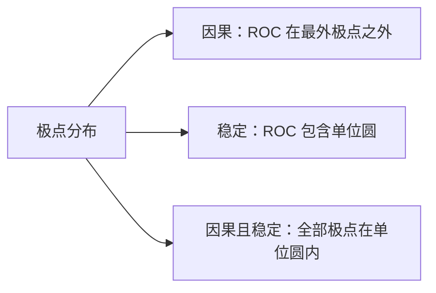
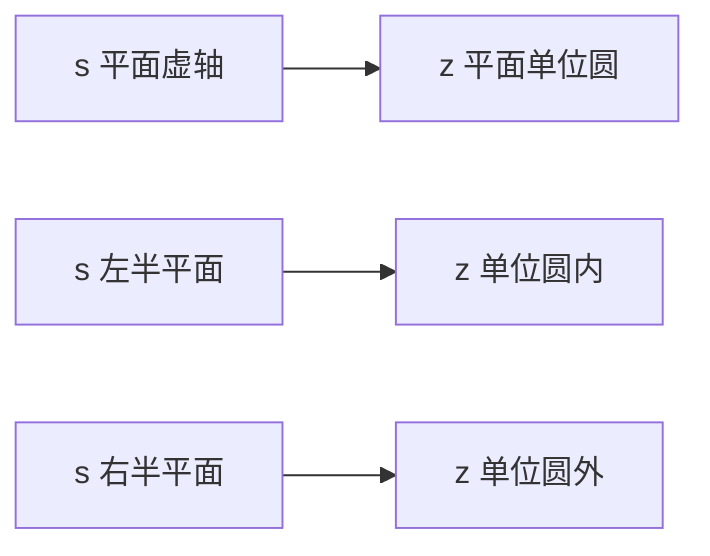

# Z 变换与收敛域

**标签：** #数字信号处理 #DSP #Z变换 #收敛域 #ROC

---

## 一、为什么需要 Z 变换？

离散时间系统分析有三个层次：时域靠**卷积和**（[[【数字信号处理DSP】（七）卷积和|（七）卷积和]]）、频域靠**序列的傅里叶变换（DTFT）**、复频域靠 **Z 变换**。

DTFT 有一个硬伤：它要求序列**绝对可和**，否则级数不收敛。而现实中一大堆有用的序列都不满足，例如

- $u[n]$：$\sum \lvert u[n] \rvert$ 发散
- $a^n u[n]$（$a \gt 1$）：指数增长，更不可能收敛
- 反因果序列 $a^n u[-n-1]$

解决办法很朴素：**给序列乘一个指数衰减因子 $r^{-n}$（$r \gt 0$），把它"压"到可和，再做傅里叶变换。**

$$
X(re^{j\omega}) = \sum_{n=-\infty}^{\infty} \bigl(x[n]\,r^{-n}\bigr) e^{-j\omega n} = \sum_{n=-\infty}^{\infty} x[n]\,(re^{j\omega})^{-n}
$$

把复变量 $re^{j\omega}$ 记作 $z$，右边那个式子就是 **Z 变换**。

> **Z 变换 = 先对序列做指数加权，再做傅里叶变换；它能处理的序列范围比 DTFT 大得多。**

两者的关系一句话说清：**DTFT 就是 Z 变换在单位圆上的取值**（$r = 1$，即 $z = e^{j\omega}$）。所以 Z 变换是把 DTFT"解放"到整个复平面上的推广，而不是另起炉灶的新东西。

---

## 二、定义

### 1. 双边 Z 变换

$$
X(z) = \sum_{n=-\infty}^{\infty} x[n]\,z^{-n}
$$

其中 $z$ 为复变量。使这个级数收敛的 $z$ 的集合，称为**收敛域（Region of Convergence，ROC）**。

### 2. 单边 Z 变换

$$
X(z) = \sum_{n=0}^{\infty} x[n]\,z^{-n}
$$

只对 $n \geq 0$ 求和，适合处理因果序列，以及带初始条件的差分方程（[[【数字信号处理DSP】（九）离散时间系统的时域解法|（九）时域解法]]里的零输入响应就靠它）。若序列本身因果，单边与双边完全一致。

### 3. 收敛条件

级数在 $z$ 处收敛，指的是**绝对可和**：

$$
\sum_{n=-\infty}^{\infty} \lvert x[n] \rvert \, \lvert z \rvert^{-n} \lt \infty
$$

注意式子里只出现 $\lvert z \rvert$，**与辐角 $\omega$ 无关** —— 这一个事实直接决定了 ROC 一定是 z 平面上以原点为中心的圆环。

### 4. 记号约定

$$
x[n] \;\longleftrightarrow\; X(z)
$$

---

## 三、收敛域（ROC）

> 上图：复平面单位圆（虚线）上，$z=0.5$ 处一个极点（红 ×）、$z=-0.5$ 处一个零点（蓝 ○）。因果序列的 ROC 是极点之外、不含极点的区域（蓝色，$|z|>0.5$）。

### 1. ROC 的三条基本性质

1. **ROC 是圆环**：$R_{x-} \lt \lvert z \rvert \lt R_{x+}$，可能退化成"圆外"（$R_{x+}=\infty$）或"圆内"（$R_{x-}=0$）
2. **ROC 内一定不含极点** —— 极点处分母为零，级数必然发散
3. **ROC 边界一定是圆** —— 因为它只由 $\lvert z \rvert$ 决定，与角度无关

### 2. 四类序列与 ROC 的对应

| 序列类型 | 时域范围 | ROC |
|----------|----------|-----|
| 有限长 | 只在 $n_1 \leq n \leq n_2$ 非零 | 整个 z 平面；有负序号项则不含 $\infty$，有正序号项则不含 $0$ |
| 右边（因果） | $n \geq 0$ | $\lvert z \rvert \gt R_{x-}$，含 $\infty$ |
| 右边（一般） | $n \geq n_1$ 且 $n_1 \lt 0$ | $\lvert z \rvert \gt R_{x-}$，不含 $\infty$ |
| 左边 | $n \leq n_2$ | $\lvert z \rvert \lt R_{x+}$；$n_2 \gt 0$ 时不含 $0$ |
| 双边 | $-\infty \lt n \lt \infty$ | 圆环 $R_{x-} \lt \lvert z \rvert \lt R_{x+}$，无公共部分则 Z 变换不存在 |

记忆方法：**看"哪一头"延伸到无穷**。序列往 $n \to +\infty$ 延伸，需要 $z$ 足够大才能压住 $z^{-n}$；往 $n \to -\infty$ 延伸，需要 $z$ 足够小。

### 3. X(z) 与 ROC 必须一起写

同一个表达式，配不同的 ROC 就是**完全不同的两个序列**。这是本章最容易丢分的地方：

$$
X(z) = \frac{1}{1-az^{-1}}, \quad \lvert z \rvert \gt \lvert a \rvert
\qquad \Longleftrightarrow \qquad
x[n] = a^n u[n]
$$

$$
X(z) = \frac{1}{1-az^{-1}}, \quad \lvert z \rvert \lt \lvert a \rvert
\qquad \Longleftrightarrow \qquad
x[n] = -a^n u[-n-1]
$$

所以"求 X(z)"这道题，**不写 ROC 等于没答完**。

### 4. ROC、因果性与稳定性

对 LTI 系统，判据可以全部翻译成 ROC 的语言：

- **因果** $\Longleftrightarrow$ ROC 取**最外极点之外**（延伸到 $\infty$）
- **稳定**（BIBO）$\Longleftrightarrow$ ROC **包含单位圆**
- **因果且稳定** $\Longleftrightarrow$ 全部极点在单位圆内，且 ROC 取 $\lvert z \rvert \gt R_{x-}$

这三条把时域判据（[[【数字信号处理DSP】（二）离散时间系统六大性质判断方法|（二）六大性质]]里的因果性、稳定性）换成了"看图说话"：把极点画在 z 平面上，ROC 怎么画、含不含单位圆，因果与稳定就都出来了。

---

## 四、常用变换对

完整表格见 [[Z 变换表与性质]]。下面这 6 对是必须背到条件反射的：

| 序列 $x[n]$ | $X(z)$ | ROC |
|-------------|--------|-----|
| $\delta[n]$ | $1$ | 整个 z 平面 |
| $u[n]$ | $\dfrac{1}{1-z^{-1}}$ | $\lvert z \rvert \gt 1$ |
| $a^n u[n]$ | $\dfrac{1}{1-az^{-1}}$ | $\lvert z \rvert \gt \lvert a \rvert$ |
| $-a^n u[-n-1]$ | $\dfrac{1}{1-az^{-1}}$ | $\lvert z \rvert \lt \lvert a \rvert$ |
| $n a^n u[n]$ | $\dfrac{az^{-1}}{(1-az^{-1})^2}$ | $\lvert z \rvert \gt \lvert a \rvert$ |
| $\cos(\omega_0 n)u[n]$ | $\dfrac{1-z^{-1}\cos\omega_0}{1-2z^{-1}\cos\omega_0+z^{-2}}$ | $\lvert z \rvert \gt 1$ |

**两个记忆要点**：

1. $u[n]$ 只是 $a=1$ 的特例，所以第 2、3 行的形状完全一样，只是把 $a$ 换成 1。
2. 第 3、4 行**表达式相同、ROC 不同**，正好是上一节那个"必须写 ROC"的例子 —— 这不是巧合，而是 Z 变换的固有性质。

推导 $a^n u[n]$ 的过程就是等比级数求和：

$$
X(z) = \sum_{n=0}^{\infty} a^n z^{-n} = \sum_{n=0}^{\infty} (az^{-1})^n = \frac{1}{1-az^{-1}}, \qquad \lvert az^{-1} \rvert \lt 1 \;\Rightarrow\; \lvert z \rvert \gt \lvert a \rvert
$$

---

## 五、常用性质

完整列表（12 条）见 [[Z 变换表与性质]]，这里只讲**最常用的四条**，以及它们各自"为什么有用"。

| 性质 | 表达式 | 用途 |
|------|--------|------|
| 线性 | $ax[n]+by[n] \leftrightarrow aX(z)+bY(z)$ | 分解复杂序列 |
| 时移 | $x[n-k] \leftrightarrow z^{-k}X(z)$ | **把差分方程变成代数方程** |
| 时域卷积 | $x[n]*y[n] \leftrightarrow X(z)Y(z)$ | **定义系统函数 $H(z)$** |
| z 域微分 | $n x[n] \leftrightarrow -z\dfrac{dX(z)}{dz}$ | 求带 $n$ 的序列 |
| 累加 | $\sum_{k=-\infty}^{n} x[k] \leftrightarrow \dfrac{1}{1-z^{-1}}X(z)$ | 由 $\delta[n]$ 得 $u[n]$ |

其中**时移**和**时域卷积**是整章的核心：前者把差分方程降级成代数方程（下一节），后者让"卷积"变成"乘法"，于是才有了系统函数 $H(z)$ 这个概念。

**单边 Z 变换的时移要注意**：左移（超前）时会多出初始条件项

$$
x[n+k] \;\longleftrightarrow\; z^{k}\Bigl[X(z) - \sum_{m=0}^{k-1} x[m]z^{-m}\Bigr]
$$

右移（延迟）则干净得多：$x[n-k] \leftrightarrow z^{-k}X(z)$，这也是为什么差分方程里的延迟项处理起来毫无负担。

---

## 六、由差分方程直接求 H(z)

把 [[【数字信号处理DSP】（九）离散时间系统的时域解法|（九）时域解法]]里的差分方程

$$
\sum_{k=0}^{N} a_k \, y[n-k] = \sum_{r=0}^{M} b_r \, x[n-r]
$$

逐项做 Z 变换（每项用一次时移性质）：

得到

$$
Y(z)\sum_{k=0}^{N} a_k z^{-k} = X(z)\sum_{r=0}^{M} b_r z^{-r}
\;\Longrightarrow\;
H(z) = \frac{Y(z)}{X(z)} = \frac{\sum\limits_{r=0}^{M} b_r z^{-r}}{\sum\limits_{k=0}^{N} a_k z^{-k}}
$$

**这就是系统函数**：分子由前向系数 $b_r$ 决定（对应零点），分母由反馈系数 $a_k$ 决定（对应极点）。[[【数字信号处理DSP】（十二）系统互联|（十二）系统互联]]里说的"分母对应反馈支路、分子对应前向支路"，根源就在这里。

**例**：差分方程 $y[n] - 0.5y[n-1] = x[n] + 0.8x[n-1]$

**解**：

逐项变换得

$$
Y(z) - 0.5z^{-1}Y(z) = X(z) + 0.8z^{-1}X(z)
$$

整理：

$$
Y(z)\bigl(1 - 0.5z^{-1}\bigr) = X(z)\bigl(1 + 0.8z^{-1}\bigr)
\;\Longrightarrow\;
H(z) = \frac{1 + 0.8z^{-1}}{1 - 0.5z^{-1}}
$$

零点：$1+0.8z^{-1}=0 \Rightarrow z = -0.8$；极点：$z = 0.5$。

极点在单位圆内，取因果 ROC（$\lvert z \rvert \gt 0.5$，含单位圆）⇒ 该系统**因果且稳定**。

注意：拿到 $H(z)$ 后**要不要加 ROC** 取决于问题。判因果稳定性时必须写；而两个系统级联、并联做代数运算时，可以先按表达式算，最后再回头统一确定 ROC。

---

## 七、典型例题

### 例题1：有限长序列

$x[n] = \{1, 2, 3\}$（$n = 0, 1, 2$，其余为零），求 $X(z)$ 与 ROC。

**解**：

$$
X(z) = 1 + 2z^{-1} + 3z^{-2} = \frac{z^2 + 2z + 3}{z^2}
$$

ROC：序列含正序号项（$n=1,2$），所以 $z=0$ 处发散；$z \to \infty$ 时只剩常数项，收敛。故

$$
0 \lt \lvert z \rvert \leq \infty
$$

零点：$z^2+2z+3=0 \Rightarrow z = -1 \pm j\sqrt{2}$；极点：$z=0$（二阶）。

**要点**：有限长序列的 ROC 几乎铺满整个 z 平面，唯一的例外来自"有没有正序号项"（排除 $0$）和"有没有负序号项"（排除 $\infty$）。

### 例题2：因果与反因果指数序列

求 (a) $x[n] = a^n u[n]$ 与 (b) $x[n] = -a^n u[-n-1]$ 的 Z 变换。

**解**：

(a) 等比级数，公比 $az^{-1}$：

$$
X(z) = \sum_{n=0}^{\infty}(az^{-1})^n = \frac{1}{1-az^{-1}}, \qquad \lvert z \rvert \gt \lvert a \rvert
$$

(b) 换成 $m = -n$（$m$ 从 1 到 $\infty$）：

$$
X(z) = -\sum_{n=-\infty}^{-1}a^n z^{-n} = -\sum_{m=1}^{\infty}a^{-m}z^{m} = -\frac{a^{-1}z}{1-a^{-1}z} = \frac{1}{1-az^{-1}}
$$

收敛条件是 $\lvert a^{-1}z \rvert \lt 1$，即

$$
\lvert z \rvert \lt \lvert a \rvert
$$

**要点**：两问的 $X(z)$ 一模一样，ROC 一个在圆外、一个在圆内。这就是"$X(z)$ 与 ROC 必须成对出现"的标准演示。

### 例题3：双边序列

求 $x[n] = a^{\lvert n \rvert}$（$\lvert a \rvert \lt 1$）的 Z 变换。

**解**：

把序列拆成 $n \geq 0$ 与 $n \leq -1$ 两半：

$$
X(z) = 1 + \sum_{n=1}^{\infty}a^n z^{-n} + \sum_{n=1}^{\infty}a^n z^{n}
= 1 + \frac{a}{z-a} + \frac{az}{1-az}
$$

通分：

$$
X(z) = \frac{z(1-a^2)}{(z-a)(1-az)}, \qquad \lvert a \rvert \lt \lvert z \rvert \lt \frac{1}{\lvert a \rvert}
$$

前半部分的 ROC 是 $\lvert z \rvert \gt \lvert a \rvert$，后半部分是 $\lvert z \rvert \lt 1/\lvert a \rvert$，取交集就是这个圆环。

**要点**：因为 $\lvert a \rvert \lt 1$，圆环**包含单位圆**，所以该序列绝对可和、DTFT 存在。若反过来 $\lvert a \rvert \gt 1$，两个不等式无交集，Z 变换就不存在。

### 例题4：一个 X(z) 对应三种序列

设

$$
X(z) = \frac{1}{\bigl(1 - 0.5z^{-1}\bigr)\bigl(1 - 2z^{-1}\bigr)}
$$

极点分别在 $z = 0.5$ 与 $z = 2$。讨论三种可能的 ROC 对应的序列类型与因果性、稳定性。

**解**：

| ROC | 序列类型 | 因果性 | 稳定性 |
|-----|----------|--------|--------|
| $\lvert z \rvert \gt 2$ | 右边序列 | 因果 | 不稳定（不含单位圆） |
| $\lvert z \rvert \lt 0.5$ | 左边序列 | 反因果 | 不稳定 |
| $0.5 \lt \lvert z \rvert \lt 2$ | 双边序列 | 非因果 | **稳定**（含单位圆） |

**要点**：极点位置固定不变，**因果性和稳定性是由 ROC 的选择决定的**。这道题是考"给定 $X(z)$ 判因果稳定"的母题：先把极点画出来，再数单位圆落在哪个区域里。

---

## 八、与 DTFT、拉普拉斯变换的关系

### 1. 单位圆上的 Z 变换就是 DTFT

$$
X(e^{j\omega}) = X(z), \qquad z = e^{j\omega}
$$

由此得到 DTFT 的存在条件：**ROC 包含单位圆**。这也解释了为什么 $a^{\lvert n \rvert}$（$\lvert a \rvert \lt 1$）有 DTFT，而 $a^n u[n]$（$a \gt 1$）没有 —— 后者的 ROC 是 $\lvert z \rvert \gt a$，单位圆在外面。

### 2. z 平面与 s 平面的映射

采样周期 $T$，令 $z = e^{sT}$、$s = \sigma + j\Omega$，则

$$
\lvert z \rvert = e^{\sigma T}, \qquad \angle z = \Omega T
$$

| s 平面 | z 平面 |
|--------|--------|
| 虚轴 $j\Omega$ | 单位圆 |
| 左半平面（稳定） | 单位圆内（稳定） |
| 右半平面（不稳定） | 单位圆外（不稳定） |
| 宽 $2\pi/T$ 的横带 | 整个 z 平面（多值映射） |

最后一行就是"采样导致频谱周期延拓"的复频域版本，可以和 [[【数字信号处理DSP】（十一）奈奎斯特采样定理|（十一）奈奎斯特采样定理]]对照看：**s 平面到 z 平面是"无穷多对一"的映射**，所以 z 域的分辨能力天然比 s 域弱一环。

---

## 九、常见错误提醒

1. **只写 $X(z)$ 不写 ROC**：$X(z)$ 不是序列的唯一表示（例题2 就是反例）。
2. **把 ROC 写成"某些具体点"**：ROC 只由 $\lvert z \rvert$ 决定，一定是一个圆环（或圆外、圆内），不可能算出半个圆。
3. **有限长序列的 ROC 说成"整个 z 平面"**：忘了排除 $z=0$ 或 $z=\infty$，要看有没有正、负序号项。
4. **混淆单边与双边**：单边 Z 变换的左移要补初始条件项，右移不用。
5. **用"$\lvert z \rvert \gt 1$"当稳定判据**：稳定是"ROC 含单位圆"，两者只有在因果序列时才等价。
6. **把 DTFT 和 Z 变换当成两套无关工具**：DTFT 就是单位圆上的 Z 变换，收敛域含不含单位圆决定了 DTFT 存不存在。
7. **做代数运算时带着 ROC 一路算**：级联、并联时 ROC 会出现"包含交集"的情况（见（十二）），先算表达式、后定 ROC 更稳。

---

## 十、知识链定位

Z 变换与收敛域（本节）

│

├── 定义：双边 / 单边

├── 收敛域 ROC：圆环 + 不含极点 + 只与 |z| 有关

├── 四类序列 ↔ ROC 形状

├── 与因果性、稳定性的对应：最外极点外 / 含单位圆 / 极点全在圆内

└── 时移与卷积 → 系统函数 H(z)

│

├── 逆 Z 变换：部分分式、留数、幂级数（下一节）

├── 系统函数 H(z)：极零点分布与稳定性判据

├── 频率响应 H(e^{jω})：单位圆上的取值

└── DTFT / DFT / FFT：单位圆上取值的均匀化

---

## 十一、总结

- Z 变换是对序列做**指数加权后的 DTFT**，推广到整个复平面；DTFT 是它在单位圆上的特例。
- $X(z)$ 必须与 **ROC 成对出现**，同一个表达式配不同 ROC 就是不同序列。
- ROC 是**圆环、不含极点、只由 $\lvert z \rvert$ 决定**；四类序列各有固定的 ROC 形状。
- 因果 $\leftrightarrow$ ROC 在最外极点之外；稳定 $\leftrightarrow$ ROC 含单位圆；**因果且稳定 $\leftrightarrow$ 全部极点在单位圆内**。
- 时移性质把差分方程变成代数方程，卷积性质把卷积变成乘法 —— 于是有了 $H(z)$。
- z 平面与 s 平面通过 $z=e^{sT}$ 相连，虚轴对应单位圆，且是"无穷多对一"的映射。

---

> **一句话总结**：Z 变换的价值在于它把"不收敛的序列"救回来了 —— 代价是必须多写一行 ROC。记住三件事就不会错：**ROC 是圆环、圆环里没有极点、单位圆在不在圆环里决定了系统稳不稳**。
