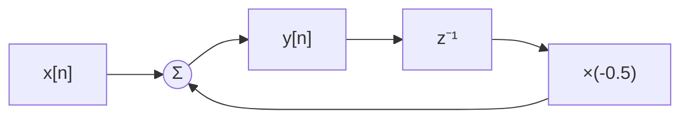
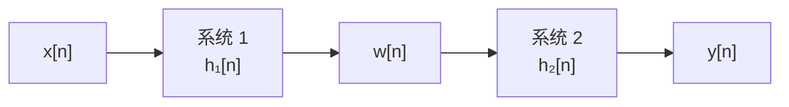
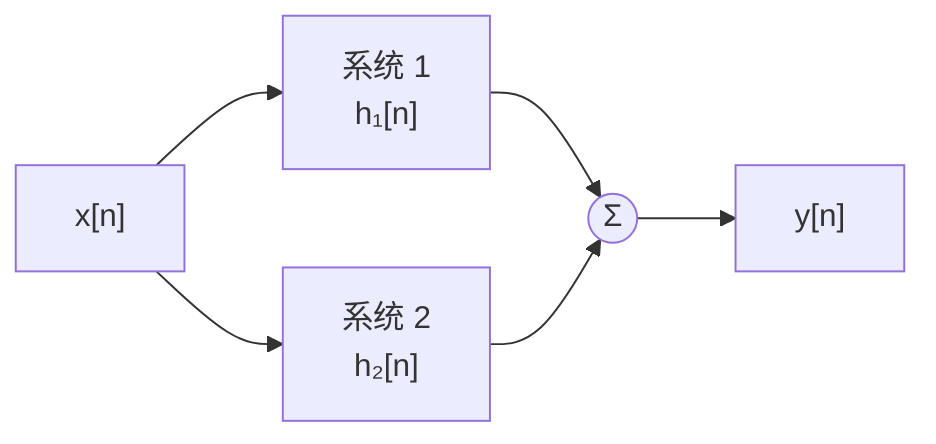
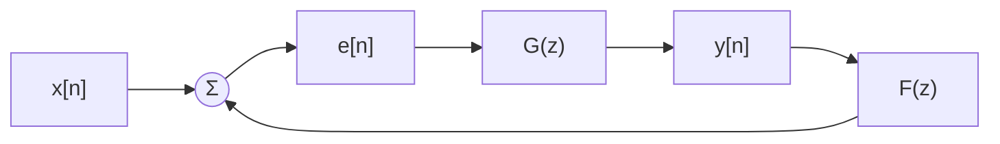
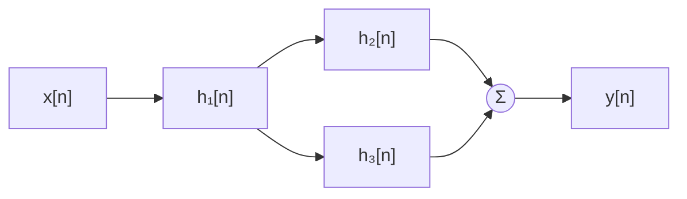

# 系统互联

**标签：** #数字信号处理 #DSP #系统互联 #级联 #并联 #反馈

---

## 一、为什么需要研究系统互联？

实际的数字信号处理系统很少只由一个环节构成，而是若干简单子系统连接起来的结果：

- 一个 FIR 均衡器后面接一个 IIR 陷波器 —— **级联**
- 两路不同滤波器的输出相加，凑出梳状或更陡的过渡带 —— **并联**
- 把输出的一部分送回输入端去修正输入，构成 IIR 滤波器、锁相环、控制器 —— **反馈**

把复杂系统拆成模块再互联，好处是可复用、可调试、可分步设计。但拆开之后绕不开三个问题：

1. **功能问题**：已知各子系统的 \(h_i[n]\) 或 \(H_i(z)\)，整体系统的 \(h[n]\)、\(H(z)\) 怎么求？
2. **性质问题**：各子系统的因果性、稳定性，互联之后还在不在？
3. **实现问题**：功能相同的系统，哪种互联结构运算量更小、存储更省、定点实现时舍入噪声更小？

本节回答前两个问题，第三个问题给出定性的判断标准。它是「差分方程」与「系统函数」之间的桥梁，也是后面讲**数字滤波器结构**（直接型、级联型、并联型）的直接基础。

> **本节要建立的三条直觉**
>
> - 级联 → 冲激响应**卷积**、系统函数**相乘**；
> - 并联 → 冲激响应**相加**、系统函数**相加**；
> - 反馈 → 唯一会**改写极点位置**的结构，所以每一条闭环都必须重新判稳。

---

## 二、基本运算单元与框图表示

任何 LTI 离散时间系统，最终都可以只用三种基本单元互联实现：

| 单元 | 框图符号 | 输入输出关系 | 说明 |
|------|---------|-------------|------|
| 乘法器 | 方框内标系数，如 `×a` | \(y[n] = a\,x[n]\) | 系数随 \(n\) 变化时为 \(a[n]\)，系统变成时变系统 |
| 加法器 | 圆圈 `＋`，可多路输入 | \(y[n] = x_1[n] + x_2[n]\) | 与减法统一：把系数写成 \(-1\) 即为减法 |
| 单位延迟 | 方框 `z⁻¹` | \(y[n] = x[n-1]\) | 存储一个样本，是「反馈可实时实现」的前提 |

有了这三种单元，一个差分方程就能直接画成框图。例如

$$
y[n] = x[n] - 0.5\,y[n-1]
$$

图中单位延迟 \(z^{-1}\) 把输出 \(y[n]\) 引回到加法器 —— 这已经是一个最简单的**反馈连接**。可见互联不只是「把系统接起来」，它本身就是差分方程的一种图形表达。

### 读图的三个步骤

反过来，给定框图求系统函数，机械地做三件事就够了：

1. **给每个加法器输出起个名字**（\(e[n], w[n], y[n]\)……）；
2. **沿箭头方向，在每个加法器处写一个方程**（输入之和 = 该节点信号）；
3. **在 z 域联立消去所有中间变量**，只留 \(Y(z)\) 与 \(X(z)\)。

这三步对任何复杂的互联结构都成立，是后面级联、并联、反馈、混联所有公式的**统一来源**。记住步骤比背公式可靠。

---

## 三、级联（串联）

> 上图：一阶低通 \(H_1\) 与二阶陷波器 \(H_2\)（零点位于单位圆上的 \(e^{\pm j\pi/2}\)）级联。三个子系统各自都是「平的」或者「宽凹的」，但相乘之后，整体同时具备低通形状与 \(\omega=\pi/2\) 处的**零增益陷波**。注意级联只能**相乘**：某处只要有一个子系统为零，整体就为零；但一个子系统做不到的深谷，另一个也补不出来。

### 1. 定义

两个系统首尾相连，前一个的输出作为后一个的输入。

### 2. 整体单位脉冲响应

中间信号 \(w[n] = h_1[n] * x[n]\)，输出 \(y[n] = h_2[n] * w[n]\)。由卷积的结合律：

$$
h[n] = h_1[n] * h_2[n] = h_2[n] * h_1[n]
$$

也就是说：**级联系统的单位脉冲响应等于各子系统单位脉冲响应的卷积**。

### 3. 整体系统函数

对两边取 Z 变换，时域卷积对应 z 域相乘：

$$
H(z) = H_1(z) \cdot H_2(z)
$$

同理，频域上幅频特性相乘、相频特性相加：

$$
H(e^{j\omega}) = H_1(e^{j\omega}) \, H_2(e^{j\omega}), \qquad
\lvert H(e^{j\omega}) \rvert = \lvert H_1 \rvert \cdot \lvert H_2 \rvert, \qquad
\angle H = \angle H_1 + \angle H_2
$$

**取对数之后乘法变加法**：\(20\lg\lvert H\rvert = 20\lg\lvert H_1\rvert + 20\lg\lvert H_2\rvert\)。这就是伯德图能「把级联系统的曲线直接叠起来看」的原因，也是工程上大量使用 dB 的实际动机。

### 4. 极零点集合：直接并起来

设 \(H_1 = N_1/D_1\)、\(H_2 = N_2/D_2\)，则

$$
H(z) = \frac{N_1(z) N_2(z)}{D_1(z) D_2(z)}
$$

于是

- **零点** = \(H_1\) 的零点 \(\cup\) \(H_2\) 的零点（重数相加）
- **极点** = \(H_1\) 的极点 \(\cup\) \(H_2\) 的极点（重数相加）

**级联不会凭空造出新极点，也不会凭空消掉极点** —— 除非两个子系统的零点、极点恰好落在同一位置（极零相消），那属于人为设计，不是级联本身的性质。

### 5. 收敛域（ROC）

级联后极点是两个子系统极点集合的并集，所以一般有

$$
R \supseteq R_1 \cap R_2
$$

注意是**包含**而不是等于。若某子系统的极点恰好被另一个子系统的零点抵消（极零相消），公共部分会扩大，甚至整体可能变成有限长系统。

例：\(H_1(z) = 1 - 2z^{-1}\)（零点 \(z=2\)）与 \(H_2(z) = \dfrac{1}{1 - 2z^{-1}}\)（极点 \(z=2\)，ROC 为 \(\lvert z \rvert \gt 2\)）级联，整体 \(H(z)=1\)，ROC 变成整个 z 平面。

> **工程提醒**：这种「用不稳定子系统抵消出稳定系统」在数学上成立，实际实现时中间信号 \(w[n] = 2^n u[n]\) 会发散到溢出，工程上**不能这样搭**。理论等价 ≠ 实现等价，这是本节反复出现的主题。

### 6. 性质

- 卷积满足**交换律**，级联顺序不影响整体响应（仅对 LTI 系统成立）
- 卷积满足**结合律**，多个系统可以任意分组化简
- 各子系统**稳定** ⇒ 级联**稳定**（BIBO 稳定性由 \(\sum \lvert h[n] \rvert \lt \infty\) 判断，卷积后仍是绝对可和）
- 各子系统**因果** ⇒ 级联**因果**
- 反过来**不成立**：整体稳定/因果，推不出每个子系统都稳定/因果

### 7. 顺序与代价：为什么工程上仍然要挑顺序

理论上 \(h_1 * h_2 = h_2 * h_1\)，实际实现却有区别：

| 差别 | 说明 |
|------|------|
| 阶次 | 总阶次 = 各子系统阶次之和，与顺序无关 |
| 中间信号动态范围 | 先放大再衰减，中间信号可能溢出；先衰减再放大，可能被量化噪声淹没 |
| 定点舍入噪声 | 增益大的环节放前面，噪声被后面的衰减压下去；反过来噪声被放大 |

所以**「可交换」是数学结论，「随便换」不是工程结论**。滤波器设计软件里能手动拖级联顺序，就是给这件事留的操作空间。

### 8. 例题

> **答题模板（本节通用：已知互联结构求整体 \(H(z)\) 并判稳）**
>
> ① 写出各子系统的 \(H_i(z)\) 及 ROC（给框图时先按「起名 → 列方程 → 消中间变量」）；
> ② 按互联类型套公式：级联 \(H_1H_2\)、并联 \(H_1+H_2\)、反馈 \(G/(1\pm GF)\)；
> ③ 通分整理成 \(z^{-1}\) 的有理式，能约分就约分（极零相消会改变 ROC）；
> ④ 分子 \(=0\) 得零点，分母 \(=0\) 得极点；
> ⑤ 由「因果 ⇔ ROC 在最外极点之外」定 ROC；
> ⑥ 全部极点满足 \(\lvert p_i \rvert \lt 1\) ⇔ 因果稳定；
> ⑦ **检验**：\(h[0] = \lim_{z\to\infty} H(z)\)，\(H(1) = \sum_n h[n]\)（后者要求 ROC 含 \(z=1\)）。

**例 1（级联）** 系统 1：\(H_1(z) = 1 - 0.5 z^{-1}\)（零点 \(z = 0.5\)）；系统 2：\(H_2(z) = \dfrac{1}{1 - 0.8 z^{-1}}\)（极点 \(z = 0.8\)，ROC \(\lvert z \rvert \gt 0.8\)）。求整体 \(H(z)\)、零极点、ROC、稳定性与 \(h[n]\)。

**解**：

（1）套级联公式

$$
H(z) = H_1(z)H_2(z) = \frac{1 - 0.5 z^{-1}}{1 - 0.8 z^{-1}}
$$

（2）零点 \(z = 0.5\)，极点 \(z = 0.8\)，两者不重合，故 \(R \supseteq R_1 \cap R_2\) 取等号：

$$
\text{ROC}: \; \lvert z \rvert \gt 0.8
$$

（3）极点位于单位圆内且 ROC 在极点外侧 ⇒ 整体**因果且稳定**。与「两个因果稳定系统级联仍因果稳定」一致。

（4）求 \(h[n]\)：分子分母同阶，先做长除分离出常数项

$$
H(z) = 1 + \frac{0.3\,z^{-1}}{1 - 0.8 z^{-1}}
$$

查表 \(\dfrac{z^{-1}}{1-az^{-1}} \leftrightarrow a^{\,n-1}u[n-1]\)：

$$
\boxed{\;h[n] = \delta[n] + 0.3 \times 0.8^{\,n-1}\, u[n-1]\;}
$$

（5）**检验**：\(h[0] = 1 = \lim_{z\to\infty}H(z)\) ✓；求和

$$
\sum_{n=0}^{\infty} h[n] = 1 + 0.3 \cdot \frac{1}{1-0.8} = 1 + 1.5 = 2.5,
\qquad H(1) = \frac{0.5}{0.2} = 2.5 \;\checkmark
$$

两条检验都通过，结果可信。

**例 2（级联的极零相消）** 判断：两个不稳定系统级联，整体一定不稳定吗？

**解**：

（1）**判据**：整体稳定性只看最终 \(H(z)\) 的极点位置，而不是子系统的稳定性。

（2）**代入反例**：取 \(H_1(z) = \dfrac{1}{1-2z^{-1}}\)（极点 \(z=2\)，不稳定）、\(H_2(z) = 1-2z^{-1}\)（零点 \(z=2\)，FIR 本身稳定）。

$$
H(z) = \frac{1-2z^{-1}}{1-2z^{-1}} = 1
$$

整体是纯直通系统，极点被零点完全抵消，**稳定**。

（3）**结论**：命题**不成立**。但必须补一句：中间信号 \(w[n]=2^n u[n]\) 发散，实现时溢出，工程上不可取。

---

## 四、并联

### 1. 定义

两个系统共用同一输入，输出相加。

### 2. 整体单位脉冲响应

由系统的线性（叠加原理）：

$$
h[n] = h_1[n] + h_2[n]
$$

**并联系统的单位脉冲响应等于各子系统单位脉冲响应之和。**

### 3. 整体系统函数

$$
H(z) = H_1(z) + H_2(z), \qquad H(e^{j\omega}) = H_1(e^{j\omega}) + H_2(e^{j\omega})
$$

注意频域是**复数相加**而不是模相加，两路信号可能同相叠加、也可能反相抵消 —— 这正是并联结构能造出「陷波零点」的原因。

举一个最小例子：\(H_1 = \dfrac{1}{1-0.9z^{-1}}\)、\(H_2 = \dfrac{-0.9z^{-1}}{1-0.9z^{-1}}\)，两路幅度几乎一样、相位反着来，相加得 \(H = \dfrac{1-0.9z^{-1}}{1-0.9z^{-1}} = 1\)。这就是一个**梳状/补偿**思想的雏形。

### 4. 极零点与 ROC

通分：

$$
H(z) = \frac{N_1}{D_1} + \frac{N_2}{D_2} = \frac{N_1 D_2 + N_2 D_1}{D_1 D_2}
$$

- **极点**：仍是 \(H_1\) 与 \(H_2\) 的极点并集（因为分母就是 \(D_1D_2\)），除非分子恰在这些位置也为零
- **零点**：由 \(N_1D_2 + N_2D_1 = 0\) 决定，**不能**由子系统零点直接得到 —— 这是并联与级联最大的差别

$$
R \supseteq R_1 \cap R_2
$$

稳定性方面比级联苛刻：**只要有一个子系统不稳定，整体一般就不稳定**，除非两个不稳定子系统恰好完全相消（例如 \(H_1 = \frac{1}{1-az^{-1}}\) 与 \(H_2 = -\frac{1}{1-az^{-1}}\) 相加得 0，同样存在中间信号发散的实际问题）。

### 5. 例题

**例 3（并联）** 求 \(H(z) = \dfrac{1}{1 - 0.5 z^{-1}} + \dfrac{1}{1 - 0.8 z^{-1}}\) 的整体系统函数、零极点、ROC、稳定性与 \(h[n]\)。

**解**：

（1）通分

$$
H(z) = \frac{(1 - 0.8 z^{-1}) + (1 - 0.5 z^{-1})}{(1 - 0.5 z^{-1})(1 - 0.8 z^{-1})} = \frac{2 - 1.3 z^{-1}}{(1 - 0.5 z^{-1})(1 - 0.8 z^{-1})}
$$

（2）极点 \(z = 0.5\) 与 \(z = 0.8\)：两个子系统的极点**都保留**，并联没有产生极零相消。

（3）零点：\(2 - 1.3z^{-1} = 0 \Rightarrow z = 0.65\)。

（4）ROC：\(\lvert z \rvert \gt 0.8\)；两路各自因果稳定 ⇒ 整体因果稳定。

（5）\(h[n]\) 不必逆变换 —— 并联的冲激响应就是两路相加：

$$
\boxed{\;h[n] = 0.5^{\,n}u[n] + 0.8^{\,n}u[n]\;}
$$

（6）**检验**：\(h[0] = 1+1 = 2\)，而 \(\lim_{z\to\infty}H(z) = 2\) ✓；

$$
\sum_{n\ge 0} h[n] = \frac{1}{1-0.5} + \frac{1}{1-0.8} = 2 + 5 = 7,
\qquad H(1) = \frac{0.7}{0.5 \times 0.2} = \frac{0.7}{0.1} = 7 \;\checkmark
$$

> **并行实现的价值**：并联结构里各路**互不影响**，可以同时算、可以流水线化。这就是为什么高速 FPGA 实现常把高阶系统拆成并联型：代价是极点保留得更多（阶次更高），换来的是关键路径更短。

---

## 五、反馈连接

> 上图：取 \(G(z)=\dfrac{1}{1-0.5z^{-1}}\)、反馈为常数 \(F=k\)。**左**：闭环极点 \(p=\dfrac{0.5}{1\pm k}\) 只沿实轴移动 —— 负反馈把极点往原点拉（越来越稳），正反馈把它往外推，\(k=1.2\) 时已到 \(p=-2.5\)（出圈失稳）。**右**：极点内移让通带变宽（曲线更平），但直流增益从 \(2\) 降到 \(0.667\)、\(0.286\)，负反馈本质上是**拿增益换带宽**。

### 1. 定义

前向通路的输出经反馈通路送回输入端，与输入相减（**负反馈**）或相加（**正反馈**）。

### 2. 整体系统函数的推导

设加法器输出（误差信号）为 \(e[n]\)，整个系统设为 LTI，则在 z 域有

$$
E(z) = X(z) \mp F(z)Y(z), \qquad Y(z) = G(z)E(z)
$$

其中「\(-\)」对应负反馈、「\(+\)」对应正反馈。代入消去 \(E(z)\)：

$$
Y(z) = G(z)\bigl[X(z) \mp F(z)Y(z)\bigr]
\;\Longrightarrow\;
Y(z)\bigl[1 \pm G(z)F(z)\bigr] = G(z)X(z)
$$

于是

$$
H(z) = \frac{Y(z)}{X(z)} = \frac{G(z)}{1 \pm G(z)F(z)}
=
\begin{cases}
\dfrac{G(z)}{1 + G(z)F(z)}, & \text{负反馈（相减）} \\[10pt]
\dfrac{G(z)}{1 - G(z)F(z)}, & \text{正反馈（相加）}
\end{cases}
$$

分母中出现的 \(G(z)F(z)\) 称为**开环系统函数**（把回路在某处断开后量到的系统函数），整体 \(H(z)\) 则称为**闭环系统函数**。

由 \(H(z)\) 求时域响应：\(h[n] = \mathcal{Z}^{-1}\{H(z)\}\)，通常先做部分分式展开再查表（见 [[Z 变换表与性质]]）。

### 3. 闭环极点与特征方程

令分母为零，得到**特征方程**：

$$
1 + G(z)F(z) = 0 \quad (\text{负反馈}), \qquad 1 - G(z)F(z) = 0 \quad (\text{正反馈})
$$

它的根就是闭环极点。闭环**因果系统稳定**的充要条件是：

$$
\text{全部闭环极点位于单位圆内，即 } \lvert z_i \rvert \lt 1
$$

### 4. 闭环的零极点：一个精确的结论

把 \(G = N_G/D_G\)、\(F = N_F/D_F\) 代入：

$$
H(z) = \frac{N_G/D_G}{1 + N_G N_F/(D_G D_F)}
= \frac{N_G(z)\,D_F(z)}{D_G(z)D_F(z) + N_G(z)N_F(z)}
$$

由此得到两条**非常实用**的结论：

$$
\text{闭环零点} = \underbrace{G\text{ 的零点}}_{\text{前向通路零点}} \cup \underbrace{F\text{ 的极点}}_{\text{反馈通路极点}},
\qquad
\text{闭环极点} = \text{特征方程的根（不能由开环极点直接写出）}
$$

闭环零点是「旧零点 + 旧极点」，闭环极点却是**全新**的一批数 —— 这就是反馈与前两种互联的根本区别。

### 5. 极点移动的定量规律（一阶）

若前向通路是一阶 \(G(z) = \dfrac{1}{1 - p z^{-1}}\)、反馈为常数增益 \(F = k\)，特征方程为

$$
(1 - p z^{-1}) \pm k = 0
\;\Longrightarrow\;
z = \frac{p}{1 \pm k}
$$

即

$$
\boxed{\;p_{\text{闭环}} = \frac{p}{1 + k}\;(\text{负反馈}), \qquad
p_{\text{闭环}} = \frac{p}{1 - k}\;(\text{正反馈})\;}
$$

这一个式子解释了反馈的几乎所有行为。注意**负反馈的极点恒在 \(\lvert p/(1+k)\rvert \lt \lvert p\rvert\)**，所以一阶系统加常数负反馈永远不会失稳；而正反馈有一个**临界增益** \(k_{\text{crit}} = 1-p\)，越过它极点就冲出单位圆。

| 情形 | 极点位置 | 含义 |
|------|---------|------|
| 负反馈 \(k \gt 0\) | \(\dfrac{p}{1+k}\)，绝对值必小于 \(\lvert p \rvert\) | 极点内移 → 收敛更快、更稳；直流增益由 \(\dfrac{1}{1-p}\) 降为 \(\dfrac{1}{1+k-p}\) |
| 正反馈 \(0 \lt k \lt 1-p\) | \(\dfrac{p}{1-k}\)，仍在圆内但更靠外 | 时间常数变大，阶跃响应拖尾变长 |
| 正反馈 \(k = k_{\text{crit}} = 1-p\) | 恰为 \(z=1\)（单位圆上） | **临界稳定**，等幅振荡、不衰减 |
| 正反馈 \(k \gt 1-p\) | \(\left\lvert \dfrac{p}{1-k} \right\rvert \gt 1\) | 出圈失稳，输出指数发散 |

> 别把「直流增益降为 \(1/(1+k)\)」当成普遍结论 —— 那个式子只在 \(p=0\)（无记忆）时成立。极点移动后直流增益是 \(\dfrac{1}{1+k-p}\)，具体数值在下面的例题里逐条核对。

**千万记住**：前向通路和反馈通路各自稳定，闭环仍可能不稳定。看下面这个例子：\(G(z) = \dfrac{1}{1 - 0.5z^{-1}}\)（极点 \(0.5\)，稳定），反馈取常数 \(F = 1.2\) 的**正**反馈，则

$$
H(z) = \frac{G(z)}{1 - G(z)F(z)} = \frac{1}{1 - 0.5z^{-1} - 1.2} = \frac{1}{-0.2 - 0.5 z^{-1}}
$$

变形为 \(z^{-1}\) 的标准形式：

$$
H(z) = \frac{-5}{1 + 2.5 z^{-1}}
$$

闭环极点 \(z = \dfrac{0.5}{1-1.2} = -2.5\)，落在单位圆外 ⇒ **闭环不稳定**，因为正反馈把极点推到了单位圆外。

### 6. 无延迟回路：能不能实时实现？

差分方程

$$
y[n] = x[n] + a\,y[n]
$$

在 \(a \neq 1\) 时可以解出 \(y[n] = \dfrac{1}{1-a}x[n]\)，它只是一次纯缩放，并不真正构成递归。这种「绕一圈没有任何延迟」的回路称为**无延迟回路（代数环）**：当前输出直接依赖当前输出，无法按样本顺序逐点计算。

$$
y[n] = x[n] + a\,y[n]
\;\Longrightarrow\;
y[n] = \frac{1}{1-a}x[n]
\qquad(\text{不是递归，只是缩放})
$$

而正常的递归单元总是含一个延迟：

$$
y[n] = x[n] + a\,y[n-1]
\;\Longleftrightarrow\;
H(z) = \frac{1}{1 - a z^{-1}}
$$

结论：**可实时实现的反馈结构中，回路内至少要有一个单位延迟。** 画框图时若发现回路里没有 \(z^{-1}\)，说明模型需要改写 —— 现实电路中反馈总要走完一个采样周期，补上这个 \(z^{-1}\) 才是正确的离散模型。这也是硬件实现差分方程时最容易出错的地方。

### 7. 反馈的三类典型用途

| 用途 | 做法 | 结果 |
|------|------|------|
| 移动极点、稳定或加速系统 | 选 \(F(z)\) 使 \(1 \pm GF = 0\) 的根落在期望位置 | 极点内移，响应更快更稳（见上图） |
| 实现逆系统 | 前向增益取很大（理想增益 \(K\to\infty\)） | \(H = \dfrac{KG}{1+KG F} \to \dfrac{1}{F}\)，即反馈通路的倒数 |
| 构成振荡器 | 闭环极点恰好落在单位圆上 | 无输入也能维持等幅振荡（滤波器设计中要避免） |

逆系统那一条值得推一下：把分子分母同除以 \(KG\)，

$$
\lim_{K\to\infty} \frac{KG}{1 + KGF} = \lim_{K\to\infty}\frac{1}{1/(KG) + F} = \frac{1}{F}
$$

所以「大增益 + 负反馈」是构造逆滤波器（例如信道均衡）的标准手段，代价是对 \(G\) 的精度要求极高。

另外，反馈结构本身就是 IIR 滤波器的来源：分母 \(a_k\) 对应反馈支路（AR 部分），分子 \(b_r\) 对应前向支路（MA 部分）。

### 8. 例题

**例 4（负反馈配置极点）** \(G(z) = \dfrac{1}{1 - 0.5z^{-1}}\)，取负反馈 \(F = 1\)。求闭环 \(H(z)\)、极点、稳定性与 \(h[n]\)。

**解**：

（1）套负反馈公式

$$
H(z) = \frac{G(z)}{1 + G(z)} = \frac{1}{(1 - 0.5z^{-1}) + 1} = \frac{1}{2 - 0.5 z^{-1}} = \frac{0.5}{1 - 0.25 z^{-1}}
$$

（2）闭环极点 \(z = 0.25\)，比开环的 \(0.5\) 更靠近原点；ROC \(\lvert z \rvert \gt 0.25\)，因果稳定。

（3）逆变换（标准一阶形式，直接用 \(\dfrac{1}{1-az^{-1}} \leftrightarrow a^n u[n]\)）：

$$
\boxed{\;h[n] = 0.5 \times 0.25^{\,n} u[n]\;}
$$

（4）**检验**：\(h[0] = 0.5 = \lim_{z\to\infty}H(z)\) ✓；

$$
\sum_{n\ge0} h[n] = \frac{0.5}{1-0.25} = \frac{2}{3},
\qquad H(1) = \frac{0.5}{0.75} = \frac{2}{3} \;\checkmark
$$

（5）**对照体会**：开环直流增益 \(2\)，闭环降到 \(2/3\)（变为 \(1/3\)）；而 \(-3\) dB 点由 \(\omega\approx0.72\) 扩到 \(\omega\approx1.70\)（约 \(2.3\) 倍）。增益下来了、带宽上去了 —— **极点内移是用增益换带宽**，这是负反馈最本质的权衡，也是运放、锁相环、控制回路里反复出现的那笔账。

**例 5（正反馈失稳）** 同一条 \(G(z) = \dfrac{1}{1-0.5z^{-1}}\)，取正反馈 \(F = 1.2\)，判断闭环稳定性并求 \(h[n]\)。

**解**：

（1）套正反馈公式

$$
H(z) = \frac{G}{1 - 1.2G} = \frac{1}{1 - 0.5z^{-1} - 1.2} = \frac{1}{-0.2 - 0.5z^{-1}} = \frac{-5}{1 + 2.5 z^{-1}}
$$

（2）闭环极点 \(z = \dfrac{0.5}{1-1.2} = -2.5\)，模大于 1。

（3）**判据**：全部闭环极点须满足 \(\lvert p \rvert \lt 1\)；此处 \(\lvert -2.5 \rvert = 2.5 \gt 1\) ⇒ **不稳定**。

（4）\(h[n] = -5(-2.5)^n u[n]\)，逐点指数发散。

（5）**检验**：\(h[0] = -5 = \lim_{z\to\infty}H(z)\) ✓；\(H(1) = \dfrac{-5}{1+2.5} = -\dfrac{10}{7}\) 为负值 —— 与「不稳定系统的 \(H(1)\) 没有 \(\sum h[n]\) 的物理意义」并不矛盾，因为此时 ROC 不含 \(z=1\)，**不能**再用 \(H(1)=\sum h[n]\) 做检验。这正是检验法的适用条件。

**例 6（反求反馈增益）** \(G(z) = \dfrac{1}{1 - 0.8z^{-1}}\)，用常数负反馈把闭环极点配置到 \(0.2\)，求反馈增益 \(k\)。

**解**：

（1）**判据**：闭环极点满足 \(p = \dfrac{p_0}{1+k}\)。

（2）**代入**：\(\dfrac{0.8}{1+k} = 0.2 \Rightarrow 1+k = 4 \Rightarrow k = 3\)。

（3）**检验**：\(H = \dfrac{G}{1+3G} = \dfrac{1}{1-0.8z^{-1}+3} = \dfrac{1}{4-0.8z^{-1}} = \dfrac{0.25}{1-0.2z^{-1}}\)，极点确为 \(0.2\) ✓；直流增益由 \(5\) 降为 \(\dfrac{0.25}{0.8}=0.3125\)（降 \(16\) 倍），与 \(\dfrac{1-p}{1+k-p}=\dfrac{0.2}{3.2}=\dfrac{1}{16}\) 完全一致 ✓。

$$
\boxed{\;k = 3\;}
$$

**例 7（一阶 IIR 就是「延迟 + 反馈」）** 前向通路只取一个单位延迟 \(G(z)=z^{-1}\)，正反馈 \(F = k\)。求闭环系统函数并讨论 \(k\) 的取值。

**解**：

（1）\(H(z) = \dfrac{z^{-1}}{1 - k z^{-1}}\)。

（2）极点 \(z = k\)：\(\lvert k \rvert \lt 1\) 时因果稳定，此时

$$
h[n] = k^{\,n-1}u[n-1]
$$

也就是一个无限长、指数衰减的冲激响应 —— **任何一阶 IIR 系统都可以看成「一个延迟 + 一条反馈」**。

（3）\(k=1\) 时极点落在单位圆上，\(H(z) = \dfrac{z^{-1}}{1-z^{-1}}\)，即累加器 \(h[n]=u[n-1]\)，**临界稳定**（不衰减也不发散，但阶跃输入会无限累加）。

（4）**检验**：\(k=0.9\) 时 \(\sum h[n] = \dfrac{1}{1-0.9}=10\)，而 \(H(1)=\dfrac{1}{0.1}=10\) ✓。

$$
\boxed{\;\lvert k \rvert \lt 1 \text{ 稳定},\; k=1 \text{ 临界},\; \lvert k \rvert \gt 1 \text{ 发散}\;}
$$

---

## 六、混联（串并联）

实际系统常常既有级联又有并联。化简原则只有一句：**由内向外，先并后串（内层先算）**。

遇到**嵌套反馈**（反馈环里再套一个反馈环），也是同一个思路：**先把最内层的闭环算成一个方框**，再把它当成外层的一个普通子系统。绝不能把内环的 \(G\)、\(F\) 直接塞进外层公式。

### 例题 8：先串后并的混联系统

取 \(H_1(z) = 1 - 0.5 z^{-1}\)，\(H_2(z) = \dfrac{1}{1 - 0.8 z^{-1}}\)，\(H_3(z) = 1\)，结构为 \(H_1\) 与 \((H_2 \parallel H_3)\) 级联。

**解**：

（1）先算并联部分（内层）：

$$
H_2(z) + H_3(z) = \frac{1}{1 - 0.8 z^{-1}} + 1 = \frac{2 - 0.8 z^{-1}}{1 - 0.8 z^{-1}}
$$

（2）再与 \(H_1\) 级联（外层）：

$$
H(z) = H_1(z)\bigl[H_2(z) + H_3(z)\bigr] = \frac{(1 - 0.5 z^{-1})(2 - 0.8 z^{-1})}{1 - 0.8 z^{-1}} = \frac{2 - 1.8 z^{-1} + 0.4 z^{-2}}{1 - 0.8 z^{-1}}
$$

（3）极点 \(z = 0.8\)（只来自反馈支路）；零点由 \(1 - 0.5z^{-1} = 0\) 与 \(2 - 0.8z^{-1}=0\) 给出，即 \(z = 0.5\) 与 \(z = 0.4\)。ROC 为 \(\lvert z \rvert \gt 0.8\)，因果稳定。

（4）**检验**：\(H(1) = \dfrac{(0.5)(1.2)}{0.2} = 3\)；分路核对 \(H_1(1)=0.5\)、\(H_2(1)=5\)、\(H_3(1)=1\)，故 \(0.5 \times (5+1) = 3\) ✓。

（5）**注意**：分母只有一阶、分子二阶 —— 混联后的系统函数阶次由最「深」的那条路径决定，不能凭支路个数猜。

### 进阶：梅森增益公式（一遍写对复杂结构）

结构稍复杂时，逐级化简容易漏项。控制/信号流图里有个通用工具叫**梅森增益公式**，在 z 域里同样适用：

$$
H(z) = \frac{\sum_k P_k(z)\,\Delta_k(z)}{\Delta(z)}, \qquad
\Delta = 1 - \sum_i L_i + \sum_{i,j} L_iL_j - \cdots
$$

- \(P_k\)：第 \(k\) 条**前向通路**（从输入走到输出、不重复经过任何节点）上各环节增益之积；
- \(L_i\)：第 \(i\) 个**回路**（闭合、不重复经过节点）的增益之积；
- \(\Delta\)：特征式（\(L_iL_j\) 只取**互不接触**的两个回路组合，依此类推）；
- \(\Delta_k\)：把 \(\Delta\) 里所有**与第 \(k\) 条前向通路接触**的回路项删掉后剩下的部分。

**例题 9** 结构：输入同时进 \(G_1\) 与 \(G_3\)；\(G_1\) 的输出经 \(G_2\) 与 \(G_3\) 的输出相加得 \(y\)；\(y\) 经 \(H\) 负反馈回 \(G_1\) 前的加法器。求 \(H(z)\)。

**解**：

（1）找前向通路：\(P_1 = G_1G_2\)（经 \(G_1 \to G_2\)）、\(P_2 = G_3\)。

（2）找回路：只有一条 \(L_1 = -G_1G_2H\)（负反馈带负号）。

（3）特征式：\(\Delta = 1 - L_1 = 1 + G_1G_2H\)。两条前向通路都与回路接触，故 \(\Delta_1 = \Delta_2 = 1\)。

$$
\boxed{\;H(z) = \frac{G_1G_2 + G_3}{1 + G_1G_2H}\;}
$$

（4）**验证**（用第二节的「起名 → 列方程 → 消元」硬算）：设加法器输出为 \(e\)，

$$
e = X - HY, \qquad Y = G_1G_2 e + G_3 X
$$

代入 \(e\)：\(Y = G_1G_2(X - HY) + G_3X \Rightarrow Y(1+G_1G_2H) = (G_1G_2+G_3)X\)，与梅森结果一致 ✓。

（5）**代数值**：取 \(G_1=1,\; G_2=\dfrac{1}{1-0.5z^{-1}},\; G_3=\dfrac{1}{2},\; H=\dfrac{1}{2}\)，分子分母同乘 \((1-0.5z^{-1})\)：

$$
H(z) = \frac{1 + 0.5(1-0.5z^{-1})}{(1-0.5z^{-1}) + 0.5} = \frac{1.5 - 0.25z^{-1}}{1.5 - 0.5z^{-1}} = \frac{1 - \tfrac{1}{6}z^{-1}}{1 - \tfrac{1}{3}z^{-1}}
$$

极点 \(\tfrac13\)、零点 \(\tfrac16\)，因果稳定。检验：\(H(1) = \dfrac{1.25}{1} = 1.25\)，与约分前的 \(\dfrac{1.5-0.25}{1.5-0.5}\) 一致 ✓。

---

## 七、运算律与框图变换

由于 LTI 系统的互联本质上是卷积与加法的运算，三条运算律直接对应三种框图变换：

| 运算律 | 表达式 | 框图含义 |
|--------|--------|---------|
| 交换律 | \(h_1 * h_2 = h_2 * h_1\) | 级联的两个系统可以前后对调 |
| 结合律 | \((h_1 * h_2) * h_3 = h_1 * (h_2 * h_3)\) | 级联可以任意分组，也可合并成一个系统 |
| 分配律 | \(h_1 * (h_2 + h_3) = h_1 * h_2 + h_1 * h_3\) | 「先并后串」与「先串后并」互相等价 |

分配律这条最有用：它说明**级联型和并联型结构可以互相转换**。同一个 \(H(z)\) 既可以写成若干一阶/二阶环节级联，也可以部分分式展开成若干支路并联 —— 两种结构的运算量、存储量、字长效应对噪声的敏感度都不同，这正是后面讨论滤波器结构时反复使用的自由度。

两条重要限制：

1. **运算律只对 LTI（线性时不变）子系统成立。** 若某个模块是非线性（如限幅、量化）或时变的（如系数随时间变化、自适应滤波器的更新环节），交换顺序会改变整体行为。
2. **理论等价 ≠ 实现等价。** 级联顺序可交换是数学结论，但不同顺序的中间信号动态范围不同，定点实现时的舍入噪声也不同，工程上仍要挑顺序。

---

## 八、等效表示速查表

记子系统为 1、2，反馈结构中前向通路为 \(G(z)\)、反馈通路为 \(F(z)\)：

| 互联方式 | 整体单位脉冲响应 | 整体系统函数 | 极点 | 零点 | 收敛域 | 稳定性 |
|----------|------------------|--------------|------|------|--------|--------|
| 级联 | \(h_1[n] * h_2[n]\) | \(H_1(z) H_2(z)\) | 两者并集 | 两者并集 | 含 \(R_1 \cap R_2\) | 各自稳定则稳定 |
| 并联 | \(h_1[n] + h_2[n]\) | \(H_1(z) + H_2(z)\) | 两者并集 | 通分后分子求根 | 含 \(R_1 \cap R_2\) | 有一个不稳定则一般不稳定 |
| 负反馈 | 由 \(H(z)\) 逆 Z 变换求得 | \(\dfrac{G}{1 + GF}\) | 特征方程根 | \(G\) 的零点 \(\cup\) \(F\) 的极点 | 由闭环极点决定 | 须逐个验证闭环极点 |
| 正反馈 | 由 \(H(z)\) 逆 Z 变换求得 | \(\dfrac{G}{1 - GF}\) | 特征方程根 | \(G\) 的零点 \(\cup\) \(F\) 的极点 | 由闭环极点决定 | 须逐个验证闭环极点 |

> 记忆钩子：**时域谈卷积与相加，z 域谈相乘与相加**；反馈是唯一会改变极点位置的结构，因此必须单独判稳。

---

## 九、常见错误提醒

1. **级联与并联的规律记反**：级联对应卷积、相乘；并联对应相加、相加。小心「并联却把系统函数相乘」这类低级错。
2. **ROC 直接写成交集**：严格地说只是包含关系，极零相消时 ROC 会扩大；解题时若发现分子分母有公因子，必须先约掉再定 ROC。
3. **忽视「中间信号发散」**：用不稳定子系统相消得到稳定整体，数学上成立但不可实现，工程上不采用。
4. **反馈公式的符号弄错**：负反馈分母是 \(1 + GF\)，正反馈是 \(1 - GF\)；先分清哪个是前向、哪个是反馈再套公式。
5. **用开环稳定性代替闭环稳定性**：必须解特征方程求闭环极点，前向、反馈各自稳定不代表闭环稳定。
6. **以为闭环零点还是开环零点**：闭环零点 = 前向通路零点 \(\cup\) 反馈通路极点，是真的会「无中生有」的。
7. **回路里没有延迟**：无延迟回路（代数环）无法实时按样本计算，框图必须含 \(z^{-1}\)。
8. **对非 LTI 模块套用运算律**：时变、非线性模块不能随意交换或合并。
9. **以为并联一定「叠加增强」**：频域是复数相加，可能反相相消，并联既能造峰值也能造陷波。
10. **滥用 \(H(1)=\sum h[n]\) 做检验**：这个等式只在 ROC 含 \(z=1\)（即系统稳定）时成立；对不稳定系统拿它验算会得出「矛盾」的假象。

---

## 十、知识链定位

系统互联（本节）

│

├── 基本单元：乘法器 / 加法器 / 单位延迟

├── 级联：h₁[n] * h₂[n]、H₁(z) H₂(z)

├── 并联：h₁[n] + h₂[n]、H₁(z) + H₂(z)

├── 反馈：G(z) / [1 ± G(z)F(z)]、闭环极点、极点配置

└── 混联：由内向外、先并后串；梅森增益公式

│

├── 系统函数 H(z)：Z 变换（[[【数字信号处理DSP】（十三）Z 变换与收敛域|（十三）Z 变换与收敛域]]）、极零点与 ROC

├── 频率响应 H(e^{jω})：幅频相乘、相频相加、并联相消

└── 数字滤波器结构：直接型 I/II、级联型、并联型

---

## 十一、总结

- **级联**：整体冲激响应是卷积，系统函数是乘积（时域卷积 ↔ z 域相乘）；极零点是两子系统的**并集**。
- **并联**：整体冲激响应是相加，系统函数是相加；频域复数相加可能相消，极点保留、零点重算。
- **反馈**：\(H(z) = \dfrac{G(z)}{1 \pm G(z)F(z)}\)，闭环极点由特征方程全新给出；一阶情形 \(p_{\text{闭环}}=\dfrac{p}{1\pm k}\)，负反馈用增益换带宽，正反馈 \(k\gt1\) 直接出圈。
- **混联**：由内向外、先并后串；结构复杂时可用梅森增益公式一次写对。
- 稳定性与因果性在级联中可继承、在并联中较脆弱、在反馈中必须重判；ROC 一律按「包含交集」处理，约分之后要重定。
- LTI 系统的互联结果仍是 LTI 系统，所以三条运算律（交换、结合、分配）可以自由用于框图变换 —— 但「可交换」不等于「可随便换」，工程上还要看动态范围与噪声。

---

> **一句话总结**：级联是串在一起 —— 冲激响应做卷积、系统函数做乘积；并联是并排走 —— 冲激响应与系统函数都做加法；反馈是绕回来 —— 它唯一会改写极点位置，所以每一条闭环都必须单独判稳。掌握这三条，再复杂的系统也能由内向外拆解清楚。
