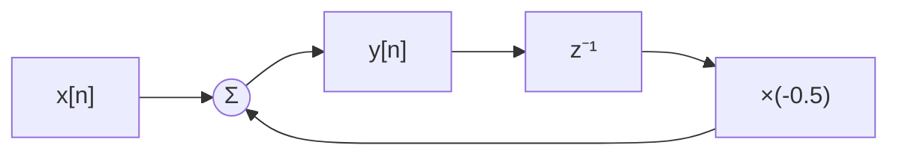
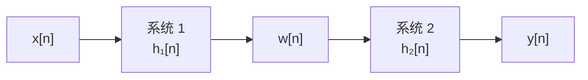
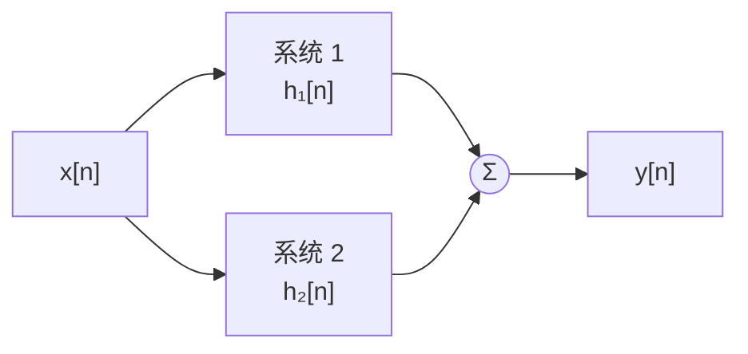
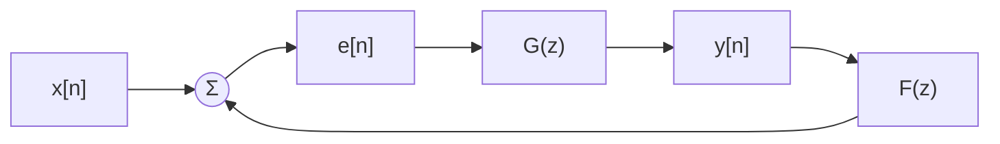
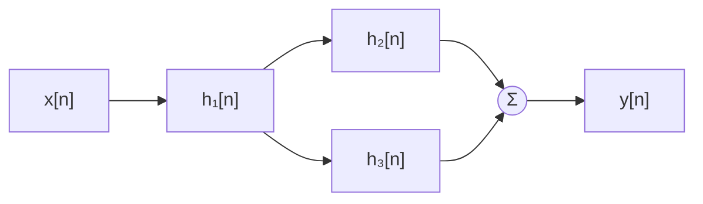

# 系统互联

**标签：** #数字信号处理 #DSP #系统互联 #级联 #并联 #反馈

---

## 一、为什么需要研究系统互联？

实际的数字信号处理系统很少只由一个环节构成，而是若干个简单子系统连接起来的结果：

- 一个 FIR 均衡器后面接一个 IIR 陷波器 —— **级联**
- 两路不同滤波器的输出相加得到梳状滤波器 —— **并联**
- 把输出的一部分送回输入端去修正输入，构成 IIR 滤波器、锁相环、控制器 —— **反馈**

把复杂系统拆成模块再互联，好处是可复用、可调试、可分步设计。但拆开之后必然要回答三个问题：

1. 已知各子系统的 \(h_i[n]\) 或 \(H_i(z)\)，整体系统的 \(h[n]\)、\(H(z)\) 怎么求？
2. 各子系统的因果性、稳定性，互联之后还在不在？
3. 功能相同的系统，哪种互联结构实现代价更小、数值上更可靠？

本节就是回答这三个问题。它是"差分方程"和"系统函数"之间的桥梁，也是后面讲**数字滤波器结构**的直接基础。

---

## 二、基本运算单元与框图表示

任何 LTI 离散时间系统，最终都可以只用三种基本单元互联实现：

| 单元 | 框图符号 | 输入输出关系 | 说明 |
|------|---------|-------------|------|
| 乘法器 | 方框内标系数，如 `×a` | \(y[n] = a\,x[n]\) | 系数随 \(n\) 变化时为 \(a[n]\)，系统变成时变系统 |
| 加法器 | 圆圈 `＋`，可多路输入 | \(y[n] = x_1[n] + x_2[n]\) | 与减法统一：把系数写成 -1 即为减法 |
| 单位延迟 | 方框 `z⁻¹` | \(y[n] = x[n-1]\) | 存储一个样本，是"反馈可实时实现"的前提 |

有了这三种单元，一个差分方程就能直接画成框图。例如

$$
y[n] = x[n] - 0.5\,y[n-1]
$$

图中单位延迟 \(z^{-1}\) 把输出 \(y[n]\) 引回到加法器 —— 这已经是一个最简单的**反馈连接**。可见互联不只是"把系统接起来"，它本身就是差分方程的一种图形表达。

---

## 三、级联（串联）

> 上图：一个低通子系统与一个陷波子系统级联后，整体幅频响应 $|H(e^{j\omega})|$ 同时具备“低通形状”和“在陷波频率 $\omega=\pi/2$ 处下陷”两个特征——级联即频率响应的相乘。

### 1. 定义

两个系统首尾相连，前一个的输出作为后一个的输入。

### 2. 整体单位脉冲响应

中间信号 \(w[n] = h_1[n] * x[n]\)，输出 \(y[n] = h_2[n] * w[n]\)。由卷积的结合律：

$$
h[n] = h_1[n] * h_2[n] = h_2[n] * h_1[n]
$$

也就是说：**级联系统的单位脉冲响应等于各子系统单位脉冲响应的卷积**。

### 3. 整体系统函数

对两边取 Z 变换，时域卷积对应 z 域相乘：

$$
H(z) = H_1(z) \cdot H_2(z)
$$

同理，频域上幅频特性相乘、相频特性相加：

$$
H(e^{j\omega}) = H_1(e^{j\omega}) \, H_2(e^{j\omega}), \qquad
\lvert H(e^{j\omega}) \rvert = \lvert H_1 \rvert \cdot \lvert H_2 \rvert, \qquad
\angle H = \angle H_1 + \angle H_2
$$

### 4. 收敛域（ROC）

级联后极点是两个子系统极点集合的并集，所以一般有

$$
R \supseteq R_1 \cap R_2
$$

注意是**包含**而不是等于：若某子系统的极点恰好被另一个子系统的零点抵消（极零相消），公共部分会扩大，甚至整体可能变成有限长系统。例如 \(H_1(z) = 1 - 2z^{-1}\)（零点 \(z=2\)）与 \(H_2(z) = \dfrac{1}{1 - 2z^{-1}}\)（极点 \(z=2\)，ROC 为 \(\lvert z \rvert \gt 2\)）级联，整体 \(H(z)=1\)，与 ROC 无关。**但要注意**：这种"用不稳定子系统抵消出稳定系统"在数学上成立，实际实现时中间信号 \(w[n]\) 会发散，工程上不能这样搭。

### 5. 性质

- 卷积满足**交换律**，级联顺序不影响整体响应（仅对 LTI 系统成立）
- 卷积满足**结合律**，多个系统可以任意分组化简
- 各子系统**稳定** ⇒ 级联**稳定**（BIBO 稳定性由 \(\sum \lvert h[n] \rvert \lt \infty\) 判断，卷积后仍是绝对可和）
- 各子系统**因果** ⇒ 级联**因果**
- 反过来**不成立**：整体稳定/因果，推不出每个子系统都稳定/因果

### 6. 例题：两个子系统级联

系统 1：\(H_1(z) = 1 - 0.5 z^{-1}\)（零点 \(z = 0.5\)）

系统 2：\(H_2(z) = \dfrac{1}{1 - 0.8 z^{-1}}\)（极点 \(z = 0.8\)）

**解**：

整体系统函数

$$
H(z) = H_1(z)H_2(z) = \frac{1 - 0.5 z^{-1}}{1 - 0.8 z^{-1}}
$$

零点 \(z = 0.5\)，极点 \(z = 0.8\)，两者不重合，故 \(R \supseteq R_1 \cap R_2\) 取等号：

$$
\text{ROC}: \; \lvert z \rvert \gt 0.8
$$

极点位于单位圆内且 ROC 在极点外侧 ⇒ 整体**因果且稳定**。这与"两个因果稳定系统级联仍然因果稳定"的结论一致。

---

## 四、并联

### 1. 定义

两个系统共用同一输入，输出相加。

### 2. 整体单位脉冲响应

由系统的线性（叠加原理）：

$$
h[n] = h_1[n] + h_2[n]
$$

**并联系统的单位脉冲响应等于各子系统单位脉冲响应之和。**

### 3. 整体系统函数

$$
H(z) = H_1(z) + H_2(z), \qquad H(e^{j\omega}) = H_1(e^{j\omega}) + H_2(e^{j\omega})
$$

注意频域是**复数相加**而不是模相加，两路信号可能同相叠加、也可能反相抵消 —— 这正是并联结构能造出"陷波零点"的原因。

### 4. 收敛域与稳定性

$$
R \supseteq R_1 \cap R_2
$$

稳定性方面比级联苛刻：**只要有一个子系统不稳定，整体一般就不稳定**，除非两个不稳定子系统恰好完全相消（例如 \(H_1 = \frac{1}{1-az^{-1}}\) 与 \(H_2 = -\frac{1}{1-az^{-1}}\) 相加得 0，同样存在中间信号发散的实际问题）。

### 5. 例题：两路一阶系统并联

$$
H(z) = \frac{1}{1 - 0.5 z^{-1}} + \frac{1}{1 - 0.8 z^{-1}}
$$

**解**：

通分：

$$
H(z) = \frac{(1 - 0.8 z^{-1}) + (1 - 0.5 z^{-1})}{(1 - 0.5 z^{-1})(1 - 0.8 z^{-1})} = \frac{2 - 1.3 z^{-1}}{(1 - 0.5 z^{-1})(1 - 0.8 z^{-1})}
$$

极点为 \(z = 0.5\) 与 \(z = 0.8\)（两个子系统的极点都保留），零点为 \(z = 0.65\)。

ROC：\(\lvert z \rvert \gt 0.8\)；两路各自因果稳定 ⇒ 整体因果稳定。并联**没有**产生极零相消，两路极点在整体中依然是极点。

---

## 五、反馈连接

### 1. 定义

前向通路的输出经反馈通路送回输入端，与输入相减（**负反馈**）或相加（**正反馈**）。

### 2. 整体系统函数的推导

设加法器输出（误差信号）为 \(e[n]\)，整个系统设为 LTI，则在 z 域有

$$
E(z) = X(z) \mp F(z)Y(z), \qquad Y(z) = G(z)E(z)
$$

其中"\(-\)"对应负反馈、"\(+\)"对应正反馈。代入消去 \(E(z)\)：

$$
Y(z) = G(z)\bigl[X(z) \mp F(z)Y(z)\bigr]
\;\Longrightarrow\;
Y(z)\bigl[1 \pm G(z)F(z)\bigr] = G(z)X(z)
$$

于是

$$
H(z) = \frac{Y(z)}{X(z)} = \frac{G(z)}{1 \pm G(z)F(z)}
=
\begin{cases}
\dfrac{G(z)}{1 + G(z)F(z)}, & \text{负反馈（相减）} \\[10pt]
\dfrac{G(z)}{1 - G(z)F(z)}, & \text{正反馈（相加）}
\end{cases}
$$

分母中出现的 \(G(z)F(z)\) 称为**开环系统函数**（把回路在某处断开后量到的系统函数），整体 \(H(z)\) 则称为**闭环系统函数**。

由 \(H(z)\) 求时域响应：\(h[n] = \mathcal{Z}^{-1}\{H(z)\}\)，通常先做部分分式展开再查表（见 [[Z 变换表与性质]]）。

### 3. 闭环极点与稳定性

令分母为零，得到**特征方程**：

$$
1 + G(z)F(z) = 0 \quad (\text{负反馈}), \qquad 1 - G(z)F(z) = 0 \quad (\text{正反馈})
$$

它的根就是闭环极点。闭环**因果系统稳定**的充要条件是：

$$
\text{全部闭环极点位于单位圆内，即 } \lvert z_i \rvert \lt 1
$$

关键提醒：**前向通路和反馈通路各自稳定，闭环仍可能不稳定。** 看一个例子：\(G(z) = \dfrac{1}{1 - 0.5z^{-1}}\)（极点 \(0.5\)，稳定），反馈取常数 \(F = 1.2\) 的正反馈，则

$$
H(z) = \frac{G(z)}{1 - G(z)F(z)} = \frac{1}{1 - 0.5z^{-1} - 1.2} = \frac{1}{-0.2 - 0.5 z^{-1}} = \frac{z}{-0.2z - 0.5}
$$

闭环极点为 \(z = \dfrac{0.5}{1-1.2} = -2.5\)，落在单位圆外 ⇒ **闭环不稳定**。原因是正反馈把极点推到了单位圆外，反馈不仅"绕回来"，还会**移动极点位置**。

### 4. 例：负反馈如何移动极点

仍取 \(G(z) = \dfrac{1}{1 - 0.5z^{-1}}\)，负反馈取 \(F = 1\)：

$$
H(z) = \frac{G(z)}{1 + G(z)} = \frac{1}{(1 - 0.5z^{-1}) + 1} = \frac{1}{2 - 0.5z^{-1}} = \frac{0.5}{1 - 0.25 z^{-1}}
$$

闭环极点从 \(0.5\) 内移到 \(0.25\)，ROC 变成 \(\lvert z \rvert \gt 0.25\)。极点越靠近原点，冲激响应衰减越快、收敛越稳。这就是**用反馈配置极点**的基本原理，也是 IIR 滤波器与控制系统设计的核心手段。

### 5. 无延迟回路：能不能实时实现？

差分方程

$$
y[n] = x[n] + a\,y[n]
$$

在 \(a \neq 1\) 时可以解出 \(y[n] = \dfrac{1}{1-a}x[n]\)，它只是一次纯缩放，并不真正构成递归。这种"绕一圈没有任何延迟"的回路称为**无延迟回路（代数环）**：当前输出直接依赖当前输出，无法按样本顺序逐点计算。

结论：**可实时实现的反馈结构中，回路内至少要有一个单位延迟。** 反映在系统函数上就是

$$
H(z) = \frac{1}{1 - a z^{-1}} \quad \text{（回路中有延迟）}
\qquad \text{而不是} \qquad
H(z) = \frac{1}{1 - a} \quad \text{（纯粹缩放，不构成递归）}
$$

画框图时若发现回路里没有 \(z^{-1}\)，说明模型需要改写 —— 这也是硬件实现差分方程时最容易出错的地方。

### 6. 反馈的三类典型用途

| 用途 | 做法 | 结果 |
|------|------|------|
| 移动极点、稳定或加速系统 | 选 \(F(z)\) 使 \(1 \pm GF = 0\) 的根落在期望位置 | 极点内移，响应更快更稳（见上例） |
| 实现逆系统 | 前向增益取很大（理想增益趋于无穷） | \(H(z) \to 1/F(z)\)，即反馈通路系统函数的倒数 |
| 构成振荡器 | 闭环极点落在单位圆上 | 无输入也能维持等幅振荡（滤波器设计中要避免） |

另外，反馈结构本身就是 IIR 滤波器的来源：分母 \(a_k\) 对应反馈支路（AR 部分），分子 \(b_r\) 对应前向支路（MA 部分）。

---

## 六、混联（串并联）

实际系统常常既有级联又有并联。化简原则只有一句：**由内向外，先并后串**。

### 例题：先串后并的混联系统

取 \(H_1(z) = 1 - 0.5 z^{-1}\)，\(H_2(z) = \dfrac{1}{1 - 0.8 z^{-1}}\)，\(H_3(z) = 1\)，结构为 \(H_1\) 级联（\(H_2 \parallel H_3\)）。

**解**：

先算并联部分（内层）：

$$
H_2(z) + H_3(z) = \frac{1}{1 - 0.8 z^{-1}} + 1 = \frac{2 - 0.8 z^{-1}}{1 - 0.8 z^{-1}}
$$

再与 \(H_1\) 级联（外层）：

$$
H(z) = H_1(z)\bigl[H_2(z) + H_3(z)\bigr] = \frac{(1 - 0.5 z^{-1})(2 - 0.8 z^{-1})}{1 - 0.8 z^{-1}} = \frac{2 - 1.8 z^{-1} + 0.4 z^{-2}}{1 - 0.8 z^{-1}}
$$

极点 \(z = 0.8\)（只来自反馈支路），零点由 \(1 - 0.5z^{-1} = 0\) 与 \(2 - 0.8z^{-1}=0\) 给出，即 \(z = 0.5\) 与 \(z = 0.4\)。ROC 为 \(\lvert z \rvert \gt 0.8\)，因果稳定。

注意分母只有一阶、分子二阶 —— 混联后的系统函数阶次由最"深"的那条路径决定，不能凭支路个数猜。

---

## 七、运算律与框图变换

由于 LTI 系统的互联本质上是卷积与加法的运算，三条运算律直接对应三种框图变换：

| 运算律 | 表达式 | 框图含义 |
|--------|--------|---------|
| 交换律 | \(h_1 * h_2 = h_2 * h_1\) | 级联的两个系统可以前后对调 |
| 结合律 | \((h_1 * h_2) * h_3 = h_1 * (h_2 * h_3)\) | 级联可以任意分组，也可合并成一个系统 |
| 分配律 | \(h_1 * (h_2 + h_3) = h_1 * h_2 + h_1 * h_3\) | "先并后串"与"先串后并"互相等价 |

分配律这条最有用：它说明**级联型和并联型结构可以互相转换**。同一个 \(H(z)\) 既可以写成若干一阶/二阶环节级联，也可以部分分式展开成若干支路并联 —— 两种结构的运算量、存储量、字长效应对噪声的敏感度都不同，这正是后面讨论滤波器结构时反复使用的自由度。

两条重要限制：

1. **运算律只对 LTI（线性时不变）子系统成立。** 若某个模块是非线性（如限幅）或时变的（如系数随时间变化），交换顺序会改变整体行为。
2. 理论等价 ≠ 实现等价。级联顺序可交换是数学结论，但不同顺序的中间信号动态范围不同，定点实现时的舍入噪声也不同，工程上仍要挑顺序。

---

## 八、等效表示速查表

记子系统为 1、2，反馈结构中前向通路为 \(G(z)\)、反馈通路为 \(F(z)\)：

| 互联方式 | 整体单位脉冲响应 | 整体系统函数 | 收敛域 | 稳定性 |
|----------|------------------|--------------|--------|--------|
| 级联 | \(h_1[n] * h_2[n]\) | \(H_1(z) H_2(z)\) | 含 \(R_1 \cap R_2\) | 各自稳定则稳定 |
| 并联 | \(h_1[n] + h_2[n]\) | \(H_1(z) + H_2(z)\) | 含 \(R_1 \cap R_2\) | 有一个不稳定则一般不成立 |
| 负反馈 | 由 \(H(z)\) 逆 Z 变换求得 | \(\dfrac{G(z)}{1 + G(z)F(z)}\) | 由闭环极点决定 | 须逐个验证闭环极点位置 |
| 正反馈 | 由 \(H(z)\) 逆 Z 变换求得 | \(\dfrac{G(z)}{1 - G(z)F(z)}\) | 由闭环极点决定 | 须逐个验证闭环极点位置 |

> 记忆钩子：**时域谈卷积与相加，z 域谈相乘与相加**；反馈是唯一会改变极点位置的结构，因此必须单独判稳。

---

## 九、常见错误提醒

1. **级联与并联的规律记反**：级联对应卷积、相乘；并联对应相加、相加。小心"并联却把系统函数相乘"这类低级错。
2. **ROC 直接写成交集**：严格地说只是包含关系，极零相消时 ROC 会扩大；解题时若发现分子分母有公因子，必须先约掉再判 ROC。
3. **忽视"中间信号发散"**：用不稳定子系统相消得到稳定整体，数学上成立但不可实现，工程上不采用。
4. **反馈公式的符号弄错**：负反馈分母是 \(1 + GF\)，正反馈是 \(1 - GF\)；先分清哪个是前向、哪个是反馈再套公式。
5. **用开环稳定性代替闭环稳定性**：必须解特征方程求闭环极点，前向、反馈各自稳定不代表闭环稳定。
6. **回路里没有延迟**：无延迟回路无法实时按样本计算，框图必须含 \(z^{-1}\)。
7. **对非 LTI 模块套用运算律**：时变、非线性模块不能随意交换或合并。
8. **以为并联一定"叠加增强"**：频域是复数相加，可能反相相消，并联既能造峰值也能造陷波。

---

## 十、知识链定位

系统互联（本节）

│

├── 基本单元：乘法器 / 加法器 / 单位延迟

├── 级联：h₁[n] * h₂[n]、H₁(z) H₂(z)

├── 并联：h₁[n] + h₂[n]、H₁(z) + H₂(z)

├── 反馈：G(z) / [1 ± G(z)F(z)]、闭环极点

└── 混联：由内向外、先并后串化简

│

├── 系统函数 H(z)：Z 变换（[[【数字信号处理DSP】（十三）Z 变换与收敛域|（十三）Z 变换与收敛域]]）、极零点与 ROC

├── 频率响应 H(e^{jω})：幅频相乘、相频相加、并联相消

└── 数字滤波器结构：直接型 I/II、级联型、并联型

---

## 十一、总结

- **级联**：整体冲激响应是卷积，系统函数是乘积（时域卷积 ↔ z 域相乘）。
- **并联**：整体冲激响应是相加，系统函数是相加；频域复数相加可能相消。
- **反馈**：$H(z) = \dfrac{G(z)}{1 \pm G(z)F(z)}$，闭环极点决定稳定性，前向/反馈各自稳定不代表闭环稳定。
- **混联**：由内向外、先并后串逐级化简。
- 稳定性与因果性在级联中可继承、在并联中较脆弱、在反馈中必须重判；ROC 一律按"包含交集"处理。
- LTI 系统的互联结果仍是 LTI 系统，所以三条运算律（交换、结合、分配）可以自由用于框图变换。

---

> **一句话总结**：级联是串在一起 —— 冲激响应做卷积、系统函数做乘积；并联是并排走 —— 冲激响应与系统函数都做加法；反馈是绕回来 —— 它唯一会改写极点位置，所以每一条闭环都必须单独判稳。掌握这三条，再复杂的系统也能由内向外拆解清楚。
