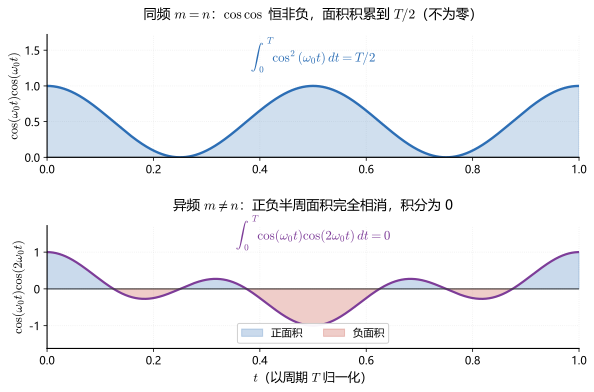
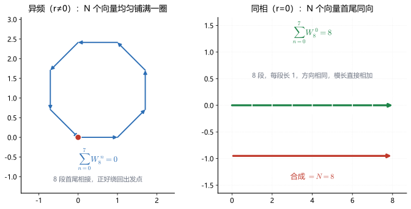

# 正弦信号的正交性

**标签：** #数字信号处理 #DSP #正交性 #傅里叶级数 #DFT #正交解调 #OFDM

> **读前提示**：本文是 [[【数字信号处理DSP】（十四）离散时间傅里叶变换（DTFT）|（十四）DTFT]] 与下一章 **DFS / DFT** 之间的桥梁。它只回答一个问题：**凭什么可以把一个信号拆成一堆正弦，而且拆完之后还能装回去？**
>
> 符号约定：$\delta[m-n]$ 是**克罗内克 δ**（$m=n$ 时为 1，否则为 0），不是冲激函数 $\delta(t)$；转动因子 $W_N=e^{-j2\pi/N}$。

---

## 本篇的位置

**这一篇补的空洞。** （十四）把序列的频谱定义为 $X(e^{j\omega})$，可它从头到尾都在用一件事而没有证明：把一个信号拆成不同频率的成分，拆完之后各成分互不干扰。（十四）的反变换里那个 $1/(2\pi)$、帕塞瓦尔式子里那个 $1/2\pi$，系数都是"给"出来的。为什么恰好是它，凭什么这样拆是唯一的、最优的，那一篇腾不出位置回答。这一篇补的就是这个欠账：系数怎么来，唯一性靠什么保证。

**和前后篇的接口。** 上游是（十四）的 DTFT 定义与卷积定理、（四）的互相关函数、（三）的能量定义。下游是紧接着的 DFS / DFT：DFT 的正变换就是一次投影，反变换除的 $1/N$ 就是基的模长平方，这两句话都要靠本篇第四节的主公式才立得住。

**本篇保留的简化。** 讨论限于有限维：连续情形只在一个周期 $[0,T)$ 内积分，离散情形只在 $N$ 个点上求和。积分区间一旦不是一个整周期，或者求和点数与基的周期不一致，正交性立刻失效，第五节之后的结论全部作废。另外只讨论复指数与实三角这两组基，不涉及小波、KL 变换这类非正弦基。

**没出现的东西。** DFS 的周期延拓与频谱的周期结构、DFT 的快速算法、正交频分复用的完整收发链（信道估计、循环前缀）。三样都在后面。

**读完能做什么。** 给两个具体序列能当场算出内积并判它们是否正交，而不是凭"频率不同"猜。看到一个"不同频率的正弦一定正交"的说法，能指出它在离散情形下被哪个频点破坏。拿到一组 DFT 系数，能说清反变换那个 $1/N$ 的来历，以及为什么实信号单边谱里直流和奈奎斯特 bin 不能乘 2。

---

## 本篇要点

1. 正交就是内积为零。系数公式 $c_k=\langle x,\varphi_k\rangle/\lVert\varphi_k\rVert^2$ 里的分母是模长平方，不是模长。漏掉平方就差一个 $N$。
2. 连续情形靠"整数个整周期"抵消，离散情形靠"模 $N$ 相等"抵消。判据从 $m\neq n$ 变成 $(k-l)\bmod N\neq0$，因为 $k$ 与 $k+N$ 落在同一个基向量上。
3. 实余弦基多出一项 $\delta[(k+l)\bmod N]$。$k$ 与 $N-k$ 是同一个序列，$N=4$ 时 $k=1$ 与 $k=3$ 的内积是 $2$ 而不是 $0$。这一步直接决定了实信号只有 $\lfloor N/2\rfloor+1$ 个独立频点。
4. 正交、不相关、独立是三个层次，包含关系单向：独立 $\Rightarrow$ 不相关 $\Rightarrow$（零均值时）正交。反方向都不成立。

---

## 一、单独成章的理由：三个必须回答的问题

傅里叶级数、DTFT、DFT 的系数公式都是"内积形式"：

$$
c_k=\frac{1}{N}\sum_{n=0}^{N-1}x[n]\,e^{-j2\pi kn/N}
$$

这个式子在教科书里通常是**直接给出**的。但它能成立、能唯一地把 $x[n]$ 还原出来，靠的是基函数之间的一条硬性质：**两两正交**。

没有正交性，你就无法回答下面三个必然会问的问题：

1. 凭什么"用内积算出的系数"就是最优的？——因为投影定理，内积就是投影。
2. 反变换前面那个 $\frac{1}{N}$ 是从哪冒出来的？——因为基的模长平方恰好等于 $N$。
3. 频谱里 $\sum\lvert x[n]\rvert^2=\frac{1}{N}\sum\lvert X[k]\rvert^2$ 为什么两边不对称？——还是因为 $\lVert\varphi_k\rVert^2=N$。

这三件事一句话说完是：**正交 $\Rightarrow$ 可分解 $\Rightarrow$ 系数有闭式 $\Rightarrow$ 能量可分摊。**

而它落地的位置远不止课本：IQ 正交解调、OFDM 子载波、相关检测、阵列波束形成，全部建立在这一条性质上。

**为什么放在这里而不是塞进（四）相关或（十四）DTFT**：（四）讲的是统计意义下的"不相关"，（十四）讲的是连续频率的谱，都已各占 500～650 行；正交性自身有一整套结构（连续 / 离散、复指数 / 实三角、模长 / 归一化、镜像项），塞进任何一篇都会喧宾夺主。把它做成（十五），正好回答"离散频率那一堆 $k$ 为什么彼此不打架"，紧接着写 DFS / DFT 才顺理成章。

---

## 二、内积：把"正交"说清楚

### 1. 定义

| 场合 | 内积 | 模长（范数） |
|------|------|------------|
| 连续时间（一个周期内） | $\langle f,g\rangle=\displaystyle\int_{0}^{T}f(t)\,g^{*}(t)\,dt$ | $\lVert f\rVert^2=\langle f,f\rangle$ |
| 离散时间（$N$ 点） | $\langle x,y\rangle=\displaystyle\sum_{n=0}^{N-1}x[n]\,y^{*}[n]$ | $\lVert x\rVert^2=\langle x,x\rangle$ |

**正交**：$\langle f,g\rangle=0$。
**归一化正交**（标准正交）：$\langle\varphi_k,\varphi_l\rangle=\delta[k-l]$，即既正交、模长又为 1。

### 2. 与向量点积的同一性

把 $N$ 点序列看成 $\mathbb{R}^N$ 里的向量，上面那个内积就是点积。于是所有几何直觉直接搬过来：

$$
\text{投影长度}=\frac{\langle x,u\rangle}{\lVert u\rVert},\qquad
\text{展开系数}=\frac{\langle x,u\rangle}{\lVert u\rVert^{2}}
$$

分母是**模长平方**，不是模长——这是最常见的丢分母错误来源。

### 3. 复信号内积的共轭要求

$\langle x,y\rangle=\sum x[n]y^{*}[n]$ 里的星号不能省。若省掉，$\lVert x\rVert^2=\sum x^2[n]$ 对复序列可能是负数甚至复数，范数就失去意义了。对实序列两者一致，所以很多人误以为"共轭无所谓"。

不取共轭到底荒唐到什么程度，能给个数吗

能，而且不必找人造的怪例，一个纯虚旋转序列就够。

取 $N=8$，$x[n]=e^{j\pi n/2}$，也就是 $1,\ j,\ -1,\ -j$ 循环两遍。这是一个模处处为 1 的序列，真实长度平方是 $8$。

不取共轭地算 $\sum x^2[n]$：$x^2[n]=e^{j\pi n}=(-1)^n$，于是和是 $1-1+1-1+1-1+1-1=0$。

一个非零序列，长度平方算出 $0$。这不是"稍微不准"，范数在这里彻底废了：零长度的非零向量会让后面每一步都出悖论——它没有任何"能量"可分，却又实实在在存在。

取共轭之后：$x[n]x^{*}[n]=\lvert x[n]\rvert^2=1$，八项相加得 $8$，与"模为 1、共 8 个"完全对得上。

实序列看不出这个坑，因为 $x^{*}=x$，两种算法给出同一个数。所以凡是"我平时都不写星号也没出错"的经验，都来自实信号的场合。

---

## 三、连续时间：正弦与复指数的正交性

### 1. 复指数基（最根本的一条）

设 $\omega_0=2\pi/T$，对整数 $m,n$：

$$
\boxed{\;\frac{1}{T}\int_{0}^{T}e^{j m\omega_0 t}\,e^{-j n\omega_0 t}\,dt=\delta[m-n]\;}
$$

**推导**（三行就够）：

（1）被积函数合并：$e^{j(m-n)\omega_0 t}$。

（2）$m=n$ 时被积函数恒为 1，积分得 $T$，除以 $T$ 得 $1$。

（3）$m\neq n$ 时令 $r=m-n\neq0$：

$$
\int_{0}^{T}e^{jr\omega_0 t}dt=\frac{e^{jr\omega_0 T}-1}{jr\omega_0}
=\frac{e^{j2\pi r}-1}{jr\omega_0}=\frac{1-1}{jr\omega_0}=0
$$

关键在于 $e^{j2\pi r}=1$：**整数个整周期，首尾正好对上，积完为 0。**

**这条式子的几何意义**：$\lvert e^{jm\omega_0t}\rvert=1$，两个基函数"长度"相同，但相位以不同速率旋转；在一个周期内它们的相对相位扫过整数圈，正负相消。相同时刻完全同相，才能积累出大数。

积分区间为什么非要取满一个整周期

正交性不是基函数自己的属性，是"基函数 + 区间"配在一起才成立的。$e^{jm\omega_0t}$ 与 $e^{jn\omega_0t}$ 在 $[0,T)$ 上正交，换个区间就未必。

取半个周期试：$m=n$ 时照旧积出 $T/2$，看不出问题；但 $r=1$ 时 $\int_0^{T/2}e^{j\omega_0t}dt=\frac{e^{j\pi}-1}{j\omega_0}=-\frac{2}{j\omega_0}$，不为零。两个"不同频率"的基在半周期上根本正交不了。

坏在哪一步：非对角项不为零，投影定理里"只有 $k=l$ 存活"那句话失效，$c_l$ 的闭式解就写不出来。整套推导的地基是"积分区间与基的周期匹配"，不是"基的函数形状像正弦"。

离散那边犯的是同一个错，只是把"区间长度"换成了"求和点数"。

### 2. 实三角函数基

由 $e^{j\theta}=\cos\theta+j\sin\theta$ 拆开（或用积化和差），对 $m,n\ge1$：

$$
\int_{0}^{T}\cos(m\omega_0 t)\cos(n\omega_0 t)\,dt=\frac{T}{2}\,\delta[m-n]
$$

$$
\int_{0}^{T}\sin(m\omega_0 t)\sin(n\omega_0 t)\,dt=\frac{T}{2}\,\delta[m-n]
$$

$$
\int_{0}^{T}\cos(m\omega_0 t)\sin(n\omega_0 t)\,dt=0\quad(\text{对任意 }m,n)
$$

注意三件事：

* 第三式**恒为零**，即使 $m=n$。$\cos$ 与 $\sin$ 相差 $90^\circ$，永远互相"看不见"。这就是同频双传两路（I/Q）的合法性依据。
* 前两式的 **$T/2$ 而不是 $T$**：因为 $\cos^2=\frac{1+\cos2\omega_0t}{2}$，那个 $1/2$ 是实三角基模长平方只有复指数基一半的原因。它直接导致实数谱要"双边相加"才等于单边幅度。
* $m=0$ 是特殊点：$\int_0^T\cos^2(0)\,dt=T$，不是 $T/2$。这就是傅里叶级数里**直流项写 $a_0/2$、且系数公式要单独用 $1/T$ 而不是 $2/T$** 的根源。凡是"直流要特殊处理"的地方，本质都是这个"自共轭点模长翻倍"。

> 上图：上栏 $\cos^2(\omega_0t)$ 恒非负，面积只增不减，一个周期积到 $T/2$；下栏 $\cos(\omega_0t)\cos(2\omega_0t)=\frac{1}{2}\left[\cos(\omega_0t)+\cos(3\omega_0t)\right]$，两个整周期余弦在同一区间里正负面积严格抵消，积分为 $0$。**"正交"在图上就是"面积相消"**。

---

## 四、离散时间：正交性的三条新规矩

离散情形换成了有限和，性质变了，而且变的地方全是考点。

### 1. 主公式

设 $N$ 点，$\varphi_k[n]=e^{j2\pi kn/N}$，$n=0,1,\dots,N-1$。则

$$
\boxed{\;\sum_{n=0}^{N-1}\varphi_k[n]\,\varphi_l^{*}[n]
=\sum_{n=0}^{N-1}W_N^{(k-l)n}=N\,\delta\big[(k-l)\bmod N\big]\;}
$$

那个取余是多余的吗，直接写 k 减 l 不行

不行，因为 $W_N^{(k-l)n}$ 只认 $(k-l)$ 除以 $N$ 的余数：$W_N$ 本身以 $N$ 为周期，指数上加 $N$ 等于没加。

验一次就清楚。$N=4$，取 $k=5$、$l=1$。按 $\delta[k-l]$ 判，$5-1=4\neq0$，结论说这两个基不正交；实际算 $\sum_{n=0}^{3}W_4^{4n}=\sum_{n=0}^{3}1=4=N$，明明完全正交。判据与实算差的那一点，就是取余。

后果不止判错一对。$k$ 与 $k+N$ 落在同一个基向量上，不取余就会把同一个基数成无穷多个，$N$ 点空间里只有 $N$ 个独立频点这件事也就无从解释。

### 2. 推导

（1）合并被积项：$\varphi_k\varphi_l^{*}=e^{j2\pi(k-l)n/N}=W_N^{-(k-l)n}$，记 $r=(k-l)\bmod N$。

（2）**若 $r=0$**：每一项都是 1，共 $N$ 项，和为 $N$。

（3）**若 $r\neq0$**：等比数列，公比 $q=W_N^{-r}\neq1$（因为 $r$ 不是 $N$ 的整数倍，$q$ 不在单位圆上取 1）：

$$
\sum_{n=0}^{N-1}q^{n}=\frac{1-q^{N}}{1-q}=\frac{1-e^{-j2\pi r}}{1-q}=\frac{1-1}{1-q}=0
$$

和第（三）节的连续推导完全是同一招：**整数圈 ⇒ 抵消**。

> 上图：左栏 $r\ne0$，8 个单位向量每次转 $45^\circ$，首尾相接正好闭合，总和为 $0$（"重心落在原点"）；右栏 $r=0$，8 个向量完全同向，模长直接累加到 8。**"和为零"不是解析巧合，而是几何上必然闭合。**

### 3. 与连续情形的三个差别

| 项目 | 连续时间 | 离散 $N$ 点 |
|------|---------|--------------|
| 求和范围 | 整个周期 $0\le t\lt T$ | 只有 $n=0,\dots,N-1$ |
| 正交条件 | 任意整数 $m\ne n$ 都正交 | 只有 $(k-l)\bmod N\ne0$ 才正交，**模 $N$ 相等则不正交** |
| 模长平方 | $\lVert\varphi_k\rVert^2=T$ | $\lVert\varphi_k\rVert^2=N$ |

第二行是离散特有的**频率混叠**在正交性上的表现：$k$ 与 $k+N$ 是**同一个基向量**，不是两个。这正是 DFS 的谱以 $N$ 为周期、DFT 只能分辨 $N$ 个频点的最底层原因——你手上只有 $N$ 个独立基，装不下更多。

### 4. 实余弦在 N 点上的镜像项

把 $\cos=\frac{1}{2}(e^{j\theta}+e^{-j\theta})$ 代进内积，会分裂成两个和：

$$
\sum_{n=0}^{N-1}\cos\frac{2\pi kn}{N}\cos\frac{2\pi ln}{N}
=\frac{N}{2}\Big(\delta\big[(k-l)\bmod N\big]+\delta\big[(k+l)\bmod N\big]\Big)
$$

多出来的 **$\delta[(k+l)\bmod N]$ 就是负频率镜像项**。后果非常具体：

那个二分之 N 和两条 δ 是怎么乘出来的

拆开就两行。$\cos\theta=\frac{1}{2}(e^{j\theta}+e^{-j\theta})$，两个余弦相乘展开成四项，记 $\theta=\frac{2\pi n}{N}$：

$\cos(k\theta)\cos(l\theta)=\frac{1}{4}\left[e^{j(k+l)\theta}+e^{j(k-l)\theta}+e^{-j(k-l)\theta}+e^{-j(k+l)\theta}\right]$。

对 $n$ 求和，这四项各自套一次主公式，能非零的只有两项：$(k-l)$ 那一对合成 $N\delta[(k-l)\bmod N]$，$(k+l)$ 那一对合成 $N\delta[(k+l)\bmod N]$，每项都带着前面的 $\frac{1}{4}$，提出来就是 $\frac{N}{2}$。

$\frac{N}{2}$ 而不是 $N$，全在 $\frac{1}{4}$ 上：一对共轭项拼回一个实余弦时用掉一半，求和给 $N$，剩下的就是 $\frac{N}{2}$。这和第三节"实三角基模长平方只有复指数基一半"是同一件事。

$$
\cos\frac{2\pi(N-k)n}{N}=\cos\left(2\pi n-\frac{2\pi kn}{N}\right)=\cos\frac{2\pi kn}{N}
$$

**$k$ 与 $N-k$ 的实余弦基是同一个序列。** 取 $N=4,\ k=1$：

$$
\cos\frac{\pi n}{2}=1,\ 0,\ -1,\ 0;\qquad
\cos\frac{3\pi n}{2}=1,\ 0,\ -1,\ 0
$$

一模一样。所以它们的内积是这个序列自己的模长平方 $\frac{N}{2}=2$，**不是 0**——两条"不同频率"的余弦并不正交。

由此得到一条工程结论：**实信号的独立频点只有 $\lfloor N/2\rfloor+1$ 个**（$k=0,\dots,N/2$），这就是 `numpy.fft.rfft` 返回长度 $N/2+1$ 的原因。其中 $k=0$ 与 $k=N/2$（$N$ 为偶）是**自共轭点**，模长平方是 $N$ 而非 $N/2$，所以实 FFT 做单边谱时，直流和奈奎斯特 bin **不加倍**，其余 bin 才乘 2。

N 是奇数时，那个不加倍的奈奎斯特点去哪了

它不存在。要当自共轭点，得满足 $k\equiv N-k\pmod N$，即 $2k\equiv0\pmod N$。$N$ 为偶数时 $k=0$ 与 $k=N/2$ 两个解；$N$ 为奇数时 $2$ 与 $N$ 互质，只剩 $k=0$ 一个解。

拿 $N=7$ 数一遍：独立频点是 $k=0,1,2,3$，共 $4=\lfloor7/2\rfloor+1$ 个，`rfft` 也确实返回 4 个数。

单边谱该怎么乘：$k=0$ 是自共轭点，模长平方 $7$，**不乘 2**；$k=1,2,3$ 各有一个镜像伙伴（$k=6,5,4$），模长平方 $7/2$，**乘 2**。三项乘 2、一项不乘，能量才对得上。

按 $N=8$ 的习惯套到 $N=7$ 上会怎样：$N=8$ 时是"$k=0$ 与最后一个 bin 不加倍"，很容易被记成"首尾两个不加倍"。照这个记法处理 $N=7$，$k=3$ 会被当成"最后一个"放过，少乘一个 2。$k=3$ 的幅度就此小了一半，而它在 $N=7$ 里恰恰是最高频的那一项。判据必须是解方程 $2k\equiv0$，不能数位置。

---

## 五、正交性直接给出的三个结论

### 1. 投影定理：系数公式的来源

设 $\{\varphi_k\}$ 在 $N$ 点上正交，把 $x$ 写成

$$
x[n]=\sum_{k=0}^{N-1}c_k\,\varphi_k[n]
$$

两边与 $\varphi_l$ 做内积，右边只有 $k=l$ 项存活：

$$
\langle x,\varphi_l\rangle=\sum_k c_k\langle\varphi_k,\varphi_l\rangle
=c_l\lVert\varphi_l\rVert^2=c_l\,N
$$

于是

$$
c_l=\frac{\langle x,\varphi_l\rangle}{\lVert\varphi_l\rVert^2}
=\frac{1}{N}\sum_{n=0}^{N-1}x[n]\,e^{-j2\pi ln/N}=X[l]/N
$$

**正变换算的是内积，反变换要除的 $1/N$ 就是模长平方。** 一句话闭环。

### 2. 帕塞瓦尔：能量按基分摊

对上式取模平方求和，交叉项全为零（正交），只剩对角项：

$$
\sum_{n=0}^{N-1}\lvert x[n]\rvert^2=\sum_{k=0}^{N-1}\lvert c_k\rvert^2\lVert\varphi_k\rVert^2
=N\sum_{k=0}^{N-1}\lvert c_k\rvert^2=\frac{1}{N}\sum_{k=0}^{N-1}\lvert X[k]\rvert^2
$$

所以 **$\frac{1}{N}$ 出现在 DFT 的右边**，而不是左边——因为它跟着"没归一化的基"一起走。若一开始就用归一化基 $\varphi_k/\sqrt{N}$，两边就完全对称，什么系数都不需要。

### 3. 最小二乘：最优截断的依据

只保留前 $K$ 项时，误差能量为

$$
\lVert x-\hat{x}\rVert^2=\lVert x\rVert^2-\sum_{k\in K}\lvert c_k\rvert^2\lVert\varphi_k\rVert^2
$$

右边第二项永远为正，所以**取系数为投影时误差最小**，取任何别的系数都只会更大。这就是"傅里叶级数是最佳均方逼近"的完整证明，也解释了滤波器截断、DCT 压缩为什么都按"能量大的先留"来排序。

误差式里为什么只有对角项，交叉项上哪去了

把 $\lVert x-\hat x\rVert^2$ 摊开，一共三块：$\lVert x\rVert^2$、两个一次项、一个双求和 $\sum_k\sum_l c_k^{*}c_l\langle\varphi_k,\varphi_l\rangle$。

双求和里 $k\neq l$ 的项就是交叉项，它们的系数是内积 $\langle\varphi_k,\varphi_l\rangle$，正交性让这些系数全为零，只剩对角线 $\sum_k\lvert c_k\rvert^2\lVert\varphi_k\rVert^2$。

两个一次项在最优系数下各贡献 $-\sum_k\lvert c_k\rvert^2\lVert\varphi_k\rVert^2$，合起来是它的 $-2$ 倍。三块相加：$\lVert x\rVert^2$ 减掉一份，剩下正文那条。

基一旦不正交，双求和里的非对角项就留着了，误差不再是"总能量减去已取能量"这种一维减法。解也跟着变难：系数要通过解一组线性方程（正规方程）才能得到，不再是每项各除一次。正交性省掉的不是几个零，是整个矩阵求逆。

> **这里为什么只能是 $\leq$ 而不是 $=$**：不等式那一半来自施瓦茨（逐项 $\lvert c_k\rvert\leq\lVert x\rVert/\lVert\varphi_k\rVert$ 后相加），等式那一半要靠勾股（残差与子空间正交）。两者的分工见 [[施瓦茨不等式速查]] 第五节。

把所有 1/N 一次性消掉，代价是什么

把基换成 $\hat\varphi_k=\varphi_k/\sqrt{N}$，主公式右边就从 $N\delta$ 变成 $\delta$，基成了标准正交基。这时候系数 $c_k=\langle x,\hat\varphi_k\rangle$ 不用除任何东西，反变换直接是 $\sum_k c_k\hat\varphi_k$，帕塞瓦尔两边完全对称。

矩阵的说法更省事。$N$ 点 DFT 写成矩阵 $\mathbf{W}$，元素是 $W_N^{kn}$。未归一化时 $\mathbf{W}^{H}\mathbf{W}=N\mathbf{I}$，所以反变换必须乘 $1/N$；归一化之后 $\hat{\mathbf{W}}=\mathbf{W}/\sqrt{N}$ 满足 $\hat{\mathbf{W}}^{H}\hat{\mathbf{W}}=\mathbf{I}$，是一个酉矩阵，逆等于共轭转置，任何系数都不用记。

代价落在幅度标定上。同一个信号，归一化后的谱系数比未归一化的小 $\sqrt{N}$ 倍。只在内部比较相对大小没影响，可一旦要和物理量对齐——电阻上的功率、麦克风的声压——就得先弄清这套约定里 $X[k]$ 到底是 $Nc_k$ 还是 $c_k$。

工程库干脆给个开关：`numpy.fft.fft(x, norm='ortho')` 走归一化，默认的 `norm='backward'` 走"反变换除 $N$"。两种都自洽，混用才是错的。

---

## 六、例题：五道标准题型

> **统一答题格式**：写定义式 → 代入具体值 → 分步计算 → $\boxed{}$ 结论 → **检验**。验证正交性就是算内积，只有一个判据：**内积是否为 0**。

### 例题 1：验证复指数基的正交性

**题**：$N=4$，验证 $\varphi_1[n]=e^{j2\pi n/4}$ 与 $\varphi_3[n]=e^{j2\pi\cdot3n/4}$ 是否正交。

**解**：

（1）**写判据**：$\langle\varphi_1,\varphi_3\rangle=\sum_{n=0}^{3}\varphi_1[n]\varphi_3^{*}[n]$。

（2）**代入**：$\varphi_1\varphi_3^{*}=e^{j2\pi n/4}e^{-j6\pi n/4}=e^{-j\pi n}=(-1)^{n}$。

（3）**求和**：$n=0,1,2,3$ 时该值为 $1,-1,1,-1$，和为 $0$。

（4）**结论**：

$$
\boxed{\ \langle\varphi_1,\varphi_3\rangle=0,\ \text{二者正交}\ }
$$

（5）**检验**：用主公式 $N\delta[(k-l)\bmod N]=4\delta[(1-3)\bmod 4]=4\delta[2]=0$ ✓。另注意 $(\varphi_3)^{*}=\varphi_1$，两者互为共轭，实部相同、虚部相反，内积必为实数 0。

### 例题 2：4 点 DFT 的正交性手算

**题**：$x[n]=\{1,0,-1,0\}$，求 4 点 DFT，并用帕塞瓦尔验证。

**解**：

（1）**写定义**：$X[k]=\sum_{n=0}^{3}x[n]W_4^{kn}$，$W_4=e^{-j\pi/2}=-j$，故 $W_4^{0}=1,\ W_4^{1}=-j,\ W_4^{2}=-1,\ W_4^{3}=j$。

（2）**逐点算**：

* $X[0]=1+0-1+0=0$
* $X[1]=1\cdot1+0+(-1)\cdot W_4^{2}+0=1+1=2$
* $X[2]=1\cdot1+0+(-1)\cdot W_4^{4}+0=1-1=0$
* $X[3]=1\cdot1+0+(-1)\cdot W_4^{6}+0=1+1=2$

$$
\boxed{\ X[k]=\{0,\ 2,\ 0,\ 2\}\ }
$$

（3）**检验一（帕塞瓦尔）**：时域能量 $\sum\lvert x\rvert^2=1+0+1+0=2$；频域 $\frac{1}{4}\sum\lvert X\rvert^2=\frac{1}{4}(0+4+0+4)=2$ ✓

（4）**检验二（反变换还原）**：$x[0]=\frac{1}{4}(X[1]W_4^{0}+X[3]W_4^{0})=\frac{2+2}{4}=1$ ✓；$x[2]=\frac{1}{4}(2\cdot W_4^{-2}+2\cdot W_4^{-6})=\frac{-2-2}{4}=-1$ ✓

（5）**解读**：$X[1]=X[3]=2$ 且互为共轭（都是实数），正是实序列谱的共轭对称；$k=1$ 与 $k=3$ 是镜像对。

### 例题 3：镜像频点的实余弦不正交

**题**：$N=8$，判断 $\cos(2\pi n/8)$ 与 $\cos(2\pi\cdot7n/8)$ 是否正交。

**解**：

（1）**判据**：算 $\sum_{n=0}^{7}\cos\frac{\pi n}{4}\cos\frac{7\pi n}{4}$。

（2）**先化简**：

$$
\cos\frac{7\pi n}{4}=\cos\left(2\pi n-\frac{\pi n}{4}\right)=\cos\frac{\pi n}{4}
$$

（3）**代入**：两序列完全相同，内积退化为自内积 $\sum_{n=0}^{7}\cos^2\frac{\pi n}{4}$。逐点列出 $\cos\frac{\pi n}{4}$（$n=0,\dots,7$）：

$$
1,\quad \frac{\sqrt2}{2},\quad 0,\quad -\frac{\sqrt2}{2},\quad -1,\quad -\frac{\sqrt2}{2},\quad 0,\quad \frac{\sqrt2}{2}
$$

平方相加：$1+\frac12+0+\frac12+1+\frac12+0+\frac12=4$。

（4）**结论**：

$$
\boxed{\ \text{内积}=4\neq0,\ \text{两者不正交（而且是同一个序列）}\ }
$$

（5）**检验**：主公式给出 $\frac{N}{2}\left(\delta[k-l]+\delta[k+l]\right)=\frac{8}{2}\left(\delta[-6]+\delta[8]\right)=4\delta[0]=4$ ✓，与手算一致。

**这条要记牢**：$\cos(2\pi(N-k)n/N)\equiv\cos(2\pi kn/N)$，所以"不同频率的正弦一定正交"这句话**只在连续时间成立**，在 $N$ 点上要排除镜像对。

### 例题 4：用正交性反推系数（识别信号里的正弦）

**题**：已知 $x[n]=3+2\cos\frac{\pi n}{3}+4\sin\frac{\pi n}{3}$，$N=6$，求 6 点 DFT 的非零值。

**解**：

（1）**展开成复指数**：$\cos\theta=\frac{e^{j\theta}+e^{-j\theta}}{2}$、$\sin\theta=\frac{e^{j\theta}-e^{-j\theta}}{2j}$，故

$$
x[n]=3+e^{j\pi n/3}+e^{-j\pi n/3}-2j\,e^{j\pi n/3}+2j\,e^{-j\pi n/3}
=3+(1-2j)e^{j\pi n/3}+(1+2j)e^{-j\pi n/3}
$$

（2）**对照基**：$e^{j\pi n/3}=e^{j2\pi n/6}$ 对应 $k=1$；$e^{-j\pi n/3}$ 对应 $k=-1\equiv5$。

（3）**读系数**：$X[k]=N c_k$，$N=6$，故

$$
X[0]=6\times3=18,\quad X[1]=6(1-2j)=6-12j,\quad X[5]=6(1+2j)=6+12j
$$

$$
\boxed{\ X=\{18,\ 6-12j,\ 0,\ 0,\ 0,\ 6+12j\}\ }
$$

（4）**检验**：$\lvert X[1]\rvert=\lvert X[5]\rvert=6\sqrt{1+4}=6\sqrt5$，共轭对称 ✓；能量 $\frac{1}{6}\sum\lvert X\rvert^2=\frac{1}{6}(324+2\times180)=\frac{1}{6}\times684=114$，而 $\sum\lvert x\rvert^2=6(3^2+\frac{2^2}{2}+\frac{4^2}{2})=6(9+2+8)=114$ ✓

（5）**要点**：正弦项的幅度 $A$ 在谱上是 $N A/2$ 两根（正负频率各一根），不是 $NA$。这就是"实信号单边谱要乘 2"的由来。

### 例题 5：判断题组

**（a）"两个正交的序列一定不相关。"**

**解**：错误。判据：相关系数用**去均值后的内积**，正交用的是**原始内积**，两者只在均值为零时等价。反例：

$$
x=\{-1,1,1,0\},\quad y=\{2,1,1,0\}
$$

内积 $\langle x,y\rangle=-2+1+1+0=0$ → 正交；但 $\bar x=0.25,\ \bar y=1$，去均值内积为
$\sum xy-N\bar x\bar y=0-4\times0.25\times1=-1\neq0$ → **相关**。

**（b）"只要正变换乘 $1/\sqrt{N}$，反变换乘 $1/\sqrt{N}$，就不需要 $1/N$ 了。"**

**解**：正确。此时基取 $\varphi_k/\sqrt N$，模长平方为 1，两侧各分一半系数，正反变换形式上对称（这也是 `fft` 库常见的 `norm='ortho'` 选项）。**但考试默认不归一化，反变换必须有 $1/N$。**

**（c）"任意两个不同频率的离散实余弦序列在 $N$ 点上正交。"**

**解**：错误。反例见例题 3：$k$ 与 $N-k$ 给出同一序列，内积为 $N/2\neq0$。正确说法是：$k\ne l$ 且 $k+l\not\equiv0\pmod N$ 时才正交。

---

## 七、三个层次：正交、不相关、独立

三者层次必须分清，这是信号处理里最容易混淆的一组概念：

| 概念 | 判据 | 含义 |
|------|------|------|
| 正交 | $\sum x[n]y^{*}[n]=0$ | 几何上"垂直"，无投影 |
| 不相关 | 协方差 $=0$，即 $\sum(x-\bar x)(y-\bar y)^{*}=0$ | 只关心波动部分无关 |
| 独立 | 联合分布 $=f(x)g(y)$ | 任何函数都无关，最强 |

包含关系：**独立 $\Rightarrow$ 不相关 $\Rightarrow$（均值为零时）正交**。反向都不成立：

* 不相关但不独立：$x$ 均匀分布于 $\{-1,0,1\}$，$y=x^2$。协方差为 0，但 $y$ 完全由 $x$ 决定。
* 正交但不不相关：上面的例题 5(a)。

对**零均值**信号（通信、噪声分析里的常态），不相关与正交等价，所以两套术语常被混用——但在有直流分量的场合混用就会出错。

---

## 八、正交性在工程上的三处兑现

### 1. IQ 正交解调：同频传两路

$\cos\omega_0t$ 与 $\sin\omega_0t$ 内积为零（第三节第三式），所以同一载频、同一时刻可以同时传 $I$ 与 $Q$ 两路，接收端分别与 $\cos$、$\sin$ 做内积即可分离，互不串扰。

**代价与边界**：正交性依赖相位严格相差 $90^\circ$。本振相位误差 $\varepsilon$ 会让镜像抑制比降到约 $20\lg\lvert\tan\varepsilon\rvert$ 量级——$1^\circ$ 误差只有约 $-41$ dB 抑制。这就是"正交"两个字为什么在硬件里值钱。

### 2. OFDM：子载波频谱重叠的合法性

$N$ 个子载波 $e^{j2\pi kn/N}$ 在 $N$ 点上正交，所以相邻子载波的频谱**明明互相重叠**，取样点上却互不干扰，省下近一半带宽。这就是"正交频分复用"中"正交"的真实含义——不是"频率不重叠"，而是"重叠但内积为零"。

换个角度：OFDM 的调制就是 IDFT、解调就是 DFT。整个系统的合法性，就是第四节那条主公式。

### 3. 相关检测：（四）的统计版本

[[【数字信号处理DSP】（四）自相关函数与互相关函数|（四）自相关与互相关]] 里算过"不同频率正弦的互相关为零"，那是正交性的**统计版本**：时间平均代替内积，结论相同。所以匹配滤波、扩频解调、雷达脉冲压缩，本质上都是在"用自己的基去做投影"，正交性保证别的信号投影为零。

---

## 九、常见错误

十条里大部分不是"算错"，而是"判据拿错"：把正交当不相关、把 $k\neq l$ 当正交条件、把未归一化基当成长度 1。改成表，每条给一句能当场自检的话，反例全部用本篇正文里出现过的数。

| 错误说法 | 为什么会这么想 | 判据 | 反例 |
|---|---|---|---|
| 正交就是不相关 | 两者的内积都算出来是 0 | 先算均值，均值为零才等价 | 例题 5(a)：$x=\{-1,1,1,0\}$、$y=\{2,1,1,0\}$，内积为 0，去均值内积却是 $-1$ |
| 复内积可以不写共轭 | 平时做实数题从没出过错 | 看序列是不是复的，是就必须带星号 | $N=8$、$x[n]=e^{j\pi n/2}$，不取共轭算出 $\sum x^2=0$，一个非零序列长度为零 |
| 离散正交的条件是 $k\ne l$ | 连续情形就是 $m\ne n$，照搬过来 | 把 $k-l$ 对 $N$ 取余再判 | $N=4$、$k=5$、$l=1$，$k\ne l$ 却完全正交，内积为 $4$ |
| 不同频率的离散实余弦一定正交 | 连续情形这句话成立，直觉上没理由不成立 | 检查 $k+l$ 是不是 $N$ 的倍数 | $N=4$ 的 $k=1$ 与 $k=3$，两个序列都是 $1,0,-1,0$，内积 $2$ 不是 $0$ |
| 展开系数除以模长 | 投影公式的分母看起来就是"长度" | 分母是模长平方，单位都不同 | 例题 2 的 $N=4$ 若漏掉平方，$c_k$ 大 4 倍，反变换还原出的 $x[0]$ 是 $4$ 而不是 $1$ |
| 基的模长平方默认是 1 | 教科书里的标准正交基确实如此 | 看基有没有除 $\sqrt N$ | 未归一化时 $\lVert\varphi_k\rVert^2=N=4$，帕塞瓦尔右边要除 4 才等于时域能量 $2$ |
| 反变换漏掉 $1/N$ | 正变换没乘系数，以为反变换也没有 | 正反变换的系数乘积必须是 $1/N$ | 例题 2 的 $X=\{0,2,0,2\}$，不除 4 得 $x[0]=4$，而原序列是 $x[0]=1$ |
| 帕塞瓦尔把 $1/N$ 放在左边 | 连续情形里 $1/T$ 就在积分那一侧 | 用 $x=\{1,0,-1,0\}$ 试一次，时域能量是 $2$ | 频域不除 4 得 $0+4+0+4=8$，与 $2$ 差 4 倍 |
| 直流和奈奎斯特 bin 也乘 2 | 单边谱的规则是"除直流外都乘 2"记串了 | 看这个 bin 是不是自共轭点 | $N=4$ 的 $k=0$ 与 $k=2$ 模长平方是 $4$ 而非 $2$，乘 2 就把这两根抬高了一倍 |
| $\delta[m-n]$ 是冲激函数 | 符号和（十一）里的 $\delta(t)$ 一模一样 | 看它取不取无穷 | 第三式右边是 $\delta[m-n]\in\{0,1\}$，若当冲激，$m=n$ 时会写成 $\infty$ 而不是 $1$ |

---

## 十、知识链定位

正弦信号的正交性（本节）

│

├── 内积 / 模长 / 正交 / 归一化正交（几何 = 向量点积）

├── 连续：$\frac{1}{T}\int e^{jm\omega_0t}e^{-jn\omega_0t}dt=\delta[m-n]$，模长平方 $=T$

├── 连续实三角：$\cos\cos$、$\sin\sin$ 得 $T/2$；$\cos\sin$ 恒为 0（IQ 的依据）

├── 离散：$\sum W_N^{(k-l)n}=N\delta[(k-l)\bmod N]$，模长平方 $=N$

├── 离散实余弦：多出镜像项 $\delta[(k+l)\bmod N]$ ⇒ 独立频点只有 $\lfloor N/2\rfloor+1$ 个

├── 三个推论：投影定理（系数公式）/ 帕塞瓦尔（能量分摊）/ 最小二乘（最佳截断）

└── 概念分层：正交 ⊂ 不相关 ⊂ 独立（均值为零时前两者重合）

│

├── **DFS / DFT**：正变换 = 投影，反变换的 $1/N$ = 模长平方的倒数（下一章）

├── 帕塞瓦尔与能量谱：[[【数字信号处理DSP】（六）维纳-辛钦定理与帕塞瓦尔定理|（六）维纳-辛钦定理与帕塞瓦尔定理]]（推论 2 的展开：三步证明 + 四种形态）

├── 能量谱密度：[[【数字信号处理DSP】（五）能量谱密度与功率谱密度|（五）能量谱密度与功率谱密度]]（幅频取模平方 = 能量谱，为何必须平方）

├── 相关与正交：[[【数字信号处理DSP】（四）自相关函数与互相关函数|（四）自相关与互相关函数]]

├── 频谱对称性：[[【数字信号处理DSP】（十四）离散时间傅里叶变换（DTFT）|（十四）DTFT]]

└── 频率分辨率与补零：$\Delta f=f_s/N$，见（十四）与（十一）

---

## 十一、总结

**一句话**：正交性 = "内积为零"，它让"分解"变成"投影"，让"系数"有闭式解，让"能量"可以分账。

**三个必背式子**：

$$
\frac{1}{T}\int_{0}^{T}e^{jm\omega_0t}e^{-jn\omega_0t}dt=\delta[m-n]
\qquad
\sum_{n=0}^{N-1}W_N^{(k-l)n}=N\,\delta\big[(k-l)\bmod N\big]
$$

$$
c_k=\frac{\langle x,\varphi_k\rangle}{\lVert\varphi_k\rVert^{2}}
$$

**两个易错点**：离散要模 $N$（$k$ 与 $N-k$ 的实余弦是同一个）；模长平方是 $N$ 不是 1。

**一句口诀**：**连续看整数圈，离散看模 $N$；系数除模长平方，能量才分得平。**

---

## 十二、学会的四层判据

这一篇的目标不是背下三组正交式子，而是四件事能做到。逐层自评，卡在哪层就回哪一节：

| 层 | 能做到什么 | 卡住了回哪 |
|---|---|---|
| 1. 会算 | 给两个具体序列，能把内积一步步算出来并得到 0 或非 0，而不是凭"频率不同"猜 | 四、2 推导；六、例题 1 与 3 |
| 2. 会判 | 看到"不同频率的正弦一定正交"，能立刻指出它在离散情形被 $k$ 与 $N-k$ 破坏，并说出内积是 $N/2$ | 四、4 镜像项；九、常见错误 |
| 3. 会诊断 | 单边谱幅度对不上、差一个 2 倍时，能判断是自共轭点被多乘了，而不是怀疑 FFT 算错 | 四、4；例题 2 的检验 |
| 4. 会被追问 | 能答"为什么内积必须取共轭""为什么 $N=7$ 只有一个自共轭点""归一化之后 $1/N$ 去哪了" | 二、3、四、4 与 五、3 三处折叠 |

第 1 层是考试要求，第 2 层是选择题要求，第 3 层是工程要求，第 4 层是面试和答辩要求。多数人停在第 2 层：知道"不正交"，但说不清是哪一项破坏了它。

---

## 十三、本篇自测

六道选择题，点选项立刻判对错，四个选项各有一句说明。

三道简答题（先自己写，再展开解析）

**题 7.** $N=4$，两个复指数基 $\varphi_1$ 与 $\varphi_3$，内积是多少？如果把内积写成不带共轭的 $\sum\varphi_1\varphi_3$，结果又是多少，说明什么问题？

**题 8.** 有人说"$N=6$ 时 $k=1$ 与 $k=5$ 的实余弦基不同，所以它们正交"。这句话错在哪，正确结论是什么？

**题 9.** 一个实信号做 $N=8$ 的 FFT 后转单边谱，你把 $k=0$ 到 $k=4$ 这五个 bin 一律乘了 2，回代帕塞瓦尔发现能量对不上。指出哪两个 bin 不该乘，并说明依据。

---

**解析 7.** 带共轭时 $\langle\varphi_1,\varphi_3\rangle=\sum_{n=0}^{3}e^{j2\pi n/4}e^{-j6\pi n/4}=\sum(-1)^n=1-1+1-1=0$，正交。不带共轭时 $\sum\varphi_1\varphi_3=\sum e^{j2\pi n/4}e^{j6\pi n/4}=\sum e^{j2\pi n}=4$，算出 $4$ 而不是 $0$。这说明星号不是装饰：省掉它，两个本来正交的基会被算成"完全同向"，内积等于模长平方。注意这里 $N=4$、$k+l=4\equiv0$，所以是 $(k+l)$ 的镜像项在起作用，而不是 $(k-l)$。

**解析 8.** 错在把"复指数基的编号不同"直接当成"实余弦基不同"。$k=5$ 与 $N-k=1$ 给出的是同一个实序列：$\cos(2\pi\cdot5n/6)=\cos(2\pi n-2\pi n/6)=\cos(2\pi n/6)$。所以它们的内积不是 0，而是这个序列自己的模长平方 $N/2=3$。正确说法是：实余弦基两两正交的条件是 $k\ne l$ 且 $k+l\not\equiv0\pmod N$，$N=6$ 时 $(1,5)$ 这一对正好被第二个条件排除。

**解析 9.** 乘错的是 $k=0$ 和 $k=4$。$N=8$ 时自共轭点满足 $k\equiv N-k\pmod 8$，即 $2k\equiv0$，解为 $k=0$ 与 $k=4$。这两个 bin 没有独立的镜像伙伴，模长平方是 $N=8$ 而不是 $N/2=4$，所以不能乘 2。$k=1,2,3$ 才各有一个镜像伙伴（$k=7,6,5$），需要乘 2。判断依据只有一条：先解 $2k\equiv0\pmod N$，解出来的 bin 一律不加倍。

