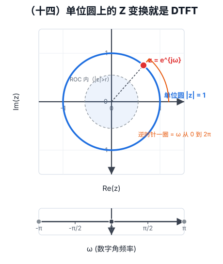
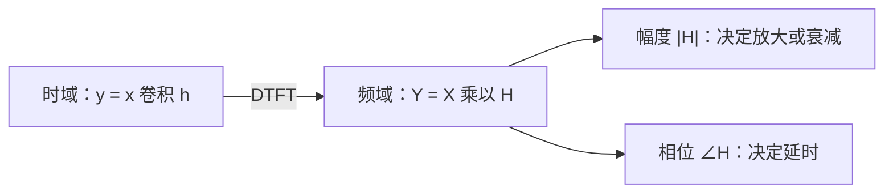
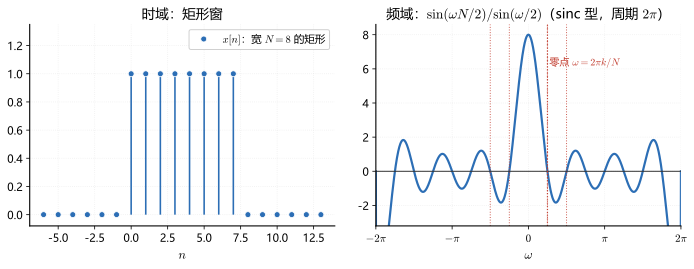
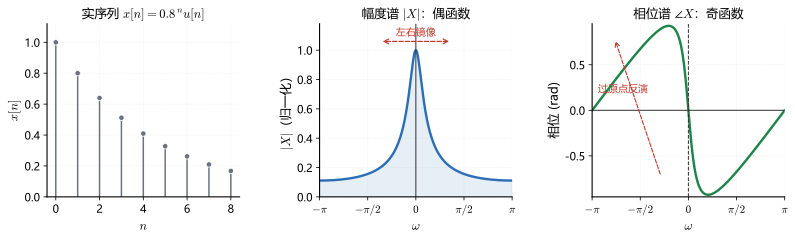

# 离散时间傅里叶变换（DTFT）

**标签：** #数字信号处理 #DSP #DTFT #傅里叶变换 #频谱 #频率响应

---

## 本篇的位置

**这一篇补的空洞。** （十二）把序列搬到了整个 z 平面，回答的是"哪个复指数能让级数收敛"，给出来的是一串关于收敛域的条件。可工程上要的往往不是整张复平面，只是 $|z|=1$ 这一圈上的值：滤波器通到哪个频率、谱线落在哪、延迟了几个点，全在这一圈上读出来。这一篇把 $X(z)$ 限制到单位圆上，单独取名为 $X(e^{j\omega})$，并把它存在与不存在的分界线画清楚。

**和前后篇的接口。** 上游三条：（十二）的 $X(z)$ 与收敛域、（七）的卷积和 $y=x*h$、（三）的能量信号与功率信号二分。第一、二条决定了这一篇的两个主角：单位圆判据和卷积定理。第三条决定了"不衰减序列为什么必须借冲激函数"。下游是（十五）正弦信号的正交性与 DFS / DFT：DFT 只是在 $\omega$ 轴上等间隔取 $N$ 个采样点，取点的合法性由（十五）保证。

**本篇保留的简化。** 讨论对象限于 LSI 系统与实系数差分方程。频率响应 $H(e^{j\omega})$ 的存在以系统稳定为前提，即极点全在单位圆内。这个前提一破，$H(e^{j\omega})$ 就不是一个可测的频率响应，而是 $X(z)$ 解析延拓出来的代数式。另外只讨论一维、单输入单输出的情形。

**没出现的东西。** DFT 的快速算法与栅栏效应的定量分析、由指标反求 $h[n]$ 的滤波器设计、多速率与采样率转换。三样都留到后面几篇。

**读完能做什么。** 拿到一个序列能不动笔先判它有没有 DTFT，依据只有一条：收敛域含不含单位圆。拿到一个差分方程能直接写出 $H(e^{j\omega})$，并用 $\omega=0$ 处的直流增益、$\omega=\pi$ 处的交替和两处自检。看到一张频谱图能报出它的窗长 $N$、零点间隔 $2\pi/N$ 和主瓣宽度 $4\pi/N$。

---

## 本篇要点

1. $X(e^{j\omega})$ 不是另一个变换，它是 $X(z)$ 在单位圆上的取值。存在判据因此只有一条：收敛域含不含单位圆。含则有，不含则无，压边界则要拆成"普通函数 + 冲激串"。
2. 绝对可和只是充分条件。$x[n]=u[n-1]/n$ 的能量是 $\pi^2/6$ 有限，但 $\sum 1/n$ 发散，它的谱在 $\omega=0$ 处按 $\ln\lvert\omega\rvert$ 发散。
3. 时域卷积变乘法，时域相乘变卷积。后一条式子前面的 $1/(2\pi)$ 就是反变换里那个 $1/(2\pi)$ 搬过来的，两处是同一个系数。
4. 矩形窗的谱峰值为 $N$、零点在 $\omega=2\pi k/N$、主瓣宽 $4\pi/N$。分辨率 $\Delta f=f_s/N$ 只由数据长度决定，补零不起作用。

---

## 一、DTFT 的来历：单位圆上的 Z 变换

承接[[【数字信号处理DSP】（十二）Z 变换与收敛域|（十二）Z 变换与收敛域]]：Z 变换把序列搬到了整个复平面，信息最全，但也最抽象。工程上我们更常问的是一个很具体的问题：

> **这个信号里到底有哪些频率？各占多少分量？**

要回答它，就得回到 z 平面上的**单位圆**——因为复指数 $e^{j\omega}$ 的模恒为 1，对应的正是「纯频率、不增不减」的成分。

于是有

$$
X(e^{j\omega}) = X(z), \qquad z = e^{j\omega}
$$

右边这个「在单位圆上取值的 Z 变换」，有一个专门的名字：**离散时间傅里叶变换（DTFT）**。

三个层次的工具各司其职：

| 工具 | 作用 | 代价 |
|---|---|---|
| 卷积和（[[【数字信号处理DSP】（七）卷积和|（七）卷积和]]） | 时域算输出 | 看不出频率构成 |
| **DTFT** | 序列 → 连续频谱 | 要求序列可和，否则要借 δ 函数 |
| Z 变换 | 序列 → 复频域 | 必须连 ROC 一起写 |

DTFT 的地位很特殊：它既是**离散时间信号的频谱定义**，又是后续 DFT / FFT（数字频谱分析）、滤波器频率响应 $H(e^{j\omega})$ 的共同源头。

---

## 二、DTFT 的定义

### 1. 正变换（分析式）

$$
X(e^{j\omega}) = \sum_{n=-\infty}^{\infty} x[n]\, e^{-j\omega n}
$$

三点要注意：

- 求和范围是**全体整数** $n$（双边求和）；
- $e^{-j\omega n}$ 是一组「数字频率为 $\omega$ 的复指数」——DTFT 干的事情，就是**测量序列与这组复指数的相似程度**；
- 结果 $X(e^{j\omega})$ 是 $\omega$ 的**连续、复值、以 $2\pi$ 为周期**的函数。

### 2. 反变换（合成式）

$$
x[n] = \frac{1}{2\pi}\int_{-\pi}^{\pi} X(e^{j\omega})\, e^{j\omega n}\, d\omega
$$

因为 $X(e^{j\omega})$ 以 $2\pi$ 为周期，积分区间可以任取一个长度为 $2\pi$ 的窗口，$\int_{-\pi}^{\pi}$ 只是最常用的选择。

**一对变换的物理含义**：正变换把序列「摊开」成一张连续的频谱图；反变换把这张图按频率积分，「叠回」原来的序列。

反变换前面那个二派分之一是怎么定出来的

它和 DFT 反变换前面的 $1/N$ 是同一件事：除以基自己的模长平方。

连续频率下，基 $e^{j\omega n}$ 与 $e^{j\omega m}$ 的内积是 $2\pi\delta[n-m]$ 而不是 $\delta[n-m]$：$\int_{-\pi}^{\pi}e^{j\omega n}e^{-j\omega m}d\omega=2\pi\delta[n-m]$。所以前面要配一个 $\frac{1}{2\pi}$，才有 $\frac{1}{2\pi}\int_{-\pi}^{\pi}e^{j\omega n}e^{-j\omega m}d\omega=\delta[n-m]$。

把 $X(e^{j\omega})=\sum_k x[k]e^{-j\omega k}$ 代进反变换，求和与积分交换次序，只有 $k=n$ 那一项活下来，它的系数是 $x[n]$ 乘上 $\frac{1}{2\pi}\cdot 2\pi=1$。

不除这个 $2\pi$ 会怎样：取 $x[n]=\delta[n]$，谱是 $X(e^{j\omega})=1$。省掉系数，积分得 $\int_{-\pi}^{\pi}1\,d\omega=2\pi$，还原出的样本是 $2\pi$ 而不是 $1$。整条序列统一放大 $2\pi$ 倍，不会在个别点上露馅。

### 3. 存在条件

| 信号类型 | DTFT 是否存在 | 形式 |
|---|---|---|
| 绝对可和 $\sum \lvert x[n] \rvert \lt \infty$ | **存在** | 普通连续函数 |
| 能量有限但非绝对可和 | 边界情形 | 可能发散 |
| 功率信号（不衰减，如 $u[n]$、正弦） | **不存在普通函数形式** | 必须引入冲激函数 $\delta$ |

这里要特别提醒一个[[【数字信号处理DSP】（三）能量信号和功率信号|（三）讲过的坑]]：**平方可和 $\neq$ 绝对可和**。

$$
x[n] = \frac{1}{n}\,u[n-1]
$$

这个序列 $\sum \lvert x[n] \rvert^2 = \sum \frac{1}{n^2} = \frac{\pi^2}{6} \lt \infty$ 能量有限，但 $\sum \lvert x[n] \rvert = \sum \frac{1}{n}$ 发散——它的 DTFT 在 $\omega = 0$ 附近像 $\ln\lvert \omega \rvert$ 一样冲向无穷。**「能量有限」并不能保证 DTFT 收敛。**

谱都发散到无穷了，帕塞瓦尔为什么对它还成立

发散有两种，这一种是"慢"的。$\sum 1/n$ 是慢发散，所以谱在 $\omega=0$ 处的奇点是 $\ln\lvert\omega\rvert$，不是冲激——值可以无穷大，但它在 $0$ 附近"占不了多少面积"。

关键在于平方：$(\ln\lvert\omega\rvert)^2$ 在 $0$ 附近仍然可积，$\int_0^{\varepsilon}(\ln\omega)^2d\omega$ 是一个有限的数。所以 $\lvert X(e^{j\omega})\rvert^2$ 的积分收敛，帕塞瓦尔那一条等式照旧成立，两边都等于 $\pi^2/6$。

出问题的只是"逐点取值"这一项：在 $\omega=0$ 这点上 $X$ 没有有限值。换句话说，这个谱属于平方可积函数，不属于有界函数。画图时应当在 $\omega=0$ 处断开、标一个向上的箭头，而不能把两边连起来。

这和 $u[n]$ 的谱是两种不同的失效：$u[n]$ 在 $\omega=0$ 处是冲激（值无穷，面积有限且可算出），$1/n$ 的谱在 $\omega=0$ 处根本没有定义（面积都积不出来）。

### 4. 与 Z 变换的关系：单位圆判据

$$
X(e^{j\omega}) = X(z), \qquad z = e^{j\omega}
$$

由此得到一条**判断 DTFT 是否存在最快的办法**：

> **DTFT 存在 $\Leftrightarrow$ $X(z)$ 的 ROC 包含单位圆。**

推论直接可用：

- 稳定系统（ROC 含单位圆）**一定**有频率响应 $H(e^{j\omega})$；
- $2^n u[n]$ 的 ROC 是 $\lvert z \rvert \gt 2$，单位圆被挡在外面 → **没有普通意义下的 DTFT**；
- $u[n]$ 的 ROC 是 $\lvert z \rvert \gt 1$，单位圆正好压在 ROC 边界上 → DTFT 不是普通函数，必须写成「函数 + 冲激串」两部分。

> 上图：橙色填充区是因果序列（极点 $0.8$）的 ROC（$\lvert z \rvert \gt 0.8$），加粗蓝圈是单位圆。单位圆上每一点 $z=e^{j\omega}$ 对应一个数字频率 $\omega$：从 $z=1$（$\omega=0$）出发逆时针绕一圈，$\omega$ 正好扫过 $2\pi$；绕到 $\pi$ 处的 $z=-1$ 是最高数字频率。**只要单位圆整圈都落在 ROC 里，DTFT 就存在。**

---

## 三、DTFT 的基本性质

设 $X(e^{j\omega}) = \mathrm{DTFT}\{x[n]\}$。

| # | 性质 | 时域 | 频域 |
|---|---|---|---|
| 1 | **周期性** | — | $X(e^{j(\omega+2\pi)}) = X(e^{j\omega})$ |
| 2 | 线性 | $a\,x[n] + b\,g[n]$ | $a\,X + b\,G$ |
| 3 | **时移** | $x[n-n_0]$ | $e^{-j\omega n_0} X(e^{j\omega})$ |
| 4 | **频移（调制）** | $e^{j\omega_0 n} x[n]$ | $X(e^{j(\omega-\omega_0)})$ |
| 5 | 时间反转 | $x[-n]$ | $X(e^{-j\omega})$ |
| 6 | **共轭对称** | $x^*[n]$ | $X^*(e^{-j\omega})$ |
| 7 | **时域卷积** | $x[n] * h[n]$ | $X(e^{j\omega})\,H(e^{j\omega})$ |
| 8 | **频域卷积** | $x[n]\,w[n]$ | $\dfrac{1}{2\pi}\displaystyle\int_{-\pi}^{\pi} X(e^{j\theta})W(e^{j(\omega-\theta)})d\theta$ |
| 9 | 相关定理 | $r_{xh}[m]$ | $X(e^{j\omega})\,H^*(e^{j\omega})$ |
| 10 | **帕塞瓦尔** | $\sum \lvert x[n] \rvert^2$ | $\frac{1}{2\pi}\int \lvert X \rvert^2 d\omega$ |

几条最要紧的：

**① 周期性**：$X(e^{j\omega})$ 以 $2\pi$ 为周期，所以**只需要画 $[-\pi, \pi]$ 或 $[0, 2\pi]$ 一段**就够了。这不是巧合——正是它在提醒我们：离散时间信号的频率本来就是「绕圈」的（见[[【数字信号处理DSP】（十）模拟频率与数字频率的关系|（十）模拟频率与数字频率]]）。

**② 时移只改相位，不改幅度**：

$$
x[n-n_0] \longleftrightarrow e^{-j\omega n_0} X(e^{j\omega})
$$

$\lvert e^{-j\omega n_0} \rvert = 1$，所以幅度谱原封不动。**纯延迟不会改变信号的频率成分，只会让各频率分量产生不同程度的相位滞后。**

**③ 调制 = 频谱搬移**：

$$
e^{j\omega_0 n}\,x[n] \longleftrightarrow X(e^{j(\omega - \omega_0)})
$$

乘一个复指数，频谱整体平移 $\omega_0$——通信里「搬频谱」的理论根据就在这一行。实信号里乘 $\cos(\omega_0 n)$ 则会搬出**两份**（正负各一份），这就是混频器的数学。

**④ 时域卷积定理（全书最重要的一条）**：

$$
x[n] * h[n] \;\longleftrightarrow\; X(e^{j\omega})\,H(e^{j\omega})
$$

**时域里麻烦的卷积，到频域变成一次乘法。** 这就是整个频域分析法的立身之本。

**⑤ 频域卷积定理（时域相乘 ↔ 频域卷积）**——和上一条完全对偶：

$$
x[n]\,w[n] \;\longleftrightarrow\; \frac{1}{2\pi}\int_{-\pi}^{\pi} X(e^{j\theta})\,W\bigl(e^{j(\omega-\theta)}\bigr)\,d\theta
$$

它的工程含义极重：**「给信号乘一个窗」等于「把频谱和窗的频谱卷积」**。加矩形窗就会把谱线抹成 sinc 形，这就是**频谱泄漏**的根源（第八节例题 6 会定量算一遍）。

时域相乘，频谱为什么不干脆也相乘

因为乘完之后的序列，已经不是原来那组频率成分的简单叠加了。

取 $\cos(\omega_0 n)$ 自乘：$\cos^2(\omega_0 n)=\frac{1}{2}+\frac{1}{2}\cos(2\omega_0 n)$。凭空冒出 $\pm 2\omega_0$ 两个新频率、还多出一个直流。如果频谱真的只是逐点相乘，两条在 $\pm\omega_0$ 的谱线相乘只会让这两个点变亮，绝不可能生出 $\pm 2\omega_0$ 的位置。

卷积在做的事情是：把 $X$ 整体平移到 $\theta$ 的位置，再用 $W$ 加权叠起来。每一个输出频点收拢的是输入谱的一整段，不是对应的一点。

$1/(2\pi)$ 那一项的作用是保持标度。两个谱都恒等于 $1$（对应时域两个 $\delta$），卷积结果是 $\frac{1}{2\pi}\int_{-\pi}^{\pi}1\,d\theta=1$，和时域 $\delta\cdot\delta=\delta$ 的谱一致。漏掉它，冲激乘冲激的谱就会算成 $2\pi$。

**⑥ 帕塞瓦尔定理**——能量在时域和频域守恒：

$$
\sum_{n=-\infty}^{\infty} \lvert x[n] \rvert^2 = \frac{1}{2\pi}\int_{-\pi}^{\pi} \lvert X(e^{j\omega}) \rvert^2\, d\omega
$$

这条式子也是[[【数字信号处理DSP】（五）能量谱密度与功率谱密度|（五）能量谱密度与功率谱密度]]的地基：$\lvert X(e^{j\omega}) \rvert^2$ 就是能量按频率的分布密度，简称**能量谱密度**。它的标准陈述、三步证明、与维纳-辛钦的关系以及四种形态（连续 / 离散 / DFT / 傅里叶级数），见 [[【数字信号处理DSP】（六）维纳-辛钦定理与帕塞瓦尔定理|（六）维纳-辛钦定理与帕塞瓦尔定理]] 第五节。

---

## 四、常见序列的 DTFT

| 序列 $x[n]$ | DTFT $X(e^{j\omega})$ | 频谱长什么样 |
|---|---|---|
| $\delta[n]$ | $1$ | 全频率等幅（平） |
| $\delta[n-n_0]$ | $e^{-j\omega n_0}$ | 幅度为 1，纯线性相位 |
| 常数 $1$ | $2\pi \sum_k \delta(\omega - 2\pi k)$ | 梳状冲激（只有直流） |
| $e^{j\omega_0 n}$ | $2\pi \sum_k \delta(\omega - \omega_0 - 2\pi k)$ | 一根孤立谱线 |
| $\cos(\omega_0 n)$ | $\pi\sum_k\bigl[\delta(\omega-\omega_0-2\pi k)+\delta(\omega+\omega_0-2\pi k)\bigr]$ | 一对共轭谱线 |
| $u[n]$ | $\frac{1}{1-e^{-j\omega}} + \pi \sum_k \delta(\omega - 2\pi k)$ | 冲激 + 连续拖尾 |
| $a^n u[n]\;(\lvert a \rvert \lt 1)$ | $\frac{1}{1 - a\,e^{-j\omega}}$ | 单峰低通 |
| 矩形窗 $R_N[n]$ | $e^{-j\omega\frac{N-1}{2}}\cdot\frac{\sin(\omega N/2)}{\sin(\omega/2)}$ | **sinc 形** |

挑三个重点讲：

**① $\delta[n] \leftrightarrow 1$**：一个冲激在时域「最短」，在频域「最宽」——所有频率等幅。这是时频互补性最直白的体现。

**② 常数 $1 \leftrightarrow$ 冲激串**：不衰减的序列在频域只能靠 $\delta$ 函数表示，且 $\delta$ 每隔 $2\pi$ 重复一次，这本身就是 DTFT 周期性的印证。**为什么一个发散的级数会等于冲激、系数 $2\pi$ 从哪来**，见 [[【数字信号处理DSP】（五）能量谱密度与功率谱密度|（五）能量谱密度与功率谱密度]] 的「例题 2 的补遗」。

为什么周期序列的谱只能写成冲激，画不成一条普通曲线

普通函数表达不了"能量全压在一条零宽度的线上"这件事。

看 $x[n]=\cos(\omega_0 n)$：$\sum_n\lvert x[n]\rvert^2$ 发散，它不是能量信号；但每个周期贡献的功率是有限的。能量无限、功率有限，这种分布只能用一个"面积不为零、宽度为零"的对象来记，那就是 $\delta$。

假设硬写成一个普通函数 $F(\omega)$：要让全部功率堆在 $\omega_0$ 一点，$F(\omega_0)$ 得取无穷大。可普通函数在单点的取值不影响积分，$\int F\,d\omega$ 仍然是 $0$。卡住的地方不是数值大小，是"零测度集上的分布"这个概念本身就超出了函数的表达能力。

第二件事是那个 $\sum_k$。DTFT 对 $\omega$ 是 $2\pi$ 周期的，谱也必须跟着周期。只写一根 $\delta(\omega-\omega_0)$，把它平移 $2\pi$ 之后与原式不相等，周期性当场就破。所以每根谱线都得在 $\omega_0+2\pi k$ 处各复制一份。

标度也能对上：$e^{j\omega_0 n}$ 的谱是 $\omega_0$ 处面积 $2\pi$ 的冲激；$\cos(\omega_0 n)$ 是两个复指数各取 $1/2$，于是每根谱线面积 $\pi$，两根合起来 $2\pi$。幅度为 1 的余弦，谱线面积只有单个复指数的一半，少掉的那一半在负频率那边。

**③ $a^n u[n]$（$\lvert a \rvert \lt 1$）**：

$$
X(e^{j\omega}) = \sum_{n=0}^{\infty} a^n e^{-j\omega n} = \sum_{n=0}^{\infty} \bigl(a e^{-j\omega}\bigr)^n = \frac{1}{1 - a\,e^{-j\omega}}
$$

几何级数，公比 $\lvert a e^{-j\omega} \rvert = \lvert a \rvert \lt 1$ 保证收敛。**$a$ 越小衰减越快，频谱越「胖」（越接近白噪声）；$a \to 1$ 时频谱越来越集中在 $\omega = 0$。**

**④ 矩形窗的 sinc 频谱**。这是最该记住的一条，因为 FFT 频谱分析全靠它：

$$
X(e^{j\omega}) = \sum_{n=0}^{N-1} e^{-j\omega n}
= \frac{1 - e^{-j\omega N}}{1 - e^{-j\omega}}
= e^{-j\omega\frac{N-1}{2}} \cdot \frac{\sin(\omega N/2)}{\sin(\omega/2)}
$$

中间那步非要把半角因子提出来，图的是什么

整条链只有三步，每一步都在解决上一步留下的死结。

第一步认级数：指数里是 $-j\omega n$，所以公比就是 $e^{-j\omega}$，套 $(1-q^N)/(1-q)$ 得 $\frac{1-e^{-j\omega N}}{1-e^{-j\omega}}$。这一步之后式子是对的，但没法用：$\omega=0$ 处是 $0/0$，而且形如复数除复数，零点在哪、相位是不是直线，全看不出来。

第二步提半角，用的是 $1-e^{-j\theta}=e^{-j\theta/2}\cdot 2j\sin(\theta/2)$。分子分母各提一次，$2j$ 约掉，两个单位复数相除给出纯相位 $e^{-j\omega(N-1)/2}$，剩下一个实正弦之比。

第三步读数：相位是标准的线性相位，斜率 $(N-1)/2$；零点由分子正弦为零给出；主瓣宽度由相邻两个零点相减给出。

只给分子提半角、忘了分母会怎样：得到的是 $\frac{2j e^{-j\omega N/2}\sin(\omega N/2)}{1-e^{-j\omega}}$，相位不再是一条直线。于是一个本来严格线性相位的系统，会被判成非线性相位、群延迟随频率变化。幅度谱倒是没算错，所以这种错很难自查——只有回头去算群延迟才会露馅。

拆成三块看：

- $e^{-j\omega\frac{N-1}{2}}$：纯相位，只表示波形「延迟了 $(N-1)/2$ 点」，与幅度无关；
- 幅度 $\lvert X \rvert = \left\lvert \frac{\sin(\omega N/2)}{\sin(\omega/2)} \right\rvert$：**主瓣 + 旁瓣**结构；
- 零点在 $\omega = \frac{2\pi k}{N}$（$k = 1, 2, \dots, N-1$）——**时域窗口越长 $N$，主瓣越窄、频率分辨力越高**。

主瓣的峰值（$\omega = 0$ 处）用洛必达法则求：

$$
\lim_{\omega\to 0}\frac{\sin(\omega N/2)}{\sin(\omega/2)} = \frac{N/2}{1/2} = N
$$

所以**矩形窗 DTFT 的峰值就等于窗长 $N$**，这个「$N$」在后面做窗函数归一化时会反复出现。第一个零点在 $\omega = 2\pi/N$，主瓣宽度（零点到零点）是 $4\pi/N$。

> 上图：左侧时域是长度 $N=5$ 的矩形脉冲，右侧是它的幅频响应 $\sin(\omega N/2)/\sin(\omega/2)$——峰值等于 $N=5$，主瓣居中、旁瓣递减，零点等距分布在 $\omega = 2\pi k/N$（红虚线），且在 $\pm 2\pi$ 处严格重复（周期性）。

---

## 五、实序列的共轭对称性

实信号（现实中测到的信号几乎都是实的）有一条极其有用的性质：

$$
x[n] \in \mathbb{R} \;\Longrightarrow\; X(e^{j\omega}) = X^*(e^{-j\omega})
$$

拆成幅度和相位就是：

$$
\lvert X(e^{j\omega}) \rvert = \lvert X(e^{-j\omega}) \rvert, \qquad \angle X(e^{j\omega}) = -\angle X(e^{-j\omega})
$$

**幅度谱是偶函数，相位谱是奇函数。**

> 上图：左栏实序列 $x[n]=0.8^{\,n}u[n]$；中栏幅频 $\lvert X \rvert$ 关于 $\omega=0$ 左右镜像（偶函数）；右栏相频 $\angle X$ 过原点反演（奇函数）——正负两侧数值相等、符号相反。

### 对称性全表

时域的对称性会「翻译」成频域的实虚性，反过来也成立：

| 时域 $x[n]$ | 频域 $X(e^{j\omega})$ |
|---|---|
| 实序列 | 共轭对称：$X(e^{j\omega}) = X^*(e^{-j\omega})$（模偶、相位奇） |
| 实且偶：$x[n]=x[-n]$ | **实且偶**：$X$ 为实函数，相位只能是 0 或 $\pi$ |
| 实且奇：$x[n]=-x[-n]$ | **纯虚且奇**：$X$ 只有虚部 |
| 纯虚序列 | 共轭反对称 |
| 一般序列 | 可分解为「偶部 $\leftrightarrow$ 实部」+「奇部 $\leftrightarrow$ 虚部」 |

最后一行是解题利器：

$$
x_e[n] = \frac{x[n]+x[-n]}{2} \;\longleftrightarrow\; \mathrm{Re}\bigl[X(e^{j\omega})\bigr],
\qquad
x_o[n] = \frac{x[n]-x[-n]}{2} \;\longleftrightarrow\; j\,\mathrm{Im}\bigl[X(e^{j\omega})\bigr]
$$

三个工程结论：

1. **只需算半边**：$\lvert X \rvert$ 和 $\angle X$ 在 $[0, \pi]$ 上确定后，负频率部分直接镜像得到；
2. **负频率不是玄学**：它就是正频率的共轭镜像，物理信息完全冗余（呼应[[【数字信号处理DSP】（十）模拟频率与数字频率的关系|（十）讲过的「负频率是什么」]]）；
3. **实系数系统的频率响应自动满足**：实系数差分方程推出的 $H(e^{j\omega})$ 一定是共轭对称的。

---

## 六、LSI 系统的频率响应

对[[【数字信号处理DSP】（八）离散时间系统的各种响应概念详解|（八）讲过的单位脉冲响应]] $h[n]$ 做 DTFT，得到**频率响应**：

$$
H(e^{j\omega}) = \sum_{n=-\infty}^{\infty} h[n]\, e^{-j\omega n}
$$

结合卷积定理，立刻得到**频域分析的基本公式**：

$$
y[n] = x[n] * h[n] \;\longleftrightarrow\; Y(e^{j\omega}) = X(e^{j\omega})\,H(e^{j\omega})
$$

### 1. 由差分方程写出频率响应

对常系数差分方程（见[[【数字信号处理DSP】（九）离散时间系统的时域解法|（九）时域解法]]）

$$
\sum_{k=0}^{N} a_k\, y[n-k] = \sum_{r=0}^{M} b_r\, x[n-r], \qquad a_0 = 1
$$

利用时移性质，直接得到

$$
H(e^{j\omega}) = \frac{\sum_{r=0}^{M} b_r\, e^{-j\omega r}}{\sum_{k=0}^{N} a_k\, e^{-j\omega k}}
$$

**注意**：这个式子能成立，前提是系统**稳定**（$h[n]$ 绝对可和，ROC 含单位圆）。不稳定的系统根本没有 $H(e^{j\omega})$。

### 2. 正弦输入的稳态输出

$H(e^{j\omega})$ 最漂亮的推论：**复指数是 LSI 系统的特征函数**。

$$
x[n] = e^{j\omega_0 n} \;\Longrightarrow\; y[n] = H(e^{j\omega_0})\, e^{j\omega_0 n}
$$

输入输出**同一个频率**，只是幅度乘 $\lvert H(e^{j\omega_0}) \rvert$、相位加 $\angle H(e^{j\omega_0})$。推广到实正弦：

$$
x[n] = A\cos(\omega_0 n + \varphi)
\;\Longrightarrow\;
y[n] = A\,\lvert H(e^{j\omega_0}) \rvert \cos\Bigl(\omega_0 n + \varphi + \angle H(e^{j\omega_0})\Bigr)
$$

这就是「滤波器改变音色、音响调 EQ」的全部数学。

### 3. 线性相位与群延迟

当 $\angle H(e^{j\omega}) = -\omega n_0$（相位是过原点的直线）时，所有频率分量延迟同样多的点数 $n_0$——**波形形状不变，只是整体平移**。这正是 FIR 滤波器设计追求「线性相位」的原因。

更一般地，衡量「延迟」要用**群延迟**：

$$
\tau_g(\omega) = -\frac{d\,\angle H(e^{j\omega})}{d\omega}
$$

群延迟里的负号和导数，各自在管什么

负号管方向。相位写成 $-\omega n_0$ 时，物理上的延迟是正的 $n_0$。相位随频率往下走，对应波形往后拖，所以要取负才换来一个正的时间量。

导数管"一群"而不是"一个"。相位值本身不可靠：给它加 $2\pi$ 的整数倍，信号一模一样，因为 $e^{j\pi}$ 与 $e^{-j\pi}$ 是同一个数。斜率没有这个自由度，加常数动不了它，所以斜率才能拿来当延迟用。

反例一：$\angle H=\pi$，常数相位。相位值是 $\pi$，看着像"延迟了半个周期"；斜率却是 $0$，群延迟为零，波形一点没动。这就是反相放大器，增益为负，输出和输入同时到。

反例二：$\angle H=-\omega n_0$ 和 $\angle H=-\omega n_0+\pi$ 的相位差一整圈，群延迟却都是 $n_0$。只看相位值会把这两个系统判成延迟不同，看斜率就知道它们延迟一样。

- 线性相位 $\angle H = -\omega n_0$ ⇒ 群延迟恒为 $n_0$，**所有频率延迟一致，波形不失真**；
- 非线性相位 ⇒ 群延迟随频率变化，不同分量到达时间不同，**方波会被抹圆、脉冲会被展宽**。

所以「相位」在工程上不是可有可无的附加项，它就是**失真**的代名词。这也解释了为什么通信与音频系统宁可牺牲阶数，也要用线性相位的 FIR。

---

## 七、DTFT 与 DFT / FFT 的衔接

DTFT 是**连续**的 $\omega$，计算机只能处理**离散**数据，于是有了 DFT：

| | DTFT | DFT |
|---|---|---|
| 自变量 $\omega$ | 连续 | 离散，$N$ 个点 |
| 序列长度 | 无限（或任意长） | 有限，$N$ 点 |
| 周期性 | 固有 $2\pi$ 周期 | 隐含周期 |
| 计算 | 理论工具 | 可用 FFT 快速计算 |

- **做法**：把 $X(e^{j\omega})$ 在 $[0, 2\pi)$ 上均匀取 $N$ 个点，就得到 $N$ 点 DFT；
- **栅栏效应**：只能看到这 $N$ 个频点，频点之间的细节被「栅栏」挡住；
- **频率分辨率**：$\Delta\omega = \frac{2\pi}{N}$，折成模拟频率就是 $\Delta f = \frac{f_s}{N}$，$N$ 越大分辨越细——代价是计算量与时间；
- 这正是[[【数字信号处理DSP】（十一）奈奎斯特采样定理|（十一）奈奎斯特采样定理]]在频域的对应：**时域采样使频谱周期延拓，频域采样使时域周期延拓**，二者完全对偶。

具体内容留到后续的 DFT / FFT 章节展开。

---

## 八、典型例题

> **答题模板（DTFT）**
>
> ① 能套性质就别硬积：先找时移、调制、卷积、线性；
> ② 硬算时用等比级数求和，公比是 $e^{-j\omega}$（或 $a e^{-j\omega}$）；
> ③ 化成 $\dfrac{1-e^{-j\omega N}}{1-e^{-j\omega}}$ 的形式后，**必须**提到半角写成实正弦比值 + 纯相位；
> ④ 求幅度谱就取模（纯相位因子模为 1，直接丢掉）；求零点就令分子正弦为零；
> ⑤ **检验**：$\omega=0$ 处的值应等于 $\sum_n x[n]$（直流增益），$\omega=\pi$ 处的值应等于 $\sum_n (-1)^n x[n]$。

### 例题 1：矩形脉冲的 DTFT（完整推导）

已知 $x[n] = 1$（$0 \le n \le N-1$），求 $X(e^{j\omega})$，并指出零点位置与主瓣宽度。

**解**：

（1）按定义

$$
X(e^{j\omega}) = \sum_{n=0}^{N-1} e^{-j\omega n}
=\frac{1 - e^{-j\omega N}}{1 - e^{-j\omega}}
$$

（首项 1、公比 $e^{-j\omega}$、共 $N$ 项的几何级数）

（2）分子分母同提半角因子：

$$
1 - e^{-j\omega N} = e^{-j\omega N/2}\bigl(e^{j\omega N/2} - e^{-j\omega N/2}\bigr) = 2j\, e^{-j\omega N/2} \sin(\omega N/2)
$$

$$
1 - e^{-j\omega} = e^{-j\omega/2}\bigl(e^{j\omega/2} - e^{-j\omega/2}\bigr) = 2j\, e^{-j\omega/2} \sin(\omega/2)
$$

相除：

$$
\boxed{\;X(e^{j\omega}) = e^{-j\omega\frac{N-1}{2}} \cdot \frac{\sin(\omega N/2)}{\sin(\omega/2)}\;}
$$

（3）取模，纯相位因子模为 1：

$$
\bigl\lvert X(e^{j\omega}) \bigr\rvert = \left\lvert \frac{\sin(\omega N/2)}{\sin(\omega/2)} \right\rvert
$$

（4）零点由 $\sin(\omega N/2) = 0$ 决定（且 $\sin(\omega/2) \neq 0$）：

$$
\frac{\omega N}{2} = k\pi \;\Longrightarrow\; \omega = \frac{2\pi k}{N}, \qquad k = 1, 2, \dots, N-1
$$

（5）主瓣从 $-\frac{2\pi}{N}$ 到 $+\frac{2\pi}{N}$，宽度 $\frac{4\pi}{N}$；峰值由洛必达法则得 $N$。

（6）**检验**：$\omega=0$ 时 $X = N$，而 $\sum_{n=0}^{N-1}x[n] = N$ ✓；$\omega=\pi$ 时 $\dfrac{\sin(N\pi/2)}{\sin(\pi/2)} = \sin(N\pi/2)$，而 $\sum (-1)^n = 1$（$N$ 奇数）或 $0$（$N$ 偶数）—— $N=5$ 时 $\sin(5\pi/2) = 1$ ✓。

**结论**：矩形脉冲的幅度谱是 sinc 形，零点等距分布在 $\omega = \frac{2\pi k}{N}$。$N = 5$ 时零点在 $\pm 2\pi/5$、$\pm 4\pi/5$，与上图完全一致。

### 例题 2：用时移与调制性质求 DTFT

已知 $x[n] = 0.5^n u[n]$，求 (1) $x[n-2]$；(2) $e^{j\frac{\pi}{4} n} x[n]$ 的 DTFT。

**解**：先求基准

$$
X(e^{j\omega}) = \sum_{n=0}^{\infty} 0.5^n e^{-j\omega n} = \frac{1}{1 - 0.5\,e^{-j\omega}}
$$

**（1）** 时移性质：

$$
\boxed{\;\mathrm{DTFT}\{x[n-2]\} = e^{-j2\omega}\, X(e^{j\omega}) = \frac{e^{-j2\omega}}{1 - 0.5\,e^{-j\omega}}\;}
$$

幅度谱 $\frac{1}{\lvert 1 - 0.5e^{-j\omega} \rvert}$ 与原来**完全相同**——时移只添了一个线性相位 $e^{-j2\omega}$。

**（2）** 调制性质：

$$
\boxed{\;\mathrm{DTFT}\bigl\{e^{j\frac{\pi}{4} n} x[n]\bigr\} = X\bigl(e^{j(\omega - \frac{\pi}{4})}\bigr) = \frac{1}{1 - 0.5\,e^{-j(\omega - \pi/4)}}\;}
$$

**频谱整体右移 $\pi/4$**，形状不变。

**检验**：(1) 取 $\omega=0$ 得 $1\times 2 = 2 = \sum_n x[n]$ —— 时移不改变样本之和 ✓。(2) 取 $\omega=\pi/4$，结果退化为 $\dfrac{1}{1-0.5e^{j0}} = 2$，正是原序列在 $\omega=0$ 处的值 —— 说明整条曲线确实被平移了 $\pi/4$，形状分毫未变 ✓。

### 例题 3：判断 DTFT 是否存在

判断下列序列的 DTFT 是否存在，说明理由：$h_1[n] = 2^n u[n]$、$h_2[n] = 0.5^n u[n]$、$h_3[n] = u[n]$。

**解**：用 ROC 判据最快——**看单位圆在不在 ROC 里**。

**（1）** $h_1[n] = 2^n u[n]$：Z 变换 $\frac{1}{1 - 2z^{-1}}$，极点 $z = 2$，ROC 为 $\lvert z \rvert \gt 2$。单位圆 $\lvert z \rvert = 1$ 在 ROC 之外 ⇒ **DTFT 不存在**（系统不稳定，频率响应无从谈起）。

**（2）** $h_2[n] = 0.5^n u[n]$：极点 $z = 0.5$，ROC 为 $\lvert z \rvert \gt 0.5$，**包含单位圆** ⇒ DTFT 存在：

$$
H_2(e^{j\omega}) = \frac{1}{1 - 0.5\,e^{-j\omega}}
$$

**（3）** $h_3[n] = u[n]$：极点 $z = 1$ 正好落在单位圆上，ROC 为 $\lvert z \rvert \gt 1$，单位圆是 ROC 的**边界** ⇒ 不存在普通函数形式，只能写成

$$
U(e^{j\omega}) = \frac{1}{1 - e^{-j\omega}} + \pi\sum_{k=-\infty}^{\infty}\delta(\omega - 2\pi k)
$$

$$
\boxed{\;\text{仅有 } h_2 \text{ 存在普通 DTFT；} h_1 \text{ 不存在；} h_3 \text{ 需借 } \delta \text{ 函数}\;}
$$

**检验**：三条结论与「$h[n]$ 是否绝对可和」逐一对应：$\sum 2^n = \infty$ ✗、$\sum 0.5^n = 2$ ✓、$\sum 1 = \infty$ ✗ —— 两种判据结论一致 ✓。

把代数式当频谱用，会错在哪里而自己察觉不到

$h_1[n]=2^n u[n]$ 的 Z 变换是 $\frac{1}{1-2z^{-1}}$，把 $z$ 换成 $e^{j\omega}$ 得 $\frac{1}{1-2e^{-j\omega}}$。这个式子在整条单位圆上都**合法**：$\lvert 2e^{-j\omega}\rvert=2\neq1$，分母永不为零。画出来是一条光滑的有限曲线，横轴、纵轴、刻度都齐全，看上去就是一张标准的幅频响应。

错在哪：$\sum_n 2^n e^{-j\omega n}$ 的每一项模长是 $2^n$，通项根本不趋于零，级数处处发散。这张"曲线"并不是任何收敛级数的和。

真正的来历是解析延拓。$X(z)$ 原本只在 $\lvert z\rvert\gt2$ 有定义，但 $\frac{1}{1-2z^{-1}}$ 这个表达式除了 $z=2$ 之外处处解析，于是它被自然延拓到了单位圆上。延拓合法，语义却变了：单位圆上的值不再等于那个级数，也不对应任何有界序列的频谱。

再走一步，错得就很具体了。在 $\omega=0$ 处读到 $\frac{1}{\lvert 1-2\rvert}=1$，结论会说"该系统对直流的增益是 1"。可真实系统对常数输入 $x[n]=1$ 的输出是 $2^{n+1}-1$，随 $n$ 指数爆炸。一个读到的是温和的 1，实际发生的是爆炸。

自查只有两条路，都要在动笔之前走：算 $\sum\lvert h[n]\rvert$ 看它收不收敛，或者看极点半径 $2$ 是不是大于 $1$。两条都不看，光盯着代数式，看不出任何异常。

### 例题 4：正弦输入的系统稳态响应

系统满足 $y[n] - 0.5\,y[n-1] = x[n]$，输入 $x[n] = \cos(\pi n/3)$，求稳态输出。

**解**：

（1）由差分方程系数（$a_0=1,\,a_1=-0.5,\,b_0=1$）写频率响应：

$$
H(e^{j\omega}) = \frac{1}{1 - 0.5\,e^{-j\omega}}
$$

（2）代入 $\omega_0 = \pi/3$，先算分母：

$$
e^{-j\pi/3} = \cos\frac{\pi}{3} - j\sin\frac{\pi}{3} = 0.5 - j\,0.8660
$$

$$
1 - 0.5\,e^{-j\pi/3} = 1 - 0.5\bigl(0.5 - j0.8660\bigr) = 0.75 + j\,0.4330
$$

（3）求模与辐角：

$$
\bigl\lvert H \bigr\rvert = \frac{1}{\sqrt{0.75^2 + 0.4330^2}} = \frac{1}{\sqrt{0.5625 + 0.1875}} = \frac{1}{\sqrt{0.75}} \approx 1.1547
$$

$$
\angle H = -\arctan\frac{0.4330}{0.75} = -\arctan(0.5774) = -\frac{\pi}{6}
$$

（4）由正弦稳态结论：

$$
\boxed{\;y[n] = 1.1547\,\cos\Bigl(\frac{\pi}{3}n - \frac{\pi}{6}\Bigr)\;}
$$

（5）**检验**：

- **幅度**：直流增益 $\lvert H(0) \rvert = 2$、高频增益 $\lvert H(\pi) \rvert = \dfrac{1}{1.5} = 0.667$，且 $\lvert H \rvert$ 随 $\lvert \omega \rvert$ 单调下降，故 $1.1547$ 必落在 $(0.667,\,2)$ 之间 ✓。
- **相位**：由 $\tan(-\angle H) = \dfrac{0.5\sin\omega}{1-0.5\cos\omega}$ 对 $\omega$ 求导并令其为零，得 $\cos\omega = 0.5$，即**最大滞后恰好发生在 $\omega = \pi/3$**，最大滞后角为

$$
\arctan\frac{0.5\times 0.866}{1-0.25} = \arctan 0.5774 = 30^\circ
$$

我们算出的 $-30^\circ$ 正好落在这个极值点上，数值自洽 ✓。（这也顺带说明：一阶低通的最大相位滞后不超过 $30^\circ$ 左右，与极点半径有关。）

### 例题 5：利用对称性反推序列

已知 $x[n]$ 为实序列，且 $X(e^{j\omega}) = e^{-j3\omega}A(\omega)$，其中 $A(\omega)$ 是实偶函数。问 $x[n]$ 有什么时域对称性？

**解**：

（1）**判据**：$X$ 写成「纯相位 × 实偶函数」。由对称性全表，实偶的频谱对应实偶的时域序列。

（2）**代入**：$e^{-j3\omega}$ 是时移因子（对应 $x[n-3]$），$A(\omega)$ 实偶 ⇒ 其逆变换 $a[n]$ 实且偶，即 $a[n]=a[-n]$。于是

$$
x[n] = a[n-3], \qquad a[n] = a[-n]
$$

（3）$x[n]$ 关于 $n=3$ **偶对称**：$x[3+k] = x[3-k]$。

（4）**检验**：取最简单的 $a[n]=\delta[n]$，则 $A(\omega)=1$，$X=e^{-j3\omega}$，对应 $x[n]=\delta[n-3]$。它在 $n=3$ 左右对称 ✓（$\delta[3+k]=\delta[3-k]$ 只在 $k=0$ 非零）。再看 $\angle X=-3\omega$，是一条过原点的直线 ⇒ 线性相位、群延迟恒为 $3$ ✓。

$$
\boxed{\;x[n] \text{ 为实序列，且关于 } n=3 \text{ 偶对称（} x[3+k]=x[3-k] \text{）}\;}
$$

**要点**：**「实」管共轭对称，「偶」管实虚性，「时移」管相位斜率**。三条各管一件事，分开看就不会乱。

### 例题 6：加窗为什么会产生频谱泄漏

设无限长正弦 $x[n]=\cos(\omega_0 n)$ 被长度 $N$ 的矩形窗 $w[n]$ 截断，求 $y[n] = x[n]w[n]$ 的频谱，并给出主瓣宽度与泄漏的来源。

**解**：

（1）**判据**：时域相乘 ⇒ 频域卷积（性质 8）。

（2）$x[n]$ 的频谱是一对谱线：

$$
X(e^{j\omega}) = \pi\sum_k\bigl[\delta(\omega-\omega_0-2\pi k) + \delta(\omega+\omega_0-2\pi k)\bigr]
$$

（3）矩形窗频谱由例题 1：$W(e^{j\omega}) = e^{-j\omega\frac{N-1}{2}}\dfrac{\sin(\omega N/2)}{\sin(\omega/2)}$。

（4）代入频域卷积式。$\delta$ 函数与任何函数卷积等于「把该函数平移到 $\delta$ 的位置」，于是

$$
Y(e^{j\omega}) = \frac{1}{2}\Bigl[W\bigl(e^{j(\omega-\omega_0)}\bigr) + W\bigl(e^{j(\omega+\omega_0)}\bigr)\Bigr]
$$

**两根无限细的谱线，各自被抹成了一个 sinc**：

$$
\boxed{\;Y(e^{j\omega}) = \frac{1}{2}\Bigl[W(e^{j(\omega-\omega_0)}) + W(e^{j(\omega+\omega_0)})\Bigr],\quad
\text{主瓣宽 } \frac{4\pi}{N},\ \text{峰值 } \frac{N}{2}\;}
$$

（5）**检验**：峰值 $\frac{1}{2}\times N = \frac{N}{2}$。另一条路直接按定义算 $\omega=\omega_0$ 处的值：

$$
Y(e^{j\omega_0}) = \sum_{n=0}^{N-1}\cos(\omega_0 n)e^{-j\omega_0 n}
= \frac{1}{2}\sum_{n=0}^{N-1}\bigl(1 + e^{-j2\omega_0 n}\bigr) \approx \frac{N}{2}
$$

（第二项是等比级数，只在 $\omega_0$ 接近 $0$ 或 $\pi$ 时不可忽略。）两条路一致 ✓。再令 $N\to\infty$，$\frac{4\pi}{N}\to 0$，sinc 收窄成 $\delta$，回到未加窗的谱线 ✓。

（6）**结论**：所谓**频谱泄漏**，就是「原本干净的谱线被窗的 sinc 抹开」——能量从主瓣漏进旁瓣。后果有两个：

- **分辨率受限**：两个频率靠得太近（$\lvert\omega_1-\omega_2\rvert \lt 4\pi/N$）就分辨不开，折成模拟频率是 **$\Delta f = f_s/N$**；
- **旁瓣干扰**：强信号的旁瓣可能盖住附近的弱信号，所以工程上要换汉宁窗、汉明窗（主瓣更宽但旁瓣更低）。

这也解释了为什么 FFT 分析时「加点长」永远是最有效的提高分辨率手段：$N$ 是唯一决定分辨率的东西，补零只能插值、不能提高分辨率。

泄漏、混叠、DFT 的隐含周期，是不是同一件事的三次出场

三次出场都来自同一个动作：在一个域里相乘，等于在另一个域里卷积。

时域乘一个有限长的窗，频域就卷窗的谱，谱线被抹成 sinc，这是泄漏。
时域乘一串间隔 $T_s$ 的冲激（采样），频域就周期延拓，副本互相重叠，这是混叠。
频域乘一串间隔 $2\pi/N$ 的冲激（频域采样），时域就周期延拓，序列穿上了一件"隐形周期"的外衣。DFT 把 $N$ 点序列当成一个周期来算，源头就在这里。

三行的差别只在"乘的对象是哪一个"和"卷的对手是谁"，公式形状一模一样，都带 $1/(2\pi)$（离散的那两行把积分换成求和，$2\pi$ 的位置也跟着换）。

这张表还能澄清一个常混的点：分辨率为什么只认数据长度。泄漏后的主瓣宽度是 $4\pi/N$，$N$ 是窗长。补零只是把同一条 $X(e^{j\omega})$ 在更密的频点上取值，窗没有变长，主瓣一点没窄。采样率高只决定能测到多高的频率，不决定两条谱线能否分开。

---

## 九、常见错误

这一节原来列了十二条。逐条读下来会发现，其中十条不是"算错"，而是"判据用错"：拿平方可和当绝对可和、拿代数式当频谱、拿 DFT 的点数当 DTFT 的分辨率。所以改成表，每条给一句能当场自检的话，再用本篇的具体数字给反例。

| 错误说法 | 为什么会这么想 | 判据 | 反例 |
|---|---|---|---|
| DTFT 对所有序列都存在 | 反变换的积分写在那儿，看着总能算 | 算 $\sum\lvert x[n]\rvert$，或看极点是否落在单位圆外 | $2^n u[n]$ 的 $\sum 2^n=\infty$，极点 $z=2$ 在单位圆外，没有 DTFT |
| $X(e^{j\omega})$ 与 $X(z)$ 是同一种写法的两个名字 | 只差一个 $z=e^{j\omega}$ 的替换 | 看动笔时有没有写收敛域 | $u[n]$ 写成 $\frac{1}{1-e^{-j\omega}}$ 就漏掉了 $\pi\sum_k\delta(\omega-2\pi k)$ |
| DTFT 就是 DFT | 两条式子长得像，都在频域 | 看 $\omega$ 是连续取的还是只有 $N$ 个点 | 同一个 5 点矩形窗，DTFT 在 $\omega=\pi/5$ 处取值约 $3.24$，而 5 点 DFT 里根本没有这个频点 |
| 画到 $-4\pi$ 到 $4\pi$ 才是更宽的带宽 | 频率轴画得越长，信息越多 | 看曲线在 $\pm2\pi$ 处是否已经重复 | 矩形窗谱在 $\omega$ 与 $\omega+2\pi$ 处数值相同，$N=5$ 时两处峰值都是 $5$ |
| 反变换可以省掉 $1/(2\pi)$ | 觉得那只是个归一化常数 | 用 $x[n]=\delta[n]$ 回代一次 | $X=1$ 时积分得 $2\pi$，还原出的样本是 $2\pi$ 而不是 $1$ |
| 时移会改变幅度谱 | 时域动了，频谱应该也跟着动 | 比 $\lvert X\rvert$ 曲线，不看相位 | 例题 2 的 $x[n-2]$，幅度谱仍是 $\frac{1}{\lvert 1-0.5e^{-j\omega}\rvert}$ |
| $u[n]$ 的 DTFT 就是 $\frac{1}{1-e^{-j\omega}}$ | 代数式能写出来，就觉得齐了 | 代 $\omega=0$ 看分母是否为零 | $\omega=0$ 时分母 $1-1=0$，而 $u[n]$ 的谱在那里是一根面积为 $\pi$ 的冲激 |
| 负频率与正频率不镜像，一定是算错了 | 实序列的谱总被说成"对称" | 先确认序列是不是实的 | 例题 5 的 $e^{-j3\omega}A(\omega)$，$A$ 实偶，模确实偶对称，但相位是奇函数 |
| $\frac{1-e^{-j\omega N}}{1-e^{-j\omega}}$ 就是最终答案 | 形式上正确，还是闭式 | 看能不能读出零点位置和主瓣宽度 | $N=5$ 时这个式子给不出 $\omega=2\pi/5$ 是零点，也读不出主瓣宽 $4\pi/5$ |
| 分母为零就说明这个点无定义 | 代进去确实算出除以零 | 看分母的零点是不是分子的零点，两者是否同阶 | $N=5$ 时 $\omega=0$ 处分子分母同时为零，约分后极限是 $5$；而 $\omega=\pi$ 处分母 $\sin(\pi/2)=1$，本来就没有奇点 |
| 补零能提高分辨率 | 补零后谱线变密，看着更细 | 看 $\Delta f=f_s/N$ 里 $N$ 是数据长度还是 FFT 点数 | 8 点数据补到 $1024$ 点，间隔 $\Delta f=f_s/8$ 的两条谱线仍然分不开 |
| 只看幅度谱就够了 | 幅度决定大小，相位只是个偏移 | 看 $\angle H$ 是不是过原点的直线 | 例题 4 的一阶低通在 $\omega=\pi/3$ 处滞后 $30^\circ$，方波过它会各分量错位、波形抹圆 |

---

## 十、知识链定位

离散时间傅里叶变换 DTFT（本节）

│

├── 定义：正变换（级数）/ 反变换（积分）

├── 存在条件：绝对可和；等价判据 = ROC 含单位圆

├── 基本性质：2π 周期、时移、调制、共轭对称、时域卷积、频域卷积、帕塞瓦尔

├── 常见变换对：δ / 常数 / u[n] / aⁿu[n] / 矩形窗（sinc，峰值 N）

├── 实序列对称性：|X| 偶、∠X 奇 → 只需半边频谱

├── 频率响应 H(e^{jω})：正弦输入 → 同频输出，群延迟衡量相位失真

└── 加窗 ⇒ 频域卷积 ⇒ 谱泄漏、分辨率 Δf = f_s/N

│

├── 正弦信号的正交性：$1/N$ 与实谱镜像的底层依据（[[【数字信号处理DSP】（十五）正弦信号的正交性|（十五）正弦信号的正交性]]）
├── DFT / FFT：把连续频谱离散化（后续章节）

├── 逆 Z 变换：部分分式、长除、留数（[[【数字信号处理DSP】（十二）Z 变换与收敛域|（十二）Z 变换与收敛域]]）

├── 系统函数 H(z)：极零点与稳定性判据

└── 滤波器设计：由 |H| 指标反求结构

---

## 十一、总结

- DTFT 就是 **Z 变换在单位圆上的取值**：$X(e^{j\omega}) = X(z),\ z = e^{j\omega}$。这是本章的纲。
- **存在判据一条就够：ROC 含不含单位圆。** 含则有，不含则无，压边界则要借 $\delta$ 函数。
- $X(e^{j\omega})$ **连续、复值、$2\pi$ 周期**，所以只需画 $[-\pi, \pi]$。
- 性质里最有用的是**时移（只改相位）、调制（频谱搬移）、时域卷积（卷积变乘法）、频域卷积（相乘变卷积）、帕塞瓦尔（能量守恒）**。
- **矩形窗 → sinc 频谱**必须记牢：峰值 $N$、零点在 $\omega = 2\pi k/N$、主瓣宽 $4\pi/N$，$N$ 越大主瓣越窄、分辨力越高。这是 FFT 频谱分析的全部基础。
- 实序列满足**共轭对称**：幅度谱偶、相位谱奇，负频率是正频率的镜像；「实」管共轭、「偶」管实虚、「时移」管相位斜率。
- LSI 系统对复指数是「透明」的：**同频进出，只改幅度和相位**——这就是 $H(e^{j\omega})$ 的物理意义；相位的斜率（群延迟）决定波形的失真。
- 加窗 = 频域卷积，这是**谱泄漏**与**分辨率极限 $\Delta f = f_s/N$** 的统一解释。

---

## 十二、学会的四层判据

这一篇的目标不是背下十几个变换对，而是四件事能做到。逐层自评，卡在哪层就回哪一节：

| 层 | 能做到什么 | 卡住了回哪 |
|---|---|---|
| 1. 会算 | 给一个矩形窗或 $a^n u[n]$，能从等比级数一路推到 sinc 形/单峰形，并用 $\omega=0$、$\omega=\pi$ 两点核对 | 四、3 与 4；八、例题 1 |
| 2. 会判 | 看到 $2^n u[n]$ 或 $u[n]$，能立刻说出"没有""要借 $\delta$"，依据是单位圆在不在收敛域里 | 二、3 与 4；八、例题 3 |
| 3. 会诊断 | 看到一张实测频谱出现旁瓣或两条谱线分不开，能指出这是窗长 $N$ 的问题，而不是采样率或补零的问题 | 八、例题 6；九、常见错误 |
| 4. 会被追问 | 能答"为什么绝对可和只是充分条件""为什么周期信号的谱只能是冲激""为什么群延迟要取负求导"，而不是只会代公式 | 二、3、四、2 与 六、3 三处折叠 |

第 1 层是考试要求，第 2 层是选择题要求，第 3 层是工程要求，第 4 层是面试和答辩要求。多数人停在第 2 层：判得对，但一被问"凭什么"就回到背诵。

---

## 十三、本篇自测

八道选择题，点选项立刻判对错，四个选项各有一句说明。

三道简答题（先自己写，再展开解析）

**题 9.** $x[n]=u[n-1]/n$ 的能量是 $\pi^2/6$，有限。有人说"能量有限就一定有 DTFT"，这句话错在哪？它的谱在 $\omega=0$ 附近长什么样？

**题 10.** 系统 $y[n]-0.5y[n-1]=x[n]$ 与系统 $y[n]-2y[n-1]=x[n]$，哪一个有频率响应 $H(e^{j\omega})$？另一个为什么连代数式都写不出合法的频谱？

**题 11.** 某段录音用 $f_s=8$ kHz 采样，取了 $N=800$ 点做 FFT，两条相距 5 Hz 的谱线分不开。把数据补零到 8192 点能不能分开？如果不能，唯一有效的办法是什么，代价是什么？

---

**解析 9.** 错在把"平方可和"当成了"绝对可和"。$\sum\lvert x[n]\rvert^2=\pi^2/6$ 收敛，但 $\sum\lvert x[n]\rvert=\sum 1/n$ 发散，级数 $\sum x[n]e^{-j\omega n}$ 在 $\omega=0$ 这点不收敛。它的谱在 $\omega=0$ 附近按 $\ln\lvert\omega\rvert$ 发散：值无界，但平方后仍可积，所以帕塞瓦尔照样成立、能量仍是 $\pi^2/6$。画图时应当在 $\omega=0$ 处断开，不能连过去。

**解析 10.** 第一个有。极点 $z=0.5$，收敛域 $\lvert z\rvert\gt0.5$ 含单位圆，$H(e^{j\omega})=\frac{1}{1-0.5e^{-j\omega}}$。第二个没有：极点 $z=2$，收敛域 $\lvert z\rvert\gt2$ 把单位圆挡在外面，$h[n]=2^n u[n]$ 的 $\sum\lvert h\rvert$ 发散。$\frac{1}{1-2e^{-j\omega}}$ 这个式子在单位圆上处处算得出有限值，但它是 $X(z)$ 从 $\lvert z\rvert\gt2$ 解析延拓过来的结果，不是任何收敛级数的和。按它读出"直流增益为 1"，而真实输出是 $2^{n+1}-1$ 的爆炸。

**解析 11.** 不能。分辨率由窗长决定，主瓣宽度是 $4\pi/N$，折成模拟频率大约 $2f_s/N=20$ Hz，$N=800$ 时 $\Delta f=f_s/N=10$ Hz。补零只是把同一条连续谱 $X(e^{j\omega})$ 在更密的频点上取样，窗一点没变长，相距 5 Hz 的两条线仍然落在同一个主瓣里，只会被画成一条更光滑的鼓包。唯一有效的办法是加长数据：$N$ 翻倍，主瓣窄一半，代价是采集时间翻倍，并且要求信号在这段时间内近似平稳。

---

> **一句话总结**：DTFT 是序列的「频率身份证」——把 Z 变换的镜头聚焦到单位圆上，就能看清一个信号由哪些频率、各占多少分量构成。记住三件事就不会错：**单位圆上取值、$2\pi$ 是周期、ROC 不含单位圆就没有 DTFT**；再补一件事就完整了：**加窗会把谱线抹成 sinc，分辨率被 $f_s/N$ 锁死**。
