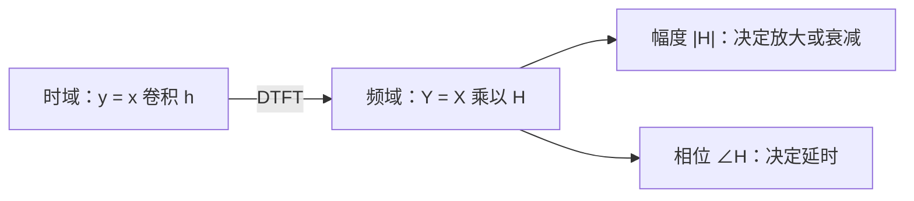

# 离散时间傅里叶变换（DTFT）

**标签：** #数字信号处理 #DSP #DTFT #傅里叶变换 #频谱

---

## 一、为什么需要 DTFT？

承接[[【数字信号处理DSP】（十三）Z 变换与收敛域|（十三）Z 变换与收敛域]]：Z 变换把序列搬到了整个复平面，信息最全，但也最抽象。工程上我们更常问的是一个很具体的问题：

> **这个信号里到底有哪些频率？各占多少分量？**

要回答它，就得回到 z 平面上的**单位圆**——因为复指数 $e^{j\omega}$ 的模恒为 1，对应的正是"纯频率、不增不减"的成分。

于是有

$$
X(e^{j\omega}) = X(z), \qquad z = e^{j\omega}
$$

右边这个"在单位圆上取值的 Z 变换"，有一个专门的名字：**离散时间傅里叶变换（DTFT）**。

三个层次的工具各司其职：

| 工具 | 作用 | 代价 |
|---|---|---|
| 卷积和（[[【数字信号处理DSP】（七）卷积和|（七）卷积和]]） | 时域算输出 | 看不出频率构成 |
| **DTFT** | 序列 → 连续频谱 | 要求序列可和，否则要借 δ 函数 |
| Z 变换 | 序列 → 复频域 | 必须连 ROC 一起写 |

DTFT 的地位很特殊：它既是**离散时间信号的频谱定义**，又是后续 DFT / FFT（数字频谱分析）、滤波器频率响应 $H(e^{j\omega})$ 的共同源头。

---

## 二、DTFT 的定义

### 1. 正变换（分析式）

$$
X(e^{j\omega}) = \sum_{n=-\infty}^{\infty} x[n]\, e^{-j\omega n}
$$

三点要注意：

- 求和范围是**全体整数** $n$（双边求和）；
- $e^{-j\omega n}$ 是一组"数字频率为 $\omega$ 的复指数"——DTFT 干的事情，就是**测量序列与这组复指数的相似程度**；
- 结果 $X(e^{j\omega})$ 是 $\omega$ 的**连续、复值、以 $2\pi$ 为周期**的函数。

### 2. 反变换（合成式）

$$
x[n] = \frac{1}{2\pi}\int_{-\pi}^{\pi} X(e^{j\omega})\, e^{j\omega n}\, d\omega
$$

因为 $X(e^{j\omega})$ 以 $2\pi$ 为周期，积分区间可以任取一个长度为 $2\pi$ 的窗口，$\int_{-\pi}^{\pi}$ 只是最常用的选择。

**一对变换的物理含义**：正变换把序列"摊开"成一张连续的频谱图；反变换把这张图按频率积分，"叠回"原来的序列。

### 3. 存在条件

| 信号类型 | DTFT 是否存在 | 形式 |
|---|---|---|
| 绝对可和 $\sum \lvert x[n] \rvert < \infty$ | **存在** | 普通连续函数 |
| 能量有限但非绝对可和 | 边界情形 | 可能发散 |
| 功率信号（不衰减，如 $u[n]$、正弦） | **不存在普通函数形式** | 必须引入冲激函数 $\delta$ |

这里要特别提醒一个[[【数字信号处理DSP】（三）能量信号和功率信号|（三）讲过的坑]]：**平方可和 $\neq$ 绝对可和**。

$$
x[n] = \frac{1}{n}\,u[n-1]
$$

这个序列 $\sum \lvert x[n] \rvert^2 = \sum \frac{1}{n^2} = \frac{\pi^2}{6} < \infty$ 能量有限，但 $\sum \lvert x[n] \rvert = \sum \frac{1}{n}$ 发散——它的 DTFT 在 $\omega = 0$ 附近像 $\ln\lvert \omega \rvert$ 一样冲向无穷。**"能量有限"并不能保证 DTFT 收敛。**

### 4. 与 Z 变换的关系（最实用的一条）

$$
X(e^{j\omega}) = X(z), \qquad z = e^{j\omega}
$$

由此得到一条**判断 DTFT 是否存在最快的办法**：

> **DTFT 存在 $\Leftrightarrow$ $X(z)$ 的 ROC 包含单位圆。**

推论直接可用：

- 稳定系统（ROC 含单位圆）**一定**有频率响应 $H(e^{j\omega})$；
- $2^n u[n]$ 的 ROC 是 $\lvert z \rvert > 2$，单位圆被挡在外面 → **没有普通意义下的 DTFT**；
- $u[n]$ 的 ROC 是 $\lvert z \rvert > 1$，单位圆正好压在 ROC 边界上 → DTFT 不是普通函数，必须写成"函数 + 冲激串"两部分。

> 上图：单位圆（加粗蓝圈）上每一点 $z = e^{j\omega}$ 都对应一个数字频率 $\omega$；从 $z=1$（即 $\omega=0$）出发逆时针绕一圈，$\omega$ 正好扫过 $0 \to 2\pi$。蓝色半透明区是因果序列的 ROC（极点圆之外）——**只要单位圆落在 ROC 里，DTFT 就存在**。

---

## 三、DTFT 的基本性质

设 $X(e^{j\omega}) = \mathrm{DTFT}\{x[n]\}$。

| # | 性质 | 时域 | 频域 |
|---|---|---|---|
| 1 | **周期性** | — | $X(e^{j(\omega+2\pi)}) = X(e^{j\omega})$ |
| 2 | 线性 | $a\,x[n] + b\,g[n]$ | $a\,X + b\,G$ |
| 3 | **时移** | $x[n-n_0]$ | $e^{-j\omega n_0} X(e^{j\omega})$ |
| 4 | **频移（调制）** | $e^{j\omega_0 n} x[n]$ | $X(e^{j(\omega-\omega_0)})$ |
| 5 | 时间反转 | $x[-n]$ | $X(e^{-j\omega})$ |
| 6 | **共轭对称** | $x^*[n]$ | $X^*(e^{-j\omega})$ |
| 7 | **卷积定理** | $x[n] * h[n]$ | $X(e^{j\omega})\,H(e^{j\omega})$ |
| 8 | 相关定理 | $r_{xh}[m]$ | $X(e^{j\omega})\,H^*(e^{j\omega})$ |
| 9 | **帕塞瓦尔** | $\sum \lvert x[n] \rvert^2$ | $\frac{1}{2\pi}\int \lvert X \rvert^2 d\omega$ |

几条最要紧的：

**① 周期性**：$X(e^{j\omega})$ 以 $2\pi$ 为周期，所以**只需要画 $[-\pi, \pi]$ 或 $[0, 2\pi]$ 一段**就够了。这不是巧合——正是它在提醒我们：离散时间信号的频率本来就是"绕圈"的（见[[【数字信号处理DSP】（十）模拟频率与数字频率的关系|（十）模拟频率与数字频率]]）。

**② 时移只改相位，不改幅度**：

$$
x[n-n_0] \longleftrightarrow e^{-j\omega n_0} X(e^{j\omega})
$$

$\lvert e^{-j\omega n_0} \rvert = 1$，所以幅度谱原封不动。**纯延迟不会改变信号的频率成分，只会让各频率分量产生不同程度的相位滞后。**

**③ 调制 = 频谱搬移**：

$$
e^{j\omega_0 n}\,x[n] \longleftrightarrow X(e^{j(\omega - \omega_0)})
$$

乘一个复指数，频谱整体平移 $\omega_0$——通信里"搬频谱"的理论根据就在这一行。

**④ 卷积定理（全书最重要的一条）**：

$$
x[n] * h[n] \;\longleftrightarrow\; X(e^{j\omega})\,H(e^{j\omega})
$$

**时域里麻烦的卷积，到频域变成一次乘法。** 这就是整个频域分析法的立身之本。

**⑤ 帕塞瓦尔定理**——能量在时域和频域守恒：

$$
\sum_{n=-\infty}^{\infty} \lvert x[n] \rvert^2 = \frac{1}{2\pi}\int_{-\pi}^{\pi} \lvert X(e^{j\omega}) \rvert^2\, d\omega
$$

这条式子也是[[【数字信号处理DSP】（六）功率谱密度|（六）功率谱密度]]的地基：$\lvert X(e^{j\omega}) \rvert^2$ 就是能量按频率的分布密度。

---

## 四、常见序列的 DTFT

| 序列 $x[n]$ | DTFT $X(e^{j\omega})$ | 频谱长什么样 |
|---|---|---|
| $\delta[n]$ | $1$ | 全频率等幅（平） |
| 常数 $1$ | $2\pi \sum_k \delta(\omega - 2\pi k)$ | 梳状冲激（只有直流） |
| $e^{j\omega_0 n}$ | $2\pi \sum_k \delta(\omega - \omega_0 - 2\pi k)$ | 一根孤立谱线 |
| $\sin(\omega_0 n)$、$\cos(\omega_0 n)$ | 两根共轭冲激 | 一对谱线 |
| $u[n]$ | $\frac{1}{1-e^{-j\omega}} + \pi \sum_k \delta(\omega - 2\pi k)$ | 冲激 + 连续拖尾 |
| $a^n u[n]\;(\lvert a \rvert < 1)$ | $\frac{1}{1 - a\,e^{-j\omega}}$ | 单峰低通 |
| 矩形窗 $R_N[n]$ | $e^{-j\omega\frac{N-1}{2}}\cdot\frac{\sin(\omega N/2)}{\sin(\omega/2)}$ | **sinc 形** |

挑三个重点讲：

**① $\delta[n] \leftrightarrow 1$**：一个冲激在时域"最短"，在频域"最宽"——所有频率等幅。这是时频互补性最直白的体现。

**② 常数 $1 \leftrightarrow$ 冲激串**：不衰减的序列在频域只能靠 $\delta$ 函数表示，且 $\delta$ 每隔 $2\pi$ 重复一次——再次印证 DTFT 的周期性。

**③ $a^n u[n]$（$\lvert a \rvert < 1$）**：

$$
X(e^{j\omega}) = \sum_{n=0}^{\infty} a^n e^{-j\omega n} = \sum_{n=0}^{\infty} \bigl(a e^{-j\omega}\bigr)^n = \frac{1}{1 - a\,e^{-j\omega}}
$$

几何级数，公比 $\lvert a e^{-j\omega} \rvert = \lvert a \rvert < 1$ 保证收敛。**$a$ 越小衰减越快，频谱越"胖"（越接近白噪声）；$a \to 1$ 时频谱越来越集中在 $\omega = 0$。**

**④ 矩形窗的 sinc 频谱**——这是最该记住的一条，因为 FFT 频谱分析全靠它：

$$
X(e^{j\omega}) = \sum_{n=0}^{N-1} e^{-j\omega n}
= \frac{1 - e^{-j\omega N}}{1 - e^{-j\omega}}
= e^{-j\omega\frac{N-1}{2}} \cdot \frac{\sin(\omega N/2)}{\sin(\omega/2)}
$$

拆成三块看：

- $e^{-j\omega\frac{N-1}{2}}$：纯相位，只表示波形"延迟了 $(N-1)/2$ 点"，与幅度无关；
- 幅度 $\lvert X \rvert = \left\lvert \frac{\sin(\omega N/2)}{\sin(\omega/2)} \right\rvert$：**主瓣 + 旁瓣**结构；
- 零点在 $\omega = \frac{2\pi k}{N}$（$k = 1, 2, \dots, N-1$）——**时域窗口越长 $N$，主瓣越窄、频率分辨力越高**。

> 上图：左侧时域是长度 $N=5$ 的矩形脉冲，右侧是它的幅频响应 $\lvert X(e^{j\omega}) \rvert$——典型的"主瓣居中、旁瓣递减、零点等距分布"。红色虚线标出零点 $\omega = \pm 2\pi/5$。

---

## 五、实序列的共轭对称性

实信号（现实中测到的信号几乎都是实的）有一条极其有用的性质：

$$
x[n] \in \mathbb{R} \;\Longrightarrow\; X(e^{j\omega}) = X^*(e^{-j\omega})
$$

拆成幅度和相位就是：

$$
\lvert X(e^{j\omega}) \rvert = \lvert X(e^{-j\omega}) \rvert, \qquad \angle X(e^{j\omega}) = -\angle X(e^{-j\omega})
$$

**幅度谱是偶函数，相位谱是奇函数。**

> 上图：左侧是实序列 $x[n] = 0.7^n u[n]$；中间幅频 $\lvert X \rvert$ 关于 $\omega=0$ 左右镜像（偶函数）；右侧相频 $\angle X$ 过原点且奇对称（奇函数）。

三个工程结论：

1. **只需算半边**：$\lvert X \rvert$ 和 $\angle X$ 在 $[0, \pi]$ 上确定后，负频率部分直接镜像得到；
2. **负频率不是玄学**：它就是正频率的共轭镜像，物理信息完全冗余（呼应[[【数字信号处理DSP】（十）模拟频率与数字频率的关系|（十）讲过的"负频率是什么"]]）；
3. **实系数系统的频率响应自动满足**：实系数差分方程推出的 $H(e^{j\omega})$ 一定是共轭对称的。

---

## 六、从 LSI 系统看 DTFT：频率响应

对[[【数字信号处理DSP】（八）离散时间系统的各种响应概念详解|（八）讲过的单位脉冲响应]] $h[n]$ 做 DTFT，得到**频率响应**：

$$
H(e^{j\omega}) = \sum_{n=-\infty}^{\infty} h[n]\, e^{-j\omega n}
$$

结合卷积定理，立刻得到**频域分析的基本公式**：

$$
y[n] = x[n] * h[n] \;\longleftrightarrow\; Y(e^{j\omega}) = X(e^{j\omega})\,H(e^{j\omega})
$$

### 1. 由差分方程直接写 $H(e^{j\omega})$

对常系数差分方程（见[[【数字信号处理DSP】（九）离散时间系统的时域解法|（九）时域解法]]）

$$
\sum_{k=0}^{N} a_k\, y[n-k] = \sum_{r=0}^{M} b_r\, x[n-r], \qquad a_0 = 1
$$

利用时移性质，直接得到

$$
H(e^{j\omega}) = \frac{\sum_{r=0}^{M} b_r\, e^{-j\omega r}}{\sum_{k=0}^{N} a_k\, e^{-j\omega k}}
$$

**注意**：这个式子能成立，前提是系统**稳定**（$h[n]$ 绝对可和，ROC 含单位圆）。不稳定的系统根本没有 $H(e^{j\omega})$。

### 2. 正弦输入 → 正弦输出

$H(e^{j\omega})$ 最漂亮的推论：**复指数是 LSI 系统的特征函数**。

$$
x[n] = e^{j\omega_0 n} \;\Longrightarrow\; y[n] = H(e^{j\omega_0})\, e^{j\omega_0 n}
$$

输入输出**同一个频率**，只是幅度乘 $\lvert H(e^{j\omega_0}) \rvert$、相位加 $\angle H(e^{j\omega_0})$。推广到实正弦：

$$
x[n] = A\cos(\omega_0 n + \varphi)
\;\Longrightarrow\;
y[n] = A\,\lvert H(e^{j\omega_0}) \rvert \cos\Bigl(\omega_0 n + \varphi + \angle H(e^{j\omega_0})\Bigr)
$$

这就是"滤波器改变音色、音响调 EQ"的全部数学。

### 3. 线性相位的意义

当 $\angle H(e^{j\omega}) = -\omega n_0$（相位是过原点的直线）时，所有频率分量延迟同样多的点数 $n_0$——**波形形状不变，只是整体平移**。这正是 FIR 滤波器设计追求"线性相位"的原因（后面的章节会详细讲）。

---

## 七、DTFT 与 DFT / FFT 的衔接

DTFT 是**连续**的 $\omega$，计算机只能处理**离散**数据，于是有了 DFT：

| | DTFT | DFT |
|---|---|---|
| 自变量 $\omega$ | 连续 | 离散，$N$ 个点 |
| 序列长度 | 无限（或任意长） | 有限，$N$ 点 |
| 周期性 | 固有 $2\pi$ 周期 | 隐含周期 |
| 计算 | 理论工具 | 可用 FFT 快速计算 |

- **做法**：把 $X(e^{j\omega})$ 在 $[0, 2\pi)$ 上均匀取 $N$ 个点，就得到 $N$ 点 DFT；
- **栅栏效应**：只能看到这 $N$ 个频点，频点之间的细节被"栅栏"挡住；
- **频率分辨率**：$\Delta\omega = \frac{2\pi}{N}$，$N$ 越大分辨越细——代价是计算量；
- 这正是[[【数字信号处理DSP】（十一）奈奎斯特采样定理|（十一）奈奎斯特采样定理]]在频域的对应：**时域采样使频谱周期延拓，频域采样使时域周期延拓**，二者完全对偶。

具体内容留到后续的 DFT / FFT 章节展开。

---

## 八、典型例题

### 例题1：矩形脉冲的 DTFT（完整推导）

已知 $x[n] = 1$，$0 \le n \le N-1$，求 $X(e^{j\omega})$，并指出零点位置。

**解**：

$$
X(e^{j\omega}) = \sum_{n=0}^{N-1} e^{-j\omega n}
$$

这是首项为 1、公比 $e^{-j\omega}$、共 $N$ 项的几何级数：

$$
X(e^{j\omega}) = \frac{1 - e^{-j\omega N}}{1 - e^{-j\omega}}
$$

分子分母同提公因式 $e^{-j\omega N/2}$ 与 $e^{-j\omega/2}$：

$$
1 - e^{-j\omega N} = e^{-j\omega N/2}\bigl(e^{j\omega N/2} - e^{-j\omega N/2}\bigr) = 2j\, e^{-j\omega N/2} \sin(\omega N/2)
$$

$$
1 - e^{-j\omega} = e^{-j\omega/2}\bigl(e^{j\omega/2} - e^{-j\omega/2}\bigr) = 2j\, e^{-j\omega/2} \sin(\omega/2)
$$

相除得

$$
X(e^{j\omega}) = e^{-j\omega\frac{N-1}{2}} \cdot \frac{\sin(\omega N/2)}{\sin(\omega/2)}
$$

于是

$$
\lvert X(e^{j\omega}) \rvert = \left\lvert \frac{\sin(\omega N/2)}{\sin(\omega/2)} \right\rvert
$$

零点由 $\sin(\omega N/2) = 0$ 决定（要求 $\sin(\omega/2) \neq 0$）：

$$
\frac{\omega N}{2} = k\pi \;\Longrightarrow\; \omega = \frac{2\pi k}{N}, \qquad k = 1, 2, \dots, N-1
$$

**结论**：矩形脉冲的幅度谱是 sinc 形，零点等距分布在 $\omega = \frac{2\pi k}{N}$。$N = 5$ 时零点在 $\pm 2\pi/5$、$\pm 4\pi/5$，与上图完全一致。

---

### 例题2：用时移与调制性质求 DTFT

已知 $x[n] = 0.5^n u[n]$，求：(1) $x[n-2]$；(2) $e^{j\frac{\pi}{4} n} x[n]$ 的 DTFT。

**解**：先求基准

$$
X(e^{j\omega}) = \sum_{n=0}^{\infty} 0.5^n e^{-j\omega n} = \frac{1}{1 - 0.5\,e^{-j\omega}}
$$

**(1)** 时移性质：

$$
\mathrm{DTFT}\{x[n-2]\} = e^{-j2\omega}\, X(e^{j\omega}) = \frac{e^{-j2\omega}}{1 - 0.5\,e^{-j\omega}}
$$

幅度谱 $\frac{1}{\lvert 1 - 0.5e^{-j\omega} \rvert}$ 与原来**完全相同**——时移只添了一个线性相位 $e^{-j2\omega}$。

**(2)** 调制性质：

$$
\mathrm{DTFT}\bigl\{e^{j\frac{\pi}{4} n} x[n]\bigr\} = X\bigl(e^{j(\omega - \frac{\pi}{4})}\bigr) = \frac{1}{1 - 0.5\,e^{-j(\omega - \pi/4)}}
$$

**频谱整体右移 $\pi/4$**，形状不变。

---

### 例题3：判断 DTFT 是否存在

判断下列序列的 DTFT 是否存在，说明理由：

1. $h_1[n] = 2^n u[n]$
2. $h_2[n] = 0.5^n u[n]$
3. $h_3[n] = u[n]$

**解**：用 ROC 判据最快——**看单位圆在不在 ROC 里**。

**(1)** $h_1[n] = 2^n u[n]$：Z 变换 $\frac{1}{1 - 2z^{-1}} = \frac{z}{z-2}$，极点 $z = 2$，ROC 为 $\lvert z \rvert > 2$。单位圆 $\lvert z \rvert = 1$ 在 ROC 之外，**DTFT 不存在**（系统不稳定，频率响应无从谈起）。

**(2)** $h_2[n] = 0.5^n u[n]$：极点 $z = 0.5$，ROC 为 $\lvert z \rvert > 0.5$，**包含单位圆**，DTFT 存在：

$$
H_2(e^{j\omega}) = \frac{1}{1 - 0.5\,e^{-j\omega}}
$$

**(3)** $h_3[n] = u[n]$：极点 $z = 1$ 正好落在单位圆上，ROC 为 $\lvert z \rvert > 1$，单位圆是 ROC 的**边界**。DTFT 不存在普通函数形式，只能写成

$$
U(e^{j\omega}) = \frac{1}{1 - e^{-j\omega}} + \pi\sum_{k=-\infty}^{\infty}\delta(\omega - 2\pi k)
$$

其中冲激串来自直流分量，前一项是连续拖尾。

---

### 例题4：正弦输入的系统稳态响应

系统满足 $y[n] - 0.5\,y[n-1] = x[n]$，输入 $x[n] = \cos(\pi n/3)$，求稳态输出。

**解**：先求频率响应。由差分方程系数（$a_0=1,\,a_1=-0.5,\,b_0=1$）：

$$
H(e^{j\omega}) = \frac{1}{1 - 0.5\,e^{-j\omega}}
$$

代入 $\omega_0 = \pi/3$：

$$
e^{-j\pi/3} = \cos\frac{\pi}{3} - j\sin\frac{\pi}{3} = 0.5 - j\,0.8660
$$

$$
1 - 0.5\,e^{-j\pi/3} = 1 - 0.5\bigl(0.5 - j0.8660\bigr) = 0.75 + j\,0.4330
$$

$$
H(e^{j\pi/3}) = \frac{1}{0.75 + j\,0.4330}
$$

求模与辐角：

$$
\lvert H \rvert = \frac{1}{\sqrt{0.75^2 + 0.4330^2}} = \frac{1}{\sqrt{0.5625 + 0.1875}} = \frac{1}{\sqrt{0.75}} \approx 1.1547
$$

$$
\angle H = -\arctan\frac{0.4330}{0.75} = -\arctan(0.5774) = -\frac{\pi}{6}
$$

由正弦稳态结论：

$$
y[n] = 1.1547\,\cos\Bigl(\frac{\pi}{3}n - \frac{\pi}{6}\Bigr)
$$

**验证**：$\lvert H \rvert > 1$ 说明系统在 $\omega = \pi/3$ 处是**放大**的——低通系统对中频段有增益，符合直觉。

---

## 九、常见错误提醒

1. **以为 DTFT 对所有序列都存在**：$2^n u[n]$ 这类增长序列的 DTFT 根本不存在。判据只有一个——**ROC 含不含单位圆**。
2. **混淆 $X(e^{j\omega})$ 与 $X(z)$**：$X(e^{j\omega})$ 是 $X(z)$ 在单位圆上的**截面**，不是同一个函数的两种写法。ROC 不含单位圆时，这个"截面"取不到。
3. **把 DTFT 当成 DFT**：DTFT 的 $\omega$ 连续、周期 $2\pi$；DFT 是 $N$ 个离散点、隐含周期。混用会导致"为什么我的频谱图对不上"。
4. **忘记 $2\pi$ 周期，画了很宽的频率轴**：DTFT 只需画 $[-\pi,\pi]$；画 $-4\pi$ 到 $4\pi$ 纯属重复劳动，还容易误以为是"更宽的带宽"。
5. **反变换漏掉 $\frac{1}{2\pi}$**：这是最高频的错误，结果会差 $2\pi$ 倍。记法：$\int$ 已经带了长度 $2\pi$，所以除回去。
6. **以为时移会改变幅度谱**：$x[n-n_0]$ 的幅度谱一模一样，只多一个线性相位 $e^{-j\omega n_0}$。
7. **把 $u[n]$ 的 DTFT 写成 $\frac{1}{1-e^{-j\omega}}$ 就完事**：漏掉了直流冲激串 $\pi\sum\delta(\omega-2\pi k)$。不衰减序列必须配 $\delta$ 函数。
8. **实序列忘了共轭对称**：算出负频率与正频率不镜像时，先怀疑自己算错，而不是质疑性质。

---

## 十、知识链定位

离散时间傅里叶变换 DTFT（本节）

│

├── 定义：正变换（级数）/ 反变换（积分）

├── 存在条件：绝对可和；等价判据 = ROC 含单位圆

├── 基本性质：2π 周期、时移、调制、共轭对称、卷积定理、帕塞瓦尔

├── 常见变换对：δ / 常数 / u[n] / aⁿu[n] / 矩形窗（sinc）

├── 实序列对称性：|X| 偶、∠X 奇 → 只需半边频谱

└── 频率响应 H(e^{jω})：正弦输入 → 同频输出

│

├── DFT / FFT：把连续频谱离散化（后续章节）

├── 逆 Z 变换：部分分式、留数、幂级数

├── 系统函数 H(z)：极零点与稳定性判据

└── 滤波器设计：由 |H| 指标反求结构

---

## 十一、总结

- DTFT 就是 **Z 变换在单位圆上的取值**：$X(e^{j\omega}) = X(z),\ z = e^{j\omega}$。这是本章的纲。
- **存在判据一条就够：ROC 含不含单位圆。** 含则有，不含则无，压边界则要借 $\delta$ 函数。
- $X(e^{j\omega})$ **连续、复值、$2\pi$ 周期**，所以只需画 $[-\pi, \pi]$。
- 性质里最有用的是**时移（只改相位）、调制（频谱搬移）、卷积定理（卷积变乘法）、帕塞瓦尔（能量守恒）**。
- **矩形窗 → sinc 频谱**必须记牢：零点在 $\omega = 2\pi k/N$，$N$ 越大主瓣越窄、分辨力越高。这是 FFT 频谱分析的全部基础。
- 实序列满足**共轭对称**：幅度谱偶、相位谱奇，负频率是正频率的镜像。
- LSI 系统对复指数是"透明"的：**同频进出，只改幅度和相位**——这就是 $H(e^{j\omega})$ 的物理意义。

---

> **一句话总结**：DTFT 是序列的"频率身份证"——把 Z 变换的镜头聚焦到单位圆上，就能看清一个信号由哪些频率、各占多少分量构成。记住三件事就不会错：**单位圆上取值、$2\pi$ 是周期、ROC 不含单位圆就没有 DTFT**。
