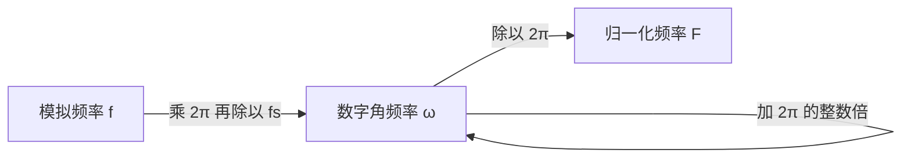
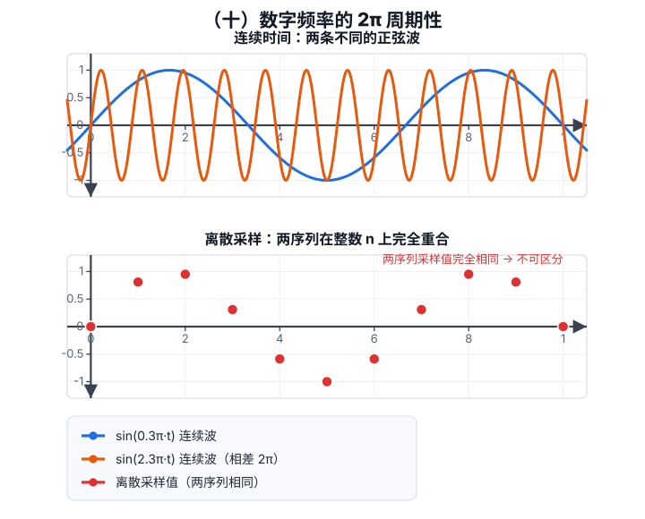

# 模拟频率与数字频率的关系

**标签：** #数字信号处理 #DSP #采样 #频率关系 #归一化频率

---

## 本篇的位置

**这一篇补的空洞。** 前九篇的输入全是已经离散好了的序列，$x[n]$ 从哪来从来不问。真实的链路只有一条：模拟信号按 $T_s$ 等间隔取点，取完点，模拟角频率 $\Omega$ 就换成了 $\omega$，两者差一个 $T_s$。这一步不做，前面所有差分方程和频率响应都只是对着无量纲的数在算，落不到任何一台设备的采样率上。

**和前后篇的接口。** 上游是（一）信号周期性判断：那里判 $\cos(\omega_0 n)$ 的周期，用的是 $\omega_0/2\pi$ 是否有理，而这条判据成立的前提正是本篇的 $\omega$ 与 $\omega+2\pi k$ 等价。下游是（十一）：本篇只说 $\omega$ 落在 $(-\pi,\pi]$ 内，（十一）把它变成一条硬件约束 $f_s>2f_{\max}$，并解释越界之后信息为什么拿不回来。

**本篇保留的简化。** 均匀采样、理想冲激采样，不含量化、不含孔径时间，只讨论实信号。非均匀采样下"数字频率"本身就没有统一定义；量化让序列的幅度失真，那是另一条独立的线。

**没出现的东西。** 量化噪声与 ADC 位数、sinc 内插重建、抽取与插值、带通采样。前两样在（十一）各占一段，后两样留到滤波器设计之后。

**读完能做什么。** 给一组 $f$ 与 $f_s$ 能一步算出 $\omega$ 和 $F$，并说清用的是哪套归一化；给一个超过 $f_s/2$ 的频率能算出表观频率，再用 $\cos(2\pi f n/f_s)$ 回代证明它与原频率逐点相同；看到 FFT 第 $k$ 根谱线，能换算成 Hz，并判断 $k>N/2$ 时该按负频率处理。

---

## 本篇要点

1. 换算只有一个乘法一个除法：$\omega=\Omega/f_s$、$\Omega=\omega f_s$，用"$f_s$ 越大、同一个 $\Omega$ 对应的 $\omega$ 越小"当场自检。
2. 归一化频率有两套约定，$F=f/f_s\in[0,0.5]$ 与 $f_{\text{norm}}=f/(f_s/2)\in[0,1]$，同一个"0.4"在两套下相差一倍。
3. $\omega$ 只在长度 $2\pi$ 的一格内能比大小；$\omega=\pi$ 时序列是 $(-1)^n$，一个采样点走完半个周期。
4. 混叠后的表观频率是"对 $f_s$ 取余，余数超过 $f_s/2$ 再用 $f_s$ 减一次"，折返是多对一，事后反推不出原频率。

---

## 一、基本概念

在处理离散时间信号时，需要区分两种频率：

- **模拟频率**：描述连续时间信号的频率，单位为赫兹（Hz）或弧度/秒（rad/s）。
- **数字频率**：描述离散时间信号的频率，单位为弧度（rad），是归一化的角频率。

两者的桥梁只有一个数：**采样频率 $f_s$**。所以凡涉及换算，"$f_s$ 是多少"永远是第一个要问的问题。

---

## 二、符号约定

| 符号 | 含义 | 单位 | 取值范围 |
|------|------|------|---------|
| $f$ | 模拟频率（每秒周期数） | Hz | $[0,\infty)$ |
| $\Omega$ | 模拟角频率 | rad/s | $[0,\infty)$ |
| $f_s$ | 采样频率（每秒样本数） | Hz | 题目给定 |
| $T_s$ | 采样周期 | s | $1/f_s$ |
| $\omega$ | 数字角频率 | rad（无量纲） | $(-\pi,\pi]$ |
| $F$ | 归一化频率 | 无量纲 | $[0,0.5]$ |

关系：$\Omega = 2\pi f$，$T_s = 1/f_s$

---

## 三、核心关系式

### 1. 数字频率与模拟角频率的关系

$$
\omega = \Omega T_s = \frac{\Omega}{f_s}
$$

即数字角频率等于模拟角频率乘以采样周期。

为什么是乘采样周期，而不是除以它

量纲先给答案：$\Omega$ 的单位是 rad/s，$T_s$ 的单位是 s，相乘才剩下 rad，而 $\omega$ 正是无量纲的"每样本转过多少弧度"。一个采样间隔里相位前进的角度就是 $\Omega T_s$，$\omega$ 的定义就是它。

写成 $\omega=\Omega f_s$ 时量纲多出 Hz 的一次方，但 $f_s=1$ 时两种写法数值相同，试不出来。拿 $f_s=2$、$\Omega=\pi$ 试探：正解给 $\omega=\pi/2$，写反的给 $\omega=2\pi$，而 $2$ Hz 采 $\pi$ rad/s（即 0.5 Hz）的信号本是每周期 4 点、$\omega$ 只能是 $\pi/2$，$2\pi$ 这个结果已经落在有效区间之外，自己把自己否掉了。

### 2. 数字频率与模拟频率的关系

$$
\omega = 2\pi f T_s = \frac{2\pi f}{f_s}
$$

### 3. 归一化频率的两套约定

**约定 A（课本常用）**：以 $f_s$ 为 1

$$
F = \frac{f}{f_s} = \frac{\omega}{2\pi},\qquad F\in[0,\ 0.5]
$$

$\omega=\pi$（Nyquist）对应 $F=0.5$。

**约定 B（MATLAB / 部分工程软件）**：以 Nyquist 频率 $f_s/2$ 为 1

$$
f_{\text{norm}} = \frac{f}{f_s/2} = \frac{2f}{f_s} = \frac{\omega}{\pi},\qquad f_{\text{norm}}\in[0,\ 1]
$$

$\omega=\pi$ 对应 $f_{\text{norm}}=1$。

> **两套约定差一个因子 2**。看到"归一化频率 0.4"时，先判断它属于哪套：若是约定 A，实际是 $0.4f_s$；若是约定 B，实际是 $0.2f_s$。**这是读论文/用工具时最常见的 2 倍误差来源。**

为什么工具软件宁可把 1 定在奈奎斯特上

因为设计滤波器时说"截止在 0.4"，要的是一个相对于可用带宽的位置，不是相对于采样率的位置。$[0,f_s/2]$ 才是能无混叠表达的全部范围，把它的右端记作 1，指标就落在 $[0,1]$ 的固定刻度上，换采样率时指标不用重写。用 $f/f_s$ 归一，右端只能到 $0.5$，指标取值范围与滤波器阶数估算公式的口径也对不上。

代价是两套刻度在文档之间串。`fir1(64, 0.4)` 指的是 $0.4\times f_s/2=0.2f_s$；把 0.4 当 $f/f_s$ 读，会以为截止在 $0.4f_s$，实际做出来的滤波器截止频率只有预期的一半，通带窄了一半。

---

## 四、物理意义与取值范围

- **模拟频率** $f$ 的取值范围：$0 \leq f \lt \infty$（连续域里频率没有上限）
- **数字频率** $\omega$ 的取值只能落在 $2\pi$ 的一个区间内，习惯取 $-\pi \lt \omega \leq \pi$ 或 $0 \leq \omega \lt 2\pi$

### 1. 周期性：相差 2π 的等价类

> 上图：两条连续余弦 $\cos(\omega_0 t)$（蓝，$\omega_0=\pi/3$）与 $\cos[(\omega_0+2\pi)t]$（橙虚线）在连续域里**波形完全不同**；但以整数 $n$ 采样后，两者的离散值**逐点重合**（下图的蓝茎与红茎完全叠在一起）。数字频率相差 $2\pi$ 时对应同一个离散序列。

$$
e^{j(\omega + 2\pi)n} = e^{j\omega n} \cdot e^{j2\pi n} = e^{j\omega n}
$$

所以 $\omega$ 与 $\omega + 2\pi k$ 描述**同一个**离散序列。数字频率"卷"成了一个周长 $2\pi$ 的圆，这正是（[[【数字信号处理DSP】（一）信号周期性判断|一）信号周期性判断]]）里那条结论的根源：判周期要用 $\omega_0/2\pi$ 是否为有理数。

指数上的 2π 为什么只在整数 n 上消失

因为 $e^{j2\pi n}=1$ 用到的条件是 $n$ 取整数。$n$ 是采样序号，只能取整数，$2\pi n$ 永远是 $2\pi$ 的整数倍，这一项恒等于 1，可以整块划掉。

换成连续变量 $t$，$e^{j2\pi t}$ 不再等于 1，$\cos(\omega t)$ 与 $\cos((\omega+2\pi)t)$ 是两个波形完全不同的函数——本篇开头那张图的上下两栏画的就是这件事。同一条等价关系误用到 $t$ 上，会得出"任何频率都不可区分"的荒谬结论。

### 2. 频率上限：π 对应的模拟频率

数字频率 $\omega = \pi$ 对应的模拟频率是

$$
f = \frac{\omega f_s}{2\pi} = \frac{f_s}{2}
$$

正好是 Nyquist 频率。再高的模拟频率采样后会折叠回 $(-\pi, \pi]$，所以**数字域里 $\pi$ 就是"最高音"**，$\omega$ 超过 $\pi$ 不是"更高频"，而是"换个说法表示同一个更低的频率"。

> **为什么 $\omega=\pi$ 是"最快振荡"**：此时序列为 $(-1)^n$，相邻两点符号必然相反，**一个采样点就完成半周期**——这已经是离散序列能做到的最快变化。再快也"看不出来"了（这就是混叠的物理本质）。

ω 越大频率越高，这条直觉在哪一段失效

失效在 $\omega$ 越过 $\pi$ 之后。$\omega$ 从 $0$ 增到 $\pi$，振荡确实越来越快；从 $\pi$ 继续增到 $2\pi$，序列反而慢下来，因为 $\cos((2\pi-\varepsilon)n)=\cos(\varepsilon n)$，$\varepsilon$ 越小越慢。

两个端点最能说明问题：$\omega=\pi$ 给 $(-1)^n$，一个采样点走半个周期；$\omega=2\pi$ 给常数 $1$，是零频。所以 $\omega=1.5\pi$ 的真实身份是 $0.5\pi$（余弦情形下两者相等，因为 $1.5\pi n$ 与 $-0.5\pi n$ 只差 $2\pi n$），用它来推"频率很高"必错。

判据只有一条：先把 $\omega$ 折进 $[0,\pi]$，再比大小。卷面上这道折算就是加减 $2\pi$ 的整数倍，代码里是 `wrapToPi` 或者 `angle(exp(1j*w))`。

### 3. 负频率：共轭对称的另一半

负 $\omega$ 不是"频率为负"的物理概念，而是复数表示的产物：实信号的频谱满足共轭对称 $\omega$ 与 $-\omega$ 成对出现。工程上讨论实信号时通常只看 $0 \leq \omega \leq \pi$ 的正频率部分即可。

---

## 五、采样定理的约束

根据奈奎斯特采样定理，为避免混叠，需满足：

$$
f_s \gt 2f_{\max}
$$

即采样频率必须大于信号最高频率的两倍。

在数字频率中，这等价于：

$$
\omega_{\max} = \frac{2\pi f_{\max}}{f_s} \lt \pi
$$

因此，数字频率的有效范围为 $\lvert \omega \rvert \lt \pi$（对应模拟频率 $\lvert f \rvert \lt f_s/2$）。

采样率减半，同一段滤波器代码还算同一个滤波器吗

系数不变，$H(e^{j\omega})$ 的形状就不变，但 $\omega$ 折算成 Hz 要除以 $T_s$，所以物理上的截止频率跟着 $f_s$ 一起缩放。

拿一个 $\omega_c=0.2\pi$ 的低通试：$f_s=48$ kHz 时它截止在 $0.1\times48=4.8$ kHz；同一段系数搬到 $f_s=8$ kHz 的链路上，截止变成 800 Hz。代码一个字没改，听感从"略微发闷"变成"只剩低频"。

工程上的规矩是把系数和采样率绑定交付：要么把 $f_s$ 写进配置并在加载时校验，要么按 $\omega_c=2\pi f_c/f_s$ 现算系数。只存系数不存 $f_s$，换设备就出事。

---

## 六、混叠频率的计算：取余再加一次镜像

若模拟频率 $f$ 超过了 $f_s/2$，采样后会"折返"成一个较低的**表观频率** $f_a$。计算方法只有一句话：

> **把 $f$ 对 $f_s$ 取余，若余数超过 $f_s/2$ 再用 $f_s$ 减一次。**

$$
f \;\xrightarrow{\ \bmod f_s\ }\; r \;\Longrightarrow\;
f_a =
\begin{cases}
r, & r\le f_s/2\\
f_s-r, & r\gt f_s/2
\end{cases}
$$

对应的数字频率 $\omega_a = \dfrac{2\pi f_a}{f_s}$（落在 $[0,\pi]$）。

取余已经把频率拉回一个周期了，为什么还要再减一次

取余只保证结果落在 $[0,f_s)$，而 $[f_s/2,f_s)$ 这一段在采样后没有独立身份：$\cos(2\pi(f_s-f)n/f_s)=\cos(2\pi n-2\pi fn/f_s)=\cos(2\pi fn/f_s)$，与 $f_s-f$ 逐点相同。也就是说这一段里的每个频率都有一个落在 $[0,f_s/2]$ 的替身，表观频率必须报到替身那一个。

不镜像的后果当场露馅：$f=800$ Hz、$f_s=1000$ Hz，取余得 800，比 Nyquist 的 500 还大。一个"采样后残留的频率"不可能超过 $f_s/2$，这个结果自己就否定自己。

> **为什么这样折**：采样序列是 $\cos(2\pi fn/f_s)$，把 $f$ 换成 $f-kf_s$ 后 $2\pi(f-kf_s)n/f_s = 2\pi fn/f_s-2\pi kn$，多出的 $2\pi kn$ 对整数 $n$ 恒为 $2\pi$ 的整数倍，序列不变。所以 $f$、$f\pm f_s$、$f\pm2f_s$…**采样结果完全相同**。再配合 $\cos$ 的偶对称把负值翻正，就得到上面的折返公式。

---

## 七、典型例题

> **统一答题格式**：① 写换算公式；② **确认 $f_s$**；③ 代入求值；④ 若求频率再化成 Hz；⑤ **回代验证**（$\omega\cdot N/2\pi$ 是否为整数，或 $f/f_s$ 是否等于 $\omega/2\pi$）。

### 例题 1：由模拟频率求数字频率

**题目**：$x(t)=\cos(100\pi t)$，$f_s=200\text{ Hz}$。求数字角频率 $\omega$ 与归一化频率 $F$。

**解**：

（1）**先求模拟频率**（把 $\Omega$ 化成 $f$）：

$$
\Omega = 100\pi\ \text{rad/s} \;\Longrightarrow\; f=\frac{\Omega}{2\pi}=50\text{ Hz}
$$

（2）**套换算公式**：

$$
\omega = \frac{2\pi f}{f_s} = \frac{2\pi\times50}{200}=\frac{\pi}{2}\ \text{rad}
$$

（3）**归一化频率（约定 A）**：

$$
F=\frac{f}{f_s}=\frac{50}{200}=0.25
$$

$$
\boxed{\omega=\frac{\pi}{2},\qquad F=0.25\ (f_{\text{norm}}=0.5)}
$$

**检验**：$\omega/2\pi = 0.25 = F$ ✓；$f_s=200> 2\times50=100$，满足采样定理，故不存在混叠 ✓

**再看一个关键点**：$\omega=\pi/2$ 意味着 $N=\dfrac{2\pi}{\omega}=4$，即**每 4 个采样点一个完整周期**。这与 $50\text{ Hz}$、$200\text{ Hz}$ 采样（每周期 4 点）完全吻合 ✓

---

### 例题 2：由数字频率求模拟频率

**题目**：$\omega=\pi/3$，$f_s=500\text{ Hz}$。求对应的模拟频率 $f$。

**解**：

（1）**套公式** $f=\dfrac{\omega f_s}{2\pi}$：

$$
f=\frac{(\pi/3)\times500}{2\pi}=\frac{500}{6}=\frac{250}{3}\approx83.33\text{ Hz}
$$

（2）**求模拟角频率**（题目可能要求）：

$$
\Omega=\omega f_s=\frac{\pi}{3}\times500=\frac{500\pi}{3}\ \text{rad/s}
$$

$$
\boxed{f=\frac{250}{3}\approx83.33\text{ Hz},\qquad \Omega=\frac{500\pi}{3}\ \text{rad/s}}
$$

**检验**：$f/f_s=\dfrac{250/3}{500}=\dfrac16$，而 $\dfrac{\omega}{2\pi}=\dfrac{\pi/3}{2\pi}=\dfrac16$ ✓ 两者一致。

> **注意常见的错误写法** $\omega=\Omega f_s$：正确的是 $\omega=\Omega/f_s$。$f_s$ 越大、同一个 $\Omega$ 对应的 $\omega$ 越小（采样越密，每点转过的角度越小）——**用这个直觉可以自检公式有没有写反**。

---

### 例题 3：混叠折返计算

**题目**：某信号含 $1200\text{ Hz}$ 分量，用 $f_s=1000\text{ Hz}$ 采样。求采样后该分量表现出的频率，并说明与哪个低频信号"看不出区别"。

**解**：

（1）**判断是否混叠**：Nyquist 频率 $f_s/2=500\text{ Hz}$，$1200>500$，**必然混叠**。

（2）**用折返公式**：先对 $f_s$ 取余

$$
1200 \bmod 1000 = 200
$$

余数 $200\le 500$，故表观频率

$$
f_a = 200\text{ Hz}
$$

（3）**换算成数字频率**：

$$
\omega_a=\frac{2\pi f_a}{f_s}=\frac{2\pi\times200}{1000}=0.4\pi
$$

$$
\boxed{f_a=200\text{ Hz},\qquad \omega_a=0.4\pi}
$$

（4）**直接验证**（回到采样序列本身，这是最硬的证明）：

$$
\cos\!\left(2\pi\cdot 1200\cdot\frac{n}{1000}\right)=\cos(2.4\pi n)
=\cos(2.4\pi n-2\pi n)=\cos(0.4\pi n)\ \checkmark
$$

而 $\cos(0.4\pi n)$ 正是 $200\text{ Hz}$、$1000\text{ Hz}$ 采样的结果：

$$
\cos\!\left(2\pi\cdot200\cdot\frac{n}{1000}\right)=\cos(0.4\pi n)\ \checkmark
$$

**检验**：两者逐点相同 ✓ —— **$1200\text{ Hz}$ 与 $200\text{ Hz}$ 在 $f_s=1000\text{ Hz}$ 下完全不可区分**，这就是混叠不可逆的含义。

> **另一个等价算法**：$1200 = 1\times1000 + 200$，也可以理解为 $1200$ 落在 $[f_s, 1.5f_s]$ 区间，折返后为 $f_s-1200=200$ 的镜像。**只要记住"取余 + 必要时再镜像"，任何情形都对**。

---

### 例题 4：由最高频率确定最小采样率

**题目**：模拟信号最高频率 $f_{\max}=3.4\text{ kHz}$（电话语音）。求最小采样频率；若取 $f_s=8\text{ kHz}$，求对应的 $\omega_{\max}$ 与每周期最少采样点数。

**解**：

（1）**采样定理** $f_s>2f_{\max}$：

$$
f_s^{\min}=2\times3.4=6.8\text{ kHz}
$$

（2）**取 $f_s=8\text{ kHz}$ 时的数字频率**：

$$
\omega_{\max}=\frac{2\pi f_{\max}}{f_s}=\frac{2\pi\times3400}{8000}=0.85\pi
$$

（3）**每周期最少采样点数**（$N=2\pi/\omega$ 取整）：

$$
N=\frac{2\pi}{0.85\pi}\approx2.35 \;\Longrightarrow\; \text{至少 } 3 \text{ 点/周期}
$$

$$
\boxed{f_s^{\min}=6.8\text{ kHz};\quad \omega_{\max}=0.85\pi;\quad N_{\min}=3}
$$

**检验**：$\omega_{\max}=0.85\pi<\pi$ ✓ 满足不混叠条件；$N=3>2$ 与"每周期至少 2 点"的基本要求一致 ✓

> **工程对照**：真实电话系统就用 $8\text{ kHz}$ 采样——比理论下限 $6.8\text{ kHz}$ 留了一点余量，好让抗混叠滤波器的过渡带不必做成理想砖墙。

---

### 例题 5：FFT 谱线索引与真实频率

**题目**：$f_s=8\text{ kHz}$，做 $N=1024$ 点 FFT。求频率分辨率 $\Delta f$；若第 $k=100$ 根谱线出现峰值，求对应的模拟频率。

**解**：

（1）**频率分辨率**（相邻谱线的间隔）：

$$
\Delta f=\frac{f_s}{N}=\frac{8000}{1024}=7.8125\text{ Hz}
$$

（2）**索引换算** $f_k=k\Delta f$：

$$
f_{100}=100\times7.8125=781.25\text{ Hz}
$$

（3）**对应数字频率**：

$$
\omega_{100}=\frac{2\pi k}{N}=\frac{2\pi\times100}{1024}=0.1953\pi\approx0.6136\ \text{rad}
$$

$$
\boxed{\Delta f=7.8125\text{ Hz},\qquad f_{100}=781.25\text{ Hz},\qquad \omega\approx0.195\pi}
$$

**检验**：$781.25/8000=0.0977$；$\omega/2\pi=0.1953/2=0.0977$ ✓ 两者一致。

谱线间隔与 2πk/N 是不是两条独立的公式

是同一条。$f_k=k\Delta f=kf_s/N$，两边乘 $2\pi/f_s$ 就得到 $\omega_k=2\pi k/N$。$N$ 点 FFT 把一个 $f_s$ 等分成 $N$ 格，$k$ 是第几格，两条式子给的是同一根谱线的两个坐标。

混用的地方在单位：$2\pi k/N$ 是弧度，当成 Hz 用会差 $f_s$ 倍。反向换算要乘 $f_s/(2\pi)$：$0.1953\pi\times8000/(2\pi)=781.2$ Hz，与 $k\Delta f$ 对得上。

> **$k>N/2$ 怎么办**：FFT 的谱线 $k=0,\dots,N/2$ 对应 $0\sim f_s/2$（正频率），$k>N/2$ 对应**负频率**。若峰值出现在 $k=900$（$N=1024$），对应频率是 $(900-1024)\Delta f=-968.75\text{ Hz}$，实际模拟频率取绝对值 $968.75\text{ Hz}$（或理解为 $f_s-968.75$ 的镜像）。

---

### 例题 6：判断两个数字频率是否等价

**题目**：判断下列各组数字频率是否描述同一个离散序列（输入为实数）：
（a）$\omega_1=0.3\pi$ 与 $\omega_2=2.3\pi$；（b）$\omega_1=0.3\pi$ 与 $\omega_3=-0.3\pi$。

**解**：

（1）**判据**：$\cos(\omega n)$ 相同 $\iff$ $\omega$ 相差 $2\pi$ 的整数倍，**或** $\omega$ 互为相反数（余弦为偶函数）。

（2）**（a）组**：$\omega_2-\omega_1=2\pi$，恰为 $2\pi$ 的整数倍：

$$
\cos(2.3\pi n)=\cos(0.3\pi n+2\pi n)=\cos(0.3\pi n)\ \checkmark
$$

结论：**等价**。

（3）**（b）组**：$\omega_1=-\omega_3$，且 $\cos(-\omega n)=\cos(\omega n)$：

$$
\cos(-0.3\pi n)=\cos(0.3\pi n)\ \checkmark
$$

结论：**等价**（但若是 $\sin$ 则相差一个负号：$\sin(-x)=-\sin x$，不等价）。

$$
\boxed{\text{(a) 等价；(b) 等价（余弦情形）}}
$$

**检验**：代入 $n=1$：$\cos(2.3\pi)=\cos(0.3\pi+2\pi)=\cos(0.3\pi)$ ✓；$\cos(-0.3\pi)=\cos(0.3\pi)$ ✓

> **注意区分**：$\cos$ 的等价关系比 $e^{j\omega n}$ 更宽（多一条"反号等价"）。若题目给的是复指数 $e^{j\omega n}$，则只有"差 $2\pi$ 整数倍"一条，**反号不等价**（$e^{-j\omega n}$ 是共轭，完全不同的复序列）。

和第一节那条周期判据是怎么接上的

（一）里判 $\cos(\omega_0 n)$ 的周期，做法是看 $\omega_0/2\pi$ 是否为有理数。这一步能成立，靠的正是本篇的等价类：$\omega_0$ 与 $\omega_0+2\pi k$ 是同一个序列，所以才能把 $\omega_0$ 折进 $[0,2\pi)$ 再讨论"转一圈要几步"。

具体到数：$\omega_0=0.3\pi$，$\omega_0/2\pi=3/20$，分母 20 就是周期 $N=20$；$\omega_0=1.6\pi$ 折成 $0.4\pi$ 后 $\omega_0/2\pi=1/5$，$N=5$，与直接算 $1.6\pi/2\pi=4/5$ 得到的 $N=5$ 一致。

接口的另一端在（十一）：当 $f_s$ 恰好等于 $2f_{\max}$ 时 $\omega_{\max}=\pi$，序列只剩 $(-1)^n$，周期判据给出的 $N=2$ 已经把相位信息丢干净，这也是临界采样不可靠的另一种说法。

---

## 八、常见错误

这一节错的都不是算术，是认错了量。表里的「判据」一列是当场能自检的一句话，「反例」一列全部用本篇例题里的数。

| 错误说法 | 为什么会这么想 | 判据 | 反例 |
|---|---|---|---|
| 数字频率可以直接当 Hz 读 | FFT 横轴常标 0 到 N/2，看着像频率刻度 | 看单位：$\omega$ 是 rad，无量纲 | 例题 5 的 $\omega\approx0.195\pi$ 若读成 0.195 Hz，实际是 781.25 Hz |
| 换算公式写成 $\omega=\Omega f_s$ | 觉得采样率越高、数字频率该越大 | 问一句"$f_s$ 变大，同一个 $\Omega$ 的 $\omega$ 变大还是变小" | 例题 2：$\Omega=500\pi/3$、$f_s=500$，正解 $\omega=\pi/3$；写反得 $500\pi/3$，早已越过 $\pi$ |
| 两套归一化约定混用 | 都叫"归一化频率"，数值都在 $0$ 附近 | 看满量程是 0.5 还是 1 | 例题 1 的 $F=0.25$ 换成约定 B 就是 0.5，差一倍 |
| $\omega$ 越大频率越高 | 模拟域 $\Omega$ 确实是单调的 | 先折进 $[0,\pi]$ 再比大小 | $\omega=1.5\pi$ 与 $\omega=0.5\pi$ 是同一个余弦序列 |
| 数字频率可以任意大 | 模拟频率确实没有上限 | 看是否落在 $(-\pi,\pi]$，超出就减 $2\pi$ 的整数倍 | 例题 6 的 $\omega_2=2.3\pi$ 折回是 $0.3\pi$，与 $\omega_1$ 等价 |
| 混叠只取余、不镜像 | "取余"听起来已经把频率拉回来了 | 看结果是否不大于 $f_s/2$ | $f=800$、$f_s=1000$ 取余得 800，超过 500，正确值是 200 |
| 换算时漏掉 $2\pi$ | $f=\omega f_s/(2\pi)$ 与 $\Omega=\omega f_s$ 长得像 | 看左边要的是 Hz 还是 rad/s | 例题 1 若写 $f=\omega f_s=(\pi/2)\times200=100\pi$，得到的是 $\Omega$ 不是 $f$ |
| "$\omega=\pi/3$ 是多少赫兹"有唯一答案 | 数字频率看起来像绝对量 | 先问 $f_s$ | 例题 2 里 $f_s=500$ 给 83.33 Hz；$f_s=1000$ 就是 166.7 Hz |

---

## 九、工程语境：四个使用场景

- **数字滤波器设计**：通常先指定数字频率指标（如通带截止频率 $\omega_p$），再根据采样频率换算为模拟频率。
- **频谱分析**：FFT输出的横轴通常是数字频率（归一化到 $0\sim 2\pi$），需结合采样频率转换为实际频率。
- **系统函数与频率响应**：频率响应 $H(e^{j\omega})$ 的自变量 $\omega$ 就是数字角频率。
- **振动/声学测量**：要从谱峰索引反推机械转速或声源频率，必须做 $f=kf_s/N$ 的换算。

---

## 十、知识链定位

模拟频率与数字频率（本节）

│

├── 符号体系：f、Ω、fs、Ts、ω、F 的对应关系

├── 核心换算：ω = ΩTs = 2πf/fs，F = f/fs

├── 归一化约定：F ∈ [0,0.5] 与 f_norm ∈ [0,1] 两套（差因子 2）

├── 混叠折返：取余 + 必要时镜像

└── 数字频率的周期性：ω 与 ω + 2πk 等价，有效区间为 π

│

├── 信号周期性判断：ω₀/2π 是否为有理数（第一节）

├── 采样定理：fs 与最高频率的约束（第十一节）

├── Z 变换与收敛域：复频域视角（第十三节）

└── 数字滤波器设计：指标换算的起点（后续章节）

---

## 十一、换算对照表

| 关系 | 公式 |
|------|------|
| 数字角频率 ← 模拟角频率 | $\omega = \Omega T_s$ |
| 数字角频率 ← 模拟频率 | $\omega = 2\pi f / f_s$ |
| 归一化频率（约定 A） | $F = f / f_s \in[0,0.5]$ |
| 归一化频率（约定 B） | $f_{\text{norm}}=2f/f_s\in[0,1]$ |
| 模拟角频率 ← 数字角频率 | $\Omega = \omega / T_s = \omega f_s$ |
| 模拟频率 ← 数字角频率 | $f = \omega f_s / (2\pi)$ |
| 混叠表观频率 | $f_a=\lvert f-kf_s\rvert$ 落在 $[0,f_s/2]$ |
| FFT 频率分辨率 | $\Delta f=f_s/N$ |

---

## 十二、学会的四层判据

这一篇的目标不是背下三条公式，而是四件事能做到。逐层自评，卡在哪层就回哪一节：

| 层 | 能做到什么 | 卡住了回哪 |
|---|---|---|
| 1. 会算 | 给 $f$、$\Omega$、$f_s$ 中任意两个，算出第三个与 $F$，并用 $\omega/2\pi=f/f_s$ 核对 | 七、例题 1 与例题 2 |
| 2. 会判 | 看到"归一化 0.4"先问是哪套约定；看到 $\omega=1.5\pi$ 能立刻折成 $0.5\pi$ | 三、归一化频率的两套约定 / 四、频率上限 |
| 3. 会诊断 | 一段滤波器换个采样率后声音变闷，能算出截止频率缩到多少，并指出是 $f_s$ 变了不是系数错了 | 五、采样定理的约束 |
| 4. 会被追问 | 能答"为什么是乘 $T_s$ 不是除""取余之后为什么还要镜像"，而不是只会代公式 | 三、六两处的 eq-note |

第 1 层是考试要求，第 2 层是选择题要求，第 3 层是调试设备时真会遇到的，第 4 层是面试和答辩要求。**大多数人停在第 2 层**——会换算，但一问"为什么这么换"就回到背公式。

---

## 十三、本篇自测

六道选择题，点选项立刻判对错，四个选项各有一句说明。

三道简答题（先自己写，再展开解析）

**题 7.** 某系统 $f_s=48$ kHz，你写了一个 $\omega_c=0.25\pi$ 的低通。换到 $f_s=16$ kHz 的设备上，同一个 $\omega_c$ 对应的模拟截止频率是多少？若要维持原来那个截止频率，$\omega_c$ 该改成多少？

**题 8.** $f_s=1000$ Hz，输入含 1500 Hz 分量。它的表观频率是多少？再用 $\cos(2\pi f n/f_s)$ 证明它与表观频率的采样序列逐点相同。

**题 9.** 有人把 `fir1(64, 0.4)` 的 0.4 当成 $f/f_s$ 来理解。$f_s=1000$ Hz 时，他以为的截止频率是多少，做出来的又是多少，差在哪一步？

---

**解析 7.** 数字频率是"每样本弧度"，换成 Hz 要乘 $f_s/(2\pi)$。$0.25\pi$ 在 48 kHz 上是 $0.125\times48=6$ kHz；在 16 kHz 上只有 $0.125\times16=2$ kHz，缩到三分之一。要维持 6 kHz，$\omega_c=2\pi\times6000/16000=0.75\pi$——注意这个值已经不小，$f_s=16$ kHz 时 6 kHz 占了可用带宽的 $3/4$，留给过渡带的只剩很少。

**解析 8.** 先取余：$1500 \bmod 1000=500$，不大于 $f_s/2$，所以 $f_a=500$ Hz，正好压在 Nyquist 上（这是本题的刁钻处，余数等于 $f_s/2$ 时不需要镜像）。验证：$\cos(2\pi\cdot1500\cdot n/1000)=\cos(3\pi n)=\cos(\pi n)$，而 500 Hz 在 1000 Hz 采样下是 $\cos(2\pi\cdot500\cdot n/1000)=\cos(\pi n)$，两串数完全相同。$1500$ 与 $500$ 在 $f_s=1000$ 下不可区分。

**解析 9.** `fir1` 的第二个参数按 Nyquist 归一，0.4 指的是 $0.4\times f_s/2=200$ Hz；把它当 $f/f_s$ 会以为截止在 $0.4\times1000=400$ Hz。差别全在那一步"除的是 $f_s$ 还是 $f_s/2$"，做出来的通带比预期窄一半。

---

> **一句话总结**：数字频率是模拟频率对采样频率的归一化，两者通过采样周期 $T_s$ 相互转换，理解这一关系是连接连续世界与离散世界的桥梁。
