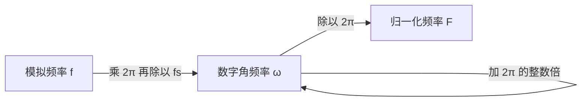

# 模拟频率与数字频率的关系

**标签：** #数字信号处理 #DSP #采样 #频率关系 #归一化频率

---

## 一、基本概念

在处理离散时间信号时，需要区分两种频率：

- **模拟频率**：描述连续时间信号的频率，单位为赫兹（Hz）或弧度/秒（rad/s）。
- **数字频率**：描述离散时间信号的频率，单位为弧度（rad），是归一化的角频率。

两者的桥梁只有一个数：**采样频率 $f_s$**。所以凡涉及换算，"$f_s$ 是多少"永远是第一个要问的问题。

---

## 二、符号约定

| 符号 | 含义 | 单位 | 取值范围 |
|------|------|------|---------|
| \(f\) | 模拟频率（每秒周期数） | Hz | $[0,\infty)$ |
| \(\Omega\) | 模拟角频率 | rad/s | $[0,\infty)$ |
| \(f_s\) | 采样频率（每秒样本数） | Hz | 题目给定 |
| \(T_s\) | 采样周期 | s | $1/f_s$ |
| \(\omega\) | 数字角频率 | rad（无量纲） | $(-\pi,\pi]$ |
| \(F\) | 归一化频率 | 无量纲 | $[0,0.5]$ |

关系：\(\Omega = 2\pi f\)，\(T_s = 1/f_s\)

---

## 三、核心关系式

### 1. 数字频率与模拟角频率的关系

$$
\omega = \Omega T_s = \frac{\Omega}{f_s}
$$

即数字角频率等于模拟角频率乘以采样周期。

### 2. 数字频率与模拟频率的关系

$$
\omega = 2\pi f T_s = \frac{2\pi f}{f_s}
$$

### 3. 归一化频率（有两种约定，务必分清）

**约定 A（课本常用）**：以 $f_s$ 为 1

$$
F = \frac{f}{f_s} = \frac{\omega}{2\pi},\qquad F\in[0,\ 0.5]
$$

$\omega=\pi$（Nyquist）对应 $F=0.5$。

**约定 B（MATLAB / 部分工程软件）**：以 Nyquist 频率 $f_s/2$ 为 1

$$
f_{\text{norm}} = \frac{f}{f_s/2} = \frac{2f}{f_s} = \frac{\omega}{\pi},\qquad f_{\text{norm}}\in[0,\ 1]
$$

$\omega=\pi$ 对应 $f_{\text{norm}}=1$。

> **两套约定差一个因子 2**。看到"归一化频率 0.4"时，先判断它属于哪套：若是约定 A，实际是 $0.4f_s$；若是约定 B，实际是 $0.2f_s$。**这是读论文/用工具时最常见的 2 倍误差来源。**

---

## 四、物理意义与取值范围

- **模拟频率** \(f\) 的取值范围：\(0 \leq f \lt \infty\)（连续域里频率没有上限）
- **数字频率** \(\omega\) 的取值只能落在 \(2\pi\) 的一个区间内，习惯取 \(-\pi \lt \omega \leq \pi\) 或 \(0 \leq \omega \lt 2\pi\)

### 1. 为什么数字频率是周期的？

> 上图：两条连续余弦 $\cos(\omega_0 t)$（蓝，$\omega_0=\pi/3$）与 $\cos[(\omega_0+2\pi)t]$（橙虚线）在连续域里**波形完全不同**；但以整数 $n$ 采样后，两者的离散值**逐点重合**（下图的蓝茎与红茎完全叠在一起）。数字频率相差 $2\pi$ 时对应同一个离散序列。

$$
e^{j(\omega + 2\pi)n} = e^{j\omega n} \cdot e^{j2\pi n} = e^{j\omega n}
$$

所以 $\omega$ 与 $\omega + 2\pi k$ 描述**同一个**离散序列。数字频率"卷"成了一个周长 $2\pi$ 的圆，这正是（[[【数字信号处理DSP】（一）信号周期性判断|一）信号周期性判断]]）里那条结论的根源：判周期要用 $\omega_0/2\pi$ 是否为有理数。

### 2. 为什么"最高频率"只到 $\pi$？

数字频率 $\omega = \pi$ 对应的模拟频率是

$$
f = \frac{\omega f_s}{2\pi} = \frac{f_s}{2}
$$

正好是 Nyquist 频率。再高的模拟频率采样后会折叠回 $(-\pi, \pi]$，所以**数字域里 $\pi$ 就是"最高音"**，$\omega$ 超过 $\pi$ 不是"更高频"，而是"换个说法表示同一个低频"。

> **为什么 $\omega=\pi$ 是"最快振荡"**：此时序列为 $(-1)^n$，相邻两点符号必然相反，**一个采样点就完成半周期**——这已经是离散序列能做到的最快变化。再快也"看不出来"了（这就是混叠的物理本质）。

### 3. 负频率是什么？

负 $\omega$ 不是"频率为负"的物理概念，而是复数表示的产物：实信号的频谱满足共轭对称 $\omega$ 与 $-\omega$ 成对出现。工程上讨论实信号时通常只看 $0 \leq \omega \leq \pi$ 的正频率部分即可。

---

## 五、采样定理的约束

根据奈奎斯特采样定理，为避免混叠，需满足：

$$
f_s \gt 2f_{\max}
$$

即采样频率必须大于信号最高频率的两倍。

在数字频率中，这等价于：

$$
\omega_{\max} = \frac{2\pi f_{\max}}{f_s} \lt \pi
$$

因此，数字频率的有效范围为 \(\lvert \omega \rvert \lt \pi\)（对应模拟频率 \(\lvert f \rvert \lt f_s/2\)）。

---

## 六、混叠频率怎么算（工程必会）

若模拟频率 $f$ 超过了 $f_s/2$，采样后会"折返"成一个较低的**表观频率** $f_a$。计算方法只有一句话：

> **把 $f$ 对 $f_s$ 取余，若余数超过 $f_s/2$ 再用 $f_s$ 减一次。**

$$
f \;\xrightarrow{\ \bmod f_s\ }\; r \;\Longrightarrow\;
f_a =
\begin{cases}
r, & r\le f_s/2\\
f_s-r, & r\gt f_s/2
\end{cases}
$$

对应的数字频率 $\omega_a = \dfrac{2\pi f_a}{f_s}$（落在 $[0,\pi]$）。

> **为什么这样折**：采样序列是 $\cos(2\pi fn/f_s)$，把 $f$ 换成 $f-kf_s$ 后 $2\pi(f-kf_s)n/f_s = 2\pi fn/f_s-2\pi kn$，多出的 $2\pi kn$ 对整数 $n$ 恒为 $2\pi$ 的整数倍，序列不变。所以 $f$、$f\pm f_s$、$f\pm2f_s$…**采样结果完全相同**。再配合 $\cos$ 的偶对称把负值翻正，就得到上面的折返公式。

---

## 七、典型例题

> **统一答题格式**：① 写换算公式；② **确认 $f_s$**；③ 代入求值；④ 若求频率再化成 Hz；⑤ **回代验证**（$\omega\cdot N/2\pi$ 是否为整数，或 $f/f_s$ 是否等于 $\omega/2\pi$）。

### 例题 1：由模拟频率求数字频率

**题目**：$x(t)=\cos(100\pi t)$，$f_s=200\text{ Hz}$。求数字角频率 $\omega$ 与归一化频率 $F$。

**解**：

（1）**先求模拟频率**（把 $\Omega$ 化成 $f$）：

$$
\Omega = 100\pi\ \text{rad/s} \;\Longrightarrow\; f=\frac{\Omega}{2\pi}=50\text{ Hz}
$$

（2）**套换算公式**：

$$
\omega = \frac{2\pi f}{f_s} = \frac{2\pi\times50}{200}=\frac{\pi}{2}\ \text{rad}
$$

（3）**归一化频率（约定 A）**：

$$
F=\frac{f}{f_s}=\frac{50}{200}=0.25
$$

$$
\boxed{\omega=\frac{\pi}{2},\qquad F=0.25\ (f_{\text{norm}}=0.5)}
$$

**检验**：$\omega/2\pi = 0.25 = F$ ✓；$f_s=200> 2\times50=100$，满足采样定理，故不存在混叠 ✓

**再看一个关键点**：$\omega=\pi/2$ 意味着 $N=\dfrac{2\pi}{\omega}=4$，即**每 4 个采样点一个完整周期**。这与 $50\text{ Hz}$、$200\text{ Hz}$ 采样（每周期 4 点）完全吻合 ✓

---

### 例题 2：由数字频率求模拟频率

**题目**：$\omega=\pi/3$，$f_s=500\text{ Hz}$。求对应的模拟频率 $f$。

**解**：

（1）**套公式** $f=\dfrac{\omega f_s}{2\pi}$：

$$
f=\frac{(\pi/3)\times500}{2\pi}=\frac{500}{6}=\frac{250}{3}\approx83.33\text{ Hz}
$$

（2）**求模拟角频率**（题目可能要求）：

$$
\Omega=\omega f_s=\frac{\pi}{3}\times500=\frac{500\pi}{3}\ \text{rad/s}
$$

$$
\boxed{f=\frac{250}{3}\approx83.33\text{ Hz},\qquad \Omega=\frac{500\pi}{3}\ \text{rad/s}}
$$

**检验**：$f/f_s=\dfrac{250/3}{500}=\dfrac16$，而 $\dfrac{\omega}{2\pi}=\dfrac{\pi/3}{2\pi}=\dfrac16$ ✓ 两者一致。

> **注意常见的错误写法** $\omega=\Omega f_s$：正确的是 $\omega=\Omega/f_s$。$f_s$ 越大、同一个 $\Omega$ 对应的 $\omega$ 越小（采样越密，每点转过的角度越小）——**用这个直觉可以自检公式有没有写反**。

---

### 例题 3：混叠折返计算

**题目**：某信号含 $1200\text{ Hz}$ 分量，用 $f_s=1000\text{ Hz}$ 采样。求采样后该分量表现出的频率，并说明与哪个低频信号"看不出区别"。

**解**：

（1）**判断是否混叠**：Nyquist 频率 $f_s/2=500\text{ Hz}$，$1200>500$，**必然混叠**。

（2）**用折返公式**：先对 $f_s$ 取余

$$
1200 \bmod 1000 = 200
$$

余数 $200\le 500$，故表观频率

$$
f_a = 200\text{ Hz}
$$

（3）**换算成数字频率**：

$$
\omega_a=\frac{2\pi f_a}{f_s}=\frac{2\pi\times200}{1000}=0.4\pi
$$

$$
\boxed{f_a=200\text{ Hz},\qquad \omega_a=0.4\pi}
$$

（4）**直接验证**（回到采样序列本身，这是最硬的证明）：

$$
\cos\!\left(2\pi\cdot 1200\cdot\frac{n}{1000}\right)=\cos(2.4\pi n)
=\cos(2.4\pi n-2\pi n)=\cos(0.4\pi n)\ \checkmark
$$

而 $\cos(0.4\pi n)$ 正是 $200\text{ Hz}$、$1000\text{ Hz}$ 采样的结果：

$$
\cos\!\left(2\pi\cdot200\cdot\frac{n}{1000}\right)=\cos(0.4\pi n)\ \checkmark
$$

**检验**：两者逐点相同 ✓ —— **$1200\text{ Hz}$ 与 $200\text{ Hz}$ 在 $f_s=1000\text{ Hz}$ 下完全不可区分**，这就是混叠不可逆的含义。

> **另一个等价算法**：$1200 = 1\times1000 + 200$，也可以理解为 $1200$ 落在 $[f_s, 1.5f_s]$ 区间，折返后为 $f_s-1200=200$ 的镜像。**只要记住"取余 + 必要时再镜像"，任何情形都对**。

---

### 例题 4：由最高频率确定最小采样率

**题目**：模拟信号最高频率 $f_{\max}=3.4\text{ kHz}$（电话语音）。求最小采样频率；若取 $f_s=8\text{ kHz}$，求对应的 $\omega_{\max}$ 与每周期最少采样点数。

**解**：

（1）**采样定理** $f_s>2f_{\max}$：

$$
f_s^{\min}=2\times3.4=6.8\text{ kHz}
$$

（2）**取 $f_s=8\text{ kHz}$ 时的数字频率**：

$$
\omega_{\max}=\frac{2\pi f_{\max}}{f_s}=\frac{2\pi\times3400}{8000}=0.85\pi
$$

（3）**每周期最少采样点数**（$N=2\pi/\omega$ 取整）：

$$
N=\frac{2\pi}{0.85\pi}\approx2.35 \;\Longrightarrow\; \text{至少 } 3 \text{ 点/周期}
$$

$$
\boxed{f_s^{\min}=6.8\text{ kHz};\quad \omega_{\max}=0.85\pi;\quad N_{\min}=3}
$$

**检验**：$\omega_{\max}=0.85\pi<\pi$ ✓ 满足不混叠条件；$N=3>2$ 与"每周期至少 2 点"的基本要求一致 ✓

> **工程对照**：真实电话系统就用 $8\text{ kHz}$ 采样——比理论下限 $6.8\text{ kHz}$ 留了一点余量，好让抗混叠滤波器的过渡带不必做成理想砖墙。

---

### 例题 5：FFT 谱线索引与真实频率

**题目**：$f_s=8\text{ kHz}$，做 $N=1024$ 点 FFT。求频率分辨率 $\Delta f$；若第 $k=100$ 根谱线出现峰值，求对应的模拟频率。

**解**：

（1）**频率分辨率**（相邻谱线的间隔）：

$$
\Delta f=\frac{f_s}{N}=\frac{8000}{1024}=7.8125\text{ Hz}
$$

（2）**索引换算** $f_k=k\Delta f$：

$$
f_{100}=100\times7.8125=781.25\text{ Hz}
$$

（3）**对应数字频率**：

$$
\omega_{100}=\frac{2\pi k}{N}=\frac{2\pi\times100}{1024}=0.1953\pi\approx0.6136\ \text{rad}
$$

$$
\boxed{\Delta f=7.8125\text{ Hz},\qquad f_{100}=781.25\text{ Hz},\qquad \omega\approx0.195\pi}
$$

**检验**：$781.25/8000=0.0977$；$\omega/2\pi=0.1953/2=0.0977$ ✓ 两者一致。

> **$k>N/2$ 怎么办**：FFT 的谱线 $k=0,\dots,N/2$ 对应 $0\sim f_s/2$（正频率），$k>N/2$ 对应**负频率**。若峰值出现在 $k=900$（$N=1024$），对应频率是 $(900-1024)\Delta f=-968.75\text{ Hz}$，实际模拟频率取绝对值 $968.75\text{ Hz}$（或理解为 $f_s-968.75$ 的镜像）。

---

### 例题 6：判断两个数字频率是否等价

**题目**：判断下列各组数字频率是否描述同一个离散序列（输入为实数）：
（a）$\omega_1=0.3\pi$ 与 $\omega_2=2.3\pi$；（b）$\omega_1=0.3\pi$ 与 $\omega_3=-0.3\pi$。

**解**：

（1）**判据**：$\cos(\omega n)$ 相同 $\iff$ $\omega$ 相差 $2\pi$ 的整数倍，**或** $\omega$ 互为相反数（余弦为偶函数）。

（2）**（a）组**：$\omega_2-\omega_1=2\pi$，恰为 $2\pi$ 的整数倍：

$$
\cos(2.3\pi n)=\cos(0.3\pi n+2\pi n)=\cos(0.3\pi n)\ \checkmark
$$

结论：**等价**。

（3）**（b）组**：$\omega_1=-\omega_3$，且 $\cos(-\omega n)=\cos(\omega n)$：

$$
\cos(-0.3\pi n)=\cos(0.3\pi n)\ \checkmark
$$

结论：**等价**（但若是 $\sin$ 则相差一个负号：$\sin(-x)=-\sin x$，不等价）。

$$
\boxed{\text{(a) 等价；(b) 等价（余弦情形）}}
$$

**检验**：代入 $n=1$：$\cos(2.3\pi)=\cos(0.3\pi+2\pi)=\cos(0.3\pi)$ ✓；$\cos(-0.3\pi)=\cos(0.3\pi)$ ✓

> **注意区分**：$\cos$ 的等价关系比 $e^{j\omega n}$ 更宽（多一条"反号等价"）。若题目给的是复指数 $e^{j\omega n}$，则只有"差 $2\pi$ 整数倍"一条，**反号不等价**（$e^{-j\omega n}$ 是共轭，完全不同的复序列）。

---

## 八、常见错误提醒

1. **混淆数字频率与模拟频率**：数字频率是无量纲的，不要直接当作 Hz 使用；读 FFT 结果时忘了乘 $f_s/N$ 是最高频的错误。
2. **忽略采样频率的影响**：同一个模拟频率在不同采样率下对应的数字频率不同，"$\omega = \pi/3$ 是多少赫兹"必须先问 $f_s$。
3. **把换算公式写反**：正确是 $\omega=\Omega/f_s$（除以），$\Omega=\omega f_s$（乘以）。用"$f_s$ 越大 $\omega$ 越小"来自检。
4. **误认为数字频率范围是无限的**：数字频率只在长度为 $2\pi$ 的区间内有意义，超出部分折叠回该区间（混叠），见[[【数字信号处理DSP】（十一）奈奎斯特采样定理|（十一）奈奎斯特采样定理]]。
5. **归一化频率两套约定混用**：约定 A 是 $F=f/f_s\in[0,0.5]$，约定 B 是 $f/(f_s/2)\in[0,1]$，差一个因子 2。看到具体数值先确认属于哪套。
6. **以为 $\omega$ 越大频率越高**：$\omega$ 只在一个 $2\pi$ 周期内可比大小；$\omega = 1.5\pi$ 实际上等价于 $\omega = -0.5\pi$，是低频。
7. **混叠频率只取余不镜像**：取余后若大于 $f_s/2$，还要用 $f_s$ 再减一次。漏了这步结果会大于 Nyquist 频率，自相矛盾。
8. **在换算时漏掉 $2\pi$**：$f = \omega f_s/(2\pi)$ 里的 $2\pi$ 来自"角频率 ↔ 频率"，$\Omega = \omega f_s$ 则是角频率之间的换算，两者别搞混。
9. **不区分 $T_s$ 与 $f_s$**：$\omega = \Omega T_s = \Omega/f_s$，写成 $\omega = \Omega f_s$ 是高频错误。

---

## 九、应用场景

- **数字滤波器设计**：通常先指定数字频率指标（如通带截止频率 \(\omega_p\)），再根据采样频率换算为模拟频率。
- **频谱分析**：FFT输出的横轴通常是数字频率（归一化到 \(0\sim 2\pi\)），需结合采样频率转换为实际频率。
- **系统函数与频率响应**：频率响应 \(H(e^{j\omega})\) 的自变量 \(\omega\) 就是数字角频率。
- **振动/声学测量**：要从谱峰索引反推机械转速或声源频率，必须做 $f=kf_s/N$ 的换算。

---

## 十、知识链定位

模拟频率与数字频率（本节）

│

├── 符号体系：f、Ω、fs、Ts、ω、F 的对应关系

├── 核心换算：ω = ΩTs = 2πf/fs，F = f/fs

├── 归一化约定：F ∈ [0,0.5] 与 f_norm ∈ [0,1] 两套（差因子 2）

├── 混叠折返：取余 + 必要时镜像

└── 数字频率的周期性：ω 与 ω + 2πk 等价，有效区间为 π

│

├── 信号周期性判断：ω₀/2π 是否为有理数（第一节）

├── 采样定理：fs 与最高频率的约束（第十一节）

├── Z 变换与收敛域：复频域视角（第十三节）

└── 数字滤波器设计：指标换算的起点（后续章节）

---

## 十一、总结

| 关系 | 公式 |
|------|------|
| 数字角频率 ← 模拟角频率 | \(\omega = \Omega T_s\) |
| 数字角频率 ← 模拟频率 | \(\omega = 2\pi f / f_s\) |
| 归一化频率（约定 A） | \(F = f / f_s \in[0,0.5]\) |
| 归一化频率（约定 B） | \(f_{\text{norm}}=2f/f_s\in[0,1]\) |
| 模拟角频率 ← 数字角频率 | \(\Omega = \omega / T_s = \omega f_s\) |
| 模拟频率 ← 数字角频率 | \(f = \omega f_s / (2\pi)\) |
| 混叠表观频率 | \(f_a=\lvert f-kf_s\rvert\) 落在 $[0,f_s/2]$ |
| FFT 频率分辨率 | \(\Delta f=f_s/N\) |

> **一句话总结**：数字频率是模拟频率对采样频率的归一化，两者通过采样周期 \(T_s\) 相互转换，理解这一关系是连接连续世界与离散世界的桥梁。
