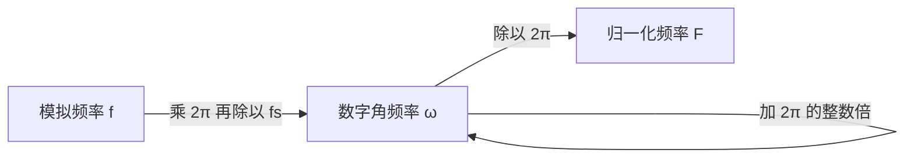

# 模拟频率与数字频率的关系

**标签：** #数字信号处理 #DSP #采样 #频率关系 #归一化频率

---

## 一、基本概念

在处理离散时间信号时，需要区分两种频率：

- **模拟频率**：描述连续时间信号的频率，单位为赫兹（Hz）或弧度/秒（rad/s）。
- **数字频率**：描述离散时间信号的频率，单位为弧度（rad），是归一化的角频率。

---

## 二、符号约定

| 符号 | 含义 | 单位 |
|------|------|------|
| \(f\) | 模拟频率（每秒周期数） | Hz |
| \(\Omega\) | 模拟角频率 | rad/s |
| \(f_s\) | 采样频率（每秒样本数） | Hz |
| \(T_s\) | 采样周期 | s |
| \(\omega\) | 数字角频率 | rad（无量纲） |

关系：\(\Omega = 2\pi f\)，\(T_s = 1/f_s\)

---

## 三、核心关系式

### 1. 数字频率与模拟角频率的关系

$$
\omega = \Omega T_s = \frac{\Omega}{f_s}
$$

即数字角频率等于模拟角频率乘以采样周期。

### 2. 数字频率与模拟频率的关系

$$
\omega = 2\pi f T_s = \frac{2\pi f}{f_s}
$$

### 3. 归一化频率

有时定义归一化频率 \(F\)（无量纲，范围0~1）：

$$
F = \frac{f}{f_s} = \frac{\omega}{2\pi}
$$

此时数字角频率 \(\omega = 2\pi F\)。

---

## 四、物理意义与取值范围

- **模拟频率** \(f\) 的取值范围：\(0 \leq f \lt \infty\)（连续域里频率没有上限）
- **数字频率** \(\omega\) 的取值只能落在 \(2\pi\) 的一个区间内，习惯取 \(-\pi \lt \omega \leq \pi\) 或 \(0 \leq \omega \lt 2\pi\)

### 1. 为什么数字频率是周期的？

$$
e^{j(\omega + 2\pi)n} = e^{j\omega n} \cdot e^{j2\pi n} = e^{j\omega n}
$$

所以 $\omega$ 与 $\omega + 2\pi k$ 描述**同一个**离散序列。数字频率"卷"成了一个周长 $2\pi$ 的圆，这正是（[[【数字信号处理DSP】（一）信号周期性判断|一）信号周期性判断]]）里那条结论的根源：判周期要用 $\omega_0/2\pi$ 是否为有理数。

### 2. 为什么"最高频率"只到 $\pi$？

数字频率 $\omega = \pi$ 对应的模拟频率是

$$
f = \frac{\omega f_s}{2\pi} = \frac{f_s}{2}
$$

正好是 Nyquist 频率。再高的模拟频率采样后会折叠回 $(-\pi, \pi]$，所以**数字域里 $\pi$ 就是"最高音"**，$\omega$ 超过 $\pi$ 不是"更高频"，而是"换个说法表示同一个低频"。

### 3. 负频率是什么？

负 $\omega$ 不是"频率为负"的物理概念，而是复数表示的产物：实信号的频谱满足共轭对称 $\omega$ 与 $-\omega$ 成对出现。工程上讨论实信号时通常只看 $0 \leq \omega \leq \pi$ 的正频率部分即可。

---

## 五、采样定理的约束

根据奈奎斯特采样定理，为避免混叠，需满足：

$$
f_s \gt 2f_{\max}
$$

即采样频率必须大于信号最高频率的两倍。

在数字频率中，这等价于：

$$
\omega_{\max} = \frac{2\pi f_{\max}}{f_s} \lt \pi
$$

因此，数字频率的有效范围为 \(\lvert \omega \rvert \lt \pi\)（对应模拟频率 \(\lvert f \rvert \lt f_s/2\)）。

---

## 六、示例

### 例1：已知模拟信号频率与采样频率，求数字频率

模拟信号 \(x(t) = \cos(100\pi t)\)，采样频率 \(f_s = 200\) Hz。

模拟角频率 \(\Omega = 100\pi\) rad/s，模拟频率 \(f = 50\) Hz。

数字角频率：

$$
\omega = \Omega T_s = 100\pi \times \frac{1}{200} = \frac{\pi}{2} \text{ rad}
$$

归一化频率 \(F = \frac{f}{f_s} = \frac{50}{200} = 0.25\)。

### 例2：已知数字频率与采样频率，求对应的模拟频率

数字频率 \(\omega = \pi/3\)，采样频率 \(f_s = 500\) Hz。

模拟角频率：

$$
\Omega = \frac{\omega}{T_s} = \omega f_s = \frac{\pi}{3} \times 500 = \frac{500\pi}{3} \text{ rad/s}
$$

模拟频率：

$$
f = \frac{\Omega}{2\pi} = \frac{500\pi/3}{2\pi} = \frac{250}{3} \approx 83.33 \text{ Hz}
$$

---

## 七、常见错误提醒

1. **混淆数字频率与模拟频率**：数字频率是无量纲的，不要直接当作 Hz 使用；读 FFT 结果时忘了乘 $f_s$ 是最高频的错误。
2. **忽略采样频率的影响**：同一个模拟频率在不同采样率下对应的数字频率不同，"$\omega = \pi/3$ 是多少赫兹"必须先问 $f_s$。
3. **误认为数字频率范围是无限的**：数字频率只在长度为 $2\pi$ 的区间内有意义，超出部分折叠回该区间（混叠），见[[【数字信号处理DSP】（十一）奈奎斯特采样定理|（十一）奈奎斯特采样定理]]。
4. **把 $F$ 和 $\omega$ 混用**：$F = f/f_s$（范围 $0 \sim 0.5$ 或 $0 \sim 1$），$\omega = 2\pi F$（范围 $0 \sim \pi$ 或 $0 \sim 2\pi$），两者差一个 $2\pi$。
5. **以为 $\omega$ 越大频率越高**：$\omega$ 只在一个 $2\pi$ 周期内可比大小；$\omega = 1.5\pi$ 实际上等价于 $\omega = -0.5\pi$，是低频。
6. **在换算时漏掉 $2\pi$**：$f = \omega f_s/(2\pi)$ 里的 $2\pi$ 来自"角频率 ↔ 频率"，$\Omega = \omega f_s$ 则是角频率之间的换算，两者别搞混。
7. **不区分 $T_s$ 与 $f_s$**：$\omega = \Omega T_s = \Omega/f_s$，写成 $\omega = \Omega f_s$ 是高频错误。

---

## 八、应用场景

- **数字滤波器设计**：通常先指定数字频率指标（如通带截止频率 \(\omega_p\)），再根据采样频率换算为模拟频率。
- **频谱分析**：FFT输出的横轴通常是数字频率（归一化到 \(0\sim 2\pi\)），需结合采样频率转换为实际频率。
- **系统函数与频率响应**：频率响应 \(H(e^{j\omega})\) 的自变量 \(\omega\) 就是数字角频率。

---

## 九、知识链定位

模拟频率与数字频率（本节）

│

├── 符号体系：f、Ω、fs、Ts、ω、F 的对应关系

├── 核心换算：ω = ΩTs = 2πf/fs，F = f/fs

└── 数字频率的周期性：ω 与 ω + 2πk 等价，有效区间为 π

│

├── 信号周期性判断：ω₀/2π 是否为有理数（第一节）

├── 采样定理：fs 与最高频率的约束（第十一节）

├── Z 变换与收敛域：复频域视角（第十三节）

└── 数字滤波器设计：指标换算的起点（后续章节）

---

## 十、总结

| 关系 | 公式 |
|------|------|
| 数字角频率 ← 模拟角频率 | \(\omega = \Omega T_s\) |
| 数字角频率 ← 模拟频率 | \(\omega = 2\pi f / f_s\) |
| 归一化频率 ← 模拟频率 | \(F = f / f_s\) |
| 模拟角频率 ← 数字角频率 | \(\Omega = \omega / T_s = \omega f_s\) |
| 模拟频率 ← 数字角频率 | \(f = \omega f_s / (2\pi)\) |

> **一句话总结**：数字频率是模拟频率对采样频率的归一化，两者通过采样周期 \(T_s\) 相互转换，理解这一关系是连接连续世界与离散世界的桥梁。