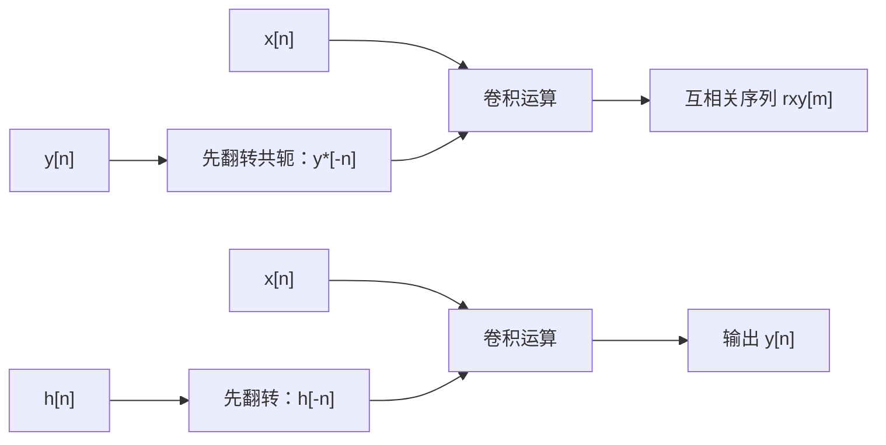

# 自相关函数与互相关函数

**标签：** #数字信号处理 #DSP #自相关 #互相关 #时延估计 #相关分析

---

## 一、为什么需要相关函数？

在信号处理中，我们常常想知道：

- 信号在不同时刻之间有没有关系？
- 两个不同的信号之间有没有关联？
- 信号中是否隐藏着周期成分？
- 如何从噪声中检测出已知信号？

**相关函数**就是用来回答这些问题的工具——它衡量信号之间（或信号与自身）在不同延迟下的**相似程度**。

一个直观的例子：把一段录音和它自己延迟 0.1 秒的版本对齐。如果两边波形"长得像"，逐点相乘再求和就很大；如果完全不像，正负相消，求和接近零。**"延迟 + 相乘 + 求和"** 就是相关运算的全部内容。

> **一个必须一开始就说清的约定**：不同教材对 $r_{xy}[m]$ 的定义**符号方向相反**，导致「延时峰出现在 $+n_0$ 还是 $-n_0$」看起来互相矛盾。本文统一使用
>
> $$r_{xy}[m]=\sum_{n}x[n]\,y^{*}[n-m]$$
>
> 在此约定下，若 $y[n]=x[n-n_0]$（$y$ 是 $x$ 的**延迟**版本），峰出现在 $m=-n_0$。**做题时按题目给的定义推，不要背结论。**

---

## 二、基本定义

### 1. 自相关函数（Autocorrelation Function）

> 上图：左为一个实有限长序列 $x[n]$；右为**由它实际算出**的自相关 $r_{xx}[m]$。可见两个特征——**关于 $m=0$ 偶对称**（红色虚线把 $r[-1]$ 与 $r[1]$、$r[-2]$ 与 $r[2]$ 分别等高连起来），且**零延迟处取最大值** $r_{xx}[0]=E$（等于序列能量）。序列长度 $L=6$，自相关长度 $2L-1=11$。

衡量**同一个信号**在不同时刻的相关性。

#### 确定性信号（能量型）

$$
r_{xx}[m] = \sum_{n=-\infty}^{\infty} x[n] \, x^*[n-m]
$$

#### 随机信号（宽平稳）

$$
r_{xx}[m] = E\left[x[n] \, x^*[n-m]\right]
$$

#### 实际计算（各态历经假设）

$$
r_{xx}[m] = \lim_{N \to \infty} \frac{1}{2N+1} \sum_{n=-N}^{N} x[n] \, x^*[n-m]
$$

> **两种归一化不要混用**：
> - 不除以长度（上面前两式）得到的是**相关序列**，$r_{xx}[0]$ 等于信号**能量**；
> - 除以长度（第三式）得到的是**平均相关**，$r_{xx}[0]$ 等于信号**平均功率**，量纲和平稳性都更好，功率谱分析中通常用这一种。
>
> 本文涉及周期信号、白噪声时用的都是**平均相关**。**周期信号必须用平均相关**，否则 $\sum_n x[n]x[n-m]$ 发散。

---

### 2. 互相关函数（Cross-Correlation Function）

衡量**两个不同信号**之间的相关性。

#### 定义式

$$
r_{xy}[m] = \sum_{n=-\infty}^{\infty} x[n] \, y^*[n-m]
$$

或等价地（把 $n$ 换成 $n+m$ 再重新标号）：

$$
r_{xy}[m] = \sum_{n=-\infty}^{\infty} x[n+m] \, y^*[n]
$$

#### 随机信号

$$
r_{xy}[m] = E\left[x[n] \, y^*[n-m]\right]
$$

> **顺序有讲究**：$r_{xy}[m]$ 和 $r_{yx}[m]$ 在一般情况下不相等，两者满足 $r_{xy}[m] = r_{yx}^*[-m]$。所以写互相关时必须交代"谁在前、谁在后"。

---

## 三、物理意义

| 情况 | 含义 |
|------|------|
| 自相关 $r_{xx}[0]$ | 信号的能量（确定性）或平均功率（随机） |
| 自相关 $m \neq 0$ | 信号与延迟后自身的相似度 |
| 互相关 $r_{xy}[m]$ | 信号 $x$ 与"延迟 $m$ 的 $y$"的相似度 |
| $r_{xy}[m]$ 峰值位置 | 两信号之间的时延估计 |
| $r_{xx}[m]$ 衰减快慢 | 信号"变化快慢"——衰减越快，相邻样点越不相关 |

---

## 四、主要性质对比

### 1. 对称性

| 类型 | 性质 |
|------|------|
| 自相关（一般信号） | $r_{xx}[-m] = r_{xx}^*[m]$ |
| 自相关（实信号） | $r_{xx}[-m] = r_{xx}[m]$（偶函数） |
| 互相关 | $r_{xy}[-m] = r_{yx}^*[m]$ |
| 互相关（实信号） | $r_{xy}[-m] = r_{yx}[m]$ |

**为什么自相关是偶函数（共轭对称）？** 推导只需三步，做一遍就再也不会忘：

$$
r_{xx}[-m] = \sum_n x[n] \, x^*[n+m] \overset{k = n+m}{=} \sum_k x[k-m] \, x^*[k] = \left( \sum_k x[k] \, x^*[k-m] \right)^{\!*} = r_{xx}^*[m]
$$

最后一步交换了求和顺序并取共轭。对**实信号**，$x^* = x$，共轭消失，于是 $r_{xx}[-m] = r_{xx}[m]$，是真正的偶函数。

> **这一步为什么必须写**：很多结论（如 $r_{xx}$ 只含余弦项、功率谱为实偶函数）都建立在偶对称之上。考卷上被问"证明 $r_{xx}$ 是偶函数"时，就照这三步写。

### 2. 最大值位置

- **自相关**：在 $m=0$ 处取最大值

$$
\lvert r_{xx}[m] \rvert \leq r_{xx}[0], \quad \forall m
$$

这个不等式就是**柯西-施瓦茨不等式**：把 $x[n]$ 和 $x[n-m]$ 看成两个向量，内积的模不超过模长之积，而 $r_{xx}[0]$ 正好是两个模长平方之积的开方。

- **互相关**：最大值位置反映两信号的相对时延

$$
\lvert r_{xy}[m] \rvert \leq \sqrt{r_{xx}[0] \, r_{yy}[0]}
$$

注意这里右端是**两个信号各自**零点值乘积的开方，所以 $\lvert r_{xy}[m] \rvert \leq 1$ 只有在两个信号都做了归一化（$r_{xx}[0] = r_{yy}[0] = 1$）时才成立——这就是下面要讲的**归一化互相关**。

### 3. 周期性与相关性

- 若 $x[n]$ 是周期信号，则 $r_{xx}[m]$ 也是同周期的周期信号
- 若 $x[n]$ 和 $y[n]$ 不相关（如信号与独立噪声），则 $r_{xy}[m] = 0$（对随机信号取期望）

### 4. 与卷积的关系

- 自相关：$r_{xx}[m] = x[m] * x^*[-m]$
- 互相关：$r_{xy}[m] = x[m] * y^*[-m]$

也就是说：**相关 = 不翻转的那个信号 与 翻转共轭后的另一个信号 做卷积**。这正是"卷积要翻转、相关不翻转"这句话的来源。

对比可见：**两者都要翻转一个信号**，区别只在"翻转的是哪一个、要不要额外取共轭"。

### 5. 直流分量的影响

若信号含直流分量 $x[n] = \bar{x} + \tilde{x}[n]$（$\tilde{x}$ 为零均值波动部分），则

$$
r_{xx}[m] = \bar{x}^2 + r_{\tilde{x}\tilde{x}}[m]
$$

即**自相关里被叠加了一个常数 $\bar{x}^2$**，而这一项对 $m$ 不衰减。后果：

- 相关图整体被抬高，非零延迟的峰不再趋近于零；
- 看起来"像"长相关，容易误判为周期性。

**工程做法**：算自相关前**先去均值**（减去 $\bar{x}$），否则谱估计在 $\omega = 0$ 处会出现虚假尖峰。这一点在功率谱密度估计中尤其重要。

---

## 五、归一化相关系数：把"有多像"变成可比的数

原始 $r_{xy}[m]$ 带着信号的能量量纲，两个不同量级的信号没法直接比较相关强弱。工程上普遍使用**归一化相关系数**：

$$
\rho_{xy}[m] = \frac{r_{xy}[m]}{\sqrt{r_{xx}[0]\,r_{yy}[0]}}, \qquad \lvert \rho_{xy}[m] \rvert \leq 1
$$

由第四节的柯西-施瓦茨不等式，这个归一化保证结果落在 $[-1,1]$：

| $\lvert\rho_{xy}\rvert$ | 含义 |
|---|---|
| $1$ | 完全正相关（$y$ 是 $x$ 的纯缩放/平移） |
| $0$ | 完全不相关（正交） |
| 接近 $1$ | 强相关，可信任的时延估计 |
| 接近 $0$ | 相关峰淹没在噪声里，时延估计不可靠 |

> **这是判断"相关峰能不能用"的标准做法**：只看到峰还不够，要看 $\lvert\rho_{xy}\rvert$ 是否明显高于其它延迟处的取值。若整条曲线都在 $0.1$ 上下浮动，那个"最高点"就是噪声。

---

## 六、典型例题

> **统一答题格式**：写定义式 → 代入求和 → 定非零区间（或取平均）→ 化简 → 结论。
> 算出结果后**必做两项自查**：① 对称性对不对；② $m=0$ 处的值是否等于能量/功率。

### 例题 1：单位脉冲的自相关

**题目**：$x[n] = \delta[n]$，求 $r_{xx}[m]$。

**解**：

（1）**写定义式**：

$$
r_{xx}[m] = \sum_{n=-\infty}^{\infty} \delta[n] \, \delta[n-m]
$$

（2）**定非零区间**：$\delta[n]$ 只在 $n=0$ 处为 $1$，求和只剩 $n=0$ 一项：

$$
r_{xx}[m] = \delta[0] \cdot \delta[-m] = \delta[-m]
$$

（3）**化简**：$\delta[-m] = \delta[m]$（冲激是偶函数）。

**答案**：

$$
\boxed{r_{xx}[m] = \delta[m]}
$$

**检验**：$r_{xx}[0]=1$，等于 $\delta[n]$ 的能量 $1$ ✓；关于 $m=0$ 偶对称 ✓

→ 只有零延迟处有值，说明信号只在同一时刻与自己完全相关。

---

### 例题 2：有限长序列的自相关（手算）

**题目**：$x[n] = \{1, 2, 3\}$（$n = 0, 1, 2$），求 $r_{xx}[m]$。

**解**：

（1）**写定义式并定范围**：$x[n]$ 非零区间为 $0\le n\le 2$，故 $r_{xx}[m]$ 非零要求 $\lvert m\rvert \le 2$，即 $m=-2,\dots,2$ 共 $2L-1=5$ 点。

（2）**逐点代入** $r_{xx}[m]=\sum_n x[n]x[n-m]$：

| $m$ | 非零项 | 计算 | $r_{xx}[m]$ |
|------|--------|------|-------------|
| $-2$ | $n=0$ | $x[0]x[2] = 1\times3$ | $3$ |
| $-1$ | $n=0,1$ | $x[0]x[1]+x[1]x[2] = 2+6$ | $8$ |
| $0$ | $n=0,1,2$ | $1+4+9$ | $14$ |
| $1$ | $n=1,2$ | $x[1]x[0]+x[2]x[1] = 2+6$ | $8$ |
| $2$ | $n=2$ | $x[2]x[0] = 3\times1$ | $3$ |

（3）**写出结果**：

$$
\boxed{r_{xx}[m] = \{3,\ 8,\ 14,\ 8,\ 3\}, \quad m = -2,-1,0,1,2}
$$

**检验**（三项全对上）：

- 对称性：$r_{xx}[-1]=r_{xx}[1]=8$、$r_{xx}[-2]=r_{xx}[2]=3$ ✓
- 零点值：$r_{xx}[0]=14=1^2+2^2+3^2$，等于序列能量 ✓
- 长度：$2L-1=5$，与卷积长度规则一致（因为自相关本质就是卷积）✓

---

### 例题 3：正弦序列的自相关

**题目**：$x[n] = A\sin(\omega_0 n)$，用平均相关求 $r_{xx}[m]$，并求 $m=0$ 处的值。

**解**：

（1）**写平均相关定义式**：

$$
r_{xx}[m] = \lim_{N\to\infty}\frac{1}{2N+1}\sum_{n=-N}^{N} A^2\sin(\omega_0 n)\sin\big(\omega_0(n-m)\big)
$$

（2）**积化和差**（$\sin A\sin B = \frac{1}{2}[\cos(A-B) - \cos(A+B)]$），取 $A=\omega_0n$、$B=\omega_0(n-m)$：

$$
\sin(\omega_0 n)\sin\big(\omega_0(n-m)\big) = \frac{1}{2}\Big[\cos(\omega_0 m) - \cos(2\omega_0 n - \omega_0 m)\Big]
$$

（3）**分两项取平均**：

- 第一项 $\frac{A^2}{2}\cos(\omega_0 m)$ 与 $n$ 无关，取平均后原样留下；
- 第二项 $\frac{A^2}{2}\cos(2\omega_0 n-\omega_0 m)$ 以 $2\omega_0$ 随 $n$ 振荡，长平均后趋于 $0$。

故

$$
\boxed{r_{xx}[m] = \frac{A^2}{2}\cos(\omega_0 m)}
$$

（4）**求零点值**：$r_{xx}[0]=\dfrac{A^2}{2}$。

**检验**：$\sin$ 的平均功率正是 $A^2/2$（见 [[【数字信号处理DSP】（三）能量信号和功率信号|（三）能量信号和功率信号]]），与"平均相关零点值 = 平均功率"一致 ✓

→ 自相关**保留了频率 $\omega_0$，丢失了相位信息**。相位丢失正是自相关的价值所在：正因为与相位无关，它才特别适合从噪声里"捞"出周期成分。

---

### 例题 4：白噪声的自相关

**题目**：$x[n]$ 为零均值白噪声，方差 $\sigma^2$，求 $r_{xx}[m]$。

**解**：

（1）**写出定义与已知条件**：白噪声的定义就是各时刻互不相关，即

$$
E\big[x[n]x^*[n-m]\big] = 0 \quad (m\neq 0)
$$

（2）**算零点值**：$m=0$ 时 $E\big[\lvert x[n]\rvert^2\big] = \sigma^2$（方差，因均值为零）。

（3）**合并**：

$$
\boxed{r_{xx}[m] = \sigma^2\delta[m] =
\begin{cases}
\sigma^2, & m=0 \\
0, & m \neq 0
\end{cases}}
$$

**检验**：$r_{xx}[0]=\sigma^2$ 等于平均功率 ✓；除零点外全为零，说明"任意两个不同时刻都不相关" ✓

→ "白"这个字就是由此而来：自相关是冲激，其频谱在所有频率上均等（见 [[【数字信号处理DSP】（六）维纳-辛钦定理与帕塞瓦尔定理|（六）维纳-辛钦定理与帕塞瓦尔定理]]）。

---

### 例题 5：两个不同频率正弦的互相关

**题目**：$x[n] = \sin(\omega_1 n)$，$y[n] = \sin(\omega_2 n)$，$\omega_1\neq\omega_2$。求平均互相关 $r_{xy}[m]$。

**解**：

（1）**写定义式**：

$$
r_{xy}[m] = \lim_{N\to\infty}\frac{1}{2N+1}\sum_{n=-N}^{N}\sin(\omega_1 n)\sin\big(\omega_2(n-m)\big)
$$

（2）**积化和差**，出现两个频率成分 $\omega_1-\omega_2$ 与 $\omega_1+\omega_2$：

$$
\sin(\omega_1 n)\sin\big(\omega_2(n-m)\big) = \frac{1}{2}\Big[\cos\big((\omega_1-\omega_2)n+\omega_2 m\big) - \cos\big((\omega_1+\omega_2)n-\omega_2 m\big)\Big]
$$

（3）**判断极限**：$\omega_1\neq\omega_2$ 且均非零，故 $\omega_1-\omega_2\neq 0$、$\omega_1+\omega_2\neq 0$（取正频率）。两个余弦都以非零频率随 $n$ 振荡，长平均后均为 $0$。

$$
\boxed{r_{xy}[m] = 0 \quad \text{（对所有 } m\text{）}}
$$

**检验**：$m=0$ 时就是 $\sum\sin(\omega_1n)\sin(\omega_2n)$，两个正交函数内积为 $0$ ✓

→ 不同频率的正弦信号互不相关。**这是频分复用、正交调制（IQ 调制）能工作的根本原因**：同频才相关，异频自动"看不见"彼此。

---

### 例题 6：时延估计（本题专治符号混乱）

**题目**：已知 $y[n] = x[n - n_0] + w[n]$，其中 $w[n]$ 与 $x[n]$ 不相关，$n_0>0$ 为未知延时。按本文定义 $r_{xy}[m]=\sum_n x[n]y^*[n-m]$，求 $r_{xy}[m]$ 的峰值位置，并说明如何估计 $n_0$。

**解**：

（1）**代入定义式**：

$$
r_{xy}[m] = \sum_n x[n]\big(x[n-m-n_0]+w[n-m]\big)^{*}
$$

（2）**利用线性拆成两项**（实信号取共轭不变）：

$$
r_{xy}[m] = \underbrace{\sum_n x[n]x[n-m-n_0]}_{=\,r_{xx}[m+n_0]} + \underbrace{\sum_n x[n]w[n-m]}_{=\,r_{xw}[m]}
$$

（3）**处理噪声项**：$x$ 与 $w$ 不相关，故 $r_{xw}[m]\approx 0$，于是

$$
r_{xy}[m] \approx r_{xx}[m+n_0]
$$

（4）**定位峰值**：$r_{xx}[\cdot]$ 在自变量为 $0$ 处取最大，即 $m+n_0=0$，得 $m=-n_0$。

$$
\boxed{m_{\text{peak}} = -n_0 \quad\Longrightarrow\quad \hat{n}_0 = -m_{\text{peak}}}
$$

**检验**（用最简数值反推）：取 $x=\delta[n]$、$w=0$、$n_0=2$，则 $y[n]=\delta[n-2]$。

$$
r_{xy}[m]=\sum_n \delta[n]\,\delta[n-m-2]=\delta[-m-2]
$$

非零要求 $-m-2=0$，即 $m=-2=-n_0$，与结论一致 ✓

> **若换成 $r_{xy}[m]=\sum_n x[n]y^*[n+m]$ 的定义，峰就落在 $m=+n_0$。** 两种约定结果差一个符号，所以**必须按题目给的定义推导**，不能背"峰在正延时处"。
>
> **物理读法**：$r_{xy}[m]$ 是拿"$x$"去和"$y$ 往回挪 $-m$"比。$y$ 比 $x$ 晚 $n_0$ 出现，所以要把 $y$ 往回挪 $n_0$ 才对齐，对应 $m=-n_0$。

**为什么噪声不影响峰值位置？** 因为噪声与信号不相关，它只把相关曲线"垫高"一层（方差），不改变峰的位置。这就是相关法能从强噪声中提取时延的原因——**它不是把噪声滤掉，而是让噪声平均掉**。

---

### 例题 7：含直流分量的自相关（为什么必须先去均值）

**题目**：$x[n] = 2 + \cos(\omega_0 n)$。求平均自相关 $r_{xx}[m]$，并说明不去均值会带来什么误判。

**解**：

（1）**拆成直流 + 零均值波动**：$\bar{x}=2$，$\tilde{x}[n]=\cos(\omega_0 n)$，且 $\tilde{x}$ 零均值。

（2）**用第四节 5 的分解式** $r_{xx}[m]=\bar{x}^2+r_{\tilde{x}\tilde{x}}[m]$：

$$
r_{xx}[m] = 2^2 + \frac{1}{2}\cos(\omega_0 m) = 4 + \frac{1}{2}\cos(\omega_0 m)
$$

（其中 $r_{\tilde{x}\tilde{x}}[m]=\frac12\cos(\omega_0m)$ 由例题 3 取 $A=1$ 得到。）

$$
\boxed{r_{xx}[m] = 4 + \tfrac{1}{2}\cos(\omega_0 m)}
$$

（3）**对比去均值前后**：

| $m$ | 未去均值 $r_{xx}[m]$ | 去均值后 $r_{\tilde{x}\tilde{x}}[m]$ |
|---|---|---|
| $0$ | $4.5$ | $0.5$ |
| $\pi/\omega_0$（半个周期） | $3.5$ | $-0.5$ |

（4）**结论**：未去均值时，自相关在 $[3.5,\,4.5]$ 之间小幅波动，**永不接近零**。

**检验**：$r_{xx}[0]=4.5=2^2+(\frac{1}{\sqrt2})^2$，正好是 $\cos$ 的平均功率 $1/2$ 加直流功率 $4$ ✓（与 [[【数字信号处理DSP】（三）能量信号和功率信号|（三）能量信号和功率信号]] 的功率相加性一致）

> **误判风险**：曲线看起来"一直很高、不衰减"，容易被读成"长相关"。去均值后曲线在 $\pm0.5$ 之间穿越零点，周期性一目了然。**功率谱估计里这个常数项会在 $\omega=0$ 造出一根虚假尖峰**，是谱估计最常见的假象。

---

### 例题 8：复数序列的自相关（看清共轭的作用）

**题目**：$x[n]=\{1,\ j\}$（$n=0,1$，$j=\sqrt{-1}$），求 $r_{xx}[m]$，并验证共轭偶对称性。

**解**：

（1）**注意定义里是 $x^*[n-m]$**，共轭作用在**延迟后的那个**因子上。

（2）**逐点算**（非零范围 $\lvert m\rvert\le 1$）：

- $m=-1$：非零项 $n=0$，$x[0]x^*[1]=1\cdot(-j)=-j$
- $m=0$：$x[0]x^*[0]+x[1]x^*[1]=1\cdot1+j\cdot(-j)=1+1=2$
- $m=1$：非零项 $n=1$，$x[1]x^*[0]=j\cdot1=j$

$$
\boxed{r_{xx}[m] = \{-j,\ 2,\ j\}, \quad m=-1,0,1}
$$

（3）**验证共轭偶对称**：$r_{xx}[-1]=-j$，而 $\big(r_{xx}[1]\big)^*=(j)^*=-j$ ✓ 符合 $r_{xx}[-m]=r_{xx}^*[m]$。

**检验**：$r_{xx}[0]=\lvert1\rvert^2+\lvert j\rvert^2=2$，等于序列能量 ✓ 且为**实数**——这是普遍规律：$r_{xx}[0]$ 必为实非负（它是能量）。

> **注意**：这里 $r_{xx}[-1]=-j\neq r_{xx}[1]=j$，**不是偶函数**。复数序列只有"共轭偶对称"，没有"偶对称"。若漏掉共轭，会算出 $r_{xx}[m]=\{j,2,j\}$，对称性检验立刻暴露错误——所以**算完一定查对称性**。

---

## 七、自相关 vs 互相关 对比表

| 对比项 | 自相关 | 互相关 |
|-------|--------|--------|
| 比较对象 | 信号与自身 | 两个不同信号 |
| 定义 | $r_{xx}[m] = \sum_n x[n] x^*[n-m]$ | $r_{xy}[m] = \sum_n x[n] y^*[n-m]$ |
| 对称性 | 共轭偶对称（实信号为偶函数） | $r_{xy}[-m] = r_{yx}^*[m]$ |
| 零点值 | 能量或平均功率（实数、非负） | 无特殊物理意义 |
| 最大值位置 | 始终在 $m=0$ | 反映两信号时延（位置随定义约定变号） |
| 周期信号 | 保留周期，丢失相位 | 保留共同周期成分 |
| 结果长度 | $2L-1$（长度 $L$ 的序列） | $L_x + L_y - 1$ |
| 计算本质 | $x[m] * x^*[-m]$ | $x[m] * y^*[-m]$ |

---

## 八、应用场景

### 自相关的应用

1. **周期检测**：从噪声中提取微弱周期信号（相关值在周期倍数处再次出现峰）
2. **功率谱估计**：通过维纳-辛钦定理，自相关的傅里叶变换 = 功率谱密度
3. **语音处理**：基音周期检测（浊音的基音周期对应自相关的第二个峰）
4. **随机信号分析**：判断信号是否为白噪声（自相关是否为冲激）

### 互相关的应用

1. **时延估计**：雷达、声呐、超声检测
2. **系统辨识**：通过输入输出互相关求系统冲激响应（白噪声激励时 $r_{xy}[m] = \sigma^2 h[m]$）
3. **信号匹配/模板匹配**：在接收信号中寻找已知信号（匹配滤波器）
4. **通信同步**：帧同步、码元同步

> **工程实现提示**：直接按定义算相关是 $O(L^2)$。实际系统用 FFT 算——对有限长序列补零到 $N\ge L_x+L_y-1$ 后，
>
> $$
> r_{xy}[m] \;\longleftrightarrow\; X[k]\,Y^*[k]
> $$
>
> 即"频域相乘再反变换"，复杂度降到 $O(N\log N)$。**补零这一步不能省**，否则得到的是循环相关，尾部会绕回头部造成假峰。具体做法见 [[【数字信号处理DSP】（十四）离散时间傅里叶变换（DTFT）|（十四）DTFT]] 与 DFT 章节的衔接部分。

---

## 九、常见错误提醒

1. **把时延峰的符号背错**：峰在 $+n_0$ 还是 $-n_0$ **取决于定义式**。本文定义下峰在 $-n_0$；换一种定义就变正。**永远按题目给的定义推**，别背结论。
2. **自相关和互相关搞错顺序**：$r_{xy}[m] \neq r_{yx}[m]$，只满足 $r_{xy}[m] = r_{yx}^*[-m]$。写的时候先说清楚谁在前。
3. **忘了共轭**：$r_{xy}[m]=\sum x[n]y^*[n-m]$ 里的共轭在 $y$ 上；$r_{xx}$ 的共轭在延迟项上。漏掉共轭后对称性检验必然失败。
4. **忘了自相关的对称性检验**：算出 $r_{xx}[m]$ 后应检查 $r_{xx}[-m] = r_{xx}^*[m]$，这是最快的自查手段。
5. **把 $r_{xx}[0]$ 当作能量还是功率说不清**：取决于是否除以长度，两种归一化不能混用。**周期信号必须用平均相关**，否则 $\sum_n x[n]x[n-m]$ 发散。
6. **以为相关就是卷积**：相关**不翻转**被比较的那个信号（等价于翻转另一个），且互相关要取共轭。
7. **不去均值就算自相关**：直流分量会让自相关整体抬高常数 $\bar{x}^2$，容易误判成周期性。**先减均值再算**。
8. **以为相关能去除噪声**：相关是把噪声**平均掉**（不相关部分趋于零），需要足够长的数据；短数据上噪声会让峰变毛糙。
9. **只看峰值不看归一化系数**：$\lvert\rho_{xy}\rvert$ 接近 $0$ 时，那个"最高点"就是噪声，不能当时延用。

---

## 十、知识链定位

自相关与互相关（本节）

│

├── 定义：延迟、相乘、求和（取期望 / 取长平均）

├── 对称性：共轭偶对称 r_xx[-m] = r_xx*[m]

├── 峰值：零点取最大（柯西-施瓦茨）

├── 归一化：rho = r_xy / sqrt(r_xx[0] r_yy[0])，绝对值不超过 1

└── 与卷积：r_xx[m] = x[m] * x*[-m]

│

├── 能量信号与功率信号：r_xx[0] 的能量/功率含义（第三节）

├── 维纳-辛钦定理：自相关的 DTFT = 功率谱（第六节）

├── 功率谱密度：相关法与周期图法（第五节）

├── 卷积和：相关的计算本质（第七节）

├── 模拟频率与数字频率：相关峰的时延换算（第十节）

└── 系统函数 H(z)：相关序列的 Z 变换（后续章节）

---

## 十一、总结

| 要点 | 自相关 | 互相关 |
|------|--------|--------|
| 一句话 | 信号与自己的相似度 | 两个信号的相似度 |
| 零点值 | 能量 / 平均功率 | 无特殊含义 |
| 对称性 | 共轭偶对称 | $r_{xy}[-m] = r_{yx}^*[m]$ |
| 峰值位置 | 恒在 $m = 0$ | 等于两信号时延（符号随定义约定） |
| 与卷积 | $x[m] * x^*[-m]$ | $x[m] * y^*[-m]$ |
| 工程判据 | 峰高 / 归一化系数 | $\lvert\rho_{xy}\rvert$ 是否明显偏离 $0$ |

> **一句话总结**：相关函数用"延迟—相乘—求和"衡量相似度，自相关告诉我们信号自身有多"黏"（有多周期性），互相关告诉我们两个信号差了多少——它是从噪声中提取时延和周期的最基本工具。
