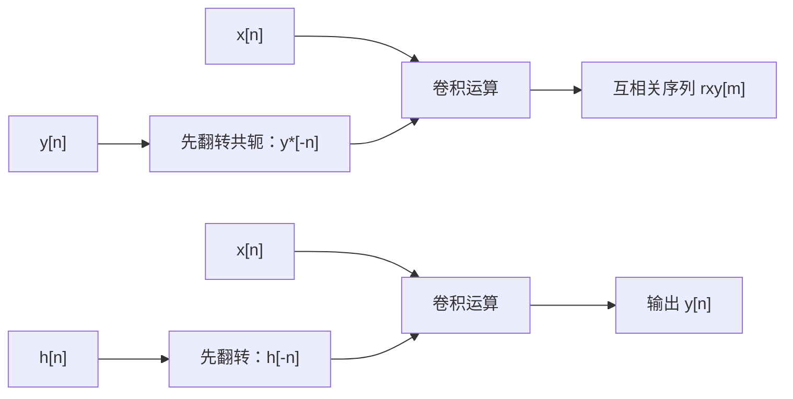

# 自相关函数与互相关函数

**标签：** #数字信号处理 #DSP #自相关 #互相关 #时延估计 #相关分析

---

## 一、为什么需要相关函数？

在信号处理中，我们常常想知道：

- 信号在不同时刻之间有没有关系？
- 两个不同的信号之间有没有关联？
- 信号中是否隐藏着周期成分？
- 如何从噪声中检测出已知信号？

**相关函数**就是用来回答这些问题的工具——它衡量信号之间（或信号与自身）在不同延迟下的相似程度。

一个直观的例子：把一段录音和它自己延迟 0.1 秒的版本对齐，如果两边波形"长得像"，乘积再求和就很大；如果完全不像，正负相消，求和接近零。**"延迟 + 相乘 + 求和"** 就是相关运算的全部内容。

---

## 二、基本定义

### 1. 自相关函数（Autocorrelation Function）

衡量**同一个信号**在不同时刻的相关性。

#### 确定性信号（能量型）

$$
r_{xx}[m] = \sum_{n=-\infty}^{\infty} x[n] \, x^*[n-m]
$$

#### 随机信号（宽平稳）

$$
r_{xx}[m] = E\left[x[n] \, x^*[n-m]\right]
$$

#### 实际计算（各态历经假设）

$$
r_{xx}[m] = \lim_{N \to \infty} \frac{1}{2N+1} \sum_{n=-N}^{N} x[n] \, x^*[n-m]
$$

> **两种归一化不要混用**：
> - 不除以长度（上面前两式）得到的是**相关序列**，$r_{xx}[0]$ 等于信号**能量**；
> - 除以长度（第三式）得到的是**平均相关**，$r_{xx}[0]$ 等于信号**平均功率**，量纲和平稳性都更好，功率谱分析中通常用这一种。
>
> 本文涉及周期信号、白噪声时（例题 2、3、4）用的都是**平均相关**。

---

### 2. 互相关函数（Cross-Correlation Function）

衡量**两个不同信号**之间的相关性。

#### 定义式

$$
r_{xy}[m] = \sum_{n=-\infty}^{\infty} x[n] \, y^*[n-m]
$$

或等价地（把 $n$ 换成 $n+m$ 再重新标号）：

$$
r_{xy}[m] = \sum_{n=-\infty}^{\infty} x[n+m] \, y^*[n]
$$

#### 随机信号

$$
r_{xy}[m] = E\left[x[n] \, y^*[n-m]\right]
$$

> **顺序有讲究**：$r_{xy}[m]$ 和 $r_{yx}[m]$ 在一般情况下不相等，两者满足 $r_{xy}[m] = r_{yx}^*[-m]$。所以写互相关时必须交代"谁在前、谁在后"。

---

## 三、物理意义

| 情况 | 含义 |
|------|------|
| 自相关 $r_{xx}[0]$ | 信号的能量（确定性）或平均功率（随机） |
| 自相关 $m \neq 0$ | 信号与延迟后自身的相似度 |
| 互相关 $r_{xy}[m]$ | 信号 $x$ 延迟 $m$ 后与信号 $y$ 的相似度 |
| $r_{xy}[m]$ 峰值位置 | 两信号之间的时延估计 |

---

## 四、主要性质对比

### 1. 对称性

| 类型 | 性质 |
|------|------|
| 自相关（一般信号） | $r_{xx}[-m] = r_{xx}^*[m]$ |
| 自相关（实信号） | $r_{xx}[-m] = r_{xx}[m]$（偶函数） |
| 互相关 | $r_{xy}[-m] = r_{yx}^*[m]$ |
| 互相关（实信号） | $r_{xy}[-m] = r_{yx}[m]$ |

**为什么自相关是偶函数（共轭对称）？** 推导只需三步，做一遍就再也不会忘：

$$
r_{xx}[-m] = \sum_n x[n] \, x^*[n+m] \overset{k = n+m}{=} \sum_k x[k-m] \, x^*[k] = \left( \sum_k x[k] \, x^*[k-m] \right)^{\!*} = r_{xx}^*[m]
$$

最后一步交换了求和顺序并取共轭。对**实信号**，$x^* = x$，共轭消失，于是 $r_{xx}[-m] = r_{xx}[m]$，是真正的偶函数。

### 2. 最大值位置

- **自相关**：在 $m=0$ 处取最大值

$$
\lvert r_{xx}[m] \rvert \leq r_{xx}[0], \quad \forall m
$$

这个不等式就是**柯西-施瓦茨不等式**：把 $x[n]$ 和 $x[n-m]$ 看成两个向量，内积的模不超过模长之积，而 $r_{xx}[0]$ 正好是两个模长平方之积的开方。

- **互相关**：最大值位置反映两信号的相对时延

$$
\lvert r_{xy}[m] \rvert \leq \sqrt{r_{xx}[0] \, r_{yy}[0]}
$$

注意这里右端是**两个信号各自**零点值乘积的开方，所以 $\lvert r_{xy}[m] \rvert \leq 1$ 只有在两个信号都做了归一化（$r_{xx}[0] = r_{yy}[0] = 1$）时才成立——这就是工程上常用的**归一化互相关**。

### 3. 周期性与相关性

- 若 $x[n]$ 是周期信号，则 $r_{xx}[m]$ 也是同周期的周期信号
- 若 $x[n]$ 和 $y[n]$ 不相关（如信号与独立噪声），则 $r_{xy}[m] = 0$（对随机信号取期望）

### 4. 与卷积的关系

- 自相关：$r_{xx}[m] = x[m] * x^*[-m]$
- 互相关：$r_{xy}[m] = x[m] * y^*[-m]$

也就是说：**相关 = 不翻转的那个信号 与 翻转共轭后的另一个信号 做卷积**。这正是"卷积要翻转、相关不翻转"这句话的来源。

对比可见：**两者都要翻转一个信号**，区别只在"翻转的是哪一个、要不要额外取共轭"。

### 5. 直流分量的影响

若信号含直流分量 $x[n] = \bar{x} + \tilde{x}[n]$（$\tilde{x}$ 为零均值波动部分），则

$$
r_{xx}[m] = \bar{x}^2 + r_{\tilde{x}\tilde{x}}[m]
$$

即**自相关里被叠加了一个常数 $\bar{x}^2$**，而这一项对 $m$ 不衰减。后果：

- 相关图整体被抬高，非零延迟的峰不再趋近于零；
- 看起来"像"长相关，容易误判为周期性。

**工程做法**：算自相关前**先去均值**（减去 $\bar{x}$），否则谱估计在 $\omega = 0$ 处会出现虚假尖峰。这一点在功率谱密度估计中尤其重要。

---

## 五、典型例题

### 例题1：单位脉冲的自相关

$x[n] = \delta[n]$

**解**：

$$
r_{xx}[m] = \sum_{n=-\infty}^{\infty} \delta[n] \, \delta[n-m] =
\begin{cases}
1, & m=0 \\
0, & m \neq 0
\end{cases}
$$

→ 只有零延迟处有值，说明信号只在同一时刻与自己完全相关。

---

### 例题2：正弦序列的自相关

$x[n] = \sin(\omega_0 n)$（取平均相关）

**解**：利用积化和差 $\sin A \sin B = \frac{1}{2}[\cos(A-B) - \cos(A+B)]$：

$$
r_{xx}[m] = \frac{1}{2} \cos(\omega_0 m) - \underbrace{\lim_{N\to\infty} \frac{1}{2N+1} \sum_{n=-N}^{N} \frac{1}{2}\cos(2\omega_0 n - \omega_0 m)}_{\text{对 } n \text{ 取平均 } \to \, 0}
$$

第一项与 $n$ 无关，直接留下；第二项以 $2\omega_0$ 振荡，长平均后为零。故

$$
r_{xx}[m] = \frac{1}{2} \cos(\omega_0 m)
$$

→ 自相关保留了原信号的频率 $\omega_0$，但丢失了相位信息。**相位丢失正是自相关的价值所在**：正因为与相位无关，它才特别适合从噪声里"捞"出周期成分。

---

### 例题3：白噪声的自相关

$x[n]$ 为零均值白噪声，方差 $\sigma^2$

**解**：

$$
r_{xx}[m] =
\begin{cases}
\sigma^2, & m=0 \\
0, & m \neq 0
\end{cases}
$$

→ 白噪声在不同时刻互不相关。"白"这个字就是由此而来：自相关是冲激，其频谱在所有频率上均等（见 [[【数字信号处理DSP】（五）维纳-辛钦定理（Wiener-Khinchin Theorem）|（五）维纳-辛钦定理]]）。

---

### 例题4：两个不同频率正弦的互相关

$x[n] = \sin(\omega_1 n)$，$y[n] = \sin(\omega_2 n)$，$\omega_1 \neq \omega_2$

**解**：

$$
r_{xy}[m] = \lim_{N \to \infty} \frac{1}{2N+1} \sum_{n=-N}^{N} \sin(\omega_1 n) \sin(\omega_2 (n-m)) = 0
$$

→ 不同频率的正弦信号互不相关。**这是频分复用、正交调制（IQ 调制）能工作的根本原因。**

---

### 例题5：信号与延迟版本的互相关（时延估计）

$x[n]$ 为某信号，$y[n] = x[n - n_0] + w[n]$（$w[n]$ 为与 $x$ 不相关的噪声）

**解**：

$$
r_{xy}[m] = r_{xx}[m - n_0] + r_{xw}[m]
$$

由于信号与噪声不相关，$r_{xw}[m] \approx 0$，因此：

$$
r_{xy}[m] \approx r_{xx}[m - n_0]
$$

→ $r_{xy}[m]$ 的峰值出现在 $m = n_0$ 处，可用于**时延估计**。

**为什么噪声不影响峰值位置？** 因为噪声与信号不相关，它只把相关曲线"垫高"一层（方差），不改变峰的位置。这就是相关法能从强噪声中提取时延的原因——**它不是把噪声滤掉，而是让噪声平均掉**。

---

### 例题6：有限长序列的自相关（手算）

$x[n] = \{1, 2, 3\}$，$n = 0, 1, 2$，求 $r_{xx}[m]$

**解**：用定义 $r_{xx}[m] = \sum_n x[n]\,x[n-m]$ 逐点算，非零区间为 $\lvert m \rvert \leq 2$：

| $m$ | 配对相乘 | $r_{xx}[m]$ |
|------|----------|-------------|
| $-2$ | $x[2]x[0] = 3\times1$ | $3$ |
| $-1$ | $x[1]x[0] + x[2]x[1] = 2 + 6$ | $8$ |
| $0$ | $1+4+9$ | $14$ |
| $1$ | $x[1]x[2] + x[0]x[1] = 6 + 2$ | $8$ |
| $2$ | $x[0]x[2] = 1\times3$ | $3$ |

即

$$
r_{xx}[m] = \{3, 8, 14, 8, 3\}, \quad m = -2, -1, 0, 1, 2
$$

→ 结果关于 $m=0$ 对称（偶函数，验证了性质 1）；峰值 $14 = 1^2+2^2+3^2$ 恰好等于序列能量（验证了 $r_{xx}[0]$ 的物理意义）；长度是 $2L-1 = 5$，与卷积的长度规则一致——因为自相关本质上就是卷积。

---

## 六、自相关 vs 互相关 对比表

| 对比项 | 自相关 | 互相关 |
|-------|--------|--------|
| 比较对象 | 信号与自身 | 两个不同信号 |
| 定义 | $r_{xx}[m] = \sum_n x[n] x^*[n-m]$ | $r_{xy}[m] = \sum_n x[n] y^*[n-m]$ |
| 对称性 | 共轭偶对称（实信号为偶函数） | $r_{xy}[-m] = r_{yx}^*[m]$ |
| 零点值 | 能量或平均功率 | 无特殊物理意义 |
| 最大值位置 | 始终在 $m=0$ | 反映两信号时延 |
| 周期信号 | 保留周期，丢失相位 | 保留共同周期成分 |
| 结果长度 | $2L-1$（长度 $L$ 的序列） | $L_x + L_y - 1$ |
| 计算本质 | $x[m] * x^*[-m]$ | $x[m] * y^*[-m]$ |

---

## 七、应用场景

### 自相关的应用

1. **周期检测**：从噪声中提取微弱周期信号（相关值在周期倍数处再次出现峰）
2. **功率谱估计**：通过维纳-辛钦定理，自相关的傅里叶变换 = 功率谱密度
3. **语音处理**：基音周期检测（浊音的基音周期对应自相关的第二个峰）
4. **随机信号分析**：判断信号是否为白噪声（自相关是否为冲激）

### 互相关的应用

1. **时延估计**：雷达、声呐、超声检测
2. **系统辨识**：通过输入输出互相关求系统冲激响应（白噪声激励时 $r_{xy}[m] = \sigma^2 h[m]$）
3. **信号匹配/模板匹配**：在接收信号中寻找已知信号（匹配滤波器）
4. **通信同步**：帧同步、码元同步

---

## 八、常见错误提醒

1. **自相关和互相关搞错顺序**：$r_{xy}[m] \neq r_{yx}[m]$，只满足 $r_{xy}[m] = r_{yx}^*[-m]$。写的时候先说清楚谁在前。
2. **忘了自相关的对称性**：算出 $r_{xx}[m]$ 后应检查是否满足 $r_{xx}[-m] = r_{xx}^*[m]$，这是最快的自查手段。
3. **把 $r_{xx}[0]$ 当作能量还是功率说不清**：取决于是否除以长度，两种归一化不能混用。
4. **以为相关就是卷积**：相关**不翻转**被比较的那个信号（等价于翻转另一个），且互相关要取共轭。顺序共轭弄错，峰值位置会从 $+n_0$ 跑到 $-n_0$。
5. **不去均值就算自相关**：直流分量会让自相关整体抬高常数 $\bar{x}^2$，容易误判成周期性。**先减均值再算**。
6. **以为相关能去除噪声**：相关是把噪声**平均掉**（不相关部分趋于零），需要足够长的数据；短数据上噪声会让峰变毛糙。
7. **周期信号的自相关用"不除以长度"的定义**：$\sum_n x[n]x[n-m]$ 对周期信号发散。周期信号必须用**平均相关**。

---

## 九、知识链定位

自相关与互相关（本节）

│

├── 定义：延迟、相乘、求和（取期望 / 取长平均）

├── 对称性：共轭偶对称 r_xx[-m] = r_xx*[m]

├── 峰值：零点取最大（柯西-施瓦茨）

└── 与卷积：r_xx[m] = x[m] * x*[-m]

│

├── 能量信号与功率信号：r_xx[0] 的能量/功率含义（第三节）

├── 维纳-辛钦定理：自相关的 DTFT = 功率谱（第五节）

├── 功率谱密度：相关法与周期图法（第六节）

├── 卷积和：相关的计算本质（第七节）

├── 模拟频率与数字频率：相关峰的时延换算（第十节）

└── 系统函数 H(z)：相关序列的 Z 变换（后续章节）

---

## 十、总结

| 要点 | 自相关 | 互相关 |
|------|--------|--------|
| 一句话 | 信号与自己的相似度 | 两个信号的相似度 |
| 零点值 | 能量 / 平均功率 | 无特殊含义 |
| 对称性 | 共轭偶对称 | $r_{xy}[-m] = r_{yx}^*[m]$ |
| 峰值位置 | 恒在 $m = 0$ | 等于两信号时延 |
| 与卷积 | $x[m] * x^*[-m]$ | $x[m] * y^*[-m]$ |

> **一句话总结**：相关函数用"延迟—相乘—求和"衡量相似度，自相关告诉我们信号自身有多"黏"（有多周期性），互相关告诉我们两个信号差了多少——它是从噪声中提取时延和周期的最基本工具。
